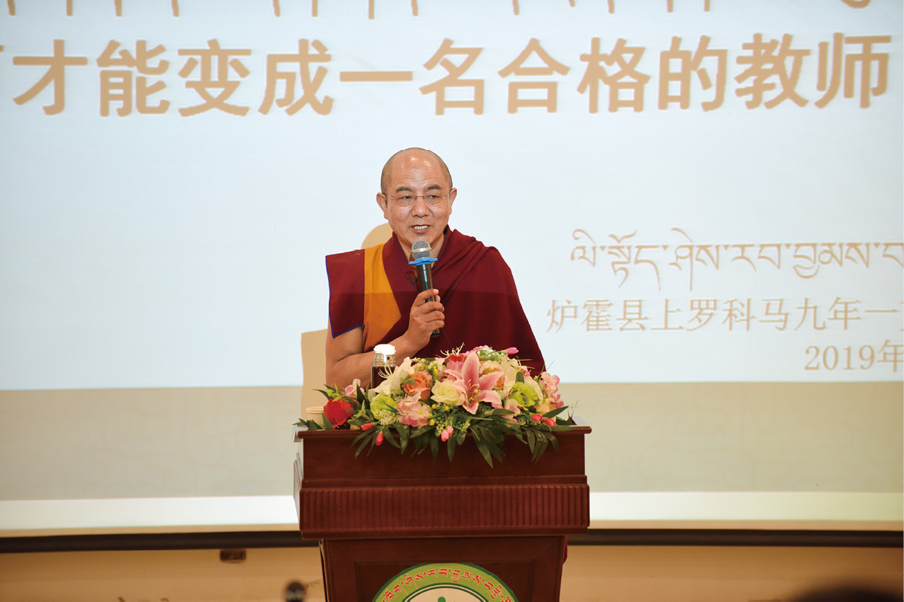
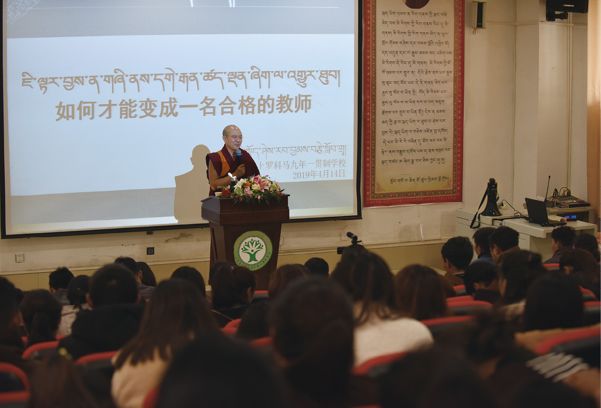
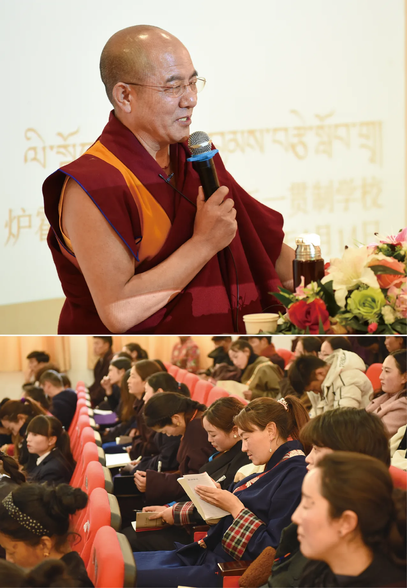
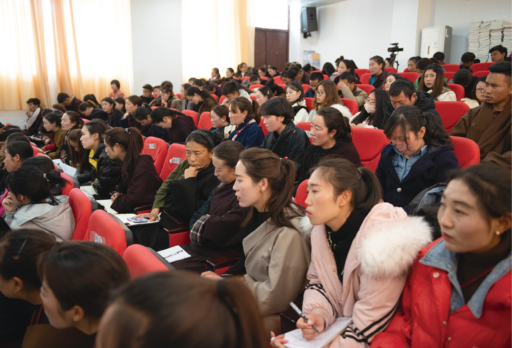

# 如何才能成为 一名合格的教师

——上罗科玛小学全体教师会议

2019年4月14日

今天我们利用这个时间，与大家进行一次简单的交流。刚才，前面几位老师分别从学校管理、德育等层面，针对好和不好的方面，提出了宝贵的建议。我们的校长也就未来的发展方向，给老师们提出了一些建议，并对以往的工作进行了全面总结。

我今天其实没有做特别的准备，但借此机会，我还是想和大家分享一些想法。前段时间我本来计划与大家交流，但因为学校这边有一些事情，当天校长没有时间，而这边的老师在星期天也难以联系，所以当时未能有所安排。

后来，前两天我去了下罗科玛学校，与那里的老师们进行了交流。昨天，我又与朵芒寺佛学院的僧人们做了一些交流。今天，我想和在座的老师们谈些什么呢？其实刚才几位老师已经提到了一些内容。

## 对教师队伍过于年轻表示担心

在座的各位老师大多非常年轻、漂亮、朝气蓬勃，充满无限的力量。然而，作为老师，年轻也会带来一些困难和挑战。这是不可避免的，也是我们当前教育的现实状况。

那么，年轻的优势是什么呢？年轻老师对新时代的接受能力非常强。与年龄较大的老师相比，二十来岁的年轻教师在认知新事物方面，展现出更强的适应能力和活力，尤其是在当今人工智能蓬勃发展、信息极其发达的时代。年轻老师作为这个时代的人，无论是对最新的知识、人们的心态，还是对当代社会的各种现象，都掌握得较为全面。这些都是年轻老师的优势。

相比之下，年纪较大的那一代老师，也许比年轻老师更有爱心，对教育更有热忱和热爱，但他们对当今时代的特点和技术可能了解不多。大家都知道，一些年长的老师在使用手机、电脑等电子设备时，往往会感到非常困难。而年轻的教师们则对新产品的使用了如指掌，对新时代的新名词通达无碍，同时对当前社会关注的各种现象也有一定的了解。

正如刚才一些老师所讲，年轻老师确实有阳光和积极的一面，也具备许多难以想象的优点，这一点我们应当予以肯定。不过，另一方面，教师队伍过于年轻也会带来一些问题。如果一位教师的家庭、事业或者人生目标还没有稳定下来，他的心思自然难以完全投入到教书育人的工作中。此外，由于年龄较轻，一些年轻老师在教学经验方面仍显不足。

那天，我们与中学的副校长商量时谈到，上罗科玛小学的80多位教师，平均年龄大约在24至26岁。今天我们进一步了解到，上罗科玛中学的教师平均年龄为25岁。这样的情况确实让我有些担心，为什么呢？因为不管是中学生还是小学生，我们许多学生的年龄都比较大，而作为老师，无论在知识、文化、做人还是素质等方面，都需要具备一定的成熟度。如果老师缺乏这种成熟，可能会对教学效果产生一定的影响。

目前，我们上罗科玛小学约有1000名学生，中学约有850名学生，下罗科玛那边大约有360名学生，加上其他教职人员，我们师生的总人数接近2500人。整体来看，我们管理团队的年龄确实偏小。如果教师自身的思想、智慧及能力尚未稳定和成熟，要教育和管理如此庞大的群体确实非常困难。

当然，管理团队年龄偏小的情况，并不仅仅存在于我们学校，现在社会上的各行各业，基本上也都是如此。那天我和一位领导交谈时提到，我对我们教师队伍过于年轻有些担心。他表示，其实现在无论是公务员、医生还是企业家等各行各业，整体年龄都比较年轻，与我们教师的队伍几乎不相上下，这是当今社会的普遍现象。

在我的印象中，无论是中学还是小学，我遇到的老师年龄都比较大，这也许与我当时年纪尚小有关。如果当年我遇到一位二十多岁的老师，我不一定会对他服从。然而，如今我们的教师队伍已经趋于年轻化。这种变化有其积极的一面。正如我刚才所说，这个时代确实掌握在在座的年轻老师手中。而且，一些年轻老师较为早熟，不管是对世间知识、未来趋势的预测，还是其他领域的知识，他们都掌握得比较全面，这是好的方面。不好的方面，我刚才也说了，我们的教师团队在教学经验方面有所不足。

我今天要讲的第一件事情，就是我比较担心的方面。担心什么呢？由于我们许多老师比较年轻，他们可能因缺乏经验而难以很好地教育学生。这是我今天讲话的第一个重点：比较担心。我今天的讲话内容有几个重点，每个重点都可以起一个小标题，第一个重点的小标题就是“比较担心”——不是特别担心，是比较担心。如果你们必须记下今天的重点，第一个题目就是“比较担心”。

我今天可能会先谈一些让我比较担心、伤心的事情，然后才说一些让我感到高兴的内容。有一位老师知道我今天下午将与大家讲话，他对我说：“你平时演讲的时候，总是先赞赏后批评，你今天是不是又想批评什么？”我回答说：“我没有这个意思，我也不是每次讲话都是先赞叹后批评，并不是这样的。”无论如何，今天我决定先讲一些不好的方面，也是我比较担心的方面。担心什么呢？我们的老师们确实太年轻了！

现在的年轻老师比较开心，开心什么呢？因为你们确实擅长掌握当下流行的娱乐方式，比如玩电子游戏，去KTV或卡拉OK，或者去各种令人眼花缭乱的娱乐场所。你们去这些场合享受生活，所以比较开心。但从另一个角度来看，也比较令人担心。这是我想讲的第一件事情：比较担心。为什么担心呢？因为你们太年轻了，去那些五光十色的场所，让我有点“嫉妒”。（众笑）

## 对学校成绩下堕表示伤心

第二件事情的小题目是“比较伤心”。我今早大约七点来到这里，去中学部看了一下，当时只有四位女生在教室里看书，其他学生都还在睡觉。直到八点左右，教室里看书、复习的人数都比较少。我知道今天是星期天，老师们有的去了县城，有的回了家，毕竟难得有一个休息日，这种情况可以理解。我也和学生们交流了一下，他们说许多同学可能已经回家，所以没有在学校读书。

我问他们：“你们距离毕业还有多少天？”他们回答说，刚好还有60天。对于现在的社会教育状况，我真的不太了解，我们中学大概有六个毕业班，共约两百多名学生，现在距离毕业仅剩60天，但这些学生心里似乎都没有太多紧迫感。不管是毕业班还是其他班级的学生，大家读书和学习氛围确实与以往有所不同。这一点让我感到比较伤心。

按理来说，无论是中学还是小学，我们学校都应该有一个良好的学习氛围。虽然今天是星期天，我这次短暂的观察未必能够反映事实，但总的来说，现在学校的学习气氛确实不如刚建立时那样浓厚。

当时，中学部尚在兴建之中，我们借用了附近一所乡镇卫生院的房屋作为临时校舍。以前我路过那边时，无论是不是星期天，里面看书、复习的学生都比较多，大家对学习都有一种新鲜感。当然，仅凭今天看到的一两件事情来推断整体情况，从逻辑学的角度来看并不十分严谨，但我确实认为，现在我们学生整体的学习兴趣不如以前。

刚才几位老师也提到，从中学毕业生的考试成绩来看，我们第一批学生的成绩非常优秀，第二批成绩一般，之后成绩就越来越差了。我们现在的成绩在全州范围内，已经从原来的第一、第二名逐渐下滑。目前，世界经济也处于下行、下滑阶段，这种情况与我们的成绩有些相似。但实际上，我们现在的成绩用“下堕”来形容可能更为合适，“下堕”与“下行”、“下滑”还是有一定区别。

对于这一点，各位老师需要认真审视问题所在，并且不断反思。如果我们不及时反思，学校的公考成绩很可能会继续下滑，最终在全州的排名中沦为倒数第二、倒数第一。到那时候，就再也没有下堕的空间了，就像第八层无间地狱一样，已经是最底层了。刚才也有一位老师用了相同的比喻。

当然，我今天所看到的也许只是局部现象，但我不禁担忧，我们的成绩是不是正在下行，甚至下堕？这一点让我感到比较伤心。也许事实并非如此，我也希望事实不是这样。无论如何，希望各位老师能够反思、调整。这是我想表达的第二件事情。

## 比较关心教师的心态

第三件事情的小题目是“比较关心”，也就是我关心的方面。关心什么呢？关心我们老师的心态。关于教师们的心态，我个人有一些分析，大致可以分为几类。就像我们平时观察血型一样，有人是B型，有人是A型，老师们的心态也可以分为不同的类型。我希望各位老师在听我介绍这些心态类型时，能够对照自身，反思并确认自己属于哪一类教师。

第一类，是那些一心一意为教育事业做贡献的老师。这类老师对教学事业怀有极大的热爱，对孩子们充满深切的关爱，并且始终把教书育人视为自己的终身目标。

第二类，是那些不热爱这个职业但又别无选择的老师。这类老师在社会中难以获得其他工作机会，比如说在企业的入职考试中，他们始终无法通过。虽然如此，他们还是勉强考上了教师岗位。如果不当教师，他们在生存和生活等方面都可能有一定困难。这类老师其实并不热爱这份职业，一直想要离开，但由于自身条件所限，只能无奈地留在教师岗位上，以混日子的心态度日。

第三类，是那些强烈渴望在社会中获得一定地位和权力的老师，他们不愿意长期留在教师岗位上。以前我们有些老师也是这样，他们很想成为官员或者公务员。由于种种原因，这类老师不一定能够成为高级官员，但他们会努力争取成为一般的乡村干部、普通干部，或者追求相对较高的社会地位。这类老师对身份和地位有很强的执著，每天都在为提升自己的地位而苦恼。

第四类，是那些强烈渴望获得钱财的老师。对他们来说，教书育人只是口头上的说法，实际上他们一直非常渴望赚钱，很想从事商业活动。这类老师认为，只要拥有了财富，一切美好都会随之而来。因此，他们日夜都在想着如何赚钱，甚至在梦中也幻想财源滚滚而来。他们对教育工作缺乏热情，内心真正追求的始终是财富。

第五类，是那些对一切都无所谓、缺乏积极心态的老师。这类老师对自己的职业和未来没有任何规划。他们认为，既然现在已经当上了老师，那就过一天算一天，抱着“当一天和尚撞一天钟”的心态度日。这类老师凡事得过且过，在浑浑噩噩中过日子，既没有上进心，也缺乏教导学生的热情和责任感。

第六类，是那些虽然自身能力有限，但真心希望能够为教育事业、为孩子们贡献一份力量的老师。这类老师常常感到担忧，原因主要包括三个方面：一是自身的智慧不足，二是年纪尚轻，缺乏足够的经验，三是各方面的协调能力有所欠缺。

正如刚才有老师提到，目前我们学校大约有70%的教师专业不对口。这种情况在国外几乎是不可想象的，甚至会被视为天大的笑话，因为国外根本不允许专业不对口的现象发生。特别是在一些高度法治化的国家，如果你想成为医生，你必须具备医学专业背景；如果你想成为老师，你必须是教育专业出身，毕业于师范学校，否则你不能担任教师职位。

而在我们这里，情况则完全不同。其他专业背景的人可以轻易成为老师，甚至有些人可以今天当老师，明天当公务员，后天当医生。现在，一些原本是学医的或其他专业的人，也可以立即转行成为老师，职业身份就这样变来变去。这种情况在我们的社会非常普遍，已经成为一种社会现象，而我们也很难去改变这种社会形势。

刚才我分析了六类老师的心态，在座的各位可以结合自身情况，看看自己属于哪一类。我并不要求大家举手表态，因为有些人可能不敢举手，他们不愿意公开承认自己属于经济类、权力地位类或者浑浑噩噩类。当然，也有可能你是一心为教育事业做贡献的那一类。不管怎样，你们都应扪心自问，诚实地审视自己。

如果真的有机会让大家公开表态，也许在座的各位中，会有一定比例的人其实并不愿意从事教师这个职业。造成这种情况的原因，与社会环境有很大关系。在某些地方，教师的待遇相当较高，薪资较为优厚，教师在一些人心目中也是至高无上、非常伟大的。在这样的社会背景下，有些人会认为，成为一名教师是一件非常光荣和伟大的事情，同时也能赢得他人的赞叹和羡慕。

事实上，不管是从待遇还是社会认可度来看，教师这个职业都算是相当不错的。公务员的工作其实非常辛苦，但在很多人看来，公务员在某种意义上更受人羡慕。如果我今天在这里说：“现在有机会让大家成为公务员，不用再教书”，恐怕大多数老师都会选择这条路，这种可能性很大。这也是一种社会现象。

我希望大家能够思考一下，自己属于哪一类老师。如果你们并不热爱教书，也不喜爱学生，仅仅是为了生存和工作而被迫留在教师岗位上，那么我们的教育事业要想更上一层楼确实非常困难。目前，大家在经验、年龄以及许多知识和能力方面，其实都还不够完善。现在，中学和小学的课程比以前难得多，学习和教学的难度都在增加，这让教师的工作变得更加困难。

在这样的环境下，如果老师本身对教育缺乏兴趣，只是为了几千元的工资而留在这里，那么在面对学校的各种规定、要求和制度时，肯定会天天感到心烦意乱。有些教师仅仅是为了生存而成为教师，他们对教育事业并不热爱，所以在接受领导和组长的管理时，很容易感到厌烦。因此，我希望各位教师能够认真反思自己的心态。

我今天与大家探讨一些问题，其实更多是为了表达我的期望。这里的堪布、校长和校领导，并不是以高高在上的姿态对大家提出要求或规定。我们应该心平气和，以平等的姿态相互交流和分享：当前的社会状况如何，我们的心态是怎样的，我们面临哪些困难，以及我们应该以什么样的方式来对待这些问题。

今天，我们特别邀请了下罗科玛学校的几位校领导参加我们的会议。我们上、下罗科玛学校共有两千多名学生，而在座的各位正是他们的带领者，是他们的老师，也是他们的“父母”。因此，我对大家的心态都比较关心。

对于大家的心态，我真的不太清楚。如果真的有一种测试工具或者问卷，让大家对照我刚才提到的六种心态，凭着良心去填写，不知道你们会如何作答？在座的教师中，分别会有多少人选择“我想赚钱”“我想获得地位”“我对一切都无所谓”“我真心希望把孩子教好”？我并不清楚你们的答案是什么，但你们自己应该心中有数，对吧？

我想，这里几位志愿者老师的心态应该是比较纯真的，但他们在我们学校毕竟是少数。这些话我是凭着良心说的。我刚才已向校长建议，今后如果各方面条件允许，学校应当为那些特别优秀的志愿者老师提供一些发展平台。我希望其他老师不要因此而产生反感，不要觉得这些志愿者老师过于积极、能说会道或者表现得太突出，甚至认为他们影响了自己的休息时间。我们不能因为有上进心的人出现，就逐一将他们打压下去。大家应该清楚，这样的做法已经不合时宜。

今天我想提出的第三个问题，就是我比较关心的教师心态问题。希望大家能够认真思考，如果将来真的有机会填写一份问卷，你们是否真心希望投身于教育事业？

## 教师不应经常擅自离岗

第四个问题，刚才也略有提及，如果我们的心态确实不是以帮助孩子为出发点，那么选择不当老师也许会更好一些。当然，即使你选择离开，后来接替你的人也有可能更不合适，这是有可能的。

老师的作用非常两极，正如刚才一位老师所说，当老师站上讲台，如果能够把课讲好，教师这个职业便显得极为神圣、纯洁和崇高；但如果讲课讲得不好，课堂秩序也管不好，教师这个岗位就会成为一个极为危险的平台。这一点我们以前也讨论过。

我并不是什么有智慧的人，尤其是在这个学校里，有许多学识渊博的老师，因此我更清楚自己称不上有智慧，也不会假装自己很有智慧。在其他学校或者地方，我也许还稍微好一些。但在这里，我对很多事情都需要再三思考，即使经过深思熟虑，我最终能付诸行动的也只有一半。此外，我对很多事情的接受和记忆能力也有限，不过有时这样的状态还是可以接受。

这里的领导和部分老师比较关心我们的传统和传承，对于学校的历史渊源及其前前后后的发展过程，他们都比较了解。然而，这里也有一些老师有喜新厌旧的倾向，这从他们的人品和人格可以看得出来。

我们藏族有一句谚语：“五个指头各有长短。”这里的每一位老师都各不相同。经过长期接触，我发现有些老师虽然表面上看起来还不错，但他们实际上为教育事业付出了多少努力，大家心知肚明。对于学校的情况，无论是小学还是中学，我都比较了解。事实上，我对大家的一些行为感到反感。对于学校的领导层，我有一些意见，这就是我今天想说的第四个问题。

我有什么意见呢？刚才校领导自己也有提到，他们还是有一定的愧疚感。我要在此提出的是，学校里的个别领导经常不在学校。我一直对此比较关注，并通过各种不同的方式去了解，发现这一现象确实存在。作为一名教师，作为一位学校的领导，从职责的角度来说，你们应该专注于学校的事务。

今天，下罗科玛学校的一些领导班子也在场，我对他们的管理方式比较满意，他们在管理上比较细致，对学校的事务也比较关心。为什么上罗科玛这边有时会出现一些事故呢？虽然并不是完全有关，但与这里的校领导有直接关系。这是我今天需要明确指出的一点。

前一段时间，我听说这里有一位老师提到：“如果学校的管理继续如此，堪布的这个学校将会垮掉。”事实上，这位老师说错了，这并不是我的学校，而是政府的学校。此外，我也特意去了解了一下，发现我们早前提出的建议，这里的领导们基本上都没有去执行。

当然，从整体来看，我们学校目前的运行尚算顺利，没有出现大的问题。但是，如果我们没有在最重要的学习和管理方面采取一系列行之有效的措施，我个人将会对教育事业失去兴趣，也许在座的各位老师同样会失去兴趣。

如果我们的许多行为确实因为个人能力有限而无能为力，我们也问心无愧。无论在小学部还是中学部，这里的部分老师确实非常积极，刚才我们也点名表扬了他们。我们并不是特意要赞叹这些老师，但他们的表现的确是全校老师有目共睹的。

各位老师平时一起工作和生活，虽然我不住在这边，但我住的地方距离这里只有一个小时的车程。在信息如此发达的时代，加上我一直非常关心学校的情况，对于这里的老师，哪些是真正认真教学，哪些只是按学校规定应付工作、只求不被开除，哪些是完全敷衍了事，到了我们这个年龄，心里都是非常清楚的。

作为学校的领导，首先应当真正做到经常关心学生的实际情况，而不仅仅是经常开会或制定纪律就可以。真正优秀的教师在课堂上会严格要求学生，保持一定的庄重与威严；而在课下，他们能够走进学生的内心世界，融入学生的日常生活。这样的老师和领导，才是真正卓越的。

如果学校里的各级领导，包括校长、副校长、教导主任、德育课主任、系主任以及班主任等，心思都不在教育上，我们将会对这里众多孩子的成长造成极大的危害，那将是多么严重的罪过？这是我一直在思考的问题，也是我今天之所以说这些话的原因。我的言辞也许有些严厉，也许说到了痛处。虽然目前学校还没有出现特别严重的问题，但如果我们现在不去正视并切实抓好教育工作，那我们什么时候才能真正去帮助这些孩子及其家庭？

我发现，这里有许多老师经常不在学校，原因是什么？这是我今天要提出的问题。我理解，作为教师，你们有时候需要参加培训，有时候需要出席会议，但不可能总是如此吧？这些情况不可能成为经常不在学校的理由。

每逢星期天，除了个别需要补课的老师外，其他老师都可以回家处理自己的事情。此外，与其他公务员、医生等职业不同，教师每年在夏天和冬天分别都有两个多月的假期，在此期间，老师们的工资始终照常发放。然而，这里一些老师却不顾时机，在非假期的时候频繁请假，今天某位班主任请假，明天某位领导请假，这导致学生经常缺课，也使学校管理长期缺乏领导角色。

在请假的过程中，那些有能力、有关系的老师可以随意离开岗位，而没有能力、没有关系的老师则没有这样的便利。我听说其他一些学校和地方同样存在类似的情况，许多人都是通过搞关系来请假。

如果这些情况持续下去，我们学校一些原本对教育事业有兴趣的人，可能会逐渐失去热情，变得不再关心。这样发展下去，我认为学校的前景并不乐观。因此，我们今天与大家共同交流，就是希望在座的每一位老师，尤其是学校的管理层，都能够再三思考自己的职责。

我们学校之所以请来一些志愿者老师，也是有其原因的。志愿者老师提出的一些建议和意见，值得我们高度重视。这些建议也许正是这里很多老师期待看到、期待听到的改变，但我们却没有真正去落实。正如社会上的一些会议，会上发言非常漂亮，文字表述得体，但会后却没有付诸行动，会议内容犹如龟毛兔角，毫无踪影。同样，虽然我们在开会时可以提出问题，也可以制定方案，但会后大家有没有跟踪进展、有没有把会议内容落实完成，大家应该心中有数。

我今天提出这些想法，并不是针对某一个人进行批评，而是希望我们内部能够反思和改进。无论是通过电话还是当面沟通，我私下也和学校的领导、个别班主任以及我认识的一些老师表达过这些想法。我会持续关注今天我们所谈到的问题，因为我并不是那种只在开会时把话说得清楚、会议后就什么都不管的人。

上、下罗科玛学校最初只有几十名学生，我们想尽一切办法来延续学校的发展。然而，到了今天，整个教学质量正处于下滑的阶段。这是为什么呢？可能是因为在座的许多人，要么逐渐变成了“老油条”，要么受到了其他因素的影响。这些因素需要我们认真去寻找。

如果我们只是互相赞叹、互相赞美，那没有什么意义，最终受害的还是这些年轻的学生。他们一直在期待着我们能够带给他们真正的知识和成长。如果大家实在对教育事业没有兴趣、实在不愿意继续当教师，我确实希望大家能够坦诚地表达出来。这样一来，我们或许能够减少对学生的危害。

在座的各位大多是藏族人，作为藏族人，我们经常讲“业因果”，对吧？这些孩子已经把自己的未来寄托到我们身上。我们每一位老师基本上都承担着一两百名学生的教育责任，这些学生能否学得好，或许与老师个人的素质、教学方法或其他因素有关，但最主要的是我们要关心学生。我们每个人对这些学生的成长和未来都负有不可推卸的责任。

这是我今天要说的第四件事情。现在学校的教育质量正处于下滑的状态，这到底是为什么呢？各位必须对此认真思考。大家不要打瞌睡，如果感到困倦，可以喝点咖啡——不过，这里咖啡的味道有点奇怪。

## 教师应不断学习

今天的第五点，作为老师，大家必须不断学习。如果老师没有持续学习，在这个特殊的时代，可能会遇到很多问题。我不清楚学校是否有禁止大家随意使用手机的纪律。无论如何，现在有许多好学的学生，他们会不断学习、不断吸收新知识。如果老师的知识水平跟不上学生，确实会带来不少麻烦。这不仅仅是我们学校面临的问题，很多地方也存在类似情况。

过去，老师被认为是知识的权威，因为老师懂的，学生未必懂。但现在，很多知识反而是学生懂，而老师不懂。这是为什么呢？因为以前我们的教育方式主要依赖于老师的口传，学生只有通过老师才能获得知识。而这个时代已大不相同，学生可以通过上网、观看PPT等多种方式获取信息。无论老师看过什么书，学生都可以随时查阅到相关内容。老师的思想或行为如果有问题，学生也可以随时用手机记录下来。因此，在某些知识方面，现在的学生确实已经超越了老师。

此外，即使老师自己没有学习的心态，也不要整日沉迷于上网、喝酒、赌博，或者经常出入一些不健康的场所，这些行为会对学生产生很大的负面影响。作为年轻人，你们或许觉得这些行为无可厚非；但作为老师，你们的行为对学生有着重要的示范作用，学生往往会模仿你们。

根据藏传佛教的观念，教师的智慧与品行如何，学生便会如何。例如，如果老师喜欢喝酒、打架，学生最终也会养成这些习惯；如果老师热爱读书、勤于学习，学生也会逐渐喜欢上读书和学习。

在藏传佛教中，有一种名为“擦擦”的小佛塔或小泥塑，大家都知道吧？擦擦的形状完全取决于模具，模具是什么形状，做出来的擦擦便如实呈现相应的形状。各位老师就像模具，那你们的小“擦擦”是什么呢？就是你们的学生。

有些人可能认为“擦擦”只是指自己的孩子，但实际上，整个班级的学生都是老师的孩子。真正优秀的教师，会将班上每一位学生都视为自己的亲生孩子。希望大家都能树立这样的观念，只有具备这样的心态，才能称得上是一位好老师。

最近，炉霍县经常出现各种丑闻，大家应该也有所耳闻。事实上，这里许多“好老师”的行为也值得关注，这些问题我日后将详细讨论。对在座的各位老师来说，当前最大的问题是自身不爱学习，尤其是这里的部分老师。

一方面，我认为学校有必要开设体育、美术等一些副科，这些课程确实有其必要。在我们的学生中，有一部分人天生具备某些天赋、特长，他们可能在美术、体育或英语等方面表现突出。学校开设各种兴趣班对这些学生的发展非常有益。

但另一方面，我们也必须重视主要课程的教学。目前，我们对最重要的藏语、汉语和英语课程缺乏足够的重视，未能真正抓好。我观察到，学校现在对体育比较重视，这里有个别老师天天打篮球。在某种意义上，这对部分有体育天赋的学生是有益的。不过，对学生而言，目前最重要的还是主课课程。

据说，无论是小学部还是中学部，我们学校的一些男老师，包括个别班主任老师，经常整日打篮球，却一直疏于备课。这种情况是否属实，你们自己心中有数。你们整天打篮球，是否真的能够通过这种方式增长学生的智慧，从而利益他们？事实上，学校里发生的一些事情也与打篮球有关。

就我个人而言，我是喜欢打篮球的。直到现在，每当看到有人打篮球时，我依然会感到有兴趣。不过，作为一个出家人，如果专门跑去打篮球，似乎并不太合适。但如果没有人看到，比如今年我在一个城市里，当时四周都没有人，我自己玩了一会儿，感觉还是不错。确实，我也喜欢这项运动。但我认为，老师们如果因为个人爱好而影响到最重要的主课，这并不太好。关于这方面，我希望学校的领导以及负责体育的老师们能够全面掌握相关情况。

当然，我们学校有几千名学生和几百名教师，出现一些问题是在所难免的。前段时间，学校里曾经发生过老师打架的情况，也有家长与我们发生纠纷。这些事情有时让我感到比较难受，因为人们总是把发生问题的地方称为“堪布的学校”，但当我们这里有好事发生时，他们却从来不会提到“堪布的”，对吧？

例如，去年我们小学有6名学生获得一等奖，7名学生获得二等奖，获得优秀奖的也有很多人，但整个炉霍县从来不会提到“堪布的学校”里有多少人获得了一等奖。人们往往因为嫉妒心理，谁都不会提及这些好事。相反，如果我们这里出现了一些负面事件，比如有两位老师发生争执，或者某位老师卷入丑闻，那么炉霍的新闻媒体就会第一时间进行报道，而且首先提到我的名字。

我个人对此倒无所谓，提到我的名字也没有什么大不了的。在某种程度上，这为我增添了名声，也可算是一种贡献。我原本并不出名，现在这里的老师却在拼命地帮我进行宣传。每个地方都会有类似的情况，例如，我们的上师有很多优点，以前我们这些弟子拼命地为上师宣传，希望能够对上师的事业有所帮助。虽然这里有些老师并不是故意为之，但无意中也帮我进行了宣传。在座的一些老师可说是我的“宣传员”，通过一些负面新闻让我逐渐出名。

炉霍县的头条新闻，总是关注“索达吉堪布的学校”里的师生发生了哪些事情，例如师生之间、老师之间、学生当中出现了什么事件。当我们学校不断有各种事情发生，这些新闻越来越多时，最直接的结果就是让我出名。其实，在炉霍县这样大的地方，有一定的知名度有时是有必要的，我也希望能够有些名气，否则容易被人欺负。

（堪布喝咖啡）

虽然这杯咖啡并不好喝，但今天我还是喝下去了。以上就是我要讲的第五点，我们老师的一些行为，在不同程度上为我带来了利益或者损害。

## 对学校的德育工作表示赞叹

第六点，我要表示赞叹，赞叹什么呢？我们学校自办学以来，已经有十几年的历史，其间确实培养了许多学生。在我们这里，从小学到初中完整就读并顺利毕业的学生，已经有两三批。今年，中学那边还将有两百多名学生毕业。在整个办学过程中，大家都非常努力。如果与其他一些地方相比，我们这里确实有许多亮点。

第一个亮点，是我们学校非常重视传统文化。为此，我要特别感谢在座的所有老师。我们学校的德育课程内容十分丰富。例如，在汉语德育方面，我们教授《弟子规》及常规的传统文化内容；在藏语德育方面，我们教授一些藏族喜爱以及广为流传的藏族歌曲。

我们有时会在早上进行藏族唱诵，这些实际上是藏地文化中的流行歌曲。唱诵这些歌曲，有助于缓解心理上的压力和疾病，这也解释了为什么如今国内外许多人，包括汉人，都喜爱唱诵藏地的《圣八吉祥颂》等歌曲。这些唱诵确实能够减轻人们的心理抑郁和压力。

我们学校与其他学校的区别，主要体现在传统文化的落实上。我们的传统文化教育并不仅仅停留在口头上，而是通实际行动来体现。其他学校的德育老师，往往只是把一些行为准则、《中学生手册》、《小学生手册》等挂在墙上，除此之外缺乏实质性的内容。而在我们学校，德育教育的成果能够从学生的行为中体现出来。

今天早上我出来的时候，遇到了两位女生。我问了她们一些问题，比如她们是哪个班级的、老师教得如何，以及她们最近的学习情况等。我观察到，当她们看到地上的垃圾时，会立即主动捡起来并扔进垃圾桶。其中一位女生捡到了一本作业本，她说：“这是我们班上某位同学的，可能是他不小心掉了，我要把它还给同学。”从我与她们的交流来看，我觉得她们非常真诚，应该不是在我面前刻意装出来的。我认为，学校的德育教育成果，可以在她们这些细微的行为中体现出来。

我以前也讲过，我们这里有一位来自宗塔的学生，后来因为某些原因入读了色达中学。他刚到色达中学时，还没有进入校门，就已经在校门前主动地捡垃圾。这让学校的领导颇为感动，大家都认为这位学生的品行非常好。

此外，我还听说，我们学校有两位原本学习水平并不突出的学生，考入了甘孜中学。甘孜中学比较全面，不管是英语、美术，还是藏语、汉语等学科，他们的教学质量都相当高。那里的老师对我们的毕业生也给予了很高的评价。

另外，前几年我们有不少学生考入了泸定高级中学。据我了解，那里多个班级的前五名基本上都是我们的毕业生。

所以，我们学生的素质如何，大家应该都很清楚，我们并不是盲目地赞叹我们的学生。无论是在色达中学、甘孜中学、泸定高级中学，还是四川省藏文学校等高中，我们学生的表现都得到了高度认可。

许多学校的老师都向我反馈，从我们这里毕业的学生有几个方面比较突出。首先，在德育方面，他们对老师非常有礼貌；其次，他们的个人素质普遍比其他学校的学生更为优秀；此外，他们的学业成绩，特别是在藏语方面，也有较好的表现。所以说，我们对学生的赞叹是建立在全面、客观的评估基础上的，这也是我们在分析问题时应有的态度。

在座的各位老师确实倾注了极大的心血和付出，否则学生们难以取得如此来之不易的成绩。教育不是一天两天、也不是一年两年的事情，它不是立竿见影的，而是需要经过长期的努力和奋斗，才能取得真正的成效。以上是我要讲的第六点，也是我对大家的赞叹。我们的教育效果有目共睹，希望今后大家能够继续努力。

## 教师要有坚定心

第七点，我们要有一颗坚定的心。作为老师，大家不能因为对学校领导或学校管理有所不满，就立刻抱怨、伤心，甚至把情绪发泄到学生身上，这是不允许的。无论是学校领导、班主任还是普通老师，心理的坚强都非常重要。现在有些人虽然身体健康，但心理却特别脆弱，就像我们常说的“玻璃心”。有些老师在面对某些情况时，可能会一下子情绪崩溃。

为什么现在许多老师的心态不够坚定呢？事实上，这与当前的电视、电影等影视文化的影响有很大关系。影视文化是怎样的呢？为了突出剧情需要，比如在电影中，主人公与某人之间的关系可能仅因一句话而彻底破裂，这种夸张的情感处理方式，正是当前影视文化的特点。然而，我们在现实生活中千万不能被这种戏剧化的表达方式所影响。

现在，中国许多年轻人也受到这种影视文化的影响。比如，有些人在被校长批评后，便会感到受伤，甚至决定从此不再与校长往来，很容易产生这种极端的心态。同样的情况也可能出现在家庭关系中，孩子可能因为母亲说了一句让他伤心的话，就从此疏远母亲。最近比较火的电视剧《都挺好》中也有类似的剧情，主人公与母亲因为某些矛盾而从此不再往来。

在我们藏地，虽然可能存在一些重男轻女的现象，但一般来说，孩子不会因为某些矛盾而长期记恨母亲。如果我们将这些情感处理方式带到学校或工作环境中，例如因为某件事情感到自己受到了不公平对待，就从此与对方断绝关系，这实际上是一种非常狭隘的表现。如果一个人心胸狭窄，今后他的事业和人生都可能会遇到很大的困难。

我们教师的平均年龄只有二十多岁，大家都非常年轻。我希望你们不要因为影视文化的影响而固化了自己的人生模式。否则，今后无论是在感情、工作还是家庭方面，你们都很难获得真正的快乐。在人生中，大家应该以宽广的心态对待不同的人和事。

比如说，虽然我今天受到了学校领导或老师的批评，但他们只是就事论事，我个人并不会因此而怀恨在心；虽然以前读书时有些老师打过我、骂过我，甚至想要开除我，但我不会记仇，即使再次遇到这些老师，我依然会非常尊重和敬重他们。我们以后与任何人相处都应如此。

在座的许多年轻人确实需要认真反思，否则大家的心态将会完全被媒体和影视文化所左右。这样一来，你们的家庭关系，包括与父母的关系、夫妻之间的关系，以及各种人际关系，都会因此受到影响。实际上，影视作品中的演员只是在进行表演，他们的行为不应该成为我们现实生活中的标准和榜样。可是，现在许多年轻人并不明白这一点。

对此，我感到着急，甚至有些伤心。尤其是看到一些商家为了赚钱而推出各种吸引眼球的影视作品，许多人看完后误以为：“噢，原来人生就是这样，我也应该这样做。”如果这样下去，我们的年轻人就很难有希望了。希望大家能够记住这一点。

## 教师要有责任心

第八点，就是老师必须要有责任感。刚才我也讲了，老师应该发自内心地希望把学生教好，而不是因为学校领导的管理，或者担心扣薪等外在压力，才早起晚睡去带领学生。

当然，有极少数的学生，无论老师多么努力地教，他们始终学不好，这或许与我们藏地所说的“业力”有关。但大多数情况下，学生其实拥有无限的潜力。如果我们老师的心思不在教育上，不在学生身上，而是抱着其他心态，那肯定无法教好学生。因此，我希望老师们都能够具备真正的责任心，并且将这种责任心付诸实际行动。仅仅有责任心是不够的，老师还需要切实付出。

教师是一个非常辛苦的职业，但它是纯洁而高尚的。虽然公务员的收入可能比教师更高，但并不是每个人都愿意成为公务员。有些企业的工作虽然收入可观，但往往不够清净。如果我们真心想做一个好人，教师这个职业虽然不一定会带来巨大的财富，但它有功德、有利益，是非常有意义的职业。所以，就我个人而言，虽然我不是一位出名的老师，但我依然每天坚持讲课，一直到今天。

昨天，我去了下罗科玛小学。我自己算了一下，从我小学毕业到现在，已经整整四十年了。我是1979年从下罗科玛小学毕业的，今年是2019年，正好是我小学毕业四十周年。我也回想了一下，自己读小学的时间其实比较短。

1976年秋天，我还没有开始读书，每当有空闲的时候，我都会去学校看看。当时学校已经开学，在学校里，我看到一位老师正在打篮球，他就是我们中学现在的副校长。那时我还不会打篮球，只是和他一起玩了一会儿。我心里想着，在学校打篮球是一件多么舒服的事情。

到了1977年，因为当时的制度，我弟弟获得了上学的机会。我送他去学校，但他待了大约一个星期后，根本不想读书，就让我带他回家。之后，我们向老师咨询，是否可以由我代替弟弟去上学，老师表示可以，但第一个学期已经过去了。最终，我在1978年3月正式开始上学，于1979年6月毕业。

我自己算了一下，小学大概只读了一年五个月。我不是在吹牛，昨天我和这里的一位老师讨论了一下，他也确认了当时的情况确实如此。所以，我升学速度比较快，用了五年时间便完成了小学和初中的课程。我在1978年到1979年间读完了小学。1979年，我和下罗科玛的几位同学都考上了宗塔中学。我们骑马到石渠去参加考试，几天后就收到了录取通知。从1979年到1982年，我在宗塔中学就读并顺利毕业。

我不知道为什么突然提到这些，可能是因为年纪大了。刚才有位老师说，你们那么年轻、那么漂亮、那么朝气蓬勃、那么有力量，用了许多赞美你们的词语。每当他这样赞叹时，我总会反过来对他说：“我们这些老年人，既不漂亮，也没有朝气，也没有……”无论如何，在座的老师确实有眼光、有活力、有力量，也很漂亮，对吧？正如刚才所说，我希望大家能够记住，作为老师一定要有责任心。

## 以关爱平等对待每一位学生

今天我要讲的第九点，希望各位老师能够调整自己对班里每一位学生的心态。这一点我一直都在强调。许多老师往往更喜欢成绩优秀的学生，而对成绩不佳或者看起来比较笨的学生则缺乏关爱，这是一种错误的做法。大家可能也知道，爱因斯坦刚上学时成绩非常不好，但他的母亲始终不断地鼓励他，最终使他开发出了应有的智慧。

确实，有些学生智商很高，非常聪明，但情商却比较低。他们不善与人沟通，不会与老师建立良好的关系，也不擅长做事。对于这类学生，有些老师可能会喜欢，有些则可能不喜欢。我们要明白，智商高的学生，情商未必高；情商高的学生，智商未必高。老师当中也存在类似的情况。有些老师情商很高，能说会道，善于做事，与人交往的能力较强，但实际上智商并不高。

如今，有一类人越来越多，这类人特别有关爱之心，但这种特质需要通过老师的教育和引导才能被启发出来。所以说，老师的作用至关重要。老师的智慧、言行和品质，都会在学生身上得到体现。如果老师善于观察学生的特质，具备善巧的方便，那么学生的潜能，无论是智慧、能力，还是慈悲、爱心，都会被激发出来，因为学生本身确实具有很大的潜能。

我希望在座的各位老师，在面对成绩不佳的学生时，不要用“笨蛋”“愚笨”“牦牛”等语言打击他们的积极性。这样可能会令学生在今后的人生中难以振作。作为善巧的老师，大家应该采用不同的方法来引导学生。

我也希望这里的老师能够尽量减少谩骂和伤害学生的行为。一方面，如果老师在情绪激动时不小心打到学生的要害部位，这是非常危险的，最严重的情况下甚至可能导致你终身坐牢。另一方面，老师偶尔显得严厉是可以的，但大多数时候，老师应当给予学生爱和关心，哪怕只是请学生喝一杯茶，也能让他们感受到温暖。

当然，老师的工资有限，不可能天天请全班同学吃东西，比如今天买凉粉，后天买其他食物，这样全班学生都享受，肯定会非常开心，但这是不现实的。物质上的支持并不是每个人都能做到，但内心始终对学生怀有一颗关爱之心，这是每位老师都可以做到的，而这或许就是最好的教育方式。

我希望各位老师在教育学生的方式和方法上能够多加思考，不要总是按照自己的固有模式去教导学生。刚才那位学校领导说得很好，大家应该多听课、多学习，如此才能提升自己的教学水平。

当然，有些新老师由于缺乏教学经验，所以在教书时感到特别紧张，这也没有必要。每个人都会有不足的时候，包括我自己。正如我刚才提到，我只读了一年多的小学，在考中学的时候，起初也感到非常紧张，但最后还是顺利地度过了。有时候，只要我们遇到合适的因缘，再加上一些善巧的方法，其实很多事情都是可以成办的。

所以，我希望这里的老师们不要自怨自艾：“我年龄还小，现在很多事情都做不了，我连自己都管不好。我心里很烦、很痛苦啊，压力好大哦，感觉天都要塌下来了。”大家不要总是说一些负面的话：“我做不下去了，现在就要崩溃了。”现在，许多年轻人经常使用这样的语言，这其实完全没有必要。每个人在人生中都会经历低谷，但在面对各种各样的困难时，我们千万不要放弃，一定要坚持下去。

如今在西方，真正成功的人是什么样的人呢？是那些在遇到困难时没有放弃，并且不断努力的人。他们无论面对身体上、精神上、工作上还是感情上的任何困难，都始终坚持奋斗，永不言弃，最终获得了成功。这里的“成功”并不一定是指发大财、开豪车、住豪宅。现在，人们的价值观可能有所提升，越来越多的人认识到，真正的成功更多体现在内在的心态和精神层面，而不一定是指外在的物质条件。

## 教师团队内部要团结

今天我要讲的最后一点，我们学校里既有许多汉族老师，也有许多藏族老师，我希望大家不要因为民族差异而产生分歧。在某种意义上，人类社会自古以来就有各种分歧。比如，汉族的东北人、广东人等不同地域的人之间有许多分歧；藏族的卫藏人、安多人和康巴人之间也有许多分歧。在人类社会中，这样的分歧很难完全避免。即使是学校附近的宗塔和罗科玛两个小部落，去年也产生过分歧。实际上，这些地域和民族分歧都是非常狭隘的思想。

在我们学校，藏族老师占大多数，各位藏族老师一定要尊重这里的汉族老师；同样，各位汉族老师也应当尊重这里的藏族老师。不同的民族有不同的生活习惯，我希望大家能够相互接纳彼此的文化差异。

这里的许多藏族老师从小就在县城生活，与汉人有较多的接触，基本上已经汉化，因此与汉人相处应该不会有太大问题。而我们学校的汉族老师中，有些是从内地直接调过来的，有些是志愿者。对于这些老师，我希望你们在藏地生活时，不要对这里的一切都看不惯。

如果你对藏地的风俗习惯、藏人的性格特点等全都嗤之以鼻，那么你根本无法在藏地待下去，更谈不上在此发心了。大家不妨去以色列或非洲看看，如果你对一切都嗤之以鼻，你是无法适应当地的生活的。既然大家已经来到这里，就应当与他人和睦相处。

在国外的一些大学，比如斯坦福大学和哈佛大学，学生来自一百多个国家。他们在学校的求学时间可能只有短短几年，但毕业后，同学之间依然会保持联系。这些学校的老师也来自世界各地，彼此之间关系非常融洽。他们不会因为对方来自中东、印度或其他国家而产生隔阂。当一个人达到一定的境界时，是不会拘泥于这些狭隘的分歧的。

一些小的分歧在人类社会中是正常现象，但在学校之中，如果我们任由这些分歧持续发酵，最终受到影响的就不仅仅是涉事老师的小圈子。我认为，老师们因此自讨苦吃也无可厚非，但真正受到损失的是我们的学生。学生们听的每一堂课都十分重要，这是非常值得我们重视的事情。以一个班级为例，如果有四位老师因为各种原因耽误了一个月的课程，那么学生们失去的青春和学习机会将永远无法弥补。这可能是我们人生中最大的过失。

不管是汉族老师、藏族老师，还是志愿者老师，我都希望大家都不要因为民族差异而出现分歧。我也希望学校领导能够对此重视。目前，志愿者老师似乎有被边缘化的现象，他们提出的建议也未能被学校采纳，这种情况并不理想。学校不应以厌烦心来对待一些批评或者建议，这不是一个好的做法。

我们学校面临着许多困难，大家都在非常努力地付出。在这样的情况下，既然大家已经来到这里，就应该努力适应这里的环境。每个人来到上罗科玛的原因各不相同，有些人是有意选择来到这里，有些人是在无意中来到这里，也有些人可能是因为前世的业力而选择了这里。

还有一些人根本不想长期留在这个偏远的山沟里，他们一直想“飞出去”，但由于自身的翅膀尚未丰满成熟，无奈之下只能留在这里。不管怎样，只要你还在这里一天，我都希望你能够为我们的环境带来温暖和美好，不要总是与他人不睦，否则这里的老师们都会感到非常痛苦。

另外，我希望这里的一些藏族老师能够注意一些事项。以前我已经和大家提出过相关要求，昨天我也在下罗科玛学校再次强调。这是一个基本要求：各位老师在教授藏语课时，最好能够穿上藏装。当然，这并不是强制性的规定。我不清楚目前这里的执行情况如何。今年我会经常过来检查，但我不会提前通知大家，不然你们会提前准备，特意在我检查时穿上藏装。

还有一个要求，当学生遇到藏语老师时，应该用藏语与老师沟通；遇到汉语老师时，应使用汉语沟通；遇到英语老师时，应使用英语沟通。学校需要将这一要求传达给所有学生。否则，一些藏族学生在遇到汉语老师时用藏语打招呼，在遇到藏语老师时又用汉语说“老师好”，这样的做法不太合适。虽然这是一件小事，但是通过一点一滴的习惯培养，学生们能够更好地掌握不同的语言。

总之，我希望我们的藏族老师在教授藏语课时，能够尽量穿着藏装。有时候当我突然来到这里，部分藏语老师因为没有穿着藏装，便试图避开我的目光，在课堂间匆忙跑来跑去，这种情况时有发生。其实，老师在一堂藏语课中穿着藏装并无不妥，这是一个非常合理的要求。

至于汉族老师，我也希望你们在给学生上课时，注意自己的行为举止和穿着打扮。身教重于言教，老师的言行举止会对学生产生潜移默化的影响，这一点大家应该清楚。我们学校有这么多学生，虽然要让所有学生都变得非常优秀，我们也不一定能够做到，但至少我们应该以身作则，给学生树立良好的榜样。

这里的学生人数确实非常多。那天我们做了一些统计，发现这里的许多学生大多缺乏依靠。基金会那边了解了今年毕业班的情况，今年的毕业生大约有200多名学生，其中有80多个学生来自单亲家庭。基金会每年都会进行相关统计，特别关注在小学阶段有较大困难、来自单亲家庭或者是孤儿的学生，并对这些学生给予重点关注和资助。

在今年毕业班的统计中，有80多名学生，也就是差不多50%，是来自单亲家庭的。这类学生一直是我们重点关爱的对象。因此，我们需要思考，如何为这些学生带来积极的影响，如何为他们树立良好的榜样。

确实，在座的每一位老师都非常辛苦，我也理解大家在生活和工作中所承受的压力。每当我遇到一些年轻老师时，我都能体会到，在当今这个金钱至上的时代，做老师确实非常不容易。不过，如果我们能够保持良好的心态，一切都会变得更好。正如刚才所说，你们不仅美丽、阳光，而且具备智慧、能力和爱心等许多美好的品质。

总而言之，无论是小学还是中学的老师，你们在自己宝贵的时光里为学生们付出了许多，我对此深表感激。今后，从学校领导开始，大家都要继续努力，不要让学校变得“越来越黑”。我们藏族有一句话：“乌鸦的孩子越来越黑，天鹅的孩子越来越白。”如果学校的成绩持续下滑，最终归零，这是大家都不愿看到的。正如经济下行时期需要及时调整政策一样，我们也应当及时调整管理和教学策略，这样学校才有复苏的希望。

我希望通过这次讲座，能够促使各个层级的老师们在行为上有所改变，从而显著提升学校的教育质量，取得有目共睹的成绩。希望各位老师能够继续努力。今天，我要特别感谢学校领导的支持，也感谢下罗科玛学校的校领导能够来到这里，与我们共同学习。

学校日后应该多举办一些有意义的活动，例如培训、研讨会、讲座，就像刚才的环节一样，让一些老师为大家授课，这是很重要的。同时，参加这些活动的年轻老师们不要因此感到很辛苦或者厌烦，不要有这些想法。

以我们佛学院为例，根据2018年的会议纪要，我们去年为学院的各项事务共召开了1471次会议，一年中举行了超过一千次会议。所以，我希望这里的年轻老师不要对参加会议或培训产生过多负面情绪。各位年轻老师不要经常唉声叹气，抱怨说：“哎呦，好累呀，好痛苦呀。我们的领导不行，我们的学生不行，这些孩子们多笨呀。”

一些老师自己没有尽到教学责任，却将教育效果不佳的原因全部归咎于学生，这是不合理的。如果学生学得不好，大家都有责任；如果学生学得好，大家都有功劳。我希望在座的各位都能够对此深思。非常感谢大家！

主持人：

非常感谢堪布仁波切！下面，我谨对堪布今天的开示做一简要归纳：

一、“比较担心”，担心老师们年轻化。

二、“比较伤心”，因为看到学生的成绩处于下堕的状态。

三、“比较关心”，关心老师的心态，担心老师的心思没有放在教学上。

四、“比较反感”，因为有些老师经常擅自离岗。

五、老师自身要不断学习。

六、要继承传统文化，培养子孙后代。

七、要有坚定心，拥抱挑战。

八、要有责任心，老师要有“天下兴亡、匹夫有责”的担当精神。

九、要有公平心，对班里每一位的学生都要做到一视同仁。

十、民族团结，不管是藏族，汉族还是彝族，都要和睦相处。

感谢堪布以浅显易懂、深入浅出的方式为我们做了精彩的开示，让大家受益匪浅、感受颇深。希望在座的各位老师能够以堪布的理念为镜，对照自己的行为、工作和学习情况，认真反思，总结经验，争取在今后的工作和学习中取得更大的进步。请大家以热烈的掌声再次向堪布表示由衷的感谢！
