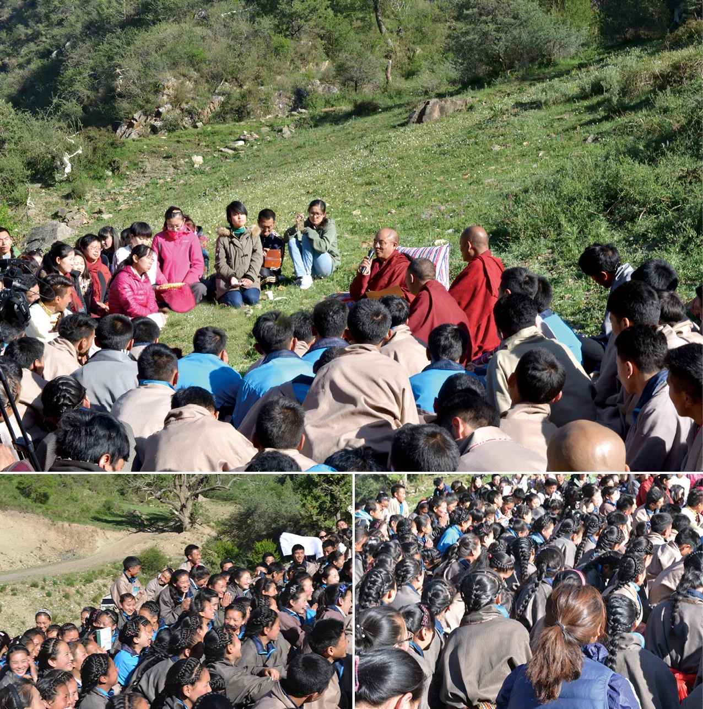
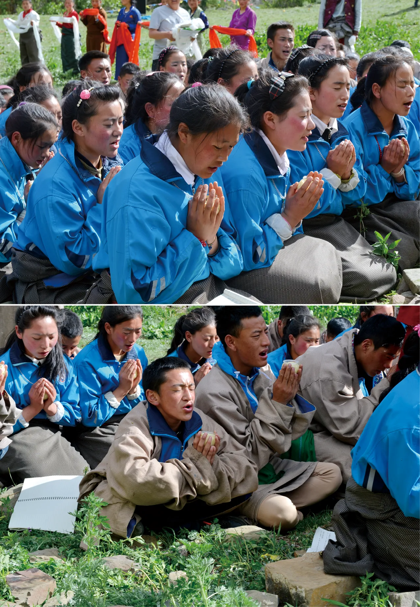
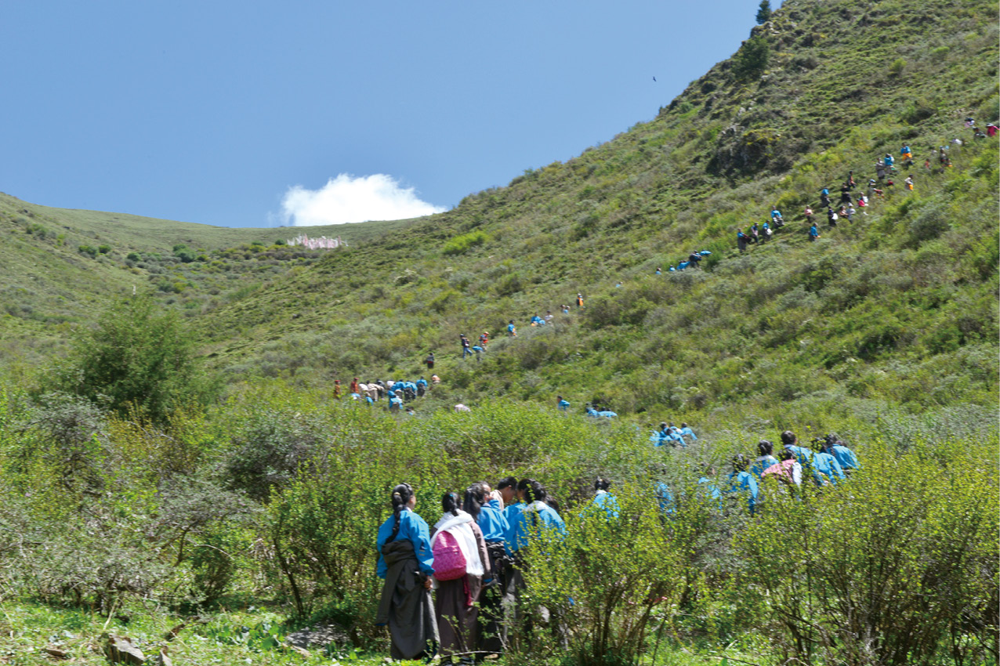
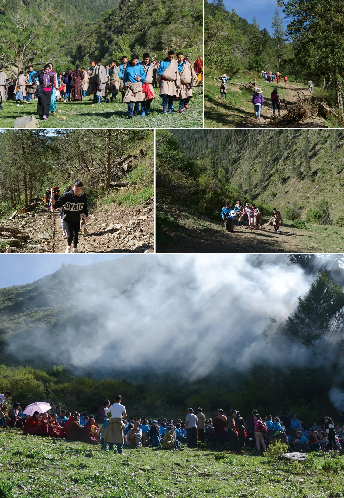
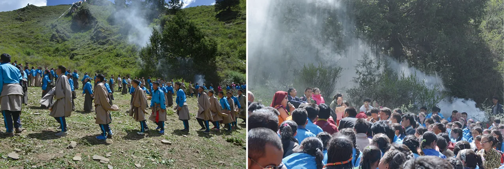
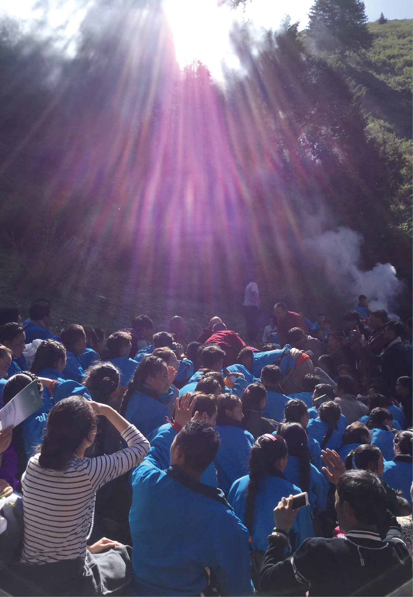
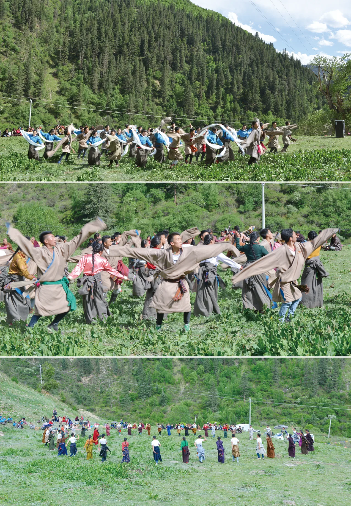
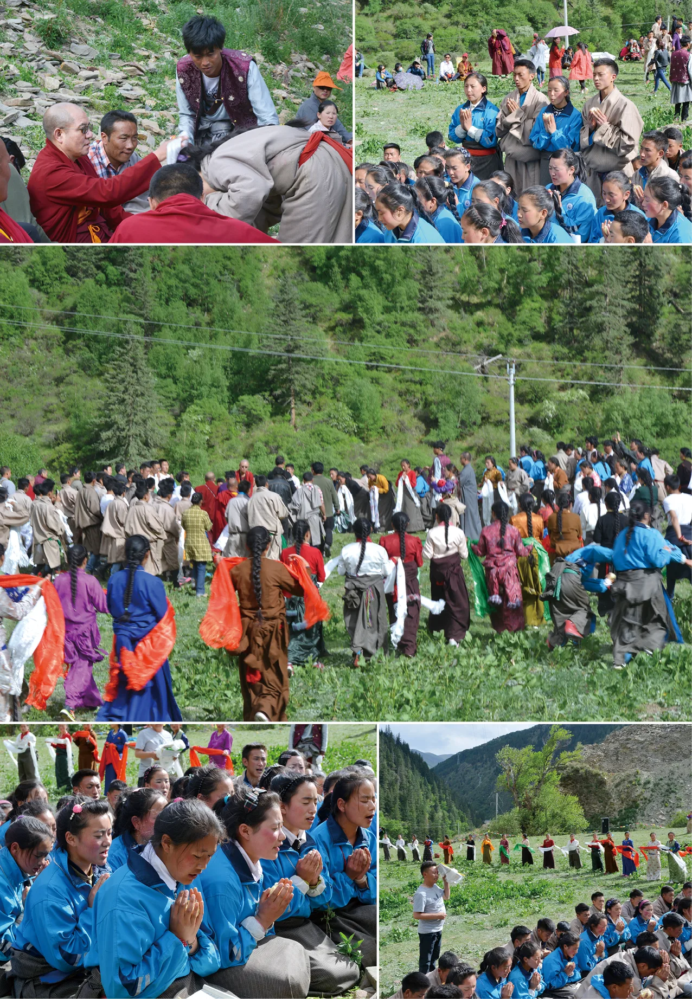
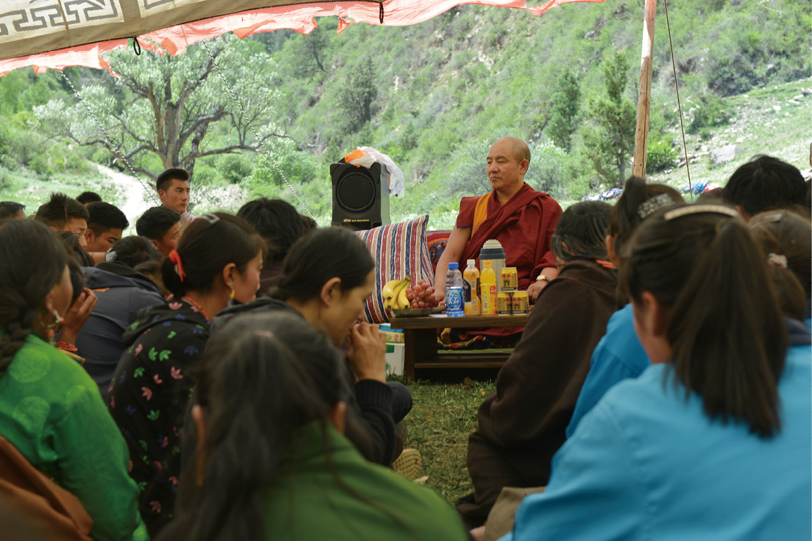

# 幸福的山谷

——上罗科玛中学毕业班耍坝子

2016年6月4日

今天，我们所要前往的是伏藏大师德钦朗巴开启伏藏的一处圣地。尊者曾经在此取出一函《财神法》伏藏。许多人认为自己的经济状况不佳，希望通过修持财神法来改善财运。尤其在汉地，人们特别渴望从众多活佛或上师那里获得财神法的灌顶。然而，没有福报的人能否通过修财神法获得财富，这是一个值得探讨的问题。

今天是一个非常吉祥的日子。无垢光尊者在《心性休息》中提到，每个月的初八、初十、十五、二十五、二十九和三十，都是空行聚集的殊胜日，而今天恰好是藏历二十九日。

多年来，我和罗科玛的几位老师一直渴望来到这个圣地，但因缘一直没有成熟，行程一再推迟。今天，我终于有机会与朵芒寺的几位堪布和初中毕业班的同学一同前往。如果你们身体状况允许，没有高血压或其他严重疾病，我建议大家一同前往。但若你的身体状况不佳，那最好留在这里休息。此处有许多食物，待我们上山之后，你们可以随意享用，开玩笑。（众笑）

## 伏藏圣地之缘起力不可思议

这里部分老师有信仰，部分则没有。对于没有信仰的老师，我刚才也跟他们讲了，藏传佛教中的伏藏已成为国际学术界极为重要的研究课题。目前，哈佛大学、哥伦比亚大学以及科罗拉多大学等知名学府，均设有专门研究藏传佛教伏藏的机构。我曾在科罗拉多大学和哥伦比亚大学，就伏藏相关内容作过演讲。

早在1993年，法王访问美国时，波士顿已珍藏了一批藏传佛教的伏藏。伏藏极为稀有，莲花生大士当时通过宝箧或空行文字的方式，将经函交付护法神守护。护法神将其保存上千年甚至数千年，直到伏藏大师出现，才将经函交予他们，并由他们记录为文字。

我们即将前往的山沟，正是伏藏大师取出《财神法》的圣地。当年，伏藏大师在取出这一伏藏前，曾在此修持莲师法门近一年之久。他当时是骑马来到此地，最终在空行护法神的加持下取出伏藏。

如果今天你们的身体状况允许，可以亲自上去一趟。昨天他们向我汇报时提到，整个行程需要五个小时，当时我吓了一跳，但后来听说实际距离或许并没有那么远。可能你们说得“不了义”，或者是担心我的身体状况。

不管怎样，今天的天气相当不错。如果有些老师穿着高跟鞋，上山可能会有一定困难，建议你们提前更换合适的鞋子，或者考虑其他办法。

我们稍后将在上面念诵《普贤行愿品》。如果你不会用藏语念诵，可以使用汉语。此外，我们还会给各位发放一串水晶念珠。这些念珠是我们前段时间在金刚萨埵法会上特别加持过的，非常珍贵。

我希望今天参加活动的人，如果有信仰并愿意，可以念一万遍以上的莲师心咒。至于完成时间，并无严格限制，最重要的是大家能够在此发愿。毕竟，莲花生大士曾亲临此地，亲自加持，并将伏藏埋藏于这里的悬崖之中。当然，大家不一定清楚具体埋藏的位置和方式，这唯有空行护法神才知道。然而，伏藏圣地的缘起力不可思议。我们寺院的帝察活佛在世时有一个习惯，他喜欢在伏藏圣地取一些沙子加以珍藏。

待会儿大家可以慢慢上山。你们或需带上一瓶饮料，因为山上较为炎热，容易感到口渴。不知道财务组有没有相关的安排？如果有准备，每人可以拿一瓶饮料，这样会比较舒适。我们藏地的许多孩子都饮用天然的矿泉水，即真正且无需付费的矿泉水。据说此处的矿泉水曾获莲花生大士亲自加持，大家可以随意饮用。

德钦朗巴在此开取的伏藏是一部财神仪轨，当时他的侍者将空行文字记录在汉地制造的特殊纸张上。因此，汉地与此法有一定因缘，而那位侍者则来自尼泊尔。

伏藏在国际学术界具有重要的研究价值，值得这里的一些老师深入探讨。目前，汉地对伏藏的研究相对较少，而在西方，如加拿大等地，研究伏藏的学者较多。那天，我遇到了几位英国学者，他们长期研究伏藏，已经访问过藏地二十多次，几乎考察了所有莲花生大士伏藏的地点。确实，现在许多人认为伏藏非常神秘，值得深入研究。

今天，我们因为特殊的因缘来到这里，希望大家在上山过程中注意安全，并相互关照。学校的藏族孩子在高原土生土长，爬山对他们而言应该不成问题。至于来自汉地或者农区的老师，可能会觉得今天的行程较为艰辛，你们明天可能要休息一整天。

（众人爬山……）

今天，我们在这个山沟举行了一场非常有意义的音乐活动，刚才，我们完成了沐浴仪式，并念诵了《普贤行愿品》。今天各方面的缘起都非常吉祥。

接下来，大多数人可以返回山下，不必继续上山。如果你的身体状况较好，可以从这里往上走一小段路，随后便能看到一个山岩，这就是当年伏藏大师德钦朗巴开取伏藏的地点。总的来说，今天各方面的缘起和因缘都非常好。

大家下山时，特别是缺乏登山经验的汉族道友，请务必小心谨慎，缓步而行。如果你们两人一组，相互扶持，可以避免跌倒，否则从山上滚下去会十分麻烦。

我稍后将会用从此地取出的伏藏品为大家作加持，其他堪布也将为大家发放不同的加持品。

（耍坝子后……）

## 学生应不忘师恩

在刚才与老师的交流中，我提到，在座的部分老师自2006年起便一直在此任教。当时，我们学校正式转为九年义务教育制，而由慈诚罗珠堪布支持的学校也开始运作。我们的学校恰好是在同一时间获得批准的。今天，我们从一年级开始培养的第一批孩子正式毕业，他们或将步入社会，或将迈向各大高校，这是一件令人非常欢喜的事情。

在这个过程中，各位老师曾面临诸多挑战，甚至在某些时刻感到十分无助。我刚才特意跟孩子们说，千万不要记仇，如果某位老师曾经对你不满，或者对你特别不好，你们不要心存怨恨。现在，有些学生在毕业后对曾经的老师态度冷淡，不愿正视，甚至表现出不敬，这是极不道德的行为。

如今，不管是在国内还是国外，接受教育都需要付出一定的报酬。请一位老师授课，无论是英语、数学、汉语、藏语，还是道德教育，通常都按小时计费。昨天，我遇到一位来自青海的老师，他创办了一所学校，专门教授英语演讲。尽管他每节课的收费为32元，但报名的学生依然众多。各位同学不妨思考一下，若按市场价格来算，自己从老师那里听授了那么多课时，总计需要花费多少钱呢？

正如刚才校长所说，任何人都不可能十全十美，老师或许有处事不当的时候，但无论如何，他们的初衷都是希望学生能够学到知识。从这一角度来看，每位学生都应该始终对老师心怀感恩。

在中学时期，我曾经与老师发生争执，甚至对老师动手，我至今仍然对这件事深感后悔。当时，一位体育老师撕破了我最喜欢的衣服，让我非常愤怒。于是我抓住他的衣服，并对他说：“你是国家干部，你有钱，而我没有钱，这件衣服对我来说十分珍贵，你撕了我的衣服，我也要撕坏你的衣服。”

现在回想起来，这种不道德的行为仍然是我一生中最后悔的事情之一。老师们为了学生的成长付出了大量努力和心血，这种奉献值得我们感恩。因此，我在这里衷心感谢本校所有老师的辛勤付出。

我们学校的公考成绩可能不太理想，这与教师经验不足及其他因素有关。这所学校和慈诚罗珠堪布的学校刚建立时，教学条件十分简陋，当时老师们只能居住在帐篷中。即使在中学部成立初期，我们各班级的教学地点仍需频繁变动，学生和老师需要不断适应新的环境。这在一定程度上影响了教学质量以及其他相关方面。

此外，在中学部刚建立时，我们的老师大多是从小学部调任过来的，他们构成了中学部最初的教学基础。虽然当时他们在小学部已是教学水平较高的老师，但要完全满足中学教师的要求，可能仍然不够理想。因此，今年、明年乃至后年，我校的公考成绩也许不会十分理想。事实上，在座的老师们已经付出了巨大的努力与辛劳。即便今年我校的公考成绩不理想，我也不会对各位老师有所抱怨。

刚才校长与我们谈到学校的未来发展。如果未来几年学校的管理层和教师团队能够保持稳定，我们有信心，本校的教学成效三年内一定能够与县内的其他中学相媲美。我们不敢妄言能够与全球或全省的学校相比，但只要学校能够稳定发展，教学质量应该会有显著提升。

昨天，教育部门的一位人员与我交流时提到，最近各地的考察团都在纷纷计划前来我们上罗科玛中学参观。他们认为，我校在管理、卫生等多个方面表现出色，对我们给予了高度评价。当然，大家不应因为外界的赞叹而骄傲自满，但不可否认的是，本校在某些方面确实有突出的优势。

最近我的身体状况不太理想，前段时间接受了一次手术，稍有好转后又需反复回去检查。按理来说，我在手术后半年内不宜重返高原，但这次我在下面待了约三个月便上来了，因为我认为学校毕业班的耍坝子非常重要。

不知道你们是否重视这次活动？我个人对此极为看重。一些堪布建议我，不应过于看重与孩子们的玩耍，应将精力投入到其他更为重要的事情上。但我始终认为，能与孩子们共度一段轻松愉快的时光，是一件非常珍贵的事情。所谓聚际必散，在毕业生即将离校之际，今日我们能够欢聚一堂，实在十分难得。

## 老师应关心毕业生的动态

伏藏大师德钦朗巴曾在此山谷中开取伏藏，根据藏文含义，此处名为“幸福的山谷”。在这片幸福的山谷中，我们这群幸福的孩子与幸福的老师们共同度过了幸福的一天。今天，无论是阳光，还是四周的自然环境，都给我们带来了幸福愉悦的心情。虽然我们今日相聚的时间并不算长，但能够与大家共度这段美好时光，我的内心感到无比快乐。

在此，我要特别感谢我们的所有老师和学生。你们在过去的九年中坚持不懈地走到今天，实属不易。在此过程中，无论是老师还是学生，都曾面临各种困难，甚至萌生过放弃的念头。确实，有些人未能坚持到底，中途选择了离开，可是大多数人都坚持到了最后，现在顺利完成了初中的学业。

那么，同学们未来的道路应该怎么走呢？我希望老师们在今后的日子里，能够继续关注毕业生的发展动态。尤其是在选择学校方面，他们可能对此一无所知，因此需要我们的帮助。

当年我升学时，有三所学校可以选择，它们分别位于不同的地区。我曾向多位老师咨询意见，但他们对这些学校的情况并不了解，最终仅能建议我自行抉择。于是我为此打了一卦，卦象显示这三所学校并无显著差异。之后我开始认真思考，甘孜离我家较近，交通费用相对较低，而且那里还有一座寺院，这或许与我未来的道路有某种关联。最后，我决定选择甘孜师范学校。

确实，孩子们在升学过程中往往感到迷茫。那天，我也特意与几位老师讨论了这个问题。例如，在学生外出参加考试或办理升学报名等事情上，我尤其希望毕业班的每一位班主任都能持续跟进，密切关注学生的情况。部分同学可能会遇到现实困难，如果条件允许，老师们最好及时为他们解决相关问题。在助学方面，我们也将尽力提供支持。

即使孩子们已经毕业，但我们仍有许多后续工作需要处理。这些工作虽然繁琐、辛苦，不过为了学生的利益，我们需要共同努力，继续关注毕业生的动态，这一点非常重要。

孩子们有时会抱怨，有时又显得格外可爱。其实，任何人都是如此，有时让你觉得亲切可爱，有时又让你觉得可恨，而这些可爱与可恨的瞬间，都是我们人生中最值得体味的时刻。

我的发言到此为止，谢谢大家。
