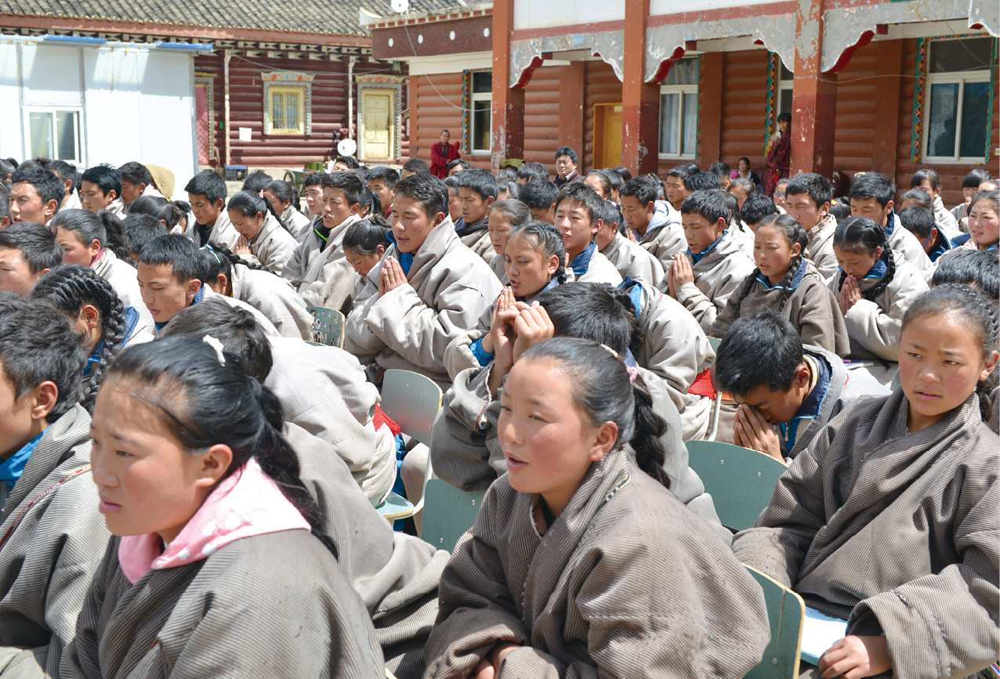
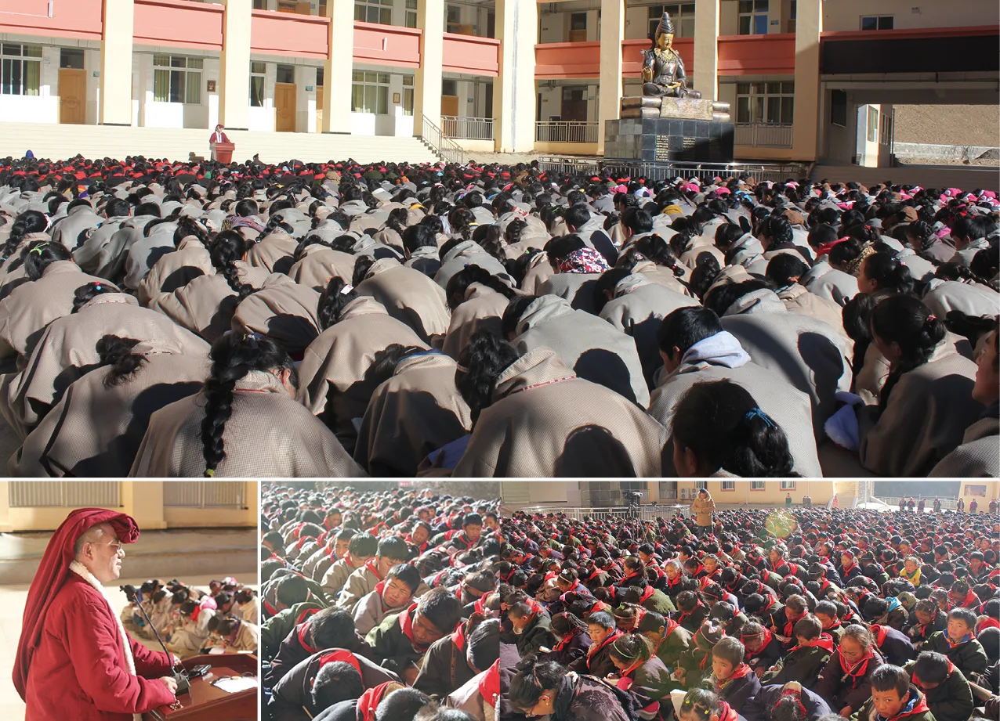
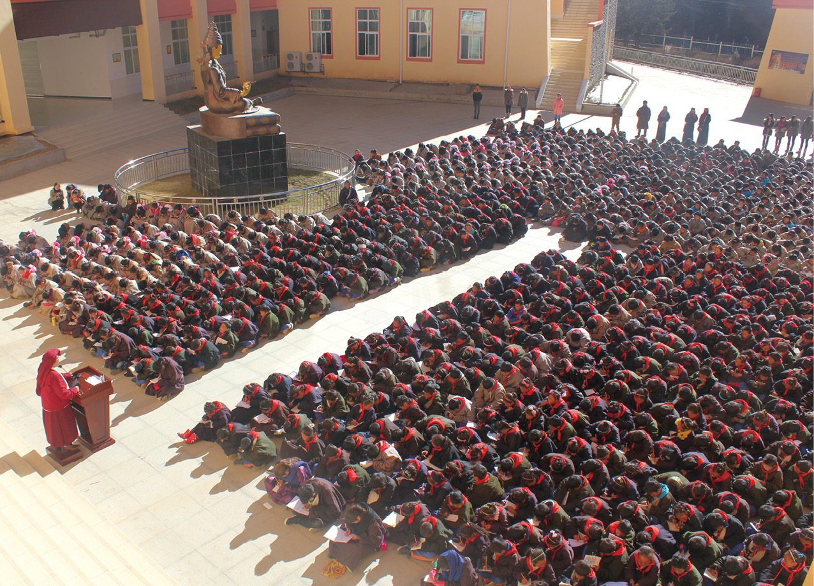
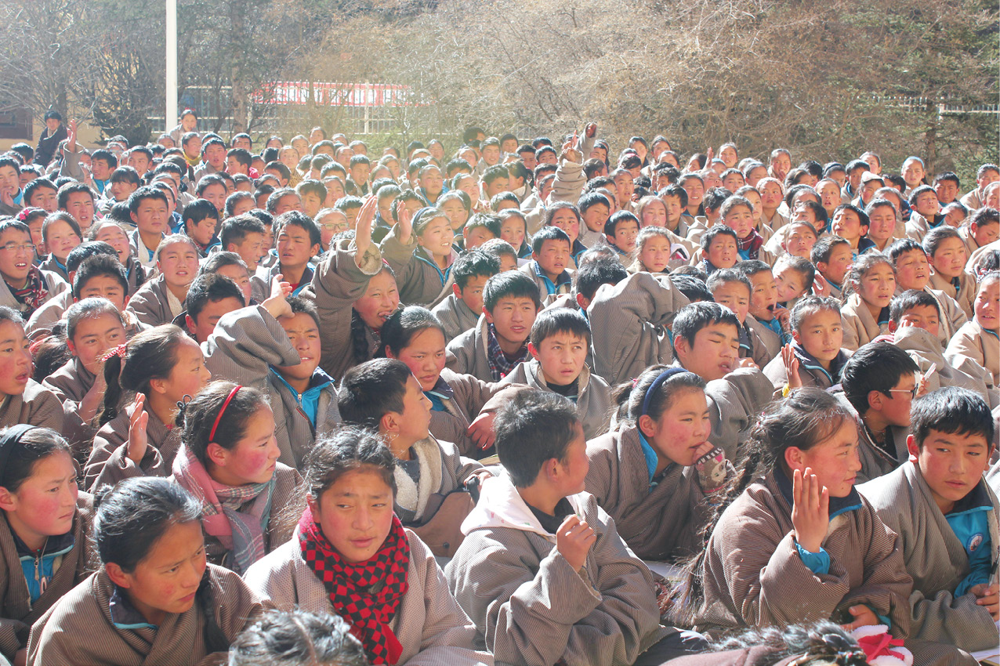
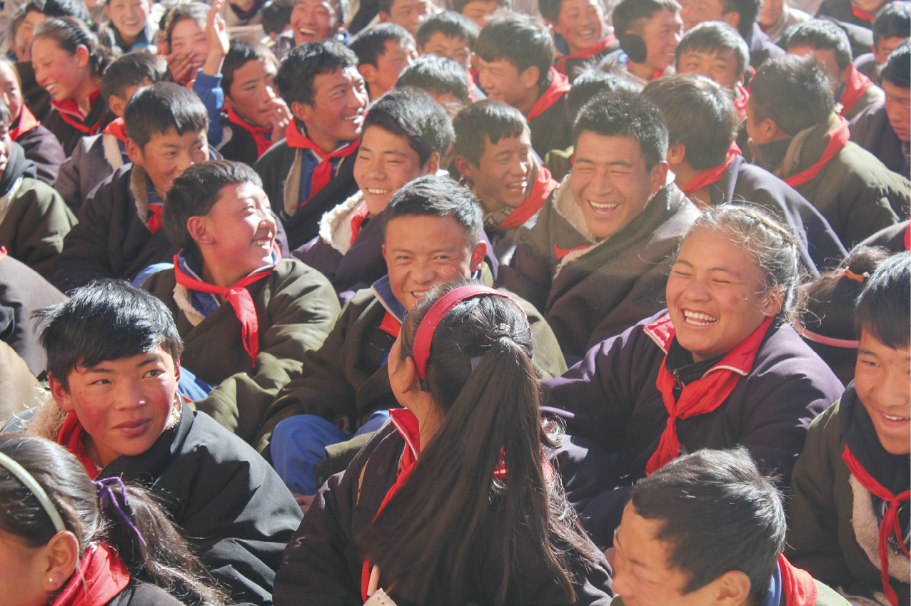
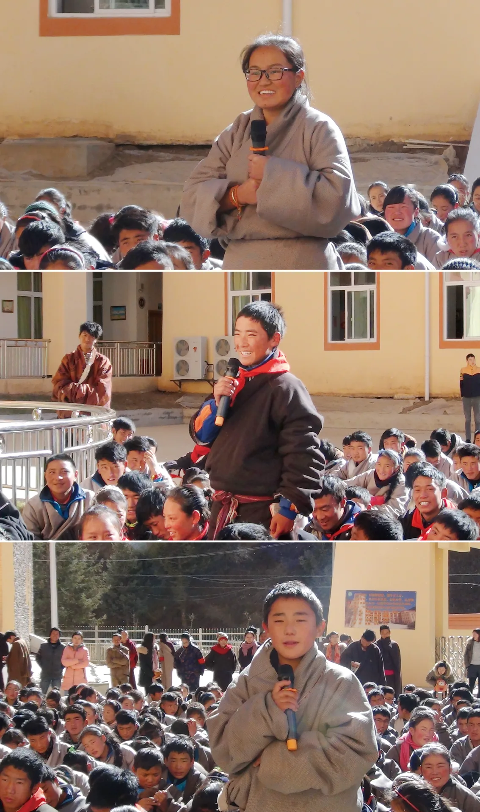

## 我们应当成为什么样的人？

——上罗科玛中学开示

2015年11月23日

今天我刚从汉地上来，学校特意为大家安排了一个简短的讲座。现在高原地区的气候确实十分寒冷，大家坐在地上可能会感受到强烈的寒意。但不管怎样，我希望老师们和同学们都能坚持一下。我会坚持，你们也要坚持。我们预计今天上午的讲座将在一个半到两个小时内完成。

这次讲座分为两个部分。首先，我会用汉语进行讲解，主要涉及一些管理方面的问题，可能有些说话大家会觉得不太好听。之后，我会用藏语讲述一些关于人生价值的内容。这就是今天讲座的主要安排。

## 勇于承担责任

首先是用汉语讲解的部分，主要与我们智悲学校有关。今天在场的有罗科玛中学和罗科玛小学四、五、六年级的师生，我想和大家分享一些看法，主要涉及两方面的内容：一是关于教师与管理的层面，二是关于学生的德育和学习问题。

最近，我们学校发生了一些事情，这些情况大家都很清楚，我们所有的老师和学生都负有不可推卸的责任。这次在本校发生的事件与以往截然不同，是炉霍县教育史上前所未有且令人震惊的大事件，我个人对此也感到非常遗憾。这些事情让我对我们的管理方式，以及我个人在办学理念和办学方向等方面产生了一些怀疑。

一直以来，本校的老师们都全力以赴地做好各项工作。但从另一个角度来看，学校发生这种事情，确实与个别老师和学生长期的不当行为有关。这次事件的发生并非偶然，可以说是一种必然的现象。

这些年来，我将自己的所有精力和财力都投入到学校的建设之中，无论是基础设施的完善、学校的管理，还是教师的聘用等各个方面，我都付出了巨大的努力。这一点在座的各位老师都非常清楚。

今天，我要对本校少数老师的行为提出一些批评。昨天当这件事刚发生时，校长给我打了电话，我当时直接对他说：“这件事情非常严重，然而，更深层次的问题还隐藏在我们学校内部。”

为什么这样说呢？对于我们小学的老师和学生，我并没有那么多抱怨。从去年开始，小学那边很多师生的行为都有了显著的进步。不过中学这边，有些老师的行为实在是教育界的……怎么形容呢？难以形容。

从某种意义上说，教师是一个非常神圣的职业，可谓人类心灵的工程师。然而，如今部分教师却将教育工作仅仅视为一种谋生手段，甚至将几千元的工资作为唯一的追求目标。他们的言行举止都只是为了钞票，缺乏其他的价值追求，这种现象让人深感悲哀。

校长在提交给我的检讨书中表示，他计划就昨天的事件向教育局请辞。同时，长期负责本校德育工作的德育主任也在报告中提出了辞职申请。此外，在中学部负责纪律和德育工作的一些老师也向我递交了检讨书。事实上，你们不需要向我作出检讨，而应当向相关部门和学生进行反思和说明。

我注意到你们的检讨都非常表面，这正是学校为何会发生这件事情的一个重要原因。不知道类似的情况在学校已经发生过多少次了？如果仅仅以辞职作为回应，我现在也可以像你们一样，说自己准备辞职。但这并非什么了不起的事情，对吧？

这所学校最初只是一片空旷之地。我在此建设了几栋建筑物和相关设施，聘请了部分教师，也做了一些宣传。在整个过程中，我并没有获取任何利益。相反，我已经在这里投入了超过3000万元。不过，令人遗憾的是，来此就读的学生素质越来越差。

究竟是谁促使了这次事件的发生？我们中学的德育老师需要承担责任。另外，参与打架的学生来自九年级的某个班级，这个班级是否也要对此负责？请该班的学生全体起立，我需要了解一下你们的情况。

虽然你们并没有直接参与打架，但作为这个班级的一员，你们有没有对这次事件感到自责？听说你们这个班级很“了不起”，我稍后会检查你们的作业本，也会了解你们老师的备课情况。据我所知，学校中有些老师在一年内连课程的三分之一都未能讲完，你们在这里究竟是如何授课的？

还有七年级的某个班级，是吧？你们也全体站起来。你们是否也是这次事件的引发者之一？你们的班主任在哪里？现在连站出来的勇气都没有了？负责德育工作的老师，你看一下，这就是你的“管理成果”。

我还听说，有一名学生留级了很多届，经常偷窃，非常“出名”。我之前在国外时，就已经听闻他的事情，真是“了不起”。你们不尊重学校，不恭敬老师，不交作业，甚至连最基础的拼音都不会。你们在这里学习了多少年的《弟子规》？

## 应常思己过

学校当前的问题不仅仅在于学生的败坏，更深层次的问题是教师的腐败。这个班级的班主任竟然被评为“优秀班主任”，据说是老师们内部评选的结果，你们究竟是如何推选的？此外，负责本年度纪律的老师，在他的管理下，竟然发生了县里历史上从未有过的事件，他的纪律管理真的那么有效吗？

对于这些问题，希望这里的老师能够给出一个明确的解释。请所有中学的老师起立。你们是如何选出“优秀班主任”的？听说这位老师还是我们先进教育工作组的成员。现在，学校发生了如此严重的事件，他是否真的配得上这些荣誉和奖项？你们究竟是如何管理的？

我一直以来都非常信任这里的老师，而无论是对教师还是学生，我都付出了大量心血。尽管我们曾跟炉霍县其他学校比赛而赢得了一些奖项，也有一些非常敬业的老师，但目前学校内部仍然存在一些腐败现象，这种情况确实令人感到无奈。

从本学期开始至今，这所中学有多少学生曾经与他人打架？你们并没有将我之前对你们所说的话放在心上，对我毫无尊重。我原本对这里的发心老师寄予厚望，但现实情况是，教师内部缺乏团结，甚至有些志愿者经常制造是非。作为教师，你们天天在说是非，究竟有什么意义？

当然，你们作为国家的教师，由国家发放工资，我确实无权批评。如果你们对我的批评有所不满，可以直接向文教局反映。我原本希望学生能够在这所学校学到真正有用的知识，但现在学校内部究竟存在着怎样的腐败现象？你们老师又处于怎样的状态？

我认为，这次事件并非最为严重的问题。更值得我们关注的，是当前这所学校师生的德育状况及其行为表现。如今这里的所有人，包括我自己在内，都非常可笑。我付出了大量心血来建立这所学校，许多家长也满怀期待地将孩子送到这里，希望他们能够学到真正的知识。然而，学生们在这里度过了八年、九年，他们究竟学到了多少？

我也可以像校长和部分老师那样，提交辞职报告。可是，除了推卸责任或递交辞职报告之外，我们难道没有其他选择吗？我们有没有真思考过学校的校训？有没有检讨过这里的学习状况？

在座的各位学生，你们应该想一想，自己热爱学习吗？另外，你们平时的衣着是怎样的？我听说，除了个别学生以外，这里部分学生的穿着十分邋遢，而另一些学生则热衷于名牌服饰。你们很富裕，但不爱学习，是吧？至于这里教师的德行如何，各位老师也应该扪心自问。

从领导到学生，这所学校的每一个人都应当明确自己的角色，学生要有学生的面貌，老师要有老师的风范。我真心希望，每位教师都能借此机会扪心自问：“作为教师，自己的言行和师德应当如何？”我们的所作所为都应当真诚可靠，如果只是做一些表面功夫，那又有什么意义？

去年，许多老师得知我将前来视察，便纷纷换上藏装，难道这就是我当初要求大家穿藏装的本意吗？此外，学校每天都有人负责打扫卫生，但你们还要在教育局来检查之前，特意组织大家一起清洁，难道我们是来学习如何打扫卫生的吗？另外，许多老师在日常生活中是否做到节约？我们现在享用着许多居士的供养，他们节衣缩食以供养我们，而我们却如此浪费，这值得大家认真反思。

这里大多数是藏族人，他们信仰因果。然而，如今学校有些老师经常议论是非，或者只重视金钱，除了钱财之外，他们对其他一切都不关心。虽然这并非所有老师的行为，但极个别老师的言行却对全校产生了负面影响。我相信学校里百分之七八十的师生都非常努力。然而，个别学生和教师的不当行为导致了当前的局面。

从今天开始，我们有两种可能的选择：一是老师和学生共同努力，踏上一条新的道路；二是学校管理层和老师设法在明年或后年退出这里的工作，实际上，我本人也有退出的想法。目前，在一些国家政策的要求下，我也同样面临类似的抉择，可能你们都已清楚。在别无选择的情况下，我们只能采取必要的措施，使学校走上一条新的道路。

不知道学校未来的发展将会如何。这里个别老师的行为确实存在问题，今天我就不一一点名了，各位老师应该深刻反思自己的责任。炉霍县其他学校还有许多默默付出的教师，你们所获得的奖项理应颁给他们。如果这里的“优秀班主任”或“优秀老师”等有退出的想法，我愿意与你们一同退下，这并无不可。

据我了解，这里有些学生非常“了不起”，他们天天模仿老师的言行，但对该学习的知识却没有掌握。他们还经常议论教师，说“这个老师像什么什么”，这种行为真是非常下劣。

我本来不想多谈学生的问题，但若这种现象持续下去，我宁可把学校关闭，也不愿意看到这么多非常愚蠢的人聚集在此。我原本希望为民族、为社会培养出一批人才，但你们的所作所为又是如何？

此外，这里学生和老师之间的关系越来越密切，甚至在国外也有各种传言。其实，小学那边曾经因此发生过一些事情，同样的事件将来可能会在中学这边再次发生，你们需要有心理准备。

刚才我所讲的内容，希望大家能够认真思考。我今天发表这些言论，并不是出于情绪宣泄，也不是因为听信了一些流言蜚语。这些问题是我在很长一段时间内观察到的。

关于这些问题具体如何处理，毕竟学校由教育局主管，我认为这里的领导和相关负责人需要向他们认真检讨，并积极处理后续事务。至于各位教师，你们可以继续思考如何解决学校的问题，也可以继续放任不管，这完全取决于你们自己。

已经发生的事情无法改变，如今我们甚至连当事人的名字都找不到。学校发生了这样的事件，其未来发展前景令人担忧。同样，无论是各位教师在教育界的声誉，还是本校在全世界的形象，恐怕都难以恢复。

这个学校能够办下来非常不容易，你们可能不知道我为此付出了多少，在座的老师不一定了解，学生们更不清楚。无论如何，今年学校发生的一些事情，以及你们极个别师生的不当行为，现在已经恶名远扬，你们应该很满足了吧！

## 成为一个不断进步、有目标和有价值的人

现在，我将用藏语来讲解“人生的价值”。当然，如果使用汉语，在座的大多数老师和学生应该都能理解。

今天讲座的主要内容包括两个方面。首先，无论是老师还是学生，我们每个人都应该在生活中不断进步，而不是退步，这是一个非常重要的道理。其次，我们应当努力成为一个有价值、有贡献的人，而非令人惋惜的无用之人。

接下来，我将用藏语为大家讲解这些内容。

（藏语开示……）

我想对今天的内容做一个总结。刚才，我对大家提出了一些批评，并向提出了以下几点建议：一、我们要努力成为一个不断进步的人；二、我们要做一个有贡献、有价值的人；三、我们要成为一个有目标的人。

关于最后一点，如今许多老师除了关注工资以外，并没有其他目标；许多学生除了贪玩、贪吃之外，也缺乏其他目标，这样的人生毫无意义。以上就是我今天演讲的主要内容。

在座的各位师生不应因为最近发生的事情而灰心丧气，从此不再努力。我相信，这里的许多老师会以此为戒，在各个方面更加努力，并重新建立起自信。我自己也希望从个角度深入思考，探索如何改善学校的学习环境和其他各方面的功能。

本校聚集了这么多师生，偶尔出现一些问题在所难免。这里90%以上的老师都在尽心尽力地付出。无论是发心老师，还是负责事务的老师，与其他学校相比，我们的教师团队确实是比较出色的。从学生层面来讲，无论是在学习还是其他方面，这里的学生也非常勤奋。

如果我今天的言辞有些不太悦耳的地方，希望在座的老师和学生能够予以指正。有时候，我确实有必要说一些较为严厉的话。另外，我希望学生和老师在观看电视、光盘或其他媒体时，尽量避免涉及任何政治和经济方面的话题，更不要将这些讨论带入学校。

有些人可能会以学校的名义进行募捐，借此骗取钱财，这是我不愿意看到的。所谓“君子爱财，取之有道”，我们应当在符合规范的前提下，以合理的方式运营学校。

今天我所讲的内容，都是肺腑之言。可能有些老师会觉得我的语气比较严厉，但我认为，在座的每一位，包括我在内，都应该对学校最近发生的事情进行认真思考和深刻反思。

前不久，我对一位学生说过，要学会自我反思。确实，每一位老师和学生都应该思考：“我来到这里的目的是什么？我是否在不断进步？我是不是一个有价值的人？”

今天，我只想强调六个字：进步、目标、价值。希望老师们能够认真思考这六个字的意义，也希望学生们能够对此深入探讨。如果大家认为我今天的讲话对学校的发展有所助益，希望各班主任及其他教师都能深入思考。

我今天所讲的并不是气话，也不是为了针对某些老师而议论是非。我衷心希望学校能够为社会培养出优秀人才。毕竟，我在这个地方长大，无论是这里的年轻人还是老年人，都与我息息相关，而我对学校的许多情况也有一定的了解。在管理佛学院时，我对学院的情况有深入的了解，这种了解是管理的基础。同样，我对这所学校的内部情况也较为清楚。

今天，我主要针对学校存在的问题提出了批评，没有提及积极的方面。因为今天讨论好的方面并没有必要，毕竟学校每年都会举行表彰活动。从今年开始，我们除了颁发奖项，也会引入惩罚制度。

如果一个国家只有奖赏而没有惩罚，它会变得腐败，最终甚至可能亡国。学校的管理也是如此，希望在座的领导能够重视这一点。既然有奖励，就必须有惩罚。如果只有奖励而没有惩罚，学校的管理将面临一定困难。因此，对于表现不佳的学生，学校应该予以惩罚。

今天，我的发言就到此为止，接下来大家可以提问。

现场互动

⊙ 问：堪布仁波切您好，非常感谢您在我们学校进行了如此精彩的演讲。我是六年级的学生，我想请教您一个问题：科学技术在当今取得了巨大的进展，但与此同时，科学的发展也导致了环境破坏等问题。那么，您认为科学的发展是利大于弊，还是弊大于利？科学究竟是为人类带来了更多的好处，还是更多的坏处？

堪布：在利用科学技术的同时，人们应尽可能减少对环境的破坏。在建设这所学校时，我们特意保留了周边的大片森林，并在使用推土机、拖拉机等科技设备的过程中，尽量减少对自然环境的影响。在科学尚不发达的年代，人类对环境的破坏时有发生。然而，随着科技的进步，我们现在能够更合理地利用各种资源。当然，科学进步与环境保护之间确实常常存在矛盾。您提出的问题非常好。

现场有些汉族老师原本在走来走去，或者心不在焉。当你发问时，许多老师都立刻集中了注意力。感谢你的提问！

⊙ 问：您刚才提到，有些老师的品德有所下降。我想请问，知识与品德之间是否存在一定的关系？

堪布：我想请问一下，您有没有不断进步？

问：有。

堪布：哪方面？

问：比如说，品德和某些运动方面。

堪布：哪些运动？

问：网球。另外，我也懂得感恩。

堪布：你有没有退步的地方或者不足之处？

问：有。

堪布：哪些方面？

问：……

堪布：你是一个十全十美的人，是吧？

问：不是。例如我不愿意洗衣服，而是让他人代劳。我不太注重清洁。

堪布：你不是很爱干净吗？（众笑）

问：不是很爱。

堪布：为什么？

问：不知道。（众笑）
