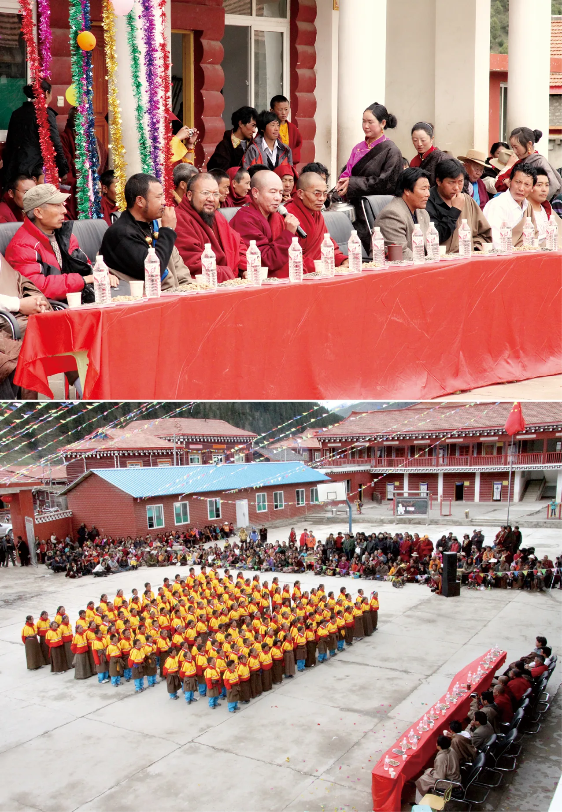
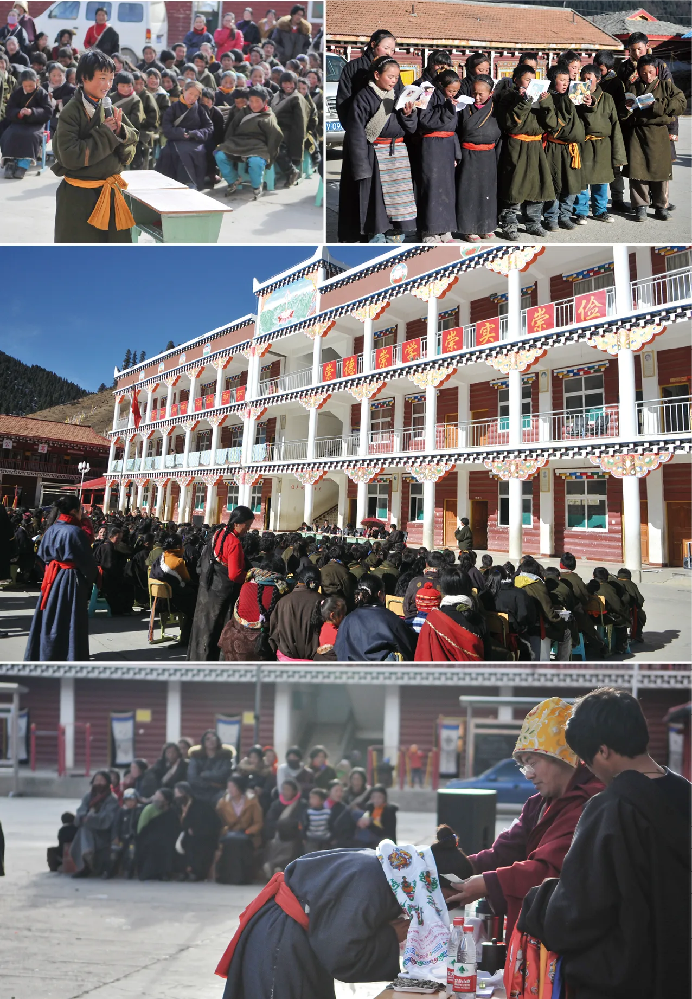

## 放下自我，以学校为重 （一）

——下罗科玛小学德育考试

2010年12月11日

今天是学校德育比赛的日子，评委老师已经说明了比赛规则，我相信，大会将以非常公正和恭敬的态度为每位参赛者评分。

刚才大家已经聆听了演讲，比赛即将正式开始。接下来可能会出现几种情况。一种情况是，有些参赛者平时非常认真地练习，但由于运气不好或其他原因，他们今天可能无法正常发挥或者获奖，这种结果是谁也无法预料的。还有一种情况是，有些参赛者平时不够用功，因此今天不管抽到什么题目，他们可能都会觉得有难度，甚至可能无法顺利通过比赛。

无论如何，每年年底或期末考试的时候，我们都会举办一场大规模的德育竞赛。我刚才已经用汉语和藏语向各位评委老师强调，在竞赛过程中，大家必须以公平公正的态度进行评判。这一点值得大家注意。

此外，我想对汉族老师们说几句。我们希望学校能够成为一个与时俱进的地方。最近，我听说极个别的汉族老师因为语言隔阂的问题，心中产生了一些想法，甚至出现了一些不当的言行。对此，我已经对相关人士进行了严厉的批评。今后，我希望无论是藏族老师还是汉族老师，在面对所有学生时，都不要将个人微小的恩怨和利益带入学校，也不要用不利的言语来影响学校的团结和进步。

今天的主要活动是德育竞赛，其他考试将在明后天进行，由于我今天是以个人名义来参与，所以在此就不多说了。总之，我要特别感谢在座的各位。无论您是否教授德育课程，我都由衷地感谢这里的所有老师。现在，让我们正式开始比赛。谢谢大家。
