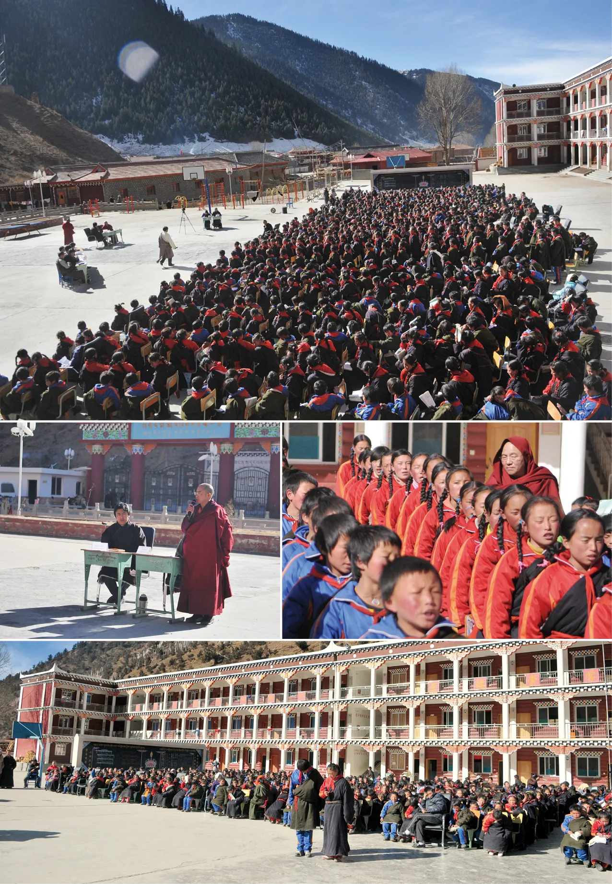

# 放下自我，以学校为重 （二）

——上罗科玛小学德育考试

2010年12月12日

接下来，我们将继续进行比赛。在此之前，我先交代一些事情。

关于昨晚藏古文念诵的评奖问题，今天早上我们与学校的相关领导进行了多次商议。经过慎重考虑，我们最终决定，昨晚所有参与藏文念诵的老师及其班级都会获发一些鼓励奖。起初，我们的评分制度分为上、中、下三等，每个等次中设有第一、第二和第三名。然而，这种评分方式引发了不同的意见，导致大家议论纷纷。

经过再三商议，我们最终决定，所有得分在40分以上的班级都将获得相同的奖励，即200元的奖金。此外，负责这些班级藏文念诵的老师也将获得100元的奖金。就是说，除了相关班级的藏族德育老师外，在那些没有德育老师的班级，相关的汉族班主任也有资格领奖。

至于得分未达到40分的八个班级，虽然他们没有获奖，但考虑到他们在这段时间内的付出和努力，我们最终决定，每个班级将获得100元的鼓励奖，而负责的老师则获得50元的鼓励奖。总体而言，大家的奖励算是平等。

然而，在未来的评奖过程中，我们希望大家能够尊重大会的决定。我们的评奖小组由学校的领导组成，他们一直都以公平公正的态度进行评审。希望大家不要因为一些小事而有过多的意见，如此会给评奖小组的工作带来不便。我个人也认为，为了一些个人事务而发表过多言论并不是一个好习惯。

虽然今天的评奖只是一件小事，但实际上，老师们应当尊重和服从上级的决定。作为一个团体，我们应该对集体制定的规定给予认可。前段时间，在评选优秀教师和优秀班级的过程中，我也听说大家有不同的意见，这种情况并不理想。毕竟，我们的评选过程一直都是公平和公开的，而所有参赛者也不可能同时获奖，这次评选也不例外。

我们希望各位老师能够互相理解。只要是由各班级、学校领导和主委会共同做出的决定，大家都应予以尊重，这也是国际上通行的做法。在这次期末评选中，我们颁发奖项是为了表扬那些被选中的班级或个人。今后，这种做法将继续保持。在此过程中，大家一定要积极配合，尊重大会的决定，不要在事后通过各种方式来争取奖励，这是不合理的。

不管是汉族老师还是藏族老师，对于那些由于各种原因而未能获奖的人，我希望大家能够宽宏大量。学生们可能对评选过程不太了解，但如果各位老师对此发表过多的负面评论，那可能会导致学生产生误解。这是我希望大家注意的第一点。

另外，我想在此强调，随着本学期即将结束，我刚刚与学校领导一起审查了学校在今年财务方面的各项费用。学校的收支报告非常清晰，我对此感到十分满意。在即将召开的学校会议上，校方不仅会公开这份报告，还会向各位老师做出详细的说明。

作为这所学校的教师，大家应该从学校整体发展的角度来思考问题，而不是从个人利益出发，或者发表不当的言论。当然，如果大家有任何问题或意见，可以向校方提出。总体而言，我认为学校在财务、学术和组织管理等方面都在不断进步。尤其是昨天的藏文念诵，学生们比往年有更大的提升。这不仅归功于各位汉文老师和藏文老师的辛勤努力，也与学生们的勤奋密不可分。对于各位师生的付出，我深表赞赏。

接下来，我们继续进行比赛。
