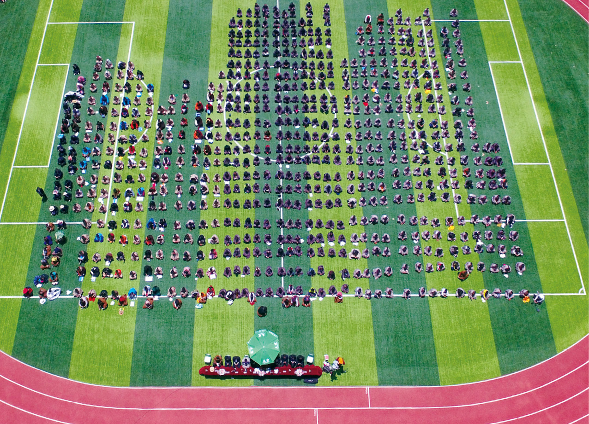

# 毕业寄语

——上罗科玛中学毕业典礼

2017年5月27日

2017年的今天，是我校的第二届毕业典礼。在这个特别的时刻，我想借此机会作简短致辞，同时表达自己对大家的期望。

首先，我要特别感谢这次毕业典礼的组委会，即筹备小组。许多老师和学生积极参与其中，投入了大量的时间与精力，为我们准备了这场感人至深、内容丰富且精彩纷呈的典礼。在此，我谨向所有参与筹备工作的师生表达最深切的谢意。

其次，我要特别感谢学校的所有老师。今天，我们秉承藏族及国际传统，向每位老师献上了两份礼物：洁白的哈达与美丽的玫瑰花。此外，每位学生还亲手制作了精美且富有价值的雕刻书画，以表达对老师们的感恩之心。不管各位教师陪伴了学生九年、三年或更短时光，这些心意都是学生们对你们的一种认可。

无论是教授英语、汉语、藏语、音乐、体育、美术等各科的教师，还是在各岗位上的管理人员，你们在这漫长的时间里，为学生付出了一切的一切。借此机会，我谨向学校全体教师致以衷心的感谢。

此外，我要特别感谢所有参与这项慈善事业的信众与善心人士。学生们能够顺利完成学业，实际上离不开许许多多的因缘。这其中既包括来自四面八方善男信女的支持，也离不开政府在学生生活费和教师工资等方面的资助。此外，众多志愿教师和发心人员不仅确保了校园水电等基础设施的正常运转，还在学生日常生活的各个方面提供了帮助。正是因为各界人士的关怀与支持，我们的学生才能安心学习。所以，在九年级学生毕业之际，我由衷地向每一位参与这项慈善事业的人士表达最诚挚的感谢。

接下来，我想分享一些想法。在刚才的议事过程中，校长及诸位师生从不同层面表达了他们的想法和见解。其中，有人提出了非常宝贵的意见，有人表达了对未来的期望，也有人回顾了学校从风雨历程中不断成长的历史。对于大家所分享的内容，我没有更多、更深或更具体的补充。但既然今天有幸在此发言，我也想简单地发表一下自己的看法。

今天我们举办的毕业典礼意义非凡。因为九年级的学生们能够借此机会，以不同的语言、文字和文化表达自己的情谊，其中大多数是对老师们的感恩之心。我认为这确实非常必要。学校的教师日日夜夜辛勤耕耘，可谓将自己的青春和全部心血无私奉献给在座的每一位学生。

明天这个时候，这里的190多名学生将告别母校。毕业同学对这里的草木花卉、一砖一瓦都怀有深厚的感情，离别时难免心生不舍。诚然，万法皆无常，无常是任何人都无法改变的客观规律。面对无常，每个人的心灵都会被触动，内心也会涌现出无尽的感言。因此，今天依靠这个平台，让大家表达内心的情感，确实很有必要。

明天此刻，在座的许多同学将离开这所学校。每位毕业生都将根据自己的阅历和学识，踏入一个全新且陌生的世界。临别之际，大家心中都有无尽的话语难以尽述。我认为，刚才各位的发言都是珍贵的历史见证。因此，我认为今日的毕业典礼非常有意义。

无论你们在此度过了九个春秋，还是三个春秋，即将毕业的同学们都正处于人生的重要转折点。对学校而言，能够汇聚来自五湖四海、学识渊博的教师，为学生传授丰富的文化与知识，实乃莫大的荣幸。明天起，这里的百余名学生将各自踏上人生的新征程。有些同学已考入理想的学校，有些同学则未能如愿。不管怎样，我们每一个人都不能放弃，一定要继续学习。

## 追求世间与出世间的智慧

关于本校所传授的课程内容，大家应已十分清楚，我们涵盖了九年义务教育中的全部课程，而各位毕业生均已一一完成这些学业，这一点我无需赘述。除此之外，我们特别注重人格教育，这一点在其他学校或许未被充分重视。事实上，我们特别重视两个层面的教育内容：一是慈悲，亦即是爱；二是智慧。正是基于这两大根本理念，本校被命名为“智悲学校”。因此，今天我想简要分享我对爱和智慧的一些心得与体悟。

首先，我想谈谈智慧。在藏文化传统中，智慧可以分为小五明和大五明。如今，英语、藏语和汉语这三种语言体系及其所承载的丰富知识，对我们而言更为重要。然而，比这些知识更为关键的是，我们应当不断追求智慧，并将其应用于生活实践之中，这是我今天特别想要强调的。

在追求智慧方面，犹太人是一个好例子。作为当今世界上公认的最聪明的民族之一，犹太人对智慧的追求与其他许多民族截然不同。他们是如何培养孩子的呢？犹太人在孩子第一天上学时，会在《妥拉》（犹太教的经典）上涂抹蜂蜜，让孩子们品尝。通过这一仪式，孩子们从小就能感受到智慧的甜蜜。

尽管犹太人仅占全球人口的约0.2%，但他们在21世纪获得的诺贝尔奖数量却占全世界的20%。为什么他们能够取得如此显著的成就？关键在于他们的勤奋好学。根据统计，14岁以上的犹太人平均每月能够完整阅读一本书。

我们藏族人口约为600万，而犹太人不到2000万。在这不到两千万的人口中，犹太人为何能够涌现出如此多的人才？无论是在美国的企业高管、政府要员层面，还是在各类学术和科学领域的专家之中，犹太人都占据了显著比例。我希望大家能够认识到追求知识的重要性，并在今后的人生道路上不断努力学习。

我刚才向大家介绍了世间最具智慧的群体，现在想跟大家探讨一下出世间的智慧。实际上，我们在人生中会遇到许多问题。在面对困境时，即便我们仅仅懂得“人生如梦、人生如幻、人生如阳焰”这一出世间的道理，也可能使我们所遇到的挫折和难题迎刃而解。

佛教中有一则教证，龙猛菩萨在《中观根本慧论》中说：“如幻亦如梦，如乾达婆城，所说生住灭，其相亦如是。”这句话的意思是，人生中所经历的一切现象，其实与梦幻泡影没有任何差别。

当然，我并不期望在座的各位都能完全通达这种甚深的中观空性义理。然而，今天我观察到，大家在英语、汉语及藏语方面都有很好的造诣，日后对较深层次的知识应该能够有所理解，不会有任何困难。如果大家能够领悟一些出世间的智慧，那么在人生遭遇烦恼和痛苦时，便能以智慧宝剑斩断它们，从而为自己的人生增添更美好、更有意义的光芒。

## 人生需要爱

我今天想与大家分享的第二个方面是，我们的人生需要爱。只要我们怀有爱心，人生中遇到的任何问题都可以用爱来化解，而帮助我们的人也会越来越多。关于这一点，我知道一个公案，接下来，我先给大家讲述这个故事。

2000年，江苏省沭阳县的四名青年在南京杀害了一户德国人家。案发不到一个月，这四名凶手即被捕获。死者的德国家属来到中国后，并没有怀恨报复，反而请求法院不要对凶手判处死刑。经过了解，德国家属发现这些年轻罪犯成长于教育资源匮乏的地区，没有接受过良好的教育。他们因此对这些青年生起了悲心。

虽然这些德国家属没有大乘佛教的宗教信仰，但为了纪念逝者及改善当地的教育环境，他们成立了基金会，并在凶手的家乡兴建了一所学校。自事件发生至今，已经过去约16年。据悉，该校迄今已培养了六百多名学生。这个事例值得我们深思。

在藏地，许多人信奉大乘佛教。可是，如果我们的家庭遭遇类似的变故，我们是否同样具备那种力量、信心和爱心？这是一个没有宗教信仰者的世间故事，但从中也能反映出爱的重要性。

前段时间，我阅读了一本名为《荣格心理学与藏传佛教》的著作，书中主要探讨了爱与权力之间的关系。荣格指出，爱与权力实际上呈反比例关系：当一个人内心充满爱时，其自我的权力意志会荡然无存；相反，当他内心充满权力意志时，爱会化为乌有。所以，爱多一分，权力欲便减少一分；权力欲多一分，爱则减少一分。这一观点尤其值得在座的学生和家长深思，它提醒我们应该常常观察自己的内心状态。

从出世间的角度来看，无与伦比的月称论师在《入中论》中云：“悲性于佛广大果，初犹种子长如水，常时受用若成熟，故我先赞大悲心。”这是我在二三十年前闻思时所背诵的教言。在世间之中，大悲心确实非常重要。因此，月称论师在造论之初，首先礼赞大悲心。月称论师并没有在此礼赞诸佛菩萨，也没有赞叹所有世间尊主，而是唯一赞叹大悲心。

为什么要赞叹大悲心呢？因为在修行过程中，大悲心在初中后三个阶段都不可缺少。初时，大悲心如同菩提种子；中间，种子需要大悲水的滋润；最后，大悲心成熟，众生能够真实受用。所以，在我们所学的大乘教义中，心灵的爱或者大悲心是至关重要的。

其他相关的佛经中也有提及，作为有信仰的人，不用学习许多法门，唯一需要学习和依止的法，就是所谓的爱，即大悲心。《大乘经庄严论》中也有许多关于大悲心的比喻。例如，大悲心如同树根，一棵树的树茎、树枝、树花和树果，实际上皆源于树根；同样的道理，如果我们没有大悲心，即便是成办世间中的一件小事，也将非常困难。

因此，我十分赞叹刚才有些老师提出的观点：在现实生活中，哪怕我们只是保护一只小小的宠物，或者守护一个微小的生命，这在我们的人生中都是非常有意义的。我希望同学们能够始终在内心保持一种爱，并且让它伴随你们一生。我认为，无论大家在社会面对何种境遇，痛苦也好，快乐也好，成功也好，失败也好，这种悲心或者爱都是不可或缺的。

## 铭记师恩

下面，我想给同学们提几点希望和要求，希望大家能够牢记于心。

首先，你们明天离开学校以后，永远不要忘记这所母校和这里的老师。为什么呢？因为当你们刚来到学校时，对许多知识都不熟悉，这一点你们自己应该清楚。莫说英语、藏语、汉语，你们初时可能连世间一些最基本的卫生常识也不了解。然而，虽然各位不一定都能考上理想的高校，但当你们今天离开校门时，在世间生存是不成问题的，因为你们已经掌握了基本的知识。

那么，这些知识和真理的来源是什么呢？正是这所学校，以及在这里默默付出的老师们。确实，老师有时会批评你们，甚至严厉地责备你们，但他们的目的是什么呢？就是促使你们成长。老师也曾在教育你们的过程中哭过、笑过、担心过，这些情感背后的原因是什么呢？实际上就是为了你们的成长和未来。

我个人认为，在一生当中，除了父母以外，老师确实是最重要的人。在某种意义上，老师的恩德甚至远远超过父母。因为父母的培养主要是让我们生活下去，而老师的教导却能让我们的生活质量有所提升，使我们的生命更加有意义。所以，我希望大家明天离开学校以后，不要忘记这所学校及这里的老师。这是我的第一个希望。

## 莫忘自己的传统文化

第二个希望，大家不要忘记我们的传统，不管是你们所说的语言、穿着的衣服，还是你们现在所拥有、显现在你身边的宝贵传统文化。在这所学校，我们有严格的纪律，有老师的悉心指导，还有同学们之间的相互监督。正是因为种种因缘具足，你们才能成为一个好人。

然而，当各位明天离开这所学校后，你们的前途也许会变得迷茫。因为在其他地方，大家未必能够遇到像这里一样尽责且时常给你指导的老师，也未必能够遇到如此多善心且经常给你提醒的朋友。事实上，外面的世界非常复杂、混乱，有些环境可能会使你的内心动摇，令你随之而转。即使你原本是一个非常优秀的学生，但经过几年之后，环境的影响可能会使你变成与现在截然不同的人。

因此，我希望同学们时刻铭记法王如意宝所说的一句话：“莫舍己道，勿扰他心。”其中，“莫舍己道”是指不要舍弃我们的传统和优秀的民族文化，不要随着外境而改变自己、放弃自己，更不可抛弃自己所有有价值的一切。

不忘自己的初心确实非常重要。我最近在翻阅《大藏经》，其中有一部经典名为《依止善知识经》，当中记载了世尊与阿难之间的对话，内容不多。经中说，我们在每时每刻都必须依止善知识、善友，以及善的所依，即善的环境；同时，我们必须永远远离恶知识、恶友和恶的环境。这部经典非常著名，其核心内容就是这一点。

因此，在座的各位同学，当你们明天离开这所学校，步入新的阶段时，一定要依止良师益友，以及有文化底蕴和优良传统的环境。否则，你们的心很容易被改变。因为目前你们的心智尚未成熟，见识也有限，在这个段特别容易受到环境的影响。有时我们会看到，一些学生在刚毕业时非常优秀，但在不良环境中待了两三年后，却完全变了一个人，跟以前判若两人，这是非常可怕的。

在今天的毕业典礼上，校长、多位班主任及老师为大家分享了许多珍贵的教言。希望你们能够将这些教诲伴随终生，牢牢铭记在心灵的最深处。否则，外在环境极有可能改变你们。虽然今天你们在这里表现非常优秀，立志为民族和整个人类做出贡献，但一旦踏入外面那个嘈杂纷扰的环境，你的初心或许会有所改变。因此，我今天想强调的第二个希望，是勿忘初心，也就是说，不要忘记我们的传统文化。

## 保持正见

第三个希望，请大家不要忘记自己是具有正见者。藏民自幼受到藏族传统文化的熏陶，因此普遍具备因果正见，相信善有善报、恶有恶报，承许前世后世的存在和业因果的道理。我们就是这么一个优秀的民族。如今，藏族那种非常神圣的文化吸引了全世界不可胜数的人前来青藏高原，追求和学习藏文化的知识。

我们希望在座的各位同学，在离开这里后，仍然能够坚持善有善报、恶有恶报的正见。我们不希望大家将来因为结交恶友、遭遇恶缘或者处于不良环境，而最终对三宝和因果产生诽谤。虽然三宝的真理和佛陀的真言如同纯金般不怕火炼，我们也不担心别人对其进行毁坏，但是，我们绝不希望在上罗科玛中学培养出具有邪见的顺世外道的教徒。

如果出现这样的人，我认为这里许多老师的善意付出已经付诸东流，我们对你们的精心培养也是毫无成效。确实，正如刚才一位老师所说，这里的老师们，包括我个人，在过去三年、五年乃至九年间，默默付出了大量心血和努力。我之所以如此付出，是期望你们能够成为有用之才，而不是成为废料，甚至是爆炸物。

大家都知道，现在ISIS培养了许多恐怖分子。他们身上系着炸弹，意图在各种环境和场合制造破坏。我相信你们当中不会有人去做这些事情。不过，如果你们对因果生起邪见，这种错误的见解可能会给自身及家庭带来如爆炸般的伤害。我绝不希望培养出这样的人。希望大家能够永远保持正确、清净的见解。只有这样，你们才能真正为自己和他人带来利益。因此，我对大家的第三个期望，就是要保持正见。

## 与时俱进

第四点希望，大家在坚守自身弥足珍贵之文化传统的基础上，能够学习和追求现代科技与文化知识。凡是懂得历史的人都清楚，一百多年前，随着工业革命的兴起，许多依赖人力的工作逐步被机器所取代。过去，无论是挖地、砍柴还是耕种，许多劳动都需要大量人力来完成。然而，工业革命的到来，使得原本需要数百甚至数千人协作的任务，借助机器便能轻松完成。这是人类历史上的一次重大变革。

现在，我们人类正面临着一个重大的危机，那是什么呢？就是人工智能时代的到来。或许在座有些人对人工智能还不是非常了解，但人工智能已经能够取代许多需要人力完成的工作，包括教师、律师、翻译家和医生等岗位。事实上，人工智能已经对社会各阶层人士产生了影响，尤其是在服务行业，从业人员的部分工作正逐渐被人工智能所替代。

例如，在美国，许多宾馆的服务、登记、开房等工作已经逐步由配备人工智能的机器人完成。以往需雇佣一百乃至二百名员工的宾馆，现在仅需两至三名核心人员负责关键工作，其余大部分职责皆已实现机械化与自动化。由此可以预见，未来人类的很多工作将被人工智能所取代。面对这一趋势，许多有识之士也对人们未来的生活表示非常担忧。

各位藏族同学即将踏入其他学校。大家今后应当注意，不要固执己见，不要只把目光局限在自己的传统文化，而对外界的一切都不予承认。这是不现实的。现代社会瞬息万变，如果我们藏族学生不能积极适应和应对社会的变化，就很有可能与社会发展脱节，被时代所淘汰。

我知道本校很多学生在知识、语言、能力、爱心等各方面都非常不错，但大家还要更加精进和努力。只有不断提升自己，我们才能跟得上时代的步伐，适应21世纪人类社会的发展。毕竟，21世纪社会的变革速度之快，变化之大，是任何人都难以预料和想象的。“日新月异”这一成语，过去常被视为夸张的比喻，甚至如梦话般远离现实，而如今，这样的变化速度已在现实生活中随处可见。因此，我希望大家记住的第四点，就是要跟上时代的发展。

## 成为一个有智慧、有文化的人

我今天的最后一个期望，是希望你们不要忘记，自己是拥有丰厚传统文化的家庭中的一员。在座的许多藏族学生，从小都成长在皈依三宝的环境中，你们的父母也好，爷爷奶奶也好，他们手中常常拿着念珠和转经轮，口中经常念诵观音心咒“嗡玛呢巴美吽”。我们就是这样的一个民族。虽然现在有些人可能对此不以为然，认为这是迷信，甚至把批评这些传统当作一种成就，但我认为，这些人实际上并不了解什么是真正的科学。

无论你将来去到哪个国家或者地方，接受什么样的教育，你都应该永远记住，自己的父母是怎样行持善法的人。表面上看，我们的一些父母可能没有文化，也没有太多接受教育的机会，但他们所拥有的知识，在西方许多顶尖科学家看来，其实是非常罕见的。

大家能够生长在如此良好的家庭，同时自己也获得了暇满的人身，遇到了殊胜的大乘佛法，实在十分难得。我希望你们在今后的人生旅程中，无论走到世界的任何角落，都不要忘记父母曾给予自己一些极有意义且深刻的教育和知识。除此之外，我对你们没有更多的期望。你们将来是否考上大学，是否成为公务员或成功人士，这些都不是我所看重的。

今天我要说的最后一件事情。也许明天分别之后，这一生我们未必还能再见，因为种种因缘，你们未必还能见到我，我也未必还能见到你们。同样，你们的一些班主任老师和任课老师，明天分开之后也可能是永远的离别。在这样的离别时刻，我想，无论是这里的许多老师还是我本人，都有一个共同的希望，那就是希望你们成为有智慧、有文化的人。

当今世界的许多知识分子，为什么会追求我们藏地的信仰与文化？因为我们的文化中确实蕴含着非常甚深的科学道理。也许你们现在还比较幼稚、年轻，未必能够完全明白。尤其是当你们进入那些充满五花八门诱惑的世界时，某些世间的知识可能会让你们变得盲目。在此情况下，大家一定要懂得取舍。希望你们今后能够成为有用的人才。

其实，今天我在这里为中学的毕业典礼发表演讲，我觉得自己既没有资格，也没有传承。为什么这样说呢？因为我就读的小学从来没有举办过任何毕业典礼。当时，我们所谓的毕业，只是大家随便带点糌粑，一起去耍坝子而已。到了中学毕业时，我们和当时的老师一起在宗塔的草原上住了一晚，这就算是我们的毕业典礼了。那时我们还拍了几张照片，现在看来非常有意义。后来，我到甘孜师范学校读中专，但还没有正式毕业，差一个学期的时候就离开了，去到寺院剃头出家。因此，在我的学习生涯中，我从来没有参加过一次真正的毕业典礼。

无论如何，我认为今天的毕业典礼对我们许多人来说都非常有意义。希望在座的同学们能够珍惜今天的经历，并将这段记忆好好保留下来。也许在十年、二十年、三十年之后，当你们回顾过去时，会觉得这是一段极为有意义的经历。

去年，我接触到一些美国和英国的高校老师。虽然他们已届七八十岁的高龄，但依然珍藏着自己在幼儿园、小学、中学以及大学时期的所有毕业照片。这次，我们的几位老师与一些技术工作者共同合作，制作了一本毕业画册。虽然这本毕业画册表面上看起来很简单，但实际上凝聚了大家的许多心血和付出。

我觉得这本画册非常有意义。现在，许多学校未必会专门制作毕业画册。这本画册不仅收录了班主任、任课老师及全班同学喜怒哀乐的各种瞬间，还包含了许多与我们藏族文化相关的内容。因此，我希望毕业班的同学们能够永远珍藏这本画册。

我们会先将这本毕业画册送给现任的每一位老师。之后，我们会通过线上方式与曾在学校任教的老师分享这本画册。我相信，他们收到后一定会非常欢喜。

刚才在发言时，一些同学提到，自己原本并不认识这里的许多老师，但现在都能认出来了。例如，以前在这里任教的一位老师，现在已经成为县长。当初你们刚来到学校时，对这里的人都不熟悉，而现在不仅能够认出来，还能看到他们的变化。

同样，我和这里的老师也见证了学生们多年来的成长和变化。有些同学刚入学时，曾经与我见过面。那时，大家在智慧、体力等方面还没有现在这样成熟和优秀，还没有成为如今的栋梁之才。我想，许多年以后，当我们回顾在这里度过的时光时，一定会觉得这些回忆非常有意义和珍贵。

另外，还有一点值得一提。昨天，慈诚罗珠堪布为我们的学生和老师做了非常好的开示。可惜的是，我们的汉族老师无法听懂。刚才有一位汉族老师告诉我，慈诚罗珠堪布昨天讲了一上午的内容，但由于语言问题，自己无法听懂，因此感到有些烦恼。今后，除了专题演讲以外，如果学校举办大型活动，尤其是青年人的活动，我们最好能够使用三种语言进行讲解，这样可能是最好的方式。

最后，我要特别感谢所有支持和参与这次盛会的各位。我认为今天非常圆满。今早我出来的时候，正好遇到了一桶满满的水，我觉得缘起很好，感到很高兴。当然，我并不是说是大家的考试成绩都非常好。但即使考试成绩不理想，你们也不要放弃学业，应该继续努力读书。从长远来看，如果大家在应该学习的年纪选择成家，或者去做一些意义不大的事情，比如放牧等，那将非常可惜。大家一定要不断努力，继续完成学业。

美国总统罗斯福曾多次经历失败，但最终取得了成功。所以，我认为，同学们如果一次考试没有通过，甚至两次没有通过，其实都不算什么。希望大家在面对困难时，切勿自我放弃。不放弃自己是勇敢的象征。我相信，通过我们今天的相聚，必将为明天带来光明。谢谢大家。
