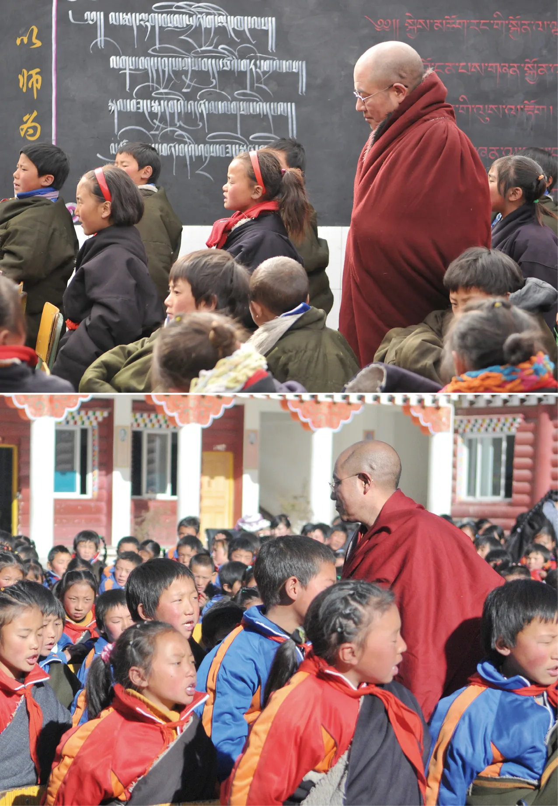

## 求学阶段的竞争必不可少 （一）

——上罗科玛小学德育考试

2013年12月16日

今天早上，我们举行了藏文和汉文《弟子规》的考试。我巡视了各个班级，观察了学生们的背诵和理解情况。在背诵方面，我们的学生比以往有更显著的进步，这主要归功于各位老师的辛勤付出。因此，我特别感谢在座的所有藏族和汉族老师。

我认为，我们生活在这个世界上并不只是为了金钱和生存，最重要的是为他人付出，做一些对众生真正有益的事情，这才是真正有意义的。所以，我特别感谢校方，特别是所有老师的付出。虽然并不是每一位老师的努力都会被认可，但只要学生能够从中受益，我相信这就是一件真正有意义的事情。

在学习过程中，考试和竞争是难以避免的。有些学生在考试中取得高分，而有些则可能得分较低，这种情况是正常的，但并不是最重要的。为了提升学生的整体成绩，我们有必要定期举行一些考试和竞赛，这对于学生的发展至关重要。因此，我特别希望各位老师能够付出更多的努力，帮助本校学生在学业上取得更大的进步。

今天，许多人认为天气很冷，但我个人并不这样觉得。我刚从最热的地方回来，包括泰国、新加坡和台湾，昨天抵达县城，今天才来到学校。在我看来，这里的天气并不算冷，反而让人感到十分舒服和凉快，这样的天气非常适合大家学习知识。

因此，我希望大家不要觉得在这里学习是一件痛苦的事。实际上，稍微冷一点的天气能让人头脑清醒，从而更高效地学习知识。虽然这个学期即将结束，但我希望大家今后能够继续共同努力。

我注意到这里的学生和老师们穿得都很厚重，衣服一层又一层，看起来好像穿了十几件似的。其实，这样的穿着没有必要，因为此处的天气并不算很冷。我想提醒大家，我们的物质条件相对来说已经很不错了。在果洛的许多地方，无论是学校的学生，还是普通的老百姓，他们的生活都十分艰苦。如果有机会，我们应该向他们提供各方面的帮助。

今天，我想跟在座的各位强调什么呢？大家不要急于购买新衣服，因为这会浪费大量资源。一件衣服可以穿很多年，大家不要认为不断穿新衣服是好的做法。事实上，这种做法并不理想，因为它会导致资源浪费和环境破坏。所以，从今天开始，我希望大家能够继续清洗和使用旧衣服，而不是频繁地购买新衣。

如果没有新衣服，大家也不必给家里增添很多麻烦，比如每周让家人来取要洗的衣服，我觉得这种做法是不合理的。从今天开始，我希望老师们在购买新衣服时也能更加谨慎。虽然本校的老师大部分是年轻人，渴望穿得漂亮得体无可厚非，但是大家也不需要像某些人那样每天更换衣服，这是没有必要的。

学生们不应在衣着上进行攀比，也不应在其他方面进行不必要的竞争。学校是一个学习知识的地方，学生们在知识方面的竞争才是最重要的。当然，今天我们还要在德育方面竞争。总之，我希望本校的学生在各方面的知识水平都能有所提升，包括汉语能力。

现在，我们继续进行德育比赛。
