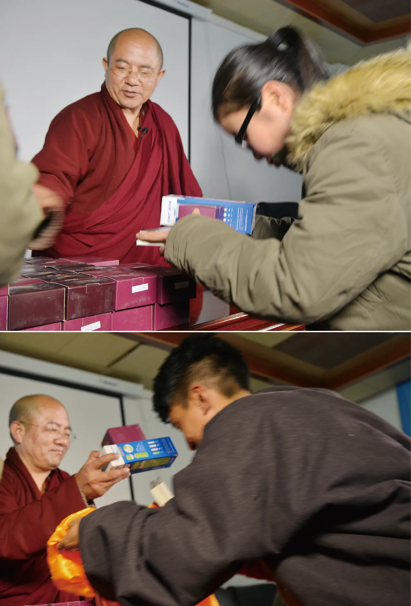
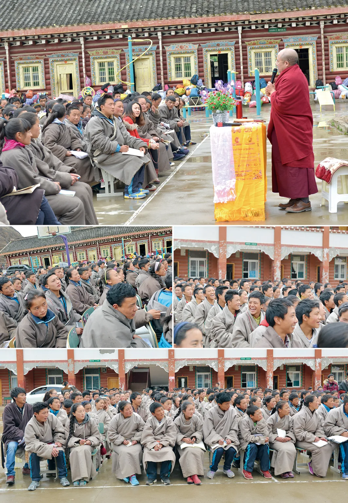
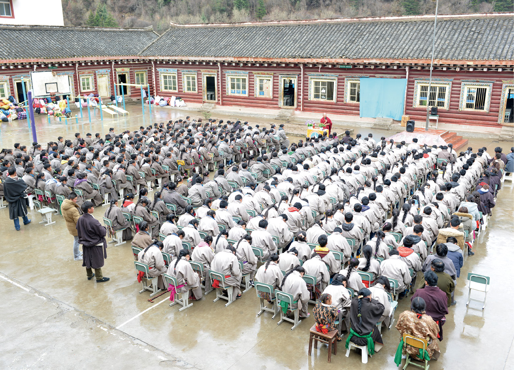
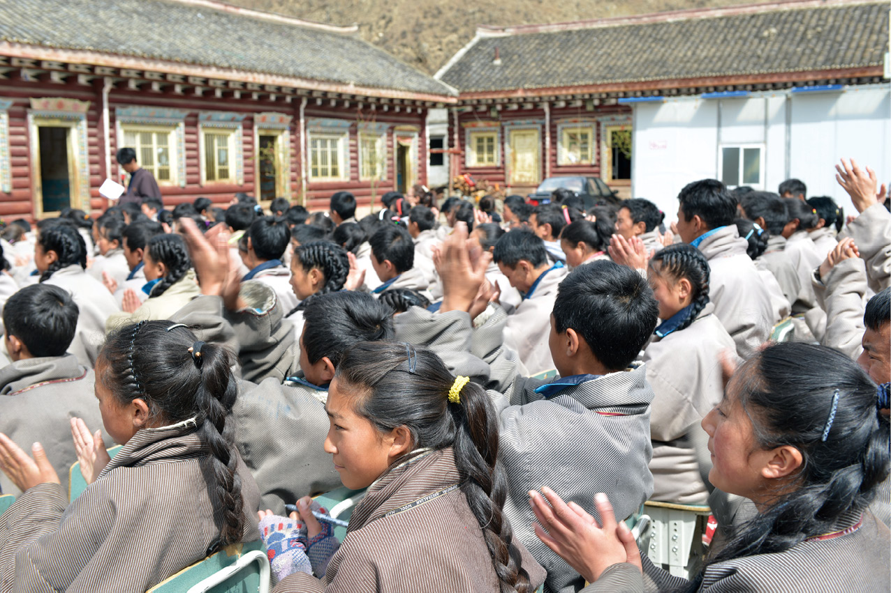

## 珍惜资源，成就未来

——上罗科玛中学开示

2015年4月25日

今天，我想与各位同学分享我以前读书时的两件事，一件好的，一件不好的。好的事情是什么呢？我在放牦牛的时候，总是带着一个笔记本，我至今仍然保存着它。我在1975年7月26日开始使用这个笔记本，那时我还没有正式上学。直至大概1977年，也就是我16岁的时候，我才正式进入学校学习。在此之前，我自学汉语，这个笔记本上便留有我当时临摹汉字的笔迹。

那时我抄写的是什么呢？“为什么列宁说要对资产阶级实行专政，这个问题要搞清楚，这个问题不搞清楚就会……”这些都是我在山上放牛时临摹的汉字，那是1975年的事情。后来我升入初中，这个本子便成了我的数学笔记本，当时我用它记录了代数、函数等内容。可以说，这是我好的方面吧。

我还有另一个笔记本，里面主要有物理学和化学的笔记。当年教我这两科的老师，如今仍在炉霍任教。几年前的一次同学聚会上，我将这个笔记本拿给他看，并对他说：“这是当年我在你课堂上所做的物理和化学笔记，已经30多年了，我至今仍然保存着。”他看到后非常感动。

今天，我也想和大家分享一件自己不太光彩的事。在甘孜师范学校读书时，我特别喜欢一本书，但当时我没有钱，买不起它。后来，我发现学校图书室里有这本书，于是在借书时，我用了一个假名，实际上就是把书拿走了。这本书上有学校的公章，为了不让别人发现书的来源，我一直小心地遮盖着那个红色的印章。这本书已经陪伴我30多年了，如果将来有机会回去演讲，我准备将它归还。

现场互动

⊙ 问：尊敬的堪布仁波切，您好，真诚地感谢您的到来。现在，我们离中考仅剩一年，同学们的压力一天比一天大，有些同学甚至承受不了这种压力，已经在考虑放弃学业，准备回家放牛或从事其他工作。请问堪布，我们该如何缓解这种压力呢？

堪布：无论是高考，还是未来的其他目标，大家在面对这些挑战时，肯定会感受到一些压力。不过，这些压力其实并不算很大，为什么这样说呢？因为如果第一次尝试没有成功，你还有第二次机会；第二次不成功，你可以再试第三次。总而言之，面对压力的最佳方法就是永不言弃，坚持到底。

在学习方面，大家一定要不断努力，不能轻言放弃。只要坚持下去，到了一定时候，你会取得成功的。新东方集团的创始人俞敏洪，现在被认为是全中国最成功的人之一。他经历过两次高考失败，直到第三次才考入北京大学。同样，社会上许多成功人士也不是一遇违缘就放弃的。

如果我们这里的部分学生或老师在遇到一些人生挫折和压力时，就选择离开学校去放牛，那实在是太可惜了。

⊙ 问：尊敬的堪布仁波切，您好。有位美国志愿者会去贫困的山区给学生们分发食物，可是在这之前，他会安排学生们先帮他做一些事情，等事情完成后，他才把食物和资源分给大家。反观我们学校，一些食物和资源都是您无条件提供给我们的，但大家没有珍惜这些食物，甚至随意浪费这些资源。请问，有什么方法能够让同学们更珍惜这些食物和资源呢？

堪布：关于浪费的问题，我也听说本校的一些学生经常浪费食物。有些同学一开始拿了很多食物，最后却把吃不完的部分随手丢进厕所。不仅仅是食物，像个人的衣物、校服，还有学校的公共物品，也常常得不到应有的爱护。当然，在这么大的学生群体中，难免会出现各种各样的情况，但总体来说，节约和惜福确实非常重要。

汉地有一位非常著名的大德，名叫印光大师。印光大师曾说，我们今生所拥有的一切，都是前世的福报现前。如果我们希望将来生生世世都能成为有福报的人，今生就必须惜福。什么是惜福呢？就是珍惜我们现在所拥有的资源，如食物和衣物。

我希望在座的同学们都能理解这一点，至少不要把自己的旧衣服随意丢弃。我昨天也特意和一些老师分享了我的习惯，不知道之前有没有跟大家提过，我今天穿的这件衣服，是我在1993年去美国时买的，至今已经有22年了。尽管如此，它依然可以使用，我还是经常穿着它。因此，当我听说这里有些学生一年换了三次新衣服时，我感到非常伤心。

其实，只要我们的智慧跟得上，外在的物质条件也应该能够跟得上。大家可以看到，我们现在的校服，正常使用三年是完全没有问题的。因此，我特别希望大家尽量减少浪费，一定要学会节省。而在自己做到节约的同时，我们还应帮助他人培养节约的意识。

我看炉霍县的很多人在吃完饭后，会将剩下的食物打包带走。相反，我们的很多老乡则比较奢侈，不会打包剩菜。看到这种情况，我心里不免有些复杂的感受。

⊙ 问：尊敬的堪布，首先感谢您的到来。我是八年级三班的学生。我想请教一个问题：在现实生活中，无论是学习还是做事，我们都非常认真，付出了很多努力，但常常得不到别人的认可，也没有取得理想的成果。请问我们该如何处理或应对这种情况呢？

堪布：这不仅仅是极少数人的情况，实际上大多数人都会遇到类似的情形。我们生活在这个世界上，确实会面对许多不公平。然而，我们做事的目的，并不是为了获得别人的认可或取悦他人。在不违背良心的前提下，无论是学习还是生活上的任何事情，我们都应废寝忘食、日以继夜地努力。当因缘成熟时，认可与成果自然会随之而来。

为了实现这样的目标，我们不应太过在意别人的评价。在学习过程中，许多老师可能会根据分数来认可成绩优异的学生，而忽略了那些品格优秀或者在其他方面表现出色的学生。

但实际上，老师是否忽略你并不重要，关键在于我们要凭良心行事，并且持续不断地努力。这样一来，即使你在读书期间得不到很多人的认可，但是到了一定时候，当你的智慧之光照亮世界时，你便能够以理服人，别人自然会对你认可。

⊙ 问：尊敬的堪布您好，我是八年级四班的学生。今天有机会聆听您的演讲，我感到非常荣幸。我想在此向您请教一个问题：作为一名藏族女孩，弘扬和传承我们的民族文化是非常重要的责任。同时，我个人对英语很感兴趣。那么，未来我该如何利用自己的微薄之力，利用英语来发扬民族文化呢？

堪布：我认为你现在应该好好地学习英语，将来有机会时，可以用英语来授课。这样，不论是在藏地还是其他不懂英语的地方，你都能够逐渐提升当地学生们的智慧。事实上，英语已经成为一种世界语，是国际通用的语言。因此，在座的各位一定要重视英语的学习。与此同时，大家也不能忽略汉语，因为汉语在我们的日常生活和学业中也非常重要。

如果你希望将来对自己的民族做出哪怕是微薄的贡献，首先必须勤奋学习。不努力学习的人，将来很难真正为自他带来快乐。因此，我想在此提醒大家：现在有些同学经常放逸、散乱，花费很多时间在没有意义的事情上，例如唱歌、跳舞。当然，并不是所有的唱歌跳舞都没有意义，但如果大家把所有时间和精力都耗费在这些活动上，忽略了学习，最终可能会对你的学业造成负面影响。

在当今时代，教育竞争非常激烈，成绩被视为衡量学生的重要标准。分数高的学生往往会得到老师和社会的认可。其实，正如我刚才所说，道德水平比成绩更为重要。只有在具备全面的知识和良好道德修养的基础上，你才能通过英语为社会和民族做出应有的贡献。

⊙ 问：感谢堪布的到来，我是预科七年级一班的学生。今天能够站在这里，是我前世修来的福分，也是我今生最大的荣幸。我的问题是：藏传佛教里提到，经过很多年后，这个世界会走向灭亡；但有些科学家则认为，只要我们保护好环境，这个世界就不会灭亡。请问这两种说法，哪一种才是正确的呢？

堪布：在藏传佛教的一些伏藏法中，确实提到再过15年，整个世界可能会遭遇巨大的灾难。前段时间，有一位老喇嘛对此非常担忧，他收集了莲花生大士和其他伏藏大师关于这方面的许多授记，并让我看了这些内容。然而，我发现这些授记并不是说整个世界都会灭亡。

实际上，现代科学对宇宙的理解，与藏传佛教中《时轮金刚》和历算学的宇宙观，在某些方面可以说是不谋而合的，并不存在一者全对、另一者全不合理的情况。当然，无论是佛教还是科学，都承认这个世界是无常的。总的来说，我认为藏传佛教的观点与现代天文学并不冲突。

⊙ 问：尊敬的堪布仁波切您好，我来自道孚，现读七年级二班。我的问题是，在我们藏区，人们不免会参加一些法会，但有些人认为参加法会是一种迷信，我们应该怎样区别迷信和信仰？

堪布：他们为什么认为这是迷信呢？

问：有些人认为参加佛事或宗教仪式是一种迷信。我的父母和藏族老师都曾教导我们，作为藏人，应该尊重自己的传统文化。另一方面，我也注意到学校的规章制度中有禁止参加迷信活动的规定。那么，我们该如何区分迷信和信仰呢？我们又怎样在遵守国家法律的同时，也遵从父母和老师的教诲呢？

堪布：毕竟大家都是学生，所以大家在学校的行为必须符合国家的相关要求。同样，国家对公务员和其他群体也有不同的规定和要求。不过，国家并没有将所有宗教活动都视为迷信。如果相关的法律条文是这样理解，那制定这种法规的人本身就存在误解，甚至可能有违法之嫌。那些把参加法会看作是迷信行为的人，实在是太愚痴了。

如果有人认为宗教法会是迷信，那么我们现在的各种集会，包括学校或任何团体的聚会，也可以被视为迷信活动。现在有些年轻人根本分不清什么是迷信，什么是正信，什么是信仰。

所谓的迷信，指的是盲目相信一些不存在的事物。然而，佛教中的任何活动，比如法会、讲经说法、念诵咒语等，都有其深刻的意义，对今生来世都有益处。如果有人认为这些宗教活动是迷信，我们应该与他们面对面交流，看看他们有什么依据。最后，你会发现他们其实没有充分的理由去否定佛教的行为。所以说，那些人极其愚痴，常常处于一种迷惑的状态。

事实上，不仅在我们学校，在整个藏区都不存在任何迷信的活动。认为佛教是迷信，这是“文化大革命”时期的说法。现在的学校和任何老师都不会这样认为。因此，如果有学生认为开法会是迷信，那只能说明他们在学习上非常糟糕。

⊙ 问：尊敬的堪布仁波切，亲爱的老师和同学们，大家早上好！今天我代表我们班级向堪布仁波切提出一个问题：有着几千年历史的玛雅历法曾经预言世界末日会发生在2012年，虽然最后这一预言没有成真，但是世界末日真的存在吗？请堪布仁波切为我们解答，谢谢您。

堪布：在2012年的时候，玛雅文化的这个预言确实传得非常厉害。关于这一授记，当时台湾等不同地方的高僧大德有着不同的看法，有些甚至认为届时90%以上的人类都会灭亡。不过，我当时也说过，玛雅的这个预言实际上是指2012年是人类文化的一个转折点，而不是世界末日。

那么，到底世界末日是否存在呢？按照科学的说法，地球和我们所在的宇宙最终都会毁灭；按照佛教的说法，我们的世界最终会被七火一水一风所毁灭。所以，世界末日确实是存在的。但至少对于在座的每个人来说，在我们的有生之年，应该不会看到世界末日的到来。

⊙ 问：尊敬的堪布仁波切您好，我来自道孚，是七年级四班的学生。我原本准备了两个问题，第一个问题是关于个人前途以及学习方法的，但堪布您刚才已经非常详细地为我们讲解了。

我想请教的第二个问题与我们学校的实际情况有关。我们学校有许多学生选择吃素，有些老师也在素食堂用餐。可是，由于学校条件有限，许多吃素的学生很少吃午餐和晚餐，因为这些餐食通常都含有肉类。这种情况会对我们的健康有不良影响吗？我们应该如何看待吃素这一善行？您认为学生吃素是有害还是有益呢？谢谢堪布。

堪布：事实上，我们的一些老师不得不选择吃素，因为我们的中学目前只有一个素食餐厅。虽然许多老师想吃肉，但他们别无选择。不过总体来说，大家在吃素方面做得不错。

在小学那边，最初只有五六位老师吃素，而吃荤的则有二十多位。随着时间的推移，现在吃荤的老师只有六七位，其他大多数老师都转为吃素了，人数翻了几倍。至于中学这边，由于目前还没有找到合适的厨师来为老师们提供荤食，他们也不得不吃素。虽然许多老师都在努力想办法，但暂时还没有可行的解决方案。

对于各位同学，我的建议是在求学时期可以不吃素。我们学校暂时无法为学生们分开提供素食和荤食，如果大家因为坚持吃素而不吃中饭和晚饭，长此下去，健康可能会受到影响，这是令人担忧的。在读书时期，你们可以为自己吃肉这件事多做一些忏悔。

也许这里有些老师喜欢提倡素食，但我希望老师们在学校不要特别强调这种观念。如果我们的学生全都吃素，教委可能会对我们有负面的看法。一些领导认为杀生是必要的，当我提倡戒杀放生时，他们反而教育我说：“哎，索达吉，你不能说不要杀牦牛啊。”他们经常给我诸如此类的教育，不过我穿着这件衣服，是不可能提倡杀牦牛的。但如果这里有很多人吃素，他们可能会认为这是我在学校一手推动的。

当然，我并不担心上面对我有什么看法，最关键的是我担心你们的健康会出问题。如果各位同学确实觉得吃肉不太好，你们可以多念观音心咒。比如在用餐时，你可以默默地念“嗡玛呢巴美吽”。当大家完成学业、长大后，可以根据自己的意愿再作选择。暂时而言，大家还是不要跳过午餐和晚餐。

⊙ 问：首先，祝愿无上智悲的上师索达吉堪布仁波切心想事成，利生事业圆满！非常感谢您在百忙之中抽空为我们演讲。今天，我想请教一个关于佛法的问题。作为一个自小在藏区长大的学生，虽然我对佛法没有深刻的了解，但是我对佛法非常感兴趣。如果我问其他藏人什么是佛法，他们通常会回答：“诸恶莫作，诸善奉行，自净其意，是诸佛教。”他们还会说，不论是大乘还是小乘，都是关于我们的心。

比如，当一个虫子在水中快要死去时，如果我们是为了来世的福报而去救它，那就是小乘；如果我们是为了让它远离痛苦而去救它，那就是大乘。我的问题是，假设有一只蚂蚁被踩了一下但还没有死，正在痛苦中挣扎，当我们看到这种情况时，如果我们是为了解除其痛苦而将它踩死，这算是大乘的行为吗？还是属于十不善中的杀生呢？谢谢！

堪布：大乘与小乘的主要差别在于是否具有利他心。有利他心的就是大乘佛教，没有的就是小乘佛教。所以，“诸恶莫作，诸善奉行”实际上是佛教的精髓，可以这样来理解。

⊙ 问：尊敬的堪布仁波切您好，我是七年级六班的学生。首先，特别感谢您在百忙中抽出宝贵的时间为我们进行精彩的演讲，真的非常感谢。今天我的提问是：有些同学虽然很聪明，但却很偏科，只专注于母语一课。尽管课任老师专门抽时间为他们补习外语，他们的进步却很有限。请问，同学们应该以怎样的心态来学习外语呢？

堪布：关于这个问题，刚才我也提到过，大家千万不要偏科，知道吧？偏科是一个非常严重的毛病。比如在学习语言的过程中，如果你只偏重藏文，或者只偏重英语，那么你的前途就如同缺了一只翅膀的鸟一样，长大后也飞不出去。

现在的一些老师在学生时代也有偏科的习惯，那些专注于藏语的人，他们的藏语水平很不错，但汉语却非常差；也有一些老师虽然汉语很不错，但由于学生时期没有好好把握学习藏语的机会，如今在使用藏语时就感到非常困难。

因此，大家在拥有学习机会的当下，一定要全面学习各种知识，否则是非常不合理的。在座的同学确实有必要学习不同领域的知识。你们看，我以前喜欢学藏语，可是我不会忽略物理和化学。我刚才也给大家展示了以前学习这两门科目时的笔记本，这说明我对这些学科有信心，否则我可能早就把笔记本扔掉了。

你们应该是从二年级开始学习物理、化学，一年级是没有的，对吧？再过20年，可能你们会积累很多笔记本。如果你们只懂买衣服，不买笔记本，那真是特别可笑，也很可惜。在我们读书的年代，买一个笔记本非常不容易，毕竟大家的经济条件都非常有限。当时我想，必须买一个质量好的笔记本，因为这是要用一辈子的。这种外壳的笔记本以前很难找到，这也是它能够从1975年保存到今天的原因之一。

这个笔记本里的大部分知识，例如代数，我至今都没有用上。你们看，里面还记下了一些藏人常用的谚语，这部分我倒是用到了。事实上，代数、函数、解方程等内容，对我们的思维训练还是有很大的帮助。我觉得，如果当初没有学过这些知识，我在学习和研究佛教的过程中可能会非常盲目。现在，不管我到哪所学校交流，当一些老师、教授谈到任何范畴的知识时，我至少能够理解一二。所以，大家现在应该把握机会，学习各种类型的知识。
