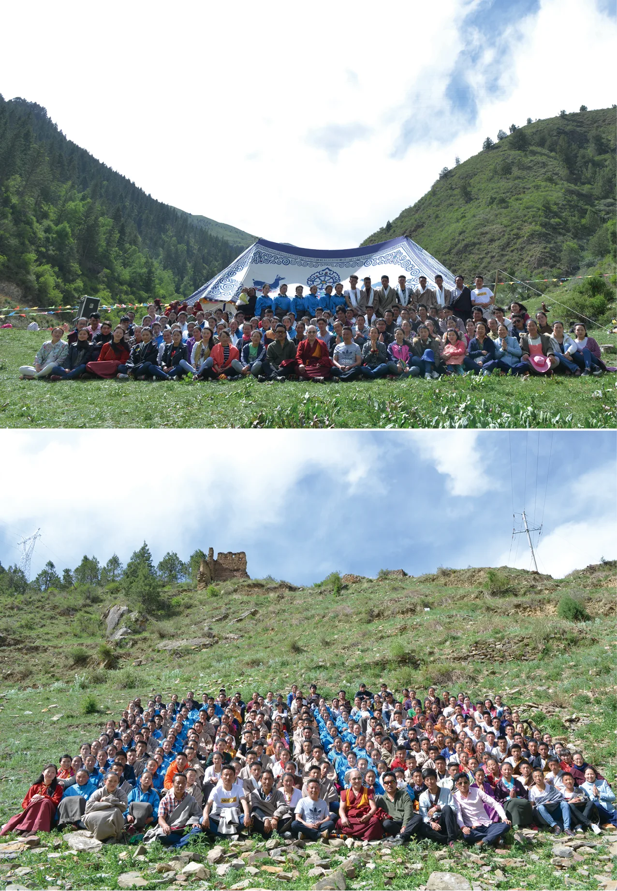

## 给发心老师的建议

2016年6月4日

我们的发心老师都非常认真负责。当然，在相处过程中，你们内部可能会出现一些矛盾或误解，这是无可避免的。佛学院的一些堪布之间也常有意见分歧。我与朵芒寺的几位堪布有时会互相批评，这种情况并不少见。即便是我与慈诚罗珠堪布，尽管我们关系相当好，但在某些问题上也会产生分歧。因此，大家在面对类似情况时，应避免小题大做。

在发心的过程中，责任感至关重要。或许你们现在尚未能深刻体会，但在这里发心两三年后，当你们回到大城市时，可能会发现自己收获颇丰。我们学校位于偏远地区，与大城市相比，这里的学生和本地教师都较为纯真，但另一方面，他们的整体素质可能相对较低。因此，我们能够从他们身上学到一些东西。

在生活条件方面，最初我认为你们在学校的生活环境已经非常艰苦，可是去过非洲之后，我才意识到这里的发心人员其实相对幸福。不管是饮食、住宿，还是基本的生活条件，这里都比非洲好得多。比如你想洗澡，至少可以从这里前往县城。而在非洲，许多地方的生活条件极为恶劣，我们这里相对而言并不算特别艰苦。

大家能够来到这所学校共同发心，确实并不容易。对你们个人而言，这里的薪资待遇有限，不仅无法让你获得名声，还会在某种程度上影响你的闻思修行。针对这一情况，我会尽量为大家提供一些方便。例如，未来我将开许部分发心时间较长的人员聆听一些密法。

我希望各位在发心过程中，能够一如既往地发挥表率作用，这一点至关重要。作为教师和发心人员，我们自身的道德修养尤为重要。具备道德素养的人能够逐渐影响更多的人，这对学校的发展具有深远意义。

今年的毕业生是学校自2006年改制后招收的第一批学生。经过九年的学习，他们即将毕业离校。这里的部分发心人员始终陪伴着这些孩子成长，这份坚持与付出实属不易。在此，我向你们表示衷心的感谢！

如果大家遇到任何困难或疑惑，可以随时与我或朵芒寺的堪布交流，无需有任何顾虑。不管是痛苦、误解，还是一些难以放下的事情，许多问题本身并不严重，往往只是我们的分别念将其不断放大而已。事实上，真正无法解决的事情极为少见。

对于出家人而言，世间上没有需要处理的大问题，否则他应该出不成家。教师也是同样，如果一个人面临严重的问题，比如犯罪，他连当老师的资格都不具备。所以说，在座的各位老师并没有遭遇无法解决的重大困难。当然，生活中难免会有烦恼和痛苦，这是每个人都会经历的，无论你身处何地，即便是在哈佛大学，也无法避免。

我曾访问过哈佛大学和哥伦比亚大学。尽管它们是世界知名的学府，但我注意到其中一些学者有较强的嫉妒心。在耶鲁大学期间，我与几位藏语专业的教师进行了半天的交流。在交谈过程中，我发现他们也承受着诸多困扰和压力，甚至面临一些不太乐观的处境。所以说，每个地方都有其独特的环境和问题，相较之下，我们这里应该算是相当不错的。

希望你们发心教师能够与学校的公办教师形成互补，共同发挥作用。在国家的教育体系中，他们在学校管理方面占据主导地位。你们也知道，我很少参与这里的事务。目前，学校的运作合规合法，各方面均发展顺利。最初，我们仅设有小学部，如今已扩展至初中。因此，我们应该继续在不同场合共同努力，这是非常有意义的。

今天，作为对大家的特别感谢，我给予了各位一串水晶念珠，它极具意义。在今年的金刚萨埵法会上，我特意请僧众为其进行了加持。每位老师不仅可以把它视为纪念品，还可以作为一生中最珍贵的物品之一。

法王曾经赐予我一颗念珠，我至今仍然珍藏着，已经超过二十年了。对于刚才送给大家的这份礼物，不仅在金刚萨埵法会上经由僧众加持，我们今天也特意作了加持，因此希望你们能够好好保存。如果各位遇到任何困难，请随时提出。最重要的是大家要关心我们的孩子。

今天，各位老师可以好好放松一下。我原本计划前往小学那边，但最终未能成行。昨天复查出院后，我便直接来到这里，之后预计在学院待二十多天，期间将安排讲课。如果你们因为事务繁忙而无法听课，我们日后可以提供光盘、书籍等资料，这完全没有问题。因为你们在此发心，可能会耽误一些学习时间，这是可以理解的。

对于所有在学校发心的人员，我会特别为你们加持。此外，若今后有特殊活动，例如灌顶，你们也可前来参加。作为教师，大家应当明确自身在不同场合中的职责，平衡在学校中的定位以及个人定位，这十分重要，如此我们才能把事情做得更加圆满。
