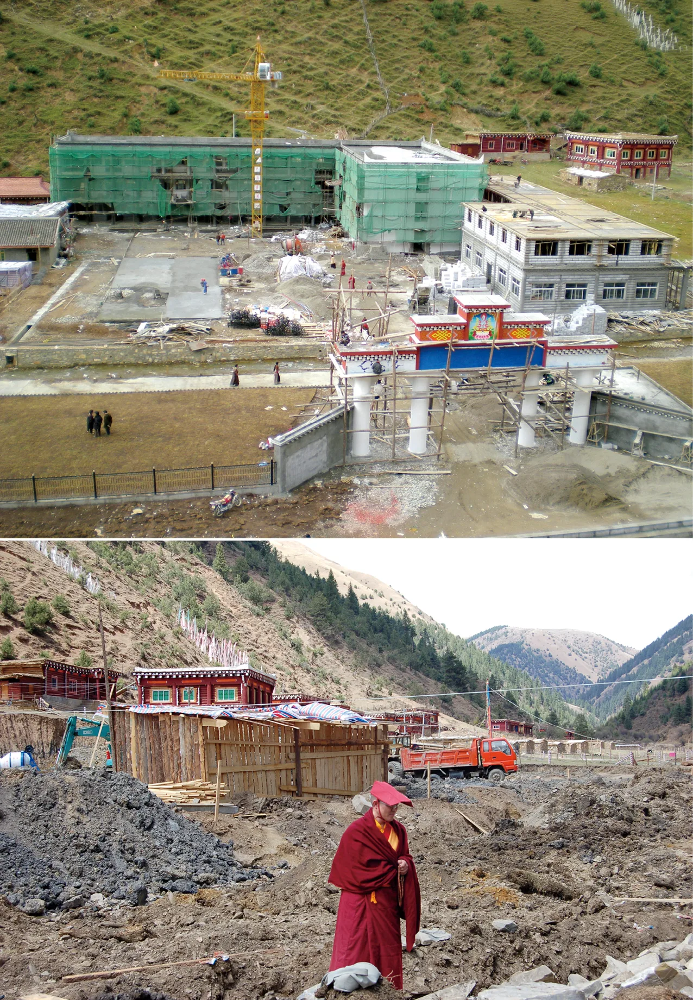
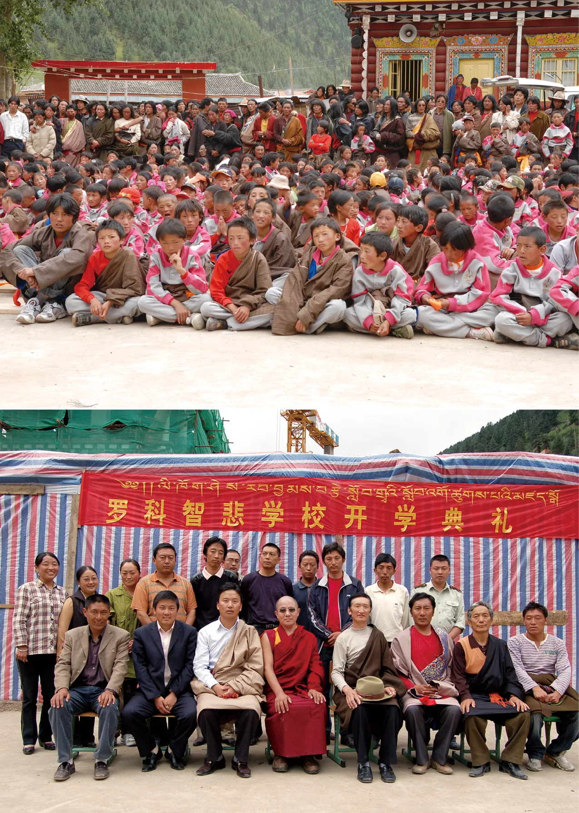
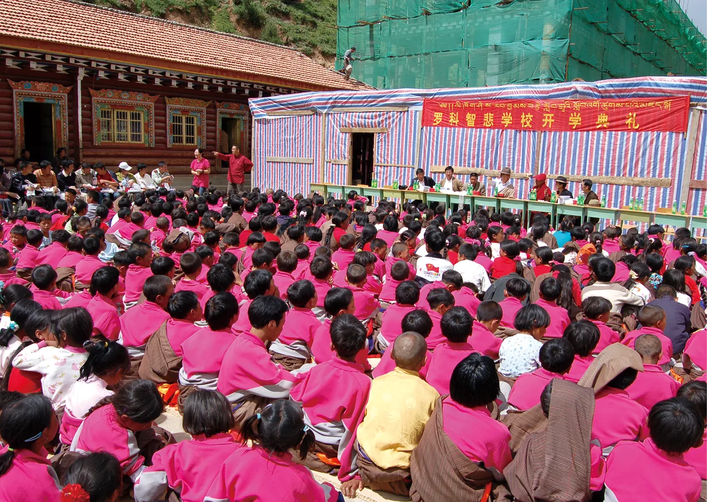
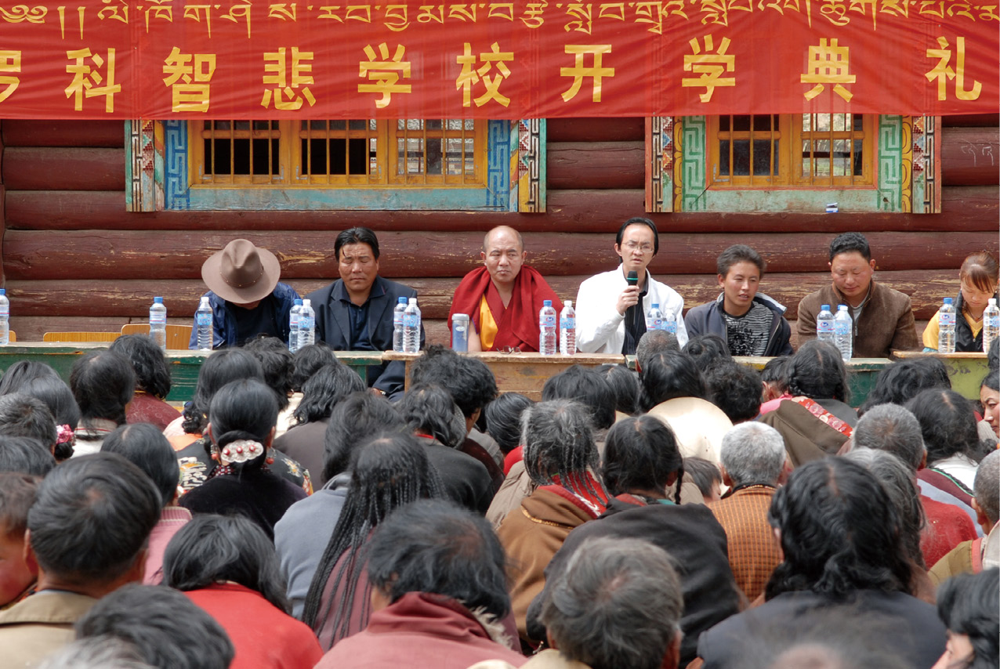
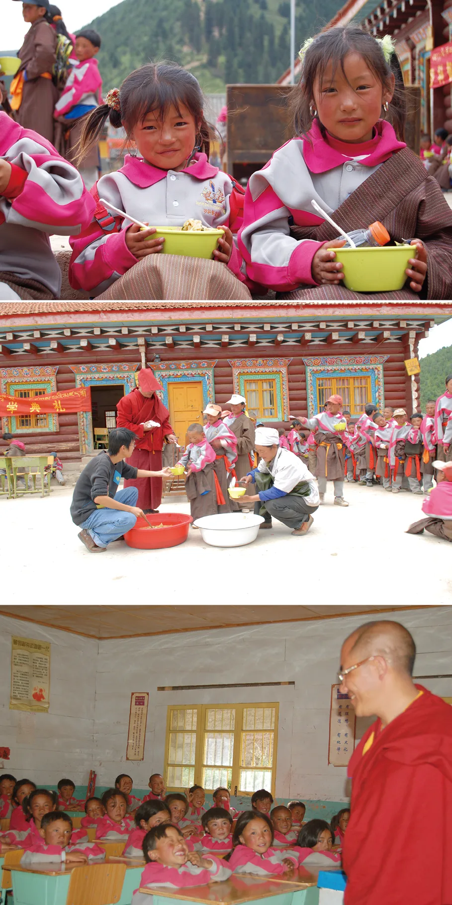
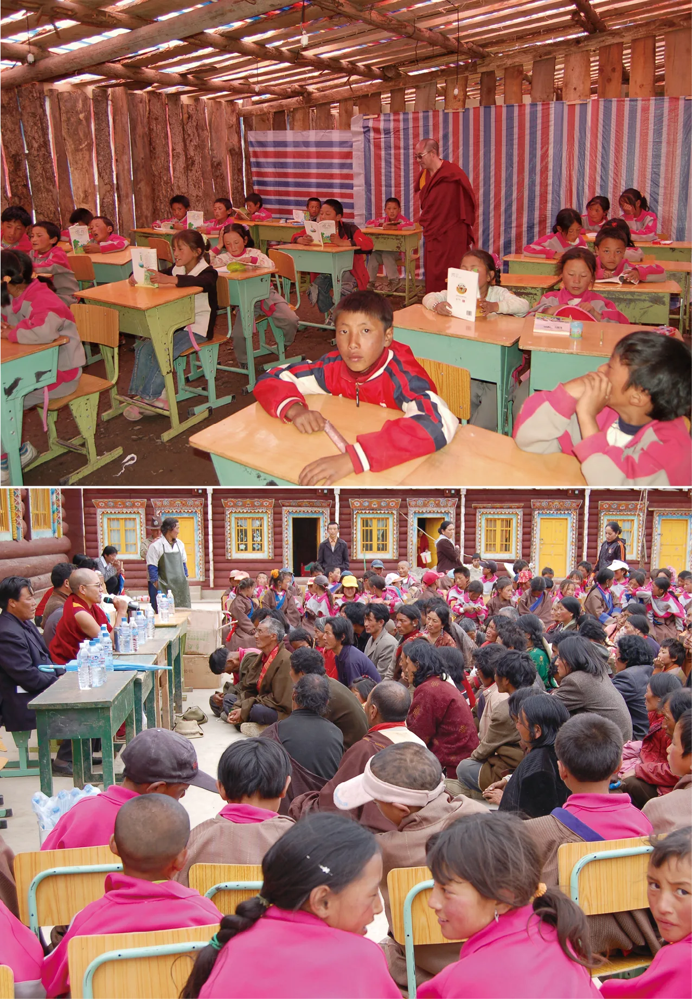
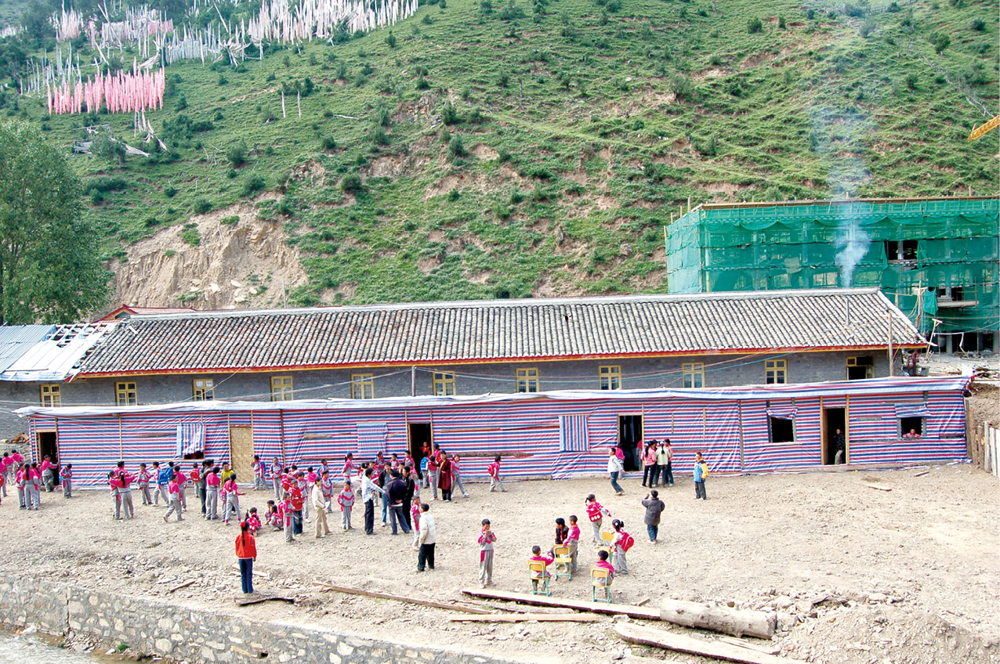

# 罗科智悲学校开学了！

2007年8月21日-22日，上、下罗科玛两所智悲学校开学了！

校园里人声鼎沸、喜气洋洋，来自炉霍不同地方的孩子们，穿着统一的校服，背着一样的书包，高高兴兴、蹦蹦跳跳地跑进各自的教室。见此情景，我的心情难以描述，种种往事一下子涌上了心头——

近年来，世界各国对藏文化的研究越来越热衷，然而作为藏族人，却对本民族的文化越来越漠视。为了继承和弘扬藏族传统文化，我一直希望能改变藏地极度落后的教育状况。后来有次去杭州，我看到了潘昌州居士的小孩，她只有十几岁，但却对儒家文化朗朗上口，佛教文化如数家珍，现代知识也非常精通。见到这番情景，我打从心底里羡慕，心想：“我家乡的很多小孩如果也能这样，那该多好啊！”

可遗憾的是，我家乡由于历史传统所致，家长对孩子受教育并不重视，宁愿让孩子在家抚养弟妹、牧羊放牛，也不愿意把他送进学校。以致这些小孩长大后，连自己的名字都不会写，一旦出门在外，根本不知道怎么坐车、点菜、看病、买东西……即使迫于国家罚款等压力，有些牧民不得不让孩子接受义务教育，但也因为教学质量差、师资力量薄弱，孩子们得不到系统而规范的教育，中途辍学的现象比比皆是。长此以往，藏地文化将面临什么样的前景呢？

在我的心中，一直有个潜藏已久的建校愿望，没想到潘居士及其爱人梦雅在这方面也有所打算。后来因缘聚合，其他信施纷纷发心，今年春办妥有关手续，正式开始在炉霍建校。如今，经过多方努力及十方信施的大力支持，我们把上、下罗科玛原来的小学扩建成了“智悲学校”，并出资修建了办公室、教学楼、医务室、电脑房、餐厅、浴室、厨房、操场、宿舍等设施（预计明年全部完工），同时说服老乡把自己的孩子送来读书。

本打算在学校彻底竣工之后，明年正式招收学生，但后来发现，有些孩子年龄过大，如果今年不上学，也许一生都没有读书的机会了。于是经过大家商量，决定在工程没有完成的情况下，提前招生。

按当地教育部门的规定，学校要在8月20日开学。我翻开日历一看，8月21日是个吉祥的日子，于是把这一天定为开学日。并且提前一个月在罗科玛供护法的例行法会上，以公告的形式通知大家。

时间：8月19日

地点：上罗科玛智悲学校

处理完学院的事情后，我就急急忙忙地赶到这里开会。上罗科玛智悲学校的教职员工，除了极个别有特殊情况以外，全部都参加了会议。

经过与教育局的多次商量，四朗达吉被任命为第一任校长。他毕业于四川省藏校，曾于上罗中心校担任校长达5年之久，为人性格稳重，具有丰富的教学管理经验，并对传统文化有很大的兴趣。

汪基老师被任命为副校长。以前我在甘孜师范学校读书时，他就是当时的副校长，后来又担任过炉霍党校校长、统战部部长、县文教局局长、县中学校长等职。多年来一直研究传统文化，对教书育人相当擅长，在音乐书法等方面也有一定的造诣。这次是我亲自邀请他的。

在职教师共有24人，素质高，修养好，教学能力强，具有无私奉献的精神。这是与教育局协商后安排的，也是从全县里精挑细选出来的。同时我还尽自己的力量，为两所学校各物色了英语老师等部分教师。

今天的会议，主要是传达十几天前的会议精神。那次会议为期两天，在炉霍康北宾馆召开。三所学校[^1]的校长、副校长、教导主任，以及慈诚罗珠和我，关于开学典礼的安排、未来的教学计划、师生的管理制度等重要问题，各抒己见，在不离国家教育制度的基础上，结合藏族特色制定了一系列的学校章程，并实行教师责任制。

在会议结束时，汪基副校长曾坚定地说：“我们今后一定要对学生负责、对堪布负责，相信会把智悲学校办得很圆满！”从各位老师的眼神和发言中，我可以明显感觉得到，智悲学校的未来充满光明。

时间：8月20日

地点：上罗科玛智悲学校

上罗科玛智悲学校的背后，是高耸入云的萨琼神山，山脚下满是笔直挺拔的柏树。过去许多修行人在此终年闭关，至今仍有一些遗迹依稀可寻。林中有各色鸟儿发出妙音，小兔子在灌木丛中窜来窜去，无处不透露着深山的生机。这座后山稳固意味着学校稳定，不会发生什么变化。前山巍峨壮观，长满茂密的松树，预示着这里将人才济济，德行犹如松树般不屈服于任何逆境。东边有吉祥的路和吉祥的河，象征着学校培养出来的人才，会给众生普降智慧甘霖。南边两河相融代表智悲双运，绵延的马路则象征财源广进。北边的山形走势，可以阻挡外界一切违缘。按照佛教的说法，这里风水极佳，从来没有来过的人，一进校门也会有不同的感觉。

此处距县城约26公里，风景怡人、空气清新、河水甘美无比，远离大城市的污染嘈杂。尤其在春天，万物复苏之际，柔和的水声、欢快的鸟声交融在一起，恍如世外桃源。

今天，上罗科玛、下罗科玛、宗塔、宗美等地的老乡们，兴致勃勃地带着孩子来报到。令人欣慰的是，以前凡是学校开学，家长都会迟十多天才把孩子送去，从来不准时报到。而这次，他们有的骑着马，有的坐着车，有的是千里迢迢走路过来，有的是一辆摩托车后面带三四个小孩……从不同地方浩浩荡荡地来到学校。校门口人山人海、尘土飞扬，孩子们的眼神中充满了期待和希望，这是罗科玛最热闹的一天！

起先我们在今年夏天作过调查，估计会有400多孩子来上学，但在登记的时候，人数远远超过了学校能容纳的数量。欣喜兼无奈之余，我们只好临时改变主意，规定今年只收8—12岁的孩子，7岁的孩子等明年再来。

接着，孩子在家长的陪伴下开始面试，这由我和四朗达吉校长亲自负责，主要是调查学生年龄、测量身高体重、了解家庭状况。在这个过程中，我看到几个十三四岁的孩子，他们非常想读书，但害怕自己太高不被录取，就在测量身高时把鞋子脱下，膝盖偷偷弯起来，眼巴巴地盼望能过关。其实我也是15岁才上一年级的，可是现在的小学都规定，超龄学生不好统一管理，故而不予招收。看到他们失望的表情，我实在是不忍心拒绝，就把特别想读书的几个孩子留了下来。那些个子太高的，只好把他们地址记下来，安排他们先回去。当时我心里就默默地承诺：“假如以后因缘具足，我会为你们办一个扫盲班！”

面试过关后，孩子们在没有换校服之前，潘居士让他们排好队，一一照相以作档案备存。试想，这些脏兮兮的小家伙，假如哪一天不小心成了历史人物，再回过头来看看自己刚入学时的“光辉形象”，真不知心里会作何感想？

然后，他们去汪基副校长那里报名登记。再由几位老师分组带领，到附近的小河里洗澡、换校服、剪掉脏脏的头发……

从早上八点开始，一直忙到下午六七点，总算把400多个孩子安顿好了。晚上回去休息的时候，我浑身都非常痛。白天忙着给孩子面试，看着他们天真的模样，自己似乎也回到了童年时代，一天不知不觉就过去了，现在才觉得特别特别累。但即便如此，我心里也被快乐填得满满的——只要这些孩子有读书的机会，自己再痛再累也无所谓。

时间：8月21日

地点：上罗科玛智悲学校

上午对开学的相关事宜作了安排，同时给今天才赶来的孩子进行面试及入学登记。

下午2点，大家穿着藏装，说着藏语，举行了具有藏族特色的开学典礼。今天不像昨天那样乱，孩子们整整齐齐地坐在一起，里面穿着校服，外面搭着藏袍，一个个兴奋得难以抑制，处处洋溢着喜悦与吉祥。

典礼是由汪基副校长主持。首先发言的是文教局康永局长，他的一番话生动深刻，赢得了大家的一致好评。他说智悲学校的建立具有历史意义，过去牧民们对教育不够重视，此举将改变本地的传统观念，带动炉霍的经济文化发展。因其立足于继承藏族传统文化，故一定会培养出大量的优秀人才。

其次，是上罗科玛乡的党委书记洛吾江村。他提出了“三个感谢”“三个希望”，话虽不多，意义却相当深远、耐人寻味。

第三位是本校校长四朗达吉，他总结了自己在上罗中心校当校长的多年经验，筹划了智悲学校未来的管理模式。

最后由我进行总结，给大家介绍了创建智悲学校的缘起、自己办学的目标，并提出了对老师、家长、学生的希望等等。

典礼结束之后，县乌兰牧骑演出队特地献上了精彩的节目。这支队伍从成立到现在，一直深受藏民们的喜爱，环境再怎么苦，演出再怎么累，都愿意把快乐带给人们。他们精纯的演艺，就连北京、广州、深圳等地都大为倾倒。很多山里来的孩子从来没有见过这些，一个个张着大大的嘴巴，眼睛眨也不眨一下。有个小孩甚至连大气都不喘，每演完一个节目，就拍手跟旁边的人大叫：“哎哟哟，真是精彩啊！”本来这些节目很精彩，但对我而言，那个小孩脸上的表情更精彩，我和康局长一直看着他，不停地笑。还有个小孩情不自禁地站了起来，一板一眼模仿着演员的动作，很陶醉地边唱边跳……

演出过后，我们给出席的老师和嘉宾敬献了吉祥哈达，并馈赠了唐卡、水晶观音等开学纪念品。然后由各个老师分班，将孩子们带到自己的教室。有些小孩什么都不懂，老师就一点一点耐心地教，告诉他们一些有关常识。整个校园里，空气中荡漾的都是温馨。

回来的路上，我坐在车里静静地看着窗外的风景，清澈的小溪、葱郁的绿树、美丽的鲜花、幽静的山谷，飞快地从眼前一一闪过。其实我们的人生也是如此，几十年光景一眨眼就过了，可能在不久的将来，这些孩子已经长大成材，在他们的人生中，8月21日或许是最值得纪念的日子了。

时间：8月22日

地点：下罗科玛智悲学校

今天也是一个良辰吉日，不仅是下罗科玛智悲学校，慈诚罗珠堪布创办的江达文殊学校也在这一天开学。

江达地区是堪布的家乡，那里原有一所村校，但是近五六年来一直荒废、无人问津。看到当地孩子没有读书的环境，堪布非常痛心，于是发心重修学校、重新招生。今天，有135个孩子背着书包，高高兴兴地步入校园，他们从此摘掉了文盲的帽子，迈进了智慧的殿堂。开学典礼于上午举行，下午圆满结束之后，堪布便赶往成都放生去了。

我是早上7点钟从炉霍出发，前往学校。学校左边是潺潺不息、弯弯曲曲的罗科河，很多小鱼在里面游来游去。小时候的我，放牦牛时经常来这里洗澡，舒服地躺在草地上，阳光暖洋洋地洒在身上，野花的清香阵阵袭来……童年的一幕幕，仿佛就发生在昨天。

右边是清澈透明的玫清河。不远处则是供护法的玫清神山。每年6月13日，男人们身着盛装、跨上骏马、手持经幡，轰轰烈烈地来这里祈祷护法神。他们将供养物投入烈火，顿时桑台上冒起滚滚浓烟，欢声如雷、响彻云霄，人们掏出大把大把的风马抛向天空……玫清神山虽然不高，但当地的护法神远近闻名，凡是罗科玛地区的人，不管走到什么地方，他都会如影随形地加以保护。在这方面，有无数精彩的故事和见闻，我本人也曾有过亲身经历，这正应验了《陋室铭》中的那句话：“山不在高，有仙则灵。”

听老人们说，罗科河与玫清河的交界处，本是一块巨大的磐石，天长日久，磐石上才慢慢有了肥沃的土地。这里是一块福地，能在这里安家落户的人，会有意想不到的福报临身。最早朵芒寺就修建于此[^2]，而今的下罗科玛智悲学校，也是坐落在这片土地上。

这所学校初建于1964年，是我30多年前的小学母校。尽管学校的学生一直不多，但却培养了不少人才，当地很多高僧大德、领导干部、知识分子，都是从这里孕育出来的。以前父母把弟弟送来这里上学，半年后我去看他，他死活也不愿待在学校，没办法，我只好把他带回家。半个学期之后，迫于政府罚款的压力，家人又把我送进学校。那时候我很喜欢读书，小学跳了两次级，两年多就学完了所有课程。据说在我们毕业的那年，全校共有63个学生，可以说是最兴盛的时期了。

而如今，几经起伏，在校的学生越来越少。不仅如此，学校建筑也极其破旧，围墙倒塌，教室漏雨，冬天刮大风时，满屋子都飞扬着灰尘……这里成了炉霍条件最差的一所学校，外面的老师都害怕调到这里来教书，本校的老师也总是抱怨连天，天天盼望着离开这个地方。

前几年，我以偶然的因缘来到这里，看见惨不忍睹的教学状况后，发愿要建一所正规的学校。从去年开始，我们便着手进行筹划修建，并多次给当地老乡开会，号召他们把孩子送入学校。有些老师得知这个消息后，也积极响应，自愿来这里教书。如今师资力量相当雄厚，老师们个个负责任、能吃苦，具有忘我的精神。今年春，罗科玛的老百姓还发愿3年或7年不杀牦牛，我想这也是现世现报吧，他们的善心马上就成熟在了自己孩子的身上。

这里原本是我的母校，也是我智慧成长的摇篮，对这儿的一山一水、一草一木，我都有着深厚的感情。许多人劝我把主要的精力和财力投在这里，但是经过考察后，发现上罗科玛交通发达、地理位置优越，能为今后办初中提供大量方便，因此最终将上罗科玛设为总校。然尽管如此，此处的教学质量并不比那里差。

今天是下罗科玛智悲学校开学的日子，入学手续与昨天大致相同，从8点起孩子们一一面试，然后登记、换校服。由于这里生源不多，故招收年龄是7—12岁，前后共有133个孩子入学。与其他地方比起来，数目尽管不多，但就当地而言，已经是前所未有的奇迹了。

在面试时，一个小孩推着小铁圈飞奔而来，不禁让我想起了自己上学的第一天——那天下着鹅毛大雪，我沿着人行道，也是一路开着“小铁车”来上学的。我招手把他叫过来，仔细地看了一下，铁圈是焊起来的，没有一个接口，比我那个好推多了。以前我住在老喇嘛家，每天放学回家时，都要一路推着它。当时我的衣服尽是破窟窿，寒风一直往里面灌，相比之下，他们现在的条件实在不错。

下午2点，副乡长根登达吉主持，正式举行开学典礼。首先致辞的是文教局文副局长，他先是对相关人员表示感谢，然后说自己对本校的未来充满信心，按现有的教学体制一定会培养出有前途的人才。

其次，是乡党委书记帝桑讲话。他在下罗科玛当了5年书记，多年来对入学状况非常关心，今天见到这么多孩子上学，心里特别高兴，谆谆告诫老乡们要珍惜这个来之不易的机会，并强调了学习文化知识的重要性。

然后，由第一任校长谢妥总结教学经验，宣布学校的管理章程。

最后，我介绍了重建学校的缘起以及办校的意义所在，并对家长、老师、学生提了一些希望。

典礼结束后，学生们表演了精彩的节目。之后，给相关人员赠献了吉祥哈达和开学纪念品。今天的天气格外晴朗，蓝天、白云也分外绚丽，被青山绿树环抱着的智悲学校，仿佛是人间天堂。

下午六七点钟，老师们把学生带到教室，叮嘱一些需要注意的事项。此时此刻，一切的热闹归于平静，太阳也慢慢落山了。在夕阳的余晖下，我怀着对母校、老师的感恩之情，默默地离开了……

建学校确实压力很大，最近几年，医生一直劝我多休息，千万不要劳累。可是一想到这么多孩子能有读书的机会，自己付出一点也没有什么。

当今社会上，没有知识简直寸步难行，倘若一辈子都像牦牛一样目不识丁，那是相当可怜的。现在的孩子即便有读书的机会，也因大多数学校片面地重视升学率，忽视对道德品质的培养，以致人与人之间缺少基本的关爱。但愿罗科智悲学校能弥补这一缺憾，通过我这点微不足道的努力，使他们在掌握文化知识的同时，能真正对人类和民族有利。

在此，也由衷感谢支持此次办学的有关部门和相关领导、潘居士的广大发心、圆见法师的尽心监工，以及圆真法师、王翠明、李梦琳、张平、阿水、赵源清、龚德因等十方信施的鼎力相助，并为这些孩子提供校服、书包、文具盒、杯子等学习用品和生活用品。最后，祈愿他们学业有成，早日成为利益众生的栋梁！

索达吉

二OO七年农历八月十五

于洒满月光的喇荣菩提书房

[^1]: 上、下罗科玛智悲学校，以及江达文殊学校。
[^2]: 后来因为种种原因，迁移到现在的朵芒沟。
