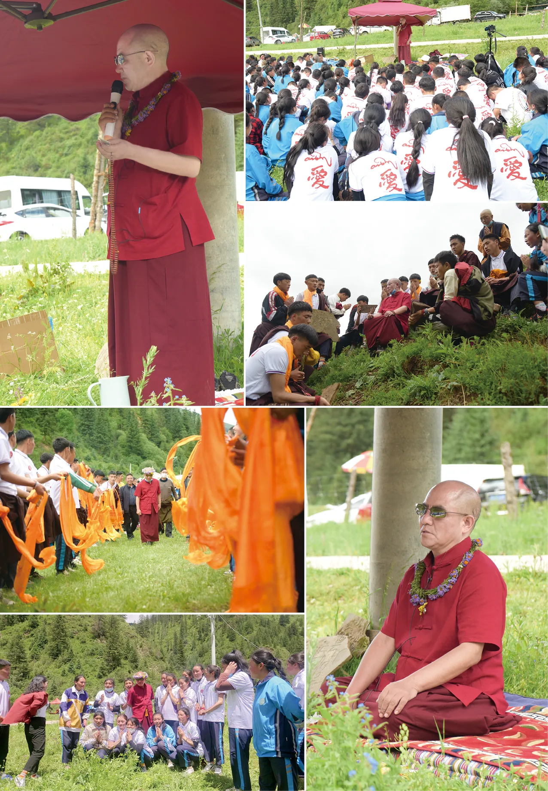

# 莫忘师恩

——上罗科玛中学毕业班耍坝子

2020年6月28日

今天，我们来到这个被称为“辛苦的山谷”的地方，在此处的上方还有一个山谷名为“痛苦的山谷”。关于这些名字的由来，我也不是很清楚，因此大家也不必太在意。今天踏上了“辛苦的山谷”，我下午的确感到有些辛苦，所以现在说起话来可能不太流畅。这算是一个缘起，也算是一个玩笑吧。

我们今天拿了一些我十一岁时刻制的玛尼石，给大家看一看。这块石头上刻了一个“舍”字。根据佛教教义，如果我们曾经杀过一些动物，可以通过刻玛尼石来清净罪业。这些石头是我在十一二岁的时侯刻的。这块刻得稍微好一些，但仍不算十分理想。不过对于一个十几岁的小孩来说，我这样的雕刻水平也算是可以吧。

今天早上，我与几位老师和学生一同爬了一座山。途中，我们经过了一处我大约三四十年前居住过的地方。站在那里，我不禁联想到米拉日巴重返故乡时的情景。米拉日巴回到家时，发现母亲已然去世，妹妹也不在了，这让他倍感伤感。而我今天也有相似的感受。

虽然我的弟弟和妹妹依然健在，但我的父母都已离世。此外，一些年长的亲戚朋友也已相继离去。因此，当我再次踏上那片土地时，表面上虽然感到欣慰，但内心却异常沉重。时过境迁，人生无常，不管是父母还是亲人，最终都会离我们而去。

今天，我首先想表达的是，这次活动可算是我们学校师生的一次“耍坝子”。由于种种原因，我们聚集在这个山谷之中，象征性地一起游玩，大家也玩得十分开心。这里无论是山、水还是树木，都构成了优美的风景，鸟语花香，天气也非常配合，为我们的活动提供了极大的支持。

为了今天的“耍坝子”，许多人员前前后后做了很多工作，他们十分辛苦。有些老师在活动前做了大量的准备工作，比如采购物资、搭帐篷、准备食物等，这些任务都非常繁重。今天我们玩得很开心，这有赖于大家的辛勤付出。因此，我想借此机会向大家表示衷心的感谢！

对于即将毕业的同学，我昨天已经向你们提出了五点期望，并进行了详细的讲解，现在就不再重复了。今天，我想特别提醒各位毕业生，我们学校的条件在上罗科玛、下罗科玛和宗塔等地来说相对较好。因此，当你们前往其他学校时，心理上需要提前做好准备。

不管是饮食、衣物，还是其他生活物资，你们未来的生活条件都可能与以往有所不同。此外，你们的前程中可能会遇到许多意想不到的情况。因此，我希望每一位学生都能为将来的各种变化和挑战做好充分准备。这是我今天给大家的第一点建议。

第二点建议是关于文化传承的。我们学校有许多德育老师，而我们平时也重视佛教中关于心地善良的教育，这是非常难得的。如今藏族文化正在逐渐消失，藏传佛教也有逐渐衰败的迹象。作为藏族人，我希望在座的每一位学生都能尽量秉持我们优秀的文化传统。

上师如意宝曾说：“莫舍己道，勿扰他心。”不管身处何种境况，我们都不能舍弃自己的道，这一点至关重要。因此，我特别希望每一位学生都不要舍弃自己的道，同时也不扰乱别人、不伤害其他众生。这是我对大家的第二个希望。

第三个希望，大家不要忘记班主任以及众多老师在过去九年中辛勤地培育自己的恩德。他们为大家所做的事情真的非常不容易。哪怕是一位仅仅为你们上过一节课的老师，我也希望你们不要忘记他的恩德。

说实在的，我始终对我的老师怀有深深的感恩之情。我记得在小学三年级时，有一位老师曾给我上过一堂数学课，内容是关于无限循环小数的，比如10除以3，答案中会有不断重复的“3333……”。这件事我去年也提到过，直到今天，我依然对那位老师心怀感恩。

无论未来你们成为卓越的领导、商人，还是其他成功人士，我都希望你们能够始终铭记每一位老师对你们的恩德。这是我今天提出的第三点希望。

现在，我准备给大家一个加持品，也是一份礼物。这是法王如意宝圆寂16周年的纪念法会上所发的加持品。一般来说，只有参加涅槃法会的人才能获得，其他人是得不到的。这个加持品装有法王如意宝的头发、衣物，以及他随身携带的一些加持物，它们都极为稀有，异常珍贵。

如果你们没有信仰，那就另当别论。如果你们有信仰，或者对法王如意宝有虔诚的信心，那么这份加持品确实是非常难得的，也是无上的至宝。今天，我们将这份加持品赠予这里的学生、老师及所有发心人员，每人一份。

我们会首先发给老师，然后再发给各位同学，大家可以从这边排队领取。最后，我们一起念诵《普贤行愿品》，以此发愿回向。
