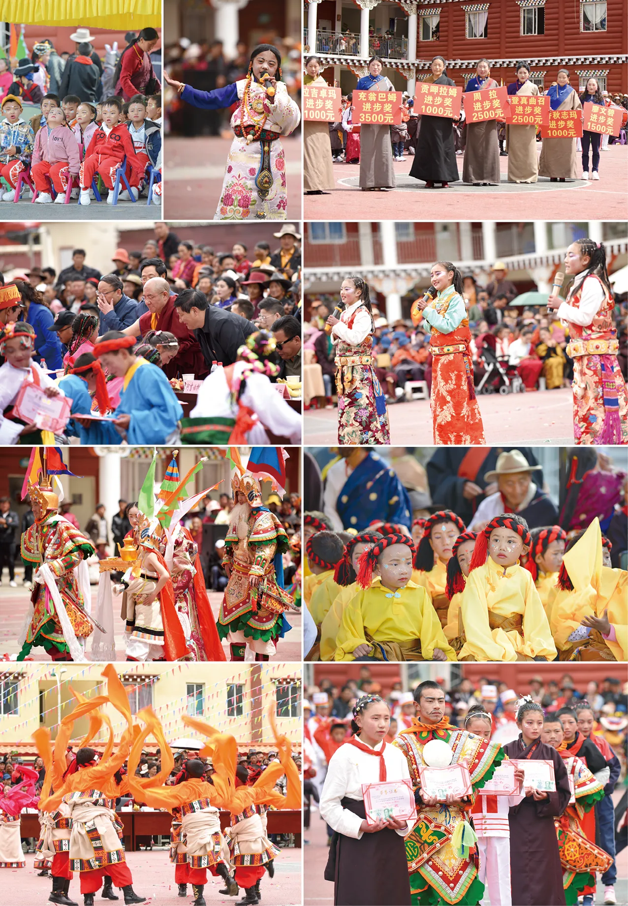
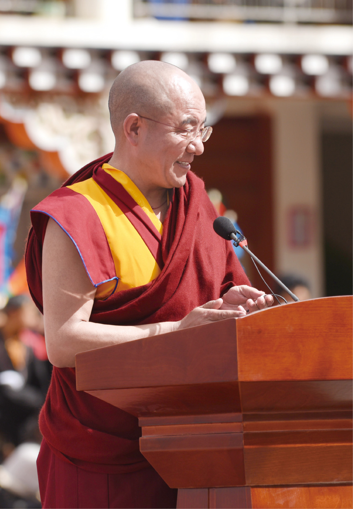

# 进步、目标、价值

——上罗科玛智悲小学六一节开示

2019年6月1日

关于上罗科玛学校的历史，昨天我已经简单地介绍过。事实上，这所学校最早建于上世纪六十年代，但由于种种原因，学校的发展并不是特别理想。

根据教育局2006年的档案记载，上罗科玛学校当时只有45名学生和4位老师。后来，在家长以及各界爱心人士的共同努力下，各种资源不断汇聚，学校得以逐渐发展。正如前面几位所提到的，如今我们的学生人数已经有一千九百多人，教师队伍也有一百六十多人。

无论是从学生人数还是从教学质量来看，我们在短短的十三年中可以说取得了一些进步。这些进步并不是依靠个别一两个人或几个人所取得的，而是大家共同努力、共同奋斗的结果。因此，我希望在座的各位能够持续不断地努力。

我今天要强调的第一件事情是，从现在开始，无论是学校的家长还是领导，都要重视孩子们的英语学习。大家都知道，中考也好，高考也好，语文和英语科目的满分都是150分。而在藏区，藏语和汉语的成绩分别是按50%计入语文科的总分。因此，如果我们现在不重视英语学习，将来孩子们想要考上一所好的学校，几乎是不可能的。

如今，世界的变化非常迅速。从现在开始，我们必须重视英语教育。我们这里的英语水平特别低。一方面，我们希望能够请到一些英语水平较高的老师，希望有关部门能够给予支持。另一方面，我也希望家长们从现在开始，就能重视孩子们的英语水平培养。

据说在青海，那里的一个班级中有一半的学生对英语感兴趣，而在我们学校，一个班里最多只有两三个孩子对英语有兴趣，其余学生几乎都对英语毫无兴趣。在这种情况下，老师的教学工作也难以开展。所以，从现在开始，我希望在座的各位都能够重视英语教学。这是我今天要说的第一点。

第二件事情，现在这个时代变化非常快，十年、二十年之后，整个世界将发生翻天覆地的变化。面对这样的形势，所有的孩子们一定要从小开始学习电脑和信息技术。否则，我们将无法跟上时代的步伐。

目前，在汉地和其他一些先进的地方，许多小学生对软件、硬件以及各种电脑操作程序都掌握得非常熟练。而我们学校的学生，连用电脑打字，无论是英文、汉文还是藏文，都非常困难。因此，从现在开始，我们的学习方式必须要有较大的转变，只有这样，我们才能跟得上这个时代。

第三件事情，如今在国际上，我们藏族的文化、宗教以及所有传统知识，都受到世界上许多有识之士的高度重视。他们对此趋之若鹜，并且正以各种方式希求、学习这些知识。然而，我们许多藏族人自己却没有充分重视这些像如意宝一样极其珍贵的知识，甚至有些人还将其完全抛弃。这实在是一件非常可惜的事情。

我非常希望在座的各位家长以及有识之士，能够珍惜我们几千年传承下来的文明知识，千万不要让它们消失。否则，我们这一代人可能会成为历史的罪人。

今天的最后一点，我想对家长们提出一个希望。现在，许多家长常常抱怨自己的孩子成绩不好，或者在其他方面有各种问题。其实，孩子的成绩有一半取决于家长的教育和管理方式。如果家长只是把孩子送到学校，就认为孩子的所有问题都能够得到解决，把全部希望都寄托在老师身上，这是不现实的。

全世界那些对自己下一代特别重视的民族，一直以来都非常重视孩子的教育。因此，我们希望所有家长，不管是对孩子的作业表现、日常行为，还是其他方面，都能够给予足够的关注。

如果家长自己都不关心孩子，只是把孩子送到学校后就不再过问，就像把石头扔到地上一样置之不理，等到考试时再来抱怨，这样是没有任何意义的。毕竟孩子是你的骨肉，各位家长都应承担起应有的责任。

我们老师的精力和时间都是有限的。正如刚才所介绍的，学校现在有一千九百多位学生，而教师只有一百多人。老师们不仅要负责学生的管理，还要在德智体美等各方面培养学生。如果我们要求老师在所有这些方面都能取得显著成效，这无疑有一定的困难，也会给老师带来不小的压力。

教育是一个非常漫长的过程，因此我希望家长们能够长期、持续地关注自己孩子的成绩和成长情况。

今天是国际六一儿童节，这是一个特别的节日，而且今天阳光灿烂，天气非常好。在这样美好的时刻，我希望在座的各位能够一如既往地在各方面继续努力。

我今天想要讲的有三点：第一，我们每个人都需要不断进步；第二，我们要有目标；第三，我们要学得有价值。我今天提出的就是这六个字——进步、目标、价值。

我们做任何事情，如果没有进步，是没有意义的；如果没有目标，那就是盲目和莽撞；如果没有价值，那同样也没有意义。因此，我们所做的任何事情，都一定要有其意义和价值。

其他的内容我就不多说了，以免耽误大家的时间。非常感谢今天所有参会的各位，谢谢大家。
