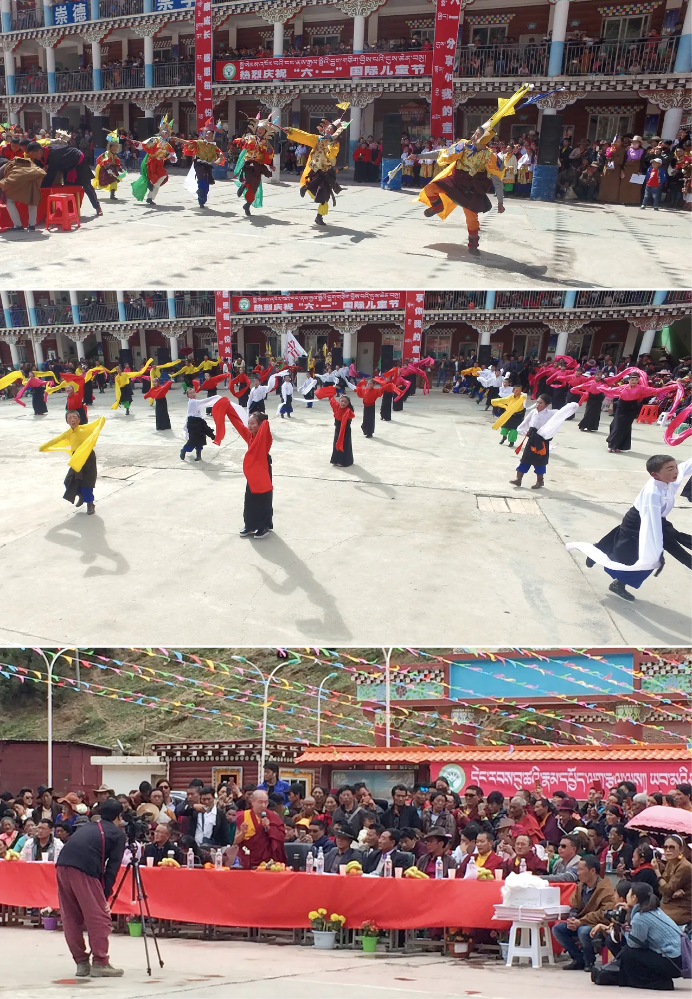

## 部落间应当和平共处 （一）

——上罗科玛小学开示

2017年6月1日

今天是一个很好的机缘。以往我们在庆祝六一儿童节时，我的话并不多，但今天由于一些特殊的原因，我可能会多说一些，希望各个小组能够对我们最近的情况有所了解。至于今天的天气，可能会比较好，也可能会不太理想，但无论如何，现在是夏天，下雨对我们来说也是一件好事。

首先，正如刚才校长所提到，政府的各相关部门与本校的各级管理层，对学校给予了极大的帮助。同时，罗科玛乡的居民也长期以来持续为学校提供了支持。此外，从道孚到色达之间的许多家长，在学校的各个方面都给予了大力的支持和配合。因此，我在此向大家表示衷心的感谢。

刚才有些领导也提到，这所学校自上世纪六十年代便已成立。多年来，本校培养了许多优秀的人才。从2007年开始，由于政府与捐助者的精心合作，我们得以扩大学校的规模。在过去的十年里，我每年都会参与学校的六一儿童节活动，只有一年因为手术原因而未能出席。

我们可以看到，这十年来本校的部分学生在英语、藏语和汉语的学习上，以及在德育和信誉方面，都取得了一定的进步。这些成绩确实来之不易，是大家共同努力的成果。

我们做任何事情都不能虎头蛇尾，如果最初大家充满热情，但后来却逐渐冷淡，那是很不合理的。所以，无论是上级的领导，还是其他各方面的人员，我希望大家都能一如既往地努力。

接下来，我想对家长们提出一个希望，希望你们一定要让孩子完成学业。也就是说，孩子们小学毕业后，应当层层而上，继续升读初中、高中，甚至考入大学，而不要在中途放弃学业。因为孩子要真正成长为一个有用的人才，就需要通过长期的学习来积累知识。

对于各位同学，我也想提出一个希望，希望大家能够成为真正有用的人才。为此，我们需要在智慧上全面提升，不管是英语、汉语、藏语，还是其他学科的知识，我们都要持续深入地学习。总之，大家一定要追求全面的发展和进步。与此同时，我个人以及这里的发心老师和志愿者们，也会一如既往地共同努力。

我最后想说的一点是关于学生们的未来目标。老师不应仅仅鼓励学生成为公务员或医生等传统职业。事实上，这些职业在当今社会的机遇并不是十分充足。在培养人才时，老师应帮助学生掌握一技之长。今天，我看到你们小学的每个班都制作了许多艺术品，例如帐篷，还有一些与藏地农业和文化相关的作品，这些都非常值得鼓励。

未来的社会需求不仅局限于公务员等传统职业，还包括大数据等很多新兴行业。因此，我们需要从小教育学生运用不同的资源，培养他们适应未来社会的能力，这是非常重要的。

今天，在参加六一儿童节活动时，我的内心一直感到遗憾，或者说是悲哀。因为自2007年以来，宗塔那边的学生每年都会参加这个活动，家长们也会陪同，不过唯独今年，他们全都缺席。从世间的角度来看，部落之间的冲突可能是一种规律，并有其成因；但从出世间或者人道主义的角度来看，这种冲突是令人难以接受的。

我们罗科玛部落的许多家长今天也来到这里。前段时间，罗科玛和宗塔之间曾发生过一些矛盾和冲突。然而，经过几个月来相关部门以及佛学院多位堪布的积极调解，这些问题基本上已经得到解决。从今以后，我特别希望我们罗科玛的人能够以正确的态度对待这件事情，不要小题大做。所谓“冤冤相报何时了”，如果我们继续纠缠下去，只会带来更多的麻烦。

罗科玛的许多人都是有信仰的人。既然佛学院已经参与了这次调解，而事情也已经得到妥善解决，它已经不再是一个大的问题。因此，关于今后的赔偿问题，或者其他的相关事宜，希望罗科玛和宗塔双方都能按照协调后所达成的约定，共同认真遵守。

今天，我们共同庆祝了2017年的六一儿童节。明年，也就是2018年，我希望到时侯宗塔的学生也会来到这所学校，与大家一起学习。当然，如果罗科玛的人对我非常排斥，对我的所作所为完全不认可，我也无能为力。

但如果你们尊重我，那么在2018年的这个时候，我们应该像往年一样，以非常和蔼、和气的态度，与宗塔的学生和家长们一起度过儿童节。只有这样，我们的民族才能发展，我们的社会才能保持安定。相反，如果我们始终以仇恨的眼光互相对待，恐怕许多问题将会难以解决，甚至一些小事也会变得越来越复杂，这是毫无意义的。

我在这里还想提醒大家一点，关于罗科玛和宗塔之间的事情，目前较大的冲突已经全部得到解决。万一今后你们在个人之间出现一些小的摩擦、冲突或矛盾，这些问题应该以你们个人的名义来处理，绝不能以宗塔或罗科玛部落的名义，或者以的集体的方式来解决。如果有人以集体的方式来解决私人问题，不管是政府还是佛学院，都会按照既定的方式来处理。希望相关人员能够牢记这一点。
