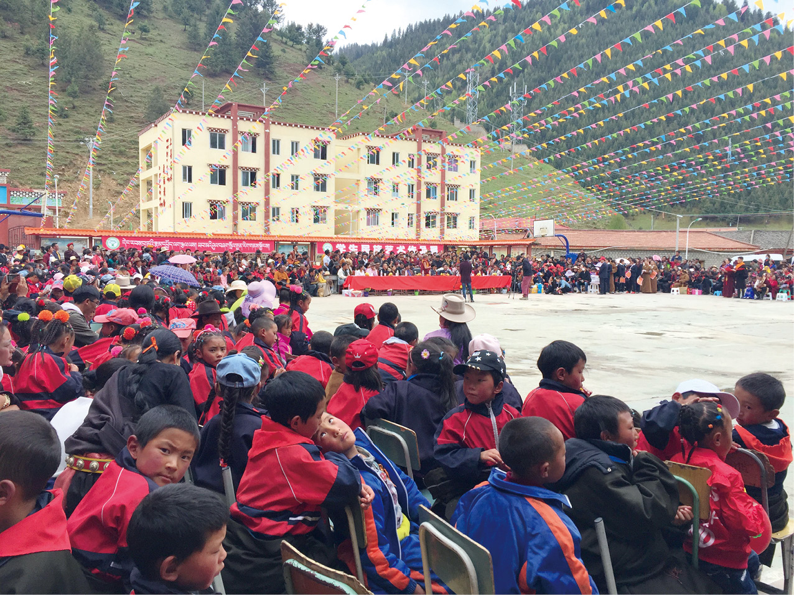
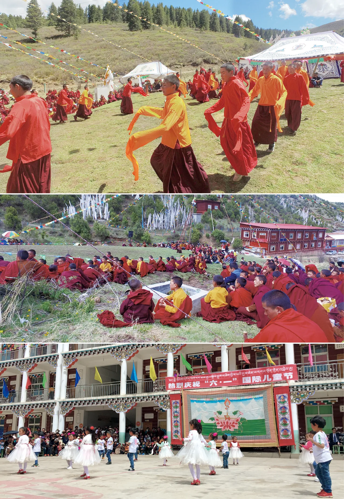

# 部落间应当和平共处 （二）

——下罗科玛小学开示

2017年6月2日

今天是六一儿童节，下罗科玛学校特意为此安排了相关的庆祝活动。在仪式开始之前，我要衷心感谢本校的全体老师、学生和家长。

同时，我还要特别感谢来自各地的慈善人士，正是因为大家的共同努力和支持，我们学校目前已经有四百多名学生。这所学校始建于上世纪六十年代，但由于多种原因，学校在人才培养方面的条件一直十分有限。自2007年起，我开始参与这里的建设工作。

如今，无论是在教学还是管理方面，学校都取得了一定的成绩，这些进步离不开在座各位长期以来的付出和无私奉献。值此六一国际儿童节这一美好时刻，我谨代表学校及我个人，向所有支持和参与学校发展的各界人士表示衷心的感谢。

今天，校方为大家准备了许多精彩的节目，其中包括极具历史渊源的岭舞。能够观赏岭舞，是一种殊胜的缘起，这种金刚舞会为观众的今生来世带来极大的利益。自2007年以来，学校一直重视古文化传统的弘扬，同时也倡导古文化与现代文化的融合。除了去年因为我身体需要接受一次小手术而未能参加外，过去十年间，我几乎每年都参与了学校六一节的活动。今天，我们再次在这个美好的环境中相聚，在吉祥的氛围中载歌载舞，我觉得非常有意义。

今天在此，我要特别强调两件事情。第一件事情是，本校校长今年因为工作需要进行了岗位调动。他在上罗科玛学校和这里从事教育工作已有十年，对我们学校作出了极大的贡献。在他任职期间，本校基本上没有出现过任何问题，教学和德育等方面也有了显著提升。从今年开始，根据上级的安排，他将调任至上罗科玛，承担相关的领导工作。

由于校长的离开，我校的原副校长将升任成为校长。他是炉霍人，刚才大家已经见过。此外，我们的副校长和教导主任也将由新任人员接替。这三位老师将是我校的主要领导班子。

我今天想要强调的是，无论是我们的老师、学生，还是家长，大家都应一如既往地配合学校的管理团队，保持这里和谐的氛围。确实，我们学校在内部团结和各项事情上一直做得非常出色。虽然我们有三四百名学生，但在过去十年中，这里从未发生过任何意外。无论是在安全还是其他方面，学校的各项工作一直都非常顺利。

对于原校长的离任，我个人也感到依依不舍，但一切都是无常的，我们也只能坦然面对。希望我们的家长、学生和老师们都能尊重和敬重学校新任的领导班子，并且服从他们的指示，依教奉行。同时，我们也要发自内心地感谢原校长，感谢他多年来对我校老师和学生的所有付出，这份恩情大家都应铭记于心。

我今天要讲的最后一件事情，可能也是最近大家比较关注的，就是关于罗科玛与宗塔的事情。这件事情经过多方面的努力，包括我们佛学院许多堪布的积极调解，目前基本上已经得到解决。我们希望此事能够真正画上句号。

我们藏民族在发展、科技等方面，能力本就比较薄弱，如果内部还不断发生冲突，形成冤冤相报的恶性循环，那么，无论是对宗塔还是对罗科玛来说，都不会有很好的前途。现在，双方已经基本达成共识，后续的许多问题也已经得到解决。因此，我希望从今天开始，宗塔和罗科玛两地的人都不要再互相挑起是非。

藏族在发展方面本就十分有限，如果内部还不断产生矛盾，我们的处境只会变得更加悲哀。如果罗科玛的人对我有所尊重、尊敬，希望大家与宗塔的关系能够恢复到原来的和谐状态。昨天我已经在上罗科玛学校讲过这些内容，今天在此也再次重申这一点。

在下罗科玛学校这里，宗塔学生的人数本来就不多。我希望今后我们这两所学校能够更加开放，欢迎宗塔的学生和家长前来交流和互动。对于这次事件，我希望大家都能以宽广的心态来对待，这是非常有意义的。

还有一件事情值得一提，最近在炉霍县城，我们发现一些年轻人之间经常发生冲突，但这些冲突与部落之间的矛盾无关。今后，宗塔人与罗科玛人之间的所有冲突都只是个人行为，这些个人之间的冲突并不能代表各自的部落或者寺院。对于这些问题，我希望在座的家长，尤其是与这次事件相关的家长，能够充分理解。

最后，我还有一点想要强调。我们要特别感谢从各地来到这里发心的人员，不管是发心人员、工作人员还是志愿者，我都由衷地表示感谢。前段时间，我们在上罗科玛学校做过一次统计，目前我们在朵芒寺、上罗科玛学校和下罗科玛学校共有64位长期志愿者，其中有出家的，也有在家的。他们当中有些人放弃了原来高等的职位、优越的生活条件，主动来到藏地，为本地孩子们的成长和教育无私付出。对此，我真的非常感谢。

此外，无论是国家文教系统的老师，还是发心老师和代课老师，我都对这里的各位老师表示衷心的感谢。许多老师多年来一直默默无闻地奉献自己，正是因为你们的付出，我们的学生在智慧、德育和综合素质等方面，确实有了显著的提升。

我们做任何事情都不能虎头蛇尾，一定要坚持下去。这种坚持与我们的情感和付出密不可分。尤其是作为老师，更需要具备长期的韧性，以及持续的投入和职业责任感、使命感，这一点非常重要。因此，我要特别感谢下罗科玛学校的所有老师。

你们的管理在某种意义上已经取得了一定的进步。去年，我们的学生在初中考试中取得了全州范围内罕见的优异成绩，这让大家感到非常惊讶。没有人会想到，我们学校能够在短短几年内在公考方面取得如此显著的进步。现在，甘孜师范学校以及当地一些较为优秀的高中，都纷纷到我们学校来招收学生。他们发现我们与其他学校之间的成绩差距非常明显。为此，我再次感谢所有老师一直以来的付出和配合。

前段时间，我对新任校长及管理团队说，现在是你们的时代，你们应当在学生的教育和成长，以及教师管理等各方面，继续保持并付出更大的努力。今天，我也想特别向在座的老师和相关技术人员强调，希望你们能够一如既往地给予学校管理层支持和关注。我的发言就到此为止，谢谢大家。
