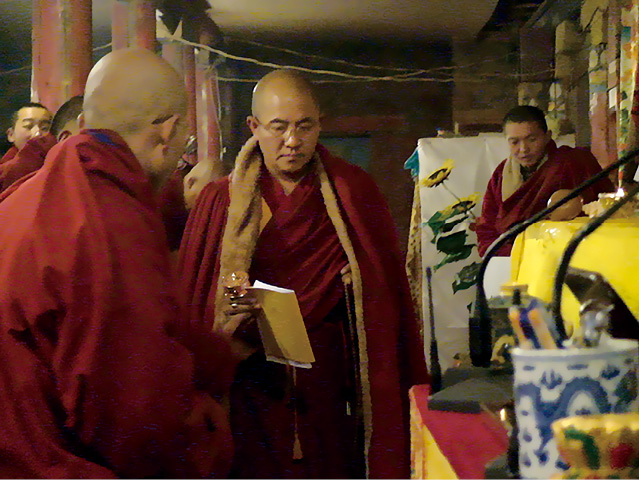
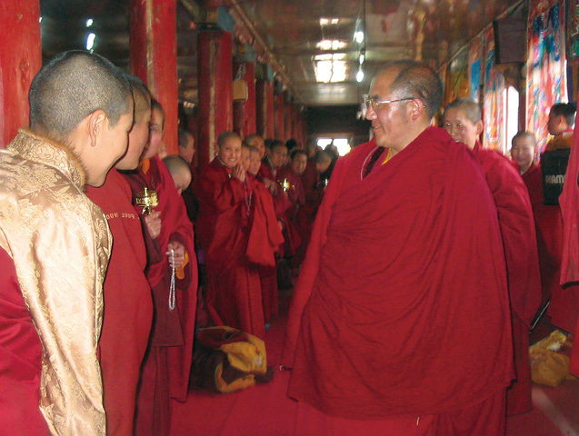

## 2006年金刚萨埵法会开示

2006年6月6日

今天的任务，主要是给大家念一下法王如意宝的意伏藏《金刚萨埵修法如意宝珠》的传承。

这个仪轨我已经翻译出来了。念修的时候，大家可以按照这个来念，也可以念《大圆满前行》中的金刚萨埵修法。总的来讲，这次开的是金刚萨埵法会，念的也是金刚萨埵心咒。

## 忏悔的必要性

法王如意宝曾说过：“如果念诵四十万遍金刚萨埵心咒，即使犯了密宗根本誓言，也能得以清净。”因此，参加这次法会的道友们，无论如何一定要完成四十万遍心咒。有些人刚到学院可能身体不适，在八天内实在完成不了，那你们回去以后，应该尽快在规定时间内念完。

我今天再三给大家强调了，希望你们尽快念完四十万遍金刚萨埵心咒，无论是在学院还是在家里，最好不要间断念诵。如果有事耽搁了几天，这个问题不大，但不要拖太长时间，否则可能无法按时完成，这一点也要记住。

为什么一定要念金刚萨埵心咒呢？因为对于没有学佛的人来说，可能一直浑浑噩噩地过日子；对于刚学佛的人来说，回首往事会发现自己一生造下了很多罪业。如果不赶快忏悔的话，那么往昔所造下的罪业，很难得以清净。

大家应该清楚，死亡来临的时候，往往让人措手不及。如果没有好好地忏悔，还想着明年再修、后年再修，或者过几十年以后再修，这是没有任何把握的，因为每个人的生命都是如此脆弱。而且在这段时间里，让大家念四十万遍心咒，这个要求也不算过分。前段时间，益西彭措堪布也提倡每个人念诵一百万遍、一亿遍金刚萨埵心咒，听说很多人都已经报名了。所以，大家一定要认认真真地念诵。

在乔美仁波切所造的一些忏悔仪轨中说：“如果一个人念诵四十万遍百字明或者一百六十万遍金刚萨埵心咒，即使今生造下五无间罪或者破了密宗的根本誓言，本该堕入无间地狱或金刚地狱，但依靠金刚萨埵法门的加持，这样的罪业也能得以清净。”因此，如果你们觉得自己一生当中造的罪业确实非常多，现在想要忏悔清净的话，那就要念诵四十万遍百字明或一百六十万遍金刚萨埵心咒。若能如此，按照乔美仁波切所引用的续部教证可以说明，一切罪业都能得以清净。

麦彭仁波切的《金刚萨埵修法仪轨》中也引用了《金刚萨埵威猛三调伏续》的教证，其中说：“若持诵此心咒十万遍，则破根本誓言亦得清净。”而法王如意宝在解释这个教证时说：“以前是念诵十万遍，但现在是末法时代，必须乘以四倍，即念诵四十万遍。”

由此可见，高僧大德们所说的基本相同，只不过念诵数目上略有不同。而为了保险起见，我希望大家即生当中能够念满160万遍金刚萨埵心咒。如此一来，所造的罪业一定能得以清净。

有些高僧大德曾说：“有智慧的人，虽然造下很大的罪业，但他懂忏悔的方法，不会感受痛苦；而愚笨的人，虽然造下很小的罪业，却感受巨大痛苦。为什么呢？因为罪业没有得以清净，甚至会增长放大。”

前两天，门措上师也给大家灌顶了。灌顶以后，就可以更好地修金刚萨埵法门，这的确是一生当中难得的机遇，每个人心里都应该有欢喜心。因为如果没有遇到这么殊胜的忏悔法门，我们的罪业根本没有办法清净。如果罪业没有清净，修法也不可能成功，往生就更困难。

## 忏悔时认真念诵

因此，我们这次一定要抓住机遇。尤其是到了学院以后，希望大家不要四处散乱，除了念诵以外，其他任何事情都不重要。这么多的僧众一起共修，功德是相当大的，可以说百千万劫难值遇。所以，无论是新来的居士还是学院的常住道友，这次都应该认认真真地念诵。在念诵的过程中，不要夹杂各种绮语。如果边念边说闲话，这样功德并不是很大，就像在金银中掺杂微量的铁或铜，那再也起不到纯金纯银的作用。莲花生大士也说：“杂有绮语诵一年，不如禁语诵一月。”

法会一共是八天，最后一天念《药师经》。这几天，我听说有些人实在是待不下去，已经下山回去了，这真的很可惜！其实，如果是到一个地方造恶业，有些人肯定能待得下去；而在需要造善业的时候，反而很难待得住。

大多数人一辈子都在造恶业，忙于世间各种琐事，这次好不容易得到八天共修的机会，如果还是待不住的话，那实在有点可惜！当然，你们想要回去，我也不会阻拦。听说明天就有很多人要下山，可能是因为已经提前买好了机票，或者有各种各样的原因。总之，希望你们回去以后，也一定要完成四十万遍金刚萨埵心咒。

前几天，有些常住道友跟我说，他想去别的地方看病，我了解后知道他病得不是特别严重，就没有同意。不过，我突然想起来自己明天要下山看病，有点不好意思了。（众笑）

还有一些人，以养病为借口想去泡温泉，我说：“你身体应该不要紧，还是待在学院好好共修吧。”这次的机会非常难得，大家这几天一定要好好地念诵。尤其是进入经堂以后，任何人都要保持安静，不要说话影响别人。如果实在想聊天或睡觉，那你可以待在家里不出来，这样别人也看不到你在干什么。

我大概观察了一下，大多数人表现得还不错，在经堂里基本上没有说话，一直非常认真、精进地念诵。但也有极个别人，可能习气现前所致，在经堂里一直说闲话，这样很不如法。这样不如待在家里好一些。

这几天，大家一定要认认真真地念诵，每天所规定的数量要按时完成。这次的金刚萨埵法会各方面因缘很好，为什么这样说呢？法王如意宝圆寂后，可能很多人都没有想到，还能有这样的共修机会。但是以后还有没有机会呢？这个很难说，毕竟“好花不常开，好景不常在”。大家应该清楚，这么殊胜的道场，这么多的僧众一起共修，在如今末法时代，并不容易找到。而这样的道场能住世多长时间，谁都没办法确定。

我希望你们来到学院后，尽量不要空耗每天的时间，要励力忏悔自己所造的罪业。从无始以来，我们不断累积大大小小的罪业。昨天有一个人说，她以前在医院的妇产科工作，已经帮人堕胎超过一万次，也算是杀了一万多人。这么严重的罪业，如果现在还不好好忏悔，果报是非常可怕的。必须依靠四对治力进行忏悔，立誓绝不再犯，这样才有清净罪业的可能性。就像指鬘王一样，由于受到恶知识的迷惑而到处杀人，杀到第999个人时遇到了佛陀，后来在佛陀的点化下，他意识到自己造下了弥天大罪，于是精进忏悔，最终净除罪障，成就了圣果。

要知道，这是有人愿意公开发露忏悔，还有很多城市里的人根本不懂忏悔，反而每天吃各种海鲜，造下许许多多的罪业。如果没有好好忏悔，带着这些罪业前往来世，去处真的很难说。

这么多僧众一起共修的机会的确非常难得，以后你们还有没有机会再来学院也很难说。一方面个人的寿命不定，另一方面很难有机会每年都来一次学院，大多数人都只能隔五六年或十年才来一次。因此，在这几天里，大家一定要认认真真地念诵。

## 忏悔的具体观想

在修法方面，按照法王如意宝的这个仪轨来修就可以。或者，也可以按照乔美仁波切的修法观想。在自己前面的虚空中，观想莲花和月轮，上面出现一个吽字，接着吽字刹那间变成金刚萨埵，身色洁白，心间旋绕着金刚萨埵心咒，然后降下甘露，融入我们的平凡身体，最后自他众生身体内全部遍满甘露，自相续中无始以来造下的罪业都变成脓血、烟汁等不清净的形象，从足底、肛门等处排出体外，向下流去。再观想自他众生的身体犹如水晶般内外透彻，一切变得极为清净。紧接着金刚萨埵和颜悦色地对我们说：“善男子、善女人，你的一切罪障都已清净。”然后观想金刚萨埵化光融入我们的身体，自己的身体与金刚萨埵无二无别，以这样的佛慢，念诵一遍回向文。这种修法比较简单。

《大圆满前行》中也有一个金刚萨埵修法，大家按哪个修都可以。总之，有些仪轨中说把金刚萨埵观在自己的前面，有些仪轨中说观在自己的头顶，一定要按照相应的仪轨来修持。如果有观想能力的话，最好依靠四种对治力来忏悔，即所依对治力、厌患对治力、返回对治力和现行对治力。

下面，我简单介绍一下四种对治力。

第一，所依对治力。将金刚萨埵作为皈依境，在金刚萨埵为主的十方诸佛面前，一一发露忏悔。

第二，厌患对治力。对于往昔自己所造的一切罪业，就像吃了毒药一样，生起强烈的后悔心。

第三，返回对治力。发誓从今日起，纵然遇到生命危险，也绝不再造罪业。

第四，现行对治力。依靠修金刚萨埵、修菩提心、修空性等方法来观想念诵。而金刚萨埵修法中的现行对治力，是指观想金刚萨埵并念诵金刚萨埵心咒。

在具足四种对治力的情况下进行忏悔，罪业一定会得以清净。所以，大家要好好地观修四种对治力。当然，每一刹那都不离四种对治力，对凡夫人来说是做不到的。那就每天从早到晚尽量做到每一座都好好地观想，把自己所造的罪业在金刚萨埵面前发露忏悔，这个功德是相当大的，最后再把善根回向给一切众生。

有些发心人员特别忙，但我还是希望你们能早上跟着僧众念一遍仪轨，然后一边念咒一边发心，最后一座回向时，再跟着僧众一起回向，希望大家不要忘记这一点。

## 尽量参加《入行论》学习

在学院常住的道友，每一天都有闻思修的机会；而山下有些寺院的出家人或居士，大多数都没有这样的机会，因此对于很多佛理都不太明白。这几年以来，我们也在想办法利用现代科技来传播佛法，我也计划在一年之内，把《入菩萨行论》传讲圆满。

如果没有遇到违缘，我还会传讲五部大论以及其他论典。当然，报名的人多也可以、少也可以，对我而言都无利无害。但对你们来讲，最好是多听受一些佛法。虽然现在大城市里有很多修行人，表面上看也已经皈依了很多年，但其实对于佛教的基本教义、发心的分类等等，很多道理都不太懂。看到这样的情景，我也深深感到众生真的很可怜。

有些虔诚的居士，虽然对佛法有强烈的渴求心，但却始终找不到有缘的善知识。当然，我也不是说自己就是善知识，只不过我在佛学院依止法王如意宝多年，还是有一定的佛法基础，也具足基本的因果正见。虽说凡夫人讲法肯定有错误的地方，但也未必全错，毕竟是依靠上师的窍诀和高僧大德的论典来进行宣说的。

如果你们之前没有报名学习《入菩萨行论》，也可以选报其他论典，这都会有很大的利益。否则，身处大城市当中，如果没有善知识的引导，即便你现在很有信心，也会越来越淡漠，最后彻底消失不见。因此，希望大家以后能有一种自我约束力，这一点很重要。

我今年真的很高兴。因为之前有些在家居士来学院，最多只能待七八天或一个月，回到城市以后，他们几乎没有听法的机会，总是到处找上师，却始终得不到真正的教言。而现在，借助于现代科技，就可以给各位提供听闻佛法的机会。我们也知道，大家工作和家庭的压力都很大，既然现在你们没有出家的机会，那就每天挤出一些时间来听法。否则，所谓的皈依佛门，恐怕只是名相上的仪式而已，意义并不大。

## 尽量多参加放生

归纳而言，我今天对大家有三个希望。

第一，希望大家在这八天当中好好地念诵金刚萨埵心咒。

第二，希望你们回到城市以后，不要整天搞一些世间法，把全部精力放在世间琐事上，这样最终一点收获也没有。一定要合理安排自己的时间，利用一部分时间来听受佛法，这在目前来说还是比较方便的。

第三，我们学院每年都会发放生倡议书，前段时间可能把这件事忘了，后面准备补上。一般来说，每年学院都会以慈诚罗珠堪布、益西彭措堪布和我三个人的名义来劝大家放生，然后你们自己也要劝身边人行持这样的善举。

大家应该清楚，一直以来我都特别强调放生。因为在这个世界上，最可贵的就是生命。实际上，众生的生命都是一样的，包括我们以前吃过的那些动物，它们的生命同样珍贵。地球上的每个生命都有生存的权利，而人类有时候为了维护自己的利益，为了满足一时的口腹之欲，残忍地杀害了很多众生，践踏了其他众生最宝贵的生命。因此，我们应该以爱心来保护所有的动物。龙猛菩萨在《大智度论》中说：“诸余罪中，杀业最重；诸功德中，放生第一。”所以，希望你们回去以后尽量多多放生。

今年我还有一个要求，凡是参加《入菩萨行论》网络学习的道友，每年至少要参加四次放生。听说有些地方每个月、每个星期都有放生，如果这个实在做不到的话，每年学院开四大法会期间或者其他时间，每人至少要参加四次放生。如果连这一点都做不到，那学习《入菩萨行论》恐怕意义也不大，因为菩提心在他的相续中根本生不起来。

## 尽量多使用转经轮

法王如意宝接近圆寂时曾说过：“末法时代，观音心咒转经轮度化众生的缘起非常成熟，每个修行人都要经常使用。”因此，你们回去以后，空闲的时候一定要使用转经轮。

原本我想在这次法会期间给大家讲转经轮的功德，因为我以前翻译过乔美仁波切所造的《观音心咒转经轮功德》，法王如意宝也讲过一次，但这次时间确实有点安排不开。你们方便的时候，可以自己看一下。

当然，你在城市里面使用转经轮时，旁边人可能会不理解、不接受，但其实现在很多人逐渐对转经轮有所了解，越来越多的西方修行人也开始使用转经轮。它的功德的确是非常大，转经轮完全可以称得上是“见解脱”，因为里面装的都是六字大明咒。

作为修行人，不能对世俗功德法一概放弃。在我们佛学院，一般要求课前课后念诵时都要使用转经轮，所以每个道友每天起码要用将近一个小时。你们在家人回去以后，也应该尽量使用转经轮，如果实在没有时间，也可以在守八关斋戒或念经时用一下。这个功德相当大。

## 把学习佛法落到实处

我刚才讲了，原本这次法会期间我想多传一些法，但最近我的事情比较多，再加上身体也不好，所以后面几天没有安排讲课。现在，大家最主要的任务就是念诵金刚萨埵心咒。如果真的想要听法，你们可以听《入菩萨行论》。

如果我还有剩余精力，过段时间可能会讲《量理宝藏论》。法会结束以后，会让大家休息两天，然后再讲《入菩萨行论》和《量理宝藏论》。益西彭措堪布也是这样安排的，星期三再开始讲课。

过几天我要下山去看病，本来这次不想出去的，但最近身体确实不太好，如果不利用这段时间看病的话，后面可能更没有空了，因为今年学院的事情非常多，而且现在很多化验检查项目，一般一到三天才能出结果。本来这些小事根本没必要解释，但我觉得还是应该告知一下大家。我不在学院时，如果你们有什么事情，可以找相关人员帮忙解决。

我希望这次来参加金刚萨埵法会的人，都能遵守学院的纪律，这一点非常重要。该得的灌顶大家已经得到了，该得的教言也已经得到了，这几天应该一心一意地念诵心咒。

总的来说，第一，好好地念诵金刚萨埵心咒；第二，回去以后尽量参加放生活动；第三，如果你们对佛法有信心，就不要再像以前那样整天浑浑噩噩，应该多听闻一些佛法。

这次法会期间，大家要思维自己往昔所造的一切罪业，然后在金刚萨埵为主的诸佛菩萨面前，一一发露忏悔，如此罪业才能得以清静，可以有把握无惧死亡。

有些人觉得被我摸下头顶就是一种加持，我认为这个不算什么加持，通过讲经说法让你们的相续发生改变，这才是真正的加持。因此，希望以前没有参加《入菩萨行论》学习的人，回去以后能通过各种途径来参加。在这个过程中，大家最好善始善终。

实际上，我作为一个凡夫人，对你们不一定有很大的帮助。虽说我到城市里去，和大家拍个合影，从世间角度来讲，这也没什么不可以的。但我始终认为，如果没有用佛法帮助到你们，尤其是对我特别有信心的这些人，在佛法方面非常欠缺，是让我非常伤心的事情。

对你们来说，亲自来学院常住，过着出家人的生活，个别人可能有因缘，大多数人终生都不一定有机会。而且学院现在还被要求控制人数，以后很难再增加很多人，即使可以增加，在这里生活也有许多困难。

其实，我在学院讲的《入菩萨行论》等课程，你们在外面也能通过各种途径得到音频或视频。这样一来，在家里听课与待在学院没有什么差别。即使你常住学院，也是每晚只有一堂课，其他时候全靠自学。

从我个人来说，也没有其他更好的方法来帮助你们，每次只能通过讲课的方式让大家获得一点利益。为什么呢？因为我在法王如意宝面前听经闻法二十多年，对于上师不可思议的加持也深有体会，很想把这些与你们分享。所以，我希望你们回去以后，不要把听课当作一般事来处理，应该认认真真地对待。

今年对我来讲，压力真的很大，尤其是讲《入菩萨行论》，确实花费了很多时间和精力，有些事情并不是想想就可以办到的。但是，只要对你们有一点帮助，无论付出什么我都心甘情愿。

因此，只要没有出现违缘，我们会尽力通过网络等方式给大家提供学习资料，希望你们能把学习佛法落到实处，这是我今天最后的一点希望。
