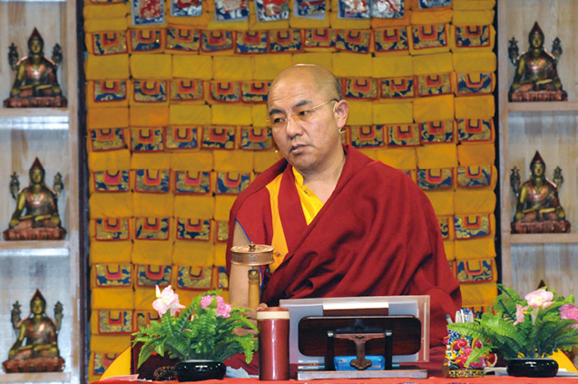

## 2007年金刚萨埵法会开示

2007年5月27日

今天交流的内容：第一个是距离金刚萨埵法会还有四天，以此缘起，我给大家传一下法王如意宝的伏藏法《金刚萨埵修法如意宝珠》；第二个是念诵《远唤上师》的传承，这是法王如意宝造的一个祈祷文，我已经翻译了，前段时间也给学院的道友们传过；第三个是马上到六一儿童节了，因为我今年在建智悲小学，所以最近跟孩子们接触比较多，心里也有一些感触，想顺便跟大家谈一下；第四个是互动环节，大家可以提出问题，然后我们一起交流。

我从屏幕上也看得出来，你们中的很多道友，每一次的菩提讲堂开示都参加了，已经成了“老常住”。虽然我们之间隔着千山万水，但是依靠不共的缘起力和发心力，大家也可以相聚在虚空讲堂，享受一种自由的生活，同时也能对佛教生起信心。所以，最让我高兴的是什么呢？可以通过这种方式来念传承，然后我的一些心里话，你们也能听得到。这些话也许对你们有所帮助，也许没有多大益处，但我想应该不会有什么危害，毕竟这跟世间的网上聊天不同。

## 一定要念诵金刚萨埵心咒

关于金刚萨埵法会，前两天我对来学院参加法会的道友做了简单的开示，今晚因为时间关系不多说，只说一些总的要求。

大概半个月前，我也跟大家说过，希望每个人发愿念诵十万或四十万遍金刚萨埵心咒，相信很多道友已经开始念诵了。法王如意宝说过：“如果有些道友以各种因缘而不能亲自参加金刚萨埵法会，只要圆满四十万遍金刚萨埵心咒，也能得到同样的共修功德。”因此，我想再次叮嘱大家，一定要完成四十万遍金刚萨埵心咒。

你们很多在家人，在生活和工作中造了许许多多的恶业，要想通过其他一些方式让恶业全部得以清净，恐怕有一定的困难，而金刚萨埵在因地时，就曾发愿：“愿我未来现证佛果时，若有众生已造五无间罪、毁坏誓言，只要闻我名号、作意于我、念诵百字咒王，一切罪障都可无余清净，此愿若不成就，我誓不成佛，愿我住于破戒者前，一切罪障都能清净。”如今，金刚萨埵已经成佛。所以，在忏悔业障方面，所有佛菩萨的名号和心咒集聚起来，也比不上金刚萨埵心咒。就像世间大学分物理、化学、语文等专业一样，虽然佛教不用这类术语来表示，但因为每位佛菩萨的发愿各不相同，故而显现上也会有此差别。

总之，任何一个人，只要念诵金刚萨埵心咒，无始以来所造的一切罪业，的的确确能全部得以清净。

很多道友学佛之前，从身体方面讲，会杀生、吃肉、偷盗、邪淫等，做了许多恶业；从语言方面讲，会说妄语、粗语、离间语和绮语等，也造了许多恶业；从心态方面讲，也会对别人产生嗔恨心、贪心、邪见等。因此，不管是佛制罪还是自性罪，每一个凡夫在有意无意之间，肯定造作了种种恶业，一定要诚心诚意地忏悔。佛经中也说，即使是千劫所造的罪业，如果具足四种对治力励力忏悔，自相续也一定会得以清净。更何况我们还遇到了这么殊胜的忏悔窍诀，所以我今晚再三地强调，一定要念诵金刚萨埵心咒！

至于完成心咒的时间，当然越快越好，但如果因为工作等事情很难按时完成，那么拖一段时间，问题也不是很大。现在学院里的很多道友，早上三四点就起来开始念咒忏悔。你们有些人要是不忏悔的话，来世会去往哪里，这个也不好说。因此，我今天的第一个希望，就是大家一定要忏悔。

（堪布念传承）

大家观修的时候，最好按照仪轨的要求，先念皈依和发心，然后在自己前面虚空当中观想金刚萨埵，身色洁白，金刚跏趺坐，手持金刚铃杵，具足圆满报身的十三种服饰，发出无量光芒。一边这样观想，一边想自己从无始以来所造的一切罪业，在上师金刚萨埵面前进行忏悔，然后以祈祷的方式念诵金刚萨埵心咒。结束时，观想金刚萨埵融入自己的身体，自己与其身语意无二无别，于此境界中安住，最后做回向。

这是非常简单的一个修法，比较适合大家，因为修法太广的话，有些人不一定有时间修。今天的讲解也比较简单，要是讲得太广，也担心你们事务繁忙，修行上会有一些困难。归纳而言，一定要先念一遍仪轨，然后再念金刚萨埵心咒，最后观想金刚萨埵融入自己的身体，在这种境界中安住。在这个过程中，上根者可以具足四对治力来进行忏悔；如果做不到，也一定要在金刚萨埵面前发露忏悔。

我们能够遇到如此殊胜的忏悔法门，的的确确非常荣幸。虽然我这几天有很多事情需要处理，但是也都暂时放下了，每天都在一心一意地忏悔。而在座的道友们，应该也造过一些罪业，所以也要在金刚萨埵面前一一忏悔，尤其是与学院这么多的僧众共同发愿、共同念诵、共同回向，这个功德非常大。

这几天，从早上七点到晚上七点之间，大家会一直共修念诵金刚萨埵心咒。不管是个人的收音机，还是所有经堂里的音响，乃至露天的高音喇叭，都会传出金刚萨埵心咒的声音，弥漫整个喇荣山沟。虽然你们所处的环境与这里不同，但是也需要一起忏悔，希望每个人都能发起精进心。

## 呼唤根本上师

《远唤上师》这个祈祷文，实际上是法王如意宝以非常诚挚的信心呼唤麦彭仁波切的。对于后学弟子来说，应该通过这个祈祷文来祈祷呼唤自己的根本上师。

其实，把上师看作佛，继而凭借上师的加持力获得觉受或开悟，在显宗和密宗的修道中是不可缺少的一种途径。前段时间，我们给大家发了一张《上师瑜伽》修法的光盘，很多道友应该都得到了。无论修哪一个法，务必要有一种信心，尤其是把上师观为十方诸佛菩萨的总集，这样祈祷的话，自相续中的智慧和悲心，很容易开发出来。

如果只是从学术方面去研究佛法，即使花很长时间，也不一定有明显的成果。因此，学佛的人既要有智慧，又要有信心，这两者缺一不可，不然就像两只脚不齐整则很难走路一样，修行很难获得成功。

（堪布念传承）

这个祈祷文的相关资料，以后我们会提供给大家。

## 给孩子一份最珍贵的礼物

现在是五月份的最后一周，再过两天就是六一儿童节。1949年11月，国际民主妇女联合会在莫斯科举行理事会议，决定以每年的6月1日为国际儿童节。它是为了保障世界各国儿童的生存权、保健权、受教育权和被抚养权，为了改善儿童的生活而设立的节日。

今天给大家说了以后，过两天，也许你的孩子或亲友的孩子，会得到你的祝福。但我认为，仅仅给孩子一个祝福并不足够，对孩子的爱心教育应该从小开始，让他在爱的氛围中逐渐成长。为什么这样讲呢？现在很多家长认为，把孩子送到学校里面，让他们学好世间知识，父母的教育任务就算完成了。实际上并不是这样，在孩子小的时候，父母就要给他灌输因果不虚、人身难得、寿命无常，尤其是慈爱所有众生的理念，因为学校里不一定有这样的教育。所以，我要给你们安排一个重要任务。不管是你自己的孩子，还是亲朋好友的孩子，你都要送一份最珍贵的礼物，这份礼物是什么呢？就是让孩子们发愿帮助一切众生，不杀害任何众生。

儿童节那天，我也准备到几所学校去，通过各种方法让孩子们发愿，以后一定要爱护所有的生命，就像爱护自己的生命一样。

你们小时候过“六一”，得到的礼物可能各种各样，我也得过一些铅笔。而现在的孩子，读书条件比我们那个时候要好很多，但也有许多值得担忧之处。前段时间，有个领导跟自己的孩子说，现在孩子的学习条件如何如何好，自己读书的时候条件如何如何艰苦。结果，他的孩子说：“这是因为你的命很苦，出生在那个年代，当然会遭受痛苦了。”现在有些不听话的孩子，也会这样来反驳父母。其实，这跟家庭教育有着直接的关系。

在“六一”期间，希望大家能够发愿去帮助一切众生，就像儿歌《种太阳》唱的那样，我们要播种很多颗太阳，一颗送给南极，一颗送给北极，让这些太阳遣除世间所有的黑暗。然后，让身边的孩子也发这样的愿，因为现在社会最缺少的就是爱心教育。当然，你也可以送其他的礼物，但这个礼物不一定会陪伴他一生，而如果给孩子灌输爱心与慈悲，那他可能永远都不会忘记，对他的一生也会帮助很大。

从我个人来讲，也是发自内心地想去帮助一些可怜的孩子。所以，我想从今年开始发愿，为改善他们的学习环境尽一点微薄之力，更重要的是，逐渐向他们灌输佛教的慈悲理念。大家应该清楚，现在很多孩子长大后没有慈悲心，所以我希望你们也能发愿，对自己身边的孩子有一种帮助，经常给他们讲一些做人的道理，这一点非常重要。

## 认认真真地闻思修行

这段时间，大家都在学习《入行论》，希望你们能够认认真真地学习。一般来讲，不管学习任何知识，都不能半途而废。所以，我们打算通过考试来给大家增加一些压力，激发一下你们学习的动力。听说有些道友一听到考试，心里就特别紧张害怕，其实学习世间知识也有很多考试，大家不用过于害怕。也许你们担心自己会考不好，但只要努力了，过程参与了，我觉得这就是一种积极的学习态度。世间的考试，你们从小到大应该参加过无数次，但佛教的考试可能没有参加过。以前法王如意宝讲过，哪怕只是短期内参加闻思、考试，这个功德也相当大。

大家应该清楚，如果想成佛，既要积累福德资粮又要积累智慧资粮。但一般而言，处于凡夫地时，的确很难积累智慧资粮，因为《中观庄严论释》等中观论典里都说，只有证悟空性，才算是真正的智慧资粮。而龙猛菩萨在《中观宝鬘论》里有讲，听闻佛法实际上就是智慧资粮的分支。所以，从佛教的角度来讲，闻思佛法具有非常深邃、广大的意义。因此，大家不要觉得闻思很累、很苦。

我尊重每个人的选择，但内心还是希望你们能够懂得一些佛理。现在世间信仰佛教的人并不少，可是真正懂佛理的人却非常少，这一点你们应该也看得出来，很多佛教徒做的事情总是让人不满意。因此，我个人认为，依靠网络科技来弘扬佛法，让更多的人明白佛法的道理，这是特别好的一个机缘。

只要众生快乐，我也就心满意足了。除此之外，我也没有其他目的，主要就是想尽心尽力给大家传讲一些佛法。因此希望你们能一边做世间的事情，一边认认真真地学习佛法。要知道，我们这个人身非常难得，寿命也很无常，死亡什么时候来临确实很难说，如果没有珍惜现在的机会，真的非常可惜。

依靠法王如意宝的加持，我在喇荣山沟已经待了二十几年。有时候，我也会感到非常惭愧，因为自己的闻思修行和所作所为，并不是特别如法。但有时又想，在末法时代，能够闻思这么长时间，真的感到非常荣幸。因此，我希望菩提讲堂中的每一位道友，都能意识到闻思佛法的重要性。如果有了闻思的基础，那所作所为就会越来越如法，不然社会有这么多阴暗面，你解脱的希望又在哪里呢？

因为我这边经常比较忙，所以菩提讲堂的开示可能半个月或一个月才有一次。我个人的话，不管是给别人讲经说法，还是在别人面前听经闻法，都会尽心尽力。希望你们也能精进努力。

现场互动

⊙ 问：修金刚萨埵时观想不到位，这样是否有功德？

堪布：即使观想得不是很清楚，只是念修仪轨和咒语，功德也很大。当然，如果观想得非常清楚，功德就会完全不同。有时因为生活和工作等方面原因，一边开车一边念咒，也是可以的。

⊙ 问：自相续没有调伏之前，应该安住在家自己学习，还是出去动员别人一起学习？

堪布：自相续没有调伏之前，大家也应该尽量动员别人、帮助别人，不然不知道要等到什么时候才能出门。

我们凡夫人的相续，要通过长期修行才能调整好，但这样一来，度化众生和利益众生的机会就不一定还有了。所以，大家不要认为，度化众生一定要等到获得成就以后，不能这么想。

我们应该这样发愿：“我只要有一口气、有一分能力，就一定会尽力地帮助众生。”我也是这样想的，虽然自己修行比较差，但只要能帮助一个众生，也会尽心尽力，只要还有一口气，就一定要发大心。

⊙ 问：如果一味地去度化众生，没有时间自己修行，死亡到来时怎么办呢？

堪布：度化众生并不障碍自己的修行，你可以一边修行，一边发菩提心帮助众生，这样也可以获得解脱。如果不愿意度化众生、不愿意帮助众生，那你的所作所为不一定能成为真正的大乘解脱之因。

因此，一方面自己应该实修，比如说每天抽出一些时间修持菩提心；另一方面，把一部分时间用在利益众生上，这样不是一举两得吗？

⊙ 问：在发放学习资料的过程中，我们会遇到一些特别想学的道友，但他们并不符合条件，这种情况下可以发给他们吗？

堪布：原则上尽量按我们的要求来发放，但也要视情况而定。如果有些人非常好学，而且信心也非常强烈，那当地的负责人可以根据具体情况来决定。

⊙ 问：我最近在参加本地的金刚萨埵心咒共修，每天从早上三点到下午三点，才念了四万遍，然后明天就要开始上班，肯定完不成四十万遍，怎么办呢？

堪布：如果能完成，就在法会八天中完成四十万遍金刚萨埵心咒；如果不能完成，以后慢慢补上也可以。

⊙ 问：我们这边有很多老居士，因为年纪大了，打坐的时候腿非常疼，请问他们应该如何祈祷？

堪布：我们打坐的时候，由于没有长期串习，刚开始可能会不适应，出现腿痛、分别念多的情况，这些都是正常的。其实，无论做什么事情，都需要经过长时间的反复串习，这样才能习惯。

对于很多老年人来说，打坐虽然很重要，但最重要的是念诵金刚萨埵心咒，忏悔自己往昔所造的杀生、诽谤佛法等罪业，然后一心一意地念阿弥陀佛。因为汉传佛教净土宗的念佛法门，对于老年人或者闻思能力不强的人来说，是非常好的一种方便方法。

⊙ 问：我们按照《菩提道次第广论》和《入行论》的进度，每天都在学习菩提心的教言，请问修持菩提心的次第是什么？

堪布：无论是学习《菩提道次第广论》还是《入行论》，都要有一种长期的耐心，不要认为听了短短几堂课，就什么都懂了。

现在《入行论》已经讲到116课，但据我了解，很多道友都没有跟上进度。前两天，我给各个地方的负责人打电话，有些说跟上了学习进度，有些说落后了三四十堂课，如果照这样下去，整部论的学习不知道什么时候能完成。所以，大家应该尽量抽出一些时间，哪怕是晚上不睡觉，也要争取赶上进度。

事实上，我们的要求并不高，没有让你们每天都学习。当然，如果你们每天都学，那再好不过了。即便不能如此，一个礼拜当中听两三堂课，也完全跟得上进度。因此，在赶进度方面，希望大家不要太懈怠，否则以后的学习也很难完成。

至于修持菩提心的次第，首先要修愿菩提心，也就是发愿度化无量无边的众生，愿他们获得佛果。大家应该清楚，凡夫人经常想的是自己的生活、自己的解脱、自己的快乐，而圣者们恰恰相反，每天都在想着众生的快乐、众生的解脱。所以，从现在开始，我们要从内心深处发愿帮助众生。当然，这种帮助，并不只是让他们获得暂时的人天福报，还要让众生获得无上圆满的佛果。

有了愿菩提心以后，还要付诸实际行动，这叫做行菩提心。所以，在愿菩提心的基础上，逐渐受持行菩提心，这就是菩提心的修行次第。

⊙ 问：如何增长自己的菩提心？菩提心增长的验相是什么？

堪布：大家应该这样发愿：我以前的所作所为都是利益自己，但听了大乘菩提心的教法之后，我要时时刻刻想到众生的苦乐。

如果我们心里能够无勤产生这种感触，无需刻意就一直想着利益众生的事情，达到这种境界的时候，说明相续中的菩提心越来越增长了。

前段时间，有位道友创作了一首歌，歌词是：

我的上师始终想着众生的事情，

我却时刻想着自己的事情；

我的上师每天做的是利益众生的事情，

我却每天做的是自己的事情。

通过这种对比的方式，他对自己的上师进行了赞叹。

总之，除了利益众生以外，相续中没有很多自私自利的想法，这就是菩提心增长的验相。

事实上，人与人之间的矛盾、冲突和痛苦，都来源于自私自利的心。大家可以观察一下，有些人跟家里人吵架，或者跟别人关系不合，根源就是执著自己。因此，我们应该放下自己的事情，尽心尽力去帮助众生，不伤害众生的利益。

⊙ 问：《极乐愿文大疏》中讲到“忏悔近无间罪”时说，不用说是毁坏佛堂，就是在里面睡觉、丢口水、鼻涕、茶渣以及放屁等，也将堕入恶趣。但有些人家里条件不太好，没办法将佛堂和卧室分开，请问这个问题怎么解决？

堪布：噶当派的有些教言里说，一个房子里面有佛像、佛经、佛塔，也算是经堂。如果故意毁坏、染污经堂，按照《毗奈耶经》里的说法，这是毁坏佛教的行为，因此过失相当大。

就在家居士来讲，有些家里反对得非常严重，有些家里也让陈设佛堂。如果实在不方便，心里保持恭敬的同时，不一定非要设佛堂。

在“文革”期间，宗教政策跟现在完全不同，那时的人们都不敢拜佛像。当时，我家的邻居是一位老喇嘛，他在脖子上戴了一个小小的口袋，里面装着佛像，这就是他的小佛堂。有时候，我跟他一起外出放牛，他会把口袋里的佛像放在草地上，然后跪在佛像前念诵、祈祷。我问他为什么要这样，他说家里没办法放，只好这样修行了，因为当时连家人也很难信任。

因此，如果你们的家人非常反对，或者有其他方面的不方便，那不一定要陈设经堂，念念不离三宝才是最重要的。

⊙ 问：密宗里的各种心咒和手印，一定要得到上师的传承，才可以念修吗？

堪布：一般来讲，最好是有传承。但是，像观音心咒、金刚萨埵心咒等，即使没有得过传承，念诵也有很大功德。

其实，有些心咒不仅在密宗里有，在显宗里也有，比如般若佛母心咒、大悲咒、往生咒等。按照汉传佛教的传统，这些心咒没有人传也可以念诵。

⊙ 问：如果打坐时来电话，是不是先回向再接电话？

堪布：打坐的时候，最好把手机静音或者关机，包括念诵咒语的时候，也最好不要说话。如果有人和你说话，一定要先回向然后再说。实在不行的话，就边处理事情边念咒，这样也有功德。

⊙ 问：以什么方式可以增长信心和智慧？

堪布：对于学佛来说，信心和智慧是不可缺少的。但要获得智慧的话，一定要长期闻思佛法，还要多看一些书，通过各种方式增长自己的智慧，进一步了知佛教的甚深奥秘。

增长信心的方法，就是多听善知识的教言，多看诸佛菩萨以及高僧大德的传记，然后将自己的发心、行为与圣者相比，你会发现完全不一样。

总之，只要我们长期地闻思修行，自相续的智慧、悲心和信心，一定会越来越增上。

⊙ 问：如果上师不在身边，那么自相续是进步还是退步，这个该如何观察呢？

堪布：麦彭仁波切在《定解宝灯论》中有讲，如果我们对佛法的信心越来越大，对众生的悲心越来越强，相续中的嗔心等烦恼越来越少，就说明修行越来越进步了。反之，表面上看好像修行有所进步，但实际上对三宝的信心越来越小，对众生的悲心越来越弱，这说明修行境界在退步。

在修行的过程中，我们应该再三观察自己，对众生的悲心是不是越来越强烈，如果强烈的话，那你的修行境界是正确无误的。

⊙ 问：我现在在网吧，杂音有点多。《大圆满前行》中有讲，三十四种暇满功德中，即使其中一种不具备，也没有修行正法的机缘。佛菩萨的金刚语肯定不虚，自己依之对照后发现并非全部具备，这样就没有修法的机缘，也得不到解脱，既然如此，那还不如不闻思修行。如果生起这种想法，该如何如理思维呢？

堪布：对于《大圆满前行》里面的这句话，应该这样来理解：如果具足三十四种无暇中的某一种，并且非常强烈的话，我们相续中的善根很可能会中断，进而失去修法的机缘。比如，转生到地狱或其他无暇中，就没有修法的机会。无垢光尊者在《如意宝藏论》中也讲到了十六种无暇，比如说相续中生起严重的邪见或嗔恨心，很可能会毁坏你所有的善根。

总之，这句话的意思，并不是说必须具足三十四种暇满功德，否则就一个法也修不成，不是这个意思。虽然我们不一定全部具足，但是具足其中一部分，也可以成为一个修行人；但反过来说，如果你的相续中生起一种非常严重的违品，那很有可能毁坏你的整个修行。

⊙ 问：可能是我福报浅薄，所以没有理解到位，但是我无论如何也不会舍弃三宝，一定要坚持闻思修。

堪布：“无论如何也不会舍弃三宝”这句话，我非常喜欢，希望每一位道友都能这样发愿。这位道友很精进，可能家里或单位没有这个条件，就到网吧里上课。其实，他说的这句话，对每一个佛教徒来讲都很重要。

今天下午，我跟慈城罗珠堪布和希阿荣博堪布，在我的小木屋里一边喝茶一边聊天。其中谈到我们在法王老人家面前得受过特别多的佛法，虽然不敢说有什么超胜境界，但对上师三宝的信心，有生之年肯定不会舍弃。

我非常希望在座的道友，也能这样发愿：不管怎样，有生之年绝不舍弃上师三宝！有了这个发愿，我想你们今天来到菩提讲堂是有意义的，并且在你们的阿赖耶识上也会种下一个坚固的菩提种子，乃至生生世世不会毁坏。

⊙ 问：随着学习《入行论》的深入，我对您的信心日益增上。现在按照您的教言，修的是法王如意宝的上师瑜伽，但总是不自觉地观想成您，虽然知道胜义中所有上师都是一体的，但还是有种心口不一的感觉。能否请您造一个自己的上师瑜伽，以方便我们早晚课时念诵。

堪布：我的上师瑜伽，我还没有想好，过几十年以后再看看能不能造。

大家修上师瑜伽的时候，要知道法王如意宝是真正的圣者，所以观法王的形象来修的话非常圆满，加持力也非常大。

⊙ 问：听到厌离今生等教言时，会觉得很殊胜，但观修这些法时，心总是不受控制地去观察身边道友的过失，而无法平静下来，甚至会生起嗔怒心，不知道应该怎么办？

堪布：对于凡夫人来讲，刚听到善知识传讲出离心、菩提心等教言时，心里会感觉收获很大，但在实际行持中可能没有这么容易。究其原因，应该跟我们的生活环境有一定关系。现在城市中的人们工作忙、琐事多，心也比较复杂，这些障碍会影响内在的信心和智慧，导致在修行过程中很难进步。

不管怎样，以烦恼心说别人的过失、想别人的过错，这是不合理的。作为大乘佛教徒，应该按照博朵瓦格西和金厄瓦格西的教言来修，多观察自己的过失，少观察别人的过失，尽量改掉自己的习气毛病。当然，这也需要一个过程，并不是学了法以后马上就能做到。

⊙ 问：《入行论》中讲到，心本不具形体，纵然别人恶语诽谤，也无法对它加以摧毁。但我感觉自己在观修上有欠缺，理解上也不够透彻，请问应该怎样观修心的来住去？

堪布：这个道理，后面讲《入行论·智慧品》时会详细阐述。

其实，心没有来源，没有住处，也没有去处。对于这样的道理，只是在世俗当中观察的话，恐怕有一定的困难，应该以胜义谛的智慧来观察，最后才能真正认识到心的本性。比如，我们平时会产生嗔恨心、贪心等烦恼，但当你用智慧来观察时，这些烦恼就会消失于法界。因此，《金刚经》中也说：“过去心不可得，现在心不可得，未来心不可得。”如是宣说的原因，就是要让我们了达心的本性。

⊙ 问：您在课上有讲，最好每天早上观修半小时的菩提心，请问该如何观修？

堪布：大家可以修华智仁波切的菩提心修法，也可以修每天学到的《入行论》里的内容。

《入行论》中讲到的全部是直接或间接利益众生的发心和行为，所以，将每天所学到的内容，在心里慢慢串习、观想，这也是菩提心的一种修法。

## 结语

今天菩提讲堂的佛法开示，到这里就基本结束了。

虽然一个小时的闻思比较短暂，要想解决很多的问题，也有一定的困难，但关键在于闻法的串习，这一点很重要。所以，只要有时间，我就尽量通过网络来跟大家交流佛法，你们有空的时候，也应该多听课、多探讨。

现在大多数人都沉溺于世间的欲乐享受中，非常非常可怜，而我们少数的佛教徒，通过网络来对佛法产生信心，真的很有功德。无垢光尊者在《窍诀宝藏论》中讲到了思维佛法的六种功德，你们方便的时候可以看一下。

大家刚才也都听到了，有些道友早上三四点钟就起床念咒、修行，真的非常精进，这对你们来讲也是一种督促和勉励。其实，现在这么多人对佛法有信心，这一点非常难得。

最后，希望大家一定要记住我前面讲到的两件事。

第一，念诵金刚萨埵心咒，好好忏悔自己相续中的罪业，无论你是什么样的人，都需要忏悔，这一点很重要。

第二，关爱自己身边的儿童，带给他们好的教育，让他们发一些善愿。作为佛教徒，应该尽量去帮助别人，尤其是对小孩子，你可以买些铅笔送给他们，然后对他们说：“你们一定要发愿，以后不害任何众生。”对于小孩子来说，这句话会根深蒂固地扎根在心底，可能永远也不会忘记。其实，这也是一种弘法利生。

所谓的弘法利生，不一定非要你去度化所有的众生，哪怕只在一个人相续中种下菩提善根，我认为这就是弘法利生。因此，每一个佛教徒都要有弘法利生的责任，生起弘法利生的发心，创造弘法利生的机会。

作为大乘佛教徒，不要整天想着吃什么、喝什么、怎样才能拥有更好的生活……每天只想着自己的快乐。要知道，这个五蕴假合的身体，最终也会毁坏无余。那个时候，唯有自身相续中的善根生生世世不会被摧毁，这一点大家一定要记住。
