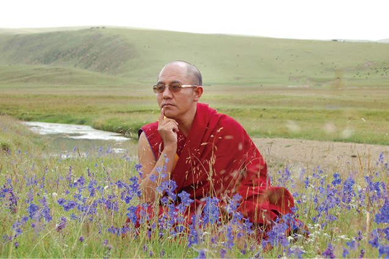
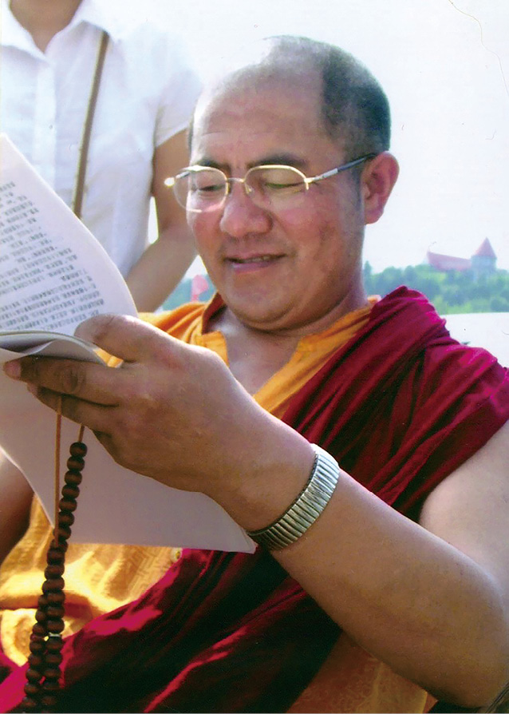

## 《怀业时语》讲解

2007年5月13日

今天是母亲节，是一个很好的日子。世间人所谓的母亲与大乘佛教中提到的母亲，意义有所不同。因为对于发了菩提心的人来说，要将所有众生看成自己的父母。事实上也的确如此，一切众生都曾做过我们的父母。

## 认真发愿，认真考试

在这么好的日子里，我们应该共同发一个愿，什么样的愿呢？现在人与人之间的关系变得越来越复杂、冷漠，为此大家应该以慈悲心，尤其是以大乘菩提心来对待所有的众生。

现在，大家跟我一起发愿：从今天开始，我们要度化无量无边的老母有情！发这个愿只需要几秒钟，但它在我们相续中的力量是非常强大的。

我们要从内心深处想，从今天做起，从现在做起，尽心尽力地度化无量众生，这是每一个佛教徒不可推卸的责任。

下周，我们会举行《大圆满前行》考试，希望大家不要错过这个机会。通过考试，才能巩固和加深自己学到的知识。另外，我们也想了解一下你们的学习状况。

我非常希望你们参加网络佛学院以后，对自相续的改变能起到一定的作用。这样的话，一方面可以提升我的信心，以后尽量通过不同方式来跟大家结缘；另一方面，对你们来说，到寂静处闻思修行，或者去佛学院就读，即生可能没有这样的机会，所以，通过网络学佛而得到一些收获，才算没有浪费这个难得的机会。

我知道你们工作很辛苦，生活琐事也比较多，但现在依靠网络的方便方法，每位道友都有了闻思修的机会，而且还可以参加网络考试，希望大家能够认认真真地对待。

## 讲解《怀业时语》

《怀业时语》是法王如意宝在2000年所造的一个非常殊胜的教言，以前我们学院的有些堪布也给大家讲过。下面，我先念藏文传承，然后做一个简单的开示。

（堪布念传承）

首先，法王如意宝顶礼一切智慧的主尊——文殊菩萨。其实，文殊菩萨就是我们心的本性。但愿在座的所有道友，都能通过上师的窍诀和自己的信心真正认识到自心的本性，那时你就面见了真正的了义文殊圣尊。

接下来，法王说具足三学功德和三种信心的善缘道友，请你们聆听这位发心清净、修行有经验的老人的教言。老人，指的是法王老人家自己，教言一共有五条。

### 1．积累资粮，净除罪障

第一条教言，法王说我们以各自前世的殊胜发愿力，以及特别清净的善业力，现在才能聚集在一起听受佛法。在拥有这么好的因缘时，我们务必要发一个大心。什么大心呢？我们要生生世世追随传承上师，自由自在地享用正法，永不舍弃菩提心，度化无量无边的众生。而想要将来师徒一直不分离而共同趣入菩萨道中，那就要每天积累资粮、净除罪障。

对于以前自己所造的罪业，一定要精进忏悔。有些教言中也讲了，即使造了很大的罪业，但如果我们真正忏悔的话，最后感受的果报也比较轻，所以不会有很大障碍。大家不要认为自己修行很好，境界很高，不需要进行忏悔。这种想法是不合理的，应该先认清自己的烦恼和业障，之后精进忏悔、积累资粮。

### 2．不偏自宗，勿毁他宗

第二条教言，不要毁谤他宗，尽量观清净心。也就是说，我们不能太偏执自己的宗派、上师、学习小组，等等。如果过于偏袒自宗，进而舍弃、诽谤他宗，最终会彻底毁坏自他的善根。

对于自己有缘的宗派，不管是宁玛、噶举、噶当等任何一个教派，都应该精进修学，除此之外对其他教派要观清净心。

### 3．以平等心维护一切众生

第三条教言，三界轮回中的一切众生都曾做过自己的父母，我们应该以大慈大悲之心来爱护他们。不应过于贪执自方而嗔恨他方，世间人经常说“这是我的民族”“这是我的亲人”，或者“那是他的民族”“那是他的宗派”等等，如此贪自嗔他是不合理的。另外，我们还要发愿成为救度一切众生脱离轮回苦海的大商主。

总而言之，就是以自他平等的原则维护一切老母有情。

### 4．永远不舍弃高尚行为

第四条教言，世间法和出世间法的根本就是利他心。如果没有利他心，一切世间出世间的功德都无法圆满。因此，我们一定要远离无惭无愧、舍弃以狡诈行为欺骗众生的做法，受持高尚清净的行为，想方设法让我们的善心越来越增上。

### 5．修持怀业，发愿往生

第五条教言，我们要多修怀业，也就是多念《大自在祈祷文》、观音九本尊心咒等，如此可以让自他的相续得以成熟，通过怀业摄持让有缘众生往生极乐世界。

当然，我们还要精进学修净土法，并共同发愿离开娑婆世界，前往极乐刹土。

以上这五条教言，归纳起来就是：

一、积累资粮，净除罪障。

二、不偏自宗，勿毁他宗。

三、以平等心来维护一切众生。

四、永远不舍弃高尚的行为。

五、修持怀业，发愿往生极乐世界。

教言的最后，法王如意宝以造此《怀业时语》为主的一切善根，回向所有众生速疾圆满断证功德而成佛。

我们心里也应该这样发愿：从现在开始，我一定要利益众生！而利益众生的话，最初要发菩提心，中间做利益有情的事情，最后将所得到的一切善根回向给所有老母有情，这就是大乘佛子的行为。

## 依教奉行，实地修持

前面的开示，虽然只有短短十几分钟，但如果你真正依法修持的话，自相续一定会得到利益。为什么呢？因为高僧大德们的金刚语，尤其是法王如意宝教言的加持不可思议。现在再看真的觉得非常难得。以前法王在世时，我总感觉随时能够得到上师的教言，但现在才发觉自己虽然依止了这么多年，但好像并没有完全了知上师的密意。

即生当中能够遇到这么殊胜的佛法，的确是非常难得的机会。虽然每个人都会在工作和生活中遇到各种困难，继而产生各种烦恼和痛苦，但如果自己是一个真正的佛教徒，应该可以轻松地面对这些，给自他带来利益和快乐。

我始终认为，佛法的加持非常不可思议，也希望所有人都能获得这种甘露。当然，每个人的缘分不同，信心也不同，能长期坚持闻思修的人，在当今时代中实属罕见。为此，我才反反复复地说，学习佛法要细水长流，不要刚开始听几次，之后就消失得无踪无影。很多人只能保持三分钟的热度，这样成办不了任何事情，一定要有一种长期的精进心。

从表面上看，法王的教言只有几个颂词，好像谁都可以写出来，并没有什么特别，但如果从它的深度和广度来看，可以说是八万四千法门的总集文。因此，我们一定要将法王的这些教言牢记心间。

现在的社会竞争十分激烈——不管是世间方面还是出世间方面，在家居士们都没有充裕的时间用于学习，而法王的这些简单教言，可以帮助我们解决很多问题。

如果有机会的话，大家最好是广闻博学，多学一些大经大论；如果没有机缘，也没有时间，那一定要多学窍诀性的教言。学习之后，自己要认真地思维法义，并经常将其与自相续对照、结合，这样行为也会变得越来越如法。

其实，如果这里没有殊胜的佛法，我也不想待在天气严寒的雪域高原，但这里确确实实有非常纯洁、非常清净的正法。所以，有时候也不想待在红尘当中，想尽量待在寂静山里，虽然这里生活条件比不上大城市，但对内心清净却有一定的帮助。

在此，我想给大家提出两点希望：第一，以后要尽量广闻博学，毕竟佛法浩如烟海，不可能听三言两语就通达了，一定要通过长期的闻思才能改变心相续。第二，作为一个聪明且具有殊胜缘分的弟子，上师所传的窍诀性教言，我们一辈子都不能忘记，而且要用来好好地指导自己的生活和修行。

## 放生与社会慈善

我今年在上海的时候，在有些开示中也提到了，从现在开始，就像十几年前我与许多道友发过的愿那样，我们一定要提倡放生。这十多年以来，大家也的确全力以赴，救护的生命不计其数。当然，我个人的力量非常微小，这个成果主要来自上师们的加持、道友们的帮助以及十方信众的支持。

在放生方面，以喇荣五明佛学院为中心的很多高僧大德的发心力、三宝的加持力、无欺因果的法性力，种种因缘集聚以后，如今在国内外的很多地方，放生已经成为人们生活中不可缺少的一环，这一点值得所有佛教徒发自内心地随喜。同时，希望大家以后也能一如既往地坚持下去，将处于屠刀之下的可怜众生救护出来。这个发心，我想你们不会轻易放弃，我个人在有生之年也不会放弃。

在社会慈善方面，我们可以看到，其他宗教人士非常重视公益慈善事业，尤其是公益教育，以此也赢得了社会各界人士的认可，这对他们的宗教在社会中生存起到非常大的作用。而我们许多佛教徒，虽然口口声声说学佛是为了度化一切众生，但在实际行动上好像还不如其他宗教人士。

每次提起这个话题，我自己也很惭愧。但不管怎样，我们身边有很多孤儿、病人、残障人士以及孤寡老人，为了这些可怜的众生，即便失去自己的名声，花费很多时间和精力，对于发了大乘菩提心的人来说也是值得的。因此，从今年开始，不管别人说什么，我们都应该坚持做一些慈善。

我们每个人还是要思考一下，以什么方式来度过自己短暂的一生。对于长期在这里求学的我来说，有想过找一个清净的地方闭关实修，也想过到处去弘法利生，不过很多事情只是在心里想一想，真正去做的话，有时也是人在江湖、身不由己。但我只要活一天，就要为身边的可怜众生做一点实际的事情。

有些事情，如果现在不去做，以后可能就没有机会了。而且奉献爱心，不一定要有特别大的力量，哪怕是一个微笑、一句安慰，或者是扶老人上车，也会让我们成为一个有爱心的人。所以，我在这里也合掌祈请大家共同发愿：从身边的小事做起，做对众生有意义的事情。

在利益众生的过程中，可能会遇到各种各样的磨难，甚至会牺牲自己的生命，对于这些我们要修习安忍。大家应该想一想，我等本师释迦牟尼佛在因地时，为了在一个众生的相续中种下菩提善根，发了何等的大心？所以，一方面我想祈请所有的四众道友共同发愿利益众生，另一方面我自己也想做一点事情。虽然我的能力有限，但也愿意从身边的点点滴滴做起。希望你们也能根据自己的实际情况去帮助众生，最好亲自去做，如果实在脱不开身，也可以通过其他方式去护持。

作为发了大乘菩提心的人，应该用实际行动来帮助周围的可怜众生，这一点在当今社会尤为重要。前段时间我也讲过，佛教徒要通过什么方式在社会人群中弘扬佛法，并让佛法长久住世呢？需要获得社会的尊重和认可。而要实现这一点，就要用实际行动为众生做好事。

在做事情的过程中，我们千万不要搞自我宣传，或者有其他目的，这样不但上师三宝不会加持，自己的良心也会受到谴责。如果问心无愧地真正帮助众生，即使困难重重，也值得去做。因此，希望大家发无上殊胜的菩提心！

现场互动

⊙ 问：圣者到底能不能代众生受业？如果可以代受，诸佛菩萨为什么不把所有众生的业都代受了？

堪布：按照佛教的有关教言来讲，有些高僧大德、诸佛菩萨显现上可以代受众生的业，这是因为他们的加持力不可思议，在这种情况下，可以减轻众生所受的痛苦。

《释迦牟尼佛广传·白莲花论》中讲到，佛陀在因地时曾转生为莲花王，该国的民众普遍得了一种瘟疫病，只有若和达鱼肉方能治疗，而这种鱼当时没办法得到，于是国王发愿舍弃生命，跃入河中变成若和达鱼，让人们割取它的身肉，以此医好了所有人的瘟疫。还有阿底峡尊者的上师达玛绕杰达，为了救人，把大腿的精肉割下来作为药引，病人因此痊愈。通过这两个公案可以看出，在某种程度上，圣者确实可以代受众生的业，但不是上师所有的病都是在代业。要知道，圣者们的显现背后有不同的情况，佛陀时代也是如此。

虽说圣者有时可以代受众生的业，但不代表全部都可以代受。有些业，必须众生自己感受。比如，我问你：“在世间，领导可不可以帮助监狱里的犯人减刑？”你说：“因缘具足的时候，领导可以帮得上。”然后我接着说：“这样一来，所有监狱里的犯人都不用受罚了，因为领导可以帮忙之故。”对于这样的推理，按照因明逻辑学来讲，这叫做不定因。

总之，因缘具足时，诸佛菩萨可以代受众生的业；因缘不具足时，即使佛陀亲临也没有办法。对有些感受恶果的可怜众生，佛陀也没有办法改变，只能默默地加持，授记未来某某佛出世时，此众生才能得以解脱，这类公案非常多。

通过因明的推理，我们也可以了知，圣者有时可以代业，但不一定能全部代受，因为需要具足因缘，就像世间领导帮助犯人也需要因缘一样。

⊙ 问：在《菩提道次第广论》中，宗喀巴大师曾引用《菩萨地论》的教证说，如果犯了菩萨戒的根本罪，即使可以忏悔清净，今生也不可能获得一地菩萨果位。请问这是了义的说法，还是不了义的说法？

堪布：应该是了义的说法。除了《菩提道次第广论》《菩萨地论》以外，《三戒论》等有关大乘论典中也是这样讲的。因此，我们最好不要违犯菩萨戒的根本戒，如果有所违犯或者经常违犯，虽然忏悔清净后可以重新受戒，但是成就或登地的时间会延长。

⊙ 问：如果一个人犯了菩萨戒后，精进地修习密宗殊胜法门，这样会不会有即生获得圣者果位的希望？

堪布：这要看他的精进力。就密宗的殊胜方便力本身来说，不要说犯了菩萨戒，就算是犯了密乘戒，忏悔清净之后，也有即生成就的机会。

当然，这只是我的一种推理。对于因果的甚深道理，唯有佛陀的智慧才能了知，凡夫人只能凭借自己的智慧进行推断。

⊙ 问：我们寺院每周末都在学习佛法，祈祷上师加持，消除我们弘扬正法的违缘。

堪布：你们做得很好。我也听说了，你们寺院的很多佛教徒，都在精进地学习《入行论》等大乘佛法，希望你们持之以恒。我这边会经常念经和祈祷，希望你们也是如此，我们一起努力！

⊙ 问：对于我们这些法王如意宝圆寂后才开始学佛的弟子来说，怎样才算是与法王结缘，进而得以凭借法王的发愿力决定往生西方极乐世界？

堪布：按照法王如意宝生前的有些发愿和行持，我们可以推出，与法王结缘，就是要按照法王的教言去实际修持。

至于修持的方法，最好先受持清净的戒律，然后发大乘的菩提心，再念阿弥陀佛名号、往生咒等，并对正法生起正见。如此一来，我认为就是与法王结上了殊胜的因缘。

⊙ 问：晚上一直打坐不睡觉，这样可以吗？

堪布：晚上打坐可以，但完全不睡可能不行，可以尽量少睡一点。

⊙ 问：我听有些人说众生有三种病，即四大不调病、业障病和鬼神病。现在很多佛教徒遇到鬼神侵扰时，纷纷找大仙儿帮助，请问这样做如法吗？

堪布：凡夫众生不仅有这三种病，还有最严重的贪嗔痴病，而要对治贪嗔痴的病，唯有依靠佛法的甘露妙药。

关于鬼神侵扰的问题，在佛陀亲自授记的莲花生大士的教言中，就有殊胜的对治法，即一心一意地念诵《金刚七句祈祷文》和莲师心咒。

在修行过程中，我们每个人都会遇到各种违缘和障碍，所以一定要经常祈祷莲师加持！而祈祷莲师的话，念诵《金刚七句祈祷文》非常殊胜。此祈祷文的功德文中说，任何一个修行人，只要一心一意地念诵《金刚七句祈祷文》，就像母亲被独子呼唤那样，莲花生大士一定会来到他面前，为他遣除一切违缘。

因此，不管是鬼神病，还是暂时的四大不调病，乃至世间的各种疾病，依靠莲花生大士不可思议的加持力，一定能遣除修行上的诸多违缘。

⊙ 问：我现在正在学习您讲的《大圆满前行》，但我很想学习密法，不知道怎样才能学到？

堪布：密宗也有很多层次。如果是密宗历史方面的教言，以及人身难得、寿命无常等《大圆满前行》的一些内容，即使没有得过灌顶，也可以学习和修持，不会有任何过失。而密宗的正行部分，也有不同的层次，想要学习这些就必须经过灌顶，没有灌顶而通过走后门进入密宗正行，这是很不如法的。因此，按照密宗的修法要求，我们不应该错乱次第而修持。

大家应该清楚，藏传密宗与汉传显宗是殊途同归的。所以，我们不能学了密宗以后，就舍弃汉传佛教的显宗，这种做法非常不合理。事实上，我们所学的佛法里，既包括了显宗，也包括了密宗。因此，只学习显宗不学习密宗，或者只学习密宗不学习显宗，都不是一个完整的修行体系。

作为佛教徒，我们既要学习显宗法门，也要学习和修持密宗法门，这样修行才是圆满的。总之，长期闻思修是不可缺少的，否则短时间内很难掌握佛法的究竟奥义。

⊙ 问：现在有些上师传密法时，根本不提需要圆满加行，请问现在听密法还有没有修加行的要求？

堪布：现在社会上有各种各样的说法，比如交一些钱或放一些生，就不用修加行可以直接听密法。他们这样说到底有什么目的，我也不太清楚。但一般人谁都没有权力改变修加行的传统，因为这是藏传佛教诸多祖师们的要求。我们后人随意更改的话，确确实实不符合传承上师们的教言。

因此，希望大家以后不要以各种借口来毁坏这种传承制度，学院也是一如既往地强调次第性修行，并没有一种超越加行的创新。

⊙ 问：我以前做居士时得过一些密法传承，但出家后所在的道场不让学密宗，现在道心有些退失怎么办？

堪布：无论你是出家人还是在家居士，最好不要退失道心。《入行论》中有讲，一旦退失，即生当中很多事情会不圆满，以等流果和异熟果，来世也会不断感受痛苦、生生世世遇不到正法等等，有许许多多的过患。

即便你后来以各种因缘破戒或舍戒了，也要继续如理如法地修持，否则过失可能会更加严重。因此，我们要恒常护持自己的道心。

⊙ 问：观修的时候，总是杂念纷飞怎么办？

堪布：有些人刚开始学佛的时候，心态特别着急，稍微发现自相续有一点分别杂念就特别伤心。大家应该清楚，并不是学佛以后当下就能断除所有妄念，有妄念是很正常的，可以通过各种方式来忏悔。

在修学的过程中，每个人都会有妄念分别，但随着修行的积累，烦恼会逐渐有所减少。而不是今天学佛了，明天就能如如不动，凡夫人很难达到这种境界。因此，大家不要对佛法退失信心。

⊙ 问：通过音像制品，能得到佛法的传承吗？

堪布：严格来讲，可能不行。

⊙ 问：我的上师比较多，教言的侧重点又各不相同，如此我就没办法一一做到，结果没有太大收获不说，还苦恼于有时违背了教言，我到底该怎么办？

堪布：在修学过程中，现在很多人都存在这个问题。

有些人比较善巧，抉择出最重要的上师和最殊胜的法之后，就不断精进地修持，至于其他上师和法门，暂时就不去考虑了。还有一些人，可能信心比较大，对所有上师都想依止，所有法门都想修持。

按照以前高僧大德的教言，如果自己的智慧力和精进力不够，最好不要依止太多上师。不然，上师太多的话，今天见这个上师，明天见那个上师，每一位的要求又都不相同，自己修行也抓不住重点，最后的结果可能是一无所得。

因此，我们要选择一个最殊胜、最适合自己根基的教言长期修行。也就是说，观想其他上师与传授此教言的上师本体无别，都是诸佛菩萨的化现，他们的教言也可以包括在此上师的教言当中。如此则不算违反上师的教言，并且自己也会有所收获。

⊙ 问：如何设计自己的佛堂？

堪布：这方面很多道友经验比较丰富，你可以就近问一下，也可以亲自去参观他们的佛堂。就像有些人在做建筑设计时，也会借鉴别人的作品。

⊙ 问：我们小组有一些老年人，虽然闻思方面很精进，但是毕竟年纪大了，还是有点困难。请问他们现在是实修好，还是继续闻思好？

堪布：作为老年人，应该精进地实修，多念阿弥陀佛。与此同时，如果各方面因缘具足，最好是广闻多学。

现在的很多老年人，早年接受佛法教育的机会比较少，所以对佛法的了解并不多，而如今值遇的善知识教言，是摄集了所有大乘佛教精华的窍诀，这个机会非常难得。因此，一边实地修持一边广闻多学，还是很重要的。

⊙ 问：为什么闻思之后，感觉我执反而比以前更重了？

堪布：这是因为我们以前从来没有观察过自己。没有学习佛法之前，根本不懂什么是分别念和修行，觉得自己做人各方面还不错，后来通过闻思的智慧详细观察自己的相续，反而觉得我执变重了，或者还会跟金刚道友不合，这种现象是正常的。就像一个没人管的小孩，从不知道自己非常顽皮，只有家长管他时，他才发现自己的行为是不对的。

因此，当我们意识到自己有我执时，一定不要有怯懦心，要让自己变得坚强起来，心里可以这样作意：“我这个人为什么不能闻思！为什么不能断掉我执！”应该有这样一种坚定的信念。

⊙ 问：我们这里以前念阿弥陀佛圣号的人比较多，现在让他们念阿弥陀佛心咒会有些不习惯，请问圣号和心咒有什么区别？

堪布：实际上，二者并没有什么区别。如果有些人不习惯念心咒，喜欢念阿弥陀佛圣号，觉得这样比较方便的话，也可以继续念下去。

⊙ 问：是不是只要起心动念舍弃众生，就违反了愿菩提心戒？

堪布：一般来说，发了恶愿后才算是真正舍弃愿菩提心。

比如，你发愿说：“从现在开始，我不再度化这个众生，即使有饶益他的机会，我也不会帮助他。”生起这种恶念后，进一步发下这种恶愿，那就是舍弃了愿菩提心。

⊙ 问：有的时候会看道友的过失，应该怎么处理这种心态？

堪布：当我们看到身边人的一些过失时，最好是反观自己的心清不清净。因为事实上，如果我们心清净的话，绝不会看到别人的过失。所以，很多禅宗大德说：“佛看众生都是佛，凡夫看众生都是凡夫。”这句话里有着殊胜的密意。

⊙ 问：很难做到安忍怎么办？

堪布：《中观宝鬘论》里面有讲，对于我们根本做不到的事情，诸佛菩萨不会要求我们必须做到。事实上，当安忍心修得越来越成熟时，即使怨敌来杀你，你也会发起善愿并坦然面对一切。

⊙ 问：有些公案中说，佛陀时代有出家人违犯了当地的法律后，国王会将其交由佛陀处置，那么佛法与世间的法律是不是矛盾呢？

堪布：在我看来，二者并不矛盾。当时是针对某个人的具体情况，以佛教规则来解决问题，并不是说世间的所有法律都不需要。另外，佛陀在有关经典，尤其是《仁王护国经》中也宣说了很多治国的理念，强调以法律来约束人们的行为。从中可以看出，佛教并不是不承认法律。

作为行持佛法的国王或君主，最好是参照佛法而制定一些如法的法律，以此来维护自己的国家。如果以不如法的法律来解决问题，则不一定合理。所以，我们需要如法的法律。
