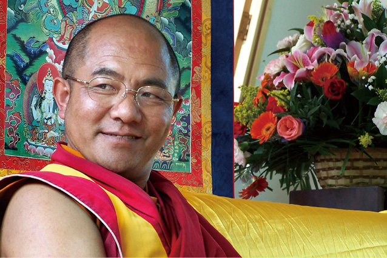

## 《教诲甘露明点》讲解

2007年4月8日

今天，我们主要是传授法王如意宝所造的《教诲甘露明点》。

## 内守己道，合和世间

从去年开始，我们基本每月都在菩提讲堂做一两次开示，让各地的道友与佛教结上善缘。今年之初，我们也跟大家交流过，在新的一年当中学习《入行论》以及其他闻思修行的一些安排，相信很多人仍然记忆犹新。

在这里，我想再次跟大家强调一下。我们这个人身的的确确非常难得，大家一定要好好利用它来修行佛法。尤其是网络面前的各位道友，你们身处嘈杂的城市当中，要在这样充满诱惑的外境中保持修行的力量，不是一件容易的事情。

在这种情况下，我们要对自己的内心境界有所把握。不仅佛教中如此要求，中国古人也非常强调这一点。古人说：“外化而内不化。”意思是说，我们的内心应该保持宁静，守护一份坚持，而在外相上要和合随顺，言行方面要顺应他人、顺应世间、顺应社会，千万不要跟任何人都合不拢。

因此，我希望身处大城市中的道友们，内心能够秉持佛教的殊胜观点，比如密乘的大圆满见解、大乘中观的缘起性空见解，或者小乘的人无我见解。总之，不舍离佛教的修行，这是我们内在应该保持的一种状态，而在外相上，我们的行为要尽量随顺世间。在任何一个单位、团体或者在自己的家庭中，佛教徒更应该表现出一种随顺、合和的态度。这是我对你们的期望。

前段时间，我出去了一个多月，回到学院后，因为重建大经堂等各方面事情比较多，所以一直没来讲堂为大家开示。以后如果没有什么特殊情况，我会继续在网络上给大家念诵一些传承，做一些简单的开示。同时，道友们有什么问题，我们也可以在网上交流。虽然我回答得并不好，但我还是想为大家提供一个打开思路的机会。我们彼此探讨学习，这是非常好的一件事情。

其实我们这样的聚会，可以说有着不共的特点，大家安住在自己的家里，不用像前辈大德那样跋山涉水，就可以听受到藏地雪域殊胜的佛法传承。

喇荣这几天一直在下雪，外面已经成了一个银白的世界，而你们很多人所处的环境应该是阳光明媚、春暖花开。我们会在雪域高原祈祷诸佛菩萨和法王如意宝的加持，把冰雪般清净的教言传授给大家，愿每一个人都能得到诸佛菩萨的慈悲垂念以及传承上师的加持，这样你们的修行一定会圆满、成功。即使在错综复杂的人生路上，仍然会遇到一些挫折和困难，但只要坚信上师三宝的加持不可思议，就能获得很大的力量，将违缘转为道用，最终趋至究竟解脱地。

## 讲解《教诲甘露明点》

接下来，我先用藏文念诵法王如意宝造的《教诲甘露明点》的传承，然后就字面意思给大家做一个简单开示。

（堪布念传承）

法王如意宝这一生摄受弟子的过程中，所传讲的教言全部可以归纳在《教诲甘露明点》中，可见其殊胜之至。正因为如此，法王在世的时候，就要求凡是听受他教言的弟子都必须背诵《教诲甘露明点》，并将其内容融入于自相续，这样才有可能修行圆满。这一点在结文的小字中，法王也做了说明[^1]。

这篇教言分为三个层次：一、首义；二、论义；三、末义。

首先是顶礼句，即顶礼文殊菩萨，祈请文殊菩萨向所有弟子赐予悉地。

“谁之尊名一入耳，终破累劫心愚暗，祈汝文殊勇猛尊，普降善妙瑞花雨。”意思是说，任何一个人只要听到文殊菩萨的名号，那他无始以来自相续中的无明黑暗，会被文殊菩萨的智慧光芒全部遣除。所以，我们应该生生世世恭敬顶礼文殊菩萨，祈求文殊菩萨赐予加持、悉地、力量和智慧。

论义部分也分为三个内容，即人格贤善、戒律清净、智慧无垢。“人格贤善戒清净，勤学无垢智慧源，彼即三世佛之子，亦吾究竟之挚友。”法王说，任何一个人只要具足这三个条件，那他就是十方诸佛的佛子，也是法王如意宝的心子、最好的朋友、最好的弟子。

我们很多人自称为法王如意宝的弟子，现在可以根据教言对照一下，看看自己到底是不是合格的弟子。法王如意宝曾一再强调：“不管我在世还是不在世，凡是能受持这个教言的弟子，我始终都把他当作最珍贵的弟子。”也就是说，具足人格贤善、戒律清净和智慧无垢这三个条件，才是上师合格的弟子；不仅是上师的合格弟子，也是三世诸佛的佛子。

### 1．人格贤善

今生能够得到人身非常不容易，因此希望大家首先要做一个好人。有了好人的基础，才有进一步学佛修行的机会。如果连好人的标准都达不到，连贤善的人格都不具备，根本没有办法学佛修行。

我最近正在讲《二规教言论》，也是希望道友们能够明白，人格贤善是学佛的基础。在藏地，做人方面的教言有《君规教言论》《二规教言论》《萨迦格言》等；在汉地，古人也非常重视《论语》《弟子规》之类的教言。但是，现在很多人忽视了传统文化的教育。如果从小就接受人格方面的教言，必定会对自己的一生起到很大帮助。

“何为贤善之人格？心善诚实少欺诈，温和稳重耐性强，广学多闻心量宽。”如果要把关于做人的教言全部广说，恐怕有一定的困难。所以，法王如意宝把人格贤善总结为七个方面，即心地善良、无狡诈、性格好、有远见、稳重、包容、智慧。

大家可以反观自己：首先，自己的心是不是很善良？不管做什么事情，是否保持大公无私、利益众生的心态？其次，做事情的过程中，自己是否具有远见、稳重、包容和智慧？如果你具足了这几条，那可以算得上具有贤善的人格。

通过今天的教言，希望大家观察一下自己，究竟具不具足贤善的人格。尤其是稳重这一点，在《二规教言论》中讲得比较广，方便的时候你们可以学习一下。

### 2．戒律清净

“何为清净之戒体？佛经论典所宣说，一切取舍护如眼，于此浊时虽极难，然于显密三乘教，各乘得果直接障，根本堕罪于自续，当恒远离精进行。”所谓戒律清净，是指对佛经论典中制定的戒条，像护持自己的眼目一样来受持，无有任何违犯。但对末法时代的很多人来说，这是非常困难和不现实的。因此，法王说在别解脱戒、菩萨戒和密乘戒这三乘戒中，对自己的解脱直接造成障碍的根本罪，最好不要犯，即不能失坏根本戒。

就别解脱戒而言，在家居士受持的是居士五戒，那么这个居士五戒就是不能破的。一旦破了，先要好好忏悔，忏悔清净之后，才可以重新受戒。

就菩萨戒而言，戒条广分有千千万万，但归纳起来，愿菩提心是不能失坏的。一旦失坏，就需要再次念诵仪轨重新受戒。

就密乘戒而言，誓言也是非常多的，尤其是《大幻化网》中讲到的五种戒条，以及密宗的十四条根本戒，大家要尽量遵守。其中最根本的是什么呢？就是不能舍弃密法，不能舍弃金刚上师或与之发生矛盾。

如果你是出家人，就要守出家人的根本戒；如果你是在家人，就要守在家人的根本戒。总之，如果三乘戒律中的根本戒没有失坏，就算是戒律清净。因为将所有的戒律如比丘戒、比丘尼戒守持得一尘不染，即使在佛陀时代也是有困难的，更何况现在是末法时代，所以法王对我们也没有那么高的要求。

大家要尽量守护好自相续中的根本戒。如果出现破损、违犯的情况，应该想尽一切办法进行忏悔和恢复。

### 3．智慧无垢

“何为无垢之智慧？真实教诲诸经论，日日精进闻思修，彼将速获菩提果。”法王说，我们每天都应该力所能及地闻思修行，听受清净的佛法教言，这样便可获得无垢智慧，很快得以解脱。

你们很多人都有家庭、有工作，想要像佛学院的道友一样，每天安住在寂静处闻思修行，恐怕很难实现。但每个礼拜当中学习一节《入行论》等经论，应该可以做到的，希望你们不要随意中断。大家最好每天抽出一些时间闻思修，或者听录音，或者看法本，或者思维法义，或者实际行持。长此以往，最终一定会获得佛果。

以上这三个教言，归纳起来也比较简单。第一，人格贤善，以人格稳重为基础，同时心地要善良；第二，戒律清净，无论受持哪一种戒律，不要毁坏根本戒；第三，智慧无垢，每天不间断地闻思修行。这些要求都不算很高。

“未入正道初学者，愚痴形象盲修者，世智辩聪傲慢者，此文将成消毒药。”法王说，对于还没有步入正道的初学者、盲修瞎练者、假成就者以及寻伺者[^2]来说，看了以上教言以后，心里很可能会不舒服。但也有可能，他们得到这些教言之后，就如同中毒的病人得到妙药，立马治好了自己的病。

对于那些堕入邪道、堕入歧途的人来说，倘若能遇到法王如意宝的这些教言，都一定会有所帮助，更何况我们这些对佛法有清净信心、清净智慧的人呢？遇到如此殊胜的教言，能让我们一生受益无穷。

且不说法王如意宝生生世世高深的成就境界，仅是这一生当中，就摄受了成千上万的弟子，并且根据弟子们的不同根基和意乐，以及末法时代的各种状况，传授了很多简要而殊胜的教言。现在大城市里的人非常忙，真要把千经万论学得滚瓜烂熟，恐怕有一定的困难，但我想把这几句简单的教言铭记于心，应该不会有很大的困难。

因此，通过现代科技的方便方法给大家传授《教诲甘露明点》，我觉得非常有必要。只要你们有智慧、有信心，将法王的这三个教言牢记在心，必定可以获得世间的暂时安乐和出世间的究竟解脱。

最后，法王谦虚地说：“为利自心修习故，亦为挚友作良药，净心善言所生善，诸众愿等妙吉祥。”法王说，宣说以上这些教言，实际也是为了自己的修行，因为这些道理非常深奥，自己也需要再次修习，还有就是为了帮助自己的心子、朋友、弟子，所以以清净的心造了这篇教言，愿以此善根回向给一切众生，愿所有众生早日得到文殊菩萨的果位。

这篇具有八吉祥数目之颂文的《教诲甘露明点》，是法王当年住在寂静虹身处——喇荣五明佛学院的时候，给四众弟子开示的一个精妙教言。当时，他老人家要求以学院僧众为主的凡是听受他教言的道友，务必先将词句熟背于心，然后在自相续中再再串习其内容。

归纳而言，《教诲甘露明点》最初是顶礼文殊菩萨，祈请文殊菩萨赐予智慧，让所有弟子的心相续中生起证悟智慧；中间正文宣讲了三种教言；最后是回向，愿所有众生获得文殊菩萨一般的超胜智慧。所以，大家也一定要好好地回向。

所谓的佛法修行，并不一定要用很长的时间。如果你有智慧、有信心，即使在短暂的时间当中，这样短小精妙的教言也能使你的一生发生转变。

现场互动

⊙ 问：我是一所职业学校的老师。上课时，我经常会引用佛理，但我说我不信佛，只是觉得佛法很有道理，因为在学校里说自己信佛，其他人可能会产生邪见。请问这样可以吗？

堪布：我觉得这种方法很好。因为在现在的社会当中，如果你说“我信仰佛教”，那么老师、学生在内的很多人可能会对你产生各种误解，甚至说出毁谤的语言。

我们内心要对三宝深信不疑，但为了随顺世间人，口头上可以说：“我虽然不信佛，但我通过智慧来观察时发现，释迦牟尼佛宣说的真理是任何一个科学家都没办法推翻的。”如果是通过这种方式来交流，学生们慢慢也会有所领悟。

因此，我们要用智慧来观察，如果场合比较特殊，你可以用方便语随缘度化，比如一开始说自己也是半信半疑，到了一定时候，也可以说出真相。

⊙ 问：听了您讲的《转经轮之功德》，我们很想请转经轮，请问哪里可以请到？

堪布：前段时间，我讲了《转经轮之功德》以后，听说很多地方的道友都想请转经轮。我原来也想通过学院为大家提供这个方便，但目前看来，找工厂制作有一定的困难，而且从学院这边快递出去，也没有这么多的发心人员。所以，希望全国各地的道友先自行想办法请购。

但是，你们也不要过于着急。我听说现在成都武侯祠等很多地方，所出售的一些转经轮里并没有装观音心咒，只是装了一些泡沫，很多人请完才发现自己上当了。还有些地方的转经轮价钱太高了，小小一个就卖七八十块钱。对于这类情况，希望大家留心观察。

总之，你们自己想办法请购，应该相对方便一些。我们这里要提供的话，确实有非常大的困难，以后因缘具足时，再创造条件方便大家。

⊙ 问：什么日子供灯最好？

堪布：每个月的初八、十五、三十都比较殊胜。平时也尽量不间断地供灯，这样有很大的功德。

⊙ 问：佛经中经常说人身难得，但在一些催眠实验中，有的被催眠者能回忆起自己多次转生为人，这是否说明人身很容易得？

堪布：所谓人身难得，是指特定的人身，并不是指有些众生死后很快又获得的普通人身。

佛经中讲的人身难得，是指具足十八种暇满的珍宝人身，这种人身并不容易得到。

⊙ 问：我想种花，但听说修行人不能无意义地随便开挖土地，请问该如何抉择？

堪布：一般来讲，修行人确实不能随意挖掘土地，这是释迦牟尼佛在《毗奈耶经》中宣说的。

如果你真的想要种花，或者做一些有意义的事情，那应该一边忏悔，一边作意种花是为了供佛，以善的发心来摄持，这样也可以。

⊙ 问：佛陀是万能的吗？

堪布：佛陀为众生所宣讲的佛法，是世间上任何一个人都绝对说不出的真理，如果我们依之精进修持，就可以断除一切烦恼，直至解脱成佛，这是佛陀是万能的唯一理由。

虽然基督教也承认上帝是万能的，但上帝到底是不是万能的，这个问题在《影尘回忆录》中有解答。有一个基督教徒和倓虚大师辩论，基督教徒说基督是万能的，而倓虚大师说佛陀是万能的。最后的辩论结果是：因为上帝不能让众生做上帝，这一点上帝也无法成办，所以上帝不是万能的；而佛陀是万能的，因为如果所有的众生精进修持佛法，最终都能成就佛果。每个众生本具如来藏，再加上佛陀已经为我们宣讲了断除烦恼的方法，如果所有的众生都依此精进修持，那么最终都将获得佛果。所以，从这个角度来说，佛陀是万能的。

这个道理，大家方便的时候最好看一下《影尘回忆录》。

⊙ 问：我们这儿修净土的比较多，请问修金刚萨埵时，能否将其观成阿弥陀佛？

堪布：在佛经续部中，并没有讲到这种修法。修金刚萨埵时，将十方诸佛菩萨观为与金刚萨埵无二无别，这是可以的。把他单独观想成阿弥陀佛，应该没有过。

⊙ 问：可以将上师观成金刚萨埵吗？

堪布：可以。

⊙ 问：什么是声明学？

堪布：在藏传佛教中，有专门学习古印度梵文语法的一门学科，类似于现代的语言学，这就是声明学。

学习声明之后，在遣词造句、著书立文、语言交流方面非常有用处。但是现在藏传佛教中，学习声明学的人不是特别多，最多就是学习一些藏文的文法基础。

⊙ 问：如何遣除家人对自己修行的阻碍？

堪布：具体方法，需要根据各自的情况来确定。

在修行过程中，我们每个人都会遇到违缘和障碍。遣除的方法，一方面要好好地祈祷十方诸佛菩萨，祈祷自己的根本上师；另一方面，自己的道心一定要坚定，如果信心不坚定，恐怕很难遣除修行过程中的种种违缘。

⊙ 问：有些出家人因犯错误而被开除，这时候有人说他的过失，会有怎样的后果？

堪布：佛经中有讲，即使出家人犯戒甚至被僧团开除，在家人也不能毁谤。当然，你不供养他或者不尊他为师，这是允许的，但凡是穿着释迦牟尼佛袈裟的人，我们最好不要随便说他的过失。

如果他有些行为真的不如法，你可以通过一些途径来反映，这是可以的。但是，如果以自己的不清净心来观别人的过失，这有一定的罪过，不太合理。

⊙ 问：我们最近在开展创建卫生城市的工作，整个城市都要达到卫生标准，不得不杀一些生，应该怎么忏悔？

堪布：这个只有念金刚萨埵心咒或百字明来忏悔了，除此之外，可能没有更好的办法了。

⊙ 问：皈依后，只依靠念咒、念佛或转转经轮，能否成就？

堪布：这个要看你自己的信心。

⊙ 问：您能不能亲自来给我们讲法？

堪布：你们通过光盘听受，跟我亲自去讲没有什么差别。

⊙ 问：听说依止上师之前，要观察上师是否具有功德，但有些功德我们又看不到，怎么办呢？

堪布：那就应该在比较长的时间中，反反复复地去观察。有些上师的法相，短时间内的确很难看得出来。

关于上师的法相，无垢光尊者在《大圆满心性休息大车疏》中也说了，在末法时代，一位上师要具足所有的法相，这是很难得的，但是最根本的几条必须具足，比如具有智慧、大悲心、行为清净、戒律清净等。因此，将经论学习和实际观察结合起来，应该可以找到一位很好的上师。

⊙ 问：电动转经轮和手摇转经轮，哪个功德更大？

堪布：我个人认为，手动的转经轮功德更大一点，因为需要自己亲自摇动。但是电动转经轮，我们也要交一些电费，这样肯定也有功德。

佛经论典中有说，转经轮分为好几种，有水转经轮、火转经轮等。现在的电动转经轮，应该是利用地、水、火、风发电而转动的，因此是有功德的。

有些细微的因果，只有佛陀才知道，我只不过是用比量来推测而已。

⊙ 问：我在湖南开了一间茶楼，原本是想卖茶叶、推广茶文化，但是开业后一看，喝茶的人很少，打牌赌博的人很多，茶楼几乎变成赌馆了，不知道该如何取舍？

堪布：这个问题不是很好回答。但是我想，如果你的发心不是为了赌博，也不是为了做坏事，只是想要维持生计，并且想让其他人对三宝生起信心，可能问题也不是特别严重。

对于在家人来说，有些生意可能不得不做，但是在做的过程当中，自己的发心还是很重要的。一方面，我们要确保自己的发心不是想害他人；另一方面，自己最好还是要逐渐转变，不要让茶楼沦为赌博的场所。当然，要想一下子转变很困难，但也要尽量想办法解决。

⊙ 问：我接了一些密法，但有些本该每天念诵的咒语，忙起来会有间断的情况，这会不会违犯密乘五根本戒中的“不间断修行”呢？

堪布：如果两个月之内一点不修的话，会损害到这一誓言。不过一般来讲，如果自己心里没有想舍弃修法的念头，也不是特别严重。但还是尽量不要间断，每天再忙也要念一点咒语，这应该不是很困难。

⊙ 问：念咒一定要出声音吗？

堪布：不一定要念出声音，默念也可以。

⊙ 问：如何去除魔障？

堪布：很多传承上师的教言中说，修行人经常会遇到一些外魔、内魔、密魔等各种魔的干扰，如果能够一心一意祈祷莲花生大士，就能消除一切违缘和魔障。因为在遣除魔障方面，莲花生大士的确有不共的威力。有些传记中说，只念一句莲花生大士的名号，就等同于数劫当中念诵三世诸佛的名号。所以，我在这里给大家念一下《金刚七句祈祷文》和莲花生大士的心咒。

（堪布念传承）

今天下午我看了一张光碟，内容是一位上师在印度莲花湖传讲佛法。当年，萨霍国王想要把莲花生大士烧死，结果不但没有烧着，火海反而变成了莲花湖，在现在的印度北方。然后我又看了一遍《莲师略传》，这是当年法王如意宝朝拜莲花湖时，自然唱出的金刚歌，也就是莲花生大士的略传。

不管是学显宗还是学密宗，大家都应该祈祷莲花生大士，因为莲花生大士可以遣除我们的外、内、密的魔障。在藏传佛教的历史上，有很多修行人通过祈祷莲花生大士，令自己一生的修行非常圆满、非常顺利。

⊙ 问：密法中说，有些人在六个月中即可得到解脱，请问是成就佛果还是获得其他境界？

堪布：这个要看个人的根基。有些修行人仅仅六个月，就获得了圆满正等觉的果位，有些则获得不同程度的证悟。

⊙ 问：在观无常的时候，产生一切都是无常的感觉，这有什么意义？

堪布：大圆满共同外前行的修法，主要是为了让我们生起出离心。如果有了无常观，自然会有一种紧迫感，而有了紧迫感，就会精进学习佛法。

在修人身难得、寿命无常等共同四前行的基础上，接着修习五加行就会非常稳固。因此，观修生死无常非常重要。

⊙ 问：为什么众生还在轮回中受苦，而佛却圆满了六度？

堪布：众生受苦的原因，是因为没有通达如幻如梦的境界，而佛陀了达万法都是心的幻现，证悟了远离一切戏论的境界。

⊙ 问：理解、觉受和证悟是否有差别？

堪布：这三者是有差别的。一般在凡夫地的时候，只是在文字上有点理解；在资粮道和加行道的时候，会有一些觉受；到了一地菩萨时，才真正证悟法界本性。

所以，不管在显宗还是密宗当中，这三者都是有差别的。

⊙ 问：心不分别，自然安住觉性，这种修行方式正不正确？

堪布：从实相的角度来讲，这样是正确的。但如果我们没有通达这种境界，只是口头上说一说，也不一定起作用。

⊙ 问：百字明的仪轨，能不能用汉文版？

堪布：可以。

## 结语

每次的问答交流环节，确实很有必要。因为佛法是一种智慧的教育，大家有什么问题，直接摆在桌面上探讨，如此一来，就能遣除很多疑惑。

但是，有些道友提出问题，我回答过后，他就忘光了，这是比较大的一个毛病。我想，即便我的回答不准确，也有引发进一步思考的价值。因此，希望道友们能把听到的回答记录下来，然后思考一下有没有道理，这是你们以后需要重视的事情。

比如，某城市中有一位道友，就一个问题反反复复地提问两三次。上次我去，他提这个问题；这次我去，他又提这个问题，这说明没有重视之前的回答。

以前法王如意宝去美国，当地的很多佛教徒都是一边提问，一边拿笔记录。上师答完了，他也记完了，然后他再回去好好思考，这是比较好的一种传统。希望你们以后也记录下来，自己反复去思维。

现在，我们一起共同发愿回向，将今天所造的善根及三世所造的一切功德，都回向给天边无际的一切众生。大家在一起听法、探讨法义，这肯定有很大的功德。佛陀在佛经里面讲了四种“不可思议”，其中一个就是思维佛法的功德不可思议。我以前讲《金刚经》的时候，也引用过这个教证。

在座各位今天相聚于此，没有别的目的，就是为了学习佛法，这是我们共同的目标。

[^1]: 此具八吉祥相数目之颂文，于大密虹身成就静处安住之会众为主，凡欲遵吾教实行者，再三恭请心中持文后领取其义。土蛇年三月十六日，阿旺洛珠宗美所述。
[^2]: 即自己一点都不修行、整天口头上说得特别漂亮的人。
