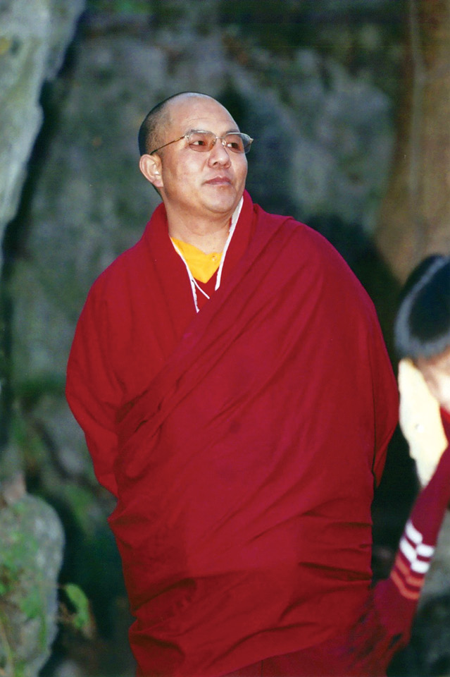

## 《无常道歌》讲解

2007年4月15日

今天，给大家传授的是法王如意宝造的《无常道歌》。

在学佛的过程中，学习无常、观修无常非常重要。《涅槃经》中说：“一切众生迹中，象迹为上，是无常想亦复如是，于诸想中最为第一。”意思是说，所有的脚印当中，大象的脚印最殊胜；所有的观想当中，无常的观想最殊胜。

现在世间很多人整天忙着生活、忙着家庭，他们并不知道自己的生命到底还有多久，也不知道如何应对死亡。虽然我们已经学佛了，但如果无常观修得不好，学佛始终明日复明日，最终也得不到什么结果。

## 一个殊胜的缘起

大家应该清楚，所有藏传佛教和汉传佛教的高僧大德，都极其重视无常法门。法王如意宝的著作当中也有许许多多的道歌，但其中最殊胜的就是《无常道歌》，老人家在世时曾给我们传过很多次。

1987年法王如意宝率众朝拜五台山时，最先让我给汉族弟子传的法，除了《佛子行》以外，就是这首道歌。当时，我对汉传佛教的很多名词还不熟悉，但也依教奉行，想尽一切办法翻译，应该是一个殊胜的缘起。

1987年到现在，刚好20年了。那个时候，很多藏传佛教的大德跟汉地的修行人基本没有结过缘。但依靠法王的发愿和缘起，现在不管是藏传佛教的高僧大德还是普通出家人，在汉地各大城市已经是遍地开花。

对我个人来讲，刚来学院时就对《无常道歌》特别有信心，再加上五台山的殊胜因缘，因此我今天想给大家念一下《无常道歌》的传承。其实，佛法传承的加持力不可思议，为了得到这些妙音，我们也经常前往很多地方去求法。

《无常道歌》大概有三十二个偈颂，我本来想把每一个偈颂都给大家详细讲一下，但后来觉得学院的一些法师已经给大家讲过，网上也有相关的资料，所以我就不详细解释了。最近学院修建大经堂等事情比较多，我又在翻译好几本书，而且还要传讲《入行论》《量理宝藏论》等，每天都有很多事情要做。但不管怎样，抽出时间给大家传一些法，这个还是很有必要的。虽然我讲得并不好，但是在法王如意宝面前的确得过很多珍贵的佛法传承，所以念个传承还是有信心的。

## 抓住机遇闻思佛法

自从去年我们开设《大圆满前行》的网络学习以来，大多数道友不再像世间人那样，每天在网上无意义地聊天，看一些不清净的东西，最后自相续中生起贪心、嗔心等烦恼，而是很系统、很认真地学习了一百多堂课，非常值得随喜！

过段时间，《大圆满前行》的学习就要结束了，预计五一期间，我们会举行一次考试。学完一部论典之后，通过考试可以了知自己的智慧如何，希望大家都能积极参加。当然，考试的目的，并不是为了得到高分，收获一些赞叹，而是为了让自相续中的信心、悲心、智慧等功德越来越增上。

这一阶段的学习结束之后，我们还会继续给大家提供一些以前讲过的佛法，以及现在正在传授的法。我们会尽可能为大家提供学习的方便，希望你们也能好好利用起来。

其实，你们在网上听与不听，对我个人来讲是无利无害的。但我想，我毕竟受过佛学院的教育，也得过很多佛法传承，而你们现在到寂静处或者寺院里去学习，这种机会有没有呢？你们也心里有数。正因为这样，现在国内外的很多大德、道友都非常感谢如今发达的网络时代，我也是这样想的。不然，像今晚这样跟这么多的道友交流佛法，在过去来讲是根本不可能的事情。而现在，依靠诸佛菩萨的加持，让大家能在不同地方听受真正的佛法，然后你们有什么问题、想法，我们也可以了知，这中间的方便方法就是科技。

但是，科技也有两面性，大家千万不要用它来毁坏自己的今生来世。如果你经常在网上看不清净的东西，或者整天玩网络游戏，进行无意义的聊天，这些都是在毁坏自己的暇满人身，浪费自己的时间和精力，除此之外没有任何用处。相反，如果能够利用网络来学习佛法，以此断除自相续中的怀疑，增长信心、悲心、智慧等功德，这是非常有价值的。

在学习佛法的过程中，如果没有互相沟通、互相交流，很多疑惑可能没办法自己解开。藏传佛教中特别伟大的萨迦班智达说过：“如果没有通过提问和辩论，我们很难发现自己的智慧如何，如同鼓不敲就发不出声音一样。”所以，在繁忙的工作和生活中，大家依然抽出时间来学习佛法，这也是一种殊胜的因缘。

虽然我的事情比较多，身体也不太好，这里的气候也不像你们那里春光明媚、鲜花盛开，到现在冰雪都还没有融化，外面也有很多灰尘，而且菩提讲堂离我家比较远，走路要花很长的时间，尽管如此，每天坚持讲课让我觉得很值得，这样做只是为了让更多人了知佛法，而不是为了世间的名声、地位、财富等等。每次来的路上，我心里都在想：我今天讲法，哪怕只能在一个人的相续中种下善根，我也心甘情愿！

今天是星期天，大家本来应该在家休息，好好地睡个懒觉，或者舒舒服服地躺着，这样的生活也比较令人羡慕。但是我想，我们的人生不知道还有多少时间，所以一旦有好的因缘，大家一起交流佛法还是很有必要的。作为凡夫人来讲，我确实发了比较大的心，你们也克服了一些困难。其实，如果真的对佛法有信心，就应该做出一些努力，否则修行的境界不可能增上。

## 时时刻刻观修无常

接下来，我先用藏语念一下《无常道歌》的传承，大家听着就可以。按照藏传佛教的传统，任何一个法，有了传承以后，加持是完全不同的，就像受戒也需要传承一样。因此，大家以后一定要重视传承。

（堪布念传承）

《无常道歌》里面讲了，万事万物都是无常的。比如说现在的所有人，包括今晚在座的各位道友，再过一百年基本上都会离开人间。当我们离开人间之前，如果没有懂得一点佛法，没有发菩提心，没有好好发愿，那可能生生世世都会继续漂泊在轮回当中。因此，我们一定要时时刻刻观修无常，这样修行才会成功。

观修无常的教言，《大圆满前行》、《大圆满心性休息》以及《山法宝鬘论》、《开启修心门扉》中都有提及，此外其他高僧大德所写的、所翻译的书中也有很多。

总之，大家应该这样想：我活在人间的时间不一定很长，趁现在还有稍许自由的时候，我一定要珍惜这个人身，一定要发无上的菩提心！这种正确的人生观，对我们每个人来说都非常重要。

虽然我很忙，但是只要有时间，就会把法王如意宝著作中具有加持的仪轨和道歌，以及一些经典的传承念给大家，这样慢慢积累起来，你们得到的就会比较多。

现场互动

⊙ 问：念佛诵经后，按汉地那样回向可以吗？

堪布：可以。

⊙ 问：我既学藏传佛教，又学汉传佛教，比如经常念《金刚经》等，这样会不会太杂了？

堪布：这些我们都可以学。汉传佛教和藏传佛教虽然在见解、修行方面有一些不同的观点，但究竟而言显密佛法都是圆融无违的，这一点我在讲其他论典时也提到过。

因此，不管我们念什么经，都可以得到加持。尤其是汉传佛教中的《金刚经》，加持力非常大。

⊙ 问：《菩提道次第广论》里讲的“清净教授”是什么意思？

堪布：一般来讲，具有法相的善知识在了悟佛教的义理之后，为他人直接讲解开示，这就叫做清净教授。

⊙ 问：是不是没有生起出离心，就不能生起菩提心？

堪布：一般来说，没有出离心确实不能生起菩提心。但出离心也分几种，比如发愿说“我从现在开始向往解脱，不再把名闻利养放在首位”，这种发心属于凡夫人的出离心。

我们学佛的目的，应该是为了从三界轮回当中获得解脱，而不是为了今生升官发财等等，有了这样的出离心之后，才能进一步发起菩提心，愿一切众生都获得解脱。

⊙ 问：看战争片或战争报道是否有过失？

堪布：如果不是为了利益众生或者弘扬佛法，而是以一种喜爱之心，对战争本身感兴趣的话，那会在你的阿赖耶识里种下杀生的种子。

⊙ 问：为了风水好，把佛像埋在土里可以吗？

堪布：这种传统是没有的，我觉得不应该这样做。

如果你是伏藏大师，可以将佛像交付给土地神或护法神，这个传统确实早就有了，但一般人可能没有这种修行境界。另外，在战争年代里，为了保护佛像，有些人暂时会把佛像埋在土里，以后方便的时候再挖出来供奉。除了这两种情况以外，一般不会把佛像埋藏起来。

⊙ 问：往生被能不能随着尸体燃烧或埋葬？

堪布：一般来讲，都是可以的。

⊙ 问：按照宁玛派的传承，应该如何上香、磕头？

堪布：跟其他传承是一样的。

⊙ 问：洗脸洗手时念什么咒语比较好？

堪布：可以念金刚萨埵心咒。

⊙ 问：组内师兄的上师来到小组，希望我们捐款修建佛塔、对他做供养等，这种情况应该怎么处理？

堪布：我们成立学习小组，目的不是为了让你们供养财物，也不是为了做其他形象上的事情，包括学院的任何一件事情，我也没有以任何名义来让你们捐款。

如果是个人行为，我们也不会进行遮止，但如果要小组集体捐款或者做一些其他事，就必须先经过我们的同意。成立学习小组，是为了道友们能够在当地学习佛法，组长们也只有组织大家一起闻思修的权力，其他方面没有权力。因此，希望大家本着弘扬佛法和闻思修行的原则行事。

⊙ 问：我们用的转经轮有点噪音，应该怎么办呢？

堪布：这个问题不大，因为各个厂家的工艺不同，有些质量好一点，有些质量差一点。但不管怎样，使用转经轮的功德非常大。

⊙ 问：听说有些转经轮里没有装心咒，不知道该怎么请？

堪布：你们买的时候最好打开看一下，看里面是否有如法装藏的经文。

⊙ 问：念咒的时候，是我们的信心在起作用，还是佛菩萨的加持在起作用？

堪布：咒语是诸佛菩萨的真实语，本身有着不可思议的加持力。

当我们念诵咒语的时候，诸佛菩萨的加持力、咒语的法性力以及我们清净的信心力，这三者因缘聚合时，力量是非常大的。

⊙ 问：出离心是否就是厌世心？

堪布：出离心与厌世心既有相同的地方，也有不同的地方。

相同之处，出离心是对整个轮回有一种厌离感；而厌世心是在生活中遇到困难或者家庭遭遇不顺时，对这个世间有一种厌烦心。

不同之处，厌世心没有什么目的，只不过是对这个世间很不满；而出离心是认识到整个三界轮回没有任何意义，进而产生一种想要解脱的心。当然，这种心还要通过闻思修行和祈祷上师三宝来加以稳固。

⊙ 问：意乐是什么意思？

堪布：所谓意乐，就是我们的心态、意识。比如，我心里产生一种对上师三宝的信心，这在佛教里叫做意乐清净。

⊙ 问：有些人比较不听话，那还应该帮助他们吗？

堪布：作为大乘佛教徒，如果看到别人正在遭受痛苦，应该尽心尽力地去帮助。当然，帮助别人也要有智慧。

有时候，我们会认为有些人可能不需要帮助，或者说是不应该帮助，其实这种想法是错误的。不管他是什么样的人，只要我们能帮得上，就一定要发心帮助，这才符合大乘佛教的思想。

因此，哪怕只能帮助到一个人，只能做一点点的事情，也是值得赞叹的。前两天，我在《入行论讲解》的法本上题了一段词，内容是：我们应该每天为众生做一件小事，这样的人生才有价值。我一直认为，别人的想法并不重要，能帮人的时候尽量帮。

⊙ 问：学习显宗的修行者应该如何修持上师瑜伽？

堪布：在汉传佛教中，没有必须修上师瑜伽的说法。但在藏传佛教中，各个教派都有不同的上师瑜伽观修仪轨。

⊙ 问：我身边有些信仰其他宗教的人，总跟我说信佛教就得下地狱，问我选择上天堂还是下地狱，请问如何面对这种情况？

堪布：在这个世间，佛法是最殊胜、最稀有的珍宝。没有信仰佛教之前，很多人可能并不知道这一点，也不懂得什么是毁谤与邪见，直到进入佛门以后，才知道自己以前的知见是不对的。因此，有了正确的信仰、信心以后，自己应该认认真真地对待。

关于上天堂，一般来讲不应该这样发愿，因为天堂实际上也只是世间的人天福报。我们在讲“三士道”时说过，希求人天福报对应的是小士道的发愿，连唯一希求自己解脱的中士道都不如。作为佛教徒，我们应该为了利益一切众生而发菩提心，这才是大士道的发心。

⊙ 问：既然人生是如梦如幻的，那我们人是实有的还是虚幻的？

堪布：除了人以外，哪有所谓的人生呢？所以，既然人生是如梦如幻的，人肯定也是如梦如幻的。《般若经》中说：“一切法如梦如幻，涅槃亦如梦如幻，较涅槃有胜法者，此亦如梦如幻。”意思是说，一切法都是如梦如幻的，涅槃也是如梦如幻的，如果有超越涅槃的法，也是如梦如幻的。

我最近刚翻译完的《大圆满虚幻休息》中讲到了八种幻化喻，即如梦、如幻、如阳焰、如水月、如乾达婆城等。所以，如果你们真的想要深入了解人生如梦如幻的道理，可以多看一下《大圆满虚幻休息》。

⊙ 问：请您传授《极乐愿文》的传承。

堪布：法王如意宝在世时，经常会念麦彭仁波切所造的《略极乐愿文》。这个愿文也收录在《喇荣课诵集》里。

如果你们没有时间念长的《极乐愿文》，可以念这个《略极乐愿文》，希望大家以后经常念诵。

（堪布念传承）

⊙ 问：什么是了义法？

堪布：了义法是佛陀为众生宣讲的最深、最究竟的法。在修行过程中，我们一定要寻求了义法，因为按照佛教“四依四不依”原则，其中一条就是不依不了义而依了义。

⊙ 问：金刚萨埵和金刚持是什么样的关系？

堪布：二者在本体上没有区别，但在显现上有一些差别。

金刚持是密宗中一尊如来的名号，而金刚萨埵是我们平时修忏悔最主要的本尊。

⊙ 问：听说您最近在建一个小学，不知道进展如何？我们也想做一点事情，请问怎样完成这个心愿？

堪布：我正在发心建造的智悲小学，就在我的家乡炉霍县罗科玛乡，也是我原来读小学的地方。

这么多年来，我可能“睡”着了，不知道家乡变成什么样了。最近我开始“醒”过来了。这个时候再回头看，我的家乡，尤其是我读的小学，发展得非常不好。怎么样不好呢？去年，我回去看了一下，我们那里大概有1000多户人家，而现在这个学校里读六年级的有3个学生，读五年级的有4个学生。

前段时间，我想扩建这所学校。结果到那里一看，教室里就有一位老师在上课，本来他们班有三个六年级的学生，但是当天有一个没来，所以只有两个学生和一个老师在教室里。后来我跟他们开玩笑说：“你们三个人是不是在喝咖啡？”可见，现在那里的教育现状非常可悲！

那里现在大概有5000多人，其中在读初中和高中的只有11个人，读大学的一个也没有。因为那里是牧区，生活条件很差，很多人并不懂得读书的重要性。

我自己以前也是在这种环境里成长的，现在这个学校依然破破烂烂，所以决定发心扩建。前段时间，我们在当地政府办完了相关手续，现在正准备修建，可能明年八月之前修好。

一旦开始做事，就会发现有很多事情需要做，也会面临一些困难和阻碍，但我相信慢慢都会好起来的。

关于学校的一些具体情况，大概一个月后会在智悲佛网上说明。

⊙ 问：我们这边有一种特别好的材料，是用麦秆做的，可以防水防火，很适合在高原地区修造建筑，请问需不需要这种材料？需要的话，我们应该找谁对接？

堪布：确实需要建筑方面的材料。老师和学生的宿舍，现在已经在修建，但其他地方的材料可能不够，如果你们能够提供方便，真的非常感谢。

至于具体的事宜，我现在在负责学院大经堂的修建，同时还有很多其他的事情，到时候你们可以和学校那边的工程负责人对接。

⊙ 问：我们很想把佛法传播到不同的团体当中，让更多人受益，请问怎样实现这个愿望？

堪布：大家应该清楚，慈悲和智慧是佛教的核心教义。不管是哪一个宗教团体或社会团体，都需要这样的爱和智慧。当然，弘扬的方法有各种各样。

首先，我们要随顺世间，然后再让更多的人了知佛法的真理。要想让别人明白，自己要先了解，如果自己都没有感受、没有被打动，要说服别人也有一定的困难。总之，佛教的教义非常深奥，大家一定要先好好闻思，然后再到社会当中去弘扬。

像基督教等很多宗教，他们会通过各种各样的方式将自己的宗教弘扬出去。而我们佛教徒，在这方面做得不是特别圆满，很多人在山沟里闻思修行时，只想着自己解脱。一方面这种想法也是对的，我们的确要希求解脱；但另一方面，我们还要努力把佛教的智慧和慈悲传播到世界各地。

⊙ 问：对于新入学的学员，可以先让他们学习《净土教言》吗？

堪布：对于新学员来说，先学《净土教言》或者先学《入行论》，都是可以的。

从今年开始，每年八月中旬左右，我们都会举行一次考试。考试的方法，我们也会尽量符合大家的意愿。后来报名的学员，今年十月份左右进行补考，如果能跟上的话，也可以参加八月份《入行论》前六品的考试。具体安排现在还没有定下来，到时候相关人员会和你们协商。

⊙ 问：有些经论中说，身体是四大组成的粗大色法，而心是非无情的明清之法，请问应该如何理解？

堪布：简单来说，身体是无情法，而心是有情法，是明清之识。这一点按照唯识宗或中观宗的观点，都是可以成立的。方便的时候你们可以看一下《入行论》的第三品，还有《俱舍论》的第二品，里面都有讲到这个问题。

⊙ 问：最近一段时间，我们这里经常来活佛传法，去的话就要耽误《入行论》的课程，不去又不好意思，请问应该怎么做？

堪布：现在很多人喜欢接待所谓的上师和活佛，如果是真正的具德善知识，依止也没有什么不可以的。但一般来讲，我希望学会的道友不要组织大家到处跑，这不是创建学会的意趣所在。

我们创建这个集体，是为了在共同闻思修方面发挥一定的作用，至于其他的事情，我也不方便评价。你们应该运用智慧和所学到的大乘教言来进行取舍，这一点非常重要。
