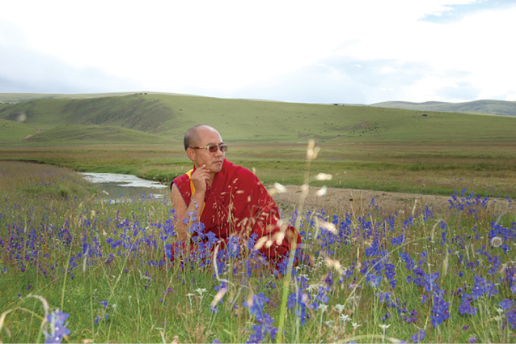
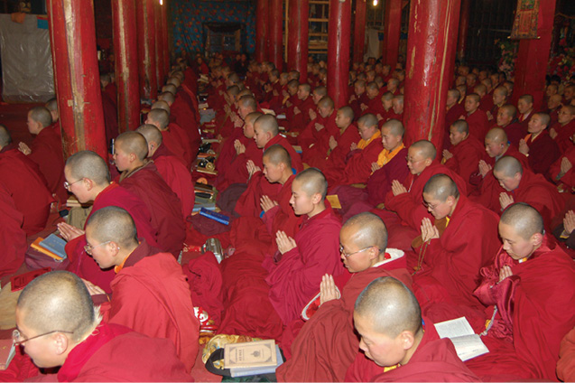

## 《远唤上师》讲解

2006年2月6日

今天，我们给大家发了一个小册子，里面有两篇《远唤上师》。第一篇是《远唤上师·引加持日之乘》，第二篇是《远唤上师·悉地藏流》，都是法王如意宝所造。今天给大家讲一下第二篇。

法王如意宝圆寂后，我的内心十分痛苦，以致很多事情无法成办，为压制自己的情绪而翻译了这首道歌。法王如意宝已经圆寂两年多了，时间过得真的很快。按照传承上师的传统，作为具有信心的弟子，会经常以虔诚心唱诵“远唤上师”的偈颂，以祈祷、赞叹、呼唤的方式向上师求得加持。如今，很多国外道场也会经常放“远唤上师”的唱诵磁带。所以，我想道友们应该对自己的根本上师有一种非常真切的信心，然后以非常可靠的金刚语来祈祷上师，这样做很有必要。

去年的时候，关于上师的很多事情，我都还不想提。因为每次提起，我都很难控制自己的情绪，也影响了很多道友的情绪，所以我在课堂上很少表露自己的哀伤，但现在过去这么久了，我想我们应该多多忆念上师。

在很多经典续部中讲到，一刹那间忆念上师的功德也是相当大的。以此“远唤上师”的方式诚挚地呼唤与诸佛总集无二无别的大恩根本上师，无论上师在哪一个清净刹土，都会以他的智慧之眼观照我们，随时以无分别的智慧加持我们，就好像澄清的水器放置在地上，十五的月亮自然而然会显现于水器中一样，这是无欺的缘起规律。同样，我们这些具缘弟子在上师的清净道场当中，以诚挚的信心呼唤上师，这时上师一定会慈悲垂念我们。如此一来，我们的相续才会堪能，才会成熟，无论做任何事都会成功，而且也会遣除修法中的违缘。

希望道友们不要有学术界的一些过失，只是在理论上磨时间是不行的。作为佛教徒，要有一种不共的信心，与上师沟通、相应，这一点是不可缺少的。历代的高僧大德，没有一个对自己上师不恭敬、不想念的。如果经常忆念上师，自相续中一定会得到上师的加持。我们也看得出来，无论在藏地还是汉地，凡是弘法利生事业非常广大的人，都对自己的传承上师具有不共的恭敬心和虔诚心。所以，我们以后无论是在深山里静修，还是在大城市里弘法利生，或者以其他方便方法修持正法，都离不开上师的加持。因此，经常祈祷上师相当重要。

“悉地藏流”，是指此祈祷文如同甘露之水流进我们的心田。实际上，这个祈祷文是法王如意宝对托嘎如意宝与麦彭仁波切的呼唤，而后学弟子应将大恩上师法王如意宝为主的所有上师作为对境进行祈祷呼唤。其实，我们应该把这个祈祷文当成金刚道歌，然后请声音特别好的师父来唱诵，这样也非常好。

《远唤上师·悉地藏流》一共有十六个颂词。利用今天的时间，我给大家做个简单的字面解释。

> 浩瀚如来之总相，无余有情之依怙，

> 显密教法开显者，大恩上师垂念我。

对于这些颂词，我们应该把前后内容全部结合起来，这样比较好理解。如果讲颂词的时候，把每一个颂词分开来讲，有时可能会词不达意，导致很多内容无法连接起来。这篇祈祷文中的颂词，全部是讲上师的功德，最后也都是祈请上师垂念自己。

“浩瀚如来之总相”，上师是浩瀚如海般如来之总相。此处“总相”并非因明中的总相，而是指过去、现在、未来三世诸佛总体的形象，即三世诸佛完全是以上师的形象来到人间。也就是说，上师是三世诸佛的化身。

“无余有情之依怙”，世间人认为很了不起的国家总统、国家主席，也只能做他所统辖范围内的怙主，而上师是一切有情的怙主，对六道众生没有任何亲怨之分。

“显密教法开显者”，上师是一切显密教法的开显者、弘扬者。

这三句已经讲述了金刚上师应该具备的功德。从法王如意宝自身来讲，每一种功德都是具足的，所以法王如意宝也是一切如来的化身，是一切众生的怙主。另外，法王如意宝对显密佛法并非偏袒执著，而是将显密教法圆融一味地进行开显与弘扬。

藏文“喇嘛钦”，直译即“上师知”，但此处是从意义上来讲，即“上师垂念我”“上师加持我”。

此处已经讲述了大恩上师的功德，接下来就对远方的上师深切地呼唤：大恩上师请垂念我！大恩上师请加持我！

现在的译者，有些翻译成垂念，有些翻译成加持，有些翻译成上师知，等等。其实，根据内容和语境来定，这样可能会好一点。总的来讲，上师的功德就是这样。

> 佩带清净之戒饰，拥有无散等持藏，

> 具备无等智慧眼，大恩上师垂念我。

上师具足戒定慧的功德，也就是三学的功德。

“佩带清净之戒饰”，上师的身体有清净戒律作为严饰。《赞戒论》中讲，世间人特别喜欢用珠宝、珊瑚、玛瑙等作为首饰，而出家人对这些都应该舍弃，只有清净的戒律才是出家人最庄严的饰品。这是戒定慧里的戒学，也就是戒律清净。

“拥有无散等持藏”，上师始终安住于等持之中，不被任何散乱分别念所动摇。也就是说，具有无有任何散乱的等持宝藏。

“具备无等智慧眼”，上师具有无与伦比的智慧之眼。

具有戒定慧三学的大恩上师请垂念我！

> 百万智者之顶饰，千成就者之尊主，

> 摧毁五浊衰败者，大恩上师垂念我。

“百万智者之顶饰”，上师是百万智者之顶严装饰，世间与出世间的多少智者也无法与大恩上师相比，所有人都应恭恭敬敬地顶戴上师。

这里主要是法王如意宝对麦彭仁波切的一种赞叹与呼唤。但其实法王如意宝也是如此，不管在藏地还是汉地，如今这个时代当中，像上师老人家这样精通佛法的人，可以说是凤毛麟角。因此，所有的智者都应该赞叹、恭敬这样的上师。

“千成就者之尊主”，上师是所有大成就者的主尊。一般来说，法王如意宝在世时，有些大成就者会特别敬畏，因为他们在别的地方可以显现这个神通那个神通，但不知道什么因缘，来到学院以后都显不出来了。所以，任何一个成就者，想要在学院依靠神通而出名是很难的。由此可见，法王如意宝真的是成千上万大成就者的主尊。

“摧毁五浊衰败者”，上师住世的时候，依靠他的发心和加持，五浊恶世的各种衰败、疾病、险难都会消失。所以，他是五浊恶世的摧毁者。

具有如此殊胜功德的大恩上师请垂念我！

法王如意宝所造的这些赞叹句，每一个都具有非常深的含义。有些道友平时也会写一些道歌或者赞颂上师的祈祷文，但从内容上来看，完全是凭着自己的分别念去创作，也没什么好解释的。而这里每一句话都蕴含了殊胜的内涵和意义，大家应以自己的智慧细心品味。

> 了然照见一切法，如母慈爱诸有情，

> 十自在藏自驾驭，大恩上师垂念我。

上师具足智悲力的功德，也就是智慧、悲心和力量。

上师以其无碍智慧可以了然照见一切法，以其无缘大悲如同慈母一样慈爱一切众生，以具备十种自在[^1]宝藏的能力利益无量无边的众生。

具足智悲力之功德的大恩上师请垂念我！

现在有些上师智慧不够，不要说甚深的密宗教法，甚至连稍深一点的显宗教法都讲不出来。但是，从显宗到密宗，包括最深的无上大圆满之间的所有教法，法王如意宝全都精通无碍。大家也清楚，法王如意宝是以怎样的悲心保护每一个弟子，以怎样的智慧传讲显密一切教法。

在末法时代，如果想要利益众生，需要有一种威力。虽然法王如意宝有深不可测的智慧，也有不可思议的悲心，但在这个社会当中，想要以佛法利益众生，开展弘法利生的事业，没有一定的发心力和自在力，也是一件相当困难的事情。实际上，这些功德法王如意宝全部具足。

> 无遗断除诸二障，获证四身胜王位，

> 利乐大海之源头，大恩上师垂念我。

上师具足究竟的断证功德。

上师虽然显现为凡夫形象来度化众生，但实际上已经断尽烦恼、所知二障，获得法报化以及本性身的四身殊胜果位，是无量利生事业大海之源泉。

具足究竟断证功德及利生事业的大恩上师请垂念我！

> 三传承师之代表，寂猛本尊之遍主，

> 三处空行之商主，大恩上师垂念我。

上师是上师、本尊、空行三根本的总集。

上师是如来密意传、持明表示传、补特伽罗耳传这三大传承的代表；上师是寂猛百尊之遍主；“三处空行”即三界的空行母，或者是法身界、报身界、化身界三处的空行母，上师是一切空行之怙主。

请三根本怙主之大恩上师垂念我！

> 如海佛陀之补处，如海妙法之源泉，

> 如海僧众之君主，大恩上师垂念我。

上师是佛、法、僧三宝的总集。

上师是所有佛陀事业的补处者，是所有显密妙法的来源，是所有僧众的君主。

如果没有上师，我们的相续中不一定会生起真正的悲心。上师对我们的恩德，世间上任何一种恩德也无法相比，世间上任何一种货币也无法换取，我们相续中生起的一刹那因果正见，也是由上师加持而出现的。

昨天，有人给学院供养了五十吨大米，价值将近二十万。很多道友认为，这很了不起。但我认为，哪怕相续中生起一刹那的因果正见，其价值也是远超于此。因此，上师是所有妙法的源泉。

在我们学院当中能有这么多僧众，完全是依靠上师的威德力感召。而其他有些地方并非如此，尤其在国外，有些大法师经常在特别大的体育场里讲法，听法的在家人可能有上万人，但出家人只有几百个人。大家也应该清楚，现在的寺院或佛学院里都有多少人，即便是比较出名的寺院，里面能有一百个出家众，很多人都会觉得这个寺院了不得。而藏地的三大寺院，以前我们也都去过，也知道每个寺院里有多少人。可见，上师与上师之间也是有差别的，比如发心不同、事业不同、加持也不同，我们应该对自己的传承上师和根本上师有信心。

请圆满具足三宝功德之大恩上师垂念我！

以上是从戒定慧、智悲力等方面来讲上师的功德，下面是从麦彭仁波切等上师是藏地八大教派的教主这个方面来进行赞叹。

> 受持香巴之教轨，庄严三学之教法，

> 开显六加行教者，大恩上师垂念我。

“香巴”是噶举派的一个分支，由穹波尊者弘扬，是藏地非常出名的八大教派之一。这里讲到，我的根本上师是香巴噶举派的教主。

“庄严三学”指噶当派，他们主要修持释迦牟尼佛、度母、不动佛以及观世音菩萨四大本尊，并且以三学为修行准则。

“开显六加行”指觉囊派，此派在修时轮金刚时有六种加行[^2]。

请三大教派教主之大恩上师垂念我！

> 道果教法之砥柱，断法教派之来源，

> 依修教法持藏者，大恩上师垂念我。

“道果”指萨迦派；“断法”由帕单巴尊者从印度传到藏地，属于般若教法，也叫希解派，“依修”与“断法”可以合在一起讲。

上师即是道果法之砥柱、断法之来源、依修教法之持藏者，这样的大恩上师请垂念我！

> 中观教法之主人，大手印教之杲日，

> 大圆满法之妙车，大恩上师垂念我。

“中观教法”指格鲁派，“大手印”是噶举派，“大圆满”即宁玛派。

上师即此三大教派的教主，这样的大恩上师请垂念我！

对于没有甚深见解的人来讲，可能会感到非常困惑，藏地的各大教派都有自己的祖师，汉地的禅宗、净土宗等也有自己的祖师，怎么会是全部融入一体呢？其实，这两种说法并不矛盾。

我们学习《远唤上师》有两个目的：一是对根本上师应该经常祈祷。如果自己心里很烦躁，出现修法违缘时，在家里或者到山上呼唤自己的根本上师，这种祈祷对每一个修行人来讲是始终不能离开的。还有一个方面，法王如意宝显现上是我们宁玛派的教主，全知无垢光尊者、麦彭仁波切也是宁玛派的教主，但此处讲到上师是一切教派之教主，为什么呢？这里具有甚深的密意。

有些人说：“我是学藏传佛教的，汉地的净土宗不好，禅宗也不好。”有些人说：“我是学宁玛派的，其他的格鲁派、觉囊派全都不好。”如果以这种眼光、态度修学佛法的话，恐怕心相续中很难生起真正的智慧与悲心。法王如意宝希望我们后学者对所有教派皆应具有恭敬心，而且一旦自己有弘法利生能力时，应该主要站在宁玛派的角度，对所有教法进行弘扬。如果没有弘扬所有教法的能力，也不能毁谤其他教派。

大家也应如此发愿：从现在开始，我对所有的教派都不毁谤，对所有教派的高僧大德均以恭敬心、清净心对待。在学院，由于法王如意宝的加持，四众弟子中有些人虽然现在还“长”得不是很高，但也在一点一点地成长，而在成长的过程中，上师始终都在教诫我们不能对任何一个教派起邪见，因为一切教派都是如来的教法。

前几天，我们讲《心经》时也说过，在藏传佛教中，八大教派没有一个不讲《心经》的，此经是所有教派学习的核心；汉传佛教的净土宗、禅宗、天台宗等，也都修学《心经》，甚至从唐密的历史来看，他们也有修学《心经》。各个教派虽然在修持方法上有些不同，比如华严宗以修“华严”为主，禅宗打“禅七”，净土宗以念佛为主，密宗则以不共窍诀进行修持，但在大的方面没有任何差别，如最开始的发心、中间的积累二资粮、最后成就佛果，所依止的全部是释迦牟尼佛、观世音菩萨等。而且，诸佛菩萨以及高僧大德从本体上来说均是无二无别，所以大家不要妄加区分。

希望大家以后能在言行举止方面有所改变，包括我自己在内，由于以前学习因明时，还有一种寻思的习气，所以始终觉得自己宗派如何如何正确而其他宗派如何如何不对。法王如意宝晚年时经常说，年轻时在辩论过程中很有可能造了谤法罪，因此一定要忏悔。所以，作为后学者，我们一定要对各教派有恭敬心。现在不论是汉传佛教还是藏传佛教，一些没有宗派偏见的法师，弘法事业确实非常广大。但若仅仅认同宁玛派，其他宗派全部反对，那在宁玛派的范围内也许会有一点立足之地，到其他地方恐怕就不行了。

有些人问我：“你们学院有什么特色？”我说：“不舍自宗，尊重他宗。”学院中出来的人应该具足学院的特色，对任何宗派的毁谤言词都没有必要，否则很容易造下谤法罪，后果非常可怕。

> 宗喀巴师之行为，米拉日巴之修持，

> 莲师见解持藏者，大恩上师垂念我。

在藏传佛教中，格鲁派的行为、持戒是很殊胜的，包括他们经堂里的垫子都非常整齐，让人一看就生信心。我们学院可能人太多的原因，有时候也不好管理，今天摆放好的垫子，明天可能就被扔到门口。但格鲁派的寺院，每次他们供斋的时候，穿着都十分洁净，乃至厨房里的桶、壶都非常整齐。

作为出家人，应该注意自己的行为，穿衣服不要太破烂，在方方面面要表现出佛教的慈悲与智慧，这才是真正佛教徒的威仪。以前我们小的时候，生活很困难，买不起新衣服，穿得破烂一点也情有可原。但现在的出家人如果衣服和头发都很脏，看起来就不像个佛教徒，也容易让人产生不好的想法。

因此，我们的穿着要干净、整洁。有些道友认为自己闻思修特别忙，连好好穿衣服的时间都没有，僧裙不是左边高一点，就是右边拖在地上，这样看起来很不庄严。除了仪表整洁以外，自己的住处也应该干干净净。

法王如意宝以前说过：“去格鲁派上师的家里非常舒服，屋子里除了茶壶、钢炉、糌粑箱子等生活必需品外，其他的就是书，看上去非常整齐清爽，上师自己也是坐得很端直。”我听说有一位上师，自己在家时不太注重威仪。有一天，他知道有个居士要来就很紧张，赶紧和居士说：“你先不要来，我正在禅修。”然后，他马上把衣服穿好，一本正经地端坐在座位上。居士来了之后，以为上师真的在一直禅修，就很生信心。

其实，行为上学习格鲁派很重要。在国外，有很多人就是依靠一些高僧大德的行为、微笑生起信心的。如果穿得破破烂烂，走路也是东倒西歪，看起来疯疯癫癫的，除非你是大成就者，否则这样故意示现没有任何必要。当然，现在冬天不方便洗衣服，我也不强求，但再过一段时间就立春了，希望到时候道友们能洗一洗衣服。有些道友的衣服一两年都不洗，你可能已经习惯了自己的味道，所以没有什么感觉，而旁边的人又不好意思直说，这样也很麻烦。

修行时，应该像米拉日巴尊者那样苦行，自己的亲朋好友、名声财产等全部放弃。在藏传佛教中，行为方面谁也比不上格鲁派，苦行方面谁也超不过噶举派和噶当派，比如米拉日巴尊者、博朵瓦尊者等等，这些高僧大德都非常了不起。而见解方面，应以莲花生大士的见解为准，大圆满的无二正见远远超胜诸多宗派的见解。

具足宗喀巴大师之行为、米拉日巴之苦行、莲花生大士之见解的大恩上师请垂念我！

> 阿底峡尊之戒律，珠魏滚波之等持，

> 萨班智慧之领主，大恩上师垂念我。

阿底峡尊者不论守持小乘别解脱戒、大乘菩萨戒还是密乘戒，一直都是纤尘不染，在整个佛教历史上可谓首屈一指，非常难得。

珠魏滚波，也即觉囊派的多罗那他，他可以很长时间安住于等持中不动摇，而且他的弘法利生事业非常广大。以前觉囊派的教法衰败时，是依靠他的力量才得以恢复，其所造的《印度佛教史》《时轮金刚注释》等诸多论著，使得觉囊派在藏地又重新兴盛起来。

萨迦班智达根嘎嘉村，是《格言宝藏论》的作者，也是藏地公认的雪域三大文殊之一。另外两位是无垢光尊者和宗喀巴大师。

具足阿底峡尊者之戒律、多罗那他之等持、萨迦班智达之智慧的大恩上师请垂念我！

> 帕单巴尊之威力，邬金巴尊之悲悯，

> 穹波智慧之总集，大恩上师垂念我。

帕单巴尊者曾在印度、藏地以及汉地五台山等很多地方弘扬佛法，在弘法利生方面具有很强的能力。

大成就者邬金巴，出生于1230年，是噶举派的一位大德，也是第二世噶玛巴的弟子，第三世噶玛巴的经师，即噶玛巴自生金刚的上师，曾被元世祖忽必烈尊奉为国师，他对所有众生都非常慈悲。

穹波尊者原是苯教徒，后来到印度、尼泊尔一带依止了150位上师，并开始弘扬香巴派，此派在藏地兴盛过很长一段时间，其所培养的弟子有数十万之多。据说他住世150岁，是一位非常了不起的成就者，法王如意宝也讲过有关他的故事。有些历史书中说，香巴派教法曾存世400年左右，现在基本已接近隐没了。

聚合了帕单巴尊者之威力、邬金巴尊者之悲悯以及穹波尊者之智慧的大恩上师请垂念我！

在藏地，以上各教各派的祖师，都是非常了不起的成就者，也是诸佛菩萨的化身。而在汉地，也可以说达摩祖师和智者大师、印光法师本体是无二无别的。对佛法不太了解的人可能会想：“我是学净土宗的，净土宗的祖师是印光法师，其他祖师怎么和印光法师是一体呢？”但实际上，诸佛菩萨在本性中是无二无别的，各教派的上师究竟意义上也是一个本体。就像《中观庄严论释》前面总义部分中讲到的，藏地凡是化现为亲教师身份的诸位大德，实际上与尊者菩提萨埵均是一味一体，所以说各宗各派圆融无违，这一点非常重要。

> 于作祈祷具缘子，不懈慈悲而垂念，

> 加持甘露妙雨流，灌溉心间之莲花。

作为具信心的有缘弟子，一方面赞美、称扬上师，一方面诚心诚意祈祷上师，希望上师老人家慈悲加持，以甘霖之水灌溉我们信心之莲花。

如果没有上师的加持，我们的信心莲花始终都无法开放，而一旦有了加持的雨水，信心之花就有希望成熟，有希望开启。作为修行人，如果经常至诚祈祷上师，一定可以遣除修行过程中的诸多违缘。在末法时代，虽然我们很想做一个合格的修行人，但遇到违缘时心还是会容易改变，并且无有对治的能力。所以，祈祷上师非常重要。

从我自身来讲，确实没有什么功德，给你们讲法的话，有时候也很惭愧，这并不是谦虚之词。前段时间，生命电视台对我进行采访，主持人说我具足广大的菩提心，还写了很多利益众生的书。但我直爽地说，著书立说只是我的个人爱好，至于菩提心的话，我反反复复地观察自己，在我的相续中并没有生起真实无伪的菩提心。菩提心一般分为世俗菩提心和胜义菩提心，真正的世俗菩提心我可能都还没有具足，公开欺骗大众也没有什么用。

我确实喜欢讲一些佛法，也写一些书，翻译一些著作，但这就像喜欢唱歌的人，经常爱去歌舞厅一样。当然，按照因果规律来看，我应该是前世与佛法有缘，但今生还没有生起真正的菩提心，对上师三宝的祈祷也还不足够。

有时候，我真的很想念上师如意宝。在这个世界上，除了上师以外，应该没有更想念的人了，包括自己的父母和亲朋好友。尤其是出去的时候，今年我去过云南的几个地方，有些是上师以前常去的地方，到了那边之后自己非常伤心。包括去北京或其他地方也是如此，以前和上师一起去过的地方，自己再去的时候，总是不自觉地想起上师，然后就不想出去了，一个人待在屋里怀念上师，这样心里感觉很舒服，也算是对上师的一种信心吧。

作为有信心、有智慧的弟子，应该经常修上师瑜伽，也就是把上师的智慧融入自己的心间。虽然我是这么告诉你们的，但我自己并没有做到每天观修，一方面确实没有时间，一方面修行的习气也比较薄弱，因此难以实现。但这么多年一直在学习佛法，到底什么重要什么不重要，我还是比较清楚的。比如，对于卖东西的人来说，虽然他自己很穷，但他也知道哪个是真正值钱的货物，哪个是假冒伪劣的货物。同样，我作为佛法大宝库中的一名服务员，对这些法也是比较了解的。

希望大家将法王如意宝为主的所有传承上师观为一体，经常恭敬祈祷，这样自己的烦恼就会逐渐消除，而且中观、大圆满的见解也会日益增上。如果对上师三宝一点都不祈祷，然后想“我要证悟大圆满”，这是非常困难的。

在末法时代，想要成为一个真正的修行人，让自己的修行善始善终，一定要依靠传承上师和护法神的加持。就像世间一些想得到更高地位的领导，一方面他自己要有智慧，一方面要有一个坚实的靠山，这样才能官运亨通。同样，我们要想成为真正的修行人，也要具足内因外缘，经常祈祷上师慈悲垂念加持。

> 于泊可怖轮回中，苦难芸芸之群生，

> 祈愿赐予永安乐，殊胜菩提大慰藉。

我们这些漂泊在恐怖轮回中的芸芸众生，一心祈祷上师，祈愿您能赐予我们究竟的安乐——殊胜大菩提的安慰。

> 五浊猖狂诸损恼，致使徒存虚名已，

> 现喜刹土之妙欲，祈愿招引于此处。

《赞戒论》中说：“然亦会遭恶魔之危害，恒以恭敬清净之信心，猛厉祈祷上师莲花生，决定不为违缘所转变。”也就是说，众生的五浊烦恼越来越炽盛，违缘越来越强的时候，依靠莲花生大士的不共威力，各种恼害全部会荡然无存。

法王如意宝在世时，也会经常祈祷莲花生大士。学院这次做了一批小挂件，上面有一个吽字，还有莲花生大士的心咒，质量也很好，是在香港那边定制的，过段时间会发给大家，希望各位内心具足莲花生大士的见解。刚刚也讲了，我们作为密宗弟子，要具足宗喀巴大师之行为、米拉日巴之苦行、莲花生大士之见解。这样一来，以后你的弟子祈祷你的时候，可能也会赞叹说：“我的法师是非常不错的，他的行为和宗喀巴大师一模一样，修行和米拉日巴尊者一模一样，见解和莲花生大士一模一样。”

在如今五浊恶世中，各种各样的损恼猖狂不绝，依靠上师的加持，这些衰损全部会变成一种虚名，而现喜刹土等所有清净刹土的功德以及种种妙欲全部会招引于此处。

我们应该以虔诚心向正在远方以智慧之眼观照所有弟子的大恩上师法王如意宝祈祷：愿上师加持我们，生生世世不损害任何众生，所有弘法利生的顺缘圆满具足，修行过程中的一切违缘全部遣除！

此十六偈颂，是为利密友班增等个别求解脱者，阿旺罗珠宗美于十六胜生周木蛇年正午时分造。愿增吉祥！

法王如意宝的好几首道歌里都提到班增，他现在应该已经圆寂了，他的功德也是很大的。以前还有一个叫达吉的，他祈请法王造了《大圆满直指心性注疏》，也已经圆寂了。

阿旺罗珠宗美是法王如意宝的名字。木蛇年是1965年，当时宗教政策还没有开放。正午时分造。愿吉祥！

[^1]: 十种自在：寿命自在、心自在、财自在、业自在、生自在、愿自在、解自在、如意自在、智自在、法自在。
[^2]: 《时轮金刚》有收摄、禅定、运气、持风、随念、三摩地等六种加行。
