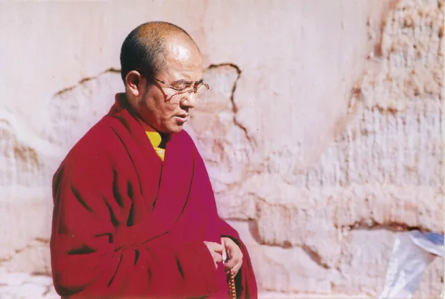
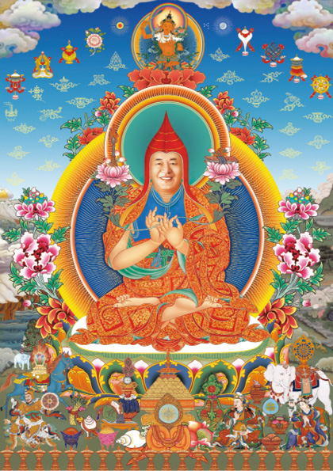

## 一切加持的源泉

2006年12月17日

今天，我们简单讲一下上师瑜伽的内容。

## 上师瑜伽的重要性

所谓上师瑜伽，就是与上师相应的修法。无论学显宗还是学密宗，都应该明白上师瑜伽的重要性。《般若摄颂》中说：“佛法皆依善知识，功德胜主佛所说。”世间的知识，很多依靠老师的恩德获得；而出世间的一切智慧、证悟，全部依靠上师的加持获得。因此，依止上师是修学过程中非常重要的一个环节。

每一个教派当中，都有自己的上师瑜伽仪轨。我这次传的是法王如意宝的《上师瑜伽速赐加持》，大家都可以修。一方面，今天大多数道友跟学院和法王如意宝有一定的因缘；另一方面，即使你们以前没有见过法王如意宝，也不是学宁玛派的，但在经续论典中都有提到，所有具德上师在智慧法界中是一味一体的。因此，大家不必为了“我的上师”“你的上师”而争论不休。

当然，不同上师对自己的法恩不同，所以自己也会有不同的信心。比如，给自己皈依、灌顶、传窍诀的上师，是一生中最难忘的人。智悲光尊者曾说：“我也是因为拜读了第二大佛无垢光尊者的论著后，相续中认为他老人家就是真佛的想法油然而生，一心一意地虔诚祈祷，承蒙尊者的智慧身摄受，从而自相续中生起了自然本智，从此以后我才开始引导数以百计的求法者。”很多道友也是一样，对不同法恩的上师，会有不同的信心，但同时也应该清楚，真正具有法相的上师，在智慧法界中是一味一体的。

根据信心的不同，修上师瑜伽时的观想也不同。如果你深信上师与佛没有差别，可以直接观想上师的形象；如果你认为上师与佛还有一定的差别，可以把上师观想为释迦牟尼佛、莲花生大士或者文殊菩萨等的形象。

如果只是学一些世间知识，不一定要修上师瑜伽。但如果想要在自相续中生起出世间智慧和证悟境界，则务必要依止上师，而依止上师就一定要修上师瑜伽。因此，希望大家在每次修法之前，最好先修一遍上师瑜伽。

（堪布念传承）

## 上师瑜伽的具体修法

修持的时候，可以念藏文，也可以念汉文。

首先念皈依偈和发心偈，之后观想万法是本来清净的大空性，在此境界中，自相不灭地显现出莲花和月轮。在本来清净的大空性中，显现五光萦绕的根本上师。莲花和月轮之上观想红黄色的“德”字，“德”字变成宝剑——文殊菩萨的标志。宝剑渐化为黄文殊，黄文殊变成上师，上师的形象是法王如意宝，本体与文殊菩萨无二无别，在五光萦绕的净现中显现。身上具足班智达的一切服饰，以说法手印持着代表智慧的宝剑、经函，以及代表方便的莲花，双足金刚跏趺坐，身体发出无量光芒。

在这样非常清净、明然的状态中，如是观想上师安住于前方的虚空中。

观想：

> 阿

> 括第秋根嘎达热波昂 轮涅诸法本净觉性中

> 让当玛嘎耶西哦诶隆 自性不灭智慧五光界

> 哦沃华丹蒋波多杰拉 本体具德文殊金刚尊

> 南巴嘉吉耶印诺沃涅 形相唯一怙主如意宝

> 嘎萨贼怎班智达耶齐 白明美颜班智达之饰

> 秋恰香吉绕哲拉万南 说法手印持执剑经函

> 雅尼杰仲哦瑞么美绰 双足跏趺放射无边光

> 让囊达波坚德兰美萨 明然观想自现净庄严

然后，对上师生起无比信心，心想：我从现在乃至获得佛果之间，暂时增上生和究竟决定胜的安乐全部依靠您，请上师赐予我加持，请上师赐予我灌顶，请上师赐予我一切教言！

祈祷：

> 内钦热沃贼诶样堪色 自大圣境五台山

> 蒋华特杰辛拉耶拉门 文殊加持融入心

> 晋美彭措雅拉索瓦得 祈祷晋美彭措尊

> 贡觉多巴破瓦辛吉洛 意传加持得证悟

此四句殊胜的祈祷文是1987年法王如意宝在五台山取出意伏藏《文殊静修大圆满·手中赐佛》后，有两位弟子祈请法王为这个极为殊胜的伏藏所造的传承上师祈请文中的四句。

此文念多长时间都可以，至少是三遍以上，或者七遍、二十一遍。随力念诵后，观想上师化为五光明点，从自己头顶融入心间，之后上师相续中的慈悲、智慧、等持、总持等所有功德，以及一切灌顶、教授，自己全部无余获得，自己的分别念与上师的智慧变成无二无别。在这样的境界中稍许安住。

> 塔呢喇嘛哦诶特类杰 末观师成五光之明点

> 让格协沃内耶酿卫腾 由自头顶融入于心间

> 嘉根耶西吉第喇嘛当 获得诸佛智慧之总集

> 嘎瓦年波辛拉托巴三 上师同等缘分之加持

从中起定时，一切现有观为上师本体，平时行住坐卧如是行持。比如，听到的一切声音是上师的金刚语，看到的一切相是上师的身相，所有的分别念是上师的智慧。

略而言之，前面皈依、发心；然后一边念诵，一边观想上师如意宝安住在前方虚空中；上师一直非常慈祥地注视着自己，自己在上师面前合掌念诵祈祷文；祈祷完之后，观想上师化光融入自身，自己的心与上师的智慧变成无二无别，在这种境界中安住；起定之后，观想显现的一切都是上师身口意的幻变。

## 上师的加持不可估量

很多人工作特别忙没时间修行，而修这个上师瑜伽，可以说非常方便。事实上，听到这个法的道友，都会直接或间接得到法王如意宝的加持。要知道，如果1987年法王如意宝没有发心摄受汉族四众弟子，恐怕很多人不一定有这种学佛的机会。而且从法王如意宝的事业来看，老人家一直提倡各教派互不相违。因此，不管你皈依哪位上师，学习哪个教派，都可以修这个仪轨。

如果经常修上师瑜伽，修行过程中则不会出现障碍。无垢光尊者在《大圆满心性休息》中有讲，修生起次第和圆满次第，需要其他遣除障碍的窍诀和方便方法，而修上师瑜伽不需要任何除障法。另外，修上师瑜伽的功德也非常大。《誓言庄严续》中说：“十万劫中勤观修，具相随好之本尊，不如刹那念师胜，念咒修法千万遍，不如祈师一遍胜。”意思是说，在十万劫中观修本尊，不如一刹那忆念上师的功德大，念诵咒语千百万遍，不如对上师祈祷一遍功德大。《大圆满前行》中也引用过这个教证。

除此之外，有些显宗经典中也讲到上师是佛，上师所赐予的功德，任何一个修法也无法相比。比如，《华严经》中说：“善知识者即是如来，善知识者一切法云，善知识者诸功德藏……”

我们每个人都想成为真正的佛教徒，但是在修学过程中，经常会出现一些违缘，导致许多事情不能如愿以偿，而想要遣除违缘，最主要的就是祈祷上师。作为佛教徒，不要认为了知佛教的教义就可以了，应该要生起不共的证悟境界。如果把佛法当成世间学问去研究，这样没有多大的意义。

## 时刻鞭策自己闻思修

网上的道友虽然与我之间有一定的距离，但现在大家也可以互相沟通，交流佛法。其实，住在学院的道友，除了上课以外，平时也很难见到我，因为我的事情比较多。

作为在家人，你们有很多工作、家庭方面的事情，但为了听闻佛法，也花了一定的时间。我刚才听工作人员说，有些道友七八个小时前就在网上等着，这种精神非常可嘉。但事实上，与住在学院的道友相比，你们的生活条件已经非常不错了。今天整个学院都没有电，漆黑一片，而且气温零下二三十度，路上到处是冰雪，很多道友提水时经常摔倒。如果你们在这样冰天雪地的环境中修行，自己提水、生火、做饭……恐怕不一定受得了。

生活条件好，散乱的因也会很多，你们应该给自己一些压力，否则修行很难有所进步。而在这个山谷里，散乱的因并太多，为了求法，为了修行，很多道友非常精进，早上大约5点就起床背书，晚上一般12点之前不会睡觉，尤其最近要考试了，每天熬夜看书的人很多。我相信，看到他们的苦行，你们一方面会觉得很感动，一方面也会觉得很惭愧。

其实，大家今年比往年进步多了，学习《入行论》等论典也比较积极，非常随喜你们的功德。作为佛教徒，我们不能迷信，应该花一定的时间来修行，进而生起坚定不移的信心。

虽然你们住在城市里，但我们也尽量提供了各种学习佛法的方便，希望大家能够珍惜。如果错过了这次，可能就错过了多世累劫当中唯一的机会。因为从你们的家庭、工作、道心等来看，完全舍弃红尘到寂静处去修行，因缘不一定能成熟；如果没有这样的因缘，即便一些上师给你们传授灌顶，这一方面是种加持，也非常好，但要想真正改变自相续，一定要通过系统性的闻思修，才有可能趋入真正的解脱道。

## 对佛教徒的三点寄语

为了大家更好地学习，今天在宣讲上师瑜伽修法的同时，我想提出几点希望：

第一，一定要抓住学习的机会。

我会排除一切困难，尽力为大家传讲《入行论》等经论，希望你们能够认真地学习。

对我个人来讲，你们学也可以，不学也可以，但对你们来讲，学习这些经论有很大的利益。

第二，佛教徒内部一定要团结。

不管是学汉传还是藏传，学显宗还是密宗，佛教徒内部一定要互相观清净心，不要互相抵触。

现在外面有那么多不信佛教、反对佛教、杀害众生的人，还有无数外道想逐渐攻占我们佛教界，如果你真正有本事，应该用你的智慧和威德力去调伏他们，而不是诽谤其他教派的上师。一方面，我们佛教徒内部一定要团结；另一方面，对于一些不如法的现象，我们应该勇于提出来。比如，现在有些人根本不具足上师的法相，却冒充上师欺骗他人，已经混入到上师的行列；还有些法并不是真正的佛法，这些方面大家一定要注意。除此之外，对于具有法相的上师、真正的佛法，我们要生起信心而接受。

佛教徒之间要和睦相处，不要互相闹矛盾、互相抵触。尤其是金刚道友之间，一定要懂得互相理解。

第三，注重次第性的学习。

什么叫次第性的学习呢？首先，应该学习《入菩萨行论》《大圆满前行》《菩提道次第广论》这样的基础法门，先要打好基础，不要觉得自己一下子可以证悟很高的境界。

现在有些人特别喜欢讲神通、讲境界，把一些神神叨叨的事情当作佛法，这是非常危险的！真正的佛教徒，不会整天讲这些，也不会重视这些。真正的善知识，也不会整天宣扬自己是谁的转世，或者和别人说听了他的法马上就可以开天眼。

有些佛教徒天天高谈阔论，这样不太好，应该越修越精进、越调柔。因此，大家一定要有次第、有条理地学习，不要妄想一步登天，否则修行不会有进步的。

希望大家依靠上师的加持，早日认识自己心的本性。就我个人来讲，虽然没有什么证悟境界，但对传承上师有着无比的信心和恭敬心，这一点在任何人面前我都敢保证。近二十年来，虽然自己作为一个凡夫人，有时候会让上师不高兴，但是当天都会立即忏悔。随着时间的流逝，我对上师的信心也是越来越强烈，永远也不会忘记传承上师的恩德。

依靠上师的加持，认识心的本性并不是特别困难。但如果只是理论上说得天花乱坠，这样不一定能认识心性。因此，大家最好观一观自心的本体，不管用禅宗的方法，还是用中观、密宗的方法，都是可以的。在轮回中漂泊的可怜众生，一旦认识了自心的本来面目，就不会再继续苦恼了。

总之，大家要好好地祈祷上师，同时还要多观一观自己的心，争取在临终之前认识心的本性，这一点非常重要。

现场互动

⊙ 问：心识是如何产生的？

堪布：心识的形成，有显宗、密宗两种解释方法。

按照显宗的说法，众生的心识本来跟法界无二无别，但是可怜的众生没有认识到一切都是自心显现，所以逐渐迷惑，显现外境的各种迷乱，就像白天做梦一样。

所以，心识形成的状况，应该结合“如白天醒觉时的法界心”和“如晚上做梦时的迷乱心”来理解。

⊙ 问：如何帮别人忏悔业障？

堪布：最好劝他以四种对治力念诵金刚萨埵心咒，如果他不愿意，你可以念了之后回向给他。

⊙ 问：看到出家师父行为不如法，能不能跟师父直接说？

堪布：如果是真正不如法的行为，可以当面跟对方说。当然，有时候是自己的心不清净，本来别人行为如法，却误认为不如法，如果这样对出家人进行诽谤，也会有一定的过失。

不管是上师还是普通出家人，任何一个人，如果他的行为不如法，与如来圣教相违，都是可以制止的，即使对方不接受，自己也没有过失。宗喀巴大师在《事师五十颂释》中说：“假设上师吩咐非理非法之事，弟子用婉转的语言说清楚缘由，则不必去做，即使上师不高兴，弟子也没有过失。”

为了佛法的利益，为了众生的善根不被毁坏，如理如法地制止恶行没有过失。所谓在家人不要说出家人的过失，是因为有些在家人爱生邪见，总是看不惯出家人，经常说三道四，这种行为是不合理的。

⊙ 问：在中观里面，有时讲到没有任何承认，有时又讲随世人如何承认，中观也这样承认，请问如何理解？

堪布：从胜义谛而言，中观宗没有任何承认；从世俗谛而言，中观宗随顺众生承认名言显现，同时安立因果、五道十地等。

⊙ 问：很多大德来我们这儿传法、灌顶，我们也都去参加，认为得法越多越好，请问是这样吗？另外，我们还梦见法王如意宝让我们依止您。

堪布：今天不讲梦境。修行人经常讲梦不太好，因为现在很多人以做梦、神通来宣扬自己，欺惑别人。

不管梦境是真的还是假的，都不是很重要；今天得一个法，明天得一个法，实际上也不一定很重要，最重要的是系统地学习。

⊙ 问：如何才能以六度来度化众生？

堪布：只要我们具足菩提心，随时随地都可以帮助众生、利益众生。

不管是人还是非人，我们每天都有机会去利益他们。因此，一定要发起菩提心、利他心，这样想要以六度的方式来度化众生就不难了。

⊙ 问：法王如意宝曾说：“你们若念诵阿弥陀佛名号一百万遍，命终之后立即会往生到极乐世界。我以佛菩萨作证来担保，对此你们无需怀疑、犹豫。”授记也中说，凡是与法王结缘者都能往生极乐世界。请问怎样才算是与法王结缘？

堪布：不仅仅是法王的弟子，凡是对往生极乐世界有信心、对大乘佛法有信心的人，只要即生当中努力积累资粮，具足往生四因——明观福田、积资净障、发菩提心、发清净愿，都可以往生极乐世界。

所谓与法王结缘，不是仅限于见到他的色身，也包括参与他的事业。比如，直接或间接得受过法王的教言，发愿念诵100万遍藏文阿弥陀佛名号，以及参加法王创办的极乐法会，完成法王规定的念诵任务，我认为这都是与法王结缘。

凡是与法王结缘者都能往生极乐世界，这一点早在两百多年前，藏地大成就者菩提金刚就曾授记：“单坚阿拉木天喇荣沟，邬金莲师化身名晋美，彼于菩萨四众眷属中，广弘显密教法如明日，利生事业顶天立地也，清净所化眷属遍十方，凡结缘者皆生极乐刹。”其中明确指出，凡与莲花生大士的化身晋美彭措法王结缘的众生，必定可以往生极乐世界。

因此，如果大家真的对法王有信心，一定会往生极乐世界。对于这一点，我自己是坚信不疑的，因为这个授记并不是现代人写的，而是两百多年前大成就者菩提金刚的授记。另外，法王老人家一生当中也有过这样的发愿。1987年，法王如意宝朝拜五台山时，在塔院寺装有佛舍利的白塔前，曾带领大家一起共修《普贤行愿品》300万遍。这个殊胜的善根以非常广大的发愿作了印持——凡是结缘者全部往生极乐世界，以及兴盛佛法和利益众生。

因此，大家最好发愿在有生之年念诵100万遍藏文阿弥陀佛名号。同时，不要忘记念诵40万遍金刚萨埵心咒，遣除往生极乐世界的两种障碍，即五无间罪和谤法罪。

⊙ 问：以前在上师面前发过愿，三年内修完加行，但现在跟着学《菩提道次第广论》《入行论》，这样加行就难以按时完成，请问该如何抉择？

堪布：先以学习为主，因为这样的集体学习，以后不一定有，大家应该珍惜机会，好好学习。

学习之余，如果还有时间，尽量不散乱，慢慢修加行；如果没有，学完这些论典之后，也一定要修圆满，不要失去信心。

⊙ 问：受了菩萨戒以后，感觉行菩提心四根本戒很难守，比如自赞毁他，很多时候会犯，虽然可以忏悔，但还是担心有很大过失，只守不舍弃愿菩提心可以吗？

堪布：一般来讲，最好还是守四根本戒[^1]，这样菩提心就会日日夜夜增上。虽然有时比较难守，但也有补救的方法。比如，觉察到自己以自私自利的心态赞扬自己，以轻蔑的心态毁谤别人时，就要马上忏悔对治，再加上每天以仪轨自受菩萨戒，戒体会恢复的。

只守不舍弃愿菩提心这条戒，对钝根者来讲是可以的，但我们不能因为自赞毁他这一条难守而放弃，因为如果我们守这条戒，每次自赞毁他的时候，自己会觉察到并进行忏悔，这样行为就会逐渐变好。

⊙ 问：八无暇中的旁生没有修法的机会，但有些公案中讲，旁生也可以往生清净刹土，请问该如何理解？

堪布：《释迦牟尼佛广传》中记载，有些旁生是有善心的，并且善根深厚，所以依靠善知识的加持等因缘也可以往生。

所谓八无暇，是指因为各方面的因缘不具足而没有修法的机会，比如旁生没法念阿弥陀佛或者观修本尊。从这个角度来讲，旁生一般没有修法的条件，但并不是完全没有解脱的机会。

⊙ 问：有情造恶业，果报只会成熟于自相续，为什么还要修自他相换呢？

堪布：一般来讲，众生自己所造的业，只会成熟在自己身上。《百业经》中说：“众生所造之业，不会成熟于外界地水火风上，也不会成熟于其他相续中，而是成熟于自己的界蕴处。”智悲光尊者在《功德藏》中也说：“高空飞翔金翅鸟，虽暂不见身影现，然与其身无离合，因缘聚合定现前。”

虽然说善恶业果自作自受，但也有特殊情况，即依靠诸佛菩萨的加持，有时显现上也可以代受众生之苦。就像世间人犯了法，必须自己承受法律的制裁，但也有特殊情况，比如找有权势的人救护。

因此，依靠菩提心或证悟法性的威力，有时确实能代受众生之苦，这从许多高僧大德的事迹中可以了知。当然，按照《百业经》的观点，大多数众生所造的业，都是自作自受。

⊙ 问：空行母是什么意思？

堪布：空行母有两种意思，一种是指莲师刹土或其他清净刹土中的空行母，一种是指诸佛菩萨幻化成空中飞禽的空行母。

⊙ 问：《入行论》中提到，将闻思者的财物供养修行者，或者将修行者的财物供养闻思者，这样也犯菩萨戒，请问为何犯戒？

堪布：《菩萨地持经》中讲到，将闻思者的饮食供养修行者，或者将修行者的饮食供养闻思者，以此因缘而使对方中断了修行，这样自己就会犯堕罪。

《毗奈耶经》中也讲到，信众供养三宝的财产不能混用，比如供养佛像的钱、供养僧众的钱、供养法本的钱，每一个都要分清。

总之，闻思者和修行者是不同供养对境的补特伽罗，如果施主发愿供养其中一者，管理人员却自作主张，随便转供另一者，就会犯戒。

⊙ 问：如果有人乞求菩萨布施身体，菩萨布施后，会失去生命而无法利生，这样一来，乞求者是否造了严重罪业？

堪布：会不会造下严重的罪业，关键要看乞求者的发心。

比如，魔王波旬或者其他野蛮人，为了损害菩萨而乞求施身，就会造下罪业。而像《释迦牟尼佛广传》中的梵天、帝释天，为了圆满菩萨的布施度，显现各种形象乞求施身，这种情况不会成为罪业。

⊙ 问：什么是三宝所依？

堪布：三宝所依，是佛教的一种专有名词，也就是佛、法、僧三宝的所依。佛宝的所依是佛像，法宝的所依是法本，僧宝的所依是僧衣。

⊙ 问：将有主物意幻供养上师三宝，是否有偷盗的过失？

堪布：城市里的霓虹灯、建筑等，虽然是有主物，但并非真实偷盗而是意识幻化其为供品供养三宝，这样做不仅没有过失，而且有很大功德。

意幻供养的时候，不管是有主物还是无主物，都是意识所幻化的，都可以作为供品。而且，只要自己具备供养的能力，那么诸佛菩萨肯定具有享用的能力，因此凡是世间界中有主、无主的人天受用，我们都应观想拿来作供养。

⊙ 问：关于毁坏三宝所依的罪业，《地藏经》中说会堕于无间地狱，而《入行论》中说通过修复、重造可以忏悔，也说依靠菩提心可以焚毁五无间罪等一切深重罪业。请问应如何圆融理解？

堪布：《地藏经》的观点应理解为，在没有忏悔的情况下，造下五无间罪的人，会长久堕于无间地狱，难以获得解脱。

《入行论》中提到的两种观点应理解为，依靠这两种方式如法忏悔，即使造了五无间罪，也有可能不堕恶趣，就算堕入地狱，也会很快从中解脱出来。

如果你生起了真实无伪的菩提心，肯定能像劫末火一样，直接摧毁相续中五无间罪为主的一切罪业。但是，这个人到底能不能生起真正的菩提心，有时也不好说。因此，最好再做一些其他忏悔。

⊙ 问：有人和我说造恶业没关系，念百字明、金刚萨埵心咒忏悔就行了，但我想如果经常明知故犯，这样也不太好吧。

堪布：跟你的想法一致，我也觉得这样不太好。

⊙ 问：冬虫夏草可以吃吗？

堪布：这个问题不好直接下结论，因为所谓的冬虫夏草，冬天变成虫，夏天变成草。有些植物学家认为它有生命，有些认为没有生命，但到底有没有生命，我也不是特别清楚。

如果真的是虫，那我们最好不要吃；如果不是虫，只是一种植物，可能没有大的问题。

⊙ 问：主修净土法门的人，可以修上师瑜伽吗？

堪布：当然可以修。其实，阿弥陀佛也会以上师的形象来度化众生。

净土宗祖师蕅益大师等在参学过程中，也依止过多位善知识，而且信心也非常大，这从他们的著作中可以看得出来。

⊙ 问：《净土教言》中说具足信愿便可往生，而《无量寿经》的宗旨是“发菩提心，一向专念”。这两者是否矛盾？如果不矛盾，那么具足信愿的人，是否也具足了菩提心？

堪布：两者不矛盾。《净土教言》中讲往生四因时说：“主要的因素就是忆念阿弥陀佛和渴求往生极乐世界，积累善根与标志着大乘种性的发无上菩提心作为它的辅助因素。”因此，往生极乐世界需要具足菩提心。

在不同的经论中，有时强调信愿为主，有时强调念佛为主，有时强调菩提心为主，这是佛陀和高僧大德观待所化众生的根基，提出的侧重点不同而已。

实际上，真正圆满具足信愿的人，不可能怀有自私自利的心，应该有利他的菩提心；而发菩提心的人，许多也会有往生的信愿。所以，两者是相辅相成的。

⊙ 问：如果一切缘起法都是自性空，那么因果规律也是自性空吗？

堪布：缘起性空，要从世俗谛和胜义谛两个角度理解。

世俗谛当中，因果缘起法是不空的。所谓缘起，就是有因有缘而产生。

胜义谛当中，因果的本体也是空的。但是，这种空并不是一种单空，而是远离四边八戏的大空性。

所谓缘起，可以从胜义和世俗两个层面分析，在龙猛菩萨的《中观根本慧论》中有详细阐述。

⊙ 问：修行人要广闻博学，还是要一门深入？

堪布：这个要看根基的差别。如果相续中没有任何怀疑，可以一门深入，专修某一个法门。但在末法时代，众生的分别念层出不穷，必须通过广闻博学来断除疑惑和邪见。

按照前辈上师们的传统，最好在年轻时广闻博学，遣除一切怀疑，在此基础上，选择最有缘的法门深入专修，这样证果会比较快，也比较稳妥。否则，刚开始就想一门深入，很多法义都不懂，最后很可能会误入歧途。

因此，我个人赞同先广闻博学，到了一定时候，再一门深入。

⊙ 问：很多经论中说，人身难得如盲龟值木轭。现在很多人都在造恶业，为何世界人口反而增多了？

堪布：所谓人身难得，并不是指普通的人身，而是指具有十八暇满的人身难得，可以用盲龟值木轭的比喻来说明。

虽然现在世界人口增多了，但是造恶业的人也越来越多，真正具足十八暇满的人越来越少。

[^1]: 行菩提心学处：自赞毁他；以吝啬心拒绝布施；以嗔恨心不接受他人忏悔、殴打他人；舍弃、颠倒宣说大乘正法。
