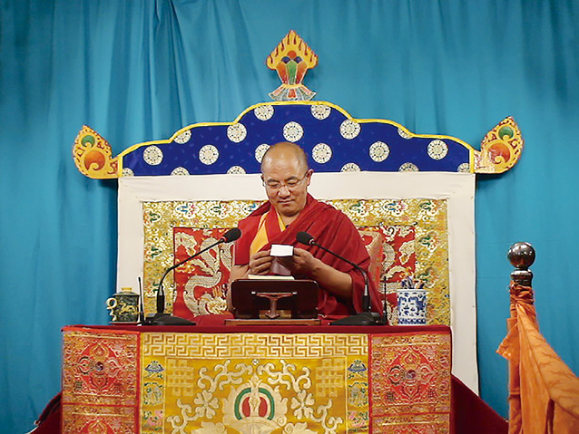

## 以佛陀的教言要求自己

2006年9月24日

今天晚上，我们通过网络来交流佛法。这是一个测试，如果可行的话，以后我们会继续采用这种方式，为大家传讲佛法，念诵传承。

你们可能聆听过不少上师的开示，但是依靠网络直播的方式来得受佛陀教言，这样的机会并不多。因此，我打算以后跟大家一起通过这种方式来学习佛法。

## 念诵《释迦佛修法仪轨》传承

喇荣五明佛学院的四众弟子每天都会念诵《释迦佛修法仪轨》。法王如意宝在世时，老道友们在上师面前发过愿：每天不间断地念诵一遍。当然，各位的工作和生活比较忙碌，不一定能做得到，但无论如何，你们今天得到传承以后，应该尽量多念，有时间的可以天天念，这样对自他都有一定的利益。

作为本师释迦牟尼佛的弟子，如果每天不祈祷佛，不念诵佛号，即便口头上说自己是佛教徒，可能也不太合理。因此，在日常生活当中，大家以佛陀教言来要求自己的同时，还应该有一些功课，否则学修得再好，也无法体现出来。

这个修法仪轨是由全知麦彭仁波切所造，摘自《释迦牟尼佛广传·白莲花论》。这部佛传，法王如意宝以前讲过，我也翻译过，里面讲述了佛陀从因地直至成佛的经历，都是非常殊胜的教言。大家方便的时候可以读一下，相信你们会对本师释迦牟尼佛生起强烈的信心。

依靠网络的方便方法来传播佛法，这样非常好。现在世间人都在利用这些科学技术，只可惜大多数人不知道努力的方向，整天浑浑噩噩，而我们佛教徒却可以运用这些科学技术，使自相续中的善根得以增长。尤其是在家人，想要到佛学院或其他寂静处求法，恐怕即生当中很难实现，但依靠现在的科学技术，你们轻而易举地就能获得传承、得到佛法。所以，这是非常好的一件事情。

（堪布念传承）

今天，凡是听到我声音的道友，应该都得到了传承。以后，我们还会通过网络为大家传授五加行等佛法传承。你们有哪些传承没有得到过，也可以提出建议，我们会尽量满足大家的需求。

## 初学者应从《大圆满前行》学起

自菩提学会网络佛学院开学以来，大家的学习气氛很不错。无论学习哪一部法，希望你们都能够坚定信念，持之以恒地学习，这样一定会获得利益。另外，既然你们已经自愿加入学会，就应该遵守学会的纪律。除了考试和作业方面以外，我们对大家没有什么特别的要求，希望你们珍惜机会，尽量把时间用在佛法上，这样做对自他都有非常大的利益。

学习《大圆满前行》的道友，从今年10月1日开始，到2007年5月中旬为止，每天都要听一节课，一节课大约半小时。这部法是我前两年讲的，现在只有音频可以下载，暂时没有视频。一节课的内容并不多，偶尔落下了，过几天补上也可以。学完之后，明年5月中旬考试。

这样半年学下来，大家应该可以打好佛法的基础。法王如意宝非常重视《大圆满前行》，他再再告诫我们，不修好前行，任何大法都修不上去。听说报名学因明的时候，你们都非常热情踊跃，但过了一段时间后，很多人又会觉得因明非常难懂，这也是正常的。

想要学好佛法，必须先打好稳固的基础。而想要打好基础，学习《大圆满前行》《入菩萨行论》是不可或缺的，这两部法对我们今生来世的修学有非常大的帮助。因此，我非常希望你们都能参加《大圆满前行》的学习。一天24小时当中，抽出半小时来学习佛法，应该不会特别困难。

虽然我讲得不是特别好，但是所传授的内容是极其殊胜的。希望大家能积极自主地学习，我也会随时监督你们。通过这样的互动，相信大家一定可以打好佛法的基础，这样以后不管学什么法，哪怕是五部大论，也不会有很大困难。

## 利用网络方便学习佛法

以后，我们可以每一周或两周在网络课堂上探讨一次佛法，这样对彼此都有一定的利益。对我个人而言，看到不同城市当中有这么多的修行人，而且他们对佛法有很大的信心，我感到很高兴。另外，与这么多的人通过网络探讨佛法，我自己也受益匪浅。对你们而言，抱着互相学习的态度，也有利于发起自利利他的心。

现在世间的人们，白天晚上都处于一种迷迷糊糊的状态当中，要想真正找到自己的修行道路，其实是极为困难的一件事情。因此，大家遇到这么殊胜的大乘佛法，一定要抓住机遇，珍惜时间，认真修学，不然临终时会非常后悔。

在网上学习佛法的人，大多具有一定的智慧，世出世间的水平也比较高，但我还是要劝大家一句，一定要先打好佛法的基础，再认认真真地修持，这是我多年学修过程中的一点经验和体会。

我始终认为，现在的这种弘法方式、学习空间，完全是依靠诸佛菩萨不可思议的加持力和神变力而得到的。大家应该好好利用起来，并时时对诸佛菩萨和传承上师心怀感恩之情，因为找到修行的正道非常不容易。

其实，你们现在想要学习佛法真的非常容易。以前，前辈大德们来藏地求法，一路翻山越岭、风餐露宿，对藏地的气候、环境以及文化等很多方面都不适应，求法之路可谓异常艰辛。而现在，借助于现代科技，你们舒舒服服地待在家里，坐在电脑前，就可以原原本本地得受高僧大德的教言。我想对于真正想要学习佛法的人来讲，一定会好好利用这个机会改变自相续。

无论学习什么，从来都不是一件简单的事情，世间法尚且如此，何况出世间的佛法。所以，大家一定要下功夫，这样见解才不会退失。你们大多数人已经皈依很长时间了，也自认为是佛教徒，但我想告诉大家，真正的佛教徒，一定要拥有内在的智慧，而要拥有智慧，就必须在见解上打好稳固的基础。

现场互动

⊙ 问：我家人以前毁坏过佛像、佛塔、佛经等三宝所依，请问他们应该用怎样的方式忏悔？

堪布：毁坏三宝所依属于近五无间罪，罪业非常严重。如果要忏悔的话，最好念满十万遍百字明，或者四十万遍金刚萨埵心咒。根据经典续部的教证来看，这样可以遣除自相续当中的罪业。

⊙ 问：请您为我传皈依。

堪布：我给这位道友以及所有想要皈依的道友，传授一个简单的皈依仪轨。你们要在心里观想：我从现在开始乃至获得菩提果之间，皈依佛、皈依法、皈依僧。

（堪布传授皈依戒）

⊙ 问：我经常生嗔恨心，有时候会怒火冲天，而且还控制不了，应该怎么办？

堪布：可以学习《入菩萨行论》，学到“安忍品”的时候，你的嗔恨心会得到抑制，愤怒的情绪会逐渐减弱，乃至息灭。

⊙ 问：忏悔可以消除严重的罪业吗？

堪布：佛经中说，如果有人造了非常严重的罪业，本来会堕入地狱，但若依靠四种对治力[^1]诚心忏悔，也能得以清净，甚至获得圣果，指鬘王就是最好的例子。他曾经在邪师的指点下杀了999个人，但皈依佛陀以后，励力忏悔，最后也获得了解脱。

⊙ 问：学习佛法时经常生起怀疑，应该怎么办？

堪布：作为凡夫人，相续当中生起怀疑，这是一种正常现象。一般来说，获得一地菩萨果位后，才可以完全断除怀疑。

当我们生起怀疑的时候，首先要知道这是一种烦恼，属于贪嗔痴慢疑五种根本烦恼之一，然后平时要多念金刚萨埵心咒或百字明忏悔，并且以后要多学习佛教知识。

莎士比亚曾说：“有怀疑就有真理，因为真理是怀疑的影子。”禅宗中也经常说：“大疑大悟，小疑小悟。”可见，大怀疑也可能是大悟的一种征兆。总之，越生怀疑，越要精进不懈地闻思因明、中观等甚深教义，这样相续中的怀疑自然而然会消除。

⊙ 问：供养贤圣僧的果报，今生一定能看到吗？

堪布：如果我们对贤圣僧做供养，并且发心回向无上菩提，将来一定会获得佛果，而且在获得佛果之前，善根永远不会耗尽。但是，这种布施的果报不一定今生成熟。

很多世间人认为：“做功德，果报要马上显现；做罪业，果报也要马上显现。”这种因果观念并不正确。轮回并不是一生一世，而是接连不断的生生世世。今生所造的善业，不一定会马上成熟果报，可能等到来世才会成熟。

⊙ 问：观想金刚萨埵的时候出现昏沉，是什么原因？

堪布：对于这个问题，原因可能有两种：一是自己不太精进，二是天气比较热。

以前，我们跟随法王如意宝去印度时，因为当时印度特别热，无论我们观哪位本尊或念哪个心咒，都会经常打瞌睡。一般来说，如果修法时出现昏沉，就不能再坐在屋子里，可以到外面去走一走，放松一下心情，意识清醒之后，再回来继续观修，这样效果也会比较好。相反，如果心散乱于外境，就要想办法让心安住下来。这就是大乘佛法的修行窍诀。

因此，如果念诵的时候心昏沉，就稍微放松一下，然后再回到比较寂静的地方，让心专注于念诵和观想，这样效果会好一些，所获得的加持力也会更大。

总之，心不散乱很重要，心不昏沉也很重要，遣除这两种障碍以后，心就能专注于观想金刚萨埵而念诵百字明或金刚萨埵心咒。

⊙ 问：如何才能真正做到世间和出世间的圆融？

堪布：严格来讲，世间法和出世间法在很多方面是相违的。如果你想成为一个好的修行人，就必须看破世间的很多东西。但是，从不严格的角度讲，在家人也可以将事业和佛法结合起来。比如，给自己安排一些听课、念咒的功课；同时，在家庭、社会乃至所处的任一环境当中，都要以爱心和慈悲心来对待众生。即使遇到一些坎坷不平，也能以佛教的教义提醒自己，看得淡一些，不要特别执著。这样以后，应该能够做到《六祖坛经》中所讲的“佛法在世间，不离世间觉”。

现在世间也有很多非常了不起的修行人，一方面，他们自己的修行成就非常高；另一方面，依靠佛教的慈悲教义，他们对社会乃至整个世界做出了极大的贡献。

⊙ 问：初学者可以修气脉明点吗？

堪布：对初学者而言，并不一定适合。大家最好先修持菩提心，菩提心稳固之后，再修密宗的生起次第、圆满次第会比较稳妥，也会得到真实的利益。

⊙ 问：发愿供养和意幻供养有什么不同？

堪布：比如，同样是供养悦耳动听的歌声，直接观想将歌声供养诸佛菩萨，是意幻供养；发愿将来在诸佛菩萨面前供养歌声，是发愿供养。

发愿供养和意幻供养也有相同的地方，二者都是在心中作意，只不过作意的方式不同。一个是在心中幻化，一个是在心中发愿。二者并不矛盾，意幻供养中可以包含发愿供养，发愿供养中也可以包含意幻供养。

⊙ 问：发菩提心仪轨的含义是什么？

堪布：这个仪轨的含义，我在讲《入菩萨行论》第三品的时候，已经阐述过了，你们可以自行参考。

⊙ 问：菩萨戒的内容是什么？

堪布：菩萨戒的具体内容，在《菩萨戒二十颂》、《三戒论》、《学集论》以及《入菩萨行论》的第三品中都有详细阐述。

⊙ 问：如何才算得到传承？

堪布：得传承必须依靠声音，而且念传承的声音最好不要间断。

有些道友说自己只看法本，不想听法。虽然看法本能获得一些理解，但是得不到真正的传承，所以，听受声音非常重要。无论是集体学习还是个人学习，只要听到传法的声音，就可以获得传承。

⊙ 问：请您讲解一下皈依的对境。

堪布：我在讲解《大圆满前行》的皈依境时，已经讲过了，大家可以自行参考。

⊙ 问：什么是修行的验相？如何判断自己的根基？

堪布：对于修行人而言，外在的验相并不是很重要。通过修行，自相续中的贪心、嗔心等烦恼逐渐减少，慈悲心、菩提心等善念日益增上，才是最好的修行验相。表面上能看到什么东西，听到什么声音，并没有多大意义。

学习佛法时，最好不要以求神通、求外在验相为目的，应该努力让自相续变得调柔，为利益众生发起菩提心。

判断自己是什么样的根基，可以看自己对哪个法门最有信心。比如，你对密宗最有信心，说明你是密法根器者；你对净土宗或禅宗最有信心，说明你是净土或禅宗根器者。

总之，大家在修习佛法的时候，一方面，不要希求神通、神变和外在的验相；另一方面，要选择与自己相应的法门和上师，这可以根据自己的信心和欢喜心来确定。

[^1]: 四种对治力：所依对治力、厌患对治力、返回对治力、现行对治力。
