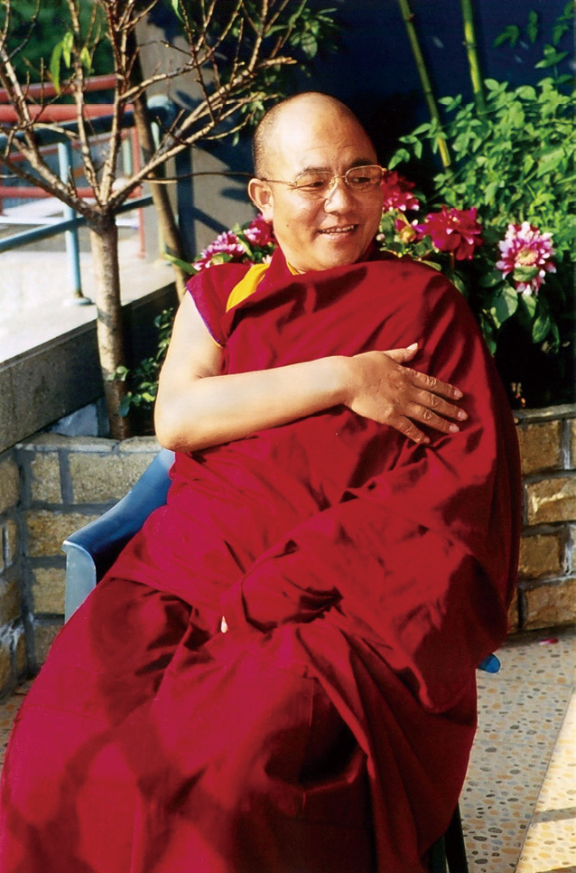

## 吉祥与胜利的缘起

2006年11月19日

今天，我会先给大家念几个传承。第一个是《八圣吉祥颂》，在《喇荣课诵集》里就有。《八圣吉祥颂》中收录了众多佛菩萨和护法天众的名号，通过念诵此文来祈祷圣尊的加持，可以让我们所做的任何事情如愿成办，圆满成功。然后，再念《文殊礼赞》、《金刚七句祈祷文》以及《胜利道歌》的传承。

（堪布念传承）

## 胜利的缘起

今天，我想主要讲一下《胜利道歌》的内容。

《胜利道歌》是法王教言中最殊胜、最精要的窍诀之一。自从即兴唱出这首道歌之后，不管是传讲显宗法要还是密宗法要，在开始的第一天，上师老人家都会先讲一遍《胜利道歌》。上师说：“不管你们以后到哪个地方弘扬佛法，或者到哪里独自安住修行，首先应该传讲或念诵一遍《胜利道歌》，如此可以战胜一切邪魔外道，遣除所有违缘和障碍。”

在末法时代，修持正法不是一件容易的事情。有些人很想成为一个合格的修行人，却经常遭受一些内外的违缘。这个时候，凡夫人想要凭借一己之力战胜所有的违缘和障碍是不可能的，一定要借助上师三宝的加持，依靠诸佛菩萨的威德力，才能完全从中获得胜利。所以，当我们感觉修行不顺、违缘不断、障碍重重的时候，一定要一心一意地祈祷与文殊菩萨无二无别的上师如意宝，同时多念几遍《胜利道歌》。

我已经把《胜利道歌》翻译成了汉语，大家念的时候，念汉文或藏文都可以，没有什么差别。上师的教言如同诸佛菩萨的金刚语，具有不可思议的加持力，也有极其殊胜而深奥的缘起。念诵的时候，依靠我们的清净心、法王的发愿力和诸佛菩萨的加持力，三者因缘和合，一切违缘和障碍都会土崩瓦解。所以，今天我很想给大家念这个传承。这个法我在上师面前得过很多次，传承非常清净。

对于忙于生计同时又想修行的人来讲，经常念诵《胜利道歌》非常重要。因为它的文字并不多，总共十个颂词，但内容已经涵盖了显密所有教法。下面，我从五个方面简单介绍一下这部论典。

## 劝修密法

第一层内容是劝修密法。大圆满是末法时代难得值遇的殊胜窍诀，我们今生有缘遇到，是多生累劫积累资粮的结果。这样的大圆满，仅仅是听闻到一些词句，也能断除三有轮回的根本，而有缘者修行六个月便能获得成就。

因此，希望大家能对密法有清净的信心，至少不要排斥，因为排斥的心态不会损害密法，只会损害自己的善根。一旦犯下谤法罪，不管修什么法，都不会获得成就。

如果各方面因缘具足，大家一定要好好地修持密法，尤其是无上大圆满，珍惜上师所传的密宗教言以及密法法本；即便暂时不具足因缘，也应该对密法观清净心，了知这是十方诸佛菩萨的甚深教言。

有些人可能认为：“这是藏地的一种教法，我们学汉传佛教的没有必要学习。”大家千万不要这样想，更不要对密法产生邪见。要知道，我们学佛的目的在于解脱，而不是堕落。

## 发菩提心

第二层内容是发菩提心。菩提心的意义和功德，我在讲解《入行论》时已经再三讲过了，相信听过的道友应该会有一定的认识，还没听过的道友可以补听一下。

我个人认为，如果想要在短时间内全面了解佛法，最好能够学一下《入行论》。我这样说，并不是为了找更多人来听我的课。对我个人来讲，一个人听也可以，一百个人听也可以；但对你们来讲，如果没有系统性的学习和研究，很多佛教道理是不好懂的。

最近，我听说很多人闻思一段时间以后，自相续已经有所改变了，这让我心里很高兴。其实，我辛辛苦苦传讲《入行论》的目的，就是希望凡是听到这部论典的人，内心都会有所改变，这就是我梦寐以求的心愿。

不管是哪个国家、哪个地方、哪个宗派的修行人，都可以学习这部论典。所以，以前没有学过的道友，可以通过网络等方式来报名学习。菩提心的修法，会让我们的身心发生改变，而改变的出现，又会让我们重新定位自己的人生，并真正发起菩提心，成为一名真正的大乘佛教徒。

## 发出离心

第三层内容是发出离心。如果想要从轮回中获得解脱，就一定要有出离心，并且守护好别解脱戒，没有出离心和戒律，是不可能获得解脱的，更不要说大乘的显密成就。因此，作为修行人，我们要时时刻刻想到轮回的过患。无论我们转生到人间、天界、地狱、旁生等任何一道当中，都离不开痛苦的本性，犹如火宅一般遍满痛苦。所以，我们一定要发起誓求解脱的出离心。

## 人格贤善

第四层内容是人格贤善。修行需要人格贤善，因为人格不好的话，连修学佛法的资格都没有。那么，什么才叫贤善人格呢？一、懂得随顺他人，与人相处要为他人着想，不要轻易和别人发生矛盾；二、为人秉性正直，非常诚实；三、心地善良。这是我们做人的基本要求。

其实，一个人的品行就像一棵树，这棵树依靠树根而开花结果。同样，一个人没有人格，也就失去了生起出离心、菩提心乃至中观或密宗境界的基础。因此，学佛的人，先要学会做一个好人。

## 往生极乐

第五层内容是往生极乐。不管是学藏传佛教还是汉传佛教，大家都应该发愿往生极乐世界。就像净土宗祖师们所说的那样，凡夫要往生其他清净刹土难度很大，而往生极乐则容易很多。

作为佛教徒，一定要发愿往生净土，并且经常念诵阿弥陀佛的名号。另外，还要遣除往生的两大障碍，即谤法罪和五无间罪。我们要尽量成办往生的顺缘，也就是《净土教言》中讲到的往生四因，即明观福田、积资净障、发菩提心、发清净愿。如此一来，往生就有把握了。

总之，修习无上密法、发菩提心、发出离心、人格贤善和发愿往生极乐世界，法王如意宝一生所讲的法要都包括在这五条当中，乃至所有高僧大德的教言也可以含摄其中。

## 结语

最后，我想对网络前的道友们表达我的感谢。我知道你们大多数人都很忙，难得周末可以休息，还要集中起来学习佛法，确实精神可嘉。虽然我们一直在学院里面学习，但周末还是可以放松一下，而你们除了忙工作和家庭以外，还要抽出时间来学佛，不得不说，你们的确非常精进。

听说自开讲《入行论》以来，很多人没有星期天了，一直在跟着学习，这让我非常钦佩。其实，修行人就应该有一种毅力，不然不要说成佛，就连世间工作也很难成办。因此，在学习佛法的过程中，我们要在各个方面严格要求自己，这样才会有大的收获。不管遇到什么违缘、什么障碍，都不要在困难面前屈服，更不要倒下去、垮下去，这才叫真精进。

当然，还要感谢为我们提供各种方便的法师和居士大德，希望我们同心协力，将大乘佛法弘扬到世界的每一个角落。

现场互动

⊙ 问：什么叫所知法？

堪布：所知法，就是所了知的一切法，所知法包括有实法和无实法。

从广义的角度来讲，有为法、无为法以及涅槃在内的所有法，都可以包括在所知法当中。

⊙ 问：什么是闻思修？

堪布：学习佛法前，我们首先要依止一位上师，然后在上师面前如理听闻而了知法义，叫闻所生慧。听闻后反反复复在心里思维，基本能了知诸法的本性，叫思所生慧。对所思维的内容再再串习、修持，以此获得不退转的信解，叫修所生慧。

比如，你最初根本不懂万法无常，上师为你讲解无常的道理后，你因此了解了无常的概念，这叫做“闻”。

对无常有所了知后，你开始反反复复思维这个道理，一切真的是无常吗？器世界和有情世界的所有万法都是无常吗？为什么会无常呢？这样再三地观察，终于认识到万法的的确确是无常的本性，这叫做“思”。

只是了知无常的道理并不足够，还要每天上座进行观修，最后自相续生起稳固的定解，从此对万法无常深信不疑，并且这种智慧永不退转，这叫做“修”。

⊙ 问：有些经论中讲，不发菩提心就不能往生极乐世界，但有些道友说佛经中讲，极乐世界也有阿罗汉和凡夫，请问应该怎样理解？

堪布：在有些经论中，的确说过极乐世界有阿罗汉和凡夫，所以有人就认为，这些阿罗汉和凡夫应该没有菩提心，比如说往生极乐世界之前，有些老太太不一定发菩提心。但我们要知道，虽然老太太往生前没有发菩提心，但是在她往生的一刹那，相续中一定具足菩提心。

一般来说，阿罗汉分为大乘阿罗汉和小乘阿罗汉，像目犍连和舍利子，就是佛陀在世时发了菩提心的大乘阿罗汉。所以，极乐世界中的阿罗汉，应该是大乘阿罗汉。

我们凡夫也分发菩提心的凡夫和没有发菩提心的凡夫，而在极乐世界的凡夫，一定是发了菩提心的。

总之，凡是往生极乐世界的人，一定具足菩提心。

⊙ 问：学习《入行论》的时候，有些道友中间几堂课没有看视频，只是看了讲记，这样算不算断传承？

堪布：所谓的传承圆满，是指一定要把传承的声音从头到尾听完整。如果中间断了，最好把没有听到的部分补上。

虽然看书可以对内容有所了解，但是耳边没有听到声音，这个传承是得不到的。因此，如果中间断了传承，最好在有传承的道友面前补听一遍，这样做很有必要。

⊙ 问：《入行论》中讲，对发菩提心的人生嗔恨心，会有很大的过失，而我们在上师的教导下都发了菩提心，那么，在与人接触或者教育孩子的过程中，如果他们对我们生起嗔恨心，会不会有很大过失？

堪布：发了菩提心的人，是非常严厉的对境。如果对发菩提心的人生起嗔恨心，按照《大密善巧方便经》《大乘经庄严论》等有关经论的说法，确实有很大的过失。但反过来说，对发菩提心的人生起欢喜心和饶益心，也会有非常大的功德。

因此，在与人接触或者教育孩子的过程中，尽量不要让他们对你生起嗔恨心等恶心，如果生起应该要他们立即忏悔。忏悔的方法有很多，比如念诵金刚萨埵心咒或者百字明，这样罪业很容易清净。

事实上，我们非常的幸运。因为今生不仅遇到了大乘佛法，而且还遇到了殊胜的忏悔法门。所以，你说的这种情况，应该没有很大问题。同时自己也要时刻注意，尽量不要对别人生嗔恨心。

⊙ 问：如果家人阻止我们信佛、学佛、供佛，白天工作又比较忙，在这种情况下，如果想发心为众生做事，应该怎么做？

堪布：我们学习佛法，不仅仅是要做一些利众的事，更重要的是从内心对佛陀生起无比的敬仰心。当然，每个人的家庭状况不同，有些人很想学习佛法、研究佛法，以大乘菩提心的理念来饶益众生，但就像你刚才所说的，不仅家里对他制造违缘，连工作单位也制造违缘，这种情况非常普遍。

在这种情况下，首先应该保持道心不退。同时，还要多念经、看书、放生等，尽心尽力地行持善法。遇到的违缘越多，越应该坚定自己的发心，这一点非常重要。

对于有些人来说，家人阻拦得越厉害，他的道心反而越来越增上。因此，只要我们有信心，一切外缘都不是障碍。

⊙ 问：有些佛经中讲，众生的业是自作自受，别人不能代受，但在显现上，很多上师可以为众生背业。请问圣者到底能不能替众生背业？

堪布：一般来讲，众生自己所造的业，不可能成熟在其他众生的相续当中。佛陀在经中也说：“众生所造之业，不会成熟于外界地水火风上，也不会成熟于其他相续中，而是成熟于自己的界蕴处。”这是从总的业因果规律而言的。

有些高僧大德和诸佛菩萨，显现上可以为众生代业，这是因为他们的加持力不可思议，在这种情况下，可以减轻众生所受的痛苦。比如，有一个人犯了罪，按照世间法律来讲，他必须自己承担法律的制裁，但是也会有一些特殊情况。

关于定业转变的问题，智悲光尊者在《功德藏自释》中有广说，方便时大家可以看一下。

⊙ 问：我们来自哈尔滨净土宗的一个念佛堂。请问助念多久之后，才能移动亡者的遗体？如何知道亡者往生净土还是转生其他道了？如果亡者身体僵硬，是否往生了？

堪布：你们净土宗的道友能够学习《入行论》，对此我由衷地随喜。这次学习《入行论》的，还有很多其他上师的弟子，也有禅宗、华严宗、天台宗等宗派的弟子。

按照佛教的传统，遗体至少三天之内不要动。期间道友们应该尽量为他助念，可以念阿弥陀佛名号、释迦牟尼佛名号和观世音菩萨名号等。如果你懂得其他的助念仪轨，也可以照着仪轨进行念诵；如果不懂其他仪轨，只要一心一意地念阿弥陀佛，也非常好。

一般人死以后，要在49天之内为他做些佛事，最好每天都有人为他念佛、念经回向，这一点无论显宗密宗都非常认可。

按照大乘的某些教言，判断往生的标准，最好是看天象的变化。有些人虽然身体僵硬，但也有可能往生了。

⊙ 问：我是学净土宗的，请问什么是火施？

堪布：火施和火供不同。火供，是通过燃烧供品来供养诸佛菩萨，在密宗中有专门的仪轨。火施，是用于下施，即把食物烧掉之后，依靠烟味来布施空中的饿鬼和非人等。通过我们念经诵咒的功德，一些非人可以得到利益，甚至可能会依此获得解脱。因此，平时我们按照仪轨念诵，有很大的功德。

作为净土宗的弟子，不懂这方面的道理也没关系。实际上，一心一意地念佛，不管是对个人还是非人，都有非常大的利益。因为阿弥陀佛也是一切诸佛的总集，是将诸佛的慈悲、智慧聚于一身的佛陀。

⊙ 问：我们平时会接触到不同的人，有些并不学佛，尤其是家里人，总劝我们吃鱼虾等肉，如果不吃，他们就有意见。请问如何避免这种情况？

堪布：如果你们不吃鱼虾，他们有意见的话，那么反过来，他们吃鱼虾，你们也应该给他们提意见。

⊙ 问：家里装藏的佛像在夏天会生很多小虫子，该如何处理？

堪布：装藏的时候，最好不要装易生虫的东西。

⊙ 问：什么是一地菩萨？什么是登地菩萨？

堪布：大家可以看一下月称论师所造的《入中论》，里面对一地菩萨的定义、属性、功德等讲得很清楚，或者看一下《十地经》。

登地菩萨是指从一地到十地之间的菩萨。

⊙ 问：什么是狮子坐？

堪布：狮子坐是密宗当中一种特殊的坐式。一般来讲，你们要得过灌顶以后，我才可以宣说。

⊙ 问：人死了以后，灵魂还分男女老少吗？

堪布：如果是中阴身，在他自己的自现当中，还是会有这种感觉。如果转生为其他的众生，当然也会有种族、性别之分。

⊙ 问：什么是不可思议的变异生死？

堪布：不可思议的变异生死，是指声闻、缘觉和菩萨的一种特殊的身体，这种身体有细微的生死。有时也可以依靠这种意生身前往清净的刹土。

⊙ 问：哪一地的菩萨对众生最有利？

堪布：从一地到十地之间，都对众生有利。

⊙ 问：通过看《入行论》的视频，能不能得到菩萨戒的戒体？

堪布：我在讲《入行论》时传过菩萨戒，当时听的人应该可以得到戒体。

⊙ 问：如何将世间法与发菩提心结合起来？

堪布：其实，发菩提心不能离开众生，因为我们的发愿是让所有众生获得佛果。发菩提心的力量和功德非常大，我们应该将菩提心融入世间法当中。

⊙ 问：可不可以把法王如意宝作为自己的本尊？

堪布：最好是把佛菩萨作为本尊，自己对哪一尊佛菩萨最有信心，那就是你的本尊。
