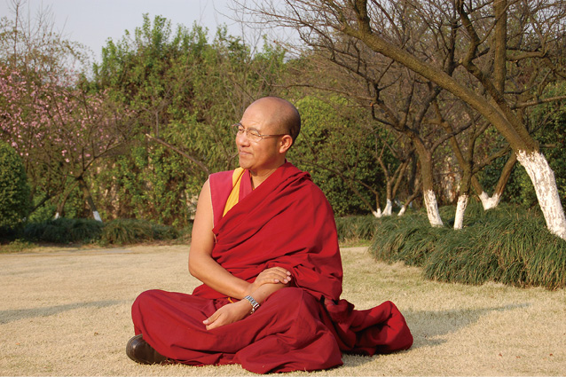
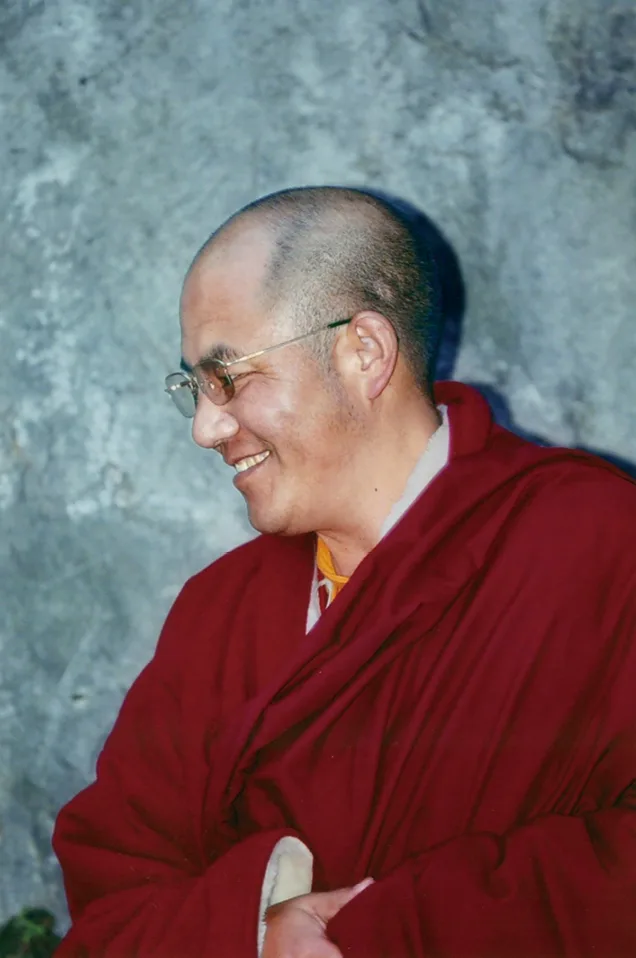

## 如何修行大乘佛法

2006年12月3日

今天，我想给大家念一下《普贤行愿品》的传承。根据学院的传统，不论修学任何法，回向时都要念诵《普贤行愿品》。

法王如意宝在世时，曾多次为我们念过这个传承，也讲解过很多遍。前两天我就在想，如果想要真正利益大家，应该传这样的法，而且我也有清净的传承，在法王面前得过，在其他上师面前也得过。

## 菩提心是大乘佛法的核心

念传承之前，我想先讲一讲“如何修行大乘佛法”。这个道理在《入行论》中讲得非常详细，但考虑到有些道友还没有开始系统的学习，所以我在这里简单地讲一讲。

实际上，大乘与小乘之间，有很多方面的差别，但最根本的是什么呢？阿底峡尊者说：“内道与外道以皈依别，大乘与小乘以发心别。”也就是说，大乘与小乘的根本差别，在于有没有菩提心。有菩提心的就是大乘修行人，没有菩提心的就是小乘修行人。

因此，我们每一位道友都要扪心自问：“虽然我学的是大乘佛法，但是我发了菩提心没有呢？”如果答案是肯定的，你确实发了菩提心，也能用菩提心来摄持自己的行为，应该算是大乘修行人。当然，只有发心还不足够，《大圆满前行》中说：“发心不为主，生心乃为主。”是否真正生起了利他菩提心，还需要进一步的观察。

有关菩提心的重要性，以及它的功德和生起方法，我在讲解《入行论》时已经讲过了，希望大家今后能够认真学习这部论典，这样你对大乘佛法的教义才会有所了解。

今天在网络平台上的道友，有些可能还没有参加学习，有些虽然已经参加了，但是学得并不认真，在此我郑重奉劝大家，如果真的想要学习佛法，就不能满足于字面上的理解，而要通过亲身体验来巩固所学到的知识。

《入行论》是印藏两地公认的在修学菩提心方面最系统、最圆满的一部论典。如果大家能以恭敬心、渴求心来学习，依靠如此殊胜的因缘，一定会得到真实的利益。

## 对佛法保持希求珍惜之心

最近，我发现很多道友有个毛病，学习容易虎头蛇尾，刚开始的时候非常精进，到后来就没有动静了，这样不太好。既然已经开始学习了，就要认真努力地学习，还没有学过这部论典的道友，应该尽快参与报名。

我一直很想帮助大家，但就目前来看，我这一生对你们最大的帮助，也许就是传讲这部法了。虽然我偶尔会去汉地，但也只是和大家见见面而已，想要通过佛法提供大的帮助，确实有一定的困难。我翻译过不少论典，但这些论典大家看了没有也不好说。因此，我和你们之间的缘分，应该是从学习《入行论》真正开始的，我认为这是最好的一种途径。

我知道你们工作很忙，还要操办家庭里里外外的琐事，做也做不完。其实不仅仅是你们，我们同样也有很多事要做，但学习佛法是一生中最重要的事情，无论如何都应该空出时间来学习，这样才能找到生命的意义。相反，如果你没有一个端正的学习态度，那就永远都学不好，也永远不会有进步。因此，大家最好不要以种种借口来逃避学习，比如我特别忙，我身体不好，我有这个事那个事……经常自己给自己找借口，最后就半途而废了。

我传法的唯一目的，就是希望用佛法帮助大家摆脱烦恼和痛苦。除此之外，没有其他任何目的，可以说心是比较纯净的。我始终认为，藏传佛教的传承体系以及历代上师们传下来的教言，的确非常殊胜。虽然我修得并不好，但毕竟学修多年，内心对佛法已经深信不疑，相信它超越了所有的世间学问，是最有加持的，也是最殊胜的。

我们会想尽一切办法，给大家提供学习的方便。前段时间我也讲过，这些方便不是无缘无故出现的，而是需要各种因缘和合才能成办，所以发心人员们也非常辛苦。但不管怎样，即使是粉身碎骨，只要对众生有利，我们也心甘情愿。

今天是星期天，大家本来应该在家休息的，但还是利用这个时间来听受佛法，对此我非常随喜。其实，我平时也比较忙，而且最近这边天气比较冷，但为了和大家一起交流佛法，辛苦一点也没事。在修学佛法的过程中，面对寒冷和饥饿，劳累和疲倦，我们应当毫无怯懦地安忍，直到剩下最后一口气。只要自己以顽强的毅力修行，一定会现前殊胜的境界。你们在忙碌的生活和工作下，还能对佛法保持渴求之心，的确让我非常感动。

## 行持善法要以三殊胜摄持

大乘佛法的修持方法，最关键的是要靠菩提心来摄持。无论是磕头、转转经轮，还是放生、念经，做任何一件善事时，首先都要想到：我做这件善事，并不是为了自己的利益，而是为了天下无边的众生获得解脱，这些老母有情一直沉溺在轮回中受苦，希望通过我的这次善行，让他们全部获得佛果。这就是所谓的愿菩提心。

每一次修善法，都不能离开菩提心的摄持，这叫加行发心殊胜。无论修学任何法，心都要一直专注，中间不要产生嗔心、贪心等烦恼，这叫正行无缘殊胜。真正的无缘，是以空性的见解来摄持，作为初学者要想做到很困难，但还是应该尽量减少粗大的烦恼。最后，将善根回向给一切众生成佛，这叫结行回向殊胜。

比如，当你念《普贤行愿品》的时候，要想：我念这部经典是为了利益一切众生。哪怕只有几秒，也不要忘记这样的发心，这是第一个殊胜；然后，在念的过程中，尽量不要跟别人吵架，也不要生起嗔心、贪心等，而是一心一意地专注念诵，这是第二个殊胜；最后，将今天念诵的善根回向给一切众生，愿他们都能获得佛果，这是第三个殊胜。

我们回向的时候，千万不要想只回向给自己的亲朋好友或者自己的身体健康等。虽然这样想也没什么不可以的，但是对于真正的大乘修行人来讲，一定要把善根全部回向给天下无边的众生，要以这种利他菩提心来摄持。

总之，行持任何善法，最初应以菩提心来摄持，中间尽量专心致志地修持，最后缘无上菩提而作回向，这就是三殊胜。

听课的时候，课前要先发菩提心，想到：我听课是为了所有众生从轮回中获得解脱，获得佛法的利益。然后，在闻法期间，专心思维法义，心不要散乱，不要以贪心、嗔心以及打瞌睡等痴心来扰乱这种善根。

我们通过网络来交流佛法，肯定会种下善根的，为什么呢？因为我们是缘着佛法僧三宝而行善，只要心专注于三宝之事，一定可以积累很多功德，这一点不会有任何欺惑。

最后，将闻法所得到的善根回向给一切众生获得佛果。这样一来，在短短一个小时内所做的善根，就成了大乘的善法。

如果我们最初没有发菩提心，而是处于无记的状态来听课，中间也是迷迷糊糊的，最后回向时也没有什么感觉，这样能有多大的善根也不好说。表面上看，大家都在听课，然而做到三殊胜的人，才称得上是大乘修行人，没有做到三殊胜的人，就不是大乘修行人。

今天所讲的修行内容，叫做“三殊胜”。在相关大乘经论中都有详细阐述，我在这里就不广说了。

希望大家在以后的日常生活中，做任何一件善事，都能以三殊胜来摄持。哪怕只是念一句观音心咒、放一条生命，都要让它变成大乘的善法功德。要知道，大乘功德与小乘功德之间，确实是天差地别。

## 多多忆念法王如意宝

再过一个月，是大恩上师法王如意宝圆寂三周年的纪念日。按照公历是1月3日，藏历是十一月十五。三年前的这一天，三界怙主大恩根本上师法王如意宝晋美彭措，在执著常有的世间众生面前，示现圆寂。届时，我们学院会象征性地举办一次法会。

你们如果方便的话，最好在当地放一点生，或者供一些灯，好好地祈祷法王如意宝。作为大乘佛教徒，应该知道忆念上师的功德非常大。《大圆满前行》中也引用续部教证说：“何人俱胝劫，修十万本尊，不如一刹那，忆念上师胜。”因此，大家要多多忆念上师如意宝。

法王如意宝在世时，非常重视放生，因为生命对谁来说都是最宝贵的。因此我想，学院四众弟子若能在法王圆寂纪念日当天，专门在各地放生一些鸟类或者其他众生，应该是对上师最好的供养。

有些人很想来学院参加法会，但这里本来就缺氧，现在天气又非常冷，来了之后可能会有高原反应，所以没有必要非来这里。另外，法会具体怎么安排也还没有确定。你们在家里好好地忆念法王、祈祷法王，这样也是可以的。

一会儿念完传承以后，我们做一个简单的答疑，大家有什么问题可以提出来。其实，解除疑惑关键要靠自己。如果平时没有好好听课，没有好好学习，可能会满腹疑惑；如果平时好好听课，好好学习佛法，相续中的疑惑就会逐渐消除。因此，大家一定要精进修行，这一点非常重要。

我们的暇满人身确实非常难得，尤其在大城市里，你们可以看到周围的人，他们不但不信佛教，反而还会诽谤三宝。在这种环境下，各位能坚持学习佛法，真的非常难得、极其稀有。而且你们对三宝的信心，不但不退，反而越来越增上，这真是一件值得高兴的事情。

希望大家好好学习佛法，平时的一些疑惑，尽量通过各种途径来解除。我感觉随着这些年大乘佛教基础知识的推广，很多地方人们的佛教知识水平已经有所提高。虽然我在喇荣山沟已经讲经说法二十年了，但从今年开始才通过网络方式来和大家交流佛法。所以，学习《入行论》以后，你们的行为能够有所进步，这是我最高兴的事情。

我在这里再次提出希望，你们一定要长期地学习佛法。世间的事情总是没完没了，大家一定要为自己的来世做好准备，否则临终之时会后悔莫及的。遇到了这么殊胜的佛法，如果一点都不修持，真的非常可惜。

## 念诵《普贤行愿品》等传承

除了念诵《普贤行愿品》的传承以外，我还要给大家念一下法王如意宝1990年在印度金刚座造的一个发愿文——《愿海精髓》，它的副标题是“普贤刹之杲日”。法王如意宝当时说：“如果你们平时很忙，没有时间念《普贤行愿品》，最好念《愿海精髓》来回向。”

1990年的时候，各方面还不太开放，我们是最早一批去印度朝拜的。在菩提伽耶，法王代表他过去及未来的所有传承弟子，发了这样一个愿。此发愿文是从法王的自然智慧当中流露出来的，如果能够经常念诵，功德是相当大的。

（堪布念传承）

前段时间，有位道友想求古萨里修法的传承，今天晚上这位道友在不在也不好说，如果在，请谛听。我给大家念诵古萨里修法传承……

现场互动

⊙ 问：念经诵咒的时候，有些道友经常会冒出一些对佛菩萨不敬的念头，所以特别害怕自己会堕入地狱。请问怎样才能消除这种恐惧心理以及不恭敬的念头？

堪布：遇到这种情况，可以多念金刚萨埵心咒。

不过我们也要知道，由于众生前世积累的福报不够，今生才会产生一些不如法的邪知邪见，这完全是自己的业力现前，是自己在虚妄执著。知道这种恶念的来源之后，就要在佛菩萨面前好好祈祷，好好忏悔，同时也要多看佛菩萨的传记，了知他们浩瀚如海的智慧和悲心。然后，再反观自己有没有这方面的功德，如果没有的话，我们凭什么对佛菩萨产生不清净的念头呢？

总之，一方面要努力地忏悔，另一方面还要观察自己的心态，同时多忆念诸佛菩萨的功德。如此一来，各种恶念就会逐渐消失。

⊙ 问：怎样理解法身、报身、化身？

堪布：化身是佛陀在清净和不清净众生面前显现的色身；报身是只在一地以上菩萨面前显现的具有五种决定的受用圆满身；法身则是远离一切戏论的清净实相，是诸佛自证的境界。

关于三身的道理，在《大圆满前行》中时有提及，而广泛讲解是在《现观庄严论·法身品》。我很想明年讲这部论，相信大家听了之后会对三身有比较圆满的了解。《大圆满心性休息大车疏》里也宣讲了三身的功德，方便的时候你们可以看一下。

⊙ 问：隔阴之迷怎么理解？这一生的愿力，下一世会不会因为入胎而忘掉？

堪布：一般来讲，众生入胎之后，会有比较严重的胎障习气，这个习气会遮蔽我们前世所学的知识，包括学到的佛法等，都会因此而忘失。但是，从有些高僧大德的传记中可以看到，他们前世相续中了解的经论意义，今生不但没有忘失，反而会越来越有智慧。

总之，不管是否忘记前世的发愿，实际上众生心相续中的善法功德，最终都会以越来越增上的方式存在。

⊙ 问：《入行论》第三品中讲，如果舍弃藏传佛教的大乘密法，转而学习学汉传佛教或南传佛教的法门，实际上舍弃一法就等于舍弃一切法，对此应该如何理解？

堪布：实际上，在本师释迦牟尼佛所讲的法要当中，密法是最精要、最深奥的一部分，可以说代表了整个佛法。如果以嗔恨心舍弃了密法，那不管修什么法，都不会获得成功。《阿弥陀经》、《极乐世界功德庄严经》（《无量寿经》）中明确说到，一旦造下舍法罪，不可能往生极乐世界。

因此，不管是密法，还是其他宗派的正法，如果从内心当中舍弃，今生想要往生极乐世界会非常困难。

⊙ 问：行菩提心和菩萨戒之间的关系是怎样的？

堪布：发了愿菩提心过后，在实际行动中行持六度万行，这叫做行菩提心。而菩萨戒，是指发了愿行菩提心以后，通过仪轨在相续中获得的大乘菩萨戒的戒体。

菩萨戒分为愿菩提心的戒和行菩提心的戒，二者有所不同，但也有相同的地方。有愿菩提心不一定有行菩提心，而有行菩提心则一定有愿菩提心。

⊙ 问：什么才叫依止上师？一定要天天见上师吗？

堪布：真正的依止上师，就是自相续中得到了佛法的利益。如果不懂佛法的话，依止多少个上师也没什么用。

我认为，见不见上师并不是特别关键，最关键的是将上师所传的法融入自相续，然后在实际行动当中去行持。如果你真正得到了佛法的利益，那么见上师也可以，不见上师也可以，都有依止上师的功德。

许多高僧大德的传记中也有记载，他们虽然没有见过某位上师，但是依靠上师的教言，最终获得了究竟的证悟。所以，最重要的是依靠上师通达佛法的意义。

⊙ 问：作为佛教徒，应该以怎样的心态对待外道徒？

堪布：外道徒也是众生，我们应该以慈悲心来对待。但是要知道，他们的宗教与佛教有着本质上的差别，所以见解上不能与他们混为一谈。

我们应先将自己的见解稳固下来，然后行为上以慈悲心来对待他们。

⊙ 问：作为初学者，若遇到持邪见者，应该先稳固见解，还是先帮助他们？

堪布：按照大乘经典的观点，一定要先稳固自己的见解，否则自己很可能会随外境而转，最终堕入无法自救的深渊当中。

所谓的见解稳固，并不意味着要获得很高的境界或者成就。假设身处复杂的人群或外道团体中，也无法动摇你对三宝的信心，达到这样的境界，我认为就可以去尝试度化众生了。

⊙ 问：《入行论》第二品有一道思考题：如果梦里佛陀显现让你做破戒的事，你会怎样处理？我心里肯定不想做破戒的事，但又不知道怎么控制自己的梦，该怎么办呢？

堪布：一般来讲，以假设句提出来的问题，是为了让大家打开思路，从多方面思维佛法的真理。

对一般的修行人来讲，要想控制自己的梦境非常困难。不过对梦不能控制，并不代表修行是失败的。

修学佛法的时候，我们要尽量想办法把自己的梦转成善梦，这一点在《入行论》的后面内容会讲到。比如，晚上睡觉的时候，尽量以狮子卧式入睡，这样做可以使我们的相续转向正法，睡梦中不产生恶念，除此之外，还可以作光明想等。如果能以这些方式来摄持入睡，依靠法性力和佛菩萨的加持力，应该可以逐渐控制自己的梦境。

⊙ 问：受了菩萨戒的在家居士，怎么样取舍细微的因果？

堪布：首先，要了知佛陀在有关经典中规定的菩萨戒戒条。如果不了知菩萨戒的根本学处、细微的支分学处，在日常生活中根本没办法取舍。

不管是学显宗还是学密宗，即使自己的证悟、见解非常高深，也不能错乱取舍因果，在缘起规律上，“善有善报，恶有恶报”的因果法则永远不会改变。莲花生大士也说：“纵然见解比虚空还高，取舍因果也要比粉末还细。”当然，具体怎样取舍因果，关键还是看修行人自己。

总之，大家先要了解自己所守持的戒律，对佛陀所制的戒律具有无比的恭敬心，然后在此基础上，尽量护持一切学处。行为有所违越时，应当励力忏悔。

⊙ 问：如何判断相续中的菩提心是真实的还是相似的？

堪布：这个界限比较好分。菩提心有世俗和胜义两个层次。胜义菩提心远离一切戏论，是凡夫人难以测度的。而世俗菩提心相对容易生起，也就是做任何事情都要想：“我要度化一切众生，让沉溺在轮回大海中的老母有情获得佛果，为此我要精进努力。”如果这样的决心在相续中生起来，而且没有造作，时刻不忘，这说明我们相续中已经生起真实的菩提心。如果只是偶尔想要度化众生，大多数时间都是自私自利，这叫相似的菩提心。

比如，一个员工不愿意在某公司干了，时时刻刻都想要离开，这种非常坚定的决心，类似于出离心；如果他在工作的过程中，经常想着要利益众生，除此以外别无他想，这就类似菩提心。因此，我们到底有没有生起菩提心，可以通过这个标准来衡量。

⊙ 问：既然一切众生本来是佛，又怎么会有众生呢？

堪布：从实相而言，一切众生本来是佛，这在《楞伽经》《宝性论》中均有明确宣说。但从现相来讲，众生在没有了悟心性之前，被无明迷乱所障，跟佛陀之间有天壤之别。

如同王子变成乞丐，因为别人不认识他，而流落他国受苦，后来乞丐又登上王位，实际上当年的乞丐就是原来的王子，后来的国王就是曾经的乞丐。同样，众生在实相上与佛无二无别，但就现相而言，众生被迷乱实执所缚，故而沉溺于轮回中受苦。

实际上，众生在轮回中就像做梦一样。当你做梦时，会觉得一切都非常真实，但是当你醒来时，整个做梦的迷乱过程和现象都是不存在的。

关于这个问题，大家可以多看一下《入中论》《宝性论》《圆觉经》等。

⊙ 问：《入行论》中讲到，佛不能拔着众生的头发让他觉悟，因为佛也不能超越客观规律。这里的客观规律是指什么？

堪布：在世间当中，如果一个人犯了罪，一定会受到法律的制裁，旁人无法轻易消除他的罪业。同样，众生前世所造的异熟业在即生必定成熟之时，即使佛陀的威力再大也没有办法，这就是客观规律。

这一点不是我说的，是弥勒菩萨在《现观庄严论》里面讲的。

⊙ 问：什么是自相续？

堪布：所谓自相续，就是我们心里的起心动念。

⊙ 问：阿耨多罗三藐三菩提跟菩提心一样吗？

堪布：不一样。菩提心是我们所发的大乘心，而阿耨多罗三藐三菩提是“无上正等正觉”的梵文，也就是佛的意思。

⊙ 问：平时什么都不修，死时将希望全部寄托在上师身上，是否可以获得往生？

堪布：如果上师是非常了不起的大成就者，通过他的殊胜加持，再加上自己的前世因缘，可能会产生一些奇迹。但一般来讲，最保险的方法，就是自己没有死之前，该修的法一定要修。尤其是临终时想解脱的话，必须修往生极乐世界的捷径法。如果相续中具有正知正见，对极乐世界有不退转的信心，依靠这种捷径法门，必定可以往生极乐世界，这是佛陀的无欺之语。

将一切希望寄托在上师身上，虽然也有一定的好处，但佛陀常说：“我为汝说解脱之方便，当知解脱依赖于自己。”大家最好还是按照佛陀或上师的教言，自己踏踏实实地修行。

⊙ 问：怎样在最短的时间内，将上师的智慧融入自己的相续？

堪布：按照高僧大德的传记中所讲，要对上师具有无比的信心，将上师视为佛陀来对待。噶当派的金厄瓦格西说：“心脏是身体的核心，除去心脏的话，身体就成了一个血淋淋的肉团。同样，上师瑜伽是所有修法的核心，没有了上师瑜伽，一切修法都无法成功。”《华严经》中也说：“十方法界中，所有诸佛法，汝事善知识，一切皆能入。”

有些人认为，这只是密宗的说法，显宗中不存在这些内容。对此我并不认可，其实只要了解《华严经》中要求对善知识是什么样的心态、什么样的行为，就会明白视师如佛并非密宗的一家之言，而是大乘了义经典中再再强调的。因此，将上师智慧融入自相续的最快方法，就是修持上师瑜伽。

大家要经常祈祷上师三宝。祈祷的时候，最好在自己面前放一尊佛像，或者是上师的像，然后将诸佛菩萨与自己传承及根本上师的本体观为无二无别，恭恭敬敬地合掌祈祷。如此一来，上师的智慧会逐渐融入你的相续。

⊙ 问：《佛子行》中讲到的抛弃恶友与发菩提心是否矛盾？

堪布：《佛子行》所讲的抛弃恶友，是指行为上的远离，并非心里舍弃慈悲心。

作为初学者，如果经常跟恶友同流合污，对自己的见解和行为都有一定的影响。因此，最好不要跟恶友交往，否则逐渐受到他的影响，你也可能会变坏。

许多噶当派的大德以及我们宁玛派的智悲光尊者和无垢光尊者，都曾经说过：“对于这些恶友，千万不能舍弃菩提心，但行为上尽量不要交往，自己没有达到一定境界之前，与之交往的话，很可能令自己的见修退失。”

⊙ 问：如果对行善不积极，是不是违犯了菩萨戒？

堪布：在守持菩提心的过程中，行持一切善法，叫做摄持善法戒；远离身口意的种种恶行，叫做禁止恶行戒。

实际上，我们行持六度万行的时候，就是在行持善法，同时自然而然会远离一切恶行。当然，有时候我们可能处于一种浑浑噩噩的状态中，虽然没有造恶业，但是也没有行善法，这样算不算破菩萨戒呢？并不算，因为你只不过是没有行持善法而已。

而且菩萨戒不同于别解脱戒，如果违犯了菩萨戒，还可以重新受。《三戒论》中讲过失坏菩萨戒后如何恢复的方法。所以，如果我们平时有所违犯的话，应该马上进行忏悔，然后重新受持菩萨戒。

⊙ 问：初学者依止的上师是越少越好，还是越多越好？

堪布：以前，博朵瓦问他的上师：“像仲敦巴尊者那样依止的上师少好，还是像阿底峡尊者那样依止的上师多好？”上师就告诉他：“如果自己清净观修得好，则像阿底峡尊者那样上师越多越好；如果自己信心不足，对这种人来说上师越少越好。”

法王如意宝也曾讲过：“依止上师时，如果清净心观得很好，就像阿底峡尊者那样，依止的上师越多越好；如果邪见、偏见和成见比较严重，最好不要依止很多上师，否则最后看这个上师有过失，看那个上师也有过失，不一定有好的结果。”

因此，关键在于清净心观得好不好，自己的信心大不大。如果你具有清净观，信心也很大，那依止的上师越多越好；如果不具有清净观，信心也不大，则依止的上师越少越好。

⊙ 问：打坐时总是昏沉，这是什么原因？

堪布：可能因为你平时喜欢睡懒觉，然后早上又起得太早了。

⊙ 问：我刚皈依不久，什么都不懂，但对观音菩萨很有信心，现在正在学习《入行论》，请问我还应该修什么法、看什么书？

堪布：刚刚皈依佛门就学习《入行论》，是非常殊胜的因缘。刚学佛什么都不懂很正常，只要自己精进努力，慢慢会懂得佛法的道理。

至于修法方面，既然你对观世音菩萨很有信心，那就经常念观音心咒“嗡玛呢巴美吽”，行住坐卧都不忘祈祷观世音菩萨。

除了《入行论》以外，还可以学习《大圆满前行》。

⊙ 问：利益众生和成佛，哪个更重要？

堪布：华智仁波切在《〈现观庄严论〉总义——修行次第略说》中讲过：“大乘道的主要追求目标，就是将普天下的所有众生安置于圆满正等觉的无上果位的佛陀之事业。”也就是说，成佛实际上就是为了利益众生，而不是为了自己过得快快乐乐。

现在很多大学生认为，读书是为了将来找一份高薪的工作，而我们学佛的目的，就是想要获得成就，帮助天下无边的众生。所以，究竟来讲，利益众生是最重要的；但暂时来讲，当我们遇到一些破戒者，或者其他不如法的众生时，依靠诸多经典续部中所说，行为上要远离他们，但心里不能舍弃菩提心。

⊙ 问：因明中有讲，所有的分别念全都是错乱性的，请问这是从分别识的角度来说的吗？

堪布：对的。按照因明的观点，分别识并没有直接照见对境的自相，与现量识比较而言，可以说是错乱的。

⊙ 问：请您宣讲一下法王如意宝和门措上师的功德。有没有门措上师的传记？

堪布：关于法王如意宝的功德，大家可以看一下他老人家的传记，里面讲得比较详细。

学院刚开始建立时，女众出家人很少，于是法王如意宝就让门措上师出家，以此缘起，现在学院的女众出家人非常多，而且她老人家从小修学善法，自身功德相当大。

去年，有位台湾法师把门措上师的传记，从藏文翻译成了汉文，所以现在应该有汉文传记。

⊙ 问：您能不能写一个您自己的传记？

堪布：如果写我的传记，只有两个内容：一个是放牦牛的故事，一个是在学校里打架的故事，可能很难让大家生起信心。

⊙ 问：既然众生本具佛性，为什么会不认识呢？

堪布：众生之所以不能照见自己的佛性，是因为有暂时的客尘障碍。

⊙ 问：这种真实的佛性，是因缘而生还是原来就有呢？

堪布：从实相上讲，佛性不是因缘而生，而是原本就有的；从现相上讲，是观待因缘才可以显现的。
