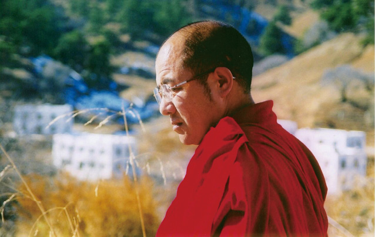
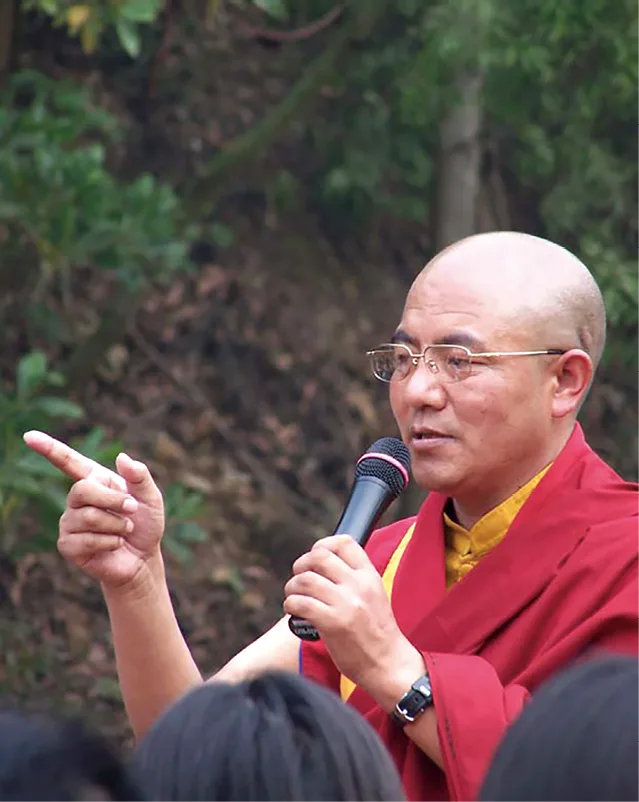

## 新年愿望

2006年12月31日

新年马上到了，祝大家新年快乐，一切圆满！

我们虽在不同地方，但有共同的发愿：愿度无量众生，愿获无上佛果。我衷心祝愿大家修行无有任何障碍，具足一切顺缘，圆满福慧资粮，成就自他二利。

## 走过三年的悲与喜

最近，学院将举办为期七天的“法王如意宝圆寂三周年纪念法会”。法会每天四座，从早上七点到晚上六点，全体僧众共修《上师供》、《上师瑜伽》、金刚萨埵仪轨及心咒、《普贤行愿品》等。

通过祈祷上师，可以遣除自相续中的一切罪障。《时轮金刚根本续》中说：“上师圆寂年月日，若于此时供养者，摧毁累劫所造罪，解脱恐怖阎罗城。”如果条件具足，大家最好在各地举行小规模的纪念法会，于法王像前以香、花、灯、水、食品等进行供养，并尽己所能地吃素、放生、念诵等。

上师在世时最喜欢放生，希望大家在各地多放一些生，比如东北那边天气冷，不适合放鱼类的话，也可以放麻雀等。事后把放生数目汇总到智悲佛网——哪怕放了一个生命，下次聚会时一起回向。

虽然上师已经示现圆寂，但在清净刹土当中始终用智慧眼关照着我们。在这七天里，大家一定要好好祈祷法王如意宝。依靠自己的恭敬心和上师的加持，我们自相续的所有功德会迅速圆满。这是最重要的一件事情，你们金刚道友之间应该辗转相告。

在这三年里，有说不完的悲哀，也有值得欢喜之事。悲的是，我们的根本上师、三界导师、众生怙主法王如意宝晋美彭措已经离开我们三年了。上师曾经传授浩瀚如海的显密正法，以各种方便方法培养了这么多的弟子……每每念及都令人非常伤心。喜的是，上师创办的喇荣五明佛学院至今完好无损，所有闻思修行、弘法利生事业一如既往地存在着，这对后学者来讲极为重要。

学院的正常运转离不开各位道友的支持和帮助。在此，我对为学院发心的所有大德、法师、居士表示感谢！

## 修习佛法，行持善法

在新的一年里，大家也应该发个愿，一定要认认真真学习我们所安排的论典。作为修行人，我们不应该浑浑噩噩地过下去，应该尽量圆满相关的一些闻思修。

明年学习《入行论》的同时，我们也会安排大家学习其他经论。其实，我在网上的开示答疑，解决不了很多的问题。如果你们真的对佛教感兴趣，或者认为我讲的法对你们有点利益，那就要在学习上多下功夫，这样相续中的怀疑会自然而然断除。

此外，希望每个人在念咒语等善法方面定个目标。新的一年开始，就像新的人生开始，行善方面应该有个目标，没有任何目标而得过且过，不是智者的选择。大家一定要在上师像或佛像前默默发愿。

三年前的藏历十一月十五日上午，法王如意宝一生弘法利生事业圆满，示现前往清净刹土。希望大家记住这个特殊的日子。一般来讲，传承上师的圆寂日，弟子们都应该非常重视。比如，麦彭仁波切圆寂日是藏历四月二十九日，学院每年都会举行法会、大量供灯。

很多印藏高僧大德的传记中有讲，真正合格的弟子，在上师圆寂三年当中，都会非常注重自己的行为。就像世间人家里有人去世了，也会有很多方面的讲究，三年过后，基本才一切照常。

最后，我给大家念一下《修心七要》的传承。

（堪布念传承）

《修心七要》的加持力非常大，若能依之修持，会成为一个非常好的大乘佛教徒。因此，前辈修行人乃至如今美国、加拿大等地学习藏传佛教的修行人都很重视。

《修心七要〈耳传略释〉》已翻译并传讲，希望大家好好学习。

现场互动

⊙ 问：生起菩提心的界限是什么？

堪布：所谓菩提心，是指内心真的想要利益众生，不只是暂时给众生一点吃的穿的，应该从心坎深处想要将一切众生安置于佛果，让他们从三界轮回的痛苦中摆脱出来。

⊙ 问：出家好还是在家好？

堪布：这个要看个人情况。如果从根本上对在家生活生起出离心，而不是暂时遇到违缘后想逃避，那么哪怕出家一天的功德也很大。《佛说出家功德经》中说：“于此一日一夜清净出家故，此善根，六欲天中，七反受福，二十劫中常受生死世间之乐。最后人中，生福乐家。”

如果自相续还没有如是成熟，最好以在家身份来利益众生。

⊙ 问：为什么一切众生皆具佛性？

堪布：众生具有佛性是事势理，即万法的自然规律，如同火的本体是热性、水的本体是潮湿、石头的本体是坚硬，不一定非要说出一个理由。

⊙ 问：《入行论》中讲，众生堕入恶趣后，由于不断因烦恼而造业，势必愈陷愈深，永无解脱的希望。这样一来，是否与佛经中所说的“一切众生皆能成佛”相违？

堪布：不相违。暂时而言，堕入恶趣时，造的恶业越多，陷得也会越深；究竟而言，佛性是本具的，且以前的善业也会成熟、增长，一旦因缘具足，佛性必定显露，所以众生最后一定会成佛。

《俱舍论·分别业品》中有讲到业的几种差别，大家方便的时候可以看一下。

⊙ 问：有些人认为自己修学的是大乘，不应随学小乘，因为小乘希求自我寂灭，请问这样对吗？

堪布：修学大乘佛法的人，确实不应该希求自我寂灭，甚至为了自利而希求佛果，也不是特别符合大乘的发心。

全知麦彭仁波切说：“稀奇萨霍堪布之行为，无比具德龙树之见二。”见解依龙猛菩萨的观点，即内心秉持诸法空性的空性见解和利益众生的菩提心见解；行为依静命论师的观点，应分别持守出家或在家的别解脱戒。

⊙ 问：有些道友认为供灯有时会影响闻思，请上师开示供灯和闻思的关系，以及供灯的重要性。

堪布：希望你们把学习《入行论》放在更重要的位置。因为如果我们没有深入法义，很难了知所做善法功德的真正意义。

当然，供灯也有很大利益，请参阅《供灯之功德》。

⊙ 问：菩萨戒和居士戒在一个补特伽罗相续里，是别别他体还是一体存在？

堪布：以“一本体异反体”的方式存在。人死之后，居士戒已经舍了，菩萨戒仍继续存在。

⊙ 问：在具德上师的加持下，具缘弟子仅一刹那见到心的本性，之后没有精进修行，临终时可以解脱吗？

堪布：如果今生真正了悟心的本性，即便临终时没有解脱，也会在来世得到解脱，这在中阴窍诀里有说。

⊙ 问：如何以菩提心来修持五加行？

堪布：修五加行中的任何一个法，都要以菩提心来摄持。也就是说，修法前先调整发心：我今天磕头、供曼茶罗、念百字明等，不是为了自己的利益，而是为了天下无边的一切众生获得佛果。

现在很多人希求发财、平安等今生利益，这无可厚非。但最主要的目标应该是让所有众生获得佛果，这才是修行的根本。

⊙ 问：“菩萨不昧因果”是什么意思？

堪布：意思是说，菩萨对三世因果了如指掌，不会迷惑。当然，彻底照见因果者，唯有佛陀。

⊙ 问：我们已经学完了《入行论》前四品，但现在比刚开始懈怠了，请您传一个窍诀，让我们都能圆满学完。

堪布：听法时间长了，很多人会生起懈怠心，包括学院有些道友，这也是一种正常现象，因为每个人都有惰性习气。

我个人发愿，只要没有离开人间，无论如何，会将这部法传讲圆满。希望大家也发这个愿，一定要像刚开始那样，把后面部分学完。如果能够坚定誓言，修行定会善始善终。

⊙ 问：《华智仁波切略传》中讲到，尊者时常劝诫大家发愿往生西方极乐世界与东方现喜刹土。请问东方现喜刹土也很庄严吗？

堪布：东方现喜刹土的器情庄严都不是人为造作的，而是诸佛菩萨的福报自然形成的，就像极乐世界一样。

⊙ 问：受居士戒、八关斋戒时，必须受全分还是可以只受其中几条？

堪布：居士戒可以根据自己的情况受少分或多分，不一定要受全分。

八关斋戒只能受全分，刚开始会有点困难，习惯以后就好了。也可以在每月十五、三十等殊胜日受持。

⊙ 问：若因工作、家庭原因无法止语，是否能受大乘八关斋戒？

堪布：特殊情况的话，实在不能止语也有开许。第一次受戒，应该在善知识面前得受。

⊙ 问：加倍咒、字母咒、缘起咒有什么作用？

堪布：念诵经典、咒语、仪轨之前，先念一些咒语来加持自己的语言使之清净，功德会非常大。

⊙ 问：《入行论》中提到，人生最有意义的两件事，要么为众生做事，要么自己修行。有道友认为自己先修行再为众生做事；有道友认为可以一边做事一边修行。请问应该如何处理两者的关系？

堪布：每个人的情况都不相同，不应偏袒执著于某一者更为重要。

人身非常难得，如果只是利益众生，自己一点也没有修，非常可惜。反过来说，利益众生的机会非常难得，如果只是自己修行，一点不想利益众生，也非常可惜。

总之，我们应该尽心尽力，边修行边饶益有情，这样既可以不舍菩提心，也可以修持佛法。

⊙ 问：要想往生极乐世界，应如何念修金刚萨埵和阿弥陀佛？

堪布：一般来讲，先要多念一些金刚萨埵心咒，因为往生极乐世界有两大障碍，即五无间罪和谤法罪。

法王如意宝说过：“只要能如理念诵四十万遍金刚萨埵心咒，包括五无间罪、谤法罪在内的一切罪业都能得以清净。”之后，再一心一意祈祷阿弥陀佛，发愿往生极乐世界。

⊙ 问：往生时是金刚萨埵还是阿弥陀佛来接？

堪布：一般来说，临终之时，金刚萨埵也会显现为阿弥陀佛的形象，所以是阿弥陀佛来接。

阿弥陀佛有专门的发愿，《佛说无量寿经》中说：“设我得佛，十方众生，发菩提心，修诸功德，至心发愿，欲生我国，临寿终时，假令不与大众围绕现其人前者，不取正觉。”也就是说，只要信愿具足，任何人都可以得到阿弥陀佛的接引。

⊙ 问：临终时，上师也会显现成阿弥陀佛的形象来接吗？

堪布：这个要看你上师的证悟境界。

⊙ 问：父母身患疾病，为其念经诵咒时应如何发心和回向？

堪布：可以这样想，让此病人为主的一切病人，暂时远离病苦乃至世间一切苦难，究竟获得圆满佛果。

⊙ 问：孩子上学，念哪个咒回向好？

堪布：可以念文殊心咒，让孩子增长智慧。

⊙ 问：《入行论》中讲，善根没有回向，很容易被嗔恨、懊悔等烦恼损毁。而《大庄严论》中记载：释迦牟尼佛在世时，有一个人来求出家，佛陀观察他八万劫前念过一句“南无佛”，因为这一念的善根，得遇佛法，出家得道。请问应如何圆融理解？

堪布：如果善根没有回向，确实可能被嗔恨心等摧毁；而公案中的“一称南无佛”，我们不能确定他之前没有回向，也不能确定他相续中出现了足以毁灭善根的因缘。

⊙ 问：《入行论》第一品说：“博施诸佛子，若人生恶心，佛言彼堕狱，长如心数劫。”而第三品又说：“若人因见我，生起信憎心，愿彼恒成为，成办众利因。”同样对菩萨生嗔，前一颂说会堕恶趣，后一颂说由于菩萨猛烈的发愿力所致，将来会获得无上的利益，前后是否矛盾？

堪布：不矛盾。前一颂着重强调菩萨是严厉对境，后一颂着重强调菩萨的发愿力。

对菩萨生嗔会堕入恶趣很久，但是因此和菩萨结缘了，结缘比不结缘更好，结缘之后将来终究会得到菩萨的度化，所以只要和菩萨结缘，最终都会得到大利益。

暂时来说，对菩萨生嗔还是可能长期在恶趣感受痛苦，但将来会获得利益，何况对菩萨生欢喜心、信心呢？

⊙ 问：《大圆满前行》中说：有位了不起的唐巴比丘供施食子时，集来了许多鸽子，此人心想：如果我有这样庞大的军队，就足能消灭我的敌人。由于当时的恶念没有转为道用，导致他后来还俗成了军队首领。请问什么是“恶念没有转为道用”？

堪布：他本来是一位了不起的比丘，但后来产生恶念时，随着恶念发了恶愿，所以说他没有转为道用，也就是没有把心念转到善法上面，导致修行没有如愿以偿。

⊙ 问：《三主要道论》中说：“了知以现除有边，以空遣除无有边。”请问该如何理解？

堪布：一般来讲，平时是以显现断除无的边，以空性断除有的边。而在这里，宗喀巴大师运用了不同的解释方法。

在“显现”之体相不舍弃的同时，其本体即为空性，以此即可遣除有边；在“空性”的同时，其体相不舍弃而显现，以此可以遣除无有边。显现不是有，空性不是没有，这就是现空双运的甚深意义。

⊙ 问：守八关斋戒日，供护法时碰触酒器犯不犯戒？

堪布：不犯。

⊙ 问：《入行论》中讲的菩萨戒还净方法，是依龙猛菩萨还是无著菩萨的观点？

堪布：可结合两种观点，然后以龙猛菩萨的观点为主。

⊙ 问：修行时遇到违缘怎么办？

堪布：好好祈祷上师，不要退失信心。

⊙ 问：没有上师传，可以自受八关斋戒吗？

堪布：第一次受最好有上师传。在上师面前受戒时，可发愿今后在特定日子自受戒，这样到了特定日子就可以在佛像前念诵仪轨自受。

⊙ 问：修法时，可不依仪轨而随自己的意乐观想吗？

堪布：仪轨怎样要求，就怎样去做。

⊙ 问：法王圆寂法会时应如何供灯？

堪布：陈设释迦牟尼佛、法王等圣像，还有佛经、佛塔，观想并念诵《阿底峡尊者供灯愿文》《普贤行愿品》等，还可观想将自己的身口意供养上师三宝。
