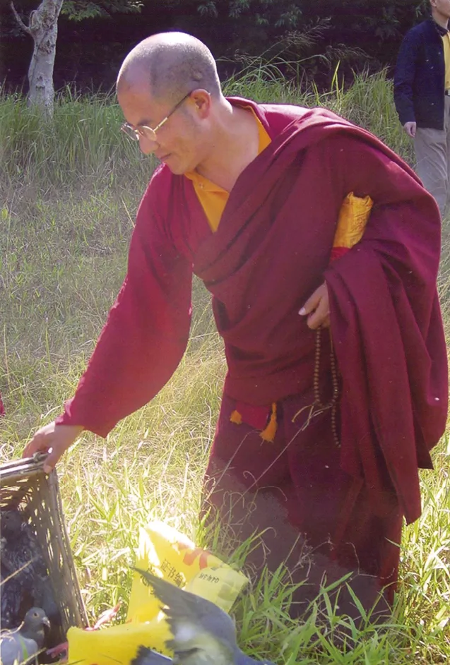

## 菩提心 佛子行

2006年11月5日

本来按照通知的安排，今天应该给大家念诵《佛子行》和法王如意宝所造《胜利道歌》的传承，但是因为时间关系，这次只能念《佛子行》的传承，顺便给大家做一个简单的开示，之后你们可以提问。

《佛子行》是藏传佛教中非常重要的一部修心论典，法王如意宝在一生当中，听过这个教言五十次以上。希望大家得到传承以后，能以《佛子行》的利他菩提心来要求自己。

今天我就不多说了，如果你们真的想听我说，可以去听我讲课的视频和音频。我在传讲《入菩萨行论》《量理宝藏论》《净土教言》等论典的过程中，已经把自己懂得的佛教知识和修行方法全都传给大家了。

## 念诵《佛子行》传承

听传承和听法一样，要按照《大圆满前行》中讲的闻法方式，如理如法地听受。要知道，大家如今能够听闻到佛法，是多生累劫极其难值难遇的大事。虽然你们居住在不同的地方，但我相信依靠佛菩萨和传承上师的加持，借助于网络的方便，每个人都能得到传承。

（堪布念传承）

《佛子行》只有三十七个颂词，字面上看起来很简单，但实际做起来却没那么容易。对于大乘修行者来说，这是必不可少的修持方法，希望大家有时间多看看。了解它的内容以后，就要落实在实际行动上，在菩提心的摄持下，以论中的“佛子行”来观察自己的三门，这一点至关重要。

## 积极参加极乐法会

马上就要入冬了，过几天是藏历九月二十二日——天降日。这一天是纪念佛陀在三十三天为母说法圆满、返回人间的日子，是任何一个佛教宗派都承认的殊胜吉日，希望大家多多行持善法。

最近，学院也在举办极乐法会。法会期间，主要念诵《极乐愿文》和阿弥陀佛心咒“嗡 阿么得瓦 阿耶色德吽舍”，你们在各地也要好好念诵，并发愿往生极乐世界。

这个心咒，学院要求法会期间每人念诵30万遍。我知道你们整天忙于工作和家庭，能不能念完也不好说，但还是希望大家积极参与进来，共同发愿和念诵。凡是参与者，都能得到法会共修的所有功德，这一点通过佛经中的教证可以说明。

法会一共八天，希望大家专注祈祷阿弥陀佛，多念阿弥陀佛的心咒或名号。共修期间，学院所有道友会一起发愿：凡是与我们共同发愿的所有有缘信众，都能一同往生极乐世界。你们自己也要如此发愿，这样我们都会往生极乐世界。要知道，往生净土是修行人的头等大事。

## 排除困难，长期学习

希望全国各地的道友，不管在什么情况下，都要坚持学习。虽然对你们来说可能会有诸多不便，比如要坐车去很远的地方等等，而我自己也有很多事情需要处理，但是我想，能够通过这种方式来共同学习佛法，也是一件非常荣幸的事情。因此，我们以后会不定期地组织学习，大概会提前一个礼拜通知大家。

我会通过网络给大家念一些简短又甚深的窍诀传承，同时也会做一些修行答疑。在交流过程中，我不可能满足所有人的要求，因为时间有限，只能选择少数人来提问，希望你们能够理解。不过有时候，一个人的问题能让一群人产生共鸣，对一个人的回答也能让其他人受益。所以，当其他道友提问的时候，你也应该思考一下，自己有没有这方面的疑惑，或者你会怎么回答这个问题。我也不一定回答得非常圆满，但是我有自己的一些理解和想法。当我解释这个问题的时候，你是否持有相同的观点？你又有什么样的收获？对于这些，你自己要再三思维，这样必定可以从中受益。

我唯一的希望，就是你们能够学到佛法。我们已经想尽一切办法，把在寂静处所传的法直接送到各位的家门口了，希望真正想学习佛法的人不要错过这个机会。当然，你们可能没有足够的时间和精力，但是为了学习佛法，应该排除一切困难。大家可以看一看以前高僧大德的传记，如果去藏地或者印度求学，要付出多少代价？而现在，你们轻而易举地就能得到这些法，因此一定要认真学习。

## 珍惜因缘，依止上师

所谓依止善知识，不一定非要天天跟着上师，或者坐在上师面前，一直看着上师。对上师所传的教法，只要你如理如实地了知、如理如实地修持，这就是依止上师。大家应该清楚，依止上师最主要的目的是调伏自相续。

如今，通过网络手段，每个人都能得到佛法的利益，希望大家能够珍惜机会，认认真真地学习。有生之年遇到佛法，是最难得、最荣幸的事情。你们可以看看自己周围的人，他们过着什么样的生活？一个人来到这世上，不知道自己有前世，也从来不考虑后世，实在是一件令人非常遗憾的事情。

以上这些话，都是我的肺腑之言。现在我们能够通过这种方式来传播佛法，其实也是诸佛菩萨和传承上师的加持，对此我非常感恩。当然，还要感谢为菩提讲堂、网络佛学院、智悲佛网以及其他方面付出的所有法师、居士和施主，非常感谢你们的善举。如果没有你们的支持，即使我心里很想把佛法传给有缘的人，也是心有余而力不足。

在许多人的支持和帮助下，网络传法因缘得以成熟，效果也比较不错。以后，我们要继续祈祷上师三宝加持，让方方面面的安排都能圆满，尽量满足所有人的需求。

我这样努力传法的目的，就是希望凡是听我讲法的人，即生成为非常好的修行人，来世不堕三恶趣，在菩提道上不断增进，直至成佛。这是我唯一的目的，除此之外别无他想，上师三宝可以作证。

人生过得特别快，几十年转眼间就过了，所以大家一定要精进。经过半年多的学习，相信你们已经找到了生活的意义，对佛法也有了更深入的了解。这就是我内心最深处的愿望。

现场互动

⊙ 问：宗萨仁波切在《佛教的见地与修道》中认为，因为一切现象都是自心的感受，所以让一切众生觉悟是自己的责任，而不是众生的责任，以及要在明了中觉悟诸法如幻。请问该如何理解这些教言？

堪布：实际上，外境的一切显现都是唯心所造。这不仅是无上大圆满的见地，也是显宗唯识宗以上的观点。

如果我们了知外境的一切显现都是如幻、如梦、如阳焰，进而在修行过程中也如理如实地修持，那么对外境的执著就会逐渐减少，最后所有的分别念全部消于法界，当下获得菩提的果位。

因此，我们时时刻刻都应该持有这种见地，对任何人、任何事，以及财富、地位、名声等外境，尽量不要产生强烈的贪执。这样一来，修行自然而然会成功。

帝洛巴尊者曾说：“显现不缚执著缚，断除执著那若巴。”也就是说，如梦如幻的显现不会对解脱造成障碍，解脱最大的障碍就是实执。所以，宗萨仁波切的这些教言，我们应该牢牢记在心间。

⊙ 问：如果对某一类众生总是生不起欢喜心，比如说很害怕老鼠，这个要不要忏悔？

堪布：害怕老鼠不用忏悔，但是想害老鼠要忏悔。

⊙ 问：对发菩提心的人产生恶念，是指要打他、害他吗？

堪布：如果对方是发了菩提心的人，最好不要对他产生恶念，更不要骂他、打他、害他。

道友之间最好不要吵架。当然，作为凡夫要想做到这点，恐怕有一定的困难。如果你跟他吵架，或者打他、害他了，就要随时想起侮辱大乘佛子的过失，然后好好地忏悔，多念金刚萨埵心咒或者百字明。

⊙ 问：我感觉身边很多人的嗔心比较重，当然也包括我自己，请问该怎么对治？

堪布：嗔恨心重并非个人问题，很多人经常对自己的道友、家人或同事生嗔心，可见嗔心是比较难对治的。

过段时间，我们会学习《入行论·安忍品》，里面把嗔心的因缘、体相、果报以及对治方法等剖析得非常透彻。只要大家认真学习，一定会对消除嗔恨心有很大的帮助。

⊙ 问：请您为我们传一下金刚萨埵的修法仪轨。

堪布：我给大家念一下法王如意宝造的《金刚萨埵修法如意宝珠》。

（堪布念传承）

这个修法仪轨是法王如意宝1997年从智慧中显现的意伏藏，传承非常清净，在《喇荣课诵集》以及其他教言集里都有收录。

无始以来，我们每个人都造下了无量无边的罪业。即使已经学佛修行，但就像刚才那位道友所说，还是会对金刚道友、发了菩提心的人生起嗔心、嫉妒心、傲慢心等。所以，为了清净这些罪业，应该好好地忏悔。

《地藏十轮经》中讲到，有两种人是最好的修行人：一种从来不造罪业；一种虽然造了罪业，但能发露忏悔。第一种人，除了高僧大德以外，一般人很难做到。所以，对于以前犯过的罪业，以及一些不如法的行为，我们一定要励力忏悔。

此修法仪轨的后面有说，如果念满40万遍金刚萨埵心咒，即使犯了密乘根本戒，也能得以清净。很多传承上师也讲过类似的教言。如果你们觉得自己业力深重，那最好念诵40万遍以上的金刚萨埵心咒，这样罪业肯定能得以清净。

我刚才给大家念的仪轨传承来自法王如意宝。一般来讲，藏传佛教非常重视传承上师的教言。因为任何一个法，如果它的传承法脉从未间断，便会有非常大的加持。所以，密宗灌顶或各类教言的传授都要有传承。

其实，汉传佛教也很重视传承，比如比丘戒、沙弥戒、居士戒、八关斋戒，这些戒都是释迦牟尼佛制定的，直到现在依然传承着。

⊙ 问：小乘阿罗汉没有菩提心，却也可以出离轮回，请问这与大乘的解脱有什么区别？

堪布：虽然小乘阿罗汉可以出离轮回，但这不是最究竟的解脱。

按照小乘的观点，阿罗汉是最高果位，他可以很长时间入于灭尽定。但依照大乘经典的说法，他最后还是要出定趋入大乘，五道十地全部圆满之后才能获得佛果。可见，虽然阿罗汉可以脱离轮回，但是却没有获得佛陀那样圆满的断证功德，因此他的解脱是不究竟的。

总之，如果没有大乘菩提心，绝对无法获得佛菩萨的果位。我们一定要好好地修持菩提心，依靠菩提心的力量，最后才能获得断证圆满的佛果。

⊙ 问：无垢光尊者讲了三个殊胜：最初是发心殊胜，以菩提心来摄持一切善行；其次是正行无缘殊胜，安住于三轮体空的无缘境界中；最后是回向殊胜，缘无上菩提而做回向。请问“安住于三轮体空的无缘境界中”，到底是什么样的状态？

堪布：以听法为例，听课前为了度化一切众生发菩提心，这是前行发心殊胜。心不外散而专注于法义，基本上就是正行无缘殊胜。

当然，真正的三轮体空是无上密法或大中观所讲的境界，一般凡夫人很难做到。但是，在做任何善法的过程中，心专注于所行的善法，也可以算是正行的无缘殊胜。

最后，把听课的善根回向无上菩提，这是结行回向殊胜。

⊙ 问1：没有传承可以念《喇荣课诵集》吗？算不算盗法？

堪布：可以，不算盗法。

问2：供护法的仪轨没有传承也可以念吗？

堪布：可以。

⊙ 问：依靠什么因缘会转生到非想非非想天？

堪布：按照大乘的说法，当六识聚入于阿赖耶识，依靠阿赖耶识，同时以相关的业力牵引可以转生到非想非非想天，即无色界最高的一层天，然后在天上安住八万劫。

⊙ 问：小乘圣者见道以后才能入灭尽定吗？

堪布：对，是不来果以上。

⊙ 问：有些利根者，在大乘资粮道或加行道的时候，就已经见到了自心本性。那么，他们在入定的时候，有没有二取分别念？是所有的二取分别念全都融入法界，还是粗大的二取分别念融入法界，但尚有微细的分别念存在？

堪布：利根者进入资粮道或加行道时，与大乘的见道相比，仍然会有二取分别念；但与一般凡夫相比，可以说他的粗大二取分别念已经融入法界，但细微的分别念还是存在的。

⊙ 问：什么是断法？

堪布：所谓的断法，就是通过修持般若法门，以无二智慧彻底断除自相续中的我执和实执。

总之，修断法的功德非常大。我们平时可以将《心经》等般若法门与施身断法相结合而修持，这样可以遣除修行过程中的一切违缘，获得今生来世的广大善妙功德。

⊙ 问：什么是实修？

堪布：认认真真地将所学到的法在相续中不断串习，然后在实际行动中如是行持，这就是实修。

⊙ 问：一个人没有皈依，也没有受五戒，可以受菩萨戒吗？

堪布：具足皈依戒是受菩萨戒的一个前提，如果没有受过皈依戒，不可能得受菩萨戒。因此，任何一个传菩萨戒的上师，都会先给大家传皈依戒。

没有受五戒也可以受菩萨戒。如果要受居士戒，也可以只受持一分以上的戒律，大家可以根据自己的实际情况来定。
