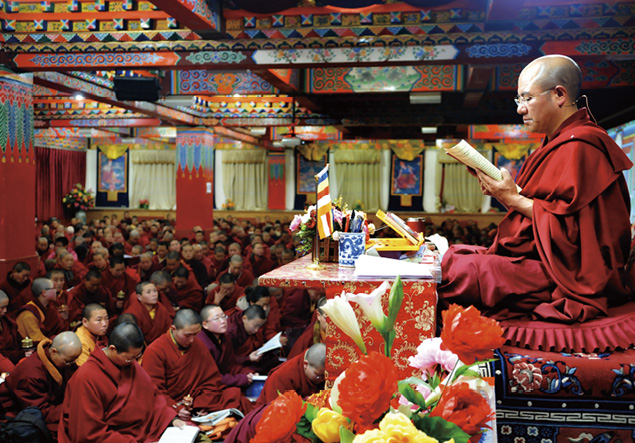

# 2009年金刚萨埵法会开示

2009年5月31日

菩提讲堂的各位道友，大家晚上好。今天我先做简单的开示，然后为大家念诵法王如意宝《金刚萨埵修法仪轨》的传承，最后与大家共同探讨一些佛法方面的问题。

## 金刚萨埵法会事宜

1．念诵40万遍金刚萨埵心咒

明天是藏历四月初八，这一天是释迦牟尼佛的降生纪念日。学院每年都会从这个具有殊胜加持的日子开始，开为期八天的金刚萨埵法会。

我们要求大家在法会期间，尽量念诵40万遍金刚萨埵心咒。为什么这样要求呢？因为每个人无始以来，尤其在今生当中造的业非常可怕，按照法王如意宝等很多传承上师的教言，如果念满40万遍金刚萨埵心咒，就能遣除一切罪障。

上等精进者应在这个月完成，中等精进者在下个月完成，下等精进者依此类推。这次学院没有安排特殊的灌顶，很多道友因为种种原因，不一定能亲自来学院参加法会，但你们在家里或单位，如果能圆满念诵40万遍金刚萨埵心咒，按照《俱舍论》和有些上师的教言，同样能获得参加法会的功德。

希望大家今天能共同发愿，这次一定要念满40万遍金刚萨埵心咒。每位道友可以根据自己的情况，在法会期间、这个月或下个月当中完成，这对自己非常重要。

2．金刚萨埵心咒的功德

大家可以好好想一想，以前自己没有学佛的时候，造了多少弥天大罪，即使现在学了佛法，但由于前世业力深重，或者因今生所处的环境、亲友等影响，造的罪业也多不胜数。现在如果想要迅速清净罪业，一定要念诵金刚萨埵心咒。

为什么要念金刚萨埵心咒呢？因为，金刚萨埵佛尊在因地时曾发愿：以后任何一个众生，若能念诵我的咒语、持诵我的名号，无论是破誓言者还是破戒律者，乃至造下无数重罪之人，其罪业都将得以清净，如果不能得以清净，我誓不成佛。后来，他的发愿已经成熟，最终成为金刚萨埵佛尊。

所以，念诵金刚萨埵心咒完全能清净罪障而得解脱，这就像念诵阿弥陀佛能往生一样。这对每个人来说极其重要！上师如意宝在《忠言心之明点》中讲：就如铺满灰尘的明镜不能显现影像，如果没有好好忏悔罪障，相续因被各种业障染污，无论修生起次第还是圆满次第等任何法，都不能成就。

3．金刚萨埵法会共修安排

金刚萨埵法会为期八天，每天修四座。第一座早上7:00—9:00；第二座上午10:00—12:00；第三座下午14:00—16:00点；第四座下午17:00—19:00。前七天念诵金刚萨埵心咒，最后一天念诵《药师七佛经》。每一座的开头都要念诵皈依、发心等仪轨，最后要念《普贤行愿品》回向；座间的时候，我们会为大家播放观修金刚萨埵的视频。

虽然直播法会的全部内容有一定困难，需要很多道友的发心，但为了让你们能获得学院共修的加持和利益，我们会尽量想办法直播大部分的音频和重要视频。希望大家一定要利用好这样的顺缘，圆满40万遍金刚萨埵心咒的念诵。

如果时间允许，尽量从早7点到晚7点之间参加法会，做到有头有尾。可以在当地菩提学会或者寺院当中共修，也可以几位道友聚在一起，一边看学院直播，一边念诵，或者以闭关的方式念诵金刚萨埵心咒。如果没有这些因缘条件，一边上班做事，一边念诵金刚萨埵心咒也可以。

有些人可能认为，念诵40万遍金刚萨埵心咒太多了，很难完成啊！其实，如果能认认真真地念诵，每天念五万遍没有任何问题，有些念得快的道友，每天能完成九万遍或十万遍。希望这次大家能全力以赴地念诵。

我个人而言，每年一定要完成40万遍金刚萨埵心咒的念诵，因为想到自己作为凡夫人，肯定不知不觉造过许许多多罪业，如果不好好忏悔，以后必定会感受特别可怕的果报。不管是出家人还是在家人，凡是修学佛法的人，都应该清楚自己相续的状况，有这么好的忏悔机缘时，如果没有念诵，实在是不合理。

4．金刚萨埵念诵仪轨

念诵的时候，需要依靠一个仪轨。可以念诵法王如意宝的《金刚萨埵修法·如意宝珠》仪轨，或者麦彭仁波切的《金刚萨埵修法仪轨》，也可以念诵《开显解脱道》或《大圆满宁提心滴》里的金刚萨埵修法仪轨。希望大家能一心专注地念诵仪轨，前面好好发心，中间心不散乱，最后认真回向。这对每个人来讲的的确确非常重要。

法王如意宝从青海湖里取出伏藏品——《金刚萨埵修法·如意宝珠》时说：这个金刚萨埵法门，与汉地众生有着甚深和密切的因缘。事实证明的确如此，自从法王如意宝取出这个意伏藏之后，金刚萨埵法门便在汉地遍地开花。

希望大家能依靠这次殊胜的缘起，发愿在规定时间内一定要圆满40万遍金刚萨埵心咒。你们与学院所有僧众通过念诵《普贤行愿品》共同回向之后，所得的功德将与我们完全一样。

## 过佛教“六一”儿童节

后天是国际“六一”儿童节，每个儿童都有自己的过节方式，每个学校也有自己的庆祝仪式，我们不能影响他们的正常安排，但我希望在座孩子的家长，最好能在六一儿童节的前一天——5月31日，给自己的孩子过一个佛教“六一”儿童节。我们很多人从小过了许多个儿童节，但却从来没有过过一个佛教的儿童节。

作为佛教徒，最好让自己的孩子从小就接受佛法的教育。如果自己是虔诚的佛教徒，却没有关注自己的孩子，没有让他在佛教氛围中成长，那他长大之后很可能不但不信佛教，甚至还会诽谤佛法。现在外面的世界混乱不堪，孩子在这样污浊的环境中成长，身心能否健康一目了然。

作为孩子的家长、亲友，让孩子从小就在生活的点点滴滴中感受佛法，接受佛法的灌溉和滋润非常重要。等他长大以后再想转变，将是非常困难的。

如果因缘具足，可以在5月31日这一天把孩子们集中在一起，让他们表演佛教歌舞，或者带他们一起放生、供灯等。以此可以让孩子们了解佛教的思想、感受佛陀的慈悲。这样的佛教庆祝活动，能给他们的一生留下深刻印象。如果集体活动不方便，可以给他们买佛教相关的礼物等等。

孩童时的每一个“六一”儿童节，无论是看节目，还是看图书，都终生难忘。表面上看，给孩子过个佛教儿童节，似乎没有什么大的意义和价值。但实际上，佛法对人的影响并不是一天两天就能立竿见影地显现，而是逐渐逐渐潜移默化的。这样的庆祝活动必定会令孩子的相续得到佛法的滋润。

如果大家这一天有安排儿童集体活动，可以将文字和图片发布在我们网上专设的“儿童读经”版块上，比如，有多少个孩子参加集体放生，有什么样的学习活动等等。

其实，佛教和传统文化一样，都是提倡多做善事。今年我之所以给大家讲《弟子规》，也是因为《弟子规》教导人们行善。所有人如果都能以佛教或传统文化的理念来护持自己的国家、对待一切人，整个世间就会变成人们心之向往的乐土；如果人们没有受到佛法或传统文化的教育，长大之后内心会变得非常浮躁、空虚，这将给整个国家和社会带来种种不安全、不稳定。

为了使人们安居乐业、国家平稳发展，以及种种美好的目的，大家不但自己要修持善法，也要培养自己的孩子从小就接受大乘佛教的利他思想，这样做极为重要！

前段时间，有位道友发愿说：“六一儿童节，我要和孩子一起到菜市场买两条鱼放生。”这样做非常好，因为做放生等善事，不但对孩子今生的身体健康和智慧成熟等方面有很大的利益，而且对他的来世也有不可估量的功德和利益。

## 学修要点

下面说一下，学修方面需要注意的几点：

1．圆满传承

最近在学修加行、净土的过程中，有些道友觉得课程压力太大了，很难坚持下去，要想退出。今年我们给大家开设的课程是多了一点，但如果能分清主修和兼修，一个月中听几堂主修课，应该不是特别困难。希望大家能把加行坚持修下去，如果中间放弃了，是非常可惜的。有些实在没办法实修加行的道友，最好把《大圆满前行》等法听圆满。

不管是修加行、修净土法，还是闻思其他法，想轻而易举完成是不可能的。希望大家一定要花时间、下真功夫。以后我有机会给大家传授密法时，必定会按照现在的要求：只有圆满修完加行的人才能学习密法，未圆满的人是不被允许听授的。

2．修法王如意宝的上师瑜伽

修加行的时候，我们要求磕头的对境是法王如意宝，修上师瑜伽时，要用法王如意宝的《上师瑜伽速赐加持》仪轨来修。但学会很多道友来自不同的宗派，他们在做会供、修上师瑜伽、日常念诵仪轨等方面各不相同。这些道友可能想：“我可不可以观自己的上师，或者用自己上师的一些传承呢？”

应该是可以的，佛经里也没有说，要指定哪个人是所有人的上师。因为众生的根基不尽相同，所以在藏地、汉地才会出现诸多教派，这都是诸佛菩萨度化众生的方便。诸佛菩萨会依靠各个上师的形象来度化众生，不一定只依靠一个形象来度化众生。所以，在修上师瑜伽的过程中，如果有人觉得有些冲突，可以根据自己上师的要求来修。

但无论哪个教派，你所观想的上师必须是真正的大成就者，或者是真正具有菩提心等法相的善知识，按照密乘续部所讲，成就的验相必须具足，比如，格鲁派要念诵宗喀巴大师的偈颂文，萨迦派要念诵萨迦班智达的祈祷文。

总之，把真正的大成就者作为自己的皈依对境来祈祷，没有任何问题，因为佛法是包罗万象、融会贯通的。但如果你祈祷的对境并非如此，那把他作为修上师瑜伽的观想对境，能否获得一切加持，我是不敢保证的。

一般而言，我建议大家修法王如意宝的上师瑜伽，因为这样修能保证大家获得不可思议的殊胜加持，我本人对此深信不疑。

实际上，我们也经常修格鲁派的法，比如，守八关斋戒时，念诵的是宗喀巴大师的《三主要道文》，观想的是宗喀巴大师。所以，虽然是不同教派的弟子，但在修持某一教派法的时候，观想这个教派真正的大成就者，完全不相违。这一点大家务必要想清楚。

我本人也常会祈祷汉地的一些高僧大德。前段时间我经常祈祷六祖惠能大师，还有一段时间我经常祈祷智者大师。作为一名藏传佛教宁玛派的学徒，我以这些大成就者作为祈祷对境，通过他们的加持，禅宗思想和华严境界很容易融入自心。

我虽然只是一个平凡的修行人，但通过多年闻思显密教法，在教理上还是比较明白的，深知祈祷法王如意宝，一定不会障碍你的成就和解脱。如果对大家的相续有害，我绝对不会这样提倡。希望你们自己好好取舍。

3．团结和合，增上信心

修学佛法的时候，团结和合很重要。令人高兴的是，今年大家学习佛法的过程中，各教派的人非常团结，很多上师的弟子们也很团结。希望大家能把于自己有法恩的上师视作真正的善知识，像父母一样对待，同时，对其他所有的高僧大德、诸佛菩萨，都要怀有恭敬心、欢喜心和尊重心。只有这样，自相续才能生起无伪的菩提心和无二慧。

去年我去汉地某个城市，看到那里的菩提学会里面有来自藏地、汉地各大教派的教徒，他们都在共同学习《入行论》，现在是在共同学习《大圆满前行》和《极乐愿文大疏》，这样非常好。

希望各教派的弟子在闻思的时候能尽量广闻博学，这方面没有任何冲突，因为释迦牟尼佛所宣讲的正法，最初发心一样，中间积累资粮一样，最终获得清净二障、现前两种智慧的佛果也完全一样。各大教派虽有不同的窍诀，但究竟的道完全一致。

个别人当初没有学习《入行论》，我觉得有点可惜。大家可以回顾总结一下，通过这两三年的学习，自己的相续是否有所改变？如果对佛教、对上师生起了信心，对因果越来越诚信，说明从中已经真正获得了利益。

4．践行菩提心

我们用两三年时间学完了《入菩萨行论》，现在又在学习其他大乘法。只是学习而毫无行动，恐怕也是不行的。因此，从今年开始，希望各地能建立“爱心小组”，开展一些帮助他人的活动。比如，帮助老人、孤儿、病人等，或者对内心受到刺激和折磨的人，给予心理上的安慰。希望有能力的道友尽量积极参与。

我并不是要求大家必须做成特别大的事，而是希望每个人都能有一颗做善事的心，这一点非常重要。只要大家在自己力所能及的范围内，一心一意地帮助一些弱势群体，这就是我的愿望和目标。

我个人也发愿：在有生之年，愿自己能成为一盏灯，把全部的光明奉献给众生。当然，作为凡夫人，没有丝毫自私自利的心很难做到，但我除了简单的饮食以外，尽量不去希求个人利益。

我们自己的生活或生存，随随便便度过就可以，最根本、最重要的是，心里要想着帮助众生，行为上要尽心尽力做利益众生之事。在此过程中，肯定会遇到一些违缘，产生一些痛苦，但这些都是暂时的，最究竟的誓愿永远不应改变。

今天在座的大多数道友，已经完整学习了大乘佛法的精华——《入菩萨行论》和其他一些相关论典。如果学了这么好的论典，却没有付诸行动，就变成了一种口头禅。希望大家能把所学落到实处，哪怕一年做一件善事，或者一个月做一件善事，也是在践行菩提心。

我经常强调，即使在人力、财力和物力方面，你都不具足，但当遇到一个绝望或者有困难的人时，哪怕你给他一个微笑、说一句安慰的话，也是菩提道中发大乘心的表现。关键是要有一颗帮助他人的心，这一点相当重要。

5．抓住利益众生的机会

我们有些管理发心人员，包括学会的一些负责人，感觉很难处理发心与修行之间的冲突。我的想法是：做对众生有利的事，即发心很重要。为什么呢？因为自己以后也有机会修行，但发心的机会以后有没有则很难说。

学院很多道友都想一心修学，但我对他们说：“自己的修行毕竟是为自己的利益而修，这样肯定要修很长时间才会有效果。所以，现在应尽量帮助众生，做一些有意义的发心工作，以后有时间再专注于自己的学修。”

如果我自己去实修，这些年就不可能为大家传任何法，但我想，实修毕竟是一个人的事情，而给大家传法，让很多人通达佛理，会给他们带来很大利益。这就是发心的功德和利益。

因此，希望发心人员尽可能先做对众生有利的事，也就是说，在有机会帮助众生的时候，应该先去利益众生。否则，真正成为一地菩萨才去帮助众生，有一定的困难。虽然噶当派的很多教言说先成就，再利益众生，但这是从另一个角度解释的。

释迦牟尼佛在因地的时候，哪怕为了一个众生的暂时安乐，也愿意舍弃自己的头目脑髓。这样的发心精神，是我们效仿的榜样。我们作为后学者，应该追随佛陀的足迹，在即生当中，尽量做对众生有利的发心。

在此，我特别感谢学会的很多负责人，你们在管理过程中非常辛苦。网络部的很多发心人员和义工，也很辛苦。昨前天，我给他们开了一个会，希望他们在这次金刚萨埵法会期间，尽量多给大家提供方便，虽然自己失去了修学和念诵的机会，但这不要紧，因为这是做利益众生的事。

我个人也没有因为自己想成就、要实修，而不给别人传法、不做发心的事情。包括这次开金刚萨埵法会，我也没有时间念诵金刚萨埵心咒，因为法会期间安排了很多相关的事情，但我并不伤心。

只要对众生有利的事，都是我们应该做的。所以，如果你的发心是为了众生的利益，一定要尽心尽力去做。

## 传授皈依戒及金刚萨埵传承

接下来，我为大家传一个简单的皈依戒。以前皈依过的不用重新皈依，但若想为了利益一切众生，在上师三宝面前再次受大乘皈依戒，也是可以的。

（堪布给大家皈依）

以前取过法名的，不用重新取；没有取过的，男众统一叫“圆慈”，女众统一取为“圆悲”。

下面，给大家念法王如意宝的《金刚萨埵修法仪轨》的传承。

（堪布念传承）

## 开示总结

今天开示的几个主要内容，希望大家能记住。

一、凡是参加听课的人员，希望你们念诵40万遍金刚萨埵心咒。如果你们的亲戚朋友发愿念40万遍，也同样会获得这次法会的功德。希望大家相互转告其他四众弟子。

二、希望你们后天给自己的孩子过一个“佛教六一儿童节”。

三、今年我们准备建立“爱心小组”，希望各个地方的道友，都能发菩提心做一点有意义的事情，哪怕一年做一件善事也可以。

四、大家学习佛法的时候，不要有宗派的偏见，应该以各教各派互不相违的观点来摄持一切修法。无论学什么法，都不要烦恼。

五、当发心和修学发生冲突时，应把利益众生放在第一位。希望管理人员一定要为众生的利益而发心。

学会很多发心人员非常辛苦，虽然我没有一一道出，但心里非常清楚。事实上，你们的付出和利益众生的功德是成正比的，因此，哪怕利益众生再辛苦、再痛苦，也应心甘情愿去做。我个人也是如此，每次特别辛苦、特别累的时候，一想到这是利益众生的事，便觉得再累也不要紧。我们都应该这样自我安慰。希望大家都能把利益众生的事当作自己的事来对待，这样任何问题都有办法解决。

此外，有些道友在学佛过程中遇到一点点麻烦，就感到很害怕。其实，学佛不违背国家的任何政策，是每一个信众的自由，所以不需要怕。我们不害任何众生，也不参与任何其他活动，只是一心一意地学习佛法，不可能遭受法律的惩罚。希望大家不要有过多的担忧，应如理如法地学习。法王如意宝在学法的过程当中非常坚强、勇敢，这一点值得每一位出家、在家人学习。如果遇到小小的违缘就退失了，是非常可惜的。

现场互动

⊙ 问：金刚萨埵法会期间，我们想组织法会共修，这样加行观修和磕头等功课就难以完成，不知该如何安排？

堪布：金刚萨埵法会期间，念咒语和修加行等功课可以暂时停下来，开完法会以后再继续，这不矛盾。

修加行的时候，有些人认为磕头、念咒一直不能断，这种说法不对。磕头中间停了一段时间，之后继续磕也是合理的。比如念皈依偈，前面念了三四万，中间停一段时间，然后再接着念也是可以的。

⊙ 问：金刚萨埵法会期间，加行课的学习需要停下来吗？

堪布：我的建议是，如果课程能赶得上，可以暂停学习一心参加法会念诵。如果赶不上，最好还是不要停下来。

⊙ 问：听人说某某上师是邪师，但他也提倡吃素、放生，有些人说凡是提倡放生的就是好上师，请问如何辨别？

堪布：一般我不评价任何人。如果是外道，不一定提倡放生；如果是佛教徒，从大乘佛教的理念和精神来讲，放生是非常圆满的。因此，不管邪正也好，真假也好，提倡吃素和放生这两点都是很好的。大家也应尽心尽力、不断地坚持放生，这对自他都有非常大的利益。

⊙ 问：我们小组安排了三门课程，此外还学习般若班的课，也就等于同时学习四门课。有的老年道友感觉太吃力，想打退堂鼓，这时候是鼓励他们好，还是随顺他们好呢？

堪布：一般来讲，我们要求分开学习，但各地可能有一些具体的情况。我想，如果有些老年人因为时间长而生起厌烦心，或者不太愿听其他课，可以把《极乐愿文大疏》这部法先听完，然后让他们自愿去留，其他年轻人可以继续听后面较难的课程。这样的话，大家应该不会有意见。

很多小组都把主修课先听完，然后再学兼修课，愿意听的人可以留下，不愿听的可以先回去。如果他既不愿意舍弃，又比较苦恼，那就没有办法了。

现在很多地方都同时学三门课，外加般若的课。大家对这四门课都舍不得放弃，这样是很好的。我刚来学院的时候，也觉得听任何法师的课都非常难得，以后不一定有这样的机会，所以拼命去听。

如果能安排好时间，每周四堂课用半天或一天时间就可以听完，虽然累一点，但我觉得非常值得。你们这种求法精神非常可嘉。具体有些问题，可以根据实际情况来定。

⊙ 问：如果有的老年人听完一节课便想回去，是鼓励他继续听，还是随顺他打退堂鼓好呢？您一直强调，听了般若之后，会在相续中种下善根。年龄大的人，以后很难再有机会学习般若，下一世也不一定能遇到这么殊胜的上师。所以，我很希望每位道友都能听到这个法，而且大家在一起讨论，也能帮助理解很多法义。因此，总想劝他们多听一点儿、多学一点儿。

堪布：对，劝说很重要。有一部分人，你劝了也不起作用，不劝也是这样；有一部分人，你劝了会起作用，他会继续听法，如果不劝他就不会再听；还有一部分人，根本不用你劝，他会很自觉地听。

对于第一种人，我们不一定能帮到，但对第二种人，如果没有劝说鼓励，他很可能就会退失，但如果旁边有人经常劝他，他就可能继续听下去。不管是哪一种人，我们都应尽心尽力地劝他不要断传承，将所学的任何一门课都善始善终，这一点还是有必要的。

⊙ 问：我有五个问题，请上师开示。

1．师兄们很欢喜在每月初十、二十五一起做会供，但因为各自的传承上师不同，所以会供的仪轨也略有不同，师兄们都想以自己上师的仪轨为准。我们该如何统一方式做会供？

2．我们这里共修时超过10人，个别地方超过6人，就需要在公安机关登记，这边的寺庙也不再为我们提供方便了。共修小组的成员都转做了助念团的成员，请问在这种情况下，我们该如何组织共修？

3．之前，我们是在当地寺庙当中共修《入行论》的，但现在寺庙不再提供方便支持我们闻思，所以很多人不再学了，弟子们不知该如何应对？

4．我们很想了解和修持藏传大乘佛法，请问通过什么方式了知藏传大乘教法最基本的修行次第？

5．为了弘扬大乘佛法，饶益无边众生，上师能否开许用汉文念诵各种修法仪轨，并规范有代表性的课诵呢？

堪布：关于第一个问题，我以前给大家提供念佛法门的时候讲过。学会一般不特别强调会供，因为会供是需要灌顶，然后修生起次第和圆满次第，再做一些密宗非常如法的仪轨和手印之后，再进行的。仅仅念一个会供文、喝一些饮料、吃一些糖果，不一定能起到很大作用。我希望大家能共诵《药师经》或其他一些念佛法门，这对于你们来说是比较重要的。

如果非要依靠某个上师的仪轨来做会供，你们可以内部协商解决。如果协商不了，可以这次用一位上师的仪轨，下次用另一位上师的仪轨，这样轮流念诵，大家就没有什么意见了。

第二个问题，你们那里六个人或者十个人一起学佛，就需要在公安机关登记的情况可能比较特殊，藏地和汉地很少有这种现象。其实，现在几十人成百人聚在一起，练习瑜伽、搞各种宗教活动的现象都比较多，所以，个别情况不能代表普遍情况。

第三个问题，寺院不提供方便让你们共修应该也是个别情况。据我了解，无论在南方还是在北方，有关利他心的经论和我们所传的一些佛教论典，受到很多寺院欢迎。他们都愿意流通，并要求我们提供各种方便。大家无论接触寺院、家庭，还是社会，都应该把大乘佛教真正的利他心付诸于行动。

第四个问题，我们在汉地弘扬藏传佛教的过程中，该翻译的经论都会翻译，该传播的也都会传播。同时，也会结合汉传佛教禅宗和华严宗的公案、教证，以融会贯通的方式为大家传讲。所以，学习藏传佛教的过程中，明白修行的道次第不会有任何困难，肯定会从中受益。

最后一个问题，对于藏传佛教前辈大德所造的经文、仪轨，我们提倡一部分用藏文的音声来念诵，还有一部分完全可以用汉文来念诵。以后，我们也想在汉地通过这种方式加以弘扬。
