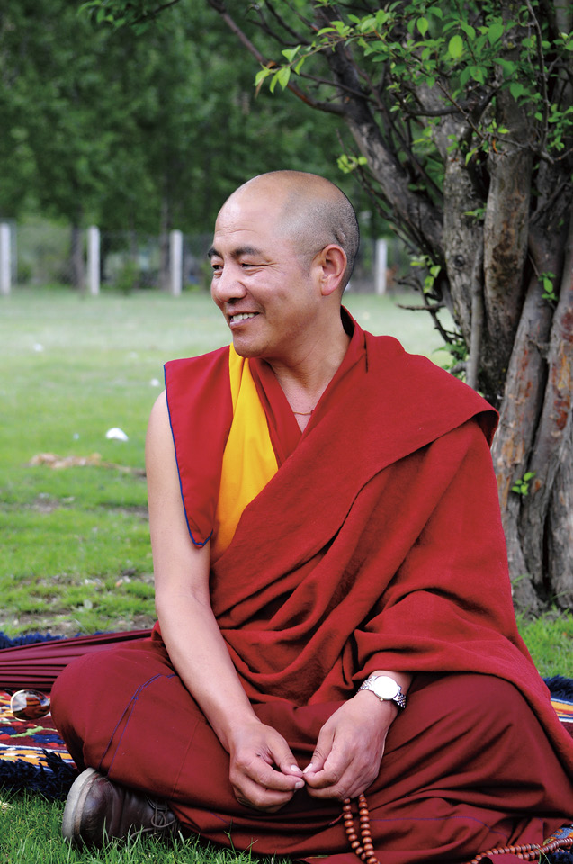
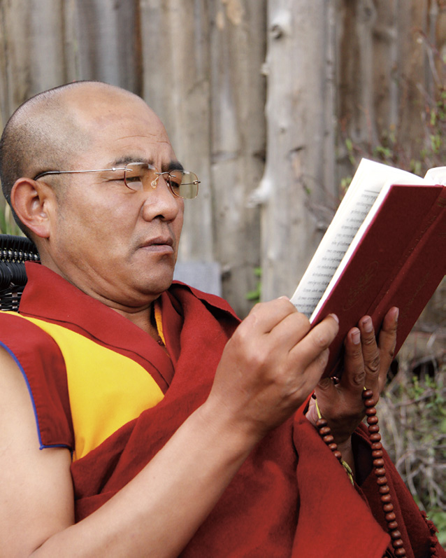

## 上师瑜伽的重要性

2009年1月4日

在今晚的佛法交流中，我主要为大家传授法王如意宝的上师瑜伽，之后，就相关学习事宜做一下开示，最后，对金刚道友学法方面的疑问做解答。

## 排除万难，精进学修

在座的各位金刚道友应该都是虔诚的佛教徒。作为佛教徒，应该精通佛教的道理，否则，起心动念、说话或做事的时候，很可能与佛法背离，这也是我经常提倡大家闻思修的原因。在闻思的过程中，首先，应该多听授上师们宣讲的甚深妙法，之后，自己要花一定时间认认真真思维、修行。

不论学佛，还是做世出世间的任何一件事，包括管理学院或菩提学会、发心做事、与道友们沟通等，都需要花一定时间、下一定功夫才有机会做成，否则，肯定无法成办。希望大家都能精进起来。

今天是周日，本来我们可以休息，但学院明年的教学计划、发心人员的工作安排，以及对外弘法等很多事情需要处理，所以，我和发心人员从早上九点一直商讨到现在。虽然做起来比较累，但从另一个角度讲，想到大家能学到殊胜的佛法，内心确实非常欢喜。

一到周日，人都会很懈怠、散漫，有些人在家看电视或做一些无聊的事，有些则和朋友聚在一起唱歌、跳舞、吃饭、喝酒等等。一般来讲，周日是世间人造恶业较多的日子，而大家却能利用这一天行持正法，这是非常值得赞叹的！

为了这次菩提讲堂的聚会，你们也付出了一定努力，有些人从很远的地方坐车去道场听；有些人下班后一直没离开，在办公室里上网听授；有些人在家里不方便，通过各种方法去别处上网……这也说明，你们对佛法具有一定的信心，否则，今天不可能来参加这次交流。

这几年，我与大家共同学习《入菩萨行论》，内心感触很深。城市里散乱的因缘特别多，在贪嗔痴的驱使下，世间人大多在吃喝玩乐方面兴趣浓厚，而在行持善法方面则兴趣索然，但你们却能排除万难，尽心尽力地学习佛法，这确实很不容易。

以前，很多道友或者根本不懂佛法，或者仅仅停留在空谈理论上，后来依靠信心与恭敬心不断努力，现在已经真正懂得了很多佛法的教义，学习效果很不错。从我个人角度讲，不管多忙多累，也会尽力把佛法教理如实地传授给大家，希望有缘的道友都能积极地参与。

## 上师瑜伽的重要性

今天，我们这么多人依靠现代科学的方便方法，相聚在幻化的空中讲堂，做幻化般的佛教交流，因缘极其殊胜，机会非常难得，这也是上师三宝的加持。接下来，我就为大家简单讲一下法王如意宝的上师瑜伽。

学习佛法，不能仅仅停留在学习或知道的层面，否则就成了学术理论。学佛还需要一种非常甚深的加持力，即依靠上师的不共力量，使自己与佛法相应，这种加持力不可或缺。因此，道友们平时不仅要学习佛理，还要经常修上师瑜伽。

在座当中有来自不同教派的佛弟子，你们可能有自己的上师，但也可以修法王如意宝的上师瑜伽。因为法王如意宝是藏地公认的大成就者，他对佛教的巨大贡献人们有目共睹。实际上，大成就者的上师瑜伽都可以修，比如，宗喀巴大师的上师瑜伽、萨迦班智达的上师瑜伽、莲花生大士的上师瑜伽等都可以修持，都会获得殊胜的加持。但对于菩提学会的道友而言，我们现在能有学法的机会，全部来自法王如意宝的加持力和发心力，因此，修法王如意宝的上师瑜伽，自相续一定会获得不共的加持。

一旦得到上师和诸佛菩萨的加持，无论学什么法、做任何利生事业，都没有任何困难。反之，如果没有得到上师的慈悲摄受，仅凭一己之力，无论个人修行还是弘法利生，都很难成功。

学习佛法与学习世间知识完全不同。学习世间知识只需懂得理论即可，比如，对于一台机器，学会了它的操作方法便可以开启，除此之外，没有什么更神秘的东西，但学习出世间的佛法，并想以此获得解脱，则必须依靠一种不可思议的甚深力量，而这种力量，来自上师的加持。

我学佛多年，虽然不敢说非常成功，但也可以说稍有成就，因为从未半途而废，并且对佛法的信心越来越大，有生之年根本不会放弃闻思修佛法，这也是上师三宝的加持。

我平时在行住坐卧中，会经常祈祷上师，修任何法之前，也要祈祷上师。比如，清晨一醒来，就会祈祷上师、念诵上师瑜伽；晚上入睡前，也是如此；平日走路、坐车、去任何地方，甚至到花园里，也不忘祈祷上师；无论遇到顺境还是逆境，都会祈祷上师加持。当我们祈祷上师的时候，十方诸佛菩萨的加持会全都融入金刚上师，之后金刚上师的智慧、大悲和力量，会全部融入祈祷者的心相续。

我在遥远的雪域藏地，合掌祈请在座的金刚道友，希望你们能精勤地祈祷自己的根本上师。得到上师的加持之后，心相续不但会有明显改变，而且永远不会退转。

末法时代，形形色色的外境令人眼花缭乱，在如此强大的诱惑下，我们暂时生起的如闪电般的善根、利他心，很容易随之退转。为了让自己的修行善始善终，并使所修之法与自心相应，再没有比修上师瑜伽更殊胜的法门了。有关续部再三讲过[^1]：哪怕一刹那观修上师的功德，也远远超过千百万劫修持本尊生起次第和圆满次第的功德。

以前，我用一堂课专门讲过上师瑜伽，并把课程录成光盘发给了很多道友，你们想详细了解，应该比较方便。今天我要强调的是，大家如果时时刻刻祈祷上师，上师将会在你的梦境中显现，赐予你加持。如果梦到上师赐予自己食品、衣服等，说明上师的智慧和悲心已经逐渐融入自己的心相续。希望大家把上师瑜伽作为自己修行中最重要的一环。以前，藏地很多老修行人，一生都不断修持上师瑜伽。如果我们终生都不舍离上师瑜伽，修行肯定会非常圆满。

我们身处末法时代，违缘接连不断，包括今天听课，很多人都要顶着家庭或单位的压力。如果经常祈祷上师，很多违缘就会自然消失，因为上师是十方三世一切诸佛的总集。

总之，不论获得悉地，还是遣除修行中的各种违缘，在众多方面，上师瑜伽的加持力量的确无法估量、不可思议。诚劝大家，一定要将上师瑜伽作为修行功课的主要内容。

## 如何修持上师瑜伽

无论自己独处，还是在众人当中，都要经常观想上师。修上师瑜伽的时候，可以将上师观想为宗喀巴大师或者麦彭仁波切，面相为法王如意宝，在班智达形象的上师面前至诚祈祷。

祈祷的偈颂是用法王如意宝在文殊道场——五台山亲见文殊菩萨的时候，在诸多弟子的祈请下亲口道出的金刚语祈祷文“内钦热卧贼诶样康色，蒋华特杰辛拉叶拉门，晋美彭措压拉所瓦得，恭杰多巴颇瓦辛基洛”。法王留下的《文殊静修仪轨》里就有这个偈颂，稍后会传给大家。大家如果有时间，就经常修上师瑜伽；如果实在没有时间，就多念这个偈颂。

今年修五加行，我们以该偈颂作为上师瑜伽的祈祷文。大家可以一边磕头，一边念诵这个上师祈祷文。修上师瑜伽的时候，可以先念七遍或二十一遍上师祈祷文，然后观想上师化为五色明点，从自己的头顶逐渐融入心间，自己的心和上师的无量智慧变成一味一体，之后，稍许安住于上师与自心无二无别的境界中，最后进行回向。

修上师瑜伽非常重要，希望大家一定要重视。谁重视，谁的相续就会获得诸佛菩萨的甚深加持。一旦得到了这种加持，道心、大悲心、菩提心等不但不会退失，反而会不断增上，最后，所有的修行都会圆满。如果没有得到上师的加持，虽然暂时对法义领悟得很好，也能讲得很精彩，但在这样具有种种违缘并且邪魔猖盛的五浊恶世，随着时间的流逝，自己的菩提心等能否日益增上很难说。

## 法王圆寂纪念法会

下周六是法王如意宝圆寂纪念日，我们佛学院将召开法王如意宝圆寂纪念法会。在七天法会期间，学院四众弟子将平时的讲经说法、闻思修行全部放下来，一心祈祷法王如意宝，同时念诵十万遍金刚萨埵心咒。

希望有时间的道友，也能念满十万遍金刚萨埵心咒。我们共同在诸佛菩萨面前忏悔自己无始劫以来的罪障，这样也能获得共修的功德。有关续部和经典中讲：为纪念自己的根本上师而参加法会或念修的功德，将千百万倍地增上，功德非常大。

在所有的法会中，纪念根本上师圆寂的法会非常重要。我们宁玛派在每年藏历四月二十九日，还会召开麦彭仁波切圆寂纪念法会，那一天整个学院都会供灯。宗喀巴大师的圆寂纪念日是藏历十月二十五日，这一天所有格鲁派寺院都会召开大法会。在传承上师的圆寂日，弟子们忆念、祈祷上师，功德确实不可思议。

山下有时间的道友可以在下周六（藏历十一月十五日）——法王如意宝圆寂日，自发地组织起来，在你们平时学佛的道场开一个简单的小法会。最好把法王的像放在供台中间，前面供一些灯、花、水果等供品（供灯时一定要注意防火），然后一起修上师瑜伽、念诵金刚萨埵心咒。如果工作非常忙没有时间共修，也可以在自己家的佛堂上供一两盏灯，然后祈祷上师，这样忆念上师的行为功德也非常大。

学院现在特别冷，冰天雪地的，可能与东北没有什么差别，也没有电，上网只能靠发电。我刚才过来的时候，路上黑漆漆的，走在冰上差点滑倒了。万一“牺牲”了，在极乐世界看着你们一直在菩提讲堂等我，那就不好了……

不过，即使天气再寒冷，学院道友们也没有中断闻思修行，依然热诚地渴求着佛法。对于这次法会，也做了认真准备。希望法会期间，大家也能在各自的地方虔诚祈祷法王如意宝，认真念修金刚萨埵心咒。

## 做如理如法的法供养

不久之后，各地道友就要参加《入菩萨行论》的考试了。去年考试过程中，极个别道友因为有些行为不如法，被取消了考试资格。如果通过作弊而得到奖励，这不算什么荣耀的事，自己心里也会不舒服。希望大家这次考试一定要如理如法，考前认真复习，最好以优异的成绩为我做一个法供养。我不求你们别的供养，只希求你们以闻思修来供养，哪怕以一刹那的善根来供养，我都特别欢喜。

我辛辛苦苦地讲了两百多堂课的《入菩萨行论》，通过这次考试，也可以看出你们消化得如何、接受了多少。所以，我很渴望见到你们的学习成绩，希望大家都能认真对待。

## 发心注意事项

2008年已成为过去了，新的一年——2009年已经开始。菩提讲堂的义工以及很多发心人员，这么长时间一直默默无闻地付出，确实非常辛苦，在此我对你们表示感谢！希望你们在新的一年里能继续发心。

发心时需要注意几点：首先，一定要有时间概念，有些道友虽然报名发心，但经常不参加或迟到，这样会给很多人带来不便。我知道城市里的人非常忙，但无论发心还是闻思修，都应该有时间观念。作为佛弟子，一定要给所有参与者留下好印象，履行自己的诺言，如理如法地行持利他事业。其次，道友之间不要互相诋毁、诽谤，彼此不和。按理来讲，作为佛教徒不应该有这些行为，但人的习气和烦恼突然显现时，也是相当可怕的。我们发心是为了行持善法，千万不要以此行持非法。这方面发心人员一定要引起重视。

如果学会管理有不当之处，大家也可以直接或间接向我们反映。当然，对于道友们的发心，大家也应该观清净心。

## 注重孩童教育

现如今，国内外都格外重视、强调孩童的德育教育，以及传统文化的传播。现在虽然很多人是佛教徒，内心善良，但如果自己的下一代没有内在的道德修养，甚至连佛陀都不承认，只重视浅表的知识，将是非常遗憾的。希望在座为人父母的道友，能对自己的孩子多灌输一些传统文化和佛教的慈悲理念，这一点极为重要。我们也会通过多种途径加以弘扬，希望大家能尽力配合。

## 发愿实修

关于学修方面也要注意，我们学佛不但要懂得佛理，还要实际修持。今年学院特别强调，各班一定要注重实修。我们计划从藏历明年开始，两年内将共同加行与不共加行圆满完成。也就是说，用半年到一年时间专修人身难得、寿命无常、轮回过患与因果不虚；然后用半年到一年时间，专修皈依、发心、百字明、曼茶罗和上师瑜伽。我们要求必须打好共同与不共加行的基础，才能学修大圆满的正行法，因为修前行非常重要。

希望菩提学会的道友，在新年伊始也能跟随我们一起发愿实修，先打好人身难得、寿命无常、轮回过患、因果不虚四个共同加行的基础，然后圆满皈依、上师瑜伽等不共五加行。当然，城市里的人像我们这样全天修行肯定有一定困难，但只要安排好自己的时间，真正行动起来，应该可以完成的。我看到你们很多人都修过五十万加行。

圆满五十万加行之后，每个人的相续会有很大改变，之后再学密法才会真正受益。有些人想得很简单，认为得个灌顶就可以直接学密法，不必花费那么长时间修加行。这种想法并不合理，因为当今时代，绝大多数人都不是上根利器，这样操作很难解脱。

如果大家愿意与我们一起共修，一定要发下大誓愿。如果未以誓愿摄持，每天受世人的染污、浑浑噩噩度日，自己的修行不可能在短时间内进步。如果你在这两三年中打好了加行的稳固基础，日后，你的道心与悲心都不会退转。希望大家能发起这样的誓愿。

## 堪布念诵传承

下面，我为大家念诵法王如意宝上师瑜伽的传承。再念一个法王教言——《教诲天人甘露》的传承。

（堪布念传承）

《教诲天人甘露》里面的教言非常殊胜，过段时间我会把它译成汉文。法王在其中讲了四个教言：依止上师、听闻佛法、清净戒律、修持禅定。

好，我已经讲完了，该传的法也传了，接下来回答道友们的提问，或者我们来一场辩论。（众笑）

现场互动

⊙ 问：修行是为了彻底放下，既然放下了，为何还要度众生？这是否矛盾？

堪布：放下有两种，一种是要放下平时心里的执著。以前我讲过隐峰禅师的故事：他年轻时为寺院做事，有一天他推车在路上行走，马祖坐在路边，用脚挡住了车子的去路。隐峰禅师不管不顾，推着车子从马祖的脚上碾过。马祖显现上很不高兴，拿起锋利的斧头指向他。隐峰禅师伸出脖子，心想今天死定了，然而，上师却大笑一声放下了斧头。隐峰禅师由此当下开悟。所以，执著的心一旦放下，便有开悟的机会。

另一种，是指放下自私自利的心、放下自我烦恼的心，但此时利益众生的心不能放下；或者说，放下世间琐事，而不放下利益众生的事。这两者并不矛盾，高僧大德们都没放下利益众生的事，比如，文殊菩萨从未放下利益众生的事业，轮回未尽，度生不休。

⊙ 问：放生时无法远离捕杀之地，该怎么办？比如，我们在江里放鱼，有人却在下游捕鱼；避开了这道网，下游还有另一道网。有些人认为这样放生没有意义。请问我们该怎样回答？

堪布：放生肯定有意义。大家放生的数量很多，即使有些被捕到，但也是极少数，尤其江面较大的时候，他们不一定能捕到很多，我想不要因此而放弃放生。

放生虽然会有一些违缘，但只要多动脑筋，应该不会有很大困难。我们在杭州、东北放鱼的时候，如果白天放，很多鱼都会被捕到，于是我们就改成黄昏放，这样捕捞者就很难看见。此外，我们还经常更换放生地点，并花时间找湖水面积较大的地方放生。这样一来，大多数众生就不容易被捕到了。

⊙ 问：磕大头的时候应该如何观想？磕的过程中，有时心特别散乱，该怎样对治？

堪布：磕大头的时候，身口意一定要集中精力。如果心比较散乱，应尽量专注于前面上师的照片或者唐卡，并观想祈祷上师和莲花生大士。这样修持应该没有大的问题。具体内容，以后学《大圆满前行引导文》的时候，我会详细宣讲。

⊙ 问：我正在修共同四加行，修完之后再修不共加行吗？

堪布：我们学院是安排先修四共同加行，再修不共加行，但城市中的道友未必能如期完成不共加行，所以我建议你们可以先磕头，先修完这个加行。

⊙ 问：修学大乘中观宗和唯识宗，所获得的果位有什么不一样？是否一个得佛果，一个得菩萨果位？舍弃世间是什么意思？

堪布：学习大乘中观宗和唯识宗，暂时会得到菩萨果位，最终都会获得佛果。舍弃世间就是舍弃名闻利养等世间八法。

⊙ 问：我们这边很多居士既学您传授的法，也学益西堪布传的法，学得很多，一直都学不完。他们想有所取舍，但又怕有过失，该怎么办呢？

堪布：这个没有过失。如果有能力，可以两边都学；如果能力有限，选一个学也可以；如果这个能力也没有，不学也可以。每个人的时间、精力都是有限的，可以根据自己的能力、意乐、信心来自行决定。

⊙ 问：很多居士觉得空性法门非常难，学到中间的时候想舍弃不学了，认为不如去念佛，可是又担心没有学圆满会有很大过失。请问这个问题该如何解决？

堪布：有舍弃的想法是因为因缘、信心和根基不够。佛陀在世的时候，空性法门也并非人人都能接受，只有大乘根基，尤其前世听闻过空性法的人，今生听到后才会生起欢喜心。如果无始以来未曾听闻过大乘法，尤其前一世是地狱饿鬼界的众生，今生学习空性不但很费力，也很容易退转。

⊙ 问：有人说，与上师告别时对上师顶礼是离别头，依此缘起，以后再没有与上师见面的机会了。请问这种说法是否正确？

堪布：也未必。虽然有这种说法，但我没有看到具体的来源和依据。我们去礼拜佛像时，顶礼完也会离开，但应该没有什么吧。

⊙ 问：古人云：“积善之家必有余庆，积不善之家必有余殃。”自作业自作受，但为什么做了善法的人，自己的家人也有余福呢？

堪布：因果非常甚深，现在做的善恶业未必马上成熟，但当前世的业与今世的业烦恼结合之后，果报就会不虚成熟。善恶业有不同的成熟方式，自己和家人肯定有共业，所以，显现上家人会感受余福。

⊙ 问：您最近身体怎么样？弟子想画佛像，请上师传一个画佛像的传承。

堪布：我最近身体还可以，只不过偶尔有点小感冒。我没有画佛像的传承，但可以给你念释迦牟尼佛圣号的传承……

## 结语

今天我们主要讲了上师瑜伽的修法。虽然我不敢说自己有大的证悟境界，但确实获得了上师的不共摄受与加持。在此，我以恭敬心祈祷上师，愿你们每一个人都能得到上师与诸佛菩萨的真正加持，心相续转向于善法，这是我发自内心的祈愿。

希望你们在今后漫长的学佛道路中，能时时祈祷上师，这样上师就会与你形影不离。这种修持极为重要。

人身非常难得，现在大家既已拥有了宝贵人身，务必认真修行，不要整天看电视、上网，以无聊之事虚度光阴。当做完工作或家务，尽了该尽的义务之后，就应该空出时间多念佛、多听经闻法，如此对自己的今生来世会有很大的利益。

我们在学院当中，除了弘扬佛法、学习经论以外，很少接触世间的琐事。你们作为城市在家人，不可能没有一点散乱，但一定要珍惜时间。有了时间概念，学习佛法就不会有很大困难。

[^1]: 如续部中云：“何人俱胝劫，修十万本尊，不如一刹那，忆念上师胜。”
