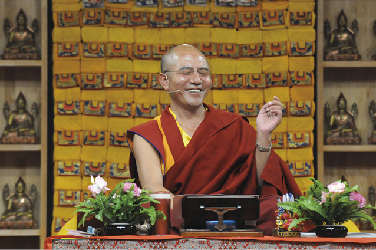
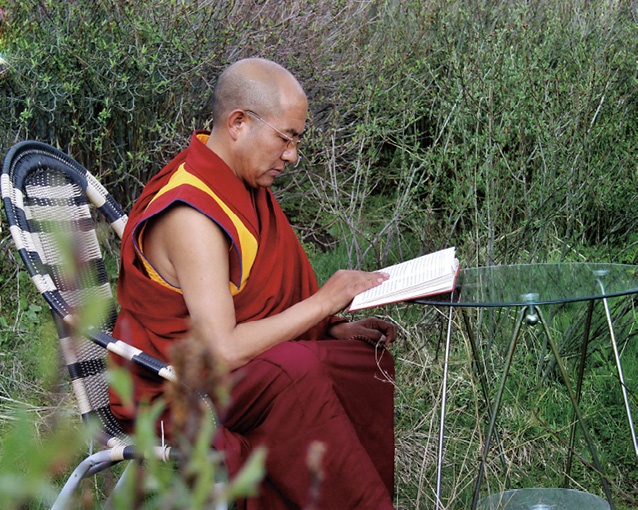
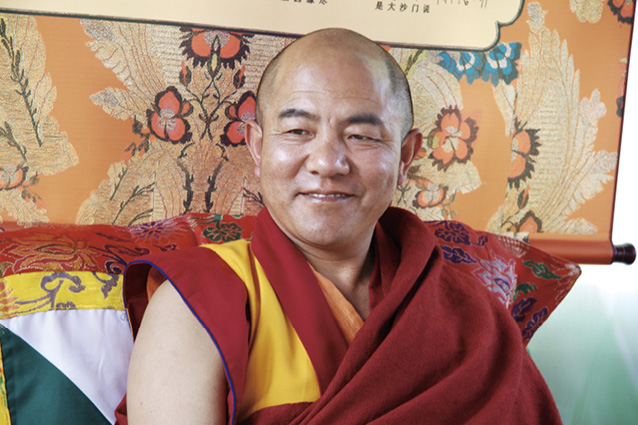

## 传授《快乐之歌》

2007年9月29日

今天交流的内容，主要是给大家简单讲一下藏地无著菩萨的《快乐之歌》，另外再讲一下近期的学修安排。

## 学习并弘扬《入行论》

最近，我们一直在忙《入行论》期中考试的后续工作，包括批改卷子、总结成绩、分发奖品等。各地交来的卷子，我们都很慎重地对待。我们这边有一百多位法师集中在一起批卷子，投入了大量的时间和精力，每份卷子有二十多位法师批阅。大家在学习上都很下功夫，这份成绩单来之不易，所以在批卷子的过程中，我们也会认真负责，给大家一个公正合理的分数。

现在各地的考试成绩已经出来了，大多数人考得很不错。过段时间，我们会把成绩公布出来，然后还会给大家发一些加持品。虽然满足每个人的要求有一定的困难——即便是释迦牟尼佛在世的时候，让所有人都满意也是不可能的，但我们还是非常认真地做了一些工作。我个人也是如此，白天晚上连轴转。

大家应该清楚，考试并不是为了一个分数，也不是为了得奖。考试最大的目的，是让我们的相续中对大乘佛法生起坚定不移的信心，对之前未掌握的内容有进一步的深入了解。这次考试许多道友都参加了，对此我深感欣慰，非常感谢大家。极个别人因为种种原因没有参加考试，十月底还有一次补考的机会，希望大家可以弥补这个遗憾。

世间的考试，我们已经参加过无数次，但出世间的、真正以解脱为目的的考试，大多数人都没有参加过。所以，这个机会非常难得，至少会在自相续中种下善根，希望大家能把学习《入行论》放在首要位置。

如果我只是在菩提讲堂里露个面，或者到城市中跟大家见见面，意义不是很大。最重要的是什么呢？就是大家认真、系统地学习《入行论》。如果在座各位对喇荣佛学院、对法王如意宝有虔诚的信心，并且想从我这里获得利益的话，那么学习《入行论》是最好的一种途径。

在弘扬《入行论》的过程中，有个别的地区负责人产生了厌倦心，每天都觉得很累。我希望你们能够发起菩提心，不要遇到一点小事就怯懦，从而退失信心；也希望各地的负责人、法师和辅导员能够认认真真地弘扬佛法，这对你们来说是一个非常难得的机会。当然，末法时代的众生刚强难化，有些言行不如法也是正常的，但对我来讲，我不会因此就退失，希望你们也不要轻易退失。

## 国庆佳节莫杀生

后天就是国庆节了，大多数人可能认为，应该欢乐地度过这个假期，但在这个过程中，恐怕会有无数生命惨遭杀害。事实上，我们在寻求快乐的同时，也应该考虑其他生命的感受，最好是戒杀吃素，尽量不要杀害其他众生。另外，大家还应该力劝自己的亲人眷属、同事朋友等，让他们不要杀生，尽量吃素行善。

国庆节期间，很多年轻人会把钱花在没有意义的事情上，比如观光旅游、吃吃喝喝。这对我们佛教徒来讲，是一种很大的浪费。在此期间，大家应该好好复习，好好修行。如果可以闭关七天，那是最好不过的。前一阵，我闭关了一个月，感觉非常殊胜，过段时间，我打算再闭关一两个月。你们大城市里的年轻人，恐怕很难有真正的闭关的机会，但是若能在短暂的时间中闭关，哪怕六七天或者三天，也会有种不一样的感觉。

我希望在国庆节期间，大家不要将财富、时间和精力全部浪费掉，甚至连平常有规律的学习计划也打破，这样很不值得。我们学院里的这些法师，对其他事情不是很重视，唯一重视的就是学习大乘论典，这一点值得大家随学。

## 近期学修安排

### 1．背诵《佛子行》

凡是今天在菩提讲堂听课的道友，我对你们有个要求，希望每个人都能做到。前段时间，我在佛学院讲课时也提过这个要求，就是让大家背诵无著菩萨的《佛子行》。其实这不难做到。

《佛子行》是将所有大乘教义归纳而成的菩提妙法、甘露教言，对大乘修行人来讲非常重要。以前，法王如意宝在世时，曾要求佛学院的所有常住道友必须背诵《佛子行》。后来，法王如意宝受邀前往国内外很多寺院、道场传法时，也都要求他们学习、背诵这部论典。

前段时间，我在学院里给大家讲过《佛子行》。现在，我要求今晚来到菩提讲堂的所有道友，除了文盲和老年人以外，其他人最好在两个月之内背下来。如果你连这一点都做不到，那可能不是一个虔诚的佛教徒。其他方面，我对你们也没有什么索求，包括财富、名声、地位等等，这些我一点也不希求，但在佛法的闻思修方面，我还是有所求的。如果以后有因缘见面，我会问：“你背诵《佛子行》了吗？”

如果背诵《入行论》的话，对你们来说可能会有一定的困难，因为颂词特别多。但事实上，很多城市里的修行人也在背，有些人背到第七品，有些人背到第八品，也有一些人全部背完了。从去年开讲到现在，很多居士表现出不错的信心和学修状态。

网上有《佛子行》的电子版，你们可以自行下载，一定要把它背下来。如果连三十七个颂词也背不出来，那么我们在菩提讲堂的交流，就真的成了一种世间的聊天。你们也感觉得到，在城市里面，有些人的闻思修行完全成了表面形象，实际上根本没有下功夫，也没有投入时间和精力，这是非常不合理的。

既然你们选择来到菩提讲堂，那就应该有一点收获，得到一些利益，而这需要依靠双方的付出。如果我不努力，恐怕你们未必能得到利益，但我努力的同时，你们也需要精进。

希望大家尽量在国庆七天当中背诵《佛子行》，背下来之后，每天都要读一遍。这样两三年后，基本就能随时记起来。有些人没有闻思修行的习惯，认为只是随便看一看书就是学习佛法，其实真正系统性的学习不是这样。

现在，《佛子行》课程的音频和视频已经在智悲佛网上公布了。大家应该去听一听，学习佛法的机会来之不易，希望各位能够认真对待。有些人可能觉得这些光盘和法本轻而易举就拿到手了，但其实这背后有很多人的付出。尤其是《入行论》的学习，从头到尾有不少道友在不断地付出，这里要特别感谢他们！

### 2．学习《二规教言论》和《佛子行》

今年还有一个学修要求：大家在学习《入行论》的同时，要学习《二规教言论》和《佛子行》。我们把这两部论典的课程编辑成《正法醍醐》，到时会和《入行论》第七册一起发给大家。

有些人说：“我现在只学习《入行论》，其他什么法都不学。”这是一种非常愚痴的说法。任何一个法，只要对自己有利，都应该学习，更何况《二规教言论》和《佛子行》是法王如意宝特别重视的两部法。前段时间，我也花了不少时间给大家传讲完了，希望各位能够认真学习。

### 3．发菩提心、好好闻思修

各个地区的道友一定要发菩提心，鼓励身边的人学习佛法。佛学院最初开始接受汉人弟子时，法王如意宝就曾要求，每个汉人都要另外再找五个汉人来学习藏传佛教。所以，当时的常住道友一起努力，发动了很多人来学院。因此，你们拥有今天的学习机会，与法王如意宝和其他上师直接或间接的发心是分不开的。现在的因缘也非常好，大家一定要发动身边人来学习佛法，哪怕是听一堂课，他的一生也可能完全转变。

大家有时间的时候，一定要好好地闻思修行。有些人经常上网，浏览一些无意义的、连世间人都起厌烦心的网站，这样很不如法。真正有世间正见、有道德的人，从不会去看这些。

如果你真的想要学习佛法，我们会尽量为各位提供一些学习、答疑的方便，希望大家能够利用这种方式好好交流、探讨，以遣除自相续中的怀疑，真正生起正知正见，这才是最重要的事情。

### 4．监督发心工作

刚才有些道友和我说，前段时间，很多地方向学院请转经轮。他们认为学院里有很多转经轮，就把钱寄来了。但是，自从去年讲《转经轮的功德》以来，每批转经轮一到学院，就马上被请完了，一直处于供不应求的状态。最后，我们这里的工作人员没能满足大家的意愿，听说个别道友有一些意见和想法。

希望你们做善事的时候，不要斤斤计较，更不要心胸狭窄，否则做任何事情都很难成功。凡是我管理的发心人员，我也要求他们做事如理如法。如果真有不如法的行为，大家可以直接联系相关负责人。虽然发心人员日日夜夜都很劳累，但是有些人因为智慧有限、能力有限、经验有限……总之，由于各种原因，可能会对大家有一些不恭敬、不公平。你们可以站在公平公正的角度提出来，也可以向我反映，我会要求他们改正。希望大家以后在弘法利生的过程中互相监督，使我们的这项工作能顺利开展。

## 快乐之歌

我们在讲完《佛子行》后，紧接着又讲了《快乐之歌》，课程都可以在网上看到。今天，我再从几个方面归纳性地讲一下无著菩萨的《快乐之歌》。在藏传佛教中，很多人依靠这几个颂词，就使自相续完全转变，成为一个名副其实的修行人。

在《快乐之歌》中，首先讲到世间人特别执著自己的身体，但这个身体其实是五蕴聚合的假象。如果你的身体生病了，应该很快乐，为什么呢？因为通过生病可以清净无始以来的罪业；罪业清净了，修行就没有障碍；修行没有障碍，最后一定会获得成就。因此，大家生病的时候不要苦恼。我有时候身体也不好——最近还不错。但不管是有病的时候，还是无病的时候，我都会尽量观修无著菩萨的《快乐之歌》。

对于有些人来说，生病真的是个好事，依靠现在这个身体得病，就可以清净无始以来的杀生、偷盗等很多罪业，这不是很好的事情吗？所以，生病没有什么值得伤心的，大家应该感到很快乐。

反过来说，如果你的身体健健康康、无病无痛，也应该很快乐，为什么呢？因为身体健康、心情快乐的话，我们做任何一个善事都会善始善终。有些道友身体很好，常年无病，身口意三门所造的善法非常圆满，这也是一种福报。当然，除了极少数人以外，大多数人都认为无病会很快乐，有病很难快乐起来。

以上是《快乐之歌》的前两个颂词。意思是说，有病应该快乐，没病也应该快乐。

如果你拥有一些财富，应该很快乐，为什么呢？有了财富的话，可以做很多功德，积累很多福报，比如说供养诸佛菩萨和十方僧众，或者放生、布施等等。如果有了福报，就会感到快乐，因为世间的一切善妙之事，都是依靠福报而显现的。

如果你一贫如洗，甚至沦落为乞丐，也应该很快乐，为什么呢？因为没有财富的话，世间的忙碌、争斗以及嗔恨、嫉妒等各种烦恼，都会从我们的生活中消失，因为这些痛苦大多数都跟财富有关。

因此，大家要知道，有财富应该快乐，没有财富也应该快乐。现在的世间人，发财的时候很快乐，觉得自己非常了不起；而生意亏本、资产耗尽甚至家破人亡的时候，又完全接受不了。其实，对于修行人而言，这是积累资粮、修持善法的最好时机。

如果你很快就要死了，应该很快乐，为什么呢？因为恶业、恶缘已经无法阻挠你了，而且即生当中已经与佛法结上了善缘。比如说有些出家人或居士具足正知正见，如果他的见解、修行、戒律都没有损坏，在这样圆满的状态中死去的话，那他来世一定会趋入解脱妙道，不会堕入三恶趣当中。因此，即使面对死亡，也应该快乐。有些人特别担心自己是不是要死了——希望大家不要伤心，如果快死了，也是非常快乐的事情。

如果你活的时间非常长，也应该很快乐，为什么呢？因为修行就相当于种庄稼，上师、道友以及其他因缘相当于阳光、雨露，依靠这些因缘才能使修行的苗芽茁壮成长。如果活着的时候坚持修持善法、不造恶业，那你获得人身也是有意义的。

归纳而言，有病也快乐，无病也快乐；发财也快乐，贫穷也快乐；死去也快乐，活着也快乐。

## 总结及祈愿

今天与大家见面的主要目的，就是希望你们能够背诵《佛子行》，这是一个硬性要求。你们能来听课，说明对我有一种信任感。既然如此，就应该按照我说的做，这样我们的交流才有意义。

希望大家都能成为一个真正的修行人。在末法时代，浮于表面的修行人非常多，而真正有实修实证、能调伏自心、对治烦恼的修行人非常少。所以，我们聚会的主要目的，就是一起修持大乘佛法，这是我们的共同愿望、共同目标。

我再给大家念一下无垢光尊者和麦彭仁波切的发愿文，愿所有众生在国庆期间不要遭受痛苦，愿大家的所作所为不离开善法。作为修行人，我们要经常祈祷上师三宝，这非常重要。

最后，祝愿大家违缘消除，顺缘具足，菩提心越来越增上！如果自己还没有生起菩提心，就让它早日生起；如果已经生起菩提心，就让它日益增上。

现场互动

⊙ 问：道友之间可以互相念传承吗？

堪布：可以。法师或居士都可以念传承。

一般来讲，在藏传佛教中，念传承的人要行为如法，并且对佛教有信心，修行也比较认真。如果条件不具足的话，给人念传承也不是很好。如果他的修行、行为等各方面都不错，是大家比较认可的出家人或居士，由他来念传承也没什么不可以，因为弘扬佛法从来都不是几个法师的事情。

在藏地有一种说法，有些《大藏经》的传承来源于一个文盲妇女，因为她有这个传承，于是有个大德到她面前求传承，一边教她念诵，一边请她口耳相传，最终从她那里得到了传承。因此，道友之间互相念传承应该也是可以的。

⊙ 问：道友或他的亲属去世以后，我们怎样才能更好地给予帮助，是念佛、念咒，还是请高僧大德超度？

堪布：我在《正法醍醐》中给大家写过一封信，其中就有提到，希望每一位佛教徒，看到其他道友在生活和修行中遇到困难的时候，尤其是他的家人去世的时候，应该提供一些帮助。具体如何帮助，并没有特别严格的规定，只要行为如法就可以。

按照藏传佛教的传统，人死之后，大家会为他念观音心咒、阿弥陀佛的心咒和名号，以及《普贤行愿品》《金刚经》等。如果某一位道友的亲人去世了，大家也应该如此给予帮助。就像在基督教团体中，如果有人遇到困难和违缘，其他人也会伸出援手，这样一来，不信基督教的人也被其吸引过去了。

当其他道友遇到违缘和痛苦时，哪怕只是对他说一句安慰的话，也是非常有必要的。我们可以根据情况来安排，为亡者念一些观音心咒、阿弥陀佛圣号，或者举行放生活动，这样做意义非常大。

⊙ 问：现在各大教派的很多弟子都在学《入行论》，但有些道友认为他们有自己的上师，如果依止了法王如意宝或者您，就会舍弃自己原来的上师，请问这种想法对吗？

堪布：无论你是哪一个教派，如果以前依止过某一位上师，而且这位上师是真正具有法相的善知识，那么你应该一直依止，不要轻易舍弃。如果你以后又遇到其他真正对大乘佛法有信心、对众生有利益的合格上师，那么你对他的信心应该也会逐渐生起来。

有些人可能想：“不管我的上师如法不如法，我都永远跟着他。”并且还会对其他的人和事物都看不惯，这种行为不是很好。有段时间，我也认为自己是法王如意宝的弟子，所以对其他上师就生不起信心。后来我转变了想法，觉得：“法王如意宝是非常了不起的上师，但只要其他上师对众生有利，是真正的大乘佛教善知识，就值得我们尊敬和崇拜，我们应该像对佛陀一般对他生起信心。”这样一来，我自己的邪见也慢慢断除了。所以，大家应该经常观清净心。

现在学习《入行论》的道友，各个教派的都有。我希望你们不要互相诽谤，因为各大教派的教义并没有任何相违之处。因此，大家应该认认真真地学习，对自己的上师有信心，对其他上师也应该生起信心。我们看高僧大德们的传记就可以知道，他们对所有的上师都有欢喜心。

⊙ 问：有些道友看到市场里杀鱼的场面，感到非常忧伤，但《入行论》中说：“遭遇任何事，莫扰欢喜心；忧恼不济事，反失诸善行。”请两者是否矛盾？

堪布：不矛盾。这个颂词的意思，并不是说让你杀生、造恶业时也生欢喜心，或者看到别人杀牦牛、杀人时也以欢喜心来赞叹，而是说在修行过程中遇到种种违缘时，我们不应该随着违缘而转，为此忧愁苦恼，而应该以坚定不移的信心来修持佛陀之教法。

⊙ 问：当我们生起悲心的时候，会感到很伤心，但是《入行论》中说，菩提心能给我们带来快乐，请问如何圆融理解？

堪布：菩提心带来的是究竟的快乐，而我们看到众生受苦时的这种暂时的伤心，叫做出离心。出离心和厌离心，在《毗奈耶经》中是两个不同的概念。当我们看见可怜众生时，会生起一种悲悯心，而悲悯心实际上是一种出离心。这种出离心，它不是痛苦的因，而是快乐的因。既然这个因是快乐的，那么果也应该是快乐的。

⊙ 问：我们是银川菩提小组的。现在个别道友会大肆拉拢组员去其他上师那里学习，以致很多人不再参加共修，请问这种拉帮结派的行为是否有过失？

堪布：目前，这种情况在个别地区确实存在，希望当地负责人能够认真对待。

从考试成绩上也能看得出来，银川可能存在这个情况。因为跟很多地方比起来，你们那里有部分道友学得不是特别理想。我昨天还在想，这些人到底在干什么？他们的有些行为，从成绩上也能略窥一二。

我们这次开讲《入行论》，是为了让大家一起学习，并不是搞一些是非，也不是为一些上师拉拢弟子、供养钱财。刚开始，在《学习<入菩萨行论>的要求》这封信里面，我已经很明确地说了，学会中有负责监督的管理人员，一旦发现哪个组员的行为不如法，将会取消他的学员资格，希望各地的道友们互相监督。

我不诋毁任何一位上师，只要是真正的具德上师，我都会恭敬合掌。但是，学会是一个单纯的学习窗口、一个方便大家学习的平台，并不是为一些上师接受供养、自我宣传而建立的。我也从未在此宣传过我们佛学院的高僧大德。如果以后有些人的不如法行为非常严重，我们也会在不同的场合进行公开批评。

你刚提到的行为确实不太如法。如果你们自己内部能很好地处理，我希望大家一如既往地学习下去；如果实在没办法，那就只有取消一些学员的学习资格。除此之外，我也没有其他权力。全国有那么多的佛教徒，想不想学是每个人的自由，但是我们不可能一直让个别人在学会的平台上搞宣传，甚至搞一些非法活动。

前段时间，个别地区的学员以学习《入行论》的名义来搞传销以及一些非法活动。对此，我在不同场合中做了点名批评，也取消了他的学习资格。这类情况，希望各地负责人引起重视。

⊙ 问：对于年纪大的修行人来说，当他感觉自己身体快不行时，是住在家里好还是去佛学院好？

堪布：住在家里好一点。

⊙ 问：修出离心和菩提心时，为什么会有一种冲突感？

堪布：不管修出离心还是修菩提心，刚开始都会有一定的困难，也会有种不适应的感觉，但是渐渐就熟能生巧了。坚持学习和修行，慢慢会有进步的。

⊙ 问：修出离心的时候，感觉自己对生活失去了信心，变得有些消极，这样修对吗？

堪布：我们修出离心的时候，对生活不应该失去信心，相反应该充满信心。这个时候，我们是对整个轮回没有兴趣，但是在日常生活和工作中，不会失去信心，不然就是世间所谓的消极，并不能称之为出离心。

⊙ 问：怎样随顺别人不如法的行为？

堪布：不如法的行为不应该随顺。

⊙ 问：我们几个都已经皈依了，但我们不知道自己的法号，也没有拿到皈依证。

堪布：以后有机会，我们会想办法给大家发皈依证。当然，皈依证不是最重要的，最关键的是自己心中要发誓：从今天开始，我皈依三宝，决不舍弃三宝。这样才有皈依的戒体，才算是真正的皈依。

⊙ 问：现在汉地有些人在学元音老人的“心中心法”，对此您怎么看？

堪布：其他高僧大德和他们所传的佛法，我个人无法做评价。不过，我以前看过元音老人的一些书，觉得里面讲得很好。有些人可能对他有各种说法，他们有什么样的理由我也不太清楚，但在我看来，元音老人在佛法方面诠释得很好。

⊙ 问：什么是造作的菩提心？怎样由造作的菩提心发起真正的菩提心？

堪布：所谓造作的菩提心，是指自相续中并没有生起真正的菩提心，但是遇到一些可怜对境时，会要求自己生起悲心。

比如，当你看到众生受苦时，本来你没有产生悲心，但你想到上师说要生悲心，你就要求自己对他生起悲心，自己有一种造作，或者说自我勉励，这就是造作的菩提心。

⊙ 问：利益众生是佛子的行为，但走路时总是无意中伤害到蚂蚁等，应该怎么办？

堪布：如果是无意中杀害众生，不会有很大的罪业，要尽量避免故意杀生。

⊙ 问：这次《入行论》考试有作弊现象，应该怎么处理？

堪布：在这次考试过程中，个别地区查出有作弊现象。我们批卷的时候也看得出来，有些错别字都一样，甚至有些还不是抄袭，两张卷子就是同一个人的笔迹。

对于这类作弊现象，我们的原则是：第一，不给发奖；第二，严厉杜绝，以后一旦发现，将取消他的考试资格、学习资格。当然，大多数地区考得很好。在此，我跟大家说一声谢谢！

虽然这次考试不是很难，但你们能在百忙之中抽出时间来学习佛法，这一点让人很欣慰。考得好的人也不要傲慢，因为考试的内容比较简单，基本都在复习范围内出题。下一次的补考，虽然不再发放奖品，但是大家也应该认真对待，尽量让自己的学修圆满。

## 结语

希望大家能够精进闻思修，认真学习以《入行论》为主的一切显密教法，早证菩提。我也会经常祈祷上师三宝：愿你们所有人的相续当中早日生起菩提心！

几年前，大多数人提的问题都是发财、保佑之类的，没有一个真正的利他话题。现在看来，大家各方面都有不同程度的进步，希望大家再接再厉。
