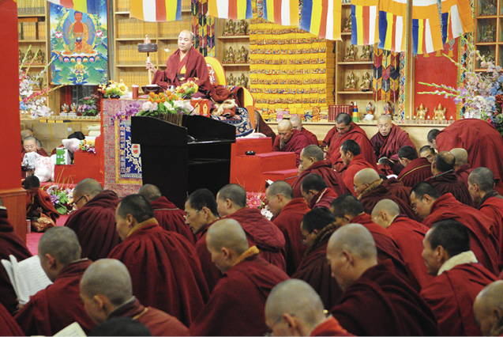

# 修行的几个小窍诀

2008年4月6日

很高兴与大家在菩提讲堂再次见面。前段时间我因为身体不好到外地治病，耽误了一段时间，回来之后学院一直停电（藏地冬天特别冷，发电非常困难），所以没有及时上网与大家交流。

以前的修行人需要穿过千山万水才能听到佛法，现如今，大家通过网络就可以学到佛法，非常方便，并且通过听网络直播，可以同样得到传承。但佛友们偶尔听授今天这样的交流课，是解决不了生死大事的，因为深奥的佛法教义不可能在短时间内懂得。若想真正学懂佛法，一定要长期、系统地闻思修。

## 学修关要

下面，我为大家讲两个学修方面的要点：

一、学习佛法首先一定要在上师面前听闻。虽然城市里的人真正到上师面前听法的机会并不多，但现在很多上师都在通过网络、光碟等途径传法。这样的闻法机会千百万劫难以值遇，大家现在有幸遇到，一定要珍惜！

如果具有信心，每天至少听一节课。我知道很多佛友非常忙，生活、家庭、工作等方面每天都有做不完的事，但我始终觉得，世间琐事没完没了，如果一直不断做下去，永远也没有学佛的时间。

如果没有听授佛法，很难对治自相续的烦恼。尤其身处纷繁聒噪的都市红尘，外界五彩缤纷的景象充满了诱惑，如果未能及时通过闻法为内心充电，不可能调伏烦恼。包括我自己在内，每天都要看书、闻法、修行，这是生命中最重要的事。

希望佛友们每天至少听一节课，这对你们的相续有不可估量的利益。《正法念处经》中讲了很多闻法的功德[^1]，有兴趣的道友可以多了解一下。佛在《发菩提心论》中云：“十方世界一切众生，听我法者，闻我名者，即得舍离一切烦恼，发菩提心。”

如果每天听一些佛法、看一些佛经，并把佛法的智慧逐渐融入自己的相续，修行境界将会全方位地提高，这样就能从容地面对世间。否则，在外境强力的诱惑之下，对佛法的信心将很难提升。

二、希望大家在学法过程中能有坚定的意志，无论遇到什么违缘或痛苦，都不要屈服。很多道友顺利的时候信心满满，遇到一点小小的违缘，就心生恐惧、退失信心，这样并不合理。学佛的道路是漫长而曲折的，任何一位修行人都会遇到很多干扰，但只要内心足够坚强，就不会受到什么影响。

很多道友都看过法王如意宝的传记，我最钦佩法王的一点，就是他在违缘面前永不低头，无论面对身体的病痛、生活的困苦，还是遭受人和非人的损害，丝毫不会退缩或倒下。不仅法王，以前很多高僧大德都是如此，在修行过程中克服了各种各样的艰难困苦。我们应该随学他们的这种精神。

我们现在所学的大乘法弥足珍贵，希望道友们不要轻易在违缘面前低头，放弃学法，这是一种脆弱的表现。实际上，只要以坚定的信心认真修学，任何邪魔外道或妖魔鬼怪都无法损害你。

## 略释《胜利道歌》

下面给大家介绍一下法王如意宝的《胜利道歌》。

《胜利道歌》里面讲了非常殊胜的教言，阐明了贤善人格、小乘出离心、大乘菩提心，以及无上密法之间的关系和修行道次第。

学习佛法，首先一定要有贤善的人格。法王如意宝曾反复强调，贤善的人格是修持一切显密佛法的基础。

之后，要生起出离心。很多人的所作所为都是围绕今生，但这不应该是修行人的所求。修行人应视三界如火宅，内心时时刻刻渴望出离轮回。有了这种心态，修行才算打好了坚实的基础。

有了出离心之后，还要生起菩提心。我们现在修学佛法，并非为了自己的利益，而是为了无量无边的一切众生，让他们获得无上圆满正等觉的佛果，这种发心叫做菩提心。

在此基础上还要修学密法。藏传佛教的密法以及汉传佛教的唐密，是佛教当中殊胜、纯洁的精华。大家在上师面前得受灌顶并修完加行之后，便可以听授。

最后，法王劝勉大家发愿往生极乐世界。

有些道友以前在法王如意宝面前亲自得过阿弥陀佛的灌顶。没见过法王的人，可以通过看法王灌顶的光碟或网上视频与之结上善缘。现在有这么好的因缘，希望道友们一定要把握。在我面前听什么不一定有很大收获，只不过得到一些听法的功德而已，但像法王如意宝这样的大成就者，稀世罕见，他的阿弥陀佛灌顶具有不可思议的加持。所以，我希望人人都能得到。这是我今天送给你们的最好礼物。如果得到了，可以说你已经趋入了密法，即已得受了《胜利道歌》的精华。

有些道友有点害怕，觉得趋入密法之后会不会很麻烦呢？其实，如果你能学习大乘显宗法、受持大乘菩萨戒，那密宗戒也完全可以受持，两者没有什么差别。很多人刚学佛时很害怕皈依，但皈依之后就知道没什么可怕的。同样，不懂密法的人刚学密法很害怕，其实，只要你学显宗法比较精进、戒律清净，各方面圆满，学密宗也一定会圆满，密宗再没有什么更高的要求。当然，如果你学显宗不圆满，学密宗同样不会圆满。

希望在一个月当中，每位道友都能得到法王如意宝的阿弥陀佛灌顶，这样就具有了往生极乐世界的因缘。

下面我给大家念诵《胜利道歌》的传承，再念一下《摄略极乐愿文》的传承。

（堪布念这两个法的传承）

## 提倡共修《诸佛菩萨名号仪轨》

最近，我翻译了麦彭仁波切著的《诸佛菩萨名号仪轨》，里面每个佛号的功德都不可思议，希望大家能安排时间共修。人不一定很多，三四个人、五六个人都可以。共修之前准备一些供品，然后在佛像前顶礼，最后念《普贤行愿品》回向。

很多道友现在经常做会供，当然，行持这一善法功德也非常大，但若想人人都得利，可能有一定的困难。而念诵诸佛菩萨名号的功德，每一个人都可以圆满获得，并且汉传佛教也有念诵佛号的传统。念诵一遍《诸佛菩萨名号仪轨》只需一个小时，一个小时在你们生活中不知不觉就过去了，希望大家能尽量抽出时间念诵，这非常重要！

## 做一名合格的修行人

还需要强调一下，学习佛法不要怀有疑惑、恐惧、怯懦之心。一名好的修行人，不仅自己今生来世会获得快乐，对于和谐社会、和谐世界也会起到积极作用。学佛过程中也不要懒惰，应该按时完成所学的功课。个别道友因受外境影响，精进状态起起落落，其实，修行人没有必要参与很多世间事，持续精进尤为重要！

此外，共修过程中，道友之间一定要和睦相处，自己有不懂的地方应在其他道友面前虚心请教。不要因为一些小小的事情互相争论、诋毁、恶语伤人，也不要在背后说是道非，作为佛教徒应该心胸坦荡，有什么问题最好直接说明。这些都是我历来的要求。

接下来，大家有什么问题可以提问。有些问题可能不仅是一个人的问题，也是大家共同的问题。在此过程中，为了维护佛法的纯洁本面，最好不要提世间方面的问题，作为修行人，不应参与世间之事，否则会对弘扬佛法带来一定的负面影响；同时，也不要议论或诋毁一些高僧大德、上师以及活佛等，因为诸佛菩萨化现的形象不可思议，作为佛教徒，应对所有的众生都观清净心。

现场互动

⊙ 问：我听别人说，给三恶道众生施食必须有一定的修行境界，并且中间不能间断，应不间断地施下去。如果中间断了，会引起三恶道众生的嗔心，招致一些违缘。请问是这样吗？

堪布：佛教当中专门有一些施食仪轨，只要按照仪轨来施，对三恶道众生都会有利益。如果不懂这些仪轨，念一些观音心咒，然后布施一些食品，功德也非常大。实际上，以善心施食，三恶道众生是不会给你带来违缘的。

⊙ 问：在学习自他交换的时候，大家有两种观点：一种认为，众生恶业的果和我们的回向互相交换；一种认为众生的恶业和我们的善业交换，请教上师哪种说法正确？

堪布：我们能完全代受众生的恶业，这种说法是没有的。自他交换的菩提心修法，实际只是心里的一种观想，观想一个众生的痛苦由自己代受，这是一种苦果交换的修法，虽然代受的是苦果，但苦因间接也代受了。

比如，一个人造了杀害众生的罪业而在地狱中感受严重苦果，如果他的这一苦果在我身上感受，那么他所造的恶业之因我也间接代受了。虽然自他交换有不同说法，但一般来讲，观想代受苦果时，苦因自然而然也会代受。

⊙ 问：我看了您的《佛教科学论》之后感触特别大，之后便开始学习佛法，现在学佛已有一年多了。以前我有抽烟、喝酒等很多坏习惯，生活过得不是特别好。学佛一年多以来，我改变了很多，现在不吃肉、不喝酒，烟也戒掉了，并且皈依受持了五戒。我想为家人请教一个问题：我的父亲、爷爷以及太爷爷，都是做屠宰行业的，我该怎样帮助亲人消除业障？

堪布：你以前喝酒、抽烟、吃肉，现在通过短暂的时间就转变过来了，这种行为非常好，我很随喜。菩提讲堂的很多道友可能也是如此，刚开始因为不懂佛法、不知取舍，造下了很多恶业，遇到佛法之后，心相续发生了巨大转变，生活焕然一新。希望佛友们学了佛法以后，都能得到一定的境界。

你说希望帮助家人消除业障。这需要让父母亲人学佛和皈依，你要在这方面做一些努力，以自己的言行不断影响他们。他们潜移默化受到你的影响之后，慢慢就会皈依佛法，很多人都有这种善缘，应该不会有很大困难。

⊙ 问：请问修持菩提心的时候，如果违背了该怎么办？如何补救？

堪布：在修持愿菩提心的过程中，舍弃众生的过失非常大，按照《入菩萨行论》的观点，有杀害三千大千世界众生的罪过。但也有恢复的方法，可以按照无著菩萨的观点，在有缘上师面前再次请受，或者按照龙猛菩萨的观点，在清净的所依面前或者观想在诸佛菩萨面前再次接受，这样就会忏除以前所犯的罪业。

⊙ 问：请问打坐的时候，如何调伏自心？

堪布：打坐的时候，虽然会有一些阿赖耶上细微的分别念，但如果除了这些细微分别以及自己的境界以外，还有一些执著相，则不是很合理。诸高僧大德说过：一切分别心是三界之因，也是无明之源。当然，这是从最高境界而言，一般初学者打坐的时候，应该先逐渐调伏粗大的分别念，然后慢慢安住在自己所修持的境界当中，这应该不会有很大困难。

⊙ 问：我可能是业力显现，得了一种叫多发性硬化症的病，由于没有特效药，医生说我可能会不久于人世，我现在不知道该怎么办好。

堪布：我们作为佛教徒，应该知道人的一生必然经历生老病死，就像一年当中必定会有春夏秋冬一样。通过学习佛法，我们已经完全明白了，希求解脱才是人生的方向和定位，所以，在面对暂时的疾病和死亡时，一定要有坚强的意志。

一般来讲，病由两种原因引起，一种是自己前世造了杀生等严重罪业的果报现前，这种恶业由于已经成熟，因此很难制止；另一种是由暂时的恶缘带来的，通过吃药、念咒语、做佛事等便可以制止。无论由哪种原因引起，都要好好忏悔自己无始以来的业障，并随时观想上师或者阿弥陀佛等诸佛菩萨的境相。这样的话，我想不管是生病，还是遇到其他违缘，都会过得很快乐。

我的身体也经常生病，常常觉得这可能是自己以前杀生引起的，但从另一个角度想，又觉得生病也是一种修行的顺缘。噶当派的《断除希疑祈祷文》中讲：“如果我生病对众生有利，但愿让我生病；如果我死亡对众生有利，但愿让我死亡……”如果我们稍微有一点修行境界，在什么境遇当中都会过得很快乐。

⊙ 问：怎样才算得到传承呢？

堪布：你们在现场或网络直播上听到法师念诵的声音，这期间没有中断，就可以获得该法的传承。如果是藏传佛教的经论，有藏文口传应该是最好的。

⊙ 问：请问《大圆满前行引导文》和《大圆满前行》是同一本书吗？我该怎样听授呢？

堪布：是同一本书。网上有传授，你可以下载听。

⊙ 问：我已经得了大圆满的灌顶，请问是否可以看《上师心滴》和《大幻化网》这两本书？

堪布：《上师心滴》和《大幻化网》需要有特殊的灌顶，没有得到之前最好不看。

⊙ 问：世俗菩提心有愿菩提心和行菩提心。有的道友认为，发了愿菩提心之后，放生等一切善行都可以不做，有了愿菩提心就可以成佛。请问这种观点是否合理？有了愿菩提心之后，是否还要实际行持六度万行？

堪布：你们最好再仔细看一下《入菩萨行论讲解》第一册。首先，要分清愿菩提心和行菩提心之间的差别；然后，应知道修愿菩提心和行菩提心的功德分别是什么。实际上，最终成佛的时候，虽然愿菩提心和行菩提心的果法存在，但已没有发愿的执著。当然，我们现在发心的时候，愿菩提心和行菩提心都不可缺少。

⊙ 问：汉地修行人是否要到清净的地方才能修行呢？

堪布：如果自己条件具足的话，到清净地方修行是最好的。

⊙ 问：我经常一边做家务，一边用耳机听您的音频课，或者在上班的路上听，这时经常有人打断我，请问有没有过失呢？

堪布：听法时最好不要间断，如果间断了，这段话可以重新听授，这样传承也算圆满。但听法的时候最好把各种事情放下来，听完之后再忙家务等。如果条件实在不具足，这样听法也可以，也有一些功德。

⊙ 问：弟子是通过看光盘得到了法王如意宝阿弥陀佛的灌顶，这样是否可以看一些密宗方面的书籍呢？此外，希望上师能讲解一下断法。

堪布：法王如意宝的这个阿弥陀佛灌顶，属于外续部的灌顶，所以你可以看外续部的有些密法，但内续部的密法还不能直接看。

断法方面的教言，在《大圆满前行》当中有宣讲。你们如果有时间，一定要学习这部《大圆满前行》，它是作为修行者不可缺少的法本。

⊙ 问：我们在小组讨论的时候，觉得时间过得很快，请问我们为什么要讨论，意义是什么呢？

堪布：学习佛法时如果没有讨论，可能很多人都不清楚自己是否真正理解了甚深法义。萨迦班智达说：如果没用鼓槌敲鼓，鼓声就不可能发出，辩论就如同鼓槌一般，通过辩论才能明白所学的道理。所以，藏传佛教非常赞叹辩论，很多寺院都有辩经。

⊙ 问：一个人如果没有完善的人格，没有报恩心和感恩心，能修成菩提心吗？

堪布：修行人首先一定要具足贤善的人格，否则，修菩提心是非常困难的，因为没有基础的缘故。

## 结语

今天，我们就交流到这里。希望大家回去之后，能在一个月之内听授法王如意宝的阿弥陀佛灌顶。此外，如果有时间，最好集中起来念诵诸佛菩萨的名号，如果条件不具足，三五个人在家里一起念诵，功德也非常大。

[^1]: 《正法念处经》云：“以闻正法故，能止于恶法，以离恶法故，常得安隐处。以闻正法故，其心得清净，能令心安住，不作众恶业。闻法能总持，闻法不造恶，闻法知业果，后得于涅槃。闻法故知法，闻法故信佛，智者闻法故，能解脱众苦。以闻正法故。能知真法相，是故有智者，当勤听正法……”
