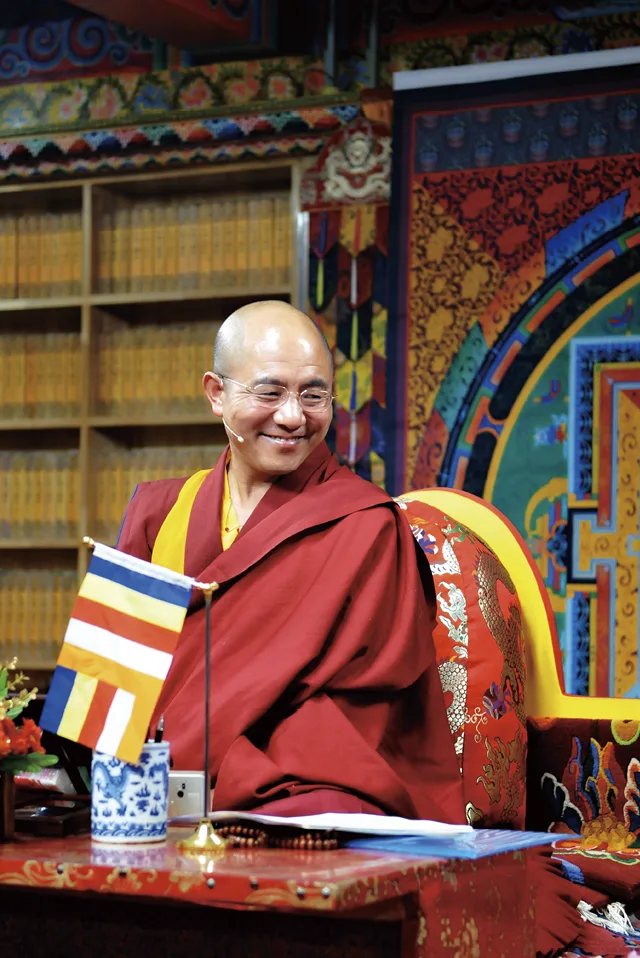
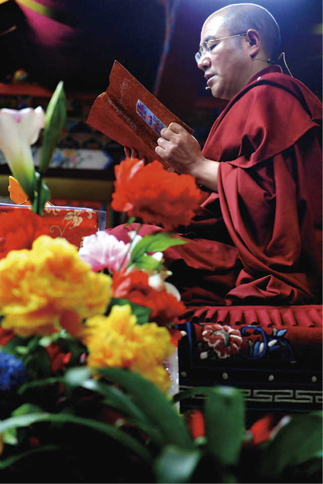

## 加行一定要修

2008年8月30日

今天与大家交流的第一个内容，是关于学完《入菩萨行论》之后的学习安排和要求，之后我为大家念诵《烟供火施仪轨》和全知麦彭仁波切著的前行实修仪轨——《开显解脱道》的传承。如果还有时间，道友们可以提一些佛教方面的问题。

## 近两年的学修安排

我们用了两年多时间圆满了寂天论师的《入菩萨行论》。可能极个别道友后面的《智慧品》和《回向品》还有部分没有学完。学了《入菩萨行论》之后，大家对佛教所宣说的生死轮回之理已经有所认识，这是我们共同努力的结果。

接下来，我们安排大家学习龙猛菩萨的《亲友书》。昨晚我在佛学院刚刚讲完这部论。等把《亲友书》的讲法光盘刻好并发给大家之后，你们就可以开始学习。《亲友书》的讲记以后也会发。这是学完《入菩萨行论》之后第一阶段的学习安排，之后还有两年以上的学习安排。

最近我写了两封信，一封是为遣除外面很多居士和内部一些金刚道友对我近期做的爱心工程和慈善事业的各种疑惑；另一封信名叫《闻思修行 切勿偏堕》，是对菩提学会为主的道友们未来两年学修的课程安排。希望大家能认真学习这封信的内容。

很希望道友们都能继续学下去，不要认为学完《入菩萨行论》之后便可告一段落了。对我个人而言，有多少人学法是无利无害的，少了多少人也没有什么，但对于你们自身而言，中断学法将是非常大的损失。学习佛法对你们的相续必定有利，这一点毫无疑问。

虽然作为传讲者，我也知道自己非常低劣，但我所传的佛法，的的确确是藏传佛教极其殊胜的教言。并且，我依止法王如意宝将近二十多年，虽然没有什么证悟境界，但对佛法的教理还是比较明白的。

这次的学修机会非常难得，希望大家千万不要退失。我也是反反复复思量之后，才给大家做了这样的安排。刚开始可能个别道友觉得不太适应，但只要坚持下来，很快就会扭转过来的。如果一点压力都没有，修行也有一定困难。

第二封信的主要内容是要求大家学完《入菩萨行论》和《亲友书》之后，学习净土法门和《大圆满前行》，也就是说，我们分了一个净土组和一个加行组。

加行组主要学习《大圆满前行》。这部法是藏传佛教极其殊胜、无与伦比的一部论典。如今世界上十多个国家的佛教徒都在一直不断修学。以前我在学院只是大概讲过，并没有实际带修，这次我想利用两年时间，与大家一起学习这部法并圆满五十万加行。

当然，身处城市的很多道友每天要上班、照顾家庭等，有各种各样的困难，但我们反反复复思维过，觉得只要认真对待，大多数人两年当中一定可以修完五十万加行。对于山上佛学院的道友，我们是要求半年或一年内修完。虽然很多道友以前修过加行，但这次还需要再修一遍，因为以前可能仅仅是数量上完成了，质量上不一定能达到要求。

二十多年前我也修过五十万加行，现在回顾起来，当时只是为了圆满数量而已，质量上并未达到要求。因此我也发心，如果没有出现什么违缘，这次跟大家一起修一遍加行。虽然我现在不论在翻译，还是学院管理方面有很多事情要做，忙碌程度可能超过你们很多人，但总觉得人身非常难得，如果此生不圆满五十万加行，实在太可惜了。希望大家能安排好自己的工作和生活，抓住这次机会，认真学习《大圆满前行》并修完加行。

希望两年之后，道友们都能保质保量地完成五十万加行。两年后我如果还在世间，准备给你们讲一些甚深的密法。当然，如果没有修完加行，就没有办法听授后面的密法课程。希望大家现在就要做好心理准备。

有些道友年龄比较大，身体也不好，可能没有能力修加行，我们建议你们报净土组。以前法王如意宝讲过，任何一个与他结缘的人，都可以往生西方极乐世界。怎样与法王结缘呢？需要念满四十万遍金刚萨埵心咒和一百万遍藏文阿弥陀佛圣号。一百万遍藏文阿弥陀佛圣号需要在两年内完成。如果念诵汉文“南无阿弥陀佛”，需要念六百万遍。

## 配合学修管理

现在离新班开学还有几个月，为了方便管理，我们需要选一些管理人员、理事人员等，还要分组、安排很多事情。到时会给大家发报名表，希望每位道友都能如实填写。

我们现在管理起来的确很困难，不管是课程安排、教学材料、各地管理等等，有很多很多事情要做，非常复杂和麻烦。我今天早上6点钟就开始和相关人员开会、安排事情，刚才晚饭也没吃好，一直忙到现在。但我并没有觉得很辛苦，为了能让大家学到法，我们愿意付出。

你们千万不要认为现在这样学法非常容易，就像从天上掉下来、从地里长出来一样简单。实际并非如此，发到你们手里的一本书，你们可能觉得无所谓，但这背后，蕴藏着许许多多发心人员有形、无形的付出。如果没有他们的付出，大家很难有这样的学法机会。我一个人势单力薄，绝对没有能力、没有办法做到。

现在，各大城市都有很多发心人员，他们从各个方面给予了我极大的帮助。学院当中也有很多藏族和汉族的道友在发心，他们每天除了吃饭、睡觉，其余时间几乎全部用在你们的学修上。

希望大家对于学院弘法部法师以及各地管理人员的要求，不管是填表还是分组，都能积极配合。他们发心非常不容易，如果不配合，说实话，我觉得有点没有良心。

此外，希望我们菩提学会的道友，最好在自己的道场认认真真学法，不要经常跑来跑去，更不要干涉别人学其他法，这样不会有很好的结果。作为菩提学会的学员，没有必要做各种各样的事情。

## 对加行班、净土班、闻思班的要求

我听说个别地方的一些道友，现在就开始磕大头，这样也是可以的，到时赶起来不是那么困难。但修的时候可能会有很多问题，对于你们的问题，我们的工作人员到时会一一答复。

不管大家以前修没修过加行，不管以前跟着哪位上师或教派学，如果以后想在我面前听受密法，这次都需要从零开始，保质保量地修满五十万加行。

大家这次修五加行，原则上要按照麦彭仁波切的《开显解脱道》来修，法王如意宝以前特别强调过这一点。有些道友以《龙钦宁提前行仪轨》的颂词来修，这样修虽然也可以，但它的汉语翻译有各种版本。我本想重新翻译，但一直没有时间。一会儿，我会给大家念一下《开显解脱道》的传承。

上一次，我提过背诵《亲友书》的要求。我要求学院年轻的道友在一两个月内就要背会。当然，对于外面的道友，背诵时间可以延长一点。到时，我们会给熟练背诵的道友发一些奖品鼓励。

这次共分三个班——加行班、净土班和闻思班。我们鼓励大家同时报加行班和净土班，一个作为主修，另一个作为兼修。如果修加行有一定困难，只学净土也可以。净土班需要一边学习，一边念诵一百万遍藏文的阿弥陀佛圣号，念汉文“南无阿弥陀佛”也可以，但数量要多一些。加行圆满的年轻道友可以报闻思班，学习五部大论。

我还会陆续宣讲《现观庄严论》和《般若摄颂》等经论。第一学期，我计划传讲《大圆满前行》、《极乐愿文大疏》和《现观庄严论》，这三部论作为三个班的课程。

希望大家不要觉得有压力，修学佛法一定要有勇气。如果一个星期当中，你用六天时间忙于家庭生活，做世间法，周日用来学习佛法，即七分之一的时间用在佛教方面，这是非常值得的。

学习佛法和发心利众需要实际付出。比如，对我而言，过段时间要同时讲三部法——《极乐愿文大疏》、《大圆满前行》和《现观庄严论》，并要与道友们一起修五十万加行，还要翻译几本书，也要处理学院建筑方面的一些事务和学院里里外外汉族四众弟子管理方面的很多事。虽然时间非常紧，身体方面也有一定压力，但我想人身非常难得，经过我们两年的共同努力，每个人一定会有所收获。

本来周日可以休息，但有翻译等很多事积压在那里等我处理，所以这一天我很少休息。山上很多出家人也是如此，七天当中没有一天做世间法。如果你们七天当中拿出一天学佛都成问题，想解脱是非常困难的。希望大家不要为自己找许许多多理由，尽量安排好学佛的时间。

前一段时间我们在网上公布了考试复习的范围，但大家觉得压力比较大，所以我们会减少一些复习题，尽量浓缩一些法义，希望每位道友都能踊跃参加考试。

几个月之后，我们会给报班学习的菩提学会道友发一个殊胜的加持品。这个加持品对你们今生来世而言意义非常大，我认为无异于几百两黄金的价值。是什么三宝加持物暂时保密，我个人认为非常殊胜，但没有信心的人，也不一定觉得特别珍贵。

这次我们开设加行班和净土班，是经过反复考虑的。对于你们每个人而言，修学加行和净土法门真正会对自己的今生来世有所帮助。希望大家至少参加其中的一个班，参加之后可以免费结缘法本。

## 共同学修的重要性

有些道友想自学或以旁听的方式学习，这样一方面也可以，因为学法是自由的，我们没有任何强迫性，但另一方面，这样学习也有弊端，很容易退失。以前很多自学《入菩萨行论》的道友，慢慢都退下去了。我现在也不敢自己在家里修加行，要发愿和大家一起修，深知互相监督之下才有完成的机会。如果没有监督，即使自己现在修行再好、正知正念再强，过段时间当激动的心情消失之后，恐怕也会把学修全部放弃。鉴于我个人多年学修的经验，建议大家这次尽量报名共修。

大家在一起共修，并不是在一起娱乐。世间有无数的娱乐聚会，比如，打麻将、歌舞酒会、赌博等，这会引发内心的贪嗔痴，对自他身心没有任何利益，而我们聚在一起学习、交流释迦牟尼佛所传下来的佛法，这对每一个人的今生来世都非常有利。

希望大家尽量不要选择自学，因为凡夫人的心极不稳定，很容易受外境影响。有了道友们的监督，从世间角度讲，自己也不好意思退下去。

## 如理如法地磕大头

我在二十多年当中一直讲经说法，很多道友也听过很多法。可是，不管我们学过多少法、背了多少教证，如果没有实修，临终时恐怕也很难把握自己。我以前背过很多论典，现在背一些汉传或藏传佛教的教证没有很大问题，但我反反复复思维过，如果临终前自己连加行都没修过、十万遍礼拜都未完成，的确非常惭愧，到时对自己真的没有一点把握。

这次我们先从磕头开始。磕的时候可以观想莲花生大士的单身像，如果对密宗信心非常大、对空乐无别没有邪见，也可以观想莲花生大士的双运像。磕头之前要先皈依和发菩提心，之后，一边磕一边念诵皈依偈或七支供，也可以念诵七句祈祷文或法王如意宝的祈祷文，即结合上师瑜伽所讲的道理来观想。

首先，在头顶、喉间、心间三处分别合掌。合掌的时候，不要把两掌完全并拢，中间应留一点空隙，状如含苞待放的莲花。于三处合掌的同时，心里观想获得了法身、报身、化身三身的果位，然后五体投地进行顶礼。所谓五体投地，是指前额、两手掌和两膝盖完全接触地面。五体着地而礼拜有清净五毒烦恼的障碍、获得身、语、意、功德、事业五种加持等必要。

此时一定要具足观想，要观想一切诸佛菩萨和上师的本体——莲花生大士，就安住在自己的前方，自己的身体幻化成无量无边的身体，与父母为主的三界一切轮回众生在诸佛菩萨的总集——莲花生大士面前磕头顶礼。如果对莲师生不起很大信心，可以观想自己的根本上师或释迦牟尼佛。就这样一边观想，一边在圣尊面前磕满十万个大头。

要知道，磕一个头的功德也不可思议。《大圆满前行》中说：“从前，一位比丘顶礼有佛陀头发、指甲的佛塔，阿难尊者请问释尊他顶礼的功德，世尊答言：‘他这样顶礼一次，将获得自己身下所压面积直至金刚大地以上所有微尘数量的转轮王位，然而这还不能达到其顶礼功德的边际。’”

观的时候一定要观想清楚，如果实在观不清，内心应想：在释迦牟尼佛、莲花生大士、根本上师等一切圣者面前，我要恭恭敬敬以身口意三门来顶礼。

有关磕头的具体细节，以后会给大家发示范视频。你们现在可以看一下《大圆满前行引导文》中有关磕头皈依境的内容。磕大头是最好的，如果身体实在不能磕大头，磕小头也可以。

佛学院的修行安排是：今年十月初，学院四众弟子开始磕大头，每天要磕一千个以上，这样三到四个月的时间就可以完成十万遍，也即来年二月之前，就会把大礼拜全部修完。我想你们城市里的人可能没有这么多时间，希望你们每天能磕一百五十个，这样两年之内就可以完成。

## 圆满发心、回向

现在，我们已经圆满了《入菩萨行论》的学习，发心道友整理出了12册讲记。讲记的用量非常大，在此过程中，很多居士都发了菩提心，他们有力的出力，有钱的出钱，通过多方努力，最终才能把法本结缘给大家。我曾去过他们的印书厂，很多道友的确非常辛苦。圣者的事业是任运而成的，不需要勤作，但我们都是凡夫人，凡夫人通过勤作才能完成很多事，过程非常不易。由于他们的发心，我的肩上减轻了很大负担，否则，这么多人力，这么多法本，我这边如果培训人员、买机器设备等等做各种各样的事，确实比较困难。

这些居士发心非常圆满，我也承诺将他们所做的善根共同回向菩提。希望今天在座的道友，等会儿念《普贤行愿品》的时候，也能特别回向给这些发心道友，我们共同享用善根，同时将自他所作的一切善根，回向给所有的众生。

## 念诵《烟供仪轨》和《开显解脱道》传承

现在，很多地方都在念诵《烟供仪轨》，今天我用藏文为大家念一遍《烟供仪轨》和《开显解脱道》的传承。

今天我们这里下雪了。你们可能不太相信，觉得现在已经八月份了，怎么还会下雪啊？今天早上我院子里的雪好大哦，我早上起来吓了一跳。现在藏历是六月份，公历是八月份，你们汉地可能热得不得了，而我们这里还冷得不得了。这个时候下大雪是比较罕见的。

（堪布念诵烟供传承）

《烟供仪轨》在《喇荣课诵集》中有。做烟供的功德非常大，如果晚上做恶梦，或者感觉有怨家债主或人非人等（东北那边经常说狐仙等）对你制造违缘，感到身心不安，可以念一些烟供，这样自然而然就会遣除一切违缘。

（堪布念诵《开显解脱道》传承）

现场互动

今天我们九点下课，现在还有十几分钟，个别道友可以提问。课后我这边还有很多事，有些道友也要坐车或走路回家，花费很多时间和精力，也很不容易。

提问的时候，希望大家直接讲问题，前后不要有很多赞叹词、皈依词、祝贺词等。我想看看谁的口才最好，谁提的问题最尖锐。

⊙ 问：我正在修五加行，请问，修皈依的时候应该怎样如理观想？

堪布：以后我们会把观想图片提供给大家，暂时先按照《大圆满前行引导文》当中的皈依境画面来观想。

⊙ 问：大圆满法和《大圆满前行》一样吗？

堪布：大圆满有前行和正行，《大圆满前行》属于大圆满的前行部分。

⊙ 问：您的教言令我对上师三宝和法王如意宝生起了无比的信心，我已经把您和法王如意宝视为自己的怙主。我想把法王如意宝的教言用诗歌形式唱出来做成CD，还想把法王的法相做成相册流通给有缘的众生，请问这样做可以吗？

堪布：如果以清净的发心来弘扬法王如意宝的法宝，让很多人得到法王的法相，当然很好。但如果有发财或其他目的，则不太好。

⊙ 问：我一想起大恩上师就泪流满面，也特别思念法王。希望自己能遣除一切违缘，将前行修圆满，并让这部法与更多众生结上善缘。请求上师加持！

堪布：好的好的。在座每个人都与法王如意宝有着不共的因缘。虽然我们应对每位开示解脱道的上师都观清净心，但这次修加行，我建议大家尽量祈祷法王如意宝，因为法王如意宝具有不共的加持，我自身感觉非常殊胜。多祈祷、常观想法王如意宝，一定会遣除违缘，具足顺缘。

⊙ 问：我做火施的时候，用电脑播放火施仪轨，但电脑离火施的地方比较远，这样是否可以？

堪布：可以。藏地做火施一般是把食品烧出烟，使之慢慢烧尽，不让出现很大的火焰，否则功德不是很大。你可以用小电炉或其他方法，在比较安全的地方烧。

⊙ 问：我没有接过“普贤云供仪轨”的传承，请问法会时我可以念诵吗？

堪布：可以，普贤云供是显宗法，没有传承也可以看、可以念。

## 结语

今天我们就交流到这里。在座的很多佛友通过互相鼓励，已经圆满了《入菩萨行论》的学习，这是一件非常值得欢喜的大事！对于任何一个与此法结上善缘的人，我们都应该随喜，并将所有的善根回向菩提。
