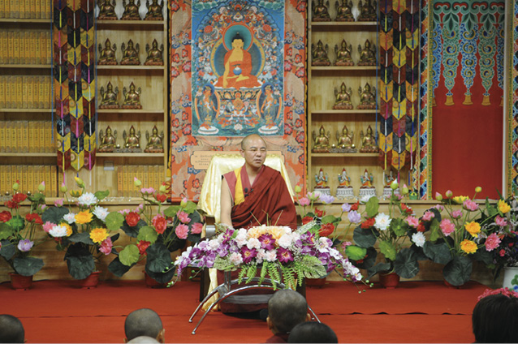
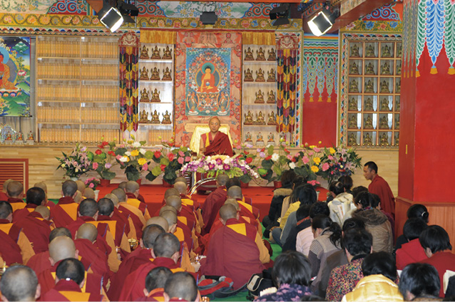

## 发普贤大愿精进行善

2008年8月2日

很高兴再次与大家相聚在菩提讲堂。先简单说一下这次交流的内容：首先，给大家念诵《佛赞》和《文殊菩萨赞颂文》的传承；之后，讲解一下“普贤云供法会”的要求以及释迦牟尼佛转法轮日有关放生的问题；接下来，就当前大家学佛存在的问题，做一个简单的交流。

## 念诵《佛赞》和《文殊菩萨赞颂文》的传承

首先，我为大家念诵《佛赞》的传承，同时念一下地藏菩萨名号，以及其他一些加持较大的诸佛菩萨名号。

（堪布念传承）

## “普贤云供法会”事宜

学院一年一度的“普贤云供法会”昨天开始举行，历时八天时间。在座很多道友可能不能亲自参加，但如果你们这几天与僧众共同念诵《普贤行愿品》来发愿回向，功德也非常大。

“普贤云供法会”是法王如意宝在世时规定的学院每年常规举行的四大法会之一。法会期间，大家需要念诵地藏菩萨名号，同时也要念诵《普贤行愿品》。

由于现今各方面因缘尚未成熟，网上的道友亲自来学院参加法会比较困难，但我希望上等精进者在这八天当中，从早晨7点到晚上7点，尽量跟随僧众一起念诵地藏王菩萨名号和《普贤行愿品》；如果没有这么多时间，每天最好念四遍《普贤行愿品》；如果还做不到，那每天至少也要念一遍《普贤行愿品》，以此回向给一切众生。

在座大部分人都已皈依并闻思了佛法。作为一名修行人，应该了知念诵《普贤行愿品》的功德——可使今生幸福快乐，来世往生清净刹土。实际上，念诵《普贤行愿品》具有无量无边的功德，即使佛陀以金刚舌来说，也无法说尽。希望大家在法会期间都能尽心尽力地念诵。

## “佛转法轮日放生”事宜

藏历的六月叫做“转法轮月”，释迦牟尼佛在2500多年前的六月初四这一天，为众生宣讲了四谛法门。自此，消除黑暗的智慧明灯便在世间点亮。在这个月中行持任何善法，功德将会增上1000万倍。希望大家在这个月当中能更加精进地行持善法。

在藏地，有些人虽然不能长期吃素，但发愿在该月中吃素；有些人虽然无法长期不杀生，但发愿在该月中不杀生……希望在座的道友也能在心里默默发愿，或者在上师三宝面前发愿，在转法轮月中多多行持善法，比如，经常守持八关斋戒、放生、念咒语、听课等等。

尤其后天——公历8月5日，按照藏历来算，是释迦牟尼佛真正的转法轮日（藏历六月初四），在这一日行持善法的功德非常大。如果方便，希望大家能聚在一起共诵诸佛菩萨名号、放生，或者行持其他善法。

很多道友想在藏历六月初四这一天为我庆祝生日。我不想要什么其他礼物，只希望当天大家能在各自的地方，根据自己的情况多放一些生，比如飞禽、鱼类等。我在遥远的雪域高原向你们合掌祈求，希望大家在这一天能把那些在屠夫刀下即将遭杀的可怜众生解救出来，让很多飞禽飞出牢笼，回归到蓝天白云的怀抱当中。我今天默默地祈祷，愿在此吉祥日当中，很多众生都能免于杀戮、获得自由。可能很多道友没有很多财力，但只要能放一条鱼、一只鸟，或者其它一只小小的旁生，对我来说也是极大的恩德。

大家可以把六月初四前后放生的数字，通过网络传给我们。所有僧众将一起念诵《普贤行愿品》为大家回向，这样每个人的善根就如河流融入大海一般，乃至菩提果之间也不会灭尽，如此发愿的力量极其广大。

为什么提倡大家放生呢？扪心自问，在这个世界上，我们最珍惜的是什么呢？是自己的生命，一旦自己的生命遭到威胁或受到损害，甚至愿将所有的财产乃至身体的一部分付出。能活在世间，是每个人最大的愿求，实际上，其它动物也是如此，乃至蚂蚁以上的旁生，同样对自己的生命如是爱执、珍惜，遭杀时也如是痛苦。

现在，我们经常说建立和谐社会，但社会要想真正和谐，光是人与人之间的和谐远远不够，因为人生活在大自然的怀抱当中，而大自然还包括了很多动物和植物。如果人类保护了大自然的所有动植物，自身也就自然获得了和谐。希望各位道友能发愿保护世间所有的生命，在放生、戒杀方面一定要努力，就像以前印光大师那样。

此外，也希望大家以后尽量吃素。如果实在做不到，在每月功德较大的日子，比如初一、初十、十五、三十等，尽量不杀生、不吃肉，行持这些善法对每一个人来说，的的确确非常重要！

## 善用人身，学习佛法

第二件事，希望在座的有缘道友能认真思维一下人身难得的道理。佛陀为众生宣讲了八万四千法门，如果懂得了佛法的一些基本教义，对宇宙人生有了一定认识，就会明白，获得暇满人身是极其困难的。既然我们现在已经获得了如此可贵而稀有的人身，理当珍惜并善用它，就像应把获得的如意宝用在最有用之处一样。如果浪费了它，是非常可惜的。

如何善用人身呢？人生最有意义的事应该是学习佛法。这段时间我尽心尽力地通过不同途径为大家传讲了一些佛法。当然，每个人的因缘不同，有些人感觉得到了一点点利益，而有些人觉得没什么。但不管怎么样，我个人在有生之年都会以佛法来饶益众生，这也是我一生当中最大的责任。自己以前在很多上师和诸佛菩萨面前发过很多誓愿。

如果能认真闻思修佛法，每个人都会在佛法大海的智慧中得到遣除今生来世贫穷的如意宝。真正拥有如意宝之后，你就会被佛法的光芒恒常照耀。

## 祈祷三宝 坚定誓愿

在学习佛法的过程中，极个别道友因为受环境或恶友的影响，出现了退转的现象，这是非常可惜的。此时祈祷上师三宝必不可少，如果没有上师三宝、护法神的怙佑，修行将很难成功。因为凡夫人的心念极易改变，今天这样想，明天那样想，尤其受现在复杂社会的影响，贪嗔之心如同汹涌的波涛一般猛烈。在这样的时代当中，凡夫人想依靠自力坚持学习佛法是非常困难的，所以，必须时时祈祷上师三宝加持自己。

此外，发愿也非常重要。我听说有些佛友发了坚定的誓愿：无论自己的身体或心理遇到任何磨难、痛苦，也永远不舍弃佛法。这样发愿非常有必要。希望在座的善男信女也能发这样的誓言：自己宁可舍弃身体、生命，也永远不舍弃佛法如意宝，就如《大宝积经》所说：“宁舍身命，不谤正法。”如果没有舍弃佛法，坚持到一定时候，就会知道这是最好的选择；如果退失了信心，就真的没有办法，已经无药可救了。

## 如何面对违缘

前段时间学习《入菩萨行论·智慧品》的时候，个别道友觉得特别难，学不下去，接近于退失，我们通过各种方法帮他们度过了难关。《智慧品》主要讲空性，刚听的时候的确不好懂，我以前学的时候也是请教了很多上师和道友，反反复复听了好多遍才基本明白。因为自己深有体会，所以很能理解大家的感受。如果你们第一次听不懂，就听第二遍；如果还不懂，就再三再四地听，这样之后，空性的意义很容易在相续中生起。

此外，在学法过程中，如果遇到了生活、工作的不顺或者身体生病等违缘，应该想这是诸佛菩萨和般若空性法的加持，帮自己遣除修行中的违缘。一般来讲，对于精进者和智慧中等者，魔王般旬随时会发射贪、嗔、痴、懈怠、傲慢的毒箭。一旦中上毒箭，修行很容易功亏一篑，难以恢复，这是非常可惜的。这时不但需要勇气和力量，也要学会把所有的痛苦转为道用，以使自己更加精进，这样所有的魔扰就会渐渐消失。

## 长期闻法才能改变相续

有些人学完《入行论》之后，并没有立竿见影的效果，这其实也正常，因为学佛是一个长期的过程，并不是听完一部法就圆满了。我个人在法王面前听法已经19年了。在我的记忆中，自己只有一两次因为生重病没去上课，除此之外，不管法王传任何法，自己从未间断过，一直辛辛苦苦地希求佛法。

当然，我并非自诩为你们的榜样，但的确觉得长期听法非常重要。作为一个业力深重的凡夫人，没有烦恼和痛苦是不可能的，而只有依靠佛法才能断除烦恼。我们既然已经遇到了如此难得的佛法，如果轻言放弃，那以后生生世世不一定再会遇到；即使遇到了，由于开头的缘起已被破坏，也很难得到解脱的光明。

## 得法不易，当自珍惜

这几年，我们通过网络、光盘为大家传讲佛法，这是一种非常好的方便法。以前的高僧大德需要越过千山万水、历经难以想象的苦行才能求得的法，现在已经送到了你们的家门口或办公室里。你们只需打开电视或电脑，佛教所有殊胜的内容就会全部呈现在面前。这么好的机会如果没有抓住、运用，是非常可惜的。

大家不要觉得我们这样传法很容易、很简单，其实在这个过程中，我们需要面对很多很多的困难。我和发心道友们这几年的确有一定的压力，学院内部每天有很多事务要处理，我们的身体也经常跟不上，很多发心人员自己还要闻思修行……然而，一想到这样能令外面的很多道友学到佛法，获得佛法的利益，我们就非常开心，也觉得非常值得。因此，无论遇到再大的困难，即使身体再累再辛苦，乃至粉身碎骨，我们也愿意勇敢地面对，全力地付出，一直坚持下去。

希望大家能了解一下以前的高僧大德在求法时发了怎样的心，经历了怎样的苦行，再对比一下现在自己听法是多么简单容易。比较之后，就会明白现在的闻法机缘是多么难得，这样自己的心就不容易退转。

## 闻法的利益

听说很多道友周一至周五要忙于工作、家庭生活等，但利用周六或周日的时间把一周的课程全部听完，还有些人一下午能听三四堂课，我听到后确实很高兴。很多人没学《入行论》的时候，对佛理一无所知，提的问题和行为非常可笑，现在虽然不敢说有了很高境界，但对于佛教已经有所认识和了解，对于一些根本的问题已经懂得，这也是通过努力听闻佛法得到的。

虽然我是一个烦恼深重的凡夫，但我口中宣说的佛法像纯金一样圆满而具有加持力，永远不会欺惑你们。希望大家一定要尽心尽力地听闻佛法，这对你们一定会有利益。

在听授佛法的过程中，虽然大家在人力、财力、时间等很多方面需要付出，但这样的付出是非常值得的。因为我们的目的不是为了短暂的今生，而是为了自己的生生世世，也是为利益一切众生。从广大心愿的角度而言，是非常值得的。当然，内心尚未达到这种境界的时候，可能会有一些奇怪的想法，但通过学法就会逐渐将其遣除。希望大家在此过程中千万不要退失信心。

## 考试事宜

《入行论·智慧品》学完之后，大家开始学习《入行论·回向品》，之后就准备考试。我们已经公布了200多道考试题，可能比前面多一点，希望每位道友都能认真复习。

今年我给参加考试的人准备了法王如意宝的念佛机，以及其他一些奖品。这个念佛机非常具有加持力。当然，大家也不要为了奖品而考试，但希求加持品也是一种态度，希望大家能做好考试的准备。

过段时间，我们会给你们提供《亲友书》的视频和颂词，现在我已经讲了一半。到时希望大家能把《亲友书》的颂词背下来，因为这部论是龙猛菩萨为乐行国王宣讲的，乐行国王也是一位在家居士，相信你们学完之后一定会改变自己的思维和命运。

《入行论》有一千多个颂词，全部背下来比较困难，所以很多道友发愿背诵前六品，但《亲友书》只有124个颂词，背下来应该很容易。其实，我对你们的要求并不是很高，学院很多道友都能同时背三四部论典。当然，你们有很多事情要做，可能没有这个时间，但可不可以把《亲友书》背下来，三个月之后给我做法供养呢？我想即使再忙，以你们的智慧，每天背一个颂词应该还是可以的。我们的很多时间都在不经意间流失了，如果用在背颂词上是非常值得的。

现场互动

接下来，佛友们有什么问题，我们可以交流（堪布的声音有点哑了）。最近，学院正在修建大经堂，很多事情要处理；智悲学校也在建设中，需要接收很多学生；学院管理方面也有一些事务，每天我还要翻译、讲经，感觉自己每天的时间特别紧。今天本想提前准备一下，但一直没有抽出时间，临开示前才急急忙忙跑过来。

希望每位道友都能对佛法、对众生多做一些事，多发一些善愿。对众生有利，佛法才会兴盛。作为大乘修行人，千万不要活得太自私，天天只想自己并不合理。大家应在力所能及的范围内，尽心尽力地学习佛法、利益众生。法王如意宝一生留给我们的教言，归纳起来就是利益众生和弘扬佛法这两点，这是大乘修行人最根本的问题，其他吃喝玩乐和生活上的问题只是暂时的小事。希望大家能把弘扬佛法和利益众生这两点牢记在心。

⊙ 问：我刚刚学佛，前段时间想退了，有位师兄发给我一个陀罗尼咒，好像咱们念诵集里有。上面说持颂此陀罗尼咒，观想本师心中放射种种智慧大光芒，可以遣除我等一切众生的罪障，如理生起大乘功德，获得不退转果位。请问，我可以念诵吗？

堪布：你说的这个咒语，应该是释迦牟尼佛心咒“达雅塔 嗡牟尼牟尼玛哈牟尼耶索哈”。此咒可以遣除一切魔障，使从大乘道不退转。今天我也呼吁大家不要退转，但有时魔的力量非常大，只是心里想不退转不一定能成功。因此，平时一定要多多念诵这个心咒，这样可以坚定自己的信心，使之不退转。

很多道友在学法过程中有很多疑惑，尤其刚学佛的时候，各种问题经常会在脑中浮现，但学到一定时候，很多问题就没有了。平时大家提问题非常有必要，萨迦班智达在《格言宝藏论》中说：“倘若自己无理智，应当询问余智者。”

⊙ 问：您在《入行论·智慧品》第177课中讲，在空性见解的基础上行持善法才能解脱，不以空性见摄持行持善法，暂时只能获得人天福报，要解脱非常困难。这与您在供灯之功德和绕塔之功德中讲的行持善法得解脱是否相违呢？不接受空性见的人，是否就无法解脱了呢？

堪布：这个问题并不相违。《中观宝鬘论》中云：“先增上生法，后得决定胜，因获增上生，渐至决定胜。增上生许乐，定胜许解脱。”也就是说，如果未以空性见摄持而行持善法，只是解脱的间接因。因为只有证悟无我空性之后，才能真正获得解脱。《三主要道论》中讲：“不具证悟实相慧，纵修出离菩提心，亦不能断三有根，故当勤证缘起法。”

严格来讲，要想真正利益众生，必须先证悟空性，因为若未证悟空性，就无法推翻自私自利的心；如果我执不能推翻，就已经成了相似的利益众生。

当然，这是从严格意义上讲的。关于这个问题，你们可以看一下《释迦牟尼佛广传》，尤其《现观庄严论》修行道次论的最后两堂课，看完之后应该就会明白。

⊙ 问：是否可以这样理解，在不具备空性见解的基础上行持善法、积累资粮，将成为开启智慧之因？

堪布：对对对。

⊙ 问：《入行论·智慧品》中讲：有人通过证悟空性智慧引发了大悲心，这一点比较好理解，但反之，通过大悲心如何了悟空性智慧呢？这是不是福报积累的问题？请您开示空性智慧和悲心之间的关系。

堪布：有两种情况：一种人先具有空性智慧，然后以此生起大悲心利益众生；还有一种人先对众生生起极为强烈的大悲心，通过积累资粮之后，慢慢证悟了空性。
