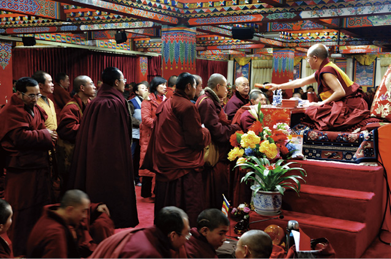

# 新学期的课程安排

2009年4月12日

最近一个月，我因为外出看病及处理一些事情，没有与大家交流。今天我们再次相聚在菩提讲堂，这样的机缘应该值得珍惜。

## 过最有意义的周末

今天是礼拜天，按照基督教的说法，是上帝赐予的休息日。很多佛教徒也在这一天放松休息，但也有很多佛友利用这一天认真学习佛法。

学习《入菩萨行论》的这两年，很多居士都将平时休闲娱乐的时间用于学习佛法。对他们来说，空出周末学佛非常不容易，因为平时要忙于工作和家庭的各种事务，只有周日才能稍微放松一下，将这样的休息日舍弃用来一心学佛，是非常值得随喜的。

作为山里的修行人，虽然我们抛弃了家庭、工作等世间八法，但身为欲界凡夫，在星期天也愿意放松。不过，对我来说，这一天却是最忙、最累的，因为平时忙于讲课、翻译，很多管理的事情只能堆在星期天处理，所以周日反而成了最累的一天。

大家利用周六、周日学习佛法，这种生活方式与之前的散乱截然不同，非常具有意义。如果不挤出这两天学习，人生几十年匆匆而逝，终将一无所获。

学习佛法是我们共同的心愿。依靠诸佛菩萨的加持，多年来我们并没有退失信心。很多佛友都有这种感觉：以前没学佛时，根本不知道善恶取舍，自从学佛之后，对很多问题都有了新的认识，内心获得了很大利益。可见，利用周末学习佛法是非常值得的。

## 善用科技，提升自己

我们虽然彼此之间远隔千山万水，但却能相聚于此，进行现场沟通，从佛法角度讲，这是不可思议的殊胜缘起；从世间角度讲，是依靠现代科学技术。对于修行人来说，这样学佛的确非常方便，否则，我亲自到你们所在的城市与大家见面、讲法是非常困难的；你们来佛学院和出家人一起学法，也有一定的困难。

我们经常在虚空中相聚，对于信心不稳固的人，可以使之稳固；对于信心较稳固的人，可以使之增上。因此，我非常欢喜与大家这样沟通，这也是佛陀不可思议的加持。

现在，全世界各个宗教人士，包括世间的学校、企业、各种组织等，都采用这种方式研讨和学习。我们佛教徒也应该利用高科技来充实、完善、改变自己，这非常有必要。

## 及时学佛，岁月不待

人生非常短暂，很多人都想等自己退休之后再学佛，但这恐怕为时已晚，因为那时你的精力、体力、心力是否具足，都很难说。

学习佛法千万不要拖到明年、后年，甚至几年、几十年之后，这样很不合理，应该当机立断，马上付诸行动。否则，自己的心态、善愿很容易随着社会复杂的环境而改变。现如今，外界各种恶法的诱惑力相当强，虽然你道心的光芒最初很灿烂，但经过一段时间染污之后，可能就会变得暗谈无光，最终消失无踪。因此，在学习佛法方面，千万不要拖延；如果拖延，理想虽然美好，但结果未必成功，这是我多年学佛过程中总结的些许经验。只要是学习佛法、弘扬佛法，我一天都不愿拖。

## 考试总结

经过一段较长时间的学习，我们共同圆满了《入菩萨行论》《亲友书》等经论，之后，大家都参加了相应的考试。学习结果有目共睹，很多人通过较为正规、系统、完整的学习，已经从对佛教一无所知，变成了有所了知；从以前的迷信，变成了现在的智信。更重要的是，无论从命运、性格，还是修行方面，都已有所改变。

我们为这次考试准备了大量奖品，并且，从批卷到发奖的各个环节，都非常认真地对待。很多道友凭借自己付出的努力，已经获得了相应的奖品。虽然有些道友没有得到一、二、三等奖，但凡是参加考试的，我们都会颁发纪念奖，奖品不久后就会到位。

有些道友平时从未间断过学习，非常精进，但考试时由于思维方式或其他原因致使成绩不太理想。希望你们不要伤心气馁，要再接再厉。考试只是暂时性的一个总结，分数并不能完全代表你的水平。

通过这次考试我们也能看出，大多数道友，大概有90%吧，都在认真学法，这是非常值得随喜的。

## 珍惜闻思的机缘

对我而言，以这种方式跟大家一起学习并不容易，因为一个人的力量是有限的，需要各方面力量的支持与付出，但只要对你们的相续有利益，我都会在承受范围之内，尽量为大家提供方便，希望你们能珍惜这样的因缘。

大家在学法过程中需要注意三点：

一、应该珍惜学法的时间。一年一年过得非常快，有些道友因为平时未重视学习时间，导致没有跟上课程进度；还有个别道友领完法本之后便消失了，直到考试时才又出现。这种态度不是很好，也许你考前突击一下，使得成绩还可以，也得到了奖品，但这并不能说明自己真实的水平。平时若没有参加共修，学到的肯定很有限，学佛千万不要只是报个名。实际上，考虑到大多数人的情况，这次我们出的考题比较简单，所以，不能完全以成绩来衡量自己。希望道友们以后尽量避免这种情况。

二、要珍惜法本和光碟。个别道友拿到法本和光碟之后便放置一边，从来也不看，这样浪费三宝财产，非常不合理。为了大家学法方便，我们免费为每个人或每个组发了一套学习资料，其间需要付出很大的努力，过程相当不容易。希望每位道友都能珍惜法本等三宝财物。

三、大家在一起共修的机缘非常难得，一定要珍惜。在佛学院，无论道友们学习成绩好坏，我都要求他们到现场共修，不能待在家里。你们在城市里参加共修，可能需要乘车到共修地点，结束之后又要乘车回去，刚开始可能觉得花费时间，有点麻烦，但实际上，共修与自学相比，在学习能力和力量上有很大差别。共修是最好的学习方式，这是我们多年总结的学习经验。

## 学修安排

今年五月之前，《亲友书》就会基本学完，之后，我们安排大家学习《大圆满前行》《极乐愿文大疏》《现观庄严论》《般若摄颂》等经论。

学习《大圆满前行》的小组，就以学前行为主。如果当地有10人以上学习净土法门，可以单独成立“净土组”；如果人数不够，可以和“前行组”一起学习，以主修《大圆满前行》，兼修《极乐愿文大疏》的方式学习。

今年的学修安排与去年不同。去年，一本书大约用两三个月就能学完。今年，我们要求大家每周不但要闻思，还要实际修行。因为完全依靠理论是不行的，一定要打好前行和净土的修行基础。所以，今年要用四五个月才能学完一本教材。

为了使每位道友都能学修圆满，我们制定了一个学修表格，以记录大家的实修情况。之前有些组长和管理人员反映不好管理，所以，这次我们做了较充分的准备。大家要明白，你们学习佛法并不是为了我，也不是为了辅导员或组长，而是为了你们自己能够断除烦恼、出离轮回，也是为了能够利益众生。

第二阶段的学修非常重要，需要两到三年时间。在此期间，如果能认真对待，对于佛教修行的次第，应该可以完全了解。第一阶段学的《入行论》，讲的基本都是一些理论，不敢说非常全面。

## 几点管理建议

1．任人唯贤

从今年开始，我们希望各地选负责人时，应尽量选一些有利他心、有智慧、有办事能力的人来担当。现在有很多知识分子学佛，他们在智慧、判断能力、解决问题等各方面的素养都不错。可能有些老菩萨在学会发心时间较长，不愿放手，想一直干下去，这种精神虽然可嘉，但有时在很多管理方面存在一定困难。希望这些老菩萨能放一部分权给更合适的人选。

为了增强学佛团体的力量。希望各地选拔管理人员时，能真正为三宝发心，使那些有智慧、有能力、有才华的人逐渐成为管理骨干。不要像一些地方官僚那样，任人唯亲，或者以钱势来衡量。

此外，管理也要细化。今后大家学的内容比较多，分科较细，有些人学加行，有些人学净土法，还有些人闻思五部大论。一个人管理全部学员肯定有困难，最好分工合作，比如三个负责人，我管净土，你管加行，他管闻思，分工明确比较好。

2．稳重学佛

现代人最大的毛病之一就是不稳重。学佛之人如果不稳重，修行将无从谈起。有些人刚开始信心如火一般猛烈，对法的意乐非常强，我都觉得有点稀有，但不久之后，热情就慢慢变淡，逐渐冷却下来，最后甚至退出了学佛团体，这样非常可惜。希望大家千万不要退。

个别人不接组长或辅导员的电话，或者换了电话也不告知一声，自此消失无踪。这种行为很不好，又不是因贪污或欠赌债而不敢露面。学习大乘佛法的人，这样行事并不合理。希望大家学习佛法一定要稳定。

我是1985年来喇荣山沟学习佛法，如今已过了二十多个春秋。虽然不敢说自己学得很好，但学法的意乐从开始到现在一直没有改变，始终一心一意。有些道友还没学到两三年，就想换个口味、换种方式，这样不是很好。如果变来变去、出尔反尔，不要说学佛，即使学世间知识，也一事无成。学习佛法一定要深入进去，浅尝辄止是很难调伏自相续的，何时自己能稳定地学佛了，说明内心已经有了一定的境界。

3．不要随意换专业

希望每位道友在报组之前能认真考虑，报了之后，中间就不能改了。因为这么多人如果都换来换去，我们就得不停地调整，这不但会给管理人员建档带来混乱，而且还导致了法本等三宝财物的浪费、流失。因此，在管理方面，我们不能随顺大家的心情，这有一定困难。一年之后，如果有特殊情况，可以做调整。学院管理也是如此，每个班的法师和学员确定下来之后，在一学年当中都不能更换。

大家学习佛法的时候，应该想到发心人员背后的付出。我们要考虑方方面面的很多事情，并不是那么简单。希望每个人都能按照学会的统一要求来做。

4．配合管理

希望大家都能尽量参加共修，没有共修力量的加持，一个人是很难坚持下去的。有些道友把学佛放在次要位置，共修时想去就去，不想去就不去。其实，我们一周只集中一次，听一堂课，如果连这个时间和精力都没有，那学佛就完全成了空谈。

在网上学习的道友，应遵守网上的管理规定；在现场学习的道友，要遵守当地小组的管理规定。如果不愿遵守，那最后只能退出。我们希求的是学员的质量，而不仅仅是数量。

刚开始传讲《入菩萨行论》的时候，我觉得外面有20个人学习，就已经满足了。现在已经远远超过了20人，这么多人要想正常学习，一定要有相应的管理。如果没有系统的管理，将会造成很多不必要的浪费。比如，某地有20人报名学习，我们就会相应发20本法本，后来若有10人退出，就会多出10本法本。如果这期间没有好好管理，很多法本都浪费了。虽然我们并不看重金钱，但这些三宝物并非无缘无故来的。

希望学会的道友对待这些问题千万不要草率。个别人可能没有很强的因果观念，觉得无所谓，但实际绝非如此，如果随随便便处理、浪费三宝财物，来世会有可怕的果报。

有些道友报名之后又退了，这是很可惜的。世界上有很多精彩的学问，佛法表面看来平平淡淡，未必能满足有些人的趣味。所以，大家首先应考虑好是否要学，如果想学的话，就认真对待，该闻思的闻思，该实修的实修。我们佛学院要求道友们每天都要闭关一段时间，每年需要背诵几部论典，还要笔考、讲考、背考。这种压力对于城市里的人来讲，肯定无法承受，所以，我对你们的要求不算高。

希望大家都能坚持学下去。要知道，学习佛法是为了众生、为了你们自己的今生来世。学习世间法尚需付出很多努力，更何况是出世间的佛法？如果学习佛法连学习世间法所应具备的态度都没有，从中能得到什么样的加持和智慧是可想而知的。

学习佛法的时候，一定要经常反观自心，尽量改正自己不好的习气，配合学会管理，不要为难组长和其他管理人员。如果不考虑发心人员的付出，随性而为，学会确实很难管理。

此外，学法要有一种主动性，如果发心人员天天求着你学，到了一定时候，肯定会生起厌烦心的。平时，学院里的发心道友从早一直忙到晚，根本没有时间休息。今天是星期天，本来他们可以休息，但为了你们的闻思，今天也休不了。

我这样说，并不想向你们诉苦，只是希望外面的道友能珍惜这样的法缘，认真对待，不要互相欺骗。我们发现个别小组在考试、领法本方面完全在应付我们，就像有些地方政府跟民众之间互相欺骗一样。上师和僧众是严厉的对境，没有必要这样欺骗。不学也是可以的，我们不会要求任何赔偿，但要学的话，就要按照我们要求的方式来学习。

## 修共同加行的重要性

过一段时间，我们开始修五十万加行。上半年大家应好好修共同加行，并结合《上师瑜伽速赐加持仪轨》来顶礼，磕大头、小头都可以。现在就可以开始磕，不然完成十万顶礼会有一些困难。

现阶段，大家最主要的是修共同加行——人身难得、寿命无常、因果不虚、轮回过患。如果没有打好这一基础，即使口头上说得再高，实际也做不到，如同空中楼阁一般。最近，学院很多道友通过每天闭关修人身难得，已经真正懂得了人身的意义和价值，这让我非常高兴。希望外面的道友先不要说大话，也能从人身难得的四加行修起，使自相续真正对此生起定解。这可以为自己的修行打下良好的基础。这一基础非常重要。

如果身体实在不好，没办法磕大头、供曼扎，那就按照以前法王如意宝的要求，用1000万遍金刚萨埵心咒来代替修50万加行。即每一个加行用200万遍金刚萨埵心咒代替。不能用其他咒语、心咒代替，只能用金刚萨埵心咒代替。

对于山上的修行人来说，念200万遍金刚萨埵心咒非常简单，但城市里的有些人可能对这个数字感到非常震惊，其实念起来也没有那么困难。

## 珍惜时间，精进修行

最近，我晚上讲完课之后，都会和大家一起磕小头。15分钟磕120个头没有任何问题。15分钟如果没有用于善法，转眼就过去了，来不及做任何事，但如果善加利用，120个头都能完成。学院好几百人都感觉这样每天坚持磕头非常容易。

城市里的人虽然在很多方面压力较大，但我希望你们在行持善法方面，一定要给自己空出时间。如果一直随着外面的世界转，不要说用短暂的几年，即使用几十年来修五十万加行，也难以完成。其实，所谓的忙只是没有重视，没有认真对待，如果真的想修，时间肯定可以挤出来。

以前学《入菩萨行论》的时候，有些人说星期天没有时间学，我说一定会有时间的，事实证明，生活有规律的人空出周末时间学习没有任何问题。当然，如果不重视佛法，只重视世间生活，就会把所有时间都用于世间琐事上，这样学习佛法只能靠边站了。

我们出家人几乎把一天24小时都用在学习佛法上，无暇顾及世间的各种事。我不要求你们像我们这样，但也应该安排一部分时间学习佛法。得到人身、学习佛法的机会非常难得，百千万劫难以值遇，如果没有好好利用，人生几十年匆匆而过，最终离开世间的时候，必定会感到非常遗憾！

现在很多人的相续中都没有人身难得、佛法难遇的概念。如果没有这些概念，一辈子也不会变成好修行人；如果有了这些概念，即使是在家人，也完全可以空出时间学习佛法。

藏地很多虔诚的在家人修学佛法非常成功，比有些出家人学得还好。我遇到过一位出家人，他说不愿住在一位居士家里，因为这位居士早上5点钟就起来磕头，而他那时一般还没起床，所以很不好意思。汉地也有很多居士精进度远远超过了个别懒惰的出家人。

非常希望大家能珍惜时间、精进修行。当然，如果实在不愿学，我们也不勉强。国家也规定宗教信仰自由，你学不学宗教，学哪个宗教都是自由的。但如果想学习佛法，最好能认认真真、有始有终地学。我个人做任何一件事都不愿半途而废、有头无尾。

你们这样系统学法的机会其实并不多。对我而言，因为年龄、健康等问题，不可能长期这样传法。这几年由于各方面因缘具足，尤其是外面很多居士、佛友给了我很多帮助，学院相当一部分金刚道友放下自己的学修，全力以赴为大家提供学习方便等，才促成了我们现在的学法因缘。一旦失去了这些因缘，想求法也是得不到的。希望大家一定要有难得之心，珍惜这来之不易的学习机会。只要认真学习，必定会从中获益。

## 铭记法王留下的四条教言

法王如意宝接近圆寂的时候，曾给四众弟子留下了四条教言，希望大家能铭记。

一、具缘的佛弟子都应受持相应的戒律。在家人受持居士五戒非常重要！五戒全部受持是最好的，如果不能全受，至少受持其中不杀人等一分以上的清净戒律。没有清净戒律，来世很难转生人天或者获得解脱。

二、相续中应生起尽心尽力帮助众生的菩提心。我们是大乘佛教徒，作为大乘佛弟子，不能天天只想自己，一定要想怎样帮助众生。尤其有能力的知识分子，如果只愿独自享受法乐，而不愿与别人接触，这是没有菩提心的表现；如果具有菩提心，一定愿与大家一起共修，也愿意发心。如果只是口头上说要利益众生，而在利益众生的因缘成熟时却一点不发心，则算不上大乘佛教徒。

三、现在是末法时代，大家一定要使用转经轮。因为这是见解脱、闻解脱，也是触解脱（谁接触它就得到解脱）。希望每位佛教徒都能尽量使用观音心咒转经轮。以前法王如意宝刚说这个教言的时候，转经轮很难请，但现在请一个非常容易。

四、大家一定要好好发愿，求生极乐世界，多念阿弥陀佛名号。这是法王如意宝最后在极乐法会给大家留下的教言。

法王最后留下的教言就如黄金一般，非常珍贵。希望所有道友都能铭记这四条教言！不但要记住，在实际行动中还要经常以这四条教言来要求自己、衡量自己。

## 传授皈依

今天有很多佛友期待皈依，下面我就为大家做简单的皈依。皈依时要想：从今天开始，自己要皈依释迦牟尼佛、药师佛、阿弥陀佛等十方世界无量无边的佛陀，这是皈依佛；皈依释迦牟尼佛所宣说的佛法，包括甚深的教法和证法，这是皈依法；皈依小乘僧众以及文殊菩萨、弥勒菩萨等大乘圣者，这是皈依僧。

皈依分为大乘皈依和小乘皈依：不希求获得暂时的快乐、财富、名声等，也不是为了自己从轮回中获得解脱，而是为了利益天下无边的一切众生，令其都从轮回中解脱而皈依，这是大乘皈依；只是为了自己获得解脱，这是小乘皈依。

虽然不同的人有不同的想法，但不管怎么样，皈依三宝之后，今生的一切都会圆满，并且，由于相续中种下了菩提种子，对于来世的解脱也非常具有意义和价值。

接下来，我给大家做简单的皈依，你们一心一意地观想皈依。

（堪布给大家皈依）

以前皈依过的，今天再次皈依也很好，这样你相续中皈依戒的功德会不断增上，就像受菩萨戒之后，每天都要念诵、受持菩萨戒，这样功德很大。

以前没有皈依过，今天新皈依的人，我给你们起一个新的法名：男众取同一个法名叫“圆智”；女众都叫“圆悲”。

下面我给大家加持转经轮、为你们摸顶。不管你们住在上海、北京、加拿大，还是其他任何地方，我都给你们头上摸顶。呵呵，碰到了没有？

听云南的居士说：今天有一些傣族的佛教徒也在听受，对此我非常随喜。释迦牟尼佛住世时，任何国家、民族的人，乃至非人（天龙、夜叉等）都可以到佛陀面前听授佛法。佛法不分区域、种族，每一个众生都能从佛法中得到无量无边的利益。

我个人对佛法确实很有信心。这种信心不是口头上，也不是人云亦云，而是自己用智慧反反复复观察了二十多年而得来的。虽然我的智慧算不上敏锐，但也不是很差，以前在校读书的时候成绩还算可以。我以智慧再三观察，最后得出的结论是：在所有的学问当中，真正对众生有利的就是佛法。我对此深信不疑，哪怕一百个人与我辩论，我的观点也不会改变。

## 坚持学佛，勿退信心

下面，为大家念诵《修心八颂》的传承。

（堪布念传承）

前几年，我在上海讲解过这八个颂词。虽然它的字面意思很好懂，但做起来却非常困难。

二十多年前，应该是1985年的时候，我就很喜欢《修心八颂》的内容，把它抄在课诵集里每天念，因为长期翻阅，课诵集边角的很多地方都破损了。虽然我一直念诵，但要做到里面的每一条也很困难。但不管怎么样，作为大乘佛教徒，我们应该尽心尽力地遵照教言帮助别人、奉献自己，这就是大乘菩提心。希望大家得到传承之后，能深入地学习，历史上很多人都依靠《修心八颂》而成就。

今天时间有点晚，就不安排提问了，一方面我这边有很多事要处理，另一方面，你们可能也有许多事。有些道友的家人比较支持，但有些道友的家人成天追问你在做什么。每次说妄语欺骗他们，也有一定困难。所以，今天不耽误你们太晚。

其实，我们学习佛法对家庭、社会，乃至整个国家和世界都有利益，因为佛法是教人行善断恶，做真正有意义的事。除此以外，没有对家庭、社会、国家不利的内容。凡有智慧的人，应该都会逐渐接受佛教慈悲为怀的理念。

最后，希望大家在求学过程中千万不要退失信心。学佛之路虽然有时曲折不平，难免遇到一些坎坷、困难和挫折，但这些也是诸佛菩萨的加持，让我们来世承受的很多苦果，通过这些小的违缘在今生就得以成熟。此时内心一定要坚强，不要畏惧任何困难，否则，学佛是不会成功的。事实上，这些违缘并不真实存在，以佛法的智慧静心观察，就会认清痛苦的本性。总之，以公正的态度加以观察、分析之后，就能得出较为明确、合理的答案。
