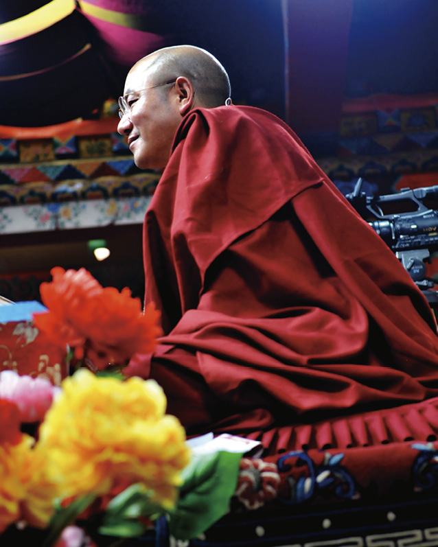
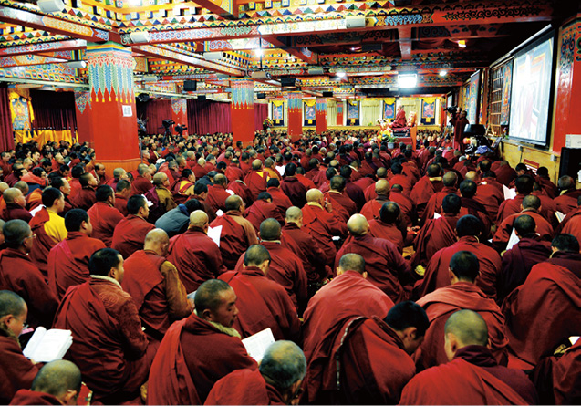
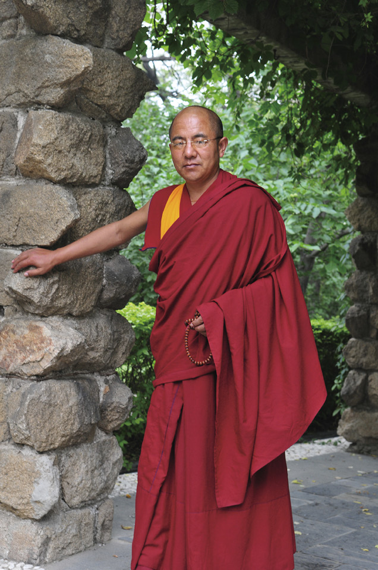

## 新年怎么过

2009年1月31日

这次虽说是“新年开示”，但实际新年已经过去好几天了。因为想到大家过年一定很忙，要应酬很多亲朋好友，做许许多多自认为有意义的事，所以我们选择今天与大家交流。

## 过年的意义

几乎所有的中国人，不管小孩子、年轻人、中年人还是老年人，都非常重视过年，大概一两个月之前就一直盼望着、准备着，各个单位也会放年假。在世人的心目中，过年是一年当中的大事，非常具有意义，可以与家人朋友欢聚一堂，辞旧迎新。

但从另一个角度讲，过年也没有什么意义。为什么呢？因为，过年期间亲朋好友聚在一起吃饭的过程中，可能会杀害很多众生、吃掉很多生命。人们把这当作乐事，但以此恶业，来世会堕落到地狱、恶鬼、旁生三恶趣当中，在无数时日中感受痛苦，不得解脱。因此，从佛教眼光来看，过年也没有什么意义。

当然，若在过年期间行持善法，则非常具有意义。藏地就有过年期间行持善法的传统。记得我小时候，隔壁有一位叫日嘎喇嘛的出家人，每年过年期间，他都要求我们附近的几个人不能造恶业，不管男女老少都要过非常清净的生活。尤其大年三十这一天，一整天都要吃素、守持八关斋戒、修持佛法。那时是六七十年代，政策还没开放，管得特别紧，一旦被发现，第二天肯定要受到批斗的惩罚。但因为我们有这种传统和信仰，所以，每年过年我们都会秘密行动。

在汉地，很多佛教徒的家人都不信佛，在此情况下，要求他们过年行持善法可能会遭到反对，产生很多矛盾。但在力所能及的情况下，应尽量劝导他们此时不要造恶业。如果实在做不到，宁可做一些唱歌、跳舞、看电影这样危害不太严重的事，也千万不要杀害众生，不要把快乐建立在另一个众生付出生命代价的痛苦之上，这是佛教的基本原则，因为杀生是极为严重的罪业。

## 做好新年规划

春节已经基本结束了，人们开始陆续上班。新年伊始，每位道友都应对自己有一个要求，发下一个善愿。

一年一年转瞬即逝，不知不觉间，我们就到了中年、老年，渐渐接近死亡。更何况，无常也会随时降临，对于修行人而言，观无常非常重要。

世人认为逢年过节是非常快乐的事，但从佛教角度讲，每个人从生到死之间，每一天都向死亡更迈进了一步。每过一年，你就老了一年，脸上的皱纹、头上的白发越来越多，智力、体力也会越来越差，这时到底应该开心还是痛苦，有智慧的人需要值得深思。

在座大多数人已经加入了佛教徒的行列，新的一年自己要行持什么善法，心中应该有一个规划。这样在未来的360天当中，你就会自己控制自己。城市里的大多数人都没有无常观，一直为了幸福而奋斗，然而，恍然间你可能就到了死亡门前，此时如果没有善业护持，将是极其可怕的。

今天，我也要求学院道友在新的一年当中，一定要对自己的闻思修做一个计划。闻思方面，要安排自己一年当中学多少部论、听多少堂课；修行方面，计划修什么法，修多少数量等等。当然，对于山下的道友，我们已经安排好了课程，你们只要认真修学，一年当中一定会学到很多佛法。

## 活到老，学到老

个别道友认为，只要学一部论典就可以了、足够了。这其实是一种愚者的想法，《萨迦格言》中讲：“大海不厌河水多，国库不厌珠宝多，欲者不厌受用多，学者不厌格言多。”求学千万不要厌倦，有了厌倦心，说明修学并不成功。藏地很多高僧大德，十几岁就外出求学，直到七八十岁还在不断学法、修行，他们把自己一生的时间都用于闻思修行上面。我们也要活到老，学到老，一定要有这种打算，具备这种求学精神。

有些居士和出家人因为学法的时间太短、学的内容太少，在外界强大的诱惑力和冲击力之下，几年之后就恢复如初，这时原来皈依佛门的道理都不一定承认。希望各位道友能通过不断学法来充实自己、完善自己。学的时候，最好能集体共修，集体学习的力量非常强，自学的力量是无法与之相比的。

## 精进的力量

现在我们已经学完了《入菩萨行论》，有些道友觉得自己学得很不错，考试成绩也很高，由此而心生傲慢。其实，为了增上大家的学习兴趣，这次我们考的并不难，如果按照学院标准，你们这样学法是远远不够的。

最近一周，学院每天都在考试。考试包括讲考、笔考和背考。讲考内容有《解义慧剑》《入中论》《大圆满前行》《贤愚经》等。很多道友一个人能讲好几部论典。笔考有《入中论》《般若摄颂》《亲友书》等经论，分A卷和B卷，A卷的要求较高，有四部论典。

学院内部考试不像外面《入行论》考试那样，会给大家出一些复习题，划定一个范围，而是所有学过的论典，如《解义慧剑》《亲友书》《现观庄严论》《般若摄颂》等全部要考。不但有笔考、讲考，还有背考。今天学院背考《亲友书》和《入行论》，几乎所有的人都能背诵。明天我们将背考《解义慧剑》和《现观庄严论》。

由此可见，一个人如果能专注、利用好时间，很多事情都可以成办。你们可能想，山上的修行人每天除了闻思以外没有其他事，当然可以做到。其实也不是，学院相当一部分道友每天都在发心，有些在医院发心，有些在电力、建筑等部门发心，相当于你们上班一样。他们白天基本都没有时间，只能利用早上和晚上的时间闻思修行。很多道友早晨3、4点钟就起来与大家一起背诵、复习，晚上12点钟才睡。整个学院的学习气氛非常浓厚。

如果你们也能早晨4、5点钟起来背诵，每天只睡五六个小时，我想一年当中背几部论典也不成问题。但大多数人在睡眠上花的时间特别多，每天要睡七八个小时，甚至更多，这样贪睡是非常可怕的。萨迦班智达在《格言宝藏论》中讲：“诸人寿短其一半，夜间入眠如死亡。”人的寿命非常短暂，最多活100年，如果一半时间用于睡眠，就像是夜里死去一般。

大家虽然身处散乱的城市，但时间还是可以挤出来的。希望你们在今年年底之前，能把《亲友书》背下来。尤其年轻一点的道友，一定要背诵，背诵会使记忆更加深刻，不容易遗忘，也会对自己的相续非常有利。如果在这方面没有下功夫，过几年很容易忘记。

## 唯一的心愿

今年2月1日至4月26日，我们会安排大家学习《亲友书》。自2月23日开始，菩提讲堂每周一、三、五下午一点半，发心人员会给大家辅导、解答疑问。这样共同学习，对你们智慧的提升肯定会有很大帮助。

过年期间，很多道友都没有散乱，一直在菩提讲堂里认真地听课、复习，这种精神非常值得赞叹。虽然那时我们并没给大家做特别安排，但有时我会悄悄来到你们的讲堂，想看看是否有人在学习，结果发现很多人都在自觉地学习。当我在遥远的地方看到这些道友的学法精神时，心里确实非常欢喜。

虽然我们这里的辅导员、发心道友非常辛苦，但只要对你们有利益，哪怕只有一丝一毫的利益，我们也愿无条件付出。如果大家觉得通过光盘或书的方式学习有利益，我们一定会尽量提供；如果觉得网上开示或讲堂辅导有帮助，我们也会尽量做。我们唯一的心愿，就是希望你们的相续能得到佛法的利益。

佛法是真正的如意宝。通过这么多年闻思修，我们的内心有了很大改变，越来越自在快乐。当内心快乐时，外面的世界也会变成美丽的净土；当内心丑恶时，整个世界也会变得昏天暗地。所以，调整内心非常关键。如果内心调整得特别好，即使只有简单的生活资具，甚至在十字路口乞讨，也会过得坦然而开心；如果内心没有调整好，即使住别墅、开豪车，也会始终处于忐忑不安的痛苦中。

## 以现代方式弘法

这么好的佛法甘露妙药，我们很想让每个众生都能得到。而众生的爱好不同、根基不同，故采用各种途径、方法传播佛法非常有必要，尤其当今时代，我们一定要利用好科技手段。现在众多具有贪嗔痴的人，都在利用科学技术传播世间法。无数人沉迷其中，难以自拔。我们作为发了菩提心的大乘行人，一定要想尽一切办法，通过网络等各种现代方法弘扬佛法，增上道友们的学法意乐，提高他们的佛法素养和理解能力。

应部分道友的请求，这学期我们开始网络教学，安排大家学习学院以前教过的一些论典，如《中观庄严论》《三戒论》《解义慧剑》等。

## 参加网络学习的必要性

《三戒论》中讲了很多出家人的戒条，虽然这些对于在家人不适用，但里面的居士戒、菩萨戒和密乘戒戒条对于你们很重要，必须要懂得。此外，《解义慧剑》所讲的道理也不得不懂，懂得之后，才会明白什么是胜义、什么是世俗，也即知道用什么样的智慧观察什么样的对境。

昨前天，学院很多道友讲考《解义慧剑》。我本以为自己对这部法已经很精通了，但从道友们的讲考中，我还是学到了好多知识。末法时代，大多数人都在为了钱财、地位、名声而奔波忙碌，而我们学院这么多道友，通过自己的努力和上师三宝的加持，已经真正理解了释迦牟尼佛的教法，并对佛法产生了不退转的信心，这真的来之不易。讲考人员中也有很多居士，他们的精彩讲述让我产生了很大信心。

每次听道友们讲考、背考，我就好似奄奄一息的人获得了甘露妙药之后重新活过来一般，因此，始终舍不得放下，一直坚持给大家传法。我心里经常想：哪怕众生只得到佛法甚深智慧的一分，相续也会变得非常美妙，这种快乐远远超过世间的任何享乐。

大概今年2月份以后，我们会安排法师在菩提讲堂上为大家辅导和答疑。

## 学修时几点注意事项

希望在此过程中，道友们能与发心人员互相配合。我们都是金刚道友，彼此一定要和睦相处，千万不要拉帮结派、互相排斥，这是不允许的。学院在这方面管理得非常严，要求所有法师一定要团结和合、护持纪律的管家和人员一定要紧密配合，这是法王在世时的基本原则。

虽然大家在外面学习，但不管在寺院里，还是在居士团体中，作为菩提学会的人，首先，内部一定要团结和合。团体与团体之间、小组与小组之间、学员与学员之间，应该有一种祥和的气氛，否则心怎么能静下来呢？如果心不静，佛教甚深的道理又怎能融入自心呢？

此外，希望各组的法师、辅导员、组长、管理人员等能以身作则，起带头表率作用，不能随随便便缺席。像我个人在学院教学、管理了这么久，如果有时不去现场上课，只在家里通过线上教学，学院道友通过收音机听授，按理来讲也是可以的，但我始终没有以法师的名义懈怠懒惰，觉得为了佛法，自己必须去现场与大家共同学习。因此，这么多年来没有特殊事情，我基本一天都没有断过课，始终把讲课、与大家共同学习视为自己一生当中最重要的事。

为了兴盛佛法、利益众生而付出，不管是出钱还是出力，我都非常愿意，觉得自己活在人间没有比这更重要的事了。我以前这样想，现在同样这样想，依止上师如意宝二十多年以来，这个想法始终未变。因此，只要做的事情对众生有一点意义，对佛法兴盛起一点作用，不管身体病得再痛、遇到的困难再大，也会心甘情愿去做，不愿谈任何条件。

希望各地菩提学会的负责人不要太懈怠，如果特别懈怠，不要说组织大家学习佛法，做世间任何一件事，包括安排人扫地、扫厕所等简单的事，也无法做好。要做好一件事，一定要付出。我的原则是，要么开始干脆不参与，要参与的话，就要全力付出。如果自己只是伸出长长的脖子，而肚皮却一直不动摇，什么事情都不去做，这样身心懒惰的状态并不是很好。希望发心道友们能以身作则，这样自己进步的同时，也能为他人做引导。

## 长期学法才能调伏相续

在座很多道友学习佛法的时间不一定很长。有些人可能想，听两三节课、学几部法应该就可以了吧。千万不要这样想。学法时间一定要长，如果只是蜻蜓点水般地学习，很难调伏我们顽固的相续。

大多数道友明天开始学习《亲友书》。希望大家学每一部论典都能善始善终。个别道友如果中间断了，一定要及时补上。《亲友书》讲了很多具有归纳性的教言，这些对于我们来说必须要懂，懂得之后，自相续定会受益匪浅。

前一段时间，在很多道友们的共同努力下，《亲友书》的光盘和书等学习资料都已发到大家手里了。因为他们的努力，如今我们才有学习的方便，对此我非常感谢。我以后只要还有能力，尚有一口气，会尽量为大家传授各种殊胜的经论。

学完《亲友书》之后，我还会讲《大圆满前行》和《极乐愿文大疏》，希望大家千万不要退。当然，你们学或不学，有一百个人、一千个人，还是一万个人学，对我个人来讲是无利无害的。我现在生活非常简单，一箪食，一瓢饮就可以了，没有什么其他要求，即生当中也不会求你们。但对你们个人来讲，学了《大圆满前行》和《极乐愿文大疏》之后，身心肯定会有所改变。如果一直不断这样学，总有一天会学到密法。当你学习密法的时候，肯定不会为现在的付出而后悔。

五年前，我要求很多道友学习五部大论——戒律、中观、现观、因明和俱舍。我发愿不管遇到再大的困难，也要坚持为大家传授。到今天为止，已经基本圆满了。五部大论属于显宗经论，一般来讲，格鲁派要学二十年，宁玛巴要学十多年。我们从2003年开始到现在，学了六年，所以，只能算是一种表示——听者已经听圆满，传者也已传圆满。近期，我们会给所有圆满五部大论传承的道友象征性地发一些奖品。

时间过得很快，学习《大圆满前行》的一两年中，大家一定要抓紧时间，该听的要听，该修的要修。该学、该修的法圆满之后，我们将会传授一些非常甚深的密法，这是很多人求之不得的。

## 学佛的基础是贤善人格

有些居士觉得每天应对家庭、工作的各种事情非常心烦，很想将其全部放下，一心学佛。其实，自己的业力导致今生已经变成了这样，若把对家人和社会的责任完全放下，那做人的品德都已丧失了，这样学习佛法将更加困难。

大家首先一定要学会做人。中国古代的孔孟思想虽然没有佛法那么殊胜，但在教人向善方面有着很好的教言。不过，这些传统文化在“文革”期间都成了批判的对象，基本已被摧毁。断了二十几年之后，现在想恢复非常困难，就像已经病入膏肓的人，想通过手术让其马上恢复极其困难一样。

因为缺失了传统文化的教育，现在很多大学生、研究生在做人方面确实堪忧。希望在座的居士或出家人，首先一定要做个善良的人，这样才能处理好与家人或道友之间的关系。如果心不善，无论世间还是出世间的事，都无法成办。这是法王如意宝传授的教言精华醍醐。心善良，就会以利他心做事，这样不仅人格品德包括在内，而且菩萨乘的利他心也包括在内，甚至密宗更深的境界也包括其中。

今后，我们也会结合传统文化来弘扬佛教，这也是大家共同的责任。每个人都想办法弘扬佛法，形成一种共同的愿望，最终才会实现。

## 勿被贪嗔痴奴役

前一段时间《入菩萨行论》考试，我看到很多道友都在认真复习，心里非常高兴。我为你们这次考试准备了很多有特殊加持力的奖品。一等奖有非常珍贵的佛像，看看谁的福分比较好；二等奖和三等奖是转经轮和皈依境，这些也是很好的加持品；此外还有鼓励奖，凡是参加考试人都能得到。

学习佛法的过程中，对于辅导员、组长等管理人员的安排和要求，大家一定要尽量配合。学法是每个人自己的事情，千万不要因为自己的事而在别人面前啰啰嗦嗦，这是没有良心的行为。同时，发心人员应该凭良心为上师三宝做事，以善心为大家服务。如果被贪嗔痴心驱使，为了自己的目的而做事，是非常不合理的。如果有能力，就尽量把这么好的佛法弘扬给别人；如果没有能力，就自己好好学法，但一定不要利用我们的团体、道场、学习环境搞一些非法之事。一般来讲，这种现象非常少，希望大家随时注意。

听说有些人对我们弘扬佛法产生了嫉妒心，以自己的邪知邪见加以诋毁。实际上，在护法神的保护下，他们不一定能得逞。护法神的能力不可思议，以前有些人也曾有意或无意破坏我们弘扬佛法，后来身心确实受到了护法神的严厉惩罚。当然，我们并没有发恶心，诅咒这些人受罚，但护法神以前曾在莲花生大士和一些传承持明上师面前承诺过，发愿维护真正弘扬佛法的高僧大德和其利益众生的宏大事业。故而，谁破坏，他们就会加以降伏、制止，这样的缘起一直不断。希望在座的道友千万不要产生这样的嫉妒心，应该祈愿佛法兴盛于世界的各个角落，愿所有众生都能得到快乐，这是我们学习大乘佛法的唯一目标。

## 每年闭关至少七天

学院最近特别冷，也没有电，你们在城市中生活应该非常方便，无需像我们这样苦行，唯一就是时间方面需要自己控制、自己做主。如果自己不能做主，始终随他人而转，就如同奴仆一样，永远得不到自由和快乐。就如麦彭仁波切在《君规教言论》中云：“孩提时随父母转，韶华时随朋友转，年迈时随子女转，愚者恒时无自由。”没有自由的人是非常痛苦的，如果学佛没有自由，那修行不可能成功。

希望大家不仅平时要安排好闻思修的时间，最好每一年都能抽出七天时间闭关。我要求学院的道友每年也要闭关修行，上等者每年闭关100天；中等者每年闭关一个月；如果实在不行，每年至少也要闭关21天。人们平时常说“不管三七二十一，我要……”，用于此处，即把乱七八糟的事全部放下，一定要闭关二十一天。你们在外面可能闭不了这么久，但再怎么忙，闭关七天应该还是可以的。如果七天都空不出来，恐怕修行不一定会成功。

你们可以到一些寺院里闭关，也可以在山上搭一个帐篷，或者在城市里租一间房子、住几天宾馆等。闭关前将吃的用的全部准备好，和家人或单位领导打好招呼，之后就把电话关机，断绝一切外界干扰，好好思维所修之法。

学院居士林最近就安排了七天闭关。我去看了一下，很多在家人修得非常不错。有的人对我说：“虽然自己观想得不是很清楚，但好好念金刚萨埵心咒的时候，心里感觉很平静，不像平时天天接打电话、交际应酬那样烦乱、痛苦。平时的时间都浪费了，闭关七天使内心非常清净、悠然，真的受益匪浅！”

明年过年的时候，我会询问你们闭得怎么样。很多人经常对我说：“谢谢堪布传讲佛法，您对我们的恩德非常大……”其实，真正想学好佛法，一定要实际修持。如果只是听闻而没有好好修，就会像学术界人士一样流于表面或口头，这对自相续没有实在意义，对治不了烦恼。所以，我特别强调闭关修行。一年有365天，如果闭关7天，那还有358天可以搞世间法。抽出短暂的7天用于修行，应该不是很困难。

如果大家同意我的观点，就在内心发下一个誓愿：我今天在堪布面前发愿，每年至少闭关七天。

## 珍惜才会有收获

最近，我们会安排法师在网上为大家辅导、解答疑问。通过这样的沟通、研讨，智慧很容易生起。虽然学院法师都非常忙，各方面压力很大，但我还是愿意让他们这样做，我们会尽量把学院传过的法全部提供给你们。当然，密法你们暂时还不能听，前不久，我传了五天无上大圆满密法。之所以保密，是因为你们现在没有修完加行，学院未修完加行的人也一律不准听，收音机也不会放。

你们现在求法真的很方便，只要安住家里、按键上网，便可以听到学院所讲的课。这样的机会极其难得，希望大家一定要珍惜。如果错失良机，我觉得非常可惜。当然，只在网上学习，不愿去现场共修，也不是很好。大家有一个共同学习的机会非常难得，最好亲自去现场，这样互动的效果非常好。

有些道友很想到学院的喇荣沟来苦行，但一直无法实现。其实，在学院不仅修房子很困难，甚至买东西、生火、做饭等等对于很多汉族道友来讲也是难题。昨天，我看到很多道友的手都冻裂了，我在商店买了一点东西发给大家。实际上，学院现在的条件比二十多年前已经好很多，我们那时的苦行比现在更甚。当然，为了佛法付出的越多，所得到的受用和利益也会越大。

与我们的苦行相比，你们城市里的生活、学习环境应该说非常舒适。这时，大家一定要把精力主要用于佛法，而不要把世间法放在第一。前年，我去了上海和杭州的有些地方，看到很多居士都把学法放在生活的首位，甚至上班或出差的时候，也会抽空学习。应该要有这种精神，这样自相续一定会有所改变。

希望在座的道友都能具有信心、精进心和持之以恒的毅力，这是学习佛法的基本要求。学佛是一个漫长的过程，有些人学了一两天后觉得没有什么感觉，就马上退了，这是非常可惜的。还有些人以凑热闹的心态学习，像看小说一样看佛法书，这样佛法水平是不可能增上的，学习佛法一定要认真。

今天，我对所有听课的人都做了一个简单的加持，愿你们的相续能早日成熟。大家平时应随时随地祈祷上师三宝，这一点非常重要。依靠诸佛菩萨和上师的加持，自相续逐渐逐渐就会转变。

## 祈祷莲师，遣除违缘

现在是末法时代，修法过程中的违缘非常多，此时，一定要多念莲花生大士心咒。据有关传记记载，在五台山开取的很多伏藏显示，念诵莲花生大士心咒，对于汉人修行的意义非常重大，可以遣除各种违缘。释迦牟尼佛在有关经典中也讲，末法时代一定要遣除修行中的违缘。

以前，藏地邪魔外道极其猖獗的时候，以菩提心及其他修法根本无法降伏，然而，莲花生大士却凭借其威力和加持力，彻底摧毁了一切魔众。藏地佛法之所以不但没有衰落，反而不断兴盛，与莲花生大士的弘扬和加持有着不可分割的关系。

如果经常祈祷莲花生大士，一方面，会使佛法常住世间，另一方面，自己修行的因缘也会非常殊胜，依靠愤怒莲师心咒的加持力，定会遣除修行过程中人和非人的违缘。这也是我自己多年以来的亲身感受。我不敢说自己有什么开悟、体验，但的确感觉到，依靠祈祷莲花生大士这个殊胜的缘起，自己修行比较圆满。

很多居士和出家人，虽然心里很想学佛，但后来却并不成功，遇到了种种违缘，包括心理上、生活上、工作上，以及很多出乎意料的违缘，最后使修行一败涂地，非常可怜。因此，祈祷莲花生大士非常重要。临终之前，一定不能让修行退转，这是自己今生最重要的事！

## 寄语

过年期间大家都很忙，我们在学院也有很多事要做，要改你们的卷子、为大家准备考试奖品等。但愿你们的心相续能真正获得诸佛菩萨的加持，无勤生起出离心和菩提心，并对无上密法生起强烈的信心。希望道友们能通过这样殊胜的因缘，不断地闻思修行佛法。

之前网上辅导《入行论》的时候，很多人都参加了，这样非常好。以后不管多少人参加，我都会尽量安排学院法师与大家沟通交流。希望大家在网上不要散乱，现在城市里散乱的因非常多，没必要在这里散乱；互相也不要说没意义的话，应尽量念咒、看书或行持其他善法。

一年365天中行持什么善法，自己应该做一个计划，比如听什么课、背多少颂词、修什么法、闭关多少天等等。同时，对于家人和自己的生活也要做一个安排，这是作为在家人应尽的责任。

今天在网上见到这么多佛友，我感到非常高兴。虽然我看不见你们脸上的笑容，但能看到你们的网名，有胡萝卜、红萝卜、大帅小帅、丹增加西、海螺、红苹果，还有一个叫观自在，观世音菩萨也来了，还有一个叫“坏人”……你们的网名都奇奇怪怪的，但我看了非常开心。以后，我会经常通过这种方式与大家沟通。

最后，祝愿大家新年快乐，一切吉祥，圆圆满满！这么多“鲜花”哦，谢谢谢谢，呵呵呵……
