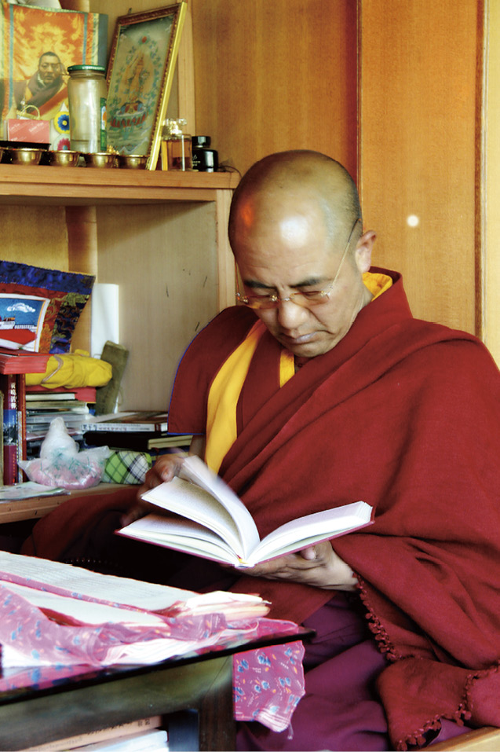
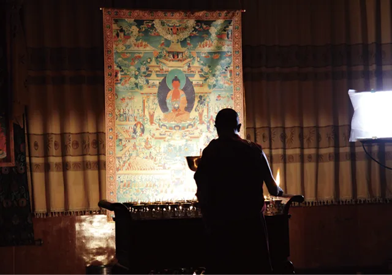
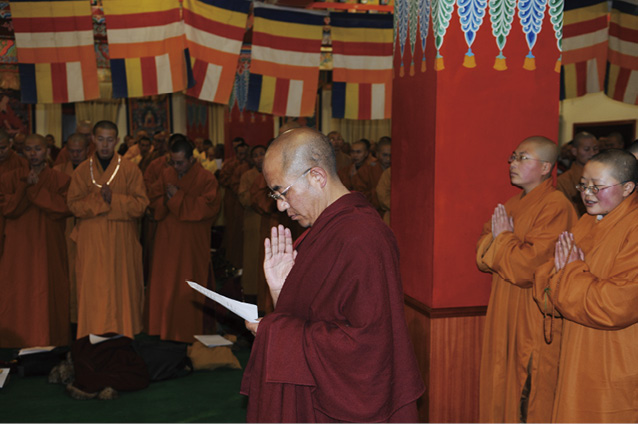

## 灾难无情 人有情

2008年5月24日

这次汶川大地震夺去了很多人的生命，有些虽然没有失去生命，但也遭受了极大的痛苦，变成残疾人、家破人亡，乃至流离失所……

我们作为大乘佛教徒，当众生遇到灾难时，应尽心尽力地给予帮助，帮他们脱离苦难，获得暂时的安乐和究竟的佛果。

## 举办“观音法会”祈福

学院准备为此举办一场“观音法会”，时间是明天早上8点到下午6点。届时，菩提讲堂会为大家直播法会实况。希望所有与学院有缘的佛教徒都能积极参与，为这次遇难的众生超度，为一切众生虔诚祈福。

我们要求这次参加法会的人，每人念诵三万遍观音心咒。初步估计，念诵总数应该达到一亿遍以上。这样不仅会给灾民带来极大的利益，而且所有的参与者都能获得一亿遍观音心咒的功德。

希望各地佛友都能发愿念诵，最好劝身边的亲朋好友或其他佛友也参与进来。现在信息传播非常方便，我今天讲完之后，你们就可以通过手机短信或其他方式转告。有些道友明天要上班或有其他事情，一天之内不一定能念完，这样最好在一周之内，即6月1日之前完成三万遍观音心咒。

根据目前的统计，这次地震造成了六万多人死亡、三万多人失踪，可能实际数字还会更多。在这样悲伤至暗的时刻，我们作为大乘佛弟子，一定要全力为受灾众生念诵、超度、回向，这是至关重要的事。

## 体会生命无常

今年天灾人祸频发，此刻我们更需要虔心念诵观音心咒，祈祷观世音菩萨，以此遣除整个世界的灾难以及个人修行的违缘。如果不一心祈求上师三宝加持，想在这样的末法时代顺利修行，绝非易事。

很多人感叹说，这次地震于人类而言是一次很大的打击。一方面，也可以这么说，但另一方面，如果懂得人身无常的道理，就会知道灾难是不可避免的。据报道，中国每年约有20万人死于自杀，与此相比，由于地震同时夺走了很多生命，所以人们内心才会感到非常震撼。实际上，我们每个人同样面临着死亡的危险，无一例外。

看到网上有人说，为什么诸佛菩萨不提前提醒大家呢？其实，佛陀早就提醒过我们了，如佛经云：世间灾难重重，地水火风危害不断，而生命瞬息万变、刹那无常。

面对世间层出不穷的灾难，人类的生命极其脆弱，大家千万不要认为自己的生命非常坚固，自己肯定能活很长时间。在死亡来临之前，每一个人都应该提前做好准备。

中阴法门及上师有关教言中说：死亡突然发生的时候，我们一定要想到上师和诸佛菩萨，观想上师或阿弥陀佛在自己的头顶，让自己的意识尽量往头顶上去，然后融入与阿弥陀佛无二无别的上师心间。为何这样观修呢？因为，在死亡突然来临的一刹那，修一般的往生法、禅宗的禅修法，或者大圆满本来清净的安住，不一定能来得及，而这种将自己的意识瞬间融入头顶的上师、阿弥陀佛心间的修法，非常殊胜可行。

这次地震，我们亲眼目睹了很多人瞬间被压在倒塌的楼房中。他们在一片废墟中渐渐停止了呼吸，此时此刻，他们平时辛苦积累的财产用不上，费尽心思得到的地位也用不上，亲朋好友也帮不上，唯一能帮自己的只有善法。因为，唯有善恶业才会形影不离地跟随自己趋往中阴，依靠善业会转生善趣，来世得到快乐；依靠恶业会堕入恶趣，来世感受痛苦。

总之，透过这次“5.12地震”以及全世界各地频发的灾难，希望大家能真切地认识到：我们这个浊恶的娑婆世界违缘重重、苦难重重，同时，千万不要认为自己永远不会改变，自己的生命是永恒的……我想稍有点修行的人，这次会对“生命无常”的道理有很多新的感悟和认识。

## 信心坚固，圆满学修

这次我们以学院的名义举办“四臂观音法会”，也是为了转变一些人对藏传佛教的误解。前一段时间，新闻报道了藏传佛教一些不如法的现象。当然，这只是极个别人的行为，不能代表整个藏传佛教，真正的藏传佛教是纯洁无垢的。但不了解真相、信心不稳固的人，看到这些报道之后很容易生起邪见，甚至做出诽谤等不如法之事。通过这次法会，我们想让这些人了解藏传佛教所倡导的慈悲观念，把他们从邪见的歧途中解救出来。

我恳切地劝导大家，千万不要对纯洁的佛法生邪见，更不能随随便便诽谤，应该真正了解佛教的慈悲、智慧及其不共的加持力。

我们学习《入菩萨行论》已近两年，很多道友无论对上师三宝的信心、对轮回的出离心，还是对众生的慈悲心都越来越增上。但也有极个别人人云亦云，见解不是很稳固，刚开始的时候特别精进，但慢慢已经退失了，行为也不太如法。

当然，众生的根基和意乐千差万别，即使佛陀也无法满足所有的众生，更何况是我们？但我想反复提醒大家，听闻这么殊胜的佛法绝非易事，一定要珍惜这样的机会，千万不要退失信心或随随便便放弃，否则，这将是你生命中无形的巨大损失。我们的钱包丢了、房子倒了，这只是暂时的损失，但如果对正法失去信心，这将是你生生世世都无法弥补的损失。道友们如果以前有些课没有听圆满，希望现在尽量补上。在我依止法王如意宝近二十年的人生历程中，最重视的事情就是闻思修行。

今天讲堂里有很多居士虽然身处闹市，却能一直坚持闻思佛法，信心越来越增上、稳固，这让我非常随喜。在修学佛法的过程中，大家肯定会遇到各种违缘，有的来自家庭，有的来自单位，有的来自亲朋好友。对很多人来说，学法不是一件很容易的事。在面对困难的时候，一定要反反复复思维：我等大师释迦牟尼佛在因地克服了怎样的困难、最后如何超越而获得了圆满正等觉的果位；诸传承祖师在求学过程中是怎样苦行的……深入思考之后，就会找到自己最有意义、最重要的人生目标。

现在我们快学到《入菩萨行论》最后一品《回向品》了。学习前九品的过程中，我们没有出现太大的违缘。当然，即使遇到了一些违缘，比如生病或者别人有各种说法等，我也不会低头，会以最坚强、勇猛的心来传法。希望大家也能以最坚强的心来圆满这部法。末法时代，各种违缘此起彼伏，很多道友既要生活、工作，又要学习佛法，在这个过程中，如果缺乏勇气，恐怕很难应对。

最开始的时候，我们一起发过愿要圆满《入菩萨行论》的学习。当时极个别道友没敢发愿，但后来也一直在坚持学习。如果有道友中间落课了，最好在规定时间内补上。希望每位道友都能善始善终。

## 学修安排

讲完《入菩萨行论》以后，我原计划传讲《大圆满前行》，但考虑之后，决定在这之前先给大家传讲龙猛菩萨著的《亲友书》。

佛陀圆寂之后，真正将大乘空性法弘扬至人间、对众生有无上恩德的人是谁呢？是龙猛菩萨。在藏传佛教中，龙猛菩萨的《亲友书》与《入行论》的地位没有多大差别。无论是格鲁派、噶举派，还是宁玛派等各大教派寺院，都对《亲友书》非常重视。

以前，我曾在上师如意宝等很多上师面前得过《亲友书》的清净传承。该法非常具有加持力，我很早就想给你们传授，但因缘一直没有成熟。今年如果没有出现违缘，我也没有离开人间的话，会尽量把这部法传授给大家。

希望大家学法不要感到厌足，不要觉得自己听过一部法就可以了。当然，无论是一个人、几百人或是几万人在我面前听法，我都照样讲课，这对我来讲是无利无害的，但对你们个人来说，听法却至关重要。现在很多人对佛教的道理都不懂，佛法水平比较低，非常需要闻思。

最近，我们一直在讲《现观庄严论》，这是一部甚深的般若论典，能听懂的人比较少，是适合极少数人的课程。当然，如果有道友愿意听的话，我们也可以在网上逐渐为大家发布视频。

## 充分利用空余时间

《入行论》最后一册讲记，大约在十月份能发到大家手中，中间有一个月左右的空闲时间。这期间，希望大家认真复习《入行论》的第七品至第十品。因为讲完第十品《回向品》之后，只会留出一个短暂的时间复习，然后就进行考试，所以需要提前做好复习准备。

此外，希望大家能利用这段时间尽量行持善法，比如，至少念诵四遍《诸佛菩萨名号·宝鬘论》、参加一次放生等。任何一点时间都不要浪费，应充分利用起来做对自他今生来世有利益的事。如果放任自己散乱，宝贵的时光就会白白流走。很多人未遇到佛法之前，一直在散乱懈怠中度日，如果遇到佛法之后仍继续这样懒惰懈怠，浪费了暇满的人身，是非常可惜的。当然，这是我的要求，做不做则观待于你们自己。

## 发心人员应认真负责

希望发心人员能一直保持积极的态度，不要因为发心时间久了，就出现一些不负责任的情况。我们这边花费了很大的心血，动用了诸多的人力、物力和财力，才把法本送到你们手里，这不是一件很容易的事。如果你们很随便地处置，发给那些不愿学、不珍惜的人，而真正想学的人却没有得到，这不是很合理。大家应该对因果负责，对学员负责，以积极的心态面对发心工作。

希望学会的所有负责人都要重视这个问题。一方面，你们发了大菩提心，确实很辛苦，很多感人的事迹，我直接或间接都有所了解，但另一方面，个别人也出现了一些不负责任的行为，这我也非常清楚。希望大家不要懈怠，继续与我们一起努力弘扬大乘佛法，这对自他的确有很大的利益。

## 灾难面前，考验发心

这次灾难发生之后，大多数学员都积极地出钱、出力，参与各种救援活动。我听到一些人的事迹之后非常高兴，深感这两年传授大乘佛法，的确具有很大意义。

当然，也有个别人不愿参加救援活动，以各种借口躲避，这种心态连有些世间人也不如。很多世间人虽然从未学过佛法，但内心非常善良，他们的精神让很多所谓的“大乘修行人”都感到汗颜。比如这次地震中，有些老师不救自己的孩子，却三番四次跑进教室救其他孩子，最后失去了自己宝贵的生命；还有的老师，撑起双臂挡住即将倒塌的房梁，保护学生撤离，最后以自己的生命换回了学生的生命。这些人虽然没受过大乘佛法的教育，但利他心却如此强烈，而有些所谓的大乘行人，不要说付出自己的生命，连一点点救援都不愿做，这是非常羞愧的！

在这次灾难面前，大家也可以反思一下自己的发心程度到底如何。希望道友们以后不管遇到什么样的众生，只要有困难，都应该尽量帮助。这是大乘佛子义不容辞的责任。

在此，我还想提醒大家两件事：一、前两天，网络上有人以我的名义化缘募捐，这很不合理；二、还有一些人以我们学院的名义，在汉地各个地方化缘，有的说要建佛塔，有的说要做经旗，有的说要造佛像，还有的说要供斋……有各种各样的情况。希望大家一定要谨慎对待，我和我们佛学院从来不曾向大家化过缘，这一点每个人务必要清楚。以后，如果再有人以我或学院的名义化缘，大家千万不要上当受骗，否则将后悔莫及。

## “观音法会”具体事宜

明天早晨8点到晚上6点，学院将举办“观音法会”。法会期间，需要先念诵《四臂观音修法仪轨》，然后念诵观音心咒，最后回向。

四臂观音的修法比较简单。首先，把自己的身体观想为四臂观音，六字真言在心间发光，然后，外面的一切现象全部观为观世音菩萨的幻化，一切声音都观为六字大明咒，自己的一切念头都观为与观世音菩萨的智慧无二无别，接下来，以这次遇难众生为主的一切众生作为大悲心的对境，在这样的境界当中，念诵六字观音心咒。念“嗡玛呢巴美吽”，或者按照无垢光尊者的观音修法，念“嗡玛呢巴美吽舍”也可以。

之前，我讲过观音心咒的功德，《宝箧经》中也讲了很多六字真言的功德[^1]，希望你们今晚看一下。如果知道了观音心咒的功德如此巨大、不可思议，明天念起来就会充满信心。以虔诚的信心摄持来念诵观音心咒，并把功德回向给所有遇难、受灾的众生，必定会给他们带来不可估量的利益。

明天，大家在各自的道场参加法会时，最好提前供一些香、花、灯等，供品应该尽量清净圆满，之后再开始念诵。念诵时最好采用学院《喇荣课诵集》里的四臂观音修法仪轨，可以用藏文来念，如果不会念，用汉文念也可以。念诵的时候，最好同时使用转经轮，使用转经轮的功德非常大。此外，明天最好尽量吃素。

## “金刚萨埵法会”事宜

今年6月，学院还将举办金刚萨埵法会。以前法王如意宝要求，金刚萨埵法会期间，每人要念满40万遍金刚萨埵心咒。

前段时间我说过，今年金刚萨埵法会期间，希望大家最好安住在自己家中念诵，不一定非要来佛学院。今年藏地出现了一些事情，各方面管得比较严，再加上开奥运会，出入不一定方便，并且四川正在闹地震，你的家人不一定放心让你来，再者，学院汉众招待所还没有建好，住宿等各方面都有一定困难。其实，现在网络为我们提供了一种很好的方便方法，大家不来喇荣也同样可以共修。

你们很多人可能要上班，家里的事情又多，在金刚萨埵法会短暂的八天当中，不一定能念完40万遍金刚萨埵心咒。所以，现在就可以开始念诵，法会结束后可以继续念，一个月内念完就可以。

## 传授《四臂观音修法》传承

目前，汉地有些地方又发生了一些余震，人们内心产生了极大的恐惧感，很多人都睡在大街上、帐篷里，过着藏地草原一般的生活。此时，佛陀所说的“万法皆无常，诸受皆为苦”的道理已经不用繁述，直接呈现在了我们的面前。

佛陀在有关经典中早已讲过，世间有地水火风的各种灾难，在这样恐慌不定的世界中，生命是非常脆弱和无常的。面对灾难，我们一定要把以观音菩萨为主的上师三宝作为唯一、最殊胜的皈依境，虔诚祈祷，这样祈祷非常重要。

接下来，我为大家念诵《四臂观音修法》的传承。

（堪布念传承）

下面，我们每人念诵100遍观音心咒：嗡玛呢巴美吽舍、嗡玛呢巴美吽舍……

## 传授《愿海精髓》传承

每次念完观音心咒之后，用《普贤行愿品》、《愿海精髓》或者《入菩萨行论》的“回向品”做回向都可以。

《愿海精髓》是法王如意宝1990年去印度金刚座时造的。当年在菩提伽耶，法王代表他过去及未来所有的传承弟子发了这样一个大愿。当时我也在现场，所以有非常清净的传承。大家每次回向之后，最好也念一下《愿海精髓》。它是圣者的金刚语，念诵会有非常大的功德。

下面我为大家念诵《愿海精髓》的传承。

（堪布念传承）

现场互动

⊙ 问：我以前曾学修过密法，后来由于种种原因中断了，之后改学显宗法。像我这样的修行人应该注意些什么？

堪布：这是一个非常重要的问题，今天听课的道友都要予以重视。我也听说有些人以前对密法的信心不错，但后来在网上见到极个别出家人不如法的行为之后，便退失了信心。有些虽然没有真正退，但信心也有所动摇，表现得不容乐观。其实，有些事情比较复杂，在此我没有必要分析。但我想强调的是，这并不能代表藏传佛教的本来面目。因为一些简单的原因就对密法生邪见、退失信心是非常可惜的。

为了挽救、扭转这种局面，消除一些人的邪见，增强大家的信心，我们将来会做一些这方面的工作。同时，希望道友们能对身边的人生起大悲心，通过直接或间接的方式来帮助这些已近退失或即将退失信心的人。

当然，我们希望很多人对藏传佛教有信心，并不是为了得到什么好处，没有这样的目的，只是看到有些人未以智慧分析，只因一些简单的表象，就对非常纯洁的密法生邪见，甚至离开了学佛团体，感到非常可惜。

通过明天的法会，出家人真正的形象会展现在公众面前。真正的藏传佛教修行人，是以慈悲心来对待天边无际的一切众生。在大乘菩提心面前，根本不分男女、种族……任何一个生命，都是我们慈爱的对象。

以后，大家如果再遇到这种情况，也可以检验一下自己的信心是否稳定。不过，在这种严峻考验下，有些人并没有把握住自己，非常可惜。

⊙ 问：您在《入行论·智慧品》中把“无我”的道理讲得很清楚。虽然我们在闻思的时候已经明白了“无我”，但在生活中总想有个所依，总觉得有个“我”，请问这该怎么办？

堪布：理论上懂了所谓的“我”不存在，但生活中始终认为有一个所依存在，这说明你还没有真正获得“无我”的定解。这种定解需要依靠实修而获得，通过长时间实修，你的见解才可以在日常生活中落实、运用。

⊙ 问：我们原来以讨论的形式学习，但学到《入行论·智慧品》时，大家就讨论不清楚了。请问，能否请学院法师先给发心人员讲解一下，然后再由发心人员带着学员讨论学习？

堪布：应该是可以的，《智慧品》确实比较深，学习过程中可以根据实际情况来定。

这里顺便提一下，今年情况比较特殊，尤其在八月之前，各方面可能有些不方便。希望学习《入行论》的道友，能利用各种方便方法坚持学习，尽量不要以各种借口断传承。学习《入菩萨行论》能调伏我们的烦恼，增长我们的慈悲菩提心，这对整个国家、社会，以及家庭的和谐会起到积极的作用。

有些人胆子特别小，一有风吹草动，就马上惊慌失措而断了传承，这样学佛将很难成功。我想再三强调，学习佛法，心一定要坚强、稳固。学佛过程中肯定会遇到违缘，尤其城市里的人，更是违缘不断，这时大家一定要牢记上师如意宝的金刚语——修行人的心应该稳固、修行过程中不能害众生。这两点是上师接近圆寂时留下的遗嘱，非常重要！

⊙ 问：很多道友想明天守八关斋戒，但有些人做不到不说话，这该怎么办？

堪布：实在做不到，也没有太大问题。

⊙ 问：明天守八关斋戒，我们中午11点10分吃中饭可以吗？

堪布：可以可以。

⊙ 问：作为释迦牟尼佛的弟子，如何做到团结和合与菩提心不相违？

堪布：团结和合需要在利益他人的心态基础上才能做到，而菩提心是对包括人类在内的每一个众生都用爱心来对待，所以，两者绝对不相违。如果先能做到人与人之间团结和合，在此基础上很容易发起大乘菩提心，利益天边无际的一切众生。

⊙ 问：听您讲观音心咒的功德非常大，可以让众生离苦得乐。请问如果长期念诵，可以让众生获得解脱吗？

堪布：大家念观音心咒的时候，一定要回向给所有众生。回向时要观想：善根全部给予这次遇难众生为主的天边无际一切众生，愿他们获得暂时的安乐和究竟的解脱。这样回向功德相当大。

## 结语

今晚的交流应该说非常圆满，从大家提问等各种情况，我能看出很多道友都对三宝很有信心。作为佛教徒，应该培养自己对三宝的信心，这种信心会直接体现在情感上。如果没有信心，我们彼此有时很难沟通。

虽然我住在喇荣五明佛学院，与你们隔着千山万水，但依靠现代科学技术，不必在地上，在空中就可以传法。这使你们一瞬间就可以得到教言、法理。这是诸佛菩萨不可思议的威力，也是他们智慧方便的一种幻变。佛在经中说：方便的功德不可思议，般若经的功德不可思议，咒语的力量不可思议。我们现在正是利用了“方便的功德不可思议”这一点，希望大家能珍惜这样难得的机缘，利用这种新的学习途径，想方设法增上自己的智慧和悲心。

我这边不管再忙再累，也尽量为大家提供一些佛法学习的机会和因缘。希望你们一定要珍惜，这种机会转瞬即逝，以后不一定会有。古大德都非常重视学佛的因缘，我们在值遇这样殊胜因缘的时候，千万不要放弃，应将学法视作生命中最重要的事。

最后，我有两点希望：

第一，希望大家学习佛法能善始善终，不要半途而废，认真对待《入行论》等经论的学习。虽然今年灾难、违缘频发，但闻思修行千万不能被违缘中断，这也体现出一个修行人的精神。

第二，希望大家明天一方面要好好念诵观音心咒，将功德回向给一切众生，另一方面，也要发愿：哪怕遇到生命危险，也绝不舍弃对三宝的信心、绝不舍弃修学佛法。

这样发愿非常重要，否则，一遇到违缘就马上退失信心，甚至改学其他宗教，这是非常可怕的。希望每个人的信心越来越坚固、前途越来越光明。

下课之后，你们每个人都要回到各自的地方，过程也很辛苦，这种精神非常可贵，千万不要退失。我们学佛不单单为了自己，也肩负着弘法利生的重要使命。

[^1]: 《宝箧经》云：“若持诵六字大明咒，能使福德具足。诵此咒时，九十一恒河沙数佛陀亲临，微尘数菩萨亦亲临，且天、龙、鸠槃荼、四大天王等亲临而守护之。其人身内之一切有情能获不退转菩萨位。若身上佩带此明咒，则成金刚身，并成舍利塔，当知此理。若诵此明咒，则能具足清净之无量慈心、悲心与智慧聚。若每日诵此明咒，则圆满六度，并能获得持明之转轮王位，现前无上菩提，成就佛果。”
