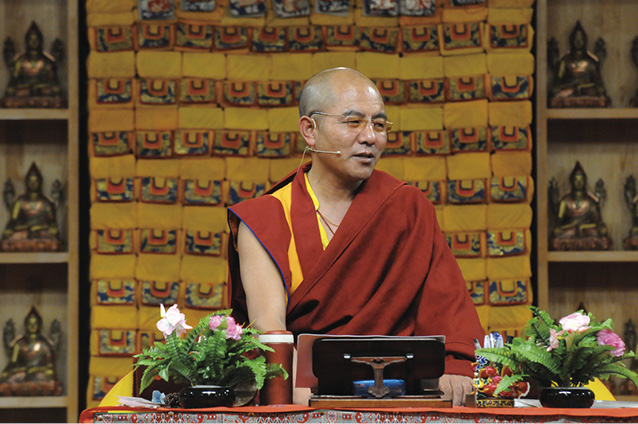

## 第一次传授《教诲天人甘露》

2007年6月24日

今天的因缘很殊胜，大家在此一起交流佛法。首先，我简单地说一下菩提网络佛学院的考试情况，以及下一阶段的学修安排，然后给大家传讲法王如意宝的教言《教诲天人甘露》，最后是问答环节。

星期天本来是休息的日子，但道友们依然愿意抽出时间来学习佛法，我个人也是如此，因为我们有着共同的目标：通过学习来通达佛法的殊胜教义，改变自己的心态和行为。

各位道友以后在任何场合中，都应该把所听受的教言及问答内容记录下来，以便更好地领会。虽然我的回答未必尽善尽美，但如果当时你明白了，过后却又忘记了，这样对彼此来说都是在浪费时间，意义并不是很大。我在一些学校里讲课时，他们会把我所讲到的教证、理证以及我的看法全都记录下来，这样的交流才有意义。但有些人提问，这次我给他讲一遍，下次他又问我一遍，这样好像没有什么价值。

## 《大圆满前行》考试总结

最近，我们在网络上举行了一次《大圆满前行》考试。刚开始学习这部论时，报名的人非常多，中间有少数人退下去，但大部分人坚持学完了，在这半年里学了180多堂课。

学完之后，我们组织了一次考试，但只有11%左右的学员参加了，人数占比很少，不是很理想。原因是什么呢？我从多方面了解到，很多道友在报名时非常热情，不仅报了《大圆满前行》，还报了《量理宝藏论》《入行论》等课程，但真正学习的时候，发现时间根本不够用，虽然勉强坚持下来，但是学得并不扎实，所以没有勇气参加考试。因此，希望大家以后报名的时候，一定要深思熟虑，并不是每一门课都必须报。

刚开始的时候，学习因明的人比较多，虽然后来有少部分人退学了，但还是有相当一部分人坚持下来，基本每天都听一两堂课，这种精神非常可嘉。我们学院也有很多好学的修行人，他们每天要上好几堂课。末法时代，人的思想比较复杂，心也比较散乱，在这种环境下能坚持闻思修，可以说非常难得。

《大圆满前行》的考试成绩出来了：第一名，113分；第二名，113分；第三名，112分。在这么多的道友当中获得了前三名，我们应该随喜赞叹他们！

不管学什么知识，都应该尽量参加考试。因为考试会让你有一种不共的压力，有了这种压力，才会学得比较扎实。要知道，现在没有一所学校是不要求考试的，佛学院也不例外。

从这次考试来看，一方面，我们以后会根据大家的能力、时间和精力来安排课程，不然课程太多的话，恐怕有些人很难学修圆满；另一方面，现在的这种学习方式非常好，希望你们能够坚持下去。从我个人来讲，也会将网络弘法作为重点来抓。这样道友们可以毫不费力地在家就能听到佛法，对真正希求佛法的人来说，这个机会非常难得。虽然我的琐事比较多，但也会尽量为你们创造学习的条件。

总之，在这么长的时间里，大家都能认真地学完《大圆满前行》，也有相当一部分道友获得了令人满意的成绩，非常值得赞叹！其实，大家愿意学习，愿意参加考试，这就是你们不共的一个成就。

## 下一阶段的学修安排

### 1．《入行论》的考试安排

八月中旬，我们将进行一次《入行论》的考试，因为这部论我们已经快学完五本书了。这次考试分开卷和闭卷两种方式。道友们可以在当地参加考试，如果不具备这种条件，也可以参加七月底的网络考试。当然，最少要几个人一起考，实在不行再单独安排。

希望每一位道友都能参加考试，检验一下自己到底学得如何。就我个人而言，讲完一部法后，如果大家愿意参加考试，我心里就感到非常欣慰，也能了解到每个人的学习态度以及对佛法的接受能力。

在以后的学习过程中，如果你们实在没有时间，就不要接太多的法、见太多的上师，否则自己会“消化”不了，还会跟工作和生活产生冲突，陷入进退两难的境地。选择学哪一门课程时，最好是经过深思熟虑后再做决定。

### 2．《二规教言论》的课程报名

很多道友希望《二规教言论》的音视和视频能在网上公布。我们再三考虑之后，决定在八月底或九月初公布。愿意学习的道友请提前做好准备，到时可以在网上报名。

### 3．《量理宝藏论》的考试安排

八月底或九月初，我们将进行一次《量理宝藏论》的考试。这部论还有最后几堂课，讲完后我的任务就完成了，而你们的任务完成了多少呢？虽然我不清楚具体情况，但也大致知道有些人学习虎头蛇尾；有些人学习非常精进，并持之以恒，非常值得赞叹。

不管怎样，希望你们这次能提前复习。《大圆满前行》考试和《入行论》考试都没有参加的道友，如果你的智慧比较不错，对因明逻辑也比较感兴趣，可以为这次考试做一些准备。

世间人为了自己的功名利禄，尚且每日奔波劳碌，我们为了如此殊胜的佛法，更应该努力精进。当然，今天在场的道友都非常不错。如果我住在大城市里，会不会像你们一样精进呢？也很难说。虽然你们身处恶劣环境，周围很多人不信佛教，甚至反对，但大家不仅没有退失信心，而且还能不断地学习，实在难能可贵！

我希望大家在学习佛法上，有一个长期的规划，多学习一些法义。现在很多人不懂什么是真正的佛法，所以行为上也不太如理。

## 祈祷莲花生大士的加持

当修行人遇到违缘的时候，或者为了遣除未来修行道路上的障碍，可以持诵莲花生大士的心咒或祈祷文。在末法时代，祈祷莲师相当重要，因为莲花生大士的心咒和祈祷文加持力非常大。

现在很多人想好好修行，做一个合格的修行人，但却经常在工作、生活和感情上遇到重大违缘，这些严重障碍了闻思修行。而末法时代的种种违缘，依靠莲花生大士的加持可以遣除。这并非我个人分别念的臆造，而是佛陀在经典续部中再三授记、宣说的。

大家平时要多念莲师心咒，祈祷莲花生大士的加持，以此遣除生活和修行中的所有违缘，最终真正认识心的本性。尤其在密宗中，想要认识自心的本性，必须依靠上师的功德力和加持力，也就是弟子借助上师的直指方法来认识心的本来面目。其实，很多人都想获得开悟、脱离轮回，却又总感觉力不从心，而依靠莲花生大士的意传加持，的确可以圆满一切所愿。

学密宗的道友，当然平时要多念莲师心咒；而学净土宗、禅宗的道友，也可以一边学净土宗或禅宗，一边念莲师心咒，这两者完全不相违。要知道，在末法时代，很多违缘通过祈祷莲花生大士才能遣除。

从小到现在，我一直对莲花生大士有着不共的信心。我感觉自己的修行比较顺利，各方面没有出现种种违缘，这与莲花生大士的加持是分不开的。因此，我今天再次提醒大家，一定要好好地祈祷莲花生大士。

下面，我给大家念一下《金刚七句祈祷文》的传承。

（堪布念传承）

这个祈祷文，谁都可以念诵，随时随地都可以念，白天晚上都可以念。至少念三遍以后，再随力念诵莲师心咒。在藏地，念诵莲师心咒几千万遍、上亿遍的修行人相当多。如今在东西方的各个国家中，祈祷莲花生大士的修行人也非常多。

总之，不管是谁，如果对莲花生大士有一种不共的信心，一定可以遣除修行过程中的种种违缘。

## 讲解《教诲天人甘露》

法王如意宝的《教诲天人甘露》目前只有藏文，还没有被翻译成汉文。除了这个教言以外，法王如意宝的其他教言，我也想逐渐翻译成汉文。如果一个月里集中一两次念诵传承，这样一两年下来，你们就能得到很多传承，而我也能用上师的教言来时时提醒自己，内心也有了依靠。

（堪布一边念传承，一边简单翻译）

在《教诲天人甘露》中，法王如意宝主要讲了四个教言：

第一，依止善知识，依止善知识是修行之道的根本。

第二，闻思佛法，闻思佛法是增上功德的助缘。

第三，守持清净戒律，清净戒律是一切利乐的源泉。

第四，修持等持，修持等持是获得圣果的根本因。

具体而言，一、依止上师时，要像爱护自己眼目和心脏一样全身心对待，经常赞叹上师、承侍上师，并且依教奉行；二、要闻思浩如烟海的显密佛法，通过长期闻思逐渐遣除内心的黑暗，圆满福德资粮和智慧资粮；三、如果守持清净戒律，即便没有其他功德，世间的一切功德也会自然而然获得，最后一定会踏上菩提妙道；四、如果没有实地修持，则不可能断除烦恼，就像没有喝水就不能解渴一样。修行的时候，首先修人身难得、寿命无常、轮回痛苦和因果不虚，然后再修皈依、发心、生起次第、圆满次第以及大圆满。

以上内容，是全知无垢光尊者《大圆满心性休息大车疏》中的教言，在此归纳出来给大家宣讲。

这就是法王如意宝《教诲天人甘露》中的四种教言。有些细节我没有翻译，但大概的内容大家一定要记住。

### 1．依止善知识

第一，依止善知识的时候不要东奔西跑。我一直强调，以前依止过的善知识，大家不要舍弃，既然已经依止了，就应该尽心尽力地承侍。现在很多人在这方面问题比较大，最后给自己和他人都带来痛苦，这样做很不如法。

### 2．闻思佛法

第二，尽量多闻思佛法，不要只做形象上的佛教徒。现在大多数佛教徒不爱闻思，喜欢做一些形象上的仪轨或佛事，只图表面上的热闹，但其实这些并不是特别重要。

### 3．守持清净戒律

第三，尽量守持戒律。作为在家人，也应该守持清净的戒律，至少受持五戒中的一条。如果能够受持五戒，即生当中就能获得现世的安乐。

如今末法时代，很多众生的行为相当不如法，尤其是物质条件比较优越的人，行为反而更加可怕。很多人不守持戒律，行为没有约束，连世间法的规矩都违越了，更不用说出世间的修行了。在这种环境下，如果能以佛教的戒律来约束自相续，从世间来讲，对家庭和社会都有很大的利益；从出世间来讲，能让我们生生世世不离佛法，最终获得真正的解脱。

### 4．修持等持

第四，精进地实地修持。大家不要说大话：“我马上要修大圆满最高境界。”不要一开始就修大法，应该从基础的四加行、五加行开始修持，这一点非常重要。

希望大家每天都不要离开闻思修行，哪怕很短的时间也要利用起来。一位观世音菩萨化现的上师在他的自传中说，他每天早上三点左右起床，然后磕些大头，再去做其他事情。其实，这种精进谁都可以做到。在大城市生活的你们，也应该起早一点，起来后好好地磕大头、禅修，那个时候也没有其他人的干扰。

现在的人实在是太不精进、太懒散了，白天为了工作和其他世间法而忙碌，晚上一直迷迷糊糊地睡着。人生短短几十年，全部在无有意义的琐事中耗尽，真是令人遗憾！世间的财富、地位等，很多东西没有任何实义，大家应该把时间尽量用在佛法方面，这是我内心当中的一个希望。如果你们觉得这个忠告有益，那么就接受它；如果觉得多此一举，那么尽可以舍弃，这对我不会有任何损害。

现场互动

⊙ 问：有些学员是学净土的，平时习惯念阿弥陀佛，吃饭、走路、睡梦中都在念。现在要求念四十万遍金刚萨埵心咒，感觉有点不习惯。在这种情况下，是专念一个好，还是两个都念？

堪布：学净土宗的人念金刚萨埵心咒，一点都不相违。以前很多上师的教言中也说过，学净土宗的人，最好念一些密宗的咒语来进行忏悔。至于原因，你们如果读过《无量寿经》就会发现，其中都有提及造五无间罪和舍法罪的人不能往生极乐世界。而要清净这两种罪业，依靠佛经和传承上师的教言，一定要念四十万遍以上的金刚萨埵心咒。

在行住坐卧当中，你能一直念佛当然很好，但除此之外，还是要在特定的时间内念四十万遍金刚萨埵心咒。

总之，没有必要只念心咒而不念佛号，也没有必要只念佛号而不念心咒。虽然每位上师的教言不同，但我觉得都念比较保险。因此，希望大家既念心咒又念佛号，这样做与显密的教言或传承上师的窍诀一点都不相违。

⊙ 问：我家孩子正在读初二，学习成绩一般，比较贪玩。《入行论》中要求我们观无常、消除贪嗔痴，那么我该让孩子拼命学习、出人头地，还是让他出家念佛学院，应该引导孩子走哪条路？

堪布：作为父母，一定先要让孩子读书。虽然观无常、消除贪嗔痴对我们来说很重要，但也要对家人和孩子负责。一方面，要让孩子学习世间的知识；另一方面，由于现在学校普遍缺乏慈悲、无常的教育，缺乏人生观、价值观的引导，所以父母应该从小给孩子灌输这些理念。实际上，不仅是佛教，任何一个人对具有慈悲心的人都会赞叹。

现在的孩子，有些没有书读很可惜，有些虽然读了书，却没有慈悲的观念，也非常可惜。当然，也没有必要很早就把孩子送到寺院或佛学院，这也不太现实。但是，父母应该把佛教的理念在这些青春期的孩子耳边一再地宣说，虽然他当时不一定能完全接受，但会对他的一生起到潜移默化的作用。只有这样做，孩子才会有一个光明、圆满的前途。

⊙ 问：请您为我传皈依，希望我将来能够利益众生。

堪布：以前没有皈依过的道友，这次可以一起皈依。皈依的时候，你们要在心里观想：在诸佛菩萨面前，我为了利益一切众生而皈依。

（堪布传授皈依戒）

我们要经常发愿利益众生，这一点真的非常重要。也就是说，大家随时随地都要想：我活着的目的，并不是为了自己的生活和家庭，而是为了多做一些利益众生的事情，今生乃至生生世世，都要成为帮助众生的人，哪怕变成牦牛等旁生，也要饶益众生。这是我等本师释迦牟尼佛在因地时发愿的唯一核心。

希望大家都能如是发愿，共同发愿的力量不可思议，总有一天我们的相续中会生起真实无伪的出离心和菩提心。

⊙ 问：现在学佛的大学生越来越多，请问您对他们有什么特别的忠告与期望？

堪布：你说得很对，现在国内外的高等学府中，学习佛法的大学生确实越来越多。这是因为佛教与其他宗教不同，如果运用智慧深入细致地去分析观察它，的确无法从中找出任何过错，所以很多大学生都愿意学习佛法。

我希望他们在完成学业的同时，尽量多思考、多研究佛教的一些甚深教言。其实，学习佛法不仅有利于家庭和谐、社会和谐，而且还能给我们的人生带来新的转变。为什么呢？不学佛的人在生活中遇到困难时，即便他的学识再高、本领再大，有时也没办法面对这些痛苦；而一个学佛的人，即便他的文化水平不是很高，也可以轻松地面对。所以，我非常希望大学生以及知识分子们先从佛教理论下手，慢慢了解之后，再去实地修持佛教的甘露妙法，这样对全人类乃至地球上的所有众生，都有很大的利益。

⊙ 问：我在大学学的是传媒专业，希望将来可以利用网络媒体来弘扬佛法，请问怎样做比较如法？

堪布：你有这样的发心，我觉得非常好。如果有能力给别人开示佛教的道理，当然是最好不过的；如果没有这种能力，也可以通过其他方法帮助他人学习佛法。

如今这个时代，利用网络转变自相续的修行人有很多，但也有些人整天沉迷于无意义的网络活动，在贪、嗔、痴的浑水中无法自拔，这种可怜众生也比比皆是。所以，我觉得通过网络来传播佛法是一个非常好的方法。

⊙ 问：为什么上师的恩德会超过佛陀呢？

堪布：其实，这种观点并非藏传佛教独有。汉传佛经中记载，有一天，阿难尊者请教佛陀：“世尊，善知识在我们修行过程中，是否能够起到一半的作用？”佛陀回答说：“阿难你错了，善知识所起的作用，不是一半，而是全部。”

由此可见，所有的佛法教义，都要依靠善知识才能了知。虽然佛陀已经来到人间转了法轮，慈悲地宣讲了八万四千法门，最后示现涅槃，但我们还是没有得到解脱。而现在依靠善知识的慈悲摄受，我们才有了听闻佛法、获得解脱的机会，从这个角度来说，善知识的恩德已经超过了佛陀。

从世间的角度来讲，虽然父母对我们有养育之恩，在生活上也给予很大帮助，但从真正意义上讲，善知识才是我们的救命恩人，他的恩德超过了父母。

藏传佛教中所有不共的教言，只不过是在提法上有所不同而已，实际上可以在佛经中一一找到教证。

⊙ 问：可以自己刻光盘、请教材吗？

堪布：可以。

⊙ 问：花钱让他人代自己修五加行，或者花钱让僧众代念心咒，自相续能得到利益吗？

堪布：自己花钱请僧众念咒，确实有一定的功德。但是我们修加行，是为了自己内心中真正生起皈依心、菩提心等。加行的每一项修法，都需要修满一定数量，并且需要不断地串习，如此才能提升自己的境界。

对于“给多少钱就不用修加行”的说法，我们并不赞叹。为什么呢？因为从无垢光尊者到现在的传承上师，从未有过这样的规矩。这种做法与修法传统相违背，所以是不合理的。如果已经发愿要修五加行，最好还是自己修完。

⊙ 问：对自己生起嗔恨心，是否失毁菩萨戒？

堪布：这一点在经论当中没有很明确的说法。

有些经论中说，对烧火时溅起的火星等无情物，都不应该生起嗔恨心，那对有情物不能生嗔恨，就更不用说了。所以，对自己生嗔恨心也有过失，但不一定会毁坏所有的善根。

⊙ 问：最初的业力从何而来，又是如何形成的？

堪布：心本来是光明的、无垢染的，但因众生有了暂时的无明，从而起惑造业感受果报。

弥勒菩萨在《宝性论》中专门讲过一个比喻：虚空是无为法，而乌云是突然出现在虚空当中；同样，心性本来是无垢光明的，但是以偶尔的因缘，暂时出现了贪嗔痴等烦恼客尘，遮障了心的本性。

总之，从心的光明本体来讲，没有任何垢染，但在某些因缘之下，无明暂时形成，就相当于乌云一样。

⊙ 问：请您为我们传授金刚橛心咒。

堪布：末法时代，念金刚橛心咒、莲师心咒的功德相当大。当修行过程中出现违缘时，可以念这两个心咒来遣除违缘。

（堪布念传承）

## 结语

今天的网络交流已经圆满结束，大家都比较遵守课堂纪律，非常感谢！

希望你们能够好好发心、精进修学。我也会在远方祈祷上师三宝、祈祷法王如意宝，愿上师三宝的加持时时刻刻融入你们的心，让你们永不退失对佛法的信心，今生来世都获得快乐并利益众生。
