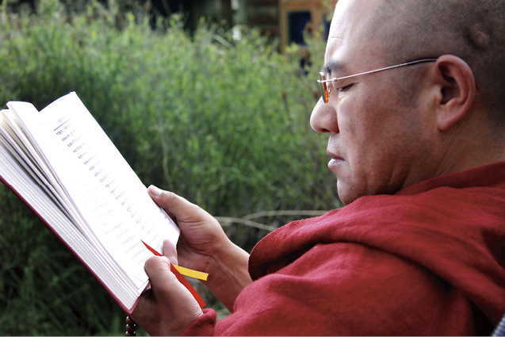

# 第二次传授《教诲天人甘露》

2007年11月18日

今年六月份，我给大家念过这个教言的传承，今天我想再念一遍，然后简单讲解一下。

现在学院的天气比较冷，我看到路上已经结冰了。虽然每个地方的天气不相同，每个人的性格和爱好也不相同，但是我们有一个共同的因缘，也就是佛缘。尤其是我们还有一个共同的心愿，为了度化一切众生而证得佛果。

## 闻思修的具体安排

今天的缘起非常殊胜，我希望大家以后每个月都共修一个法，也就是念诵诸佛菩萨的名号，过段时间我会把《诸佛菩萨名号集》翻译成汉文。到时候，你们可以在诸佛菩萨的圣像前供花、供水等，然后聚在一起念诵佛号和发愿文。

有些人虽然没有闻思的能力，但是有念佛、供佛的能力，依靠此法也可以获得功德。现在很多地方经常举行会供、火供等，对于了解密宗教言并且修完加行的人来讲，这样做非常有帮助。但是，所有人只做会供和火供，不一定有特别大的利益。而念诵佛号共修，不管什么身份的人，只要参加就能得到无量功德。

在网络弘法的过程中，我们得到过许多人的帮助，在此我向所有的法师和居士大德表示衷心的感激。依靠网络弘法，一方面对众生有非常大的利益，另一方面也能强大弘法的力量。因为我个人的能力是有限的，很多事情需要大家共同努力才能完成。

10月30号的因明考试，许多道友都参加了，考一百分以上的人也有不少。下次考试可能是12月30号，范围是《量理宝藏论》第三品和第四品。有些道友非常聪明，并且对佛法也感兴趣，以前在学院也学过因明，但我觉得你们应该认真地再学一次。

在管理的过程中，各小组的负责人要按照学会的规定来执行，不要自己想做什么就做什么，这样不太合理。当然，学员们也要听从相关负责人的安排和指挥，一定要好好地配合，这样管理起来才比较方便。

最近，我们正在学习《正法醍醐》[^1]和《入行论》的第六册、第七册。以前学习的时候，法王如意宝会要求我们把《入行论》的颂词都背下来。到目前为止，极个别道友背完了前八品，非常值得随喜。

一般来讲，《入行论》的颂词比较容易背诵，而因明、中观、现观等论典的颂词，比较难背一些。即便如此，学院每年同时背诵三四部论典的道友也非常多，比如说上半年背《大圆满心性休息》《入行论》《量理宝藏论》，下半年背《中观宝鬘论》《宝性论》《现观庄严论》，但山下的居士在背诵方面就稍微差一点。

前段时间，我说希望大家年底前把《佛子行》的颂词背下来，结果很多道友听后特别害怕，但实际上只有三十七个颂词，而且还有将近两个月的时间，差不多两天才背一个颂词。如果这样都背不下来的话，实在有点说不过去。在造恶业方面，有些人好像很有才能、很有智慧；而在善法方面，表面上在学习佛法，但实际上在两个月之内，连三十七个颂词也背不下来。总之，无论男女老少，这次都要尽心尽力地背诵。

其实，背诵并不是特别难，只不过刚开始有点不习惯，这时候会有一点点困难，但慢慢习惯就好了。我之所以希望你们背诵，是因为这有很大的功德。年轻的时候，我也背过一些论典，那时记下来的经文意义，直到现在还记忆犹新。如果没有背诵的话，不管是给别人讲还是自己理解，经常会有与法脱离的情况。所以，大家一定要好好地背诵，背诵非常重要！

背诵的内容，我以前也讲过，最好把《入行论》所有内容背下来，一千多个颂词应该不是很难，每天背几个颂词就可以。实在不行的话，一定要把《佛子行》背下来，这个没有什么困难的。除了老年人或者文盲以外，你们工作再忙，也要把三十七个颂词背下来。

这次学习的时候，《入行论》和《正法醍醐》这两本书都必须要学。我听个别道友说：“我只学习《入行论》，不学其他法。”这是非常愚蠢的说法。学习《二规教言论》和《佛子行》，对你们根本不会有任何危害，这一点我可以保证。这个学期一共有四个多月，在此期间，希望大家养成有序的学习习惯。

有些道友可能会想：“从开始到现在，《入行论》已经学了这么长的时间，现在有点生起厌烦心，可不可以不学了？”但我想，我们从年轻到现在，从不会因学习佛法而厌足，还在继续学习；而有些人以前一直迷迷糊糊地过生活，基本上没有怎么闻思佛法，现在遇到这么好的机会，如果没有好好学习，真的非常非常可惜！因此，希望你们不要生起厌倦心。

现在《入行论》的一千多个颂词还没有讲完，如果你们在中间就生起厌倦心，那应该感到很惭愧。我们应该追随前辈高僧大德的求学足迹，始终秉持孜孜不倦的态度，在修行的道路上不断前行，不要给自己找任何理由和借口。

## 辅导时不能脱离法义

最近，我听说个别地方的辅导员道友，在辅导《入行论》或其他论典时，总是夸夸其谈，实际上与原文以及我讲的内容差得很远，所以我也要求相关工作人员去调查一下。虽然你是辅导员，但如果只是嘴巴会说一点，世间的学问高一点，不一定就能讲得来佛法。所以，希望各地的居士们也认认真真地观察，不要光看一个人嘴巴比较会说，就让他一直耽误大家的时间，这样没有必要。

以后，各地的学习方式要以听光盘和看法本为主，课后大家可以一起探讨。为什么这样讲呢？并不是因为我很傲慢，也不是说我讲得多好，而是从法的方面来讲，跟网络上的道友比起来，我依止上师的时间应该算比较长的。我在法王如意宝面前听法接近二十年，而在我们的居士辅导员当中，有没有依止上师二十多年并且不间断闻思佛法的呢？这样看来，在佛学方面，我应该算是专业人士。虽然我的文化水平不是很高，但我学习的时间以及依止上师的时间是比较长的，对佛法也有一定的研究。

总之，希望你们在辅导的时候，不要信口开河、离题千里，不要随意发挥，从来不引用佛经论典中的教证和公案，完全凭着自己的分别念胡言乱语，这样没有多大的意义。另外，大家也不要把光盘和法本抛之脑后。我这样说并不是表示我的思想有价值，而是我所讲的这些内容，与传承上师的教言和诸佛菩萨的经论是不相脱离的，这一点我比较有把握。

作为辅导员，第一不能离开《入行论》的颂词，第二不能离开《入行论》的讲记，如果在这个基础上加以发挥，让大家更好地理解法义，这样才能真正起到辅导的作用。对于没有遵守原则的道友，我给予过批评，也取消了个别人的资格。因为外面有些人的胆子非常大，他们对佛教的道理并不是特别懂，只是将一些世间说法加进来，然后就随口乱说，这样没有多大的意义。

为了听课，你们应该花费了很多时间和精力，对此我也非常随喜。为什么这么讲呢？因为大家有一个共同的心愿和希求心。如果你们对佛法不感兴趣，我想传授佛法也有一定的困难。

如今，越来越多的人对佛法感兴趣，但我希望在家居士们能有长期的信心，不要只是三分钟热度，更不要把学佛当作一种消遣，一定要把学佛当作生命中最主要的事情。有些居士，的确非常精进，有时候我都感到很惭愧。尤其是现在这个末法时代，我发现有些在家人远远超过了一些出家人。当然，我不是说所有的在家人都非常精进，有些在家人也特别懒惰，经常爱睡懒觉，这种现象也有。

《入行论》的学习到现在已经一年多了，有些道友确实有所收获、有所体悟，希望依靠诸佛菩萨的加持，今后我们也能一起努力。

## 讲解《教诲天人甘露》

《教诲天人甘露》目前只有藏文，还没有被翻译成汉文，我打算以后翻译。所以，今天我会一边念传承，一边进行简单的字面解释。

法王如意宝在讲窍诀之前，首先对文殊菩萨作礼赞。

这个教言，是将所有的八万四千法门归纳起来，以简单的语言来进行宣说。所以，大家一定要记住。如果法王老人家没有圆寂，现在还活在人间的话，那么除了这些教言以外，也没有其他更好的度众方法了。

诸佛菩萨度化众生最殊胜的方法是什么呢？就是语言。就像佛陀在世时，以身体来度化众生的情况很少，以意度化众生的情况也很少，大多是通过教言来度化众生。法王如意宝也是如此，虽然上师的色身已经示现圆寂，但是他的教言依然留存于世。因此，我们要重视这些教言。法王如意宝说过：“如果只是在口头上讲得天花乱坠，这没有多大的意义，应该把释迦牟尼佛的教法归纳起来，给大家讲述简单的教言。”

法王如意宝在这里主要讲了四个教言：

第一，依止善知识，依止善知识是修行之道的根本。

第二，闻思佛法，闻思佛法是增上功德的助缘。

第三，守持清净戒律，清净戒律是一切利乐的源泉。

第四，修持等持，修持等持是获得圣果的根本因。

如果你们要修习佛法，这四种教言是不可缺少的。所以，大家在行住坐卧四种威仪当中，千万不要忘记这四种教言，一定要牢记于心。简而言之，第一个是依止上师，第二个是听受佛法，第三个是受持清净戒律，第四个是修行佛法。

我们做任何一件事情，都应该有一种收获，收获什么呢？比如这次法王如意宝《教诲天人甘露》中的四个教言，大家一定要记住，千万不要忘记！

### 1．依止善知识

第一个教言，依止上师的时候，要把上师看作自己的眼睛和心脏那样来重视，经常赞叹上师，不要诽谤上师，尽心尽力地承侍上师。这就是依止上师的方法。

白天观想上师安住在自己的头顶，晚上睡觉时观想上师融入自己的心间，然后以恭敬心和信心祈祷上师，观想上师给自己赐予四种灌顶，最后在自心与上师的智慧无二无别的境界中安住。

过段时间，我会把这个教言翻译出来，然后在网上公布，到时候你们可以一边看颂词，一边观想内容。

### 2．闻思佛法

第二个教言，所听受的佛法是什么呢？就是浩瀚无边的显密一切教言，这样我们内心无始以来的无明愚痴才能被一一遣除，成办今生来世的一切伟大事业。这就是听受佛法的功德。

对于所听受的教言，我们不能听过、学过之后就停留在表面，这是不合理的。对于所学的大圆满、菩提心，或者是任何一个教言，大家多多地闻思以后，要将所有的怀疑全部遣除，生起真正的定解。

### 3．守持清净戒律

第三个教言，如果离开了清净的戒律，即便你相貌庄严、广闻博学，或者具有其他功德，也是无济于事，由于恶业的牵引一定会堕入三恶趣，长期地感受痛苦。因此，一定要成为受持清净戒律的人。

作为居士，可以守持皈依戒和居士五戒，然后尽量不要失毁戒体。如果有失坏戒律的情况，应该先在诸佛菩萨面前诚心忏悔，然后再在诸佛菩萨或善知识面前重新受持，否则很难得到解脱。

如果具足清净的戒律，即便你没有其他的功德，但实际上所有的天龙八部、人、非人等，都会异口同声地赞叹、撒花。到了一定时候，不需要刻意勤作，世出世间的功德会像上弦月一样越来越增上，包括财富、名声等等。

### 4．修行佛法

第四个教言，如果没有喝水的话，不能遣除口干舌燥的感觉；同样，在系统学习佛法之后，如果没有修行的话，不能得到真正的解脱。

修行的时候，首先要从人身难得、寿命无常、轮回过患和因果不虚开始，然后修顶礼、皈依、发菩提心、念百字明、供曼茶罗以及上师瑜伽，最后修生起次第、圆满次第，以及大中观、大圆满，按照传承上师的教言次第修行。

大家一定要好好修行！如果没有实地修持，只是听一下课、念一下仪轨，很难真正改变自相续，一定要好好思维人身难得、寿命无常以及皈依、发心等道理。其实，我们现在能修的法特别多，应该坚持每天花一些时间实修。如果没有实修，懂得再多的道理，也不一定能遣除痛苦，就像没有喝水就不可能解渴一样。

那么，如何正确地修行呢？应该依照全知无垢光尊者的教言甘露，也就是九乘次第都圆满宣说的《大圆满心性休息》来修行。没有得过灌顶的道友，可以先看这部论的显宗部分。法王如意宝在世时，曾要求我们好好地学习这部论典，因为里面圆满宣说了宁玛巴的道次第。所以，大家一定要认认真真地学习这部论。

最后，法王说：“这样所说的善根，回向给一切众生，愿所有众生遣除二障、获得菩提，并生生世世不离麦彭仁波切的慈悲摄受。”

以上就是法王如意宝的《教诲天人甘露》。

总而言之，大家应该记住：

第一，依止上师。虽然很多居士身边没有上师，但是不要紧，现在你们每天听上师的教言，而这些教言都是诸佛菩萨的金刚语，也算是依止上师。

第二，闻思佛法。大家应该坚持每天听一两节课，然后修行方面尽量按照《大圆满心性休息》来修。除此之外，也可以每天观修菩提心，或者观人身难得、寿命无常等等，这一点不是很困难。

第三，守持清净戒律。作为居士，一定要先守持三皈依戒，然后五戒中能受持几分戒都可以。你可以受持不杀生戒，也可以受持不偷盗戒。即使不能全部受持五戒，只受持一分戒也可以。

第四，修持等持。

这些大圣者们的教言，大家一定要记住。千经万论那么多教言要全部记下来的话，现在末法时代的我们根基也不是很好，确实有一定的困难。而法王老人家修行一辈子，最后留下许多如同无价之宝的殊胜教言，我们一定要有珍惜感、难得感。因此，我非常希望各位道友能够认真学习这些教言。

现场互动

⊙ 问：我哥哥前些日子突然去世了，现在可能还处于中阴期间，请问如何才能让他往生善趣？

堪布：一般来讲，人死后49天内是处于中阴阶段，但在此期间，大多数人找不到自己的下一生，只有个别人以不同的业缘能投生。

不管怎样，我们活着的人应该为亡者多做一些善事。按照藏传佛教的传统，在亡者去世后的49天内，家人会不间断地为亡者做各种各样的善事，比如供灯、供斋、念经、放生、印经书等等。

事实上，不仅是你的亲人，就连今晚一起共修的这些道友，也都会纷纷离开人间，就像在火葬场排着队一样。当一个人离开人间的时候，活着的亲友应该为他多做功德，除了刚才讲到的以外，还可以为他磕头、吃素等等，要做许许多多的功德，这样才能让他往生善趣。

我确实没有神通，也不知道中阴的情况是怎么样，但不知道也不要紧，我们可以根据佛经论典来推断。对亡者来讲，只要有人给他念经回向，他一定会得到利益，这是诸佛菩萨的金刚语，大家务必要深信不疑。即便你只是一个凡夫人，但是依靠经咒善法不可思议的加持力，一定可以利益到亡者。因此，在你哥哥去世的49天之内，我希望你能不间断地为他做各种善事。

⊙ 问：有的道友现在急于修五加行，但因为时间太短又同时学两部论，他们就把皈依和磕头合起来修，请问这样如法吗？

堪布：这样修是如法的。我们以前修的时候，也是把皈依和磕头合在一起修。你们听两部论典，还要修五十万加行，非常随喜！

⊙ 问：请您为我们传授皈依。

堪布：凡是今天皈依的道友，法名共同取为“圆智”，圆满的圆，智慧的智。以前法王如意宝给我们灌顶，有时也会给大家取一样的法名。

（堪布传授皈依戒）

⊙ 问：有的道友觉得在家烦恼很多，修行的违缘也很多，想到学院去修行，但是又放不下工作，该如何圆融？

堪布：面对家庭和工作上的琐事，每个人都会感觉压力很大，或者说烦恼深重。但到了学院，其实也不一定能减轻烦恼。

其实，现在我们在学院所讲的法，你们在外面也能原原本本地听到。学院虽然是法王如意宝待过的地方，但是这里的气候寒冷，再加上生活条件也比较差，对你们来说会有些不适应。所以，我的建议是最好不要来学院，而是利用空闲时间多学习佛法。

通过学习佛法，就会知道应对烦恼的方法。作为大乘修行人，面对工作和生活中的违缘时，不应该把它当作违缘，而应该把它当作安忍的对境、精进的助缘。因此，我们也会鼓励学院中已毕业的道友尽量到城市里去弘法利生，不建议他们一直待在学院里。虽然这里比较寂静，但也不一定都是顺缘。

总之，你们在兼顾工作和家庭的同时，还能精进地学习佛法，这是一种勇敢的选择。

⊙ 问：有些道友认为，既然上师是佛的化现，那么接受上师的灌顶时，为什么自己没有什么感觉呢？

堪布：所谓上师是佛的化现，是指真正具有法相的上师，他需要具备佛经中所讲的一切条件。不仅仅是在实相中，在显现层面也要这样。

如果你的上师不具备佛经论典中讲到的条件，那不一定是佛的化现。当然，从了义或实相的角度来讲，每一个众生都是佛的化现，不但上师是佛的化现，弟子也是佛的化现，因为一切众生本具如来藏。

当然，得到上师的灌顶后，不一定马上就有立竿见影的效果。为什么呢？因为上师给你传的灌顶，是因灌顶而不是果灌顶。什么是因灌顶呢？比如说农民种庄稼的时候，种下的种子不可能马上发芽，要过几个月以后才会发芽。因灌顶就相当于给种子浇水一样，浇水的时候会不会长苗芽呢？这是不一定的。因此，即便上师再厉害、再有加持，你也不一定能在灌顶时开悟。

⊙ 问：《菩提道次第广论》中讲，一切烦恼来源于我执，也就是坏聚见，而断除我执以后，所有烦恼就都没有了。既然这样的话，是不是直接对治我执就可以了，不需要学习贪、嗔等烦恼的法相？

堪布：虽然《菩提道次第广论》不是我讲的，但这个问题我也可以回答。

我执是一切烦恼的根本，如果断除了我执，所有八万四千烦恼就会一并消失。但是，如果无法直接断除我执，那就要用各种方式来断掉烦恼，贪心要断除，嗔恨心也要断除。

有些人是喜欢广义者，有些人是喜欢略义者。对喜欢略义者来讲，只要断除我执，所有烦恼就已经断完了，这种人可以直接对治我执。但如果我执断不了，其他烦恼也就没办法断。

总之，任何一个人，只要断了我执或坏聚见，则会将贪嗔痴等烦恼一并摧毁。但就像我刚才讲的那样，有些众生暂时断不了我执，因此要通过各种方式来对治贪心、嗔心、嫉妒心等，而一旦真正断除了我执，其他烦恼也会一并断除。

⊙ 问：我们这里有些新报名的居士，想要学习《入行论》，请问应该怎么安排他们的学习进度？是让他们尽快赶上进度，还是按部就班一周两三节课？

堪布：我认为，最好让他们把前面的部分补上，同时还要跟上现在的学习进度。

前面耽误的课程，要求他们在几个月或者一年当中必须学完，然后现在学到了第六册，他们也应该跟着同步学习。

⊙ 问：有人说“仁义礼智信”中的“仁”，是外道儒家的思想，佛教徒不应该随学，请问是这样吗？

堪布：事实上，并不是说所有外道的思想，佛教徒都不能学。有些与佛教相合的慈善思想，或者对众生有利的思想，我们也可以随学。但是，外道对佛教的邪见，或者有些不符合佛教真理的思想，我们不应该随学。

⊙ 问：我已经受戒很多年了，但还是戒不掉喝酒，喝完了又很苦恼，怎样才能彻底解决这个问题？

堪布：喝酒确实非常不好，包括我认识的一些官员和老板，他们也认为喝酒不好。

从医学的角度来讲，喝酒对身体危害很大。从世间出世间的角度来讲，我以前也翻译过饮酒、抽烟、杀生的过失，里面讲到很多喝酒的过失。所以，希望你尽早远离这种恶习。

⊙ 问：我从网上下载了您的讲课音频和视频，但是没有报名参加共修，这样能否得到传承？

堪布：报不报名不要紧，但这样得传承，可能有点难。

⊙ 问：将善根回向给门措上师有什么功德利益？

堪布：我们把善根回向给门措上师，其实意思就是说把功德回向给一切众生，让所有的上师都欢喜。这样一来，你的一切意愿也会圆满。

⊙ 问：有个道友近期不想参加《入行论》的共修，他说他现在只学《入行论》的教理，然后专修净土，请问这样可以吗？

堪布：如果他净土修得非常好，这样也可以，我们不会强迫。但按照教务处的要求，没有全部跟着共修的话，不能免费领取学习资料。

⊙ 问：您在《二规教言论》中讲到，修行人要对好人和坏人有一个清晰的认识。这样区分的话，是不是就有了分别念？

堪布：修行人需要区分清楚好人和坏人，应该要有这样的分别念。在名言当中，哪些是好人，哪些是坏人，哪些人对我们的修行有帮助，哪些人对我们的修行没有帮助，这些都要分清楚。但是面对坏人，我们不能像世间人所说的那样去伤害对方，这样做是不如法的。

释迦牟尼佛在因地时，也是把好人和坏人分得很清楚，但是坏人害他的时候，他并没有生起嗔恨心。所以，在名言当中要分清楚好人和坏人，但分清楚之后，没有必要再去过度分别。

⊙ 问：孩子的长相和父母相似，是否与近取因有关？

堪布：孩子的长相和父母相似，不是因为近取因，而是因为俱有缘，也就是与所行持的善法或种姓方面有一定的关系。事实上，孩子的近取因是自己的心，父母的近取因也是各自的心，因此他们的近取因并不相同。

⊙ 问：持咒时只用心默念，口不出声，这样回向功德时是否能利益众生？

堪布：如果心里观想把善根回向给一切众生，就能利益到众生。

⊙ 问：有的学员刚开始特别喜欢参加放生和共修，但过了一段时间，就以种种理由不参加了，原本的发心也中断了，这对他本人的修行或者说今生来世有没有危害？

堪布：放生和共修，都是个人的一种选择。如果一直不间断，会有很大的功德。如果不想继续参加，应该也谈不上有什么危害，只不过是没有积累这个善业而已。

⊙ 问：《山法宝鬘论》是不是针对出家人宣讲的？

堪布：《山法宝鬘论》大多数的内容是针对出家人宣讲的。

⊙ 问：有一位居士说，他的上师给他灌顶，他担心自己守不了密乘戒不想接受，却又不好意思当场离开，最后勉强参加了，但灌顶后他生起很多烦恼，请问他是否得到了灌顶和密乘戒？

堪布：因为我不清楚他们具体的灌顶流程，所以这位居士有没有得到灌顶，我现在也看不出来。

是否得到了灌顶，并不是随便说一说，就能推出来的。对于这位上师的法相以及这位弟子的法相，这些我都一无所知，以后了解了，我才有发言权。

## 结语

通过网络的方便方法，大家一起共同品尝佛法的美味，对此我也非常高兴。

以后来菩提讲堂的人会越来越多，希望你们千万不要利用网络来造恶业。人身非常难得，一定要把时间用在佛法方面。

现在，让我们一起祈祷法王如意宝，祈祷十方诸佛菩萨：愿所有人的相续中真正生起圆满利他的菩提心，愿我们生生世世不离大乘佛法，不离大乘善知识。

希望每一位道友都不要退失对佛法的信心，一定要获得究竟解脱。我也祈求十方诸佛菩萨和金刚上师法王如意宝，让所有人的相续中生起真实无伪的菩提心：“菩提心妙宝，未生者当生，已生勿退失，展转益增长。”

[^1]: 在早期，《二规教言论讲解》《佛子行讲解》这两部论典合编成《正法醍醐》。
