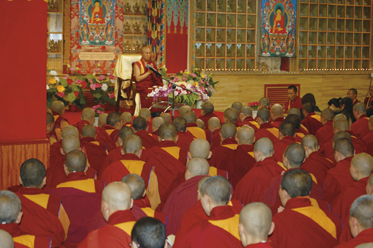

# 金刚萨埵怎么修

2008年6月7日

今天，与诸位道友在菩提讲堂再次见面，感到非常高兴。这次开示主要有三方面内容：一、最近《入菩萨行论》的学习基本圆满了，很多人关心接下来学什么，今天我就给大家讲一下；二、过几天学院开金刚萨埵法会，需要念诵《金刚萨埵修法仪轨》，我给你们念一下该仪轨的传承，然后讲解念诵的功德；三、有些道友可能会有一些问题，如果有时间，我可以做简单的回答。

## 现阶段学修总结

我们学习《入菩萨行论》用了将近两年时间，再有两三堂课，整部论就全部学完了。在这两年当中，很多道友非常精进，传承全部圆满了，我也尽了自己的一切力量为大家讲解。音频、视频和讲记制作出来需要一段时间，讲记大概有12本，这些以后会陆续提供给大家。

这个过程并不容易，我们彼此都很清楚。大部分道友都比较精进，投入了很多时间和精力用于学习，当然，也有一些人不是太精进。但不管怎么样，我想多数人的传承应该都圆满了，没有圆满的道友，希望你们挤出时间听一遍录音。

所谓传承圆满，并不是指看一遍法本，而是要把所有讲法语句的声音听完整，中间不能有任何漏缺。按照传承上师的要求，中间打瞌睡也不合理。如果大家看视频有困难，听音频也可以。

有些道友从未得过一部法的完整传承，这是非常可惜的。《入菩萨行论》只有一千多个颂词，如果这都没有毅力听完，恐怕接下来修其他法会更加困难。希望大家都能尽快圆满《入菩萨行论》的传承。

过几天，我们会在网上给大家公布这次考试的内容范围。希望各地佛友参照这个考试提纲，现在就开始复习。虽然离考试还有好几个月，但如果不提前复习，到时可能会来不及。希望每位道友都能尽量参加这次考试。

上学期我们考了《入菩萨行论》的一至六册。虽然道友们的考试分数差距很大，但不管怎么样，有参加考试的勇气就很值得赞叹，这说明你对闻思修行很有兴趣。既然前面的考试都参加了，希望这次也能提前做好准备，迎接考试。

## 下阶段学修安排

大约十几天以后，我准备给大家传讲龙猛菩萨的《亲友书》。这部法非常殊胜，按理来讲，应该比较保密，因为不是每个人都可以听授，但我考虑了很长时间，始终觉得虽然汉地很多佛友对佛教的信心很大，但听法的机会却不太多，这是非常可惜的。因此，我在向诸佛菩萨祈祷，特别向传承上师祈求加持之后，准备为大家传讲这部法。

传讲过程中，我没有其他特殊的要求，只要求大家把这部法的传承听圆满。《亲友书》共有一百二十几个颂词，约为《入行论》的八分之一，讲记可能只有一本，圆满应该不会很困难。

此外，这次我对听者的要求也不像《入行论》那样高，范围定得比较广，不只菩提学会的道友，只要对佛教有信心、对大乘法有兴趣的人，都可以听授。在座的佛友如果有机缘的话，希望你们尽量劝请身边的亲朋好友学习这部法，这对他们肯定会有一定的利益。

《亲友书》是龙猛菩萨为乐行国王宣讲的一部非常殊胜的法。龙猛菩萨是我等大师释迦牟尼佛在《楞伽经》等有关大乘经典中亲自授记的大菩萨[^1]。我们作为佛教徒，自称皈依了三宝，如果没有懂得《亲友书》的内容，将是非常遗憾、非常可惜的事。

传完《亲友书》之后，我准备给大家传授《大圆满前行》和《极乐愿文大疏》。个别道友可能只修净土法，这样你只听授《极乐愿文大疏》也可以。如果对显宗和密宗都有信心，就可以同时听授这两部法。如果只对密宗有信心，只听《大圆满前行》也没有什么不可以。

以上就是我今年的课程安排。

## 珍惜闻法机缘

现在我们依靠网络来传授或听授佛法，这是一种最殊胜的方便方法。希望大家千万不要错过这个机会。虽然我是具有一切束缚的凡夫人，但我口里说出的教言却是传承上师和诸佛菩萨的金刚语。如果大家依靠这样的金刚语来修持，对自己的心相续一定会有利益。

个别人可能觉得学不学法无所谓，今生过得好就可以了。虽然这是末法时代的普遍现象，但我始终觉得作为佛教徒，不应只求今生快乐，而对漫长的来世不屑一顾。如果将自己来世的快乐全部抛之脑后，是目光极其短浅的愚痴行为，因为，我们这一辈子最多活几十年，而来世却是几万年、几亿年，乃至无量劫。我们这一世的人身得来非常不易，千万不要浪费在一些没有太大意义的事情上。在我的内心当中，非常希望道友们不要为了今世的快乐而一心扑在各种世间法上，真正该希求的应该是解脱。

## 闻法注意事项

此外，希望大家学佛的时候，不要仅仅停留在名相上，很多人表面上学佛，实际上对因果、三宝的信心非常差，这样也不是很好。希望每个人都能从内心当中深信因果、诚信三宝，并发起利益众生的殊胜菩提心。

还要提醒大家，在学法过程中，千万不要缘佛法来造恶业。有些道友彼此之间产生了一些矛盾、恩怨，这不是很好。道友之间应该和睦相处，不要因为一些小小的冲突而影响到大家的闻思修行。这样罪过非常大，乃至生生世世都会堕入恶趣。

我们学习《入菩萨行论》已经这么久了，每位道友都应该随时随地观察自己，看看所学的法是否融入了自心。这次四川大地震，我看到很多世间人帮助众生的心特别强烈，有些为了救人，将自己的生命抛之脑后。他们虽然从未学过大乘佛法，但却具有舍己救人的精神，这是非常值得赞叹的。反观我们极个别人，虽然学了这么长时间大乘法，但却根本无法与他们相比，救灾的时候顾虑特别多，觉得那里有瘟疫不能过去啊，如果有余震该怎么办啊，别人对我有看法怎么办呢……

作为大乘佛教徒，怀有这些想法确实应该感到惭愧。如果在一帆风顺时，把菩提心挂在口头上，觉得利益众生没有任何问题，而当真正遇上违缘、逆境的时候，对众生的态度又是另一种，则不能算是真正的大乘修行人。如果从内心当中对众生真正生起了大悲菩提心，遇到再大的困难也不会顾忌的。希望道友们对此好好反思。

由此也能看出，如果没有实际修持，只在表面文字上或口头上学习佛法，很难真正利益众生。非常希望大家把所学的大乘法用在实际行动当中，这一点非常重要！

## 金刚萨埵法会事宜

### 一、法会安排

每年藏历四月初八，学院都会举行为期八天的“金刚萨埵法会”。今年因为地震等种种原因，来学院开法会不是很方便。希望法会期间，大家能在各自的道场、佛教中心或者自己的家里，跟着学院僧众一起念诵金刚萨埵心咒。届时，我们会在三个菩提讲堂为大家提供直播。

依靠这种不可思议的方便法，以及共同的发心、发愿，即使你们没有翻山越岭来到五明佛学院，也可以同样获得诸佛菩萨的加持，得到金刚萨埵法会的功德。

今年法会的阳历日期是6月11日至6月18日。法会期间每天修四座，上午两座，时间分别是7:00—9:00、10:00—12:00；中午休息一个半小时；下午修两座，时间分别是13:30—15:30、16:30—18:30。八天都这样安排。每座开始的时候要发心，然后念诵金刚萨埵修法仪轨，中间念诵金刚萨埵心咒，最后念《普贤行愿品》回向。

前不久学院开观音法会的时候，我们也做了网络直播。外面很多居士和有些出家人反映特别好，觉得虽然自己没来学院，但法音萦绕耳边的时候，自己似乎已经在学院与所有僧众一起开发会了，有一种亲切感。我也觉得这样直播非常好，希望大家在这八天当中，安住于道场、家里或者单位等场合当中，尽心尽力地念诵金刚萨埵心咒。

以前法王如意宝规定，金刚萨埵法会期间，每人需要念完四十万遍金刚萨埵心咒。大家从现在开始就可以念诵，如果法会期间因为家庭、工作等原因实在不能完成，后面要尽快补上。当然，在八天当中完成是最好的。其实，每天念五万遍金刚萨埵心咒应该没有任何问题。我们这里很多道友每天可以念八万遍，甚至十万遍。

### 二、为何开金刚萨埵法会

末法时代，众生造业非常严重。在座所有的道友，无论你以前在什么样的团体或家庭背景下长大，都会造过杀生、说妄语、邪淫等不可细数的恶业。皈依佛门之后，可能还会造过违反戒律等罪业。不只今世，乃至想不起来的生生世世，肯定也造过各种罪业。如果这一辈子没有好好忏悔，以后不一定会有这样宝贵的忏悔机会。所以，这次法会不但非常殊胜，而且极其难得！

如果大家没有特别重要的事，在这八天当中，最好把所有的琐事都暂时放下，以闭关的方式念诵，尽心尽力圆满四十万遍金刚萨埵心咒。

### 三、为何修金刚萨埵

为什么要祈祷金刚萨埵、念诵金刚萨埵心咒呢？因为无量劫以前，金刚萨埵佛在因地曾发过愿：愿我将来成佛时，任何一个众生只要持诵我的名号，或者对我起信心而皈依，哪怕他造了五无间罪、破誓言等极重的罪业，也能马上得以清净，若其罪业不能清净，但愿我不成佛。后来，金刚萨埵就像阿弥陀佛一样已经成佛，这说明他的此愿已经圆满。

由于金刚萨埵具有这样的愿力，故而在忏罪方面，念诵金刚萨埵心咒与念诵其他佛号或咒语并不相同。任何人持诵金刚萨埵心咒，罪业必定得以清净。

麦彭仁波切在《百咒功德》中讲：如果持诵金刚萨埵心咒，一切佛的名号皆已持诵，因为十方诸佛菩萨的本体，全部可以包括在金刚萨埵当中，也即任何一位本尊，都可以包括在金刚萨埵当中；任何一个咒语，都可以包括在金刚萨埵心咒当中。可见，念诵金刚萨埵心咒的功德非常大。尊者还说：金刚萨埵以前发过愿：愿我以后能遣除一切罪业深重者的障碍；即使有人仅仅忆念我的名号或咒语，罪障也会得以清净。

为什么要念四十万遍呢？《梦尊调伏续》中记载：如果念满“嗡班匝儿萨埵吽”十万遍，即使破了密乘的根本誓言，也能清净。法王如意宝说：末法时代念诵咒语的数目，应该是初劫时的四倍。以此推算，我们现在如法地念满四十万遍金刚萨埵心咒，一定能清净以前所造的一切罪业。这次法会很多道友需要发心，你们可以一边发心，一边认真地念诵。

### 四、念诵方法

念诵的时候，可以按照《大圆满前行》中金刚萨埵的修法进行观想，也可以按照上师如意宝传过的《如意宝珠》金刚萨埵单身修法进行观修。

法会每一座开始的时候，一定要发菩提心。发心时要观想：我这次修金刚萨埵法并不是为了自己一个人清净罪障，像我这样的可怜众生在整个世界当中无量无边。为了利益一切众生，我发愿从现在开始，一定要认真修持金刚萨埵，好好清净自他无始以来的所有罪障。

忏悔的时候，内心要观想：自己为一般的众生，金刚萨埵安住在自己头顶的千瓣莲花之上，通过念诵金刚萨埵心咒，金刚萨埵心间降下白色的甘露，清净了自他一切众生往昔依靠邪知识等各种恶缘所造的所有罪业。之后观想：自己心间的金刚萨埵心咒发光，幻变出无量无边的美妙供品，上供十方一切诸佛菩萨，下施轮回一切众生；光束收回的时候，自己获得了一切悉地。希望大家能通过这种方式念诵、观想。每座最后应念《普贤行愿品》回向。

要想提高念诵质量，一定要依靠四种对治力——所依对治力、厌患对治力、恢复对治力、现行对治力。

所依对治力，即念诵的时候，要观想自己的根本上师与金刚萨埵无二无别，并将其作为自己的作依；厌患对治力，就是对自己无始以来所造的罪业感到非常害怕，产生了如同服了毒药一般强烈的后悔心，真心认为自己错了，严厉谴责自己的恶行；恢复对治力，即发愿从今天开始修持金刚萨埵，以后纵遇生命危险，也不再造作罪业；现行对治力，即通过不断观想金刚萨埵身像、不断念诵金刚萨埵心咒，最后使自己的身口意全部得以清净。

法会期间，希望大家尽量不要说很多无聊的语言，最好以禁语的方式念诵。这样一方面会获得较大的功德，另一方面，如果说很多闲杂语，想念满四十万遍金刚萨埵心咒也会有较大的压力。共修的时候，每位道友都需要约束一下自己。

这次因为种种原因，大家来学院有一定的困难，但现在网络等各方面的因缘已经成熟，你们在各自的地方跟着学院僧众共同发愿、念诵、忏悔、回向，这与来学院没有任何差别。

如果大家每天能跟着学院同步念诵，当然是最好的。但可能除了个别有殊胜因缘的人以外，很多道友都要工作、照顾家庭等，不一定有时间一直挂在电脑上。这样你们早上第一座跟着学院僧众把前面的发心和金刚萨埵仪轨全部念完，白天有时间就一直持诵金刚萨埵心咒，晚上念《普贤行愿品》回向，这是最简单的一种修法。

### 五、了知因缘

大家此生遇到金刚萨埵法门，是极其殊胜的因缘。有些续部讲：如果有人今生遇到金刚萨埵法门、闻到金刚萨埵的名号，说明他以前在无量诸佛如来面前承事过、恭敬过、供养过、积累过资粮，由此，他经常受到诸佛菩萨的加倍、护佑而成为大乘修行人，最终将会往生清净刹土。可见，各位道友都与金刚萨埵有着非常深厚的善缘，否则，今生根本听不到金刚萨埵咒语。

以前，法王如意宝开取过莲花生大士的一个伏藏——《金刚萨埵修法·如意宝珠》。这个修法仪轨中也讲：金刚萨埵法门，尤其这个《如意宝珠》法门，与汉地众生特别有缘。

所以，希望在座所有的修行人，一定要抓住这个难得的机缘，认真忏悔自己往昔的罪业。

尤其在这个月（藏历四月）当中，做任何善事或和恶事，功德和罪业都会成百万倍地增长。这个月在藏地被称为萨迦月，释迦牟尼佛降生、成道、涅槃三个节日都集中于该月。当然，以不同的历算，节日也有一些不同的说法，但释迦牟尼佛成道日是没有任何争议的。希望大家在这个月当中，能圆满完成四十万遍金刚萨埵的念诵。

法王如意宝应该说是佛陀再来，但显现上每一次开金刚萨埵法会，他一定会念满四十万遍金刚萨埵心咒。像法王这样的大成就者，都如此精进地忏悔，更何况我们造业这么严重的人呢？大家以前没信佛的时候，光是吃饭可能就杀过很多众生。为了清净这些罪障，现在一定要努力忏悔。我虽然有翻译等各种事情要做，但每一年的金刚萨埵法会，也都会圆满念完。

### 六、遣除疑惑

金刚萨埵法门是任何人都可以修的法。大家身边如果有皈依过佛门，或者未皈依但对善法感兴趣的人，你们都可以劝他们参加这次念诵。

有些人可能认为，金刚萨埵是密宗的修法，学显宗的人没必要修。其实，这完全是一种错误的理解，无论显宗还是密宗的修行人，都可以修持金刚萨埵法。

法王如意宝发愿往生西方极乐世界的时候，要求大家先圆满四十万遍金刚萨埵心咒，以此清净以前所造的五无间罪或诽谤佛法等罪业。

此外，金刚萨埵也发过愿：我愿显现于一切破戒者面前；我愿显现于一切破誓言者面前；我愿显现于一切业力深重者面前；我愿显现于一切造五无间罪者面前。由此可见，金刚萨埵并不是在菩萨面前显现，而是在世间一切业力深重的凡夫面前显现，乃至造了五无间、破誓言等最可怕的罪业，通过精进念诵金刚萨埵心咒，罪业也会得以清净。

为了使这次法会顺利举行，很多发心人员都要随时维护现场和网络，非常辛苦。凡在这个过程中发善心的人，我都非常非常感谢，也祈祷诸佛菩萨加持你们。希望大家以后都能经常发心。

## 念诵金刚萨埵修法、烟施仪轨

接下来，我为大家念诵《金刚萨埵修法仪轨》。这是麦彭仁波切造的，我们学院每次开金刚萨埵法会都会念诵这个仪轨。另外，有些道友提出想得受火供火施的仪轨，今天我也给大家传一下。

（堪布念传承）

现场互动

还有几分钟时间，如果大家有问题，我们可以交流一下。

⊙ 问：非常感谢大恩上师教授我们这么殊胜的佛法，觉得您就像我们的再生父母一样！学了《入行论》以后，我的内心触动很大，深深感到生起菩提心的重要性。我看到学会还开设了五部大论学习班，也很想学习这五部论。请问，其中的戒律我们可以学吗？五部大论的学习顺序是怎样的？请为我们指明道路。

堪布：作为居士，需要学习一些戒律。虽然戒律中的比丘、比丘尼、沙弥、沙弥尼戒律，居士不必学习，但作为佛教徒，皈依的戒律一定要学；受了居士戒之后，三皈五戒也需要学；发了大乘菩提心之后，菩萨戒也要学；授过灌顶之后，密乘戒更要学。所以，学习五部大论中的戒律还是有必要的。

对于五部大论，藏传佛教各派有不同的学习次第。格鲁派先学现观庄严论，然后学习因明、中观、俱舍论，最后学习戒律；按照上师如意宝的传统，先学戒律，然后学习因明打开智慧，之后学习《俱舍论》来了知一切世俗法；最后学习宣说显义空性的“中观”以及隐义空性的“现观”，以此可以了知胜义法。

我认为如果具有智慧，居士也可以学习五部大论。学完之后，就已经掌握了整个佛法的框架。五部大论的每一部都有其不共的长处，少学其中一部，都不完整。比如，如果不懂中观，就无法理解诸法空性的道理；如果不懂现观，那般若的意义，尤其五道十地之理就不会明白；如果不懂因明，就不会运用佛理与对方辩论。

如果学了五部大论，其他的法，比如大圆满前行、净土法、禅宗法、密宗一些简单的法门，都非常容易理解。如果没有五部大论的基础，很多佛法的道理都不是很好懂。

我五六年前发愿为汉族四众弟子传讲五部大论。近期把《现观庄严论》讲完之后，就全部圆满了。我一边传讲，一边把关于五部大论较好的藏文经论译成了汉文。有了五部大论的书和光盘，你们完全可以自学。我认识的很多年轻居士与学院僧众一样，每天都在不断学习，现在基本圆满了五部大论。

你提的问题非常好。《入行论》和《大圆满前行》讲的多是佛教的基本道理，内容不是很甚深。如果学了五部大论，佛教最深奥的道理就基本明白了。很多道友既年轻又具有一定智慧，最好不要把自己的智慧用在今生无意义的琐事上，而应与佛陀最甚深的法结上善缘。

我个人虽然已经学了这么长时间佛法，但现在对于五部大论和密法为主的法要仍然非常有兴趣，每天都想翻译一点、给大家传讲一点。我的工作除此之外没有别的，自己这方面的兴趣一直不断。非常希望大家经常祈祷上师如意宝，尽量圆满五部大论。

⊙ 问：小乘的有部宗和经部宗、唯识的真相唯识和假相唯识，以及中观自续派和应承派，他们在见解上的主要区别是什么？

堪布：我以前翻译的很多论典中对此都有宣讲。比如麦彭仁波切的《中观庄严论释》就对内道各派的观点做了详细辨析，你们可以看一下。

⊙ 问：唯识宗讲清净的依他起和不清净的依他起。请问，依他起是什么意思？

堪布：唯识宗承许遍计法、依他起和圆成实。这三者是所有唯识宗的要理。菩萨后得位时，见到本尊的形象、器世界和有情世界的清净眷属等，叫做清净的依他起，也就是说，佛的相好圆满和菩萨无量无边的功德等，这些叫做清净的依他起；不清净的依他起，是指凡夫人现在所见的世间各种有漏的五蕴法。

⊙ 问：唯识宗讲万法唯心。这个心是指整个八识，还是单指第六分别意识？

堪布：万法唯心，这个心可以指我们的分别意识。按照《入中论》的观点，万法的因是识，并不是说万法的一切显相都是心。详细观察时，八识当中阿赖耶识的习气成熟以后，变成了显现的万法。

⊙ 问：财布施一定不如法布施吗？

堪布：不一定。

## 结语

可能还有很多道友想提问，但我们虚空聚会的时间有限，只能等下一次了。这次聚会最主要的意义是希望大家好好念诵金刚萨埵心咒，圆满四十万遍。此外，对于自己身边不信佛教的家人、朋友，最好也能劝他们念诵，哪怕念几遍金刚萨埵心咒也是很好的。

最后，我们把这次聚会的一切善根回向给无量无边的众生。

[^1]: 佛陀在《楞伽经》中亲自对龙猛菩萨授记：“南方碑达国，有吉祥比丘，其名呼曰龙，能破有无边。”意即南方碑达国有一位吉祥比丘，名叫龙猛，在佛陀涅槃之后，佛教内部产生争论时，他站出来弘扬大乘中观，破除有边与无边，诠释般若波罗蜜多法门。在《大鼓经》《大云经》《文殊根本续》等大乘经续中，对龙猛菩萨也有明显的授记，有些说他是一地菩萨，有些说是七地菩萨，有些甚至说获得了佛果。藏传佛教中他被喻为“二胜六庄严”之一，汉传佛教中他被八大宗派奉为开山始祖。
