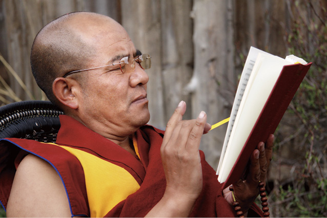

## 关于“生死救度”

2009年12月28日

由于今天参加交流的人比较多，除了菩提讲堂等三个讲堂以外，我们另外增加了几个讲堂。

今天，我首先给大家念《阿弥陀经》的传承，然后做一个简单的开示，因为时间关系，就不安排提问了。学院这几天一直停电，现在依靠发电机发电我才能上网与大家见面。我们这里天气很冷，听说有零下二十六七度，如果发电机出故障，中间很可能会停电，所以我先给大家念《阿弥陀经》的传承。

## 传授《阿弥陀经》等传承

汉地上早晚课都会念诵《阿弥陀经》，很多高僧大德对此经也特别重视。上师如意宝1993年去美国之前，在喇荣山沟下面开了一个很大规模的极乐法会。在法会上，法王给我们讲了《阿弥陀经》和《无量寿经》，所以，我有这部经很清净的传承。

不管学习或念修什么经论，得到传承很重要。今天，我先给大家念诵《阿弥陀经》的传承，之后，念一下《临终关怀仪轨》里的一些咒语和《放生仪轨》里的几个佛号和咒语。

念传承的过程中，希望讲堂里所有的道友不要说话，认认真真地听，听到声音就得到了传承。念诵大概需要十分钟左右，大家坚持一下。

首先念诵《阿弥陀经》……接着是《临终关怀仪轨》和《放生仪轨》里药师七佛的名号……八大菩萨名号的传承……再给大家念一些咒语……最后是《极乐愿文》……

## 传授皈依

今天有些道友想要皈依，下面我就为你们传授皈依。已经皈依过的可以在三宝面前再次皈依。大家首先观想释迦牟尼佛在自己的面前，然后合掌并在心里发愿：从现在开始，我进入佛门、皈依三宝，今后哪怕遇到生命危险，也永远不舍弃释迦牟尼佛为主的十方三世诸佛，永远不舍弃佛陀所宣说的与解脱有关的法门，并要随学佛陀的僧众。

佛、法、僧就是我们所说的三宝。我不要求你们皈依我，皈依人与皈依三宝相比，大家应该皈依三宝，这样没有任何危险。皈依非常重要，已经皈依过的，今天再次皈依会使相续中的善根越来越增上；没有皈依过的，今天皈依之后，你就真正变成了佛教徒。

下面我给大家念诵皈依戒。你们听完之后，相续当中就会得到皈依三宝的戒。这相当于心里发了一种皈依的誓言，就像世间人入了党就成为党员一样，我们皈依之后，就入了佛教成为佛教徒。

（堪布用藏语念皈依戒）

今天皈依的道友，男众法名统一叫“圆慧”，女众法名统一叫“圆悲”。以前已经皈依并得过法名的，不用改原来的法名。

## 规范放生和往生仪轨

最近，我编了一本《生死救度》的书，主要讲放生和临终关怀。

近些年来，全国各地很多佛教徒都在放生，但有些人放生的方法和使用的仪轨不太规范。经过再三思量，我写了一个简单的放生仪轨。过段时间，仪轨和配套光盘会发到道友们手里。如果你们原先有非常好的传统或放生仪轨，可以继续沿用；如果没有，最好用我们现在的“放生仪轨甘露妙药”来放生。

我同时也写了一个“助念往生仪轨”，因为看到汉地很多老人去世以后，没有人为他们超度和念诵，这是非常可怜的。希望学会道友们能尽量念诵这个仪轨为亡者助念。过年之前，这本书就会发到你们手里。

我们学院安排了嗓子好的道友，用统一的音调来念诵，并制作了视频和音频。希望大家念诵这个仪轨时，也能统一音调，就像不管到汉地哪座寺院，早晚课的念诵音调都是统一的。以后，这个助念仪轨在弘扬佛法方面，应该会起到很大的作用。

## 免费超度事宜

后天晚上，我们学院准备做一个免费的超度仪式。大家可以通过各种方式，把需要超度的人员名单传到弘法部或智悲佛网的管理人员手里，我们这边可以念诵回向。如果有些地方的亡者名单太多了，当地居士可以组织起来，一起念诵一遍往生仪轨，然后把名单烧掉，同时，可以烧一些饼干之类的食品。

各个地方包括菩提讲堂的有些道友，以前自己的父亲、母亲、爷爷、奶奶等亲人去世的时候，可能连一句佛号也没有为他们念。最近，我们这边来了很多消息，也许有些是真正的亡人托梦，也许有些只是分别念的迷乱显现。但不管怎样，很多亡人虽然已经去世多年，但从未得过任何超度和念诵，这是非常可怜的。所以，这次学院举办一次免费的超度，各地道友最好也能一起念诵“助念往生仪轨”。

我们超度的对象，不仅有自己以前的亲朋好友，还有所有因战争、饥饿、灾难等原因而死亡的可怜人；不但要超度人类，也要超度动物等，比如，屠宰场每天被杀的无量无边旁生也需要超度。众生非常可怜，很多死后连一遍观音心咒的加持都得不到。希望菩提学会为主的道友们，能好好地念一遍助念往生仪轨，超度这些亡灵。

后天，大家可以选一个适当的时间集中念诵。如果不能集中念诵，可以从网上下载往生仪轨，自己念一遍。往生仪轨里全部是诸佛菩萨的名号、佛经和咒语，念诵的功德非常大，不但对亡人有帮助，活人听了也会得到很大利益。

## 法王纪念法会的相关事宜

今年12月31日（藏历11月15日），是法王如意宝圆寂六周年纪念日。从12月30日开始，我们学院要召开七天法会，法会期间主要念诵金刚萨埵心咒、法王如意宝的上师瑜伽、上师供，以及《普贤行愿品》。

你们作为在家居士，连开七天法可能有一定困难，但如果因缘具足，在12月31日，即法王如意宝圆寂的那一天，不管大范围还是小范围，最好能在一起共修上师瑜伽，念上师供、金刚萨埵心咒等。在座的很多道友都有缘见过上师如意宝，有些虽然没有见过，但一直在接受法王的法和传承，得到了很多佛法方面的利益。可以说，你们每个人的心相续中，都有法王如意宝直接或间接的加持和智慧。

法王如意宝圆寂以后，我们无法用财物等方式报答上师的恩德，而共修上师瑜伽，让上师的智慧与自己的分别念融入一体，是忆念上师恩德的一种很好方式，这也是证悟的最佳途径。《自生自显续》云：上师在世时应以三喜供养，即法供养、财供养和承侍供养，上师圆寂后应开纪念法会供养。比如，宗喀巴大师圆寂之后，格鲁派所有的寺院，每年都会在大师圆寂的日子召开大型法会。

总之，为了报答上师的恩德，为了自相续真正强行获得上师的无上加持，使之永远与佛法相应，依靠如此殊胜的因缘，大家一定要共同祈祷上师如意宝，这非常有必要！

这次法会我们本想全程直播，但一方面，学院这边天气特别冷，另一方面，也不知道外面是否有很多人参加。所以，我们只在12月31日这一天，通过音频和视频的方式为大家直播。希望道友们能在上师如意宝的圆寂日，认认真真地念诵和祈祷，这对自相续的证悟是一种不可思议的缘起。这种缘起，有修行境界的人很容易了知，而没有修行境界的人，不一定能通达其中的密意。

这一天，大家如果能聚在一起开法会，当然是最好的。共修之前，需要在释迦牟尼佛像、法王如意宝像，或者自己的根本上师像前，做不同程度的供养，比如供花、供灯等做五供。当天最好能吃素、放生或者守戒，做一个特别的功德。

尤其是法王如意宝的很多亲传弟子，见过上师面、听过上师法、在上师面前亲自得过加持的道友，我想无论如何，12月31日这一天一定要忆念上师、观想上师、念诵祈祷，这样做非常重要。否则，我们就成了不孝弟子了。续部中说：如果上师圆寂以后，没有如理如法地开纪念法会，有很大的过失。

法王纪念法会期间，各地道友一定要断恶行善。哪怕放一条生命，也算报答上师的恩德。上师如意宝虽然已经往生极乐世界，但他有无缘的大悲和智慧，会在极乐世界中时时刻刻、昼夜六时观照我们，对我们的所言所行、所作所为全部了如指掌，就像盲人面前有眼目的人一样。我们作为法王的直传弟子，或与上师有间接法缘的弟子，一定要虔诚祈祷。法王的很多授记中都说：谁与他结缘，都可以往生极乐世界。因此，即使没有见过上师的人，通过这次法会，也会与上师结上殊胜的因缘，最终往生极乐世界。

## 学修事宜

1．如理如法地学习

现在学会很多道友正在学习般若，还有一些学习《入菩萨行论》、《大圆满前行》或《极乐愿文大疏》。百分之八九十的人学得非常不错，希望道友们一定要抓住机会好好闻思修行。

今天，很多东北的道友亲自来学院，请我到他们那里转法轮。我对他们说：“我正在通过光盘、网络为大家转法轮，亲自去东北其实不一定能转得了法轮，因为现在各地管理有诸多不便，这么多人聚在一起学习不一定能实现。我想，以现在这样如理如法的途径传法，对你们应该是最有帮助的。”

但这样传法也来之不易，学院里有上百名发心人员、山下也有相当一部分技术、管理人员，大家通过各方面的共同努力，才为道友们创造了这样的学习方便。我们这里冬天非常冷，各方面条件比较欠缺，山下的发心道友也有各种各样的事，但他们都在坚持着，我个人也依靠这个多病的身体一直维持着，每天讲课不断。

希望我们菩提学会的道友，能把自己的精力和时间主要放在闻思修行上面，不要整天迎请这个上师或那个上师，搞各种各样的仪式，这些都是次要的。包括对亡者的助念、对儿童的关爱等我们强调的九个爱心项目，也应在闻思修行的基础上，根据实际情况来操作，千万不能影响学习。

最近，有些学员根据自己的分别念来操作，所作所为不是很如法。我们毕竟是学佛团体，一定要按照各项要求来行持。如果个别学员实在达不到要求，年底最好能自动退出。我们这么多学员，要满足大家的法本、光盘等各方面的需求，不是那么容易的事情。希望各地的学员和负责人都能按照要求如理如法地行持。

今年二月份过年，以前过年我们都没有放假，但这次根据大家的情况和各组的要求，决定放大约一周时间的假，但第二学期的课程要在二月底之前全部学完。

2．学习《弟子规》

第三学期我们安排净土班和加行班学习《弟子规》。可能有些人觉得《弟子规》是儒家经典，不愿学；有些人觉得自己早就精通《弟子规》了，不想学。当然，如果你们已经非常精通这些国学知识，我也不勉强，但我们学院这么多大学生、知识分子、佛学学士、堪布、堪姆，都用两三个月时间认真学了《弟子规》。我虽然从小就皈依佛门学习佛法，但今年自学《弟子规》之后，觉得里面还是有很多值得学的知识，因此才决定为大家传讲。

《弟子规》虽然是世间的论典，但佛教徒也可以学习。我们五明佛学院，除了学习内明佛教以外，还会学习工巧明、因明、医明等，从来没有规定只能学内明佛学。所以，个别人的有些说法，是不懂佛教造成的。上师如意宝以前给我们讲佛法的同时，也会讲一些诗学和教如何做人的世间论典。所以，学习一些儒家典籍，是非常有必要的。

并且，这次我是按照佛教与世间相结合的方式传讲《弟子规》。我个人认为，不学这些道理很可惜。即使你的佛法境界很高，学一下《弟子规》也不会障碍你的修行。去年大家学《入行论》的时候，中间也穿插学了《二规教言论》，这也是一部讲如何做人的藏传佛教论典，它是喇荣佛学院的正式课程。

学习如何做人非常重要。对于不必学《弟子规》的说法，我是不太赞叹的。

3．学习《中观庄严论》

对于学般若的道友，第一学期我们安排学习《现观庄严论》的略义和总义，第二学期学习《般若摄颂》第一册，现在第三学期，安排大家学习《中观庄严论》。

为什么中间穿插学习《中观庄严论》呢？因为，般若的隐义要靠《现观庄严论》来解释，而显义一定要用中观法门来解说。如果通达了《中观庄严论》，就可以完全通达唯识宗、中观宗，以及弥勒菩萨和龙猛菩萨的究竟观点。很多人学习空性，都不懂得唯识和中观之间的差别，因此，安排大家交替而学，先学《中观庄严论》，之后学《般若摄颂》，然后再学《中观庄严论》。

我们学院的很多法师，通过学习《中观庄严论》，已经完全明白了大乘佛教的教义。不过，里面的内容相当难，学的时候不能囫囵吞枣，如果像看小说一样，是不可能学懂的。

这次，相当一部分道友花了很大功夫，制作出了该论的光盘和法本。希望各组能选出一名成绩和智慧比较不错的道友做辅导员，带领大家反复学习。否则，对中观的有些教义不一定能完全明白。《中观庄严论》是学院闻思班的主要课程，希望大家能认真对待。

我们会以网络课的方式，为大家播放《中观庄严论》，希望有缘者提前在网上学一遍，然后再学一遍正式课程。我以前学《中观庄严论》的时候，也是听了好几遍才明白。记得我刚来学院时，在法王如意宝面前得的第一部法就是《中观庄严论》。

有智慧的道友一定要学习这部论，它确实特别重要。学完之后，就会真正明白中观和佛教的殊胜性。学院很多道友都发愿背诵、讲考《中观庄严论》。有些道友甚至在两三年当中，一直学习这部法。希望一些年轻人，尤其智慧比较不错的道友，先在网上把《中观庄严论》全部学完。

《中观庄严论》是我很早以前讲的课，当时有些语气和表达方式比较差，并且录音设备等条件不是很齐全，再加上当时学院正在搞整顿，事情特别多，所以讲得不是很广，自己感觉特别不满意。但那天很多道友要求再学一遍，我感觉里面一些主要内容，以前上师如意宝再三传过，自己也再三学过，所以，大体上应该没有什么问题。

不管怎么样，如果有意乐，最好认真学一遍《中观庄严论》。如果不愿听我的讲法录音，可以看一遍我翻译的《中观庄严论释》，这样一定会从中获益。

希望大家能生起学法的意乐，只要有时间，就尽量多学法。有些人认为这是我该学的，那是我不该学的。其实，我在佛学院研究佛法二十多年了，对你们思想有害或者对解脱有障碍的法，我绝对不会传，只会提供那些对你们今生人格完善、来世解脱有很大利益的经论典籍。希望大家能珍惜这样的因缘。

4．遵守学会纪律

希望学会各地的负责人、组长不要以个人的分别念随便组织活动，影响学员的闻思修行，这是不合理的。前一段时间，我给大家写过一封信《树立佛幢 千秋万代》，里面说：即使我们个别人离开世间了，我们学佛的团体也不能解散。各地十人以上的小组，应配上副组长，这样即使在组长去世、不发心，或者生邪见等情况下，组里的人也有继续学习的机会。

现如今，人心很不稳定，但也有相当一部分道友特别精进。前一段时间，我去了上海、太原、五台山、成都等几个地方，大多数佛友每个周六和周日的白天都在学法，我认识的一些佛友，每天晚上吃完饭后就开始做作业，这样特别好，很让人感动。我们现在学法的机缘非常短暂，就像云间的太阳一样，希望大家一定要珍惜。

此外，对提供道场的道友，我也非常随喜。大家现在有闻思修行的方便，并不是一个人创造出来的。依靠我一个人的能力，不一定能把法义传到你们的耳边，这需要各方面的协作，有些道友提供道场，有些道友提供组织管理……总之，方方面面的因缘具足，才能促成大家的闻思修行。

这一因缘来之不易，希望学会的道友不要搞一些非法、对闻思修没有帮助的活动，包括化缘、募款、做各种宣传等，这些都不合理。我们学会并非以找钱为目的，也不是为了搞一些形式，而是一定要把闻思修行放在第一。在此基础上，如果有时间和精力，可以帮助一些老年人、病人、可怜的孩童等。

每位道友应从自身做起，认真遵守学会的规章制度，不做对自他学法有任何不好影响的事。如果实在不能遵守，可以自行退出，但千万不要破坏我们的集体，否则，自己的今生来世都会承受很严重的果报。

现在，很多人都在全力以赴地维护我们的学会。今天我接见了很多来自东北、南方和其他地方的居士，感受到他们的发心特别真切。我们非常需要这样的发心，末法时代，每个人只愿为自己做事，只想着自己发财、出名，但这并没有多大意义。《大乘经庄严论》中云：哪怕让一个众生的相续生起一刹那的善念，我们在多生累劫中应该付出，不要厌倦，这就是菩萨的精神。虽然我们现在还是凡夫人，但这种菩萨精神也要努力具足。

5．珍惜学修机缘

总的来讲，现在大家闻思修各方面都很不错。最近，闻思班道友的考试成绩已经出来了。我们这里一百多位法师忙了好多天才批完这些卷子。每份试卷大概要经过十六位法师审核，也即以流水审阅的方式批改，所以非常公正。过段时间会宣布结果，30分以下算不合格。我们不仅要批改试卷，还要为大家准备很多奖品，好多道友都累得不行了。

总体上看，闻思Ａ和闻思Ｂ的考试成绩很不错。我从试卷中能看出，大家都有努力，对法义理解得也不错，这样我们也会很有动力。我身体不好的时候，很想闭关好好清修，但看到你们很多人都有学法的意乐，并且，以后是否有这样的学习机会很难说，所以一直坚持下来。希望道友们都能努力学法，每次看到你们的考卷，我就增加了很多动力。

当然，我也不会像要求学院道友一样要求大家。学院最近正在期末考试，很多道友这几年背了好几部论。我昨天采访了一两位成绩较好的道友，他们说这几年背过《俱舍论》《定解宝灯论》《中观庄严论》《中观四百论》《中论》《大圆满心性休息》《入菩萨行论》《现观庄严论》《事师五十颂》，以及《佛子行》《三戒论》等大概十几部论典的颂词。有些道友还背了《大圆满前行》《大圆满心性休息大车疏》的所有长行文。

与这些道友比起来，城市里的人每天那么忙很难做到，这我也能理解，但你们每天该学的论典一定要学，这一点非常重要！现在依靠各种科技方法，你们这么容易就能学到如此殊胜的佛法，这也是来自上师三宝的加持，希望大家一定要珍惜。

过一段时间，我们会发给大家学会的念诵仪轨。它主要是法王如意宝在世时的课前课后念诵仪轨。道友们可以用汉文或藏文来念，念诵的音调和方法应和学院一样。我们这边专门找法师录制了光盘，大约年后会把配套法本发给大家。为什么要这样念呢？因为法王如意宝具有无与伦比的智慧，光是他念诵的音调也有不可思议的加持力，圣者的金刚语跟凡夫的表达方法有很大差别。

希望大家不要觉得这个光盘和书随随便便就可以做出来，实际上，每次出新资料的背后，都有很多人的艰辛劳动和付出。我这样说好像在抱怨一样，其实并非如此，只是希望你们能珍惜这些资料，这也是尊重发心人员的付出。当然，我们也一定会珍惜你们每一个人的善根，如果大家没有信心和意乐，彼此不一定能结成这样的善缘。弘扬佛法，需要依靠众生的善根、诸佛菩萨的加持，以及弘法者和学法者的清净意乐。三缘具足时，弘扬佛法和利益众生没有任何困难。

## 新年祝福

今天本想安排大家提问，但冬天各地都比较冷，你们下课后还要回去。如果回去太晚了，家人可能要“调查”你，如果你说去听佛法了，他们会不会不高兴也不好说。

刚才，三个菩提讲堂以及转播经堂的道友，给我发了很多信息，能看出你们很虔诚，非常感谢！我也通过转播发给大家一个祝愿：

愿你们的相续当中早日生起真正的菩提心，让我们有能力度化众生，令自相续中的烦恼和痛苦早日息灭，自相续圆满获得佛菩萨的一切大悲和智慧。希望你们的善根蒸蒸日上。

人身非常难得，每个人的身体就像水泡一样，很快就会破灭。当你离开世间时，除了祈祷上师三宝、念诵诸佛名号、依靠自己的善根以外，谁都无法救度你。我看到你们很多人都珍惜这个机缘，实际上，也应该珍惜这样的机缘。

希望大家一方面，一定要好好祈祷上师三宝，另一方面，最好经常用“助念往生仪轨”为亡者助念，也可以在佛教殊胜日，为以前过世的亲朋好友念诵祈福。今天我还给大家念了《阿弥陀经》的传承，每天念一遍也很好。我们该做的事情非常多，只是自己的时间有限、精力有限，寿命又非常短暂。此时，一定要精进，不要懈怠。

最后，让我们共同发愿往生极乐世界，谢谢大家！
