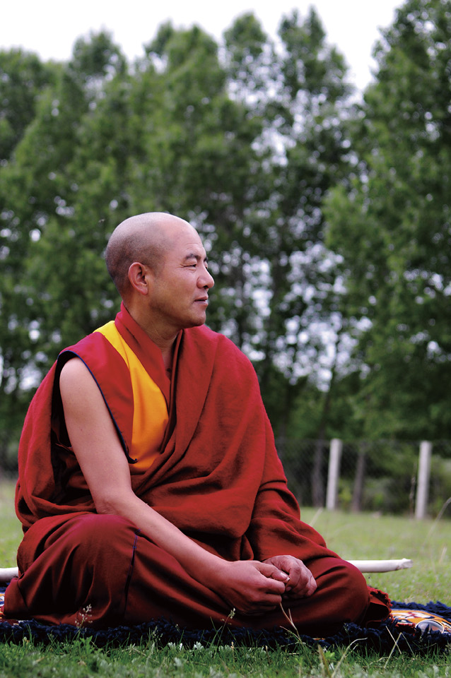

# 关于地藏法会的开示

2010年7月10日

今晚我们在菩提讲堂相聚，交流的内容是关于普贤大愿。今天是藏历五月二十九，明天是三十。从后天开始，学院要开普贤云供法会。这是法王如意宝在世时规定的四大法会中的第三个。

为什么要开普贤云供法会呢？2500多年前，我等大师释迦牟尼佛于六月初四这一天，在印度鹿野苑为五比丘初转了四谛法轮。从那时起，这世上便有了佛陀的甘露妙法。在这一个月，不管你行持的是善法还是恶法，功德或罪业的增长倍数都相当高。为了纪念佛陀初转法轮的吉祥日，上师如意宝规定学院每年六月初一到初八，都要举行普贤云供法会。

普贤云供法会的念诵主要有两个，一个是地藏菩萨的圣号和咒语，一个是《普贤行愿品》。法会为期八天，学院的四众弟子每天从早上7点开始，一直到晚上7点，都要念诵这样的内容。

## 殊胜日当发普贤大愿

今天刚好临近法会，所以给大家做一个开示。来听的道友，一部分是学院常住的四众道友；一部分是最近才到学院来的；还有一部分对普贤云供法会有强烈的信心，但因为各种原因，这次来不成。

今天的开示，学院常住和网上的道友都能听受。希望每个人好好地考虑考虑，在这个特殊的日子里，应该发什么样的殊胜善愿。一年一度的佛陀初转法轮日，是特别殊胜的发愿日，无论你发什么殊胜善愿，必定都能实现。我等大师佛陀在有关经典中讲，其他时间所发的愿、所念的经，不如在殊胜吉日的功德大。

上师如意宝也曾经说过：六月初四这一天，不管你在哪个地方，一定不能忘记发菩提心。我记得，法王是在某次给大家传授菩萨戒之后，要求大家每一年都这样发愿的。有些人以前不一定知道初转法轮日发愿的殊胜功德，现在知道了，希望能够好好发愿。

这次法会，大家一定要认真念诵《普贤行愿品》。《普贤行愿品》的每个偈颂有不可思议的功德，很多法师也讲过。今天你们应该简单了解《普贤行愿品》的字面意思。在殊胜的日子里，一定要念诵这部殊胜的发愿文。

诸佛菩萨无量无边的大愿，都可以包含在十万大愿中——也有十二万大愿的说法；十万大愿又可归纳在《普贤行愿品》的愿文中；《普贤行愿品》的愿文，正如上师如意宝在《愿海精髓》中所讲，又可归结为利益众生、弘扬佛法两大愿望。

大家这次发愿，不要发什么“让我获得快乐”“让我得到健康”“让我发财升官”等全部围绕自己的愿。这样的发愿，虽然依靠诸佛菩萨不可思议的加持，肯定也会满愿，但作为一个大乘行者，最根本的愿应该是度化天边无际的一切众生，让他们依靠佛法得到利益。

我们一定要以佛法来饶益众生，让他们获得真正的快乐和幸福。世间的财富、地位等，都不一定长久，无法带来真正的快乐和幸福。那真正的快乐和幸福是什么呢？斩断轮回的各种痛苦，令自他获得圆满正等觉的无上佛果。

因此，遇到这么殊胜的吉日，发愿时一定要高瞻远瞩，不能目光短浅，更不能自私自利，发一个以自己为中心的下等愿。

我们每个人，尤其是学会的各位道友，有时间开法会是最好的。如果没时间，能开两三天也很好，至少六月初四这一天要参加。

## 做一个负责任的放生者

在释迦牟尼佛初转法轮日，也就是藏历六月初四，公历7月15日，听说汉地各地会举行放生。前段时间，我给大家讲过放生的种种功德——非常非常大。

你们这次放生的功德，希望回向给世界上所有的可怜众生，让他们获得快乐和幸福；凡是没有听闻过佛法的，愿他们早日得到佛法的甘霖；诸佛菩萨为利益有情而化现的十方高僧大德和善知识，愿他们长久住世，常转法轮。大家应以这样的共同目标来作回向。

在放生的那一天，希望大家提前做好各方面准备。现在放生面临着一些困难，一定要考虑周全，尽量避免不好的后果。首先，大家买生时一定要知道，所买的这些众生，飞禽也好，鱼类也好，有没有合适的地方放。这个很关键。

前段时间，在云南和东北，有些居士心很虔诚，买的众生特别多，但没考虑到这些众生能不能在水里活，能不能在山里放，也没有分清那些飞禽是人工饲养的还是野生的，结果死了千千万万的生命。后来引起了环保部门的重视，各大新闻媒体纷纷报道，指责放生者对社会不负责任，对生命不负责任。

因此，事先一定要考察清楚，你所放的众生能不能在那个环境里生存。如果没有找到合适的地点，暂时就不要放。不一定非要在六月初四那天，可以再过一段时间。如果当天放得太多，不能保全它们的性命，可能也有一定的过失。

当然，这个过失不像杀生那么重，因为不是特意伤害它们的，而是为了救它们。在这个过程中，它们的业力现前而导致死亡，过失不是特别大——但过失还是有。

无论这次还是以后，放生前一定要做好研究和考察。前段时间，我去北京、秦皇岛等地做了一些放生。当地居士组织得非常不错，提前做了很多准备，考虑到了很多情况，特别周到。其实，放生本就应该这样。有些佛友买完以后，随随便便就放，什么都不考虑，恐怕这有一定过失。

在这个世界上，最珍贵的是什么？就是生命。除此之外，再也没有更珍贵的了。不仅仅我们人的生命可贵，天下所有的众生，哪怕小至蚊虫蚂蚁，他们的生命也同样具有价值。因此，哪怕是救一个生命，我觉得也有非常大的意义。正因为如此，当我听说过段时间各个地方都有放生，而且放的数量也比较多，内心非常非常随喜。希望大家在实际操作的时候，考察得周全一些，考虑得细致一些。

## 共同发愿，功德同等

各地的学佛中心或佛教团体，如果因缘具足，在释迦牟尼佛初转法轮的那一天，应该以小组为单位，比如学《入行论》的一组，学《前行引导文》的一组，学其他论典的一组，大家共同集聚在学习的道场，在佛像、佛塔、佛经前供花供水等，然后一起发愿——先念一遍《喇荣课诵集》前面的发愿文，再念几遍《普贤行愿品》。具体念几遍，你们根据自己的情况来。

当天，学院这么多出家人，也会共诵《普贤行愿品》。你们哪怕空出一个小时也可以，聚在一起共同发愿。这是普贤云供法会的要求。即使来到学院，也是做同样的善法。

前段时间开金刚萨埵法会，凡是来参加法会的人，降魔胜利洲的四众道友在生活上给予他们一定的照顾，同时学院也安排了灌顶和共修。听说这个消息传到了网上，说金刚萨埵法会如是殊胜，每天都可以吃花卷，吃包子，吃什么什么菜，还把所有的菜单拍下来发到网上。很多居士看到之后，纷纷前往学院。

学院每年的金刚萨埵法会，我们有时会做一些准备和安排，除此之外的其他法会就没有了。学院这么大，常住的人也不太多，如果每次法会都要给大量居士一一地安排，有一定的困难。所以，这次普贤云供法会也没有什么特别安排。来参加法会的道友，我相信你们的目的是跟僧众一起发普贤大愿，不是为了在这里照几张相，见见某某人。

来学院的道友，目的是什么，自己应该心里清楚。这八天当中，最好从早到晚念《普贤行愿品》，跟僧众一起好好发愿。发愿的内容，刚才也讲了，就是弘扬佛法和利益众生。如果实在没时间，至少也要在佛初转法轮日，跟僧众一起发愿。这次你们来到这个寂静的地方，做了殊胜的发愿和共修，了解到远离城市的生活和闻思修状况，这一趟也不算白费。

大家一定要把目的搞清楚。你是来发愿的，尤其要跟僧众共同发愿，哪怕念一遍《普贤行愿品》也有无量的功德。我刚才看到个别居士，一来这里就开始输液吸氧。在他们下去之前，如果身体一直不行，至少也要念一遍《普贤行愿品》。就像莲花生大士所说的，“在其他地方修一百年，也不如在圣地修一日的功德大”。所以来这里发普贤大愿，对我们每个人都很重要。

没有来成、在网上听开示的道友，在各个地方都有。一方面，佛陀转法轮日是不分宗派的，哪个宗派都可以庆祝。另一方面，学院每年开这样的法会，所有四众弟子都暂时把闻思修行放下，八天里专门念诵《普贤行愿品》和地藏菩萨名号。我觉得这对大家而言，是一个特别重要的机会。无论你在哪里——今天网上的道友有国外的，也有国内各个城市的，无论你以什么方式在听受，只要我们的心连在一起，只要我们有共同的愿力，一起念诵金刚萨埵心咒的话，得到的功德是等同的。

这次法会没有直播。因为发心人员分配不够等种种原因，不能像金刚萨埵法会那样为大家同步直播。但是我相信，大家应该都知道从初一到初八是开法会的日子。如果因缘条件具备，在这八天当中，希望大家在家里供供灯，供供水，或者闭关专修。如果因缘不具足，那就多念《普贤行愿品》。这是给大家交流的主要内容。

还有一件事要强调一下。7月12号——国外有些地方应该是11号，也就是后天，有全日食。你们可以看看日历。在那一天做任何善事，功德是无量无边的。

## 用信心和智慧建立见解

我们对各地道友强调的都是闻思修行，除此之外的事情，并不会着重强调。虽然有些修行也需要佛教的仪式和行为，这些不能全部放弃，但最关键的还是闻思修行。

我希望今天在网上听开示的佛友，一定要重视佛闻思修行。如果你对佛法没有很好地了解和学习，这一生要通达佛教确实相当困难。我不管到哪里去，强调的都是这个。对其他活动，比如邀请我参加什么开光仪式之类的，我个人觉得不是很重要，都没有兴趣。

我们每一个人需要懂得佛教的教义。要懂得佛教的教义，首先要在上师那里听受，然后自己进行思维，最后不断地在相续中串习。依照这样的次第，到一定时候，大家对佛教会有重新的认识，这样的道理在相续中也能扎下根来，成为一个名副其实的佛教徒。

今天网上听受的佛友，有相当一部分是知识分子。我本人很有意乐跟知识分子交流。前一段时间我们去北京，和清华科技园与北大哲学系的知识分子作了一些交流。我作为一名佛教徒，主要给他们讲了释迦牟尼佛的伟大智慧远远超过科学，并列举了很多理由。对于这一点，如果你们有些人不太承认或者有一些怀疑，过一段时间，我在这两所学校和其他地方的视频可以给大家转播到网上。

我们这里个别的知识分子，一定要首先遣除对佛教的误解、怀疑和错误判断，之后再建立对佛教的特别纯洁的见解，而且这种见解还要得以稳固。否则的话，现在外面的世界五花八门，蛊惑人心的东西太多了，我们纯正的信心也好，纯洁的见解也好，都很容易被外境扰乱、染污。

我相信今天上网交流的佛教徒，90%以上是知识分子。知识分子有智慧和理性，所以任何道理和他们沟通起来，都比较容易。我们佛教本身也是关于智慧和理性的教育，如果佛教宣讲的是见不得人的知识，佛教徒们可能会很担心，不愿意出来对话，尤其不愿意面对现在的科技知识。但事实上绝不是这样。我们佛教经得起科学的考验，经得起历史的考验，也经得起每一个人修行体验的考验。

因此，每一个佛教徒，每一个知识分子，甚至一些非佛教徒，我都希望你们能站在公正的立场，擦净自己的慧眼，认认真真、详详细细去观察佛教。在这个过程当中，你会得到佛教无与伦比的智慧和大悲。

智与悲，是佛教的精华醍醐。其他任何宗教或学说，都没有如是深广的智慧和悲心。这两者，我们每一个人不可能圆满得到。如果得到了，那就已经脱离了凡夫的身心，超凡入圣，获得了圣者的果位。不过，即使没有圆满得到，只要得到了佛教部分的教言和境界，对社会，对个人，乃至对自己的生生世世，也会有无穷的利益，会带来无限的光芒。

作为一个普通的僧人，我今天以恭敬心双手合掌，请求十方各位智者：你们一定要站在客观的立场，以自己的智慧或逻辑推理，对佛教中宏观世界和微观世界的教理，尤其是关于心的奥秘，进行剖析和分析。

佛教对于心灵奥秘的探索，其他任何科学或哲学思想，到目前为止都没能抵达。你如果得到了心的证悟，或者完全通达了心的本性，那么外在的一切风光，一切包罗万象的精彩，都可以一览无余，尽收眼底。那个时候你所得到的快乐，所得到的安宁，所得到的幸福，无法用语言来表诠。

2500年来，人类经历了无数风风雨雨，但佛教的真理并没有随着时代的流转而毁坏，也没有被其他人的邪见邪执所染污。它一直就像提炼过的纯金一般，在我们无明众生面前闪闪发光。

## 重新认识佛教，重新认识自己

今天在座的各位，一定要重新认识佛教。有些人工作繁忙，时间很紧，但作为一个学佛的人，再忙也应该看看这本书——《入菩萨行论》。这是我给大家提的一个建议。

《入菩萨行论》，我以前讲过，网上有相关资料。你如果把这本书从头到尾学一遍，人生也许会有新的改变。有些人虽然已经学过，但如果你再重新学一遍，很多事情也许会有新的调整。还有《大圆满前行》，这是藏传佛教特别珍贵的一部法，也值得大家认真学习。

这两本书，以前没有阅读过的，希望能够阅读；已经阅读过的，希望每年或者两三年再看一遍。只有这样，你对佛教才会不断有新的认识。我们凡夫人如果没有随时充电，只靠曾经学过的一个论典，曾经听过的一部法，不一定能解决所有的问题，不一定能调伏所有的烦恼。我们应该以清净智慧来学习以《入行论》《大圆满前行》为主的佛法真理。

同时，你们如果有人智慧特别敏锐，却对佛教的空性观不太了解或持有怀疑，我建议去看龙猛菩萨的《中观根本慧论》。我们佛学院降魔胜利洲的法师们正在学习这部论，学完以后，也许你对佛教的怀疑和否定会彻底消失，并对佛陀和龙猛菩萨的智慧生起很大的信心。

今天来听开示的各位道友，无论你处于东南西北哪一方国土，我们的心可以说是连在一起的。把我们的心连在一起的纽带是什么呢？就是佛法。因为我们希求的都是佛陀的智慧，都是发了菩提大愿想利益众生，都是通过六度万行积累两大资粮。这么多人有共同的目标，中间的行为和最后的终点也必定是一致的。

我们现在举办普贤云供法会，来学院的也好，没来学院的也好，大家都能共同发愿。要知道，是佛陀不可思议的加持力，让我们心与心相连。在佛陀和传承上师的加持下，在自己的善缘聚合时，大家应该懂得珍惜，一定要共同努力，共同发愿。只有这样，解脱才不会遥遥无期。

现在不管南方还是北方，学佛的人都相当多。尤其在四月初八或者每个月的吉日，去寺庙拜佛的人成千上万。但在大城市里，真正懂佛理的人确实不太多。

因此我再三地强调，佛教徒不能只停留在表面形式上，一定要从内心懂得佛教道理。若能如此，你会生起一种不退转的信心。有了不退转的信心，行为也不会随外境而改变。

我经常遇到一些佛教徒，闻思一两年后，逐渐认识到以前没有系统闻思时，自己的一些行为特别可笑，特别盲目。其实，凡是系统闻思过佛法的人，应该都会有这样的感受。希望大家通过学习佛法，能重新认识自己，了解自己。这一点非常重要。

## 做皈依，念传承

今天的开示就到这里。很多佛友要求皈依，下面我给他们念皈依偈颂。以前已经皈依过的，今天不用皈依，如果你还想再皈依也可以。

我们皈依的对境是三宝，也就是皈依佛，皈依法，皈依僧，并不是皈依某一个人。皈依的含义是，“从现在开始，我就是佛教徒了；从现在开始，我要学习佛陀的教法；从现在开始，乃至菩提果之间，出家的僧众也好，在家的居士也好，都是我的同行道友，都是我的伙伴和朋友。而世间的屠夫、渔夫，还有各种搞非法的人，都不是我的朋友。”

三皈依其实是一种决心。你什么时候生起了这种决心，依靠念诵偈颂，就能得到皈依戒。

下面我给今晚想皈依的人念一下皈依偈。当我念完的时候，你们在心里观想，自己已得到了皈依三宝的戒体。

（堪布念皈依偈）

有些道友还想要文殊语狮子的传承，以及简供的传承，这些我以前传过，今天再给大家念一下。

（堪布念传承）

此外，最重要的是给大家传发心仪轨。普贤云供法会每天都要念发心仪轨。以前法王如意宝每年都会在六月初四这天给大家传一遍，多年来都是这样。因为今年的六月初四我没时间上网，所以今天提前传给大家。

今天听到发心仪轨的每个道友，至少在六月初四那天要发菩提心。我等大师释迦侔尼佛为了利益无边众生，曾经发下菩提大愿，如今我们也要为了利益众生而发誓成佛。《喇荣课诵集》中有这个发心仪轨，当天你工作再忙、事情再多，也应该空出5分钟来念这个发心仪轨。

（堪布传发心仪轨）

今天我们开示的内容，算是圆满了。刚才新皈依的佛教徒，法名共同取为：圆普。圆满的圆，《普贤行愿品》的普。

现场互动

下面还有十几分钟，个别道友有问题的话可以提出来。最好语言简练，不要有太多的祝愿词，直截了当说问题，以免耽误时间。每个人最多提两个问题。

⊙ 问：什么是缘起的根本定义？胜义中是否存在缘起？

堪布：缘起有两种，一个是空性的缘起，一个是显现的缘起。空性的缘起是指一切万法都是远离四边八戏的。显现的缘起就是有因必有果。“诸法因缘生，诸法因缘灭，我佛大沙门，常作如是说”，这个偈颂里所讲的，实际上包括了胜义和世俗的缘起生灭法。

⊙ 问：我想问一下关于实有和无我的问题。

堪布：所谓的实有，不管是外面的物质，还是内心的耽著，如果你觉得这个法是实实在在存在的，就是实有的一种相。实际上，就像《中观庄严论释》里所讲的，如果在这个世界上有一个实有的法，那五颜六色或者林林总总的事物不会呈现。正因为没有实有的法，种种景色才可以在我们面前显现。

所谓的无我，就是通过中观的智慧观察，最后抉择到我和我所根本不存在，只不过是众生分别、假立的妄相。

⊙ 问：为什么说在名言中，涅槃是非假立、非缘起之法？

堪布：这里所谓的涅槃，应该是如来藏的本来面目。按照释迦牟尼佛第三转法轮的教义来衡量，因为它是心的本来面目，本体空性，自性光明，所以并不是假立的。由于它是真正的实相，则世间因缘所造的法，在如来藏的根本上面不成立。我们要想获得涅槃，就需要证达最原始的如来藏本体。

⊙ 问：如何具足正知正念，守持清净的戒律？

堪布：所谓的正知正念，《入菩萨行论》中专门讲过两品。修行人要随时以正知和正念观察自相续有没有过失，同时以善心把自己的恶心断掉。

正知和正念就像哨兵，观察和守护自己屋里的正法财富。有了正知正念，所有戒律都可以守护。上师如意宝在《忠言心之明点》中也说了，守持戒律，需要正知、正念和不放逸这三种对治法。这三种对治法，可以保护心相续，让我们守持清净的别解脱戒、菩萨戒和密乘戒律。

⊙ 问：汉传佛教解释《华严经》时，说菩萨有52个阶次，从初信菩萨开始，然后是十住、十行、十回向、十地、等觉、妙觉等。听说藏传佛教的菩萨阶次是初地到十地。藏地的初地菩萨在52个菩萨阶次里，相当于哪一个阶次？

堪布：藏传佛教并没有单独的十地菩萨的说法。月称论师在《入中论》中对菩萨十地和佛陀无学地的介绍，是按照龙猛菩萨的观点阐释的，而龙猛菩萨所解释的，是《十地经》的密意。

汉传佛教的这些阶次，不一定非要与藏传佛教一一对应。藏传佛教所安立的十地菩萨，跟汉传佛教，跟《华严经》《大宝积经》等大乘经典没有本质区别。

⊙ 问：弟子经常昏沉，该怎么对治？

堪布：佛陀在《正法念处经》里讲，在昏沉的时候，可以站起来走一走。或者像其他上师教言讲的那样，昏沉时可以在头上洒一些凉水。

⊙ 问：什么是共同五加行？什么是不共五加行？

堪布：你以后学一下《大圆满前行》，就会明白共同加行和不共加行之间的差别。《大圆满前行》里讲，共同加行有人身难得、寿命无常、轮回过患、因果不虚、依止善知识等。不共加行则包括皈依、发菩提心、修金刚萨埵、供曼茶罗、上师瑜伽、往生法。

⊙ 问：感恩上师传讲《弟子规》，让我们在教育孩子时有了一些方法。但是，孩子小时候比较好教，15岁以上就不好管了。他现在有很多很多问题，我们的知识也不够，应该怎么做呢？

堪布：按照麦彭仁波切《君规教言论》的观点，孩子在16岁之前，就像耕地一样，实在不听话的话，可以狠狠地打（笑）。过了16岁，他的身心基本成熟了，应该以说服的教育方式让他成长。

《弟子规》对于16岁之前的孩童，可以先让他们背诵，逐渐领会其中意思，以此成为一生的财富。稍微大一点的孩子，则尽量向他们传授里面的教义。

这次推广《弟子规》，大多数佛友都学得很不错。我希望你们自己先学好，如果连人都没有做好，想成就更高的境界是没办法的。

我们在很多道场推广《弟子规》，一方面对大家的学习有利，另一方面，可以应付修行中可能出现的障碍和违缘。不管哪一个地方，都不可能不让学传统文化。而有智慧的佛教徒，通过《弟子规》可以修学佛法，并能面对很多的违缘。

⊙ 问：您曾说，舍弃上师就会下金刚地狱。那我们以前学一种法，现在又学另一种法，这是不是舍弃上师呢？

堪布：舍弃上师要下金刚地狱，并不是我说的，而是佛陀说的。佛陀在续部中说过，对于接受过灌顶、听过教言和窍诀，具足这三种恩德的上师，如果无缘无故地诽谤，自己一定会堕入地狱。密宗教言也说，对上师要像对自己的眼目那样来守护。

不仅是密宗这样讲，净土宗和禅宗也有同样的说法。千万不能诋毁诽谤对自己有法恩的上师，否则会堕入恶趣的。这个道理，很多宗派中应该是相同的。

但现在末法时代，很多人依止上师前，没有好好观察，依止后又轻易毁谤，这种现象比较可怕。所以，大家在依止上师前，一定要先好好观察上师，一旦依止了，遇到再大的困难，也最好不要毁谤和舍弃。

⊙ 问：在藏地受菩萨戒，和在汉地受菩萨戒有什么区别？

堪布：我讲《入行论》和《大圆满前行》时提过，汉地可以传菩萨戒，藏地也可以传菩萨戒。二者只是所用的仪轨不同，所讲的内容、传授的目标、得戒的情况应该没什么差别。

作为一个发菩提心的人，在传授菩萨戒也好，自己接受菩萨戒也好，发愿都很重要。如果你在得受菩萨戒的那一天，心里有特别大的决心，“从今天开始要利益无边的众生”，而且，并不是暂时做一些慈善来帮助他们，而是要让他们全部得到佛果，那是非常如法的。

所以我再次希望，以前没有发过菩提心的人，今天也好，六月初四那天也好，一定要好好发菩提心。人身很短暂，发菩提心利益无边众生，对每个人来讲特别地重要。今天有相当一部分人发了菩提心，非常好。

藏汉的菩萨戒仪轨的确有所不同——我以前也分析过，但所讲的菩提心内容和菩萨戒的戒体上没有什么不一样。希望每个人的相续中都具足菩萨戒，利益无边无际的有情。

好，今天的开示和提问到此结束。大家把这次共修的功德回向给天边无际的一切众生，愿所有众生离苦得乐，愿佛法传遍整个世界！
