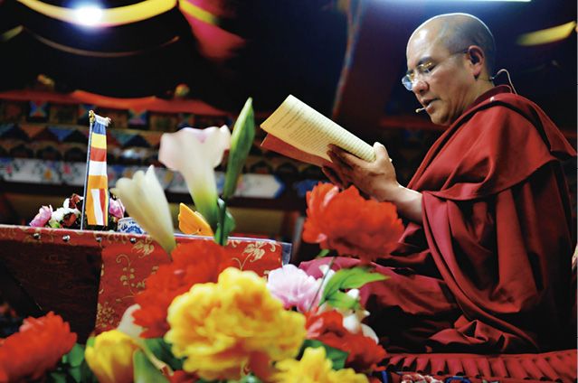

# 关于金刚萨埵法会的开示

2010年5月16日

今天咱们又集聚在菩提讲堂，共同交流。这次主要给大家介绍金刚萨埵的修法，并念诵金刚萨埵法会的仪轨传承，同时就忏悔的问题和大家探讨一下。大概这么几层内容，差不多一个小时就能完成。

## 就地安住，参加网络同步法会

首先给网上的各位佛友说一下，学院最近要开金刚萨埵法会。学院的常规法会一共有四个：第一个是持明法会，在释迦牟尼佛降伏外道六本师的神变月举办；第二个是金刚萨埵法会，在五月份，从释迦牟尼佛涅槃和成道的吉日开始举办；第三个是普贤云供法会，在七八月份开，从释迦牟尼佛初转法轮日开始；第四个是极乐法会，从9月22日开始，这一天是释迦牟尼佛为报母恩去天界为母亲说法后，从天上降临人间的日子。这些法会，都是上师如意宝住世时规定的。上师如意宝圆寂后，我们四众弟子每年都会继续举办这四个法会。

现在要开的是金刚萨埵法会，主要通过念金刚萨埵心咒，忏除自相续的所有罪业。虽然很多人想来参加这个法会，但学院从各方面考虑后决定，大家还是在本地参加共修。如果来的人太多，一方面学院不方便管理，另一方面也担心大家在路上出事。现在康定和马尔康都在修路，路上的状况很不好。

我们从来没有邀请过任何个人或者团体来参加法会，如果你偏要来，路上万一出了事，我们不会负责任的。学院的负责人都认为，现在学院的规模比较大，应该想尽一切办法，让它不再扩大。尽管这样，我们还是希望每一位有善缘的人，都得到佛法的利益。

城市里面的个别佛友，恐怕想来也来不成。现在到处在修路，光是花在路上的时间就要1到3天，回去还要花这么多时间。而且很多人在单位和家庭的事情也比较多，根本空不出时间来现场参加法会。

还有一部分佛友，曾经在佛学院待过很长时间，后来因为各种原因离开了。有的因为毕业而返回自己的家乡；有的因为身体不好，需要去别的地方疗养；有的因为弘法利生的需要，要到各个地方去讲经说法。这些老佛友或老菩萨，如今都在外面听受我们的讲法，而且很有兴趣。

为了大家能得到佛法的利益，我们前一段时间商量后决定，这次金刚萨埵法会将在网络上给大家直播。

现在是一个网络时代，也是一个信息时代。有些博客或网站的流量甚至达到了几百万、几千万人。有些人依靠网络，为自己的今生来世做了很多有意义的事情。有些人却成天陶醉在网络当中，浪费光阴，消耗生命。还有一些人，整天在网络上诈骗、偷盗，做各种非法活动，最后把自己送进监狱。

我们生存在这个世界上，一定要分清楚哪些事该做，哪些不该做。对自己身心健康有益的事，一定要多多地行持。而那些违法乱纪的、对自己身心和前途不利的事情，千万不要做。总之，凡是对自他不利的事，都不值得我们去做，否则不是智者的选择。

可是，你们看现在的一些博客上，每天有多少人在浏览、闲聊？甚至有极个别的人，整天说些乱七八糟的无稽之谈——用我们佛教的术语来讲，这就是绮语，说的语言要么让人生贪心，要么让人生嗔心，除此之外，不要说对生生世世，即便是对今生的人生有意义的事，也不能成办一点一滴。所以，我非常希望网上的佛友能杜绝这些行为，如理如法地行持善法，这一点特别重要。

## 法会安排和诵咒要求

这次金刚萨埵法会从5月21号开始，连开八天，每天的法会是从早上7点到下午7点。大家如果各方面因缘具足，可以通过网络，在自己的寺院里面，或在自己的佛教中心，或在自己的家里，和学院同步开这个忏悔法会。人多也可以，人少也可以。上网也可以，不上网也可以。每个人学法都是自由的，不管以怎样的途径来学，我们都很赞叹。

我想，虽然个别道友来学院开法会有一定困难——即使到了学院，恐怕也会因为高山反应，不能好好参加，但如果你在家里完成了法会要求念诵的40万遍金刚萨埵心咒，功德也是一样的。学过《俱舍论》或大乘论典的人都知道，不管你在什么地方，只要和大家共同发愿，为一个共同的目标而努力，所得到的善根完全是等同的。

最近听说外面有很多出家人，会在自己的寺院开八天法会。我们藏地有些居士，也会在本地的居士林开。如果抽不出八天时间，开两三天也可以。

我们藏历的初八，也就是公历5月21号，是一个非常重要的释迦牟尼佛节日。学院对这一天特别地重视。有些人如果实在没有时间，那么在四月初八那一天，能不能尽量想办法念念金刚萨埵心咒？

前不久我们给相关的佛友说过，如果工作繁忙，八天内念完40万遍金刚萨埵心咒有一定困难，那么从5月14号开始，一直到8月13号之间，3个月内完成40万遍也可以。工作再忙，3个月应该没有问题。

我们这里的发心人员，包括我自己在内，都特别忙。从前一段时间开始，我每天晚上和白天都念一点儿，现在都念完几万遍了。我相信大家在规定的时间中能够完成40万遍。如果实在不能完成，念10万遍也可以。

希望我们的学佛小组，不管是学净土的，还是学前行的，5月24号到31号这一个礼拜都放假，把主要精力放在修学金刚萨埵上。最近学院各个班、各个法师，都在全力以赴地观修金刚萨埵。

## 修持金刚萨埵的功德

今天网上的大多数人是虔诚的佛教徒，也有一些不是佛教徒，是以好奇心专门来听受我们演讲的。不管怎么样，但愿每个听者都在相续当中种下善根。

接下来给大家介绍一下修行金刚萨埵法门的功德。不管是无始以来，还是即生当中，我们大家都造了许许多多的恶业。先不说别的，光是这一年的发心或学习，大家也造下了很多恶业。

有些人和道友不团结，经常出现各种各样的矛盾，经常给别人制造一些违缘。比如，居士与居士之间不和，居士与出家人之间不和，出家人与出家人之间不和，还有居士与非佛教徒之间不和，等等。

有些人对严厉的对境进行毁谤，或者经常用各种方式说欺诳之语。比如，我们要求把念诵的数字报上来，自己却经常虚报，以妄语欺骗僧众和上师。

有些人本来是虔诚的佛教徒，却经常因为自己私人的利益，耽误我们弘法利生的很多事情，比如毁坏别人听经说法的机会，甚至耽误好多人学习佛法的机会。

有些人则在无意当中诽谤上师，诽谤道友，说三宝的过失。光是从我们管理层得知的消息来看，大家都造下了很多罪业，应该好好忏悔。

昨前天我在课堂上也讲了，法王如意宝以前说过，我们每年一定要念40万遍金刚萨埵心咒来忏悔自己相续中的罪业。凡夫人一年会造无数罪业，如果没有尽快忏悔掉，它会越来越增上，越来越加重，以致最后自己的相续不能完全得以清净。

即使从所有的法门来看，金刚萨埵修法也是非常重要的。

如果你们在有些修法上不太懂，可以去看《大圆满前行》，里面讲得很详细。以前我们也讲过金刚萨埵的一些修法，讲课的资料通过网络和书本都可以看到。大家提前熟悉具体的修法，法会那几天就好好地修行，清净自相续的罪障。

我们有些人希望很快获得开悟，可罪障如果没有清净，开悟恐怕有一定困难。佛陀在经典里说，所谓的罪障没有什么功德，它唯一的功德，就是通过忏悔可以清净。

## 四种对治力及观想方法

忏悔的时候，一定要尽量具足四种对治力。关于四对治力，我讲过很多很多次，今天在座和网上绝大多数佛友都应该明白。如果有个别人不明白，我再简单地说两句。

第一个是所依对治力。就是忏悔时依靠的金刚萨埵照片或佛像，或者自己在心里观想的金刚萨埵或三十五佛，或者愿菩提心和行菩提心，等等。我们需要依靠这些不共的对境来忏悔自相续当中的罪业。

第二个厌患对治力。对自己不管是无始以来，还是即生当中所造的罪业，都特别地后悔，就像一个人吃了毒药，特别地伤心。对自己以前所造的罪业，我们一定要有清晰的认识，认识到自己的严重过错，这就是厌患对治力。

第三个是返回对治力。你要下定决心，从此之后纵然遇到生命危险，也不会再造这样的罪业。自己发下永不造罪的坚定誓言，就叫做返回对治力。

第四个是现行对治力。就是我们观想在自己的头顶或者面前有一尊金刚萨埵，在他面前真诚地忏悔罪业，尽力念诵金刚萨埵心咒。

观想的方法其实很多。可以按照上师如意宝的单身修法来观想，也可以按照麦彭仁波切的双身修法来观想。《大圆满前行》当中也有双身的修法。如果你对密法的了解比较深，就按照《大圆满前行》和麦彭仁波切的仪轨来修持。如果你是初学者，就把金刚萨埵观在自己的前面，把自己观作业力深重的凡夫，一心一意地祈祷金刚萨埵，最后金刚萨埵的三处发光融入自己的身体，自己相续中以贪嗔痴为主的所有烦恼和罪障全部得以清净。

个别人以前没有学修过太多的佛法和仪轨，会有各种各样的疑惑。我想，如果你实在观想不起来，那就一心一意地念咒语。你大概地观想一下，自己面前有一尊金刚萨埵，只要你祈祷金刚萨埵，真诚地念诵他的心咒，自己的罪障都会清净无余。

为什么能这样呢？金刚萨埵在因地发过愿，他说：“任何一个罪业深重的众生，提起我的名字，念诵我的咒语，如果不能清净他所有的罪业，愿我不要成佛。必须能够罪业他的清净，我才可以成佛。”后来他的愿力已经成熟，并且示现成佛。所以，我们现在无论以什么方式祈祷金刚萨埵，都是非常殊胜的。

关于金刚萨埵的功德，《寂猛调伏续》中这样讲的：念10万遍金刚萨埵心咒的人，即使破了誓言也能清净。法王以前也讲过：续部里面说念10万，但末法时代需要乘以4，我们念40万遍一定能清净罪业。

各位有些受过戒，有些没有受过戒，但不管怎么样，你杀生、偷盗、邪淫、妄语，以及在世间饮酒、抽烟等，都造了无数的罪障。这些罪障，如果现在不把它忏悔清净，以后不一定还有这样的机会。

大家都知道，现在这个世界灾难频频，一会儿出现地震，一会儿出现空难，一会儿出现水灾，一会儿出现干旱。每天你在电视、报纸、网络上，都可以看到四大灾难的各种新闻。在这样的灾难面前，人命是非常脆弱的。当我们离开世间的时候，除了相续中的善业和罪业以外，任何财产、名誉等身外之物都带不走。所以，趁自己活着的时候，认真忏悔罪业非常非常重要。因此，大家一定要好好地忏悔。

我说话好像有点急，你们听起来累，我自己讲起来也累。我不能太激动。因为想到忏悔罪障很重要，所以一口气说了很多很多。刚才事情比较多，我一直忙着，来不及准备，本来不知道该给大家讲什么。到了这里，想起过几天要开金刚萨埵法会，这对每个人都很重要，虽然前一段时间已经在UC上开示过，但今晚如果再做一个开示，也许有些人会重新发愿念金刚萨埵心咒，这样也很好。

今晚发愿念40万遍金刚萨埵心咒的人，在网络上把名字给我们发过来，或者下课后你们自己给他们报，到时候我们一起回向。可能有些人发愿念40万遍，有些人念10万遍，实在不行1万遍也可以。你今晚来到这里，听了我的开示，如果连1万遍都不能念，那我觉得你除了特意调查我之外，可能没有其他任何意义了。总之，希望大家多念，最低最低也要念1万遍。当然，如果你是上等根基，发愿一年当中念100万，那就更加殊胜了。

## 从中寻找真正的快乐

过一段时间开法会的时候，大家一定要好好地修行。我这一生，在纸上写书也好，在网上开示也好，保存在光盘里的讲经说法也好，都是为了把佛法传递给大家，帮助大家好好地闻思修行。除了这个以外，我今生和来世没有其他任何目的。现在世间的一些邪教，为了实现自己的目标，有出来传法的，有做很多事情的，但我可以请三宝作证，除了让大家得到佛法真正的教义，我没有其他目的。

为什么要让大家得到佛法的教义呢？因为，佛法对当前时代来讲非常重要。世界上的每个众生，上至国家总统、超级富豪，下至仆人乞丐、蚂蚁蚯蚓，都想获得快乐。虽然所有众生都希求快乐，快乐的定义和标准也各不相同，大人物有大人物的高要求，小人物有小人物的低要求，但事实上，很多众生都达不到自己的目标，都过得非常痛苦。

在这么多痛苦的众生中，如果你得到了佛教的精华教义，就会无勤当中得到快乐。一个贪心特别重的人，花100万买一辆轿车，也不一定得到真正的快乐，因为之后他的要求可能会越来越高。其实，要得到真正的快乐，根本不需要花100万。只要从佛法中得到真正的调心方法，不花一分钱，就会快乐无比。而且这种快乐，远远超过物质带给我们的暂时快乐。

我觉得，当前社会特别需要佛教的引导，不同层次的人都需要学习佛法，懂得一些调心的方法。因为唯有从内心入手，才能得到真正的快乐。否则的话，人的欲望无穷无尽，光靠外在的资源和物质，根本满足不了不断膨胀的需求和欲望。

今天我们相约在空中，互相学习和交流，既是一种因缘，也是非常好的机会。过两天开法会，我们还可以在空中继续集聚，你哪怕在网上只参加一天也可以。现在科技发达，不同地方的人，可以在同一时间行持同一个善法。从佛教的角度来讲，这也是诸佛菩萨的功德和加持。

诸佛菩萨的功德和加持不可思议。以前佛陀说法的时候，成千上万世界中的无数众生在同一个时间都能听到。佛教的《华严经》《白莲花经》《大方广如来不思议境界经》等很多经典，专门讲述了佛陀诸多功德和加持的威力。现在这个科技时代也一样。一个人说法，在无数世界有无数的人可以听到。一个地方开法会，无数的人在不同的刹土也可以同步进行。我想，我们既然有共同的发愿和共同的行为，那么最后获得共同的功德也是决定的。

大家以后上网，不要像有些人一样，一直聊天，聊的全是乱七八糟的内容，没有一点意义和价值。与其这样浪费生命，不如以一颗清净心念念咒语，这对自他都有利。

## 圆满发心与闻思

在座有很多佛友，为了佛教的事业，为了自他的修行，发心特别大。我们现在学习净土和前行，的确需要很大的发心才能圆满。对我而言也一样，给大家讲净土和前行，也是人生的一大工程。

我讲经说法到现在已经20多年了。这些年我讲的经典和论典，有些人圆满地听受了，有些只听了一部分，有些完全没有机会听。从1985年到现在，我除了偶尔陪法王如意宝出国等特殊原因外，基本没有中断过讲经说法。而且我讲任何一部法，只要开了头，中间就不会半途而废。无论在哪位上师面前求法，我都是善始善终，全部圆满。

所以，希望正在学习的你们，也千万不要中途放弃。尤其是一些负责人，不管你负责的是哪方面发心工作，为了利益众生和弘扬佛法，都不要以各种借口或烦恼而退失。为众生和佛法做事，是非常光荣、非常伟大的，如果半途而废，实在太可惜。

从前辈大德的传记中可以了知，为了弘扬佛法和利益众生，很多大德献出了自己宝贵的生命。我虽然不一定有这样的勇气，但也不会因为自己的一点小事而耽误佛法和众生的大事。今天在座的各位发心人员，在利益众生的时候，应该多想想高僧大德和诸佛菩萨的事迹。

人要有一种坚强和勇气。所谓的坚强和勇气，并不意味着我们要像社会上某些人那样，去和政府、某些团体或部门进行战斗，而是说，我们需在大悲心的驱使下，心甘情愿去做对人类乃至对所有众生有意义的事情。在这个世界上，不管是人还是其他众生，只要对他们有利，我们都愿意去做。

在做的过程当中，肯定会受到一些不公平的对待，比如他人的诽谤或误解。这些都是难免的。释迦牟尼佛在因地发心时，也经常有人诽谤，有人不满，有人不高兴。但我们是为了佛教，为了一切众生，并不是为自己，所以遭受一些困难和违缘也是值得的。

对整个国家也好，对普通民众也好，我们都要有一颗善良的心。这一点很重要。如果我们的心不善良，表面上做再多的善事，功德也不大。相反，如果我们的心很善良，那做的任何一件事，都会直接或间接成为弘法利生之因。

我今天没有太多准备，心里想到什么，就脱口而出。也许个别道理有一些价值，也许一点价值都没有。不管怎么样，希望能对大家有一些利益。

## 为利一切众生而皈依

前不久有些道友想要皈依，当时由于时间关系没有皈依成。下面我就给大家作皈依。以前已经皈依过的，今天不用重新皈依。无论你以前皈依的是哪一位上师、哪一位活佛、哪一位和尚，都可以。皈依的人不是很重要，重要的是皈依三宝。只要是在三宝面前，只要你具有皈依三宝的戒体，谁为你做皈依都可以。

今天所有皈依的人，心里要这样想：从今天开始，我皈依佛宝、法宝和僧宝。也就是皈依释迦牟尼佛等所有佛陀，这是皈依佛宝；皈依释迦牟尼佛及印、藏、汉三地高僧大德所传授的解脱法门，这是皈依法宝；皈依十方的大乘僧众，包括以文殊菩萨、普贤菩萨等八大菩萨为主的所有得地圣者，也要皈依小乘僧众，以及凡是穿着袈裟的所有出家人，包括比丘沙弥在内，这是皈依僧宝。大家要有这样的决心。

那么我们为了什么而皈依呢？不为自己今生的平安快乐，也不为来世的人天福报，而是为天下无边的一切众生获得暂时和究竟的快乐，这样的皈依是上等皈依。为了自己得到解脱，获得阿罗汉的圣者果位，这是中等的皈依。自己身体不好，没有名声，希望通过皈依得到健康、名声和财富，这是下等的皈依。

你们每个人都有权力选择皈依的目的，无论是哪一种皈依，都可以。但最好是为了利益天下一切众生而皈依，这个非常重要，功德也特别大。以前皈依的时候，如果没有这样发心，今天也可以想：我为一切众生暂时和究竟的利乐而皈依。自己在心里默默地发愿，我给大家传诵皈依三宝的偈颂。

（堪布念皈依偈，为大家作皈依）

今天皈依的道友，法名都叫圆航。新皈依的人最好在网上把名字报上来，我们要看一下今天有多少人皈依。给大家取同一个法名是可以的，十方世界当中，很多佛陀的名号也一样。前一段时间我做过两次皈依，取的法名分别是圆智和圆悲。这次也有一个殊胜的缘起。

下面我给大家念这次法会念诵的金刚萨埵仪轨。上次念的是法王如意宝的金刚萨埵仪轨，今天是念麦彭仁波切的仪轨传承。

（堪布念金刚萨埵仪轨、度母心咒、莲师心咒、观音心咒等传承）

## 地方不同，功德相同

今天的开示基本上圆满了。这次主要是让大家好好念修金刚萨埵心咒。刚才说了，我们在不同的地方共同发愿、共同观修，所得的功德是一样的。

我们学院开法会，每天都念4遍《普贤行愿品》。如果你们跟学院同步，每天跟着法会前后的念诵就可以了，中午会休息2个小时。到时候我们把念诵仪轨公布到网上，大家可以直接下载。现在很多人为了自己的一点利益，就要付出无数金钱，而我们为了自他真正的快乐，花些时间和精力还是很有必要的。

学院的很多大法师，开金刚萨埵法会时都舍不得下山，想好好忏悔自己的罪业。因为每一年念40万遍金刚萨埵心咒，自相续基本上能得以清净。我们应该有这个把握。你们大多数人都发愿往生极乐世界，如果相续中的罪障没有清净，根本往生不了。

从各方面观察，念修金刚萨埵特别特别重要。因此，我今天反复劝告大家，一定要好好地念金刚萨埵心咒。

虽然今天开示的时间很短，但参加的人还是比较多，也可以。现在世间人每天在网上闲聊很长时间，做很多没有意义的事，像我们这样的共同学习，真的很值得随喜。

学院有这么多僧人，这次法会每个人一定会完成40万遍，而且不需要3个月，大多数会在8天内完成。这样的话，他们念诵的功德和我们念诵的功德加在一起，每个人起码能得到好几亿遍的功德。这一点，在座的人应该清楚。这不是一件小事，而是非常重大的事情。

因此大家一定要尽量参与。不要因为工作特别忙或其他原因放弃。即使工作再忙，也应该抽出一定的时间，每天念点金刚萨埵心咒。这样的话，40万或10万遍一定可以完成。

我大概就讲这么多。还有十几分钟时间，看大家有什么问题，在网上提出来我们相互学习。

现场互动

⊙ 问：我来自辽宁葫芦岛。我在菩提讲堂听了很多传承，比如《开显解脱道》《阿弥陀佛修法》，还有一些护法仪轨的传承。这些法，是不是只要听了传承就必须天天修？如果没有修，有没有过失？

堪布：以前得过的这些法都很珍贵，如果时间等各方面条件允许，自己应该精进修持。如果实在没有时间，只修个别的法也不会有过失。

⊙ 问：我们这里有些道友，是中途参加前行班的，磕头的进度与大部分学员比，差了很多。五加行磕头的10万数量，有没有时间上的要求？如果必须一年完成，我感觉那些道友有点追不上。

堪布：前行的磕大头，最好跟上其他道友。我们现在讲皈依，还有一段时间才结束，从现在开始不断地磕，讲不共加行的时候应该跟得上。

⊙ 问：我们辽宁葫芦岛的道友，迫切地祈请上师来我们这里传法，并祈请上师长久住世，让更多有情品尝到佛法的甘露妙味！

堪布：好好好，今天就来！（笑）

⊙ 问1：最初的那一念无明，是如何从如来藏中产生的？是有因生还是无因生？这和《道德经》中所说的“道生一，一生二，二生三，三生万物”是一回事吗？

堪布：按照中观胜义空性的观点，月称论师说“万法空性生”，空性中是可以产生万法的。但这种产生和《道德经》所讲的“道生一，一生二，二生三”，有很大的差别。《道德经》说的这种空性，没有触及佛教最究竟的离戏空性。

要想懂得万法的真正实相，最起码先要学习中观三部论，也就是《中观根本慧论》《入中论》《中观四百论》。然后再学习一些般若方面的经典。这样以后，你对空性法门会产生定解。接下来，还要学《宝性论》、《梵网经》以及《如来藏经》，这些经论主要宣说了如来藏的光明部分。学完以上经论，你就能得到佛教关于光明和空性的教义，并知道佛教的智慧非常超越。

问2：有人说佛道不分家，这种说法对吗？

堪布：在汉地的历史上，道教和佛教之间发生过各种情况，比如在唐朝和明朝，有些皇帝受到道教的影响，致使佛教的寺院被毁等。虽然从社会和谐的角度来讲，所有宗教也好，所有人也好，都应该和睦相处。但在观点方面，按照汉地的历史和道教的教义，道教可以称为佛教以外的教派。

⊙ 问：修金刚萨埵如意宝珠的仪轨，观想法和忏悔放到哪个部分呢？是在观想圣尊那里吗？

堪布：你可以一边念仪轨，一边观想。念金刚萨埵心咒的时候，可以按照《大圆满前行》里讲的那样，有时候观想金刚萨埵，有时候观想自己无始以来所造的罪业。这样轮番地观想也可以。

⊙ 问：在持咒的时候，尤其在持得比较多、比较清净的时候，违缘会特别重，这是什么原因？

堪布：所谓“道高一尺，魔高一丈”，我们在修行过程当中，不管是持咒也好，做善事也好，显现上肯定会有一些违缘和障碍。这个时候应该坚强地面对，不能退缩。

⊙ 问：佛教是不是最科学的？如果是科学的，有什么证据？

堪布：这个问题比较简单。到目前为止，世界上无数科学家所研究和探索的学科，对人类社会虽然暂时有突破性的利益和帮助，但无论从哪一个层面来观察，不管是物质层面还是精神层面，也不管是宏观世界还是微观世界，佛教都是最究竟的。

这并不是佛教徒自我赞叹。大家都知道，牛顿的物理学也好，爱因斯坦的相对论也好，天文地理的各大学说也好，所有这些都可以在佛教的理论当中找到。

其实很多人都应该学习佛法。只有学习佛法，才可以精通世间万物的真理。大家应该也知道，现在的科学发展已经出现了种种问题[^1]。为什么会这样呢？因为科学发展有一定的局限性，当它发展到某个阶段时，就没办法再发展下去了。比如当代科学深入研究外在的资源，但不管怎么研究，到最后整个地球的资源也满足不了人类的欲望。到那个时候，科学再发达，人们也始终得不到快乐。

所以，这个时代，除了科学，我们还需要爱心、悲心和知足少欲。在这个基础上，再去掌握对全球有利的科学，渐渐地，人们应该可以得到快乐与和平。

⊙ 问：我们念金刚萨埵心咒不会观想，这样念40万遍能净除罪障吗？

堪布：会的。即使我们的观想能力再差，也可以观想金刚萨埵的样子，他的照片可以从网上下载。把照片放在自己的前面，然后想：金刚萨埵是非常殊胜的东方佛，在他面前忏悔，我无始以来的罪业全部可以清净。一边怀着特别恭敬和虔诚的心，一边对自己所造罪业产生极大的厌恶心，在这样的心态当中念完40万遍，肯定能清净罪障。

⊙ 问：可不可以一边做饭，一边念咒？

堪布：可以。虽然念诵时最好把所有琐事都放下，但如果自己各方面的因缘不具足，坐车、做饭时都可以念咒语。我们藏地很多修行人，有的一边放牛，一边念咒；有的一边走路，一边念咒。这种现象非常多。

如果你以闭关的方式念，最好是禁语，尽量不要说话。如果实在做不到，做其他事情的同时念咒，也有无量的功德。

⊙ 问：作为学习大乘佛法的人，怎样在忏悔时缘于自他猛力忏悔，从而消除自他的罪业垢染，遣除修行路上的种种违缘？

堪布：这要与菩提心修法相结合。刚开始要发菩提心：“我今天修金刚萨埵心咒，不是为了自己的解脱，而是为了众生离苦得乐，究竟成佛。”中间在修行的过程中，把金刚萨埵观在前方虚空中，怨恨的敌人和六道众生观在自己的前边，就像修皈依的观想一样。然后金刚萨埵的身体发光，自他众生的所有罪障全部得以清净。修法结束时，把善根回向给三界轮回的一切众生。

这样以三殊胜摄持，是利益自他一切众生的殊胜修法。

⊙ 问：放生的时候，有一部分生命在路途中死了，这个因果怎么解释？我们应该怎么做？

堪布：一般来讲，放生是为了让这些众生得到解脱，生命不再受到任何威胁。可是，因为个别众生的业力现前，有时候也没有办法。比如有些人把众生放到山里，最后它们缺水而死。有些人把人工养殖的直接放到野外，最后也活不下去。也有一些众生，在放生的路途当中死去。

我们以后放生，要尽量考虑各方面因素，最好让它们今生不再遭遇生命危害。但在无意当中，有些众生死了，这不会有大的过失，因为我们本意是想放生，并没有杀它们的意乐。不过，因果非常甚深，虽然大的过患没有，但也许会有一些小的过失，这个通过忏悔可以清净。

## 结语：感谢每一个发心人员

今天的提问就到这里。不管在网络上还是各个地方，都有很多发心人员在无私奉献。我非常感谢你们。你们长期这样发心，甚至有些从《入行论》开始到现在，一直在发心，的确很不容易。

我遇到过很多发心人员。有些人刚开始有三分钟热情，激动得不得了，但慢慢地，心态就变了。而有些人因为佛法的加持已融入心，怎么也不会离开这个圈子。有些人却因为前世的业力和即生的违缘，最后不了了之，甚至直接撒手而去。

所以，今天特别感谢各位发心人员，包括学院的部分发心人员。我自己每天都忙来忙去，如果没有众多发心人员的付出，我一个人根本没办法给你们转播。你们在不同的地方，做着不同的发心工作，有时候连一点休息时间都没有。基督教认为，星期天是上帝让人类休息的日子，但即便在这一天，你们也往往没有时间休息。

当然，我也没有休息。今天下午本来比较累，想好好地休息一下。后来突然想起，今天有网络开示，不能休息，于是又从山下爬到山顶。我们的网络在最高的山顶上，我一路上要爬很长时间，才能到这个地方。但是我想，下面很多道友的工作也不是那么容易的——这个我有经验，大家都很辛苦。

不管在网络上还是在现场，很多道友都在为弘扬佛法和利益众生发大心。在这个过程当中，我们不能伤害众生，更不能做违法乱纪的事。每个人都有学习佛法和修行的自由，大家也不用担心，不要顾虑这个，顾虑那个。除了个别人的家庭和单位有些不便，在这个开放的世界，学习有利的知识没什么不可以。而这样的学修和交流，对有些人来讲非常重要。这一辈子，其他东西恐怕很难与之相提并论。

因为时间关系，今天的开示就到这里。很多佛友非常辛苦，下午一直帮别人排队，在各个讲堂给大家安排位置。外面的道友上网也不太容易，有些去网吧；有些在寺院里；有些在自己家；有些在家不方便，只能去朋友家；有些朋友的态度好一点，有些朋友的态度不太好，晚饭都不给吃；有些已经吃过晚饭，有些还没有吃——我刚才也只吃了一碗稀饭。感觉还可以。

下面，把自他的一切善根进行回向。《三十五佛忏悔文》里说，过去的善根可以回向，现在的善根可以回向，未来的善根也可以回向。因此，金刚萨埵法会虽然还没开，40万遍金刚萨埵心咒还没念完，但这些未来的善根，今晚也可以一起回向。

非常感谢，祝大家一切吉祥、顺利！

[^1]: 当前，人类面临的生态环境破坏、大量物种消失、气候逐渐恶化等问题，都与科学技术有直接关系。未来如何呢？英国宇宙学家马丁·里曾在他的《最后的世纪》一书中预言，未来200年地球将面临迫在眉睫的十大灾难：粒子实验可以吞噬地球、机器人接管世界、纳米机器人危机、生化武器危害、超级火山爆发、地震引发世界经济危机、小行星撞毁地球概率增大、地球温室效应导致人类热死、战争和核武器、不可抗力。其中与科学技术有直接关系的就占了6项。
