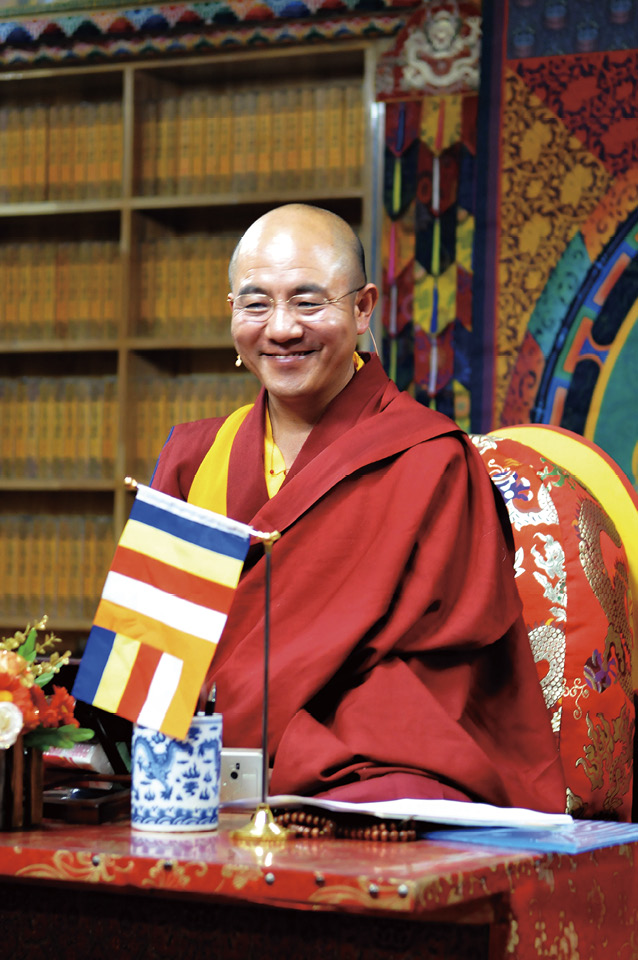

## 新年，只想和你谈谈温暖的事

——除夕开示

2010年2月14日

今天是大年三十，一个特殊而重要的传统节日。我在这样的日子作开示，或许会给一些人带来不便，因为大家对这一天特别重视，有很多事情要忙。不过我看到，除了学院常住的四众道友，外面依然有许多道友通过网络，参与我们的新年聚会。

首先，非常感谢在座、在线的四众佛友。在弘法利生的过程当中，大家一起为利益众生发了非常广大的心。这一点，对大乘修行人来讲，是非常难得的机会，也是极其殊胜的机缘。

一年多来，不同岗位上都有发心人员在默默奉献自己的一切，甚至有些我连名字都不知道，面孔也不熟悉。在这个世界上，有千千万万的人在背后支持我们，尤其在闻思修行等很多方面，给我们提供了应有的方便。所有这些默默付出的道友，我发自内心地感谢你们。

在这样一个社会环境中，生活充满了压力和忙碌，大家能抛弃自己的一切，为了众生，为了佛法，为了别人的闻思修行，不惜一切地努力付出，这不一件容易的事情。而我们在座的道友，待在这样寒冷的高原，过着这样艰苦的生活，依然在努力地闻思修行。你们的精神，非常值得赞叹。

## “年”是怎么来的

按照世间传统，人们对过年特别重视。这一点，我们十分理解。不过，从佛教的某个角度看，人们在过年的时候，会造下很多恶业。比如今天，我们这么多佛教徒集聚在网络上、经堂里共同行持善法，而与此同时，外面许多人的所作所为却与因果相违逆。

今天，很多人共同造下了不计其数的十不善业。残杀无数的生命，以满足自己的口欲；打麻将、玩棋牌、放鞭炮等，种种行为都是散乱的因。当然，过年的种种活动，是一种传统，也是一种习俗，我们以佛教的眼光一律排斥，也不现实。在世间，过年要吃最好的美味佳肴，要穿最漂亮的衣服，还要将自己的住处弄得干干净净。

我看过一个文献，说古时候有一种叫“年”的吃人野兽。它有一个特点，在365天的最后一天，它会下山，吃掉很多人。那一天，人们非常害怕，会聚在一起互相保护。因为“年”害怕红色的东西和嘈杂的声音，特别是光，人们就做一些红灯笼挂在房子外面，写一些红对联贴在门口，放鞭炮发出很大的声音，通宵点灯，把里里外外照亮。这样，“年”就不敢接近人了。第二天，人们没有死都很高兴，他们平安度过了年关，然后互相拜年，报平安。

当然，每个地方过年的传统都不一样。有些传统跟我们佛教比较接近。例如，匈牙利在新年期间从不吃禽肉。他们认为如果吃了飞禽的肉，幸福就会飞走。对此，我曾开玩笑说：“吃了飞禽的肉，幸福会飞走，那吃了走兽的肉，幸福会跑掉吗？”

在我们藏地，除夕也很重要。这一天大家通常都会行持善法，不能造一点罪业。从初一开始，人们就特别注意自己的行为，尽量有一个好的缘起。因为大家都觉得第一天做什么，今年就会做什么。比如我初一在闭关，可能这一整年都会闭关，行持善法；如果初一造了恶业，可能一整年都会造。有这样一种传统观念。

当年，弘一大师在新年贺词中说：所谓新年，就是改过自新。摆脱过去的不好，迎接未来的好，这种说法有点类似于英国的传统。据说英国人过春节的时候，要开后门和前门。打开后门让所有旧的坏的东西出去，打开前门迎接新的财富、好运等。

## 我的新年六大愿

不管怎么样，所谓的过年，应该是总结和计划的日子：总结过去的一年，计划未来的一年。所以关于“年”，应该打两个问号。第一个问号：我在过去的一年行持了什么善法？第二个问号：未来的一年我打算做什么？

经堂里的道友，去年大多数都在行持善法，比如念阿弥陀佛心咒、放生、做慈善，等等。还算不错。如果我们没有学佛，跟世间恶行同流合污，恐怕这一年会过得很糟糕。如今，依靠善知识的加持，自己往昔的佛缘成熟，各方面的善缘都具足，我们对自己这一年的总结还比较不错。

那么下一年有什么样的安排和打算呢？我自己今天也想了一下，然后在几个方面发了愿。如果没有遇到死亡或者其他一些世间的违缘，我明年还会一如既往地讲经说法，哪怕所有人都走了，只剩下一个人，我还是会尽量圆满传授。传授佛法不是那么容易的事，有时候会有许许多多的违缘。但不管怎么样，我还是会努力克服和坚持。

希望我们在座的道友，在新的一年当中听受佛法不断传承，自己应该这样发愿。如果连一个传承都不圆满，怎么追随以前的高僧大德们的足迹？有时应该想一想，以前的高僧大德经历过什么样的苦行求法？

我前两天听一位老堪布的开示音频，非常感动。古代那些高僧大德，哪怕只求四句佛法，或一部论典的传承，都非常不容易。不管是吃的方面，还是穿的方面，都要经历很多苦行。现在，无论山上的道友，还是大城市里的道友，生活资具太容易得到，佛法也太容易得到，所以许许多多的人都不知道珍惜。

所以，我第一个新年愿望是：自己发愿圆满传授佛法，也希望道友们圆满地接受传承。

第二个发愿：在新的一年，至少翻译一两本书。虽然时间很紧，但我们这一代如果错过了机会，以后很多佛法的传承，尤其是对现在一些专用名词的理解，可能都会断层。所以我在这方面可能有必要做一些事情。现在翻译个别论典的因缘如果成熟，希望能够圆满。

第三发愿：希望做一些慈善方面的事情，比如说建学校，建养老院，建居士林等。这方面要继续不断地发心。

第四个发愿：希望在建造经堂方面多做一些事情。比如说建造学院的觉姆大经堂，居士林大经堂今年也想重新建造。

第五个发愿：希望为世界与人类的和平、自由献出一份微薄之力。我个人虽然很渺小，但也发愿做一点小小的贡献。以前在这方面我好像没有提过。

在世间上，家庭内部会有很多不平等的待遇；群体内部也有很多不平等的待遇；民族与民族之间，国家与国家之间，也时常处于互相恐吓、互相威胁和互相吞并的状态。全世界大多数人都沉陷在这样的痛苦当中。

我这个想法，以前因为各方面的因素，很多人不是特别清楚。佛教里面讲，男女是平等的，人类也是平等的，因为一切众生具有如来藏德性。可是在生活当中，我们却看到许许多多不平等的状况。

我昨天听到一个人说，他想学习佛法，可是家人一致反对，不让学。他只要一学佛法，就把他所有的光盘和书本烧毁。实际上，他的家人是在践踏一个人的自由和人权。在这个社会当中，我们有时候真的得不到应有的平等。

大家应该清楚西方国家的一些历史。以前在美国，白人和黑人之间的争斗特别厉害，特别残酷。白人把黑人当作畜生一样对待，有时候甚至把奴隶一船一船地倒在海里……是这样的一种状态。

南非总统曼德拉曾说过：“我反对白人统治，也反对黑人统治。我珍视民主和自由社会的理想，在这样的社会里，人人和睦相处，机会均等。我希望为这个理想而生，并实现这个理想。但如果需要的话，我准备为这个理想献出生命。”虽然他的理想是一种世间信念，但也值得我们去分析和观察。

从现在开始，为所有的人、所有的种族，如果范围再广大一点，为所有的众生获得平等的权利，应该成为我们每个人认真观察或者思维的事情。

第六个愿望：如果有时间，要好好修行。明天是神变月的开始，我会闭关修行一段时间。虽然修得很惭愧，但还是要好好地修。人生特别短暂，现在不修，以后不一定还有机会了。

## 安逸平淡算不上圆满

我也希望大家好好利用时间，该修行的修行，该发愿的发愿，不要太脆弱、太懒惰，生活得太放逸了。世间上非常成功的人，都愿意勤奋，不愿意懈怠。作为大乘修行人，我们更不能放逸地生活。

美国罗斯福在他著名的演讲《勤奋生活论》中说：“我不打算宣讲安逸论，我要宣讲勤奋生活论，也就是操劳、勤勉、努力和奋斗的一生。我要说，安逸平淡者的一生算不上圆满，只有不畏艰险劳苦的人们，才能最终获得辉煌。”

人不能懈怠散漫，浑浑噩噩地过日子，应该为自己的人生目标奋斗。作为一个修行人，不可能没有自己的目标。一年当中，至少也要实现几个愿望。该修行的要修行，该背诵的要背诵，该利益众生做慈善的，也要认认真真去完成。有很多事情摆在我们的眼前。

我希望明年年底的时候，每一个人都能写一篇简短的文章，总结自己这一年为众生、为佛法、为调伏烦恼而做的各种尝试。

今天也是一个非常殊胜的因缘，大家集聚在这个讲堂共同发愿。这一点很重要。尤其明天开始就是神变月，佛经和论典里都讲，在神变月不论造善业还是造恶业，增长的倍数都相当大。

我们学院为期15天的持明法会，也是从明天开始。持明法会念诵的是九本尊心咒、大自在祈祷文，功德非常殊胜。学院的四众弟子应该尽量参加，多多地念诵。

外面城市里的人，虽然不能直接参与——因为天气寒冷，不能给大家做现场直播，但我希望大家在神变月当中，应该做一些佛教徒该做的事情，比如独自放生、吃素、参禅，或共同集聚念诵护法、行持善法等。

## 路漫漫其修远兮

大家今天聚在这里，我没什么新年礼物发给大家。刚才有一个寺院的小和尚——原来在我们学院里面待过，他给我打电话：“堪布啊，我今天特别高兴！”我说：“为什么高兴？”他说：“今天我们寺院给每个出家人发了1000元钱，而且午饭有11个菜！大家都特别开心！”

我们这里有没有11个菜？你们过年一般是吃饺子吧？中午一个在企业里工作的人说：“今年我做得不错，领导很高兴，年终奖发了1万块钱！”他也非常开心。

我们作为修行人，在钱财上不一定有很多收获，但在修行上确实需要有所收获。现在世间人认为，社会要发展，经济一定要搞上去，把发展的目光全部盯在经济上。这个人有没有房子，这个人有没有轿车，这个人一年的收入有多少……都是这样来判断的。

我认为，社会的发展不仅仅体现在物质上，还在体现在精神上，而且精神上的发展更为重要。如果精神上没有佛法的世界观和慈悲观，外在的物质再充足再富裕，也是身外之物，恐怕依然满足不了人们内心的需求，根本上达不到幸福的目的。

我们通过修学佛法，会有一颗宁静的心，或秉持一种知足少欲的理念，生活虽然过得平淡，但内心是非常满足的。在学院也好，在其他寺院也好，虽然没有各种世间待遇，但是大家心里都特别欢快，过得相当舒适。

因此在新的一年，我们每个人都应该发愿。有些人给我讲，他们每年神变月都会放生。尤其是东北某个学佛群体，一直坚持神变月大放生，到今年已经13年了。我非常随喜他们的功德。

我们学大乘佛教的信徒，对众生的慈悲心是首要之法。记得在佛陀《大集法门经》里面说过：“身亦行慈，语亦行慈，意亦行慈。”身语意三门都应该行持慈悲观，这才是我们真正的善法。

可是，每到过年的时候，一想到无数的众生被人们吃掉，我心里真的会有种悲痛。尤其是南方沿海一带，情况更为严重。你们想一想，过一次年，要吃掉多少众生？要做多少喝酒赌博等不如法行为？这是每个人值得深思的。

今天我没有什么准备，也没有要给大家特别交代的事。我们修行的道路是漫长的，并不是立竿见影，一天两天就出效果，而是逐渐将烦恼转为道用。世间的教育事业，都是“十年树木，百年树人”。“路漫漫其修远兮”，不是那么容易的。

但是我们依然要奋斗，要有一种坚强的意志和坚强的毅力。在浊世的今天，违缘重重，如果没有坚强的毅力，不可能在违缘面前长久站立。作为一个修行人，不要总是认为：“我遇事这么倒霉！我修行这么失败！我烦恼这么粗重！老天对我这么不公平！”不应该怨天尤人，要从内心至诚地祈祷上师三宝。

要认识到，这是诸佛菩萨不可思议的加持，所有违缘都是诸佛菩萨和空行护法让我消业的手段。应该有一种大乘信念或清净观：“不管遇到什么，快乐或痛苦，都是上师三宝的加持。”如果能够这样，可以获得更多的快乐。

我自己有一种浅见：人生没什么不公平的，一切都可以转为道用。

## 给大家的祝福

今天给大家发的东西多吧？别人发的是1000元，我们每个人发了10到20元的东西——等会儿吃啊。

该讲的基本上都讲了。因为今天是过年，外面的道友比较忙。在座的修行人可能没有什么。等一会儿念完《普贤行愿品》以后，大家就各自回去。今天有没有电，大家在月光下看书也可以。

我碰到一个老修行人，他说以前求学的时候，晚上看书没有电，就拿一支藏香，把香点燃，用香头的微光一行行地背书。后来香用完了，就去山上割一种草——藏语叫堪巴，类似于芦苇，那种草燃得比较慢，可以用很长时间。他每次割一大堆草放在屋里，一根一根地点。

他说，一根草慢慢地燃，他就慢慢地看。那种长行的藏文书，点一根草可以读一行。一根燃完以后，再点一根，又读一行。每晚都有很大一堆草放在身边。早年的时候，他基本就是这样学习的。

现在城市里的学习条件，包括跟我们山上的，跟过去的人比较起来，确实有很大改善。但我们要学习他们的精神。否则，现在的世界令人眼花缭乱，我都不敢在山下待很长时间，如果待太久，会消磨自己的心智。外面的种种诱惑，直接冲击我们的感官，让人变得神志不清，慢慢就被引入歧途了。

总之，在新的一年里，大家应该奋发努力。

今天我通过短信，给大家发了一条新年贺词：“祝愿你在新的一年当中，诸恶莫作，诸善奉行；证悟心性，利益众生。也祝愿你在神变月行持吃素、放生、参禅等一切善法，功德无量，福慧增上！”

也祈愿在座的各位道友：修行圆满，境界增上，尽量用自己的一分力量，帮助身边的人！我们身边有许许多多可怜的人和动物，的确需要我们的帮助。大家不要把所谓的善法挂在口头上，而应落实到实际行动当中去。如果有这样的心，我们每个人都能做一些事情。

最后，我希望大家能够发愿，在新年中哪怕做一件利益众生的事情。前段时间，我看了一位教授的演讲。他说：“一天要做一件实事，一个月要做一件新事，一年要做一件大事，一辈子要做一件有意义的事。”我们每个人，能不能在弘扬佛法和利益众生方面也发这样的愿呢？

作为修行人，不是每天能吃到饭就可以，能穿到衣服就可以。我遇到过一个七八十岁的老人，他说：“我在有生之年，每一年都要做一件弘法利生的大事。”他的规划能不能实现不好说，但他的发愿如此宏大，值得随喜。

最后，祝愿大家修行增上，福慧增上，早日证悟心的本性，吉祥如意！

下面，我们吃一点过年的东西。先念供养偈颂：

> 无上本师即佛法，

> 无上救护即法宝，

> 无上引导即僧宝，

> 恭敬供养三皈处。

网络上的人，没办法准备食物，好多都下线了。经堂里的你们，慢慢吃，我给大家念一下大自在祈祷文和九本尊心咒的传承。但不要吃得太多。前一段时间我建学校，有群领导天天找我们一起吃饭。后来那个领导说，他连续三天吃素，不舒服，拉肚子了。

（大家享用美食，堪布念传承）

原本还有半小时的提问时间，但今天是过年，大家比较忙，鞭炮声也比较大，所以不耽误你们了。接下来，共同念《普贤行愿品》作回向。

从明天开始，希望每个人在神变月里，特别精进地行持善法，一年中不断地行持善法。这方面，大家应该有所准备，有所发愿。
