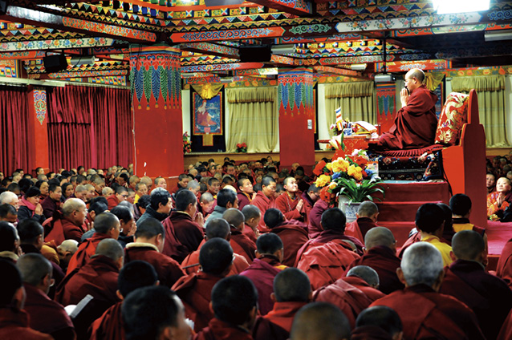

## 极乐法会的相关事宜

2009年10月25日

过一段时间学院开极乐法会，今天，我首先介绍一下有关极乐法会的事情，然后讲一下《入行论》和《现观庄严论》考试的相关事宜，最后，为大家念诵乔美仁波切《极乐愿文》和伏藏大师列绕朗巴《阿弥陀佛修法仪轨》的传承。因为时间关系，今晚就不进行答疑了。

每年从藏历9月18日开始，我们学院都会召开为期八天的极乐法会，今年法会的公历时间为11月5日至11月12日。

1．极乐法会是往生极乐的殊胜因缘

有些道友很想来学院参加极乐法会，但现在来不一定能赶得上，即使赶上了，学院也没有特别精彩的法会仪式，并且现在已进入冬季，学院天气非常寒冷，你们到这里之后，住处、生活等各方面都会有一定的困难。八天当中可能只是吸氧或输液了，我觉得这样没有必要，不如你们在当地组织共修，每个人安住在各自的地方，完成极乐法会的念诵，这样能获得与学院四众弟子同样的功德。

法王如意宝以前特别强调：每年开金刚萨埵法会，四众道友每人需念完40万遍金刚萨埵心咒；开极乐法会，每人要念完30万遍阿弥陀佛心咒；地藏法会和持明法会，也有相关的念诵要求。

对我而言，地藏法会和持明法会的念诵，基本完不成，但每年40万遍金刚萨埵心咒和30万遍阿弥陀佛心咒，即使再忙，也一定要完成。因为，不管学密宗还是学显宗的人，都对往生极乐世界有着强烈的意愿，并且，依靠法王如意宝等许多高僧大德的殊胜传承和因缘，也会让我们对往生生起信心。希望每位佛友从现在开始，就要为自己的来世做好准备。

你们一边修加行或念佛号，一边闻思，同时还要工作、照顾家人等，可能感觉特别忙。其实，在我们学院，不管是修行班、闻思班，还是发心班的道友，每天也都忙得不可开交，但我们对极乐法会的念诵都很重视，每年都会圆满30万遍阿弥陀佛心咒。

我们何时离开人间，谁也无法确定。现在有这么好的机缘，与这么多僧众一起发愿往生极乐世界，积累四种往生极乐世界的因，这是多生累劫中非常难得的殊胜因缘。因此，我今天特别提醒大家，每个人最好都能为自己来世往生极乐世界创造一个殊胜的因缘。

你们现在正在学习《极乐愿文大疏》。讲记的第一册已经学完了，现在正在学习第二册。通过这一两年的学习，我想大家应该认识到，自己临终的时候应该希求往生极乐世界。虽然有了求往生的想法，但如果没有创造一个殊胜的因缘，无缘无故或者仅凭自己的力量，或者依靠其他因缘，想要往生到极乐世界，并不是件容易的事情。

我希望诸位佛友这一次能尽量空出时间参加极乐法会。当然，如果找许许多多的借口和理由，恐怕也空不出时间。

如果各方面因缘具足，大家可以在各地的道场或中心组织开八天的极乐法会。如果难以空出八天时间全程参加，就在藏历9月22日（公历11月9日）——天降日这一天，和学院四众弟子一起同步开极乐法会，并在这一天好好发愿，尽量做一些功德。天降日非常殊胜，是释迦牟尼佛为报答母亲的恩德，到三十三天为母说法之后返回人间的日子。这一天所做的善根会无数倍地增长。

2．接受灌顶，圆满念诵

我们学院对天降日特别重视，为了纪念这个殊胜的佛教节日，每年都会开极乐法会，并且提前半个多月就开始做各项准备。

为了给各地道友提供共修的方便，极乐法会期间，我们会像开金刚萨埵法会那样，在菩提讲堂上为大家直播。学院这边前期准备工作已经就绪。虽然在户外直播，发心人员会面临天气冷、风沙大等困难，但只要对你们有点滴的利益，我们觉得这种付出都是值得的，也非常愿意发心。

法会期间，每天中午菩提讲堂会播放一堂《净土教言》，正好用八天时间播完，晚上会重播。如果有些道友白天没有时间，可以晚上看。2006年我用八堂课讲完了《净土教言》，后来有道友整理成讲记，很多老学员已经学过。没有学过的新道友，正好利用这次机会学一下。

从11月1日开始，我们会把法王如意宝以前在极乐法会上的阿弥陀佛灌顶录像，发布在智悲佛网上。从这一天开始，道友们可以通过看法王灌顶的录像，自行接受灌顶。我的要求是：所有参加这次法会的道友，一定要先在网上听授法王如意宝的阿弥陀佛灌顶，得到此特殊的灌顶之后，再参加这次极乐法会。

各地道友聚在一起开法会的时候，应在佛台上摆放一张阿弥陀佛的唐卡或佛像，前面供一些鲜花、水、香、灯等供品，然后跟着直播一起念诵。

希望那些特别忙的道友，也能尽量完成30万遍阿弥陀佛心咒的念诵。有些人可能觉得学院规定太多了，一会儿念观音心咒，一会儿念莲师心咒，一会儿念金刚萨埵心咒，一会儿又念阿弥陀佛心咒，念得太多了。如果觉得念得太多了，太烦了，不念也是可以的。毕竟，宗教信仰是自由的，没有任何强迫性。

我们学院的每位道友，对于法会要念的金刚萨埵心咒、阿弥陀佛心咒等等，都会尽量完成。有些道友因为发心，法会期间不能完成，我们就规定提前一个月开始念。大概半个月前，我就开始念诵阿弥陀佛心咒了。同样，如果城市里的道友在八天当中实在念不完，可以在11月1日到12月1日之间完成，即在一个月当中念完30万遍阿弥陀佛心咒。

其实，一天念一万遍不需要花很长时间，工作再忙，也应该没有太大困难。如果你们想把自己所念诵的功德回向，需要报数的话，可以通过网上或组长报上来，我们这边统计之后，会统一为大家做回向。

3．珍惜极乐法会因缘

现在因为可以网络直播，所以大家有时间就可以上网参加法会，非常方便。来过佛学院的人，可能一看到直播，就会想起学院的种种景象；没来过学院的人，在网上跟这么多僧众一起念诵，哪怕一天念一遍《普贤行愿品》、一遍乔美仁波切的《极乐愿文》，功德也不可思议。

实际上，藏地各个地方的信众，参加极乐法会并没有你们这么容易。为了参加这八天的极乐法会，他们要在风雪当中搭帐篷、生火、做饭。虽然天气非常寒冷，但他们却非常坚强，一直愿意待在这里念诵。

有些藏族人没有八天时间，就参加一两天或三四天。同样，你们城市里的人哪怕只能参加一天法会，也是很好的。如果连一天时间也没有，就参加一上午或一下午。只要是做善事，不管时间长短都很好。不能全部参加，也不会有任何严重的后果。

我本人随着年龄越来越大，对死亡的担忧和关切也越来越多。自己哪怕只能参加一天极乐法会、跟僧众一起念一遍《普贤行愿品》、一遍《极乐愿文》，都觉得机会很难得。当然，对于不信因果的人来讲，我们这样的开示和沟通没有什么意义，但对于有正知正见的佛教徒而言，还是很重要的。

总之，我希望大家一定要珍惜开极乐法会的殊胜因缘，尤其希望每个人都能得到法王如意宝的阿弥陀佛灌顶，这个机会非常难得！为什么这么说呢？因为，法王如意宝得过佛陀的亲自授记：与他结缘的人能往生极乐世界。幸好，我们完好地保留了法王这次灌顶的录像，除此之外，法王其他的灌顶都没有完整地保留下来。

我们准备给参加这次法会的四众弟子，每人发一张法王灌顶的光盘。有些道友已经得过这个光盘，希望你们在这次极乐法会之前再看一遍。法王的前世——伏藏大师列绕朗巴开取的这个阿弥陀佛修法，我以前跟四众弟子讲过它的具体观修方法，并且做了观修视频。对于我们来说，这是往生极乐世界的殊胜因缘，大家一定要好好珍惜。

今天，如果能在我面前发愿念诵30万遍阿弥陀佛心咒，将是非常好的，你们也可以在自己内心当中发愿。不管怎么样，这次念满30万遍阿弥陀佛心咒之后，一定会遣除很多违缘和罪障，最终往生极乐世界，这是莲花生大士无欺的真实语。如果一个月当中实在念不完，在两个月或三个月之内慢慢完成也可以。

## 考试事宜

1．积极参加考试

今年11月中旬，闻思A和闻思B两个小组要进行考试，考试内容是《入行论》和《现观庄严论》。考试的具体要求和安排，我们已经通过各种途径与道友们做过沟通。希望参加考试的道友无论从考场纪律、考试态度，还是发心力量等各方面，都能如理如法地做法供养。

以前我们提供过《入行论》的复习题答案，所以这次没有特别安排。很多道友提出需要《现观庄严论》和《解义慧剑》的复习题答案，但从各方面考虑之后，我们不准备提供。因为从以往的考试来看，很多人都把答案原原本本地写下来，很难辨别究竟是抄的，还是自己真正背诵、发挥的。

为了提高大家的思维能力，促使每位道友发挥自己的智慧来答题，同时也为了防止作弊，这次考试与以往不同，我们不准备给大家提供确切的答案，希望你们对此理解。如果每次考题都有统一答案，虽然参加考试的人数增加了，但闻思的效果不一定很理想。

听说个别道友特别害怕考试，其实，与学院道友相比，我们对你们的要求已经放宽了很多，考试复习的内容很少，考题也不是特别难。虽然城市的在家人各种事情比较多，用于复习的时间很少，但只要安排好，应该不会有很大困难。希望大家能培养自己答题的能力，增强参加考试的勇气。

如果实在不想参加考试，我们也不强迫，毕竟考试是自愿报名的。不过，我辛辛苦苦为大家讲法，很希望你们能给我做一个法供养。参加考试的人员名单里有我认识的，也有不认识的，但不管怎么样，看到考试的人比较多时，我心里确实很欢喜。

我现在讲这些法的目的，就是为了让大家懂得显宗和密宗的教义，而要真正通达其中意义，离不开考试、辩论、复习等各方面的因缘。依靠这些因缘的聚合，佛教的教义才能在大家的相续中真正生起。所以，很希望每位道友都能积极地报名参加考试。

2．如理如法地参加考试

此外，希望各地的管理人员，不要用各种不如法的行为来应付考试。即便依此得到了一些奖，也是很不清净、很不是光荣的。反之，如果以如理如法的发心和行为考出优秀的成绩，对自己的今生来世，都非常具有意义。很多道友参加过无数次世间的考试，而佛法方面的考试，可能只有这两年来的几次，因此，不管自己考得好，还是不好，都应该认真对待。

考试的时候，管理一定要严格。有些考场管得很好，大家都很有素养，自觉地遵守考试纪律，这样对自他都有很大的利益。但有些考场并非如此，出来的考卷答案都一样，成绩也一模一样，有些甚至连字体或错别字都一样。这样组长和下面的组员肯定都有问题。如此考试很不如法，考不考没有多大必要。

大家进行的是佛法考试，一定要注意。多年以来，在学院各科考试过程中，我从未发现有作弊的行为，因为出家人不会犯杀、盗、淫、妄四根本戒。虽然作为居士，在考试时稍微偷看一下，可能不算犯根本戒，也不会超越盗的界限，但这种行为毕竟是很不好的。

据我了解，最近有不少道友报名参加《入行论》和《现观庄严论》的考试，今天在讲堂里也有很多人发心参加考试，这样非常好！这次没有报名参加考试的道友，可以继续学习，以后尽量参加考试。因为通过考试，可以知道自己哪些地方懂了，哪些地方还不懂。

3．积极配合管理

为了给大家修加行、净土，以及闻思经论提供各种方便，我们学院的很多道友都在日夜地发心。虽然现在学院特别冷，但他们始终没有放弃。因为我们很想知道大家的学修情况，所以会要求你们定期报数并配合一些管理。也许个别人心里产生了一点烦恼，但这是为了大家的学修，为了你们的成就，所以，我们一定要认真负责。我们从来不会因为私事给你们添麻烦。

希望各地学员能配合发心人员的管理。如果不配合，一方面，将来有些方面会对自己不利；另一方面，也破坏了缘起。如果发心人员有不如法的行为，你们可以通过QQ、博客或其他途径向教务处反映，但对学院正常的规定和安排，最好不要讨价还价，应尽量遵守。

从最近整体的学习状况看，90%以上的道友都非常圆满，对此我非常高兴。当然，也有极少数不好的情况，但这是难免的，我也理解。

4．念诵传承

下面，我给大家念诵乔美仁波切《极乐愿文》的传承，和伏藏大师列绕朗巴《阿弥陀佛修法》的传承。时间可能稍微长一点。大家得到这些传承之后，开极乐法会时会得到更大的加持。

今天，依靠上师和诸佛菩萨的加持，我和大家有了这次沟通的因缘。希望你们都能对往生极乐世界生起信心。没有信心，就不会发愿，也不会积累资粮；不发愿、不积累资粮，是不会往生极乐世界的。对每个人而言，发愿往生极乐世界非常重要！

下面我开始念诵传承。听传承的时候，不要说话，要专心听……
