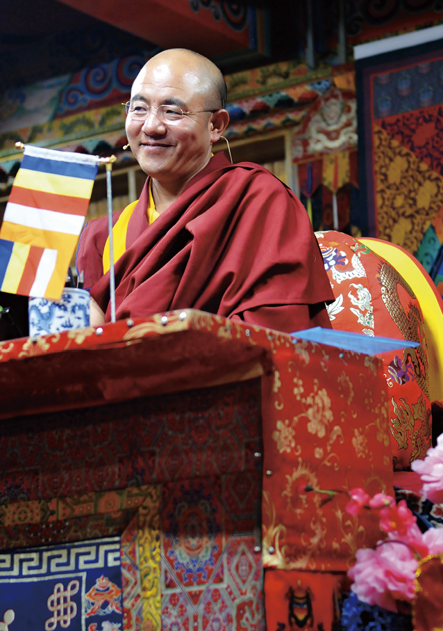
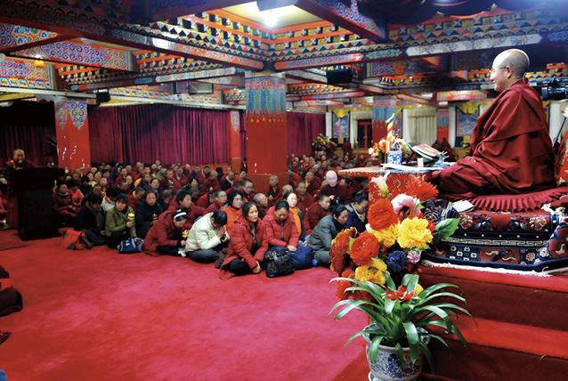

## 痛苦与快乐在一念之间

2010年3月28日

今天晚上，我们又在虚空中欢聚一堂，法喜充满。这是过完年的第一次聚会，记得上一次是在去年的大年三十。

我们今天的相聚，是为了离苦得乐。一是自己离苦得乐，二是众生离苦得乐。大乘佛法最根本的目标，就是让众生获得佛果，永远享受快乐。在座大多数是学习大乘佛法的，应该观察一下心，看自己是不是真正的大乘佛子？今天你来这里听课，如果是为了利益众生，可以算是真正的大乘佛教徒；如果只是为了自己不生病、多发财、更开心，那你学的不是大乘佛法。

## 哪怕只有一毫米的进步

今天在座的道友，有些已学佛好多年，不要说佛教的基本法要，就连深奥的五部大论也非常精通，是真正的大修行人，而有些才刚刚进入佛门，连最基本的佛教名词都不懂。所以，我今天要讲出让所有人都满意的道理，有一定困难。本来，每个人的兴趣和根基就不相同，众口难调，更何况我面对的是参差不齐的一群听众。作为讲者，我不一定能让你们所有人都满意。

我跟各位一样，身体是由骨肉组成，智慧也不是很高。可是，今天为什么有这么多人来听我的课呢？因为我学佛的时间比较长，在利益他众的菩提心方面学过一些经论。大家对我的信任，唯一来自于对佛法真理的渴求。这样的真理，不论是谁的相续中拥有，都可以成为大家共同求学的对境。在座的佛友，都希望自己能真正明白佛教的教义，同时尽量修持大慈大悲的菩提心。这样的话，大家以后都可以成为共同学习的对境。

现场的有些佛友，我们已经接触了多年，有一些则和我们素不相识。你们住在不同的地方，人生又这么短暂，除了在网络和光盘上听听课，我们以后有没有机会相见，很不好说。

但我觉得这个并不重要。我这个肉身，你们见到也没有什么用。我见到你们的肉身，也不一定有什么用。最关键的是什么呢？我口里说出的法，都是古代印度、藏地和汉地高僧大德或大成就者的教言。我这个人虽然很低劣，但我给你们传讲的教言，意义非常深刻。这些教言，不论是我，还是你，只要去学习，对今生来世都有无穷的利益。如果你们认真学习这些教言，我们的这次聚会也是有意义的。

为了听今天的课，大家都很辛苦。有些道友下午三四点就开始占位子，然后一直等到现在。大家对听课还是很有意乐的。我们求法的心越强烈，越有紧迫感，诸佛菩萨和上师的加持融入自己的心就越容易，越迅速，这是一个必然规律。如果我们对求法抱着无所谓的态度，漠不关心，得到的加持也就一般般。我看得出来，大家很努力，很认真，很珍惜这样的学习机会。这种精神非常可贵。

等会儿我给大家做一个简单的皈依，念一些简单的传承。作为修行人，要特别重视法融入心。面对生老病死的时候，我们的财产、名声、地位都用不上，唯有佛法能生生世世跟随。

大城市的人有很多生活的压力、工作的不便、修行的违缘障碍等，这些是正常现象。从高僧大德的传记看，从未感受过任何违缘和障碍、顺顺利利就获得成就的修行人，几乎没有。我等本师释迦牟尼佛在因地时，显现上也遇到过非常多的障碍。所以，希望在座的道友们不要害怕违缘。

大家学习佛法要持之以恒。如果长期不间断地学习，哪怕每天只有一毫米的进步，最后也会滴水成海，相续发生很大的转变。如果得过且过，两三天修行，两三天懈怠，修行肯定不会有很好的结果。所以，我们要时时刻刻观察自己的心。生活再困难、再劳累，每天也必须在佛法上充充电。

我认识一个法师，每晚睡觉前都要看半小时的佛教书籍。还有一个居士，发愿每天完成一部分咒语和课诵，并且看半小时的法本。学佛不是一年两年的事，而是一辈子乃至生生世世的事。只要长期坚持，我们的修行一定会成功。

## 不要因嫉妒心障碍别人

目前，大家在修行和管理方面遇到了一些困难。不管学院还是各个地方，学佛小组都有一些违缘。其实这些没有什么，任何宗教团体或个人聚会，都会受到相关部门的监督和检查。面对这种情况我们不能退缩。

学佛是非常合理的。释迦牟尼佛的教法是世界上公认的四大宗教之一。如今学基督教的、学道教、儒教的，都有很多人。我们学的是一种古老的智慧，任何人都没有权利阻止。在世间，几百个人可以聚在一起唱歌，聚在一起跳舞，聚在一起聊天喝茶。大家都是在行持自己的爱好，属于合理的行为，并不犯法，政府相关政策也是开许的。

有些佛教徒非常胆小。我不管到哪里，如果有相关部门来过问，我都觉得是正常的。不管是中国，还是美国，所有国家对某些集团和组织都会有这样的管理。我们信仰佛教是合理合法的，也是自由的。宪法也规定，任何人都不能强迫别人不信教，否则是犯法的。

佛友们在修行过程中，不要稍微遇到一点事就特别紧张，特别害怕。没必要的。如今在大城市里，行持非法的人有多少？做坏事都没有受到惩罚，佛教徒为社会、为国家、为人民、为所有众生而学佛，用自己的身口意去帮助他们，更不应该受到惩罚。如果受到惩罚，这些人应该扪心自问：这样做合不合理？

个别地方有这种情况：有些人曾在学佛小组里担任组长或负责人，后来退出了，就到相关部门去举报。他们用自己的行为障碍别人学修佛法，造下的恶业确实可怕。所有的过失，需要他一个人独自承担。你不学佛是可以的，这是你的自由，但千万不要造舍法罪。《净土教言》说过，舍法罪跟五无间罪没有什么差别，这种人即生根本不会有往生极乐世界的机会。

有些人嫉妒心很强，在这个团体中待不下去，就到另一个团体去，然后想尽一切办法用世间手段加害我们。他们虽然有这种行为，但对学习大乘佛教的人而言，哪怕别人用刀子砍杀自己，也要修安忍。这是佛教的宗旨。可是，有些人学佛只停留在口头上、形象上，法根本没有融入心。

这种行为叫做业际颠倒，特别可怕。业际颠倒者以前都是好好学佛的，他们修行佛法，承认前世后世，承许三宝有加持、四谛有功德，后来却产生了邪见、无恶不作，最终造下弥天大罪。在座的道友一定要注意。

作为佛教徒，诽谤上师或者毁坏法本，给金刚道友的修行制造障碍，罪业非常大。这些人不如不学佛。不学佛的话，最多一直在轮回中，不一定会堕入金刚地狱。可如果因为学佛，造下弥天大罪，不仅要堕入三恶趣，还要堕入金刚地狱。他们因为不懂罪业和果报，什么都无所谓，但在因果面前，有些事并不像自己想得那么简单。

因此，大家在修学过程中，应该尽量提醒自己，不要有嫉妒心，不要造下极重的罪业。对我们来讲，损失不会很大，最多一个组暂时不能学习，法本有些毁坏。但对你们自己和所涉及的众生来说，罪业却极其可怕。

希望道友们时常互相提醒，即使不能成为一个名副其实的佛教徒，也不要变成特别可怕的罪人。这么难得的一个人身，没有必要用来造这样的罪业。

## 感恩发心人员的默默付出

很多发心人员一直默默无闻地付出，相当辛苦，我从内心感激你们。因为有了你们的支持和帮助，大家才有了今天这样共同闻思修行的机会。我本人身体不好，事情也比较多，再加上各种各样的因素，如果没有大家的发心，单单靠我自己，不管怎么努力，共同学修的事情也绝对不能成办。

在座的人，除了我以外，大家都很辛苦。不仅是在学院，在网络上，讲堂上，在其他各个地方，都有很多发心人员在默默付出，而且这么多年一直坚持。有了你们，才有了我们共同学习的场所和机缘。

所以，我们应该把自己学修的功德回向给他们。我每天念完经以后，也会把善根回向给以发心道友为主的所有众生。

在发心过程中，发心人员不但没有得到什么利益，有些时候还要挨骂、挨说。我们对发心的要求比较高，如果达不到要求，就会受批评。没有这样的要求，大家的共同学修就没办法坚持下去。所以，我们这里的发心人员有很多压力。

希望大家不要诽谤、攻击以组长为代表的所有管理人员，也不要以世间的私人感情拉帮结派，互相敌对。大乘佛教徒心里想的事情，应该只有一件：弘扬佛法，让大家都得到佛法的利益。人们认为得到钱财才是最大的利益，其实得到佛法的利益，远远超过金钱所能带给我们的。大家只要好好学习佛法，今生就能得到很多收获。

在学习的过程中，大家一定要团结和合，和睦相处。各个地方的负责人，不管是大组长、中组长，还是小组长，和大家商量工作时，不要让自己的私人观点和想法占了上峰。在我们学院里，有7个理事，如果大家观点不一致，会按照民主的程序，以人数多的观点为主。法王在世的时候就是这样，以大多数人的意见为准。投票的一般是7个人、9个人或11个人。

有些组长开会的时候，经常扯来扯去，让大家不高兴。这样没有必要。我们在一起，是为了佛法，为了众生。除了这两个目的以外，我个人没有任何想法。只要能把佛教的真理传递到众生的心里，哪怕只能暂时给到一个人、帮助到一个人，我们也要全力以赴。在我们的共同努力下，会有多少人接触和接受佛教的真理，并从中受益？这是我们应该经常思考的问题，也是我们唯一的目标。

今天这里的很多人，相互之间根本不认识，包括我在内——我不认识你们，你们也不认识我。但是，我们却有一个共同的目标，那就是得到佛法的真理。为了众生和佛法，管理人员一定要断除自私自利的心。

大家都清楚地知道，我们最可怕的敌人有两个。一个是自私自利，凡事以自我为中心。这个敌人无始以来害过我们无数次。不管做什么事，只要为了自己就不是很好，我们一定把重心转移到利益他众方面去。

另一个敌人是实有的执著。世间的一切本来根本不存在，如幻如梦，虚无缥缈，我们却全部执为实有，在漫长的轮回中一直受苦，备受煎熬，没有解脱的机会。

有智慧的人，一定要学习佛法。自私自利，通过学习《入行论》等大乘经论，可以斩断。而实有的执著，则可通过学习《中观庄严论》《中论》等空性法门来断除。

这些课程，我们都给大家安排了。同时，也安排了相关的辅导法师。他们会给大家讲净土、前行、《般若摄颂》等。学院的法师每天都上好几堂课，特别忙。但是，只要对大家有帮助，哪怕只有五六个人，也会尽量给大家开课。

我们这里不像大城市，每天有很多闲聊。在学院，大家从早到晚一直忙着。发心人员的办公室，甚至在星期天，人也是满满的。大家忙的目的，就是为了与我们有缘的众生，哪怕得到一点一滴的佛法利益。这就是我们这个团队的目标，除此之外，再没有别的什么了。我们没有想过依靠你们得到财富和名声，也没有想过来世转生天界或极乐世界去独自享乐。依靠上师如意宝的摄持，大多数道友都有利益众生的意乐。

## 这样的机会非常难得

今天的网络交流，大家来自天南海北，有些地方网速不错，有些地方可能不好。有时跟你们的网卡有关系，有时跟我们这里的网络有关系。不管怎么样，大家都非常有信心。以后只要有时间，我们尽量在网上共同学习。世间人利用网络来聊天、玩游戏，没有什么大的利益。我们以学习佛法为中心，为解脱为目标，具有非常重要的意义。而且这样的学习机缘，在短短的人生中非常难得。

希望大家坚持学习佛法，闻思修行不是一两年的事。我到佛学院已经二十多年了，仍然觉得闻思修行不够。好多好多书都没看，好多修行和咒语还没完成。在短暂的人生中，为了解脱要做的事有很多，而时间却不够多。

你们在城市里，不要说长期地学习，甚至今晚能空出时间来，事先也需要很多准备。大家必须在面对很多问题之后，才能听到这一堂课。在这种情况下，大家肯定需要努力。如果不努力，学佛不可能有理想的结果。其实任何一种成效，都不是随便得到的，都需要付出。

学习佛法，一定要有坚强的意志和永恒的毅力，不能让暂时的外缘把学佛的机缘断掉。有了坚定的意志，我们的修行一定会圆满成功，一切邪魔和违缘都害不到你。大家今天一定要发下笃誓：“从今生乃至生生世世，我在修法过程当中，一定不怕违缘，不怕苦难！”有这样一种精神力量，对我们而言特别重要。只要精神有支柱，顺缘会自然而然地集聚。

同时，我们不能忘记利益众生。每天早上起来都要想：我今天的行为一定要以菩提心摄持，要帮助众生。晚上睡觉的时候要想：但愿我今天的行为能让众生得到快乐。最好再念一个简单的回向偈进行摄持。要时时刻刻提起正知正念，发愿依靠三宝的加持帮助众生。

今天，表面上是我在网上给大家开示。其实我跟大家一模一样，相续中也有烦恼，身体也是一个臭皮囊，从头到脚没有一个让人生起欢喜的地方。唯一和你们有所不同的是，我依止过如真佛一般的上师，在上师面前得到了真正的佛法教育。这种教育，不管什么样的人得到，都能得到一些利益。以上给大家分享的，算是我给大家的礼物，也是我给大家的法供养。

从世俗来讲，我们生生世世都要利益无边的众生；从胜义的角度，则要依靠中观推理来抉择一切万法为空性，摧毁实有的执著。如果达到了这种境界，我们就是真正的修行人，也是上等修行人。中等修行人和下等修行人，尽量不要给自他学佛造违缘，不要造恶业，并尽量行持善法，比如放生、吃素、念诵，周末方便时去寺院拜一拜，在生活中尽量孝顺父母，等等。

现在，大家正在学习《弟子规》。我要求每个人学完后进行自我检讨。作为佛教徒，应该经常观察自己在尊敬老人、爱护朋友等方面做得怎么样。现在很多修行人喜欢夸大事实，自我标榜，自我炫耀。真正的修行人应该摒除自我，在不同的场合揭露自己的过失，而不是到处夸耀自己的功德。

最近云南干旱严重，学院僧众在不断念经，祈祷莲华生大士和度母降下雨水，现在可能好一点了。希望各地道友也经常祈祷莲华生大士。莲华生大士的加持不可思议，如果诚心祈祷，地水火风的一切灾害，甚至我们自身的魔障、违缘，都可以遣除。我们先一起念一遍七句祈祷文，再念一些莲师心咒。

我一会儿在网络上给大家皈依，法名统一取为“圆悲”。重名不要紧，很多佛陀也是重名的，燃灯佛就有好几尊。世间人也有很多重名的。灌顶的时候，上师们也经常给弟子取同一个名字。

或许有人问：“通过网络能得到皈依吗？”我想是可以的。听说有个出家人给病人念经加持，病人的亲戚告诉他，一定要靠近病人，不能离得太远，不然病人得不到加持。出家人回答说：“三宝的加持是不可思议的。念经的时候，中阴身都能得到利益，何况是眼前的病人？”他说得很对。

我们念佛、传法的功德，对整个世界乃至其他世界的众生都会有利，甚至地狱众生也能得到利益，何况网上的众生还能同步听到声音、看到视频了？依靠不可思议的缘起力，大家应该能够得到加持。只要有皈依或者听传承的诚心，就可以。

（堪布先念《金刚萨埵修法·如意宝珠》的传承，然后为大家作皈依，之后念莲师心咒、紫玛护法祈祷文、黄财神心咒、文殊心咒、《窍诀宝藏论》《愿海精髓》等传承）

最后，感谢我们有这样一个共同聚会的机会，感谢大家抽空来到菩提讲堂。有了你们的因缘，我才能给大家传受佛法。但愿我传的法对每个人的心相续都有利益，能为你们断除轮回的种子。虽然我人很不好，但我口传的这些法，都是诸佛菩萨的金刚语，对大家应该是有利的。这一点，我有百分之百的信心。

现场互动

接下来是网络提问环节。因为听的人比较多，请尽量抓紧时间。如果有问题，用简单的语言直接了当地提出来，不要加很多的祝愿词、祈祷文、长久住世之类的祝福。很多道友下了课，还要坐车、赶路。听说有些是从很远的地方坐车到城里去上网的，待会儿回去还要花一定的时间。所以，你们简单地提问，我简单地回答。

⊙ 问1：我们虽然在网上学习了佛法，但对前生后世还没有生起定解。祈请您开一个这方面的课程。

堪布：对我们的人生来讲，承许前生后世非常关键，非常重要。对前生后世的描述，台湾、汉地和其他国家的学者智者写得比较多。这方面可能确实需要研究。

我以前翻译过学院慈诚罗珠堪布写的《前生后世论》，里面列举了很多公案，并将现代科学与佛教以对比的方式进行阐述，非常详细，非常甚深。你们先把这一部论认真地学一遍，再看还有哪些地方存在疑惑，自己不承认前生后世的理由是什么，专家学者们承许前生后世的理由有哪些。

其实，按照佛教和科学界的观点，前生后世存在的理由应该是很充分的。网上应该有《前生后世论》。我相信你们学了以后，很多道理都会明白的。

问2：我自己看过书，但效果不是很好。

堪布：你有看过《前生后世论》吗？

问3：有啊。

堪布：那没办法了。

问4：还是有很多疑惑。

堪布：有疑惑很正常，继续学习。

⊙ 问：如果工作对修行不利，该怎么办？

堪布：有些工作的确不利于修行，比如杀生或者干非法的事。这些工作与修行完全是相违的，应该尽量改行。如果各方面因缘成熟，最好找一个对自己修行有帮助的工作。

也有一些工作，虽然对修行没有帮助，但也不会有直接的危害。如果不是特别不利于修行，就可以不换。因为换工作对大家而言，不是一件简单的事，中间有些过程很难适应，必定会给学习和修行造成障碍。

不管到哪个单位，工作上的忙碌和操心都是很难免的。自己要懂得把握。如果对修行有直接的危害，而且危害程度相当严重，最好换一个工作。如果危害不是很大，就要多方面考虑。作为修行人，如果能随时把握自己的身心，也许工作会是促成你修行的顺缘。

⊙ 问：早上念金刚七句和莲师心咒，是默念、出声念，还是金刚持念？

堪布：都可以。

⊙ 问：犯了密乘戒的人，念经、供护法、用转经轮能不能忏悔？

堪布：《三戒论》等相关论典中讲过，忏悔有很多方式。方便的时候，最好可以看一下。不过，密乘戒有一些特别的限制和要求，比如超过了规定时间还没有忏悔，必定会堕金刚地狱，即生肯定没办法成就。

犯了戒当然可以忏悔，罪业没有什么功德，能够忏净算是它的一个功德。但如果犯了严重的密乘戒，不一定忏得净。你可以忏悔，用转经轮、念护法也可以。

⊙ 问：身边有一些人愿意皈依，但做不到完全断杀、吃素。应该劝他先皈依，再慢慢断除杀生呢，还是做到了不杀生以后再皈依？

堪布：最好让他先皈依。皈依以后，再慢慢了解佛陀的功德，经常祈祷佛陀，逐渐断除杀生，最后成为一个真正的佛教徒。在某些佛经当中，也有佛教徒边杀生，边念咒语的。

不管怎么样，心中有佛对每个人来讲非常重要。即使造恶业，也是皈依了佛的人，将来必定有解脱的机会。不管什么身份的人，先做皈依都是最好的。

⊙ 问：我以前得过腰间盘突出，不能久坐，偶尔趴着听一下课，如法吗？

堪布：佛陀对此有开许，如果病得非常严重，躺着或靠着听法也是可以的，没有过失。不过，身体好的人，应该以如理如法的威仪听受佛法。

⊙ 问：我学《现观庄严论》和《量理宝藏论》很费劲，只听了几节课，不太懂，所以没听圆满。这样可以吗？

堪布：我觉得，你应该不是全部听不懂，而是个别内容听不懂。但不管懂不懂，听任何一部法，最好都能圆满传承。如果中断了，有些法在未来不一定听得到。即生创造了好的缘起，以后生生世世都会遇到佛法，不会中断。所以我们要求传承一定要圆满。

法王如意宝在世时，对弟子们的要求很严格，不管什么法，都一定要听圆满。如果中间实在听不完，也要到另一个人那里去接传承。比如你的《量理宝藏论》因为某些原因听不完，要专门请一个有传承的人给你念一遍颂词，算是补上一个缘起。所以，大家学《入行论》也好，其他法也好，最好能善始善终，不要半途而废。

⊙ 问：可以送朋友烟或酒吗？

堪布：抽烟和喝酒有过失，最好不要送。不管对自己还是他人，烟酒都有一定的危害。如果不得不送，自己要念金刚萨埵好好忏悔。

⊙ 问1：我是医院的护士，医院所有的器械都要送到我这儿来消毒，包括一些堕胎的工具。我这属不属于杀生呢？

堪布：这应该不是直接杀生，因为你上班的时候并没有想“我要做这个杀生工作”。但你做的事和杀生有关，间接会有一些过失，所以应该经常忏悔。这还是很重要的。你在哪里当护士？

问2：我在内蒙一个医院。

堪布：你当护士的时候，对病人的态度怎么样？我以前在医院里遇到的护士，有些态度特别好，有些态度不太好。你态度要好一点啊，病人很可怜的。

问3：我记住了。您放心吧，上师！

堪布：从明天开始要改变行为。

问4：嗯！

⊙ 问：我们学过的法本，可不可以结缘给别人？受过灌顶的人，可不可以向父母和祖先顶礼？

堪布：学过的法本可以结缘给别人。但我这20年当中学过的法本，就像自己的生命一样珍惜，全部保存着，舍不得给别人，最多借一下。

受过灌顶的人，可以向自己的父母和祖先顶礼。

⊙ 问：往污水里放生如法吗？有些人认为可以，说这些旁生吃过了甘露丸，哪怕马上死去也会解脱。

堪布：放生之前，要看所放的这些众生是家养的，还是野生的。要为它们找好适合生存的环境后，才可以放。虽然甘露丸对它们有帮助，但我们还是应该尽量保证它们的生命能延续下去。

⊙ 问：看了一些破戒者下地狱的公案，感到很害怕。僧团中如果有破戒者，我们又没有能力观察，如果供养僧团的时候，与这些破戒者结了缘，会不会一同下地狱？

还有，随身携带的《般若摄颂》，人离世后如何处理？

堪布：佛陀在佛经里说，供养僧众的功德相当大，但并没有说供养前要先观察僧众，把戒律清净的人挑出来供养。虽然僧众不一定全部戒律清净，但作为在家人，以清净心进行供养，应该是有功德的，不会有过失。

另外，不管是《般若摄颂》还是《系解脱》之类的加持品，佩戴者离世以后，可以拿到一个清净的地方，比如山顶上、森林中，或者跟尸体一起火葬也可以。

⊙ 问1：上师，您好！我没想到自己能被抽中！

堪布：你是哪里的？

问2：我在冰岛。

堪布：你们国家怎么样啊？

问3：还行，就是物价上涨比较快。

堪布：你们那里佛法怎么样？

问4：一直没有人宣扬佛法。以前有泰国的僧人来过。我曾经发愿，希望这里能有佛法传播，但自己能力有限。

堪布：你身边有没有信佛的人？

问5：我接触过身边的人。冰岛本地人有一部分对佛法很感兴趣，但是他们有语言的障碍，很多人都说冰岛话，不过能听懂英文。上师，能不能从咱们学院得到一点帮助，得到一些佛法方面的英文资料，发给我身边的这些人？冰岛人对于佛法很感兴趣，但是没有人给他们宣传。其实这里的环境非常好，非常适合修行。

堪布：有没有寺院呢？

问6：没有。有一个泰国人发心建了一个白塔。在山上，我去看过。因为北欧这边人比较少，而冰岛的人更少。

堪布：有没有放生呢？

问7：冰岛没有卖活物的，但很多人都以捕鱼为生。大西洋的渔产非常丰富，鱼也非常大。跟他们说捕鱼是杀生，他们不在乎。我现在在学冰岛话，也尽量用英语跟他们讲因果轮回、关爱老人等观念。

冰岛本地人有信仰自然的传统，也接受和尊重佛法的理念。这儿的书店有一些介绍佛教的英文书，但内容很少。专门介绍因果轮回、前生后世的英文或者冰岛语的佛法书几乎为零。但是冰岛人很感兴趣，有些人经常来问我这方面的事。希望得到大恩上师的加持，看看能不能帮到他们。

堪布：你旁边有没有一些学佛的道友呢？

问8：中国人特别少。要是发展学会，可能需要从中国人开始，先组织那么几个人。但我接触了一下，觉得比较难。如果能把身边的外国人发动起来，让他们从因果轮回的理念开始学习，会比较好。他们相信灵魂存在，对灵魂的事情非常感兴趣，不少老人还能看到灵魂。很多冰岛人去印度找答案，希望从印度学点儿东西。我觉得，要是能把部分人组织起来修行，会很好。这个地方非常安静，非常安全。

堪布：可以可以，很好很好。

⊙ 问：我刚开始学佛，脑子里不时会产生一些恶分别念，虽然发生后就立即忏悔，平时也努力克制自己，但这种情况还是时有发生。这是否属于破密乘戒？通过念诵金刚萨埵心咒10万遍是否可以清除？任何罪业是否都能通过金刚萨埵修法来清净？

堪布：对上师不应该产生恶念，因为上师对每一个学佛或修道的人来讲，唯一只有帮助。上师过去没有害过你，今生也没有害过你，将来也不会害你。当然，对上师生起信心需要前世今世各方面的因缘，如果因缘不具足，是生不起信心的。所以，即使你现在生不起信心，也情有可原。

但如果不生信心，反而生起恶念，就非常不合理了。从道理上讲，也说不过去。世间的学生对能干或有智慧的老师，也不应该产生恶念。同样，一个学佛的人，应该尽量把上师看成——就像佛经里讲的一样，把上师看成佛菩萨或德高望重的人。这是很重要的。

那是不是我们心里产生一个恶念就破誓言了呢？也不是。每一个誓言都有自己的界限，具体情况可以看一下密乘的戒律。

生了恶念，能念金刚萨埵10万遍忏悔，当然很好。按照《三调伏续》里的观点，念金刚萨埵可以清净破誓言的罪。这个罪业是在心里产生的，所以念金刚萨埵心咒应该可以忏悔清净。

任何一个罪业，念金刚萨埵是不是都能清净呢？金刚萨埵在因地时发过愿：“将来受持我名号、念诵我心咒的人，如果不能清净他的罪障，愿我自己不要成佛。”后来金刚萨埵誓愿成熟，已经成佛。以他往昔的发愿力，不管什么人，不管什么罪业，依靠修金刚萨埵进行忏悔，相续中的罪业都可以清净。

## 结语：让修行伴随一生

现在离金刚萨埵法会还有一个多月，但前段时间个别法友一直要我念金刚萨埵心咒的传承。今天也算是开了一个小小的金刚萨埵法会，从念金刚萨埵的传承开始，以回答金刚萨埵的问题结束。

我们每个人造的罪业都非常多，希望大家多念金刚萨埵心咒。我自己天天都会念金刚萨埵心咒，一有时间就拼命地忏悔。在座的道友，以前可能杀生特别严重。不论是吃饭，还是在世间做事，都跟杀生等恶业有关。所以应该尽量念金刚萨埵心咒，忏悔自己的一切罪障。我们的佛性一直被业障所遮蔽，而这些罪业一旦清净，自己的恶分别念就可以遣除，诸佛菩萨的很多境界也会自然现前。

今天新闻说，山西煤矿有120多人被困。希望大家一起祈求诸佛菩萨，加持他们早日脱险，获得自在。如果有人失去了生命，愿他们早日获得解脱。大家应该这样发愿回向，我回去也为他们念念经。

你们回去以后，要多观想无常。人生那么短暂，世间很多东西在临死时都用不上。看看自己这个水泡般的身体，还能在世上支撑多久。如果有了修行境界，遇到什么样的违缘和痛苦都可以转为道用。如果没有修行，死的时候该怎么办？要经常观察自己，也观察他人。

非常感谢今晚来菩提讲堂的所有道友，希望你们每天过得开心。祝大家晚上做一个美梦，明早起来多观想佛陀，多观想众生，好好地修行，让修行伴随自己的一生！
