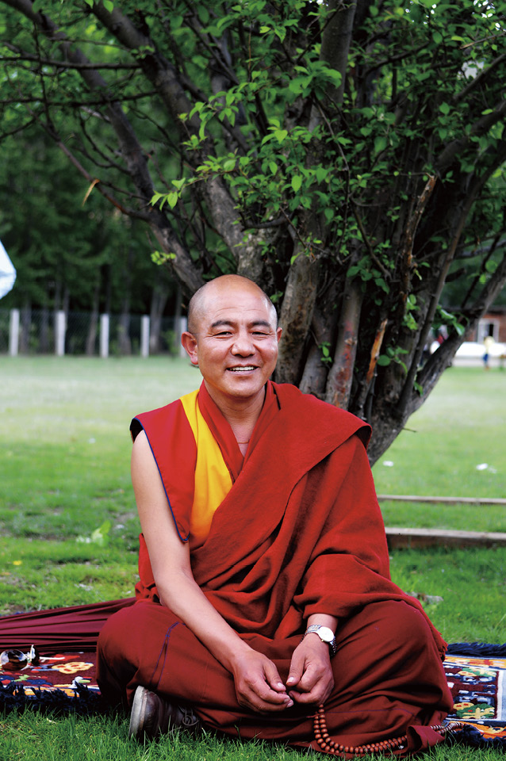
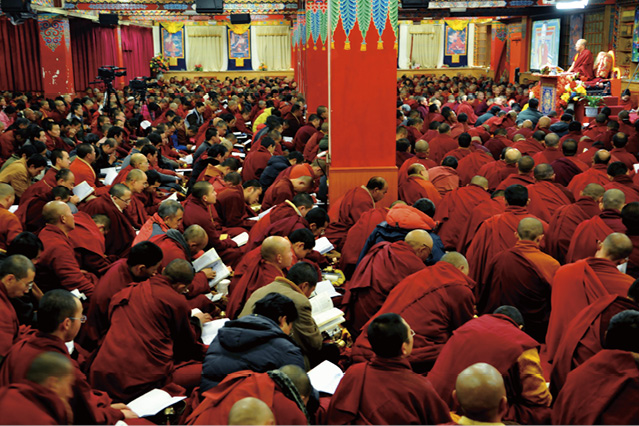

# 祈祷莲师的功德

2009年9月12日

今天，我首先讲一下最近学修方面的管理情况，然后给大家做个开光，之后念诵莲花生大士上师瑜伽的传承，后面如果有时间，大家可以提问，我们做一下交流。

## 学修管理中的问题

1．学佛要长期

最近，通过管理人员的汇报和反映，以及跟大家沟通时的感受，我了解到大多数道友在闻思、修加行或念佛方面非常精进。虽然你们身处城市，生活、工作特别繁忙，很难抽出时间学佛，但道心不但没有退失，反而一年比一年增上。这对我来说是一种很大的鼓励。

如果外面大多数道友不愿学法和修行，我们在这里辛辛苦苦给大家制造因缘和条件也没有多大意义。但现在看来，大多数人的信心越来越增上，并没有减退，我个人也会更加努力，以后尽量给大家提供各种学法的方便。

希望大家能做长期学佛的打算，因为学习《大圆满前行》和《极乐愿文大疏》是两个非常大的工程。世间的工程一般在一两年内可以完成，比如，我今年发心建的觉姆经堂有上万平方米，两年内就可以竣工。但我们学习《大圆满前行》、《极乐愿文大疏》以及《现观庄严论》，一两年当中肯定难以完成，就连共同加行的修法也不一定能完成。但短时间完不成也不要紧，以前我们的传承上师当中，有的人一辈子修了十六遍加行，有的在十几年当中一直修加行。所以，如果是一个真正的修行人，用两三年、四五年时间完成这么重大的事情，是非常值得的。

只要对大家有帮助，我和发心道友都会尽可能地付出一切。希望大家不要把学佛看成一件非常简单的事，或者只是在别人面前装模作样，这样并不合理。

2．报数要真实

在我们学会当中，大多数修行人都很上进，但也存在个别道友不太如法的现象。

比如，我们要求每月学修报数，报数理应实事求是，但个别组长和学员报给我们的数字却是虚假的。为什么这么说呢？因为，他们上报的数量都一模一样。这种现象有点可笑，因为众生的根基各不相同，每一个月当中每一个人的磕头数量、念诵佛号的数量完全一模一样，这样报数要么是组长的问题，要么是学员的问题。希望组长和学员都能充分重视起来，报给我们真实的学修数量。

实际上，你们的学修报数给我们这边带来了很多工作和很大压力。我们这边的发心人员，星期天都休不了。本来我要求他们周日可以休一天，要是一直不休，怕身体熬不住，但星期天我去各部门的时候，看到大多数道友都从早到晚忙着，因为发心工作太多，平时根本完不成，而平时，他们除了吃一点饭和简单的闻思以外，其余所有的时间都用在你们身上。相比于此，我觉得大家每个月报给我们真实的学修数目，应该不是很困难。

关于学修统计的事情，希望我们大家能共同合作。否则，你们身处那么遥远的地方，学修情况我们实在无法了知。如果没有这样的约束，两三年后颁发加行圆满奖时，哪些人能得到莲花生大士的奖，哪些人得不到，根本无法区分。如果弄虚作假的修行人得到了，而真实修行的修行人得不到，肯定不合理。虽然这是一个非常庞大的工程，但我们这边有上百人共同发愿完成。希望以后大家报数一定要真实。

3．战胜困难、坚持修行

在修加行的过程中，有些人会有一些违缘和困难，比如，有脊椎炎或其他疾病的道友，磕起头来比较困难，这是身体上的障碍；此外，因为磕头必须要有一个场地，所以有些道友的家人或单位的人会经常反对；还有些人认为磕头是外道的修行，有种种说法等等。希望大家一定要战胜各自的困难，保证每天磕完一百个头，这样完成十万礼拜也不是很困难。修行一定要精进，否则不可能轻而易举地完成。

去年，我和大家共同发愿每天磕一百个头。所以，除了周末或有特殊情况不上课以外，每天下午完成两个小时的讲课和念诵之后，我都会和学院道友一起磕一百个头。发愿至今，除了有一天身体疼得实在不行断过一次之外，都没有间断过。我以前修过加行，这次重修虽然很辛苦，但我觉得光说大话是不行的，修行非常重要，一定要身体力行，一定要付出。实际上，在我们短暂的人生当中，磕一个头的功德和利益都是不可估量的。因此，这次我并不是要求你们修加行，我自己舒舒服服地坐着，而是亲自带领大家一起修。

虽然你们城里的人和我们山里的人有些地方不同，但说自己很忙，或者有人阻碍等而修不了加行，可能也是一种借口。其实，每个人都有信仰自由，除了极个别人以外，大多数人应该都可以面对这些困难。非常希望大家在修加行的过程中，不要以种种借口而放弃，修不修完全取决于自己。

4．遵守学修要求

有些道友没有按照教务处的课程安排和进度学修，在很短的时间内就随随便便把二十几堂课，甚至所有的课都听完了。该思维的、该观想的、该修持的，都没有认真行持，只是草率了事，但最后报数的时候，却和大家一起报，这样根本不行。我们安排一星期听一两堂课，对于课里的内容，一定要认真细致地观修。虽然个别人可能根基比较特殊，但特殊根基的人也需要跟大家一起观修人身难得、寿命无常等外加行。

前一段时间，我们学院所有的道友，一起闭关一百天修人身难得、寿命无常。最近，正在进行第二个一百天的共修。你们虽然没有这样共修的机会和因缘，但也应该按部就班地修行，最好不要做各种超越。有些道友因为以前没有接受过佛教系统的教育，所以觉得修行很简单，很草率地就过了。我个人并不赞同这种做法，希望大家能按照教务处的规定来完成自己的闻思修，既不要拖后，也不要提前。

此外，上师瑜伽是所有修行的前提，所以，我们要求大家现在每天结合上师瑜伽来磕头。与此同时，好好观修四外加行——人身难得、寿命无常、因果不虚、轮回过患，这四个共同外加行非常重要！其他的皈依、发心、供曼茶罗、念百字明这些暂时不着急修。

一般来讲，一两年不一定能观得出来，起码要用四年时间特别认真地修，才能打好稳固的基础。这个基础不是为了报一个数目，以便马上去修后面的皈依和发心，我觉得没有这个必要，希望大家不要着急。

我们要求大家先磕十万个大头，之后念一百万遍莲花生大士心咒。为什么念莲师心咒呢？因为会有非常殊胜的加持和功德。今年我翻译了《七句祈祷文释·白莲花》，这是麦彭仁波切对莲花生大士七句祈祷文的注释。以前上师如意宝在藏地传过这部法，1990年到印度南方佛学院的时候也特意传过。最近，我们准备把这个莲师的外修法和七句祈祷文上师瑜伽这两个法，公布在智悲佛网上，为大家的学修提供方便。

上等修行者念一百万遍莲花生大士心咒，中等者念五十万遍，下等者念十万遍以上。如果没有时间，念一万遍也可以，再没有时间，就念一千遍，总比不念好。我个人发愿在一百天内最少完成十万遍以上，大家可以根据自己的情况念诵。

其实，每天空出一两个小时修行，完全可以做到。你们扪心自问一下，自己每天看手机浪费了多少时间？每天用在佛法上又有多少时间？

很多道友说：“上师很辛苦，我们买什么东西供养您好呢？”我不要财供养，只要法供养。法供养有两种：一种是自己认认真真地闻思修；另一种是真诚地帮助菩提学会或爱心小组做各种利益众生的事，引导众生断恶行善。

我们这边的发心道友日日夜夜工作，目的就是为大家提供学法的方便。你们好好修行、认真报数，是对我们这边发心人员最好的配合，否则他们的确很辛苦。

以前的高僧大德，到藏地或印度求学是多么艰难，而现在，我们依靠现代科技，就可以把所讲之法一字不漏地传到你们耳边，这是一个极其难得的机会。但有些人却认为太多而不觉稀有，不加珍惜，这是不合理的。

虽然我只是一个凡夫，但我讲的法百分之九十以上都是依靠前辈大德的教证和理论，所以，大的方面不会有错。加之在佛教方面，我也专研了将近二十年，虽然不敢说自己有什么修证，但不论是社会经验还是修学经验，应该还是有一些的。因此，对这么多人大胆地宣讲佛法，自己也有一定的把握。

希望愿意学习的道友，能按照我们的计划和要求去修学，这对自他都有很大的帮助，有关负责人也要认真执行。除了修学佛法以外，我们并没有其他要求，希望大家对此理解。

5．学佛要有勇气和毅力

大家学习佛法的时候，如果很多人一起共修不方便，可以分成一些小组，但无论怎么样，最好不要断传承。“文革”期间，很多高僧大德冒着生命危险讲经说法，从未断过传讲和修行，可见，只要有信心，一定会有办法学法的。我们学习佛法不但不会对国家、社会乃至人类造成危害，反而还会促进各方面的和谐稳定，并且，这也是每个公民应有的权利。

有些人因为自己懒惰，所以稍稍遇到一点违缘，就马上把所有的修学抛诸脑后，这是非常可怜的。希望大家不管面对来自家庭、单位，还是其他人和非人的压力与违缘，都能坚强地站起来，只有这样，才能圆满完成我们的修学。

此外，学佛时间一定要长。有些道友认为学的内容太多了，其实一点都不多，你们可以看看古代高僧大德们的传记，他们一生当中学过多少部论典？我们现在最多也就学几部，要是这样还懈怠懒惰完不成，实在太惭愧了。我个人如果没有特别重要的事，只要还有一口气，讲经说法和次第修学绝对不会轻易中断，这是我的发愿。

大家在闻思和修加行的过程中，遇到违缘不要紧，这是很自然的。此时，一定要有勇气和毅力，否则，在违缘重重的现今，很可能一蹶不振。希望每位道友都能在心中发下一个强大的誓愿：“为了学佛，我在有生之年一定要勇敢地面对各种违缘，无论如何都要坚强地站起来。”具有这种奋勇精神相当重要。

我看到个别道友上学期学得好好的，这学期已经着魔倒下去了，这是非常可怜的，但也没有办法。佛陀在世的时候，也有很多人退失道心，更不要说现在末法时代了。对这些道友，我只能悲哀地叹息。

## 关心儿童教育

最近，我们倡议大家关心儿童的教育，包括对一些不信佛教的家庭，建议他们教育自己的孩子学习国学，接受善良的教育。这方面各个地方做得不错。

我希望学会所有的道友，都能从方方面面为自己孩子的未来着想。孩子将来当官不重要，发财也不重要，真正对他生生世世有利的是，成为一个有德行、有利他慈悲心，乃至有菩提心的人。我们应该抓住教育孩子的机会，把他培养成这样的人。这一点非常重要。

为此，我们最近开设了“智悲佛光网”，网上有对孩子心灵成长有帮助意义的古今教育、国学文化，以及儿童故事和动画片等内容。利用一些现代技术的方便方法，可以吸引到孩子们的眼球，大家有必要在这方面共同努力。

不久前，我在学院讲完了《弟子规》。过一段时间，你们学完《大圆满前行》和《极乐愿文大疏》第二学期课程之后，用两三个月时间也学一下。

对于这件事，我翻来覆去想了很长时间，总觉得成年人也应该学一下这部国学经典。我作为一名藏传佛教的出家人，学了《弟子规》之后，感觉学到了很多知识，受益颇多。它教导人们如何对待家人、亲朋好友，以及世间的任何一件事。我自己受益之后才推荐给别人，否则没有任何意义。

希望各地儿童读经班的负责人，不仅要让孩子读《弟子规》，而且要督促他们背诵和学习。如果有时间和机会，后面还要学习《三字经》和《千字文》等经典。我看到很多城市对儿童国学教育抓得很不错，这样非常好。如今的教育不重视培养孩子的道德，整天只讲分数。学校、老师不强调德育，学生也不学习，这些孩子长大以后会变成什么样，每个人都心中有数。希望大家对于儿童读经一定要重视起来。

## 爱心小组应体现“爱”

现在，各地建立了很多爱心小组，希望相关负责人在每个月或每个季度当中，组织大家做一些有意义的爱心活动。做有意义的事不一定要收很多钱，也不一定要到处募捐，原则上我们不开许化缘，因为经济上的问题扯来扯去很麻烦。

最近，我了解到学会一些有爱心的道友，准备到一些养老院、孤儿院或灾区提供帮助，这样非常好。如果没有大的集体活动，也可以到医院照顾一些特别可怜的病人，或者到乡村去照顾一下孤苦的老年人，哪怕只去帮助一天，也是一种善行。希望大家在学了大乘佛法以后，在实际行动中真正做一些善事。

有些道友已经学佛三四年了，但在三四年当中，没做过几件有意义的事情。光是口头上发菩提心，但一辈子没做过几件好事，也不合理。所以，参加一些爱心活动，哪怕一年当中做一件好事，或者参加一个有意义的活动，也是非常有必要的。

## 压力也是一种动力

大约今年十一月，我们要进行闻思A和闻思B的考试，希望大家现在学的时候一定要认真。闻思B组原来只设了一个闭卷考试，但后来考虑到，如果只有闭卷考试，很多人都没有勇气参加。所以，我们又设了一个特别的开卷考试，具体要求会在网站上公布。

大家学法的时候，需要有一种压力，没有压力的话，很多事情都难以完成。我现在给你们讲课，也时时有种压力，如果没有压力，我可能今天去沈阳，明天到海南，每天都逛来逛去。但我觉得短暂的人生不应该这样度过，要对自己有一个约束。所以，我发愿为大家传法，如果答应给你们传某部法，那完不成就不是人。你们作为修学大乘佛法的行人，在学法方面也要给自己一些压力，在家庭、工作方面应该合理安排，利益众生方面也应承担一些责任，这是很有必要的。

## 传授传承

下面，我给大家念诵《莲花生大士上师瑜伽》的传承，以及依靠《莲师七句祈祷文》会供的传承。

（堪布念传承）

希望大家过后能看一下“莲师七句祈祷文”的功德。末法时代的众生，一定要修持莲师七句祈祷文。无论汉地还是藏地，乃至各个国家的修行人，如果异口同声祈祷莲花生大士，对于遣除末法时代种种黑暗会有不可思议的加持和功德。

前面我讲过，修前面加行和后面加行的中间，如果有一些时间，应尽量念诵莲师心咒。学院道友现在每天都在坚持念诵。当然，我们这里因为有法王如意宝的加持，所以成千上万的人有清净修行的机会，而在城市里则不一定有。但也有很多城市里的居士非常精进，远远超过了有些寂静寺院里的出家人。个别出家人因为没有生活压力，有时睡觉很香，八点钟还在梦乡云游，而城市里的有些居士一直坚持早晨四点钟就起来修行，不管学《入行论》《大圆满前行》《极乐愿文大疏》，还是其他上师的法，都非常精进。

作为修行人，不应该空耗自己暇满的人身。藏传佛教一位非常了不起的大德——全知果仁巴大师说：“白天应忙忙碌碌地闻思，晚上要安安静静地修行，这样的人身才有意义。”希望大家不要因松散懈怠而将自己的善根断掉，应时时鞭策自己，让自己的人生具有意义。

念完传承之后，我会给大家做一个皈依，并给你们的转经轮、念珠、佛像等做简单的开光。听说很多道友拿了一大堆东西，全部堆在电脑前等着开光。相信依靠发心清净力、法界不变力，以及有法无欺力这三种因缘，我们共同所缘的事一定会成就。也就是说，依靠三宝的加持力，现在我在藏地高原念开光仪轨传承，依靠法性力，你们完全能得到利益，就像现在我在藏地雪域高原给大家说话，每个人可以原原本本听到一样。

下面我做开光仪式。如果有些人需要皈依，我给大家做简单的皈依，并念诵简单的护法神仪轨。

（堪布进行开光，并给大家皈依）

以前已经皈依且有法名的不用改，这次新皈依的人统一取法名为“圆莲”，因为大家都与莲花生大士和大圆满有缘。刚才后面给大家念的护法神是：紫玛护法神、单坚护法神、热哈拉护法神、一髻佛母护法神、格萨尔王护法神，即三大护法神加上紫玛护法神和格萨尔王护法神的简供。

## 祈祷莲师的功德

我特别希望大家以后能多念莲花生大士心咒，最好也能劝身边的亲朋好友念。如果城市里的很多人能异口同声地祈祷莲花生大士，对于将来佛法在汉地兴盛会有不可思议的缘起，这有很多内外密的缘起和必要。

末法时代，藏地依然保存着非常完整的教法和证法，即使经历了“文革”那样毁灭性的运动，藏传佛教依然如杲日般完好无损地存在。这里面有不可思议的秘密要诀。为了使佛法能在整个汉地长期存在，唯一的方便方法就是祈祷莲花生大士。

此外，很多人修行不成功，经常遭受各种各样的违缘，如果一直祈祷莲花生大士，将不会被违缘所转。我们修行的保护措施太差了。大家平时会给车买保险，给房子安防盗门，把钱存在银行或保险柜里，因为担心出现违缘或盗贼。同样的道理，如果不对现在好不容易修得的一点点善根资粮做保护，很容易被邪魔外道夺走。所以，一定要依靠莲花生大士的加持来遣除违缘。

我虽然只是一个区区小人，但对现在和未来的有些道理还是明白的。所以，我以个人名义呼吁所有信众能异口同声地猛厉祈祷莲花生大士，共诵莲师心咒。只有这样，才能令自己逃脱违缘的深渊，也会对整个集体、乃至汉地佛法长久不衰创造一种不可言说的缘起。

现场互动

⊙ 问：您在《入行论》中讲：自己修行成功不重要，利益众生才最重要。《现观庄严论》总义中华智仁波切也说：利益众生才是成佛的究竟目的。这些法都倡导三宝弟子发普贤宏愿。

今天，在殊胜因缘的聚合下，我们菩提讲堂的师兄们要在大恩上师面前发愿：“顶礼大恩上师！祈请大恩上师加被我们，在轮回未空之际，生生世世能够亲近殊胜的上师和佛法，生生世世能够忆念、不忘失菩提心，生生世世行持菩萨行而无有任何疲厌之心。同时，祈请大恩上师加被，让我们全体发心人员在发心过程中善始善终，不因任何违缘而退失发心。最后，祈请大恩上师身寿不变久住世，法轮长转利群生。菩提讲堂全体国内发心人员，感恩大恩上师！”

堪布：很好！刚才这位道友的发愿，确实是包括我在内的所有道友应该共有的。我们学佛、成佛的目的，就是要帮助天下无边的众生，这是我们生生世世的重大责任！希望每位道友都能从内心当中在诸佛菩萨面前发下这样的誓愿。

我给大家念一个无垢光尊者在《窍诀宝藏论》里的发愿文，以此金刚语作为摄持大家殊胜誓愿的因缘——

> 愿我乃至生生世世中，获得具足七德之善趣。

> 愿我出生立即遇正法，具有如理修持之自由。

> 愿我能令上师生欢喜，日日夜夜之中行正法。

> 愿我悟法后生精华义，彼生越过三有之大海。

> 愿我能为众生传妙法，成办他利无有厌倦心。

> 愿我能以无偏大事业，令诸有情一同成正觉。

⊙ 问：佛网UC讲堂中有大恩上师的开示，这样我们可以跟学院一样系统地闻思修行，让更多师兄有了学佛的机会，非常感恩大恩上师！请问，我们是否可以使用E-mail与上师沟通，请您为我们解答疑惑？

堪布：我们通过网上的菩提讲堂，给大家开设了与寺院一样的课程，同时安排了法师专门做语音辅导，并且还开设了佛教论坛等。大家有问题可以与辅导法师沟通，如果他们实在解答不了，也可以通过E-mail或QQ等其他方式与我们沟通。我这边虽然发心人员有限，但会努力回复大家的。

此外，我们的“菩提讲堂”和“智悲佛光网”需要一些专业技术发心人员，如果有人愿意发心可以报名，我们非常感谢。

通过现代的方式学习佛法非常重要。古人的生活方式和闻思方法与现代不同。以前，藏族人无论到哪里都骑牦牛或骑马，现在基本没有骑马的，大多数人都骑摩托车或乘车。

同样，不论汉传佛教还是藏传佛教，佛教徒的有些学习方式不一定要与古代一模一样。古代的人需要聚集在寺院或佛学院才能听到佛法，而现在的人听法不一定非要到寺院。如果菩提讲堂的人全部来五明佛学院学习，无论你们还是学院都有很多困难。我们的目的是学法，现在大家通过网络就能听到与佛学院同样的课程，此时一定要善加利用来完成自己的善业。

⊙ 问：我每天观修菩提心、出离心，也看了很多法本，但心中并没有真正产生那种感觉，遇到问题习气就出来了，贪嗔痴还是很多，请问，如何才能生起出离心和菩提心？如何去掉自己长久以来的习气？

堪布：对于所闻思的内容，很多人在道理上都基本明白了，知道断除烦恼很重要，生起菩提心也很重要。但关键时候用不上的原因是什么呢？主要有两点：一是学得不够；二是修行时间不够。以前的高僧大德都是长年累月学佛，很多人会用二十到四十年来学习佛法。因为他们在学佛上用了特别长的时间，并且每天用很多个小时来修行，因此，在对治烦恼、生起菩提心等方面会有非常强的力量。

有些城市里的人，虽然说是看了很多佛教方面的书，但我觉得不一定很多，说自己学了很长时间，但可能也只有两三年、四五年。我们相续中的烦恼长久以来一直存在，根深蒂固，这样的痼疾就像长期慢性病一样，简单地吃一两次药或打一两次针，不一定马上见效。所以，大家需要长期努力，不能因为修行过程中有一次忍不住发脾气，或是产生了贪嗔痴的烦恼就马上放弃。只要像以前的高僧大德那样长期闻思修，必定会战胜烦恼。

⊙ 问：在家人如何平衡发心和闻思修的关系？有些师兄说发心多了，闻思修就跟不上，但发菩提心不是最重要的吗？

堪布：现在我们学院分了三种班：一种班闻思是重点，一种班修行是重点，还有一种班以发心作为重点。学院所有道友必须加入其中一种班。如果在学习为重点的闻思班，那修行和发心作为兼修；如果在发心班，那闻思和修行作为兼修。

城市里的人在同一时间完成所有的事有一定困难，此时，应根据自己的情况进行抉择。如果真的对众生有利，自己也能够发心，就应将发心作为重点，闻思和修行放到次要位置，这样有很大的功德。如果利益众生的发心和能力有限，就闻思或修行。

⊙ 问：当面对违缘的时候，是以遣除的心，还是以转为道用的心——将痛苦视为加持来对待？

堪布：两种方法都可以。如果觉得违缘是上师和诸佛菩萨的加持，比如生病的时候，觉得自己是为了众生而生病，愿将所有众生的痛苦代受在自己身上，若能这样观，就是把违缘转为道用，自己病得越严重就越对众生有利。如果不能这样观修，就通过其他方式制止或遣除违缘。

⊙ 问：顶礼大恩上师！我代表国外的发心人员在这里祈请大恩上师长久住世，永转法轮！我们发愿：虚空界尽，众生业尽，众生烦恼尽，我们的大愿无尽，我们永远跟随大恩上师的脚步弘法利生！虽然我们远在他乡，但我们有信心把佛法传向世界的每一个角落，也希望大恩上师加持，让我们具足顺缘，能有更多道友加入共修。

堪布：大家发了这样的心非常好。2500多年来，释迦牟尼佛的佛教思想不管相比于西方哲学、东方文化，还是其他任何知识或宗教，都可以说是最至高无上的，因为佛教既有理论依据，也可以实修实证。我们并非自赞毁他，这是很公正的评判。

我很希望世界每个角落的众生，多多少少都能得到诸佛菩萨的加持，生起利益他众的菩提心，并通达万法无我的空性智慧。如果具足这样的因缘，暂时能获得人天福报，究竟会证得圆满菩提。

希望每位道友都能像刚才这位修行人那样，发愿用自己所有的力量帮助众生，把利益众生放在第一。同时，也要为自己不堕入地狱、饿鬼、旁生，为趋入清净刹土而努力学修。

⊙ 问：非常感谢上师！通过两三年的学习，很多道友的相续都得以改善，对上师三宝生起了无比的信心。但有些学了不久的新学员，因为对法义一知半解，我们与他们沟通时会有很多问题。比如：有些新学员对于各种法会，都想去随喜念诵，但又念不过来，此外，他们对净土、加行，闻思A、闻思B的课程都想学，但又学不过来，不报数又怕组长不高兴，因此心里生起了很大的烦恼。这该如何抉择？

堪布：每个人的能力是有限的，我们不应该强迫，应让大家自愿选择。我这边虽然开了几门课，但分得很清楚，只有一门是主修，其他都是兼修。比如，你如果主修加行，那修加行的数量一定要报上来，其他的法我们不要求报。

如果自己有时间、精力或能力，菩提学会和显密学会的课程都可以学。如果不具足这些，选择学习其中一个也可以。同样，我们这边虽然安排了几堂课，但可以只选择一种，如果有能力都可以学。

我前段时间资助了一些大学生。其中一名能力较强，他一边读专科一边读本科；另一名没有这样的能力，只能读专科。每个人的能力和时间都不相同，所以，不要有这个烦恼，但做任何事情都应该有头有尾，这个很重要。

如果这个也学，那个也学，结果可能都学不好，最后一点效果也没有。这样组长不高兴，两个学会的管理人员也不高兴，我觉得这样没有必要。应该自己好好考虑。很多道友可能都存在这个问题。以前我跟大家再三说过，应该好好思维，哪一个对你来讲是最重要的？最重要的只有一个。

现在菩提学会虽然开设了三个组，但只以一个组作为主修。比如，前行组一周听一堂《大圆满前行》就可以，其他的课听不听都可以，我们没有要求报数。如果一周当中连一堂课的内容都没有听和修，那说自己在学法，则完全是一种说辞。

我们学院虽然课程较多，但以学院的标准来要求大家有一定困难，因此，我们对外面居士的要求是很松的。如果这样还起烦恼，那不如不学，天天上街逛公园，就没有人催你、说你了。

⊙ 问：有一小部分学员闻思修行抓不住重点，什么法都想听，虽然有的也学了两三年，但却很难改变自心，对于取舍因果、守持戒律方面也不是很重视。希望上师开示教诲。

堪布：我们刚来学院时也是这样。记得有一次，我一天听了六堂课。当时求法的心特别切，觉得这个法很重要，那个法也很重要，结果每天都跑来跑去，特别忙，但学得都不是很好。后来我发现，学法应该抓住一个重点，在此前提下，如果有时间再学其他法。

当然，每个人的根基不同，有些人不管做世间法，还是修学佛法，这个也可以抓一点、那个也可以抓一点，但这可能只是极少数。所以，按照统一标准制定一个制度，可能有一定的困难，你们还是根据自己的情况来学习吧。总而言之，大家修得还是很不错的，非常好！

⊙ 问：有人想去学院请上师亲自加持，并在学院住上一年半载，令他增强信心。

堪布：我们佛学院现在人比较多，也没有宾馆（可能两三年当中修不完），很多学员来到学院之后，住处有一定的困难。所以，我们建议大家最好安住在自己的地方。实际上，现在学院所讲的法，在外面都可以听到。

此外，到学院得上师亲自加持的说法，我是不赞叹的。因为，我一生中对你们最大的加持，就是为你们讲法，提供方便让你们学法。除此之外，用其他东西给你们加持，我自己感觉没有什么利益。大家通过学习《大圆满前行》《入行论》等，使自己的相续有所转变，这就是我最大的加持。佛陀也不是用神变来度化众生，而是通过宣讲佛法让众生解脱。

再者，来学院的路途很遥远，到学院还会有高原反应。很多人的假期都在输液中度过了，输液结束，假期也结束了，最后不得不回去。专门到学院“受加持”——输几瓶液体就回去，我觉得不值得，大家自己在家里好好学法就可以了。

⊙ 问：我来自北欧冰岛，正在学习加行，在此向上师顶礼！

我想问两个问题：

1．在修学《大圆满前行》的过程中，如何提高自己的观修质量？

2．像我们这些国外的学员共修有一定的困难，希望通过远唤上师、祈祷莲花生大士的加持，把佛法传遍世界的每一个角落。祈请您加持让我们圆满修学善法。

堪布：第一个问题，要想提高修《大圆满前行》的质量，需要花一定的功夫。虽然藏密当中讲过一些窍诀，比如灌顶等，这也是很多大成就者和上师们的行为，但作为普通人，一定要从人身难得、寿命无常开始修，并且一定要长期下功夫。当然，在修的过程中，自己有时觉得修得挺好，有时又觉得修得不好，会有这种情况，但总体来看，只要花一定时间和工夫，一定会有效果的。

因此，我强调长期修加行，在加行上面花一定时间特别重要。修行时间长了，久而久之，对加行的重要性就会有所认识，这样加行的理念在自相续中生起也不会有很大困难。

第二个问题，无论在国外，还是在国内，很多人修学佛法都会遇到困难。总体上，我还是提倡大家共修，共修的力量远远超过个人独修，因为一个人独修，什么时候倒下去，谁也不知道，凡夫人很容易不知不觉中退失信心，而依靠共修，会得到一种共同力量的加持。学院修加行的时候，我会和大家一起磕头、一起念诵，感觉这个力量非常强。

当然，在城市共修，可能需要花时间坐车，这对有些人来说有一定困难，但最好不要间断共修。因为，保证传承不间断以及智慧增上需要很多因缘。我们这么多年专门搞佛教教育，最后得出的结论是，共修的力量非常大。如果实在不具足共修的因缘，就把自己的家当做佛堂，远唤上师和祈祷莲花生大士。

上师如意宝在1993年去了美国和加拿大，然后从加拿大直接乘飞机到欧洲，当时去了法国、英国、荷兰等国家。我们在法国的时候，去了《西藏生死书》的作者——索甲仁波切的道场，在那里，很多法国人把《远唤上师》唱得特别感人，他们唱莲花生大士心咒的音调也非常好听。后来我们学院唱莲花生大士心咒的时候也采用了这个音调。

我感觉欧洲和美国在祈祷莲师方面做得特别好，希望你作为一个身在冰岛的佛教徒，也能经常祈祷莲花生大士。“嗡啊吽 班匝儿格热巴玛色德吽”（堪布唱诵）。以前我们在法国唱的就是这个音调，一会儿下课的时候，大家可以一边唱莲花生大士心咒，一边回去。

## 结语

今天我们就交流到这里，非常感谢各位今天来到菩提讲堂。我祈祷上师三宝，愿你们的相续中早日生起真实无伪的出离心和菩提心，利益天边无际的众生，自身早日圆满菩提证相。谢谢大家！
