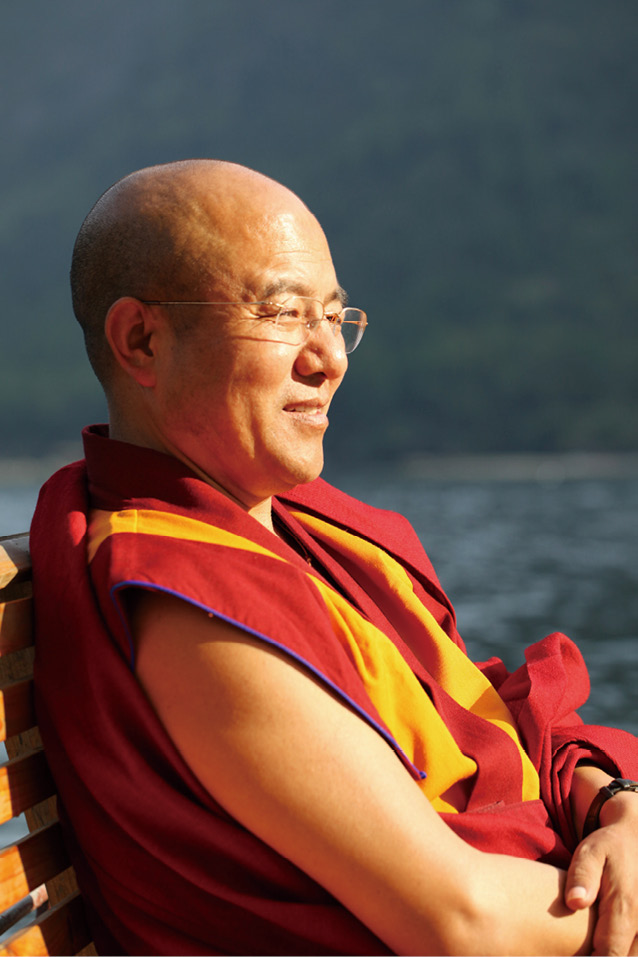
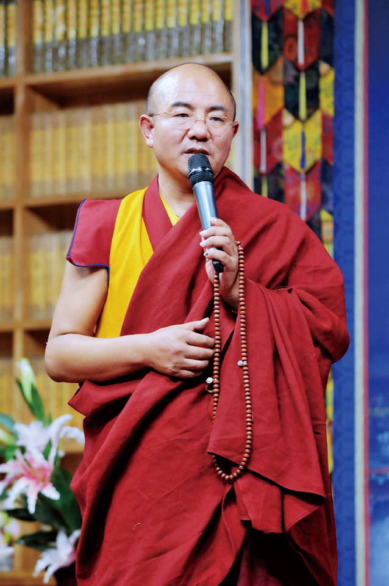
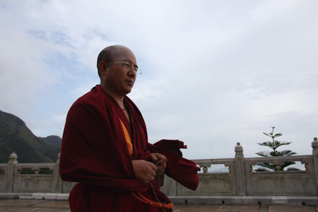
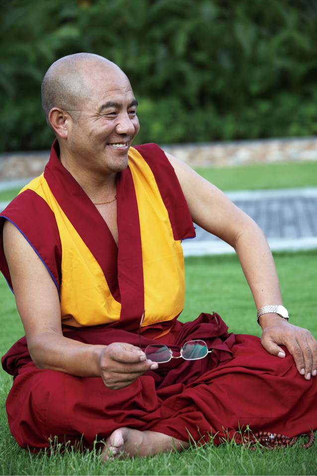
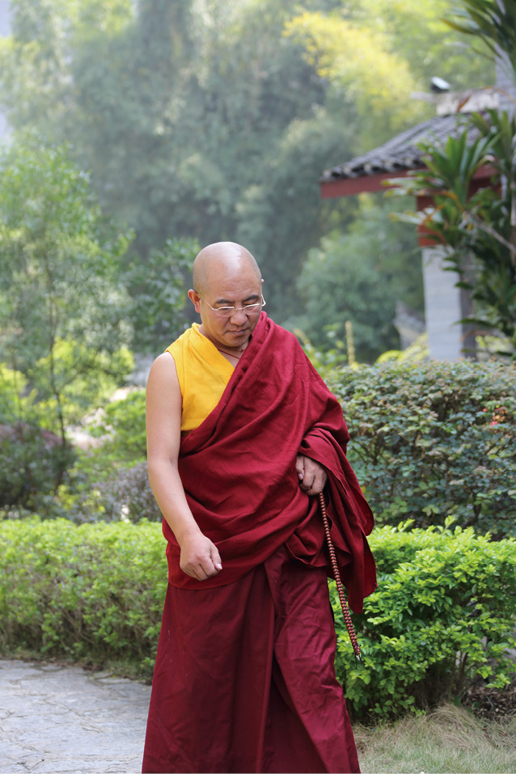

## 以清净心秉持中道

2012年3月22日

今天，我在UC智悲讲堂，与大家共同欢聚。首先，我要祈祷三宝，祈愿今天所有的听众，都得到上师和诸佛菩萨的加被。

很多人都想学习佛法，想真正获得心灵的解脱。可是在末法时代，往往有很多烦恼、痛苦、违缘和障碍。作为凡夫人，在种种折磨和违缘之下，很难提升信心和智慧。慢慢退失信心，最终误入歧途的现象，非常多。

在座的各位，百分之九十九是希求解脱者。也有极少数人，是怀有好奇心，或者抱着种种目的，进入佛门的。但无论是谁，只要耳边听到诸佛菩萨的名号，就能种下菩提的种子和善根。因此，我在这里先为大家祈请。我发自内心地祈祷十方诸佛菩萨，赐予各位加持。

（堪布祈祷）

## 别太热，也别太冷

不管是谁，学佛的因缘都来之不易。对大多数人来说，修行要善始善终、究竟圆满，不是一件容易的事。因此，不管是出家人，还是在家人，都要经常祈祷上师三宝。

要想自己的信心、出离心、大悲心、菩提心、无二慧等，不断地稳固、增上、圆满，一定要长期地精进，刻苦地修学。否则，是不可能达到目标的。

我们身边有很多道友，最初特别热情、特别用功、特别优秀，可是走到半道上，坚持不下去，最后完全沉落、彻底退失。这样的现象非常多。

每个人学习佛法都特别不容易，尤其在大城市，周围有各种各样的外缘，需要面对家庭、工作以及各种各样的社会关系。这种情况下，我们佛教徒的所作所为有时不太被人理解。时间长了，自己的信心很容易慢慢地淡化。

为了让自己能长久坚持，我们学佛应该趋入中道。什么叫趋入中道？保持一种温度，刚开始不要太热，最后不要太冷，持之以恒。

刚开始，学佛的信心特别大，将家产、亲友等全部抛弃，唯一希求解脱。坚持了一段时间，没什么大的进步，觉得修行很难成功，又将所有的佛法，乃至仪轨的念诵和基本的善行全部放舍，彻底回归世俗，落入红尘。对一个佛教徒来讲，这样做是非常不合理的。

这种现象，很值得大家深思。学习佛法，一定要走中道，不能走极端，否则很难长久。这是我今天特别强调的。

## 信心和清净心

个别的道友希望，我能对知识分子——如大学生、老师、医生、公务员以及社会各界的学者、智者等，就学习佛法的思想和见解等方面，提一些建议。

今天的时间这么短，我恐怕提不出什么具有建设性和参考价值的建议。但是，我也可以明确地告诉大家，这几年来，针对很多人学佛的思想和见解问题，我思考过许多，并在不同的院校给师生们做过开示或演讲。

目前有个别的人，包括每天都在闻思修行的学会道友，都觉得我在不同学校讲的内容是重复的。其实，我可以骄傲地说：“我在各大院校讲的那些道理，没有一模一样的。对当前的佛教徒或者非佛教徒而言，我讲的道理都有少许的意义。”

比如，我在南京大学讲的前世后世问题，虽然在西北大学也讲过，但侧重点是不同的。当时，我是以自己的智慧，结合多年学佛的思想和见解，给当代一些知识分子，做了一次自己比较满意的报告。

这些内容，我在不同的平台，都提供了相关的资料，有兴趣的人可以去了解。当然，对没有兴趣的人，不要说佛教，甚至任何一门世间知识，我也不会特意宣讲，或要求他们学习。

还有很多人要求我，今晚讲一讲佛教与科学的关系、生命存在的问题等。这些内容，要在短时间内介绍，也有一定的困难。

今天下午，我得到了塔克博士关于前世今生的一本书，很有价值。近年来，我一直在寻找这本书。花费了无数的精力和时间，找了无数的人，打了无数的电话，甚至通过网络四处联系。可以说，为了真理，我用尽了所有的办法。现在，终于得到了。

其实，在国内外，各个民族都有一些特别珍贵的书。不过现在这个社会，多数人只对钱财、地位、美色有兴趣，对真正有价值的真理，可能就像饿狗面前放青草一样，不仅不屑一顾、毫无意乐，甚至还嗤之以鼻。这种时候，我无论怎么强调，也不一定起作用。

我原来在不同的学校讲过，有一本名为《知识分子》的书。根据这本书对知识分子的概念和定义，今晚凡是来我们网络课堂的人，广义上都可以称作知识分子。

作为一名知识分子，对佛教的见解和思想，应该是怎样的呢？

很多大城市里的人，从小都是不学习佛法的。后来，以偶尔的机缘，才开始趋入佛门。这些人，和从小就受佛教的教育、在佛教的氛围中长大的藏族人相比，信心和见解不一定很稳固。

所以，对在座的很多人而言，你有什么样的年龄和地位，有多少钱财，都不重要，保持自己清净的思想和行为，才是最最重要的。

前一段时间，在一所学校里面，一位老师还是学生问我：“你出家这么多年，从开始到现在，有没有后悔过？”我发自内心地回答：“我出家这么多年，不但没有后悔过，而且一直认为，出家是我人生中迈出的最荣幸、最快乐、最有意义的一大步。”

对我来讲，如果没有遇到佛法，今生的生活琐事、生死大事以及世间各种各样的问题，用其他方法是根本不可能解决的。

因为有了佛法，我即生才有生存和独自面对一切的能力。因为有了佛法，我活着的时候，没有造特别大的恶业，各个方面都种下了许多善根，来世也有了一定的保障。总之，以我个人的修炼和经历来衡量，今生遇到佛法，应该是最荣幸、最快乐的一件事情。

## 佛法的灵魂

在座的人见仁见智，可能会有不同的观点。不过，对大多数人而言，遇到佛法确实不容易，这不是靠一个简单或偶然的机会，就可以搞定的事情。

大家现在既然遇到了佛法，就应该珍惜这个难得的机缘。如果不懂得珍惜，就会像现在某些出家人那样，最初有一点出离心，但因为没有明白真正的佛理，慢慢就趋入了邪道，甚至还俗。很多居士也是，最初对上师和三宝有一定的信心，但因为闻思不够，整天忙于各种琐事，最终没办法获得解脱。甚至有一些人，不要说解脱，连三宝都成了他口中诽谤的对象。

看到社会上各种各样的现象，我会深深地感慨，现在人们最需要的就是佛法。可惜，现在很多地方，包括一些寺院，讲经说法的人都寥寥无几。一个佛教道场，如果没有讲经说法，每天都是搞旅游、凑热闹，绝不是真正的佛教道场，只是相似的佛教形象。

真正的佛法，就像世亲论师讲的那样，唯一是教法和证法。而教法和证法，必须通过学习和修行才能获得。离开了真正的闻思修行，也就失去了佛教的灵魂。

在这样的大环境下，大家闻思修行的机缘，显得尤其珍贵、难得。不管是居士还是出家人，都是如此。这样难得的机会，大家一定不要错过，千万不要当作一般的琐事，白白荒废时日。

## 像骏马吃草那样

外面个别学佛小组的负责人，刚开始，闻思发心各方面都比较积极。到最后，每个人都只想自己的工作、家庭以及各种乱七八糟的世间事，对真正有意义的弘扬佛法和利益众生的事，却没有去特别关心。作为一个当代的大乘佛教徒，这一点是最令人遗憾的。

真正的大乘佛教徒，不论暂时或究竟，自始至终都应该利益众生。可是，我们大多数佛教徒身上，体现出来的却是，仅仅为了利益自己，如果对自己没有好处，就漠不关心——这也许是我的邪见。这种现象不太合理。

我经常在不同的场合强调，一定要闻思修行佛法，但与此同时，也不要以各种各样的借口，放弃利益众生。

利益众生的方式有很多，比如放生、做慈善、讲经说法等。哪怕在路上看见一个可怜的人，给他一毛钱、一分钱，也是在做善行。

但这些行为，现在的大乘佛教徒做得并不是很圆满。因此，从现在开始，我要大声地呼吁：大家在闻思修行的基础上，一定要多做慈善！

有些人认为，除了捐款，其他都不是慈善。其实不是这样的。真正的慈善，是培养一颗慈悲的善心，力求日行一善。这在口头上说说容易，但在实际行动中，自己是不是每天都在行善，大家可以扪心自问。所以，哪怕是一点一滴的善事，我们都应该先做起来。

个别的道场和学会小组比较极端，有的除了每天做慈善，什么闻思修行都没有；有的负责人却经常强调，做善事会障碍和影响闻思修行，从而抵触行持善法。我想，行善对闻思稍许有一些影响，但真正的修行人，做善事不会影响闻思，他会将闻思付诸行动，形成良性循环。

多年前，我讲过《札嘎山法》。记得里面有一个比喻：骏马会一边吃草，一边嚼草，一边咽草。[^1]大乘佛法的中心思想是什么？利益众生、弘扬佛法。因此，学习大乘佛法的人，也要一边听闻，一边思维，一边用实际行动利益众生。

有些孤陋寡闻的人认为，所谓的闻思修，就是最开始听闻，中间思维，最后到山里去修，修到一定的时候，再出来利益众生。其实不一定是这样。《札嘎山法》里怎么讲的？要闻、思、修并行。所谓的修行，就是在行住坐卧中，对真正的大乘理念不断地串习，而不是非要到一个山洞或者密室里去观修。

串习大乘理念有两种方法：从心上串习和从行为上串习。有些人口口声声说自己是大乘佛教徒，实际上呢，哪怕自己有能力、有机会，也不愿用行动帮助身边的众生。这是不是舍弃了大乘菩提心呢？

最近，我也参与了一些慈善活动。自始至终，我都没有像极个别人做慈善一样，把钱捐出去以后，就什么都不想了。所谓的慈善，慈是慈悲，善是善法，意义极其广大，并不是捐一点钱那么简单。所以，我希望学会的个别人，不要排斥慈善，不要认为这多此一举而去另谋修行。

当然，对于像米拉日巴那样住山洞的修行人，我也非常佩服。但我们有些人，只不过是嘴上说说而已，自己并没有去山里闻思修行。一说起做善事，就把这套说辞搬出来。

大家做任何一件事情，都不要走极端。任何时候，过了界限都不一定好。

现在，各个地方都有一些学佛的中心、寺院、学会、小组等团体。不管是负责人，还是普通学员，都应该参加共修。前一段时间，我去了一些佛教团体。在走访的过程中，我感觉有些团体特别好。在末法时代，能有这样集中学习的机会，的确非常难得。

大家要好好地共修佛法。今生，如果能把佛教的慈悲观，慢慢地扩展到全社会，对社会和谐、国家富强乃至全人类的共同进步，都将产生巨大的利益。这样过一生，应该特别有意义。

## “三不要”，很重要

目前，有些人利用学会的平台，做自己的事情。以后，我们会通过各种方式，对这类行为严加制止。所以接下来，我还需要提醒大家几件事。

第一件事，不要利用学会的名义集众，化缘搞经济。我今天在这里，正式告诫各地的学佛小组，你们以前的行为我不予追究，但从现在开始，不管是放生还是平时学习，或是任何时候，在三个人以上的团体当中，对修经堂、修佛塔、修寺院、建学校等涉及金钱的事情，一律不准化缘。

我自己对自己都是这样要求的，何况是对其他的上师？不管什么场合，不管什么上师，只要是在学会的平台上，一律禁止化缘。佛学院每年都在修经堂，今年也一样，但我们从来没有化过缘。

以后哪个小组发生这样的事，对组长等负责人会有不同程度的惩罚。情节严重的，要么解散小组，要么撤掉负责人。希望我说完以后，下面好好地执行。

第二件事，不要利用学会的平台搞个人宣传。我以前讲过，包括我的照片和资料，学会都是严禁宣传的。对其他的任何上师、任何大德，我们虽然有恭敬心，但学会毕竟是闻思修行的清净场所，没有任何私人的空间。所以，各种各样的宣传资料和上师照片，以后不要再拿到我们的道场。

如果你要宣传自己的上师，私下里怎么做都无所谓，但请你不要利用学会的平台。有些人，学习佛法只是借口，实际上却另有目的，这样不太好。

前段时间，我们走访了一些道场。在有些道场里，贴着各种各样的私人照片，有头发的、没头发的，有耳环的、没耳环的，到底是真上师还是假上师，我们也分不清楚，反正照片都挂满了。

我以前说过，在道场挂诸佛菩萨的法像，那是应该的，但挂我个人的像，我坚决反对。所以，我们并不是偏袒哪一位上师。

实际上，任何一位上师，控制佛教徒都是不合理的，我个人从来没有控制过哪一个佛教徒。对于学会的平台，只要好好学习佛法，谁都可以进来。但是，如果不是为了学佛，只想以各种方式，达到自己目的，那就谁都不要来。我们并不缺人。

所以，为了保持大家学佛的纯洁性，希望大家以后好好合作。如果实在不愿合作，我们也不可能一个一个去求，最后会有制裁的方法。

第三件事，不要参与任何非法活动。现在不管东南西北、国内国外，形势都比较复杂。有些宗教奉行的，确实是极端主义。而我们佛教是真正具有包容性和开放性，真正具有大悲心和平等心的纯粹的宗教。大家应该懂得它的价值，不要被任何非法组织和非法个人利用。如果有人利用宗教搞非法活动，损害佛教团体，不管是谁，都只是他个人的行为，而不是我们提倡的。

上师如意宝即将离开世间时，为我们留下了意义甚深的两句教言：“莫舍己道，勿扰他心。”佛学院所有的高僧大德，都把这个教言作为自己终身修持的法。

作为大乘佛教徒，我们不能抛弃自己的本质，对包容世间所有生命的佛教理念，应该感到光荣和自豪。我们要有爱，要懂得用大爱维护自己的宗教。而且在这个过程中，不能损害任何众生，哪怕是小蚊子小蚂蚁以上的生命，都不做丝毫损害——更何况做其他不如法的事情。所以，大家一定要如理如法地学佛。

有些人因为不了解情况，对大家学佛有些担心，怕学佛的人太多。其实不用紧张。我看汉地大城市的一些大寺院，有成千上万的佛教徒在那里烧香、拜佛、念经、许愿等，做各种各样的善事，做完以后就回去了。

其实，各个地方都一样。我们每一个佛教徒，只要行为如理如法，既不违背大小乘的各种戒律，也不违背、不触犯当地相关的法律法规，就会有非常好的自由空间。所以，大家不要担心，而应该珍惜。

有些佛教徒，胆子太小，自己学个佛都胆战心惊的，担心被抓起来……这是没有必要的。有些人呢，特别害怕佛教徒会干坏事。其实真正的佛教思想，他们并不了解。

因此，大家应该遵照佛教真正的本来面目，好好地行持善法；在利益众生的原则和基础上，好好地弘扬佛法。我希望各地学会的道友，都能大胆地弘扬释迦牟尼佛的教法。

## 小小违缘，挡不住前进的脚步

获得人身非常难得，稍微有点违缘很正常。我自己的身体，也经常出现各种各样的状况。前一段时间，因为身体不好，我一个人自由自在地在医院住了一段时间。

其实，一个人在医院很开心。别人不需要来陪护，自己也没有什么压力。如果旁边有一个人帮忙，我心里会不舒服，这个人肯定也不情愿。为了病人，在医院挂号、取药，跑来跑去，恐怕谁都不愿意——谁想侍候别人呢？

后来，很多人传我得了不治之症——可能个别人希望这样。但我只是输了几天液，身体现在越来越好，很开心。

其实，不仅仅是我，个别的发心人员，因为种种原因，不得不长期在某些岗位上坚守。在这个过程中，有时候心里不舒服，比如想学院、想金刚道友、想爸爸、想妈妈，但为了弘扬佛法，为了利益众生，还是一直坚持着。

我记得《释迦佛广传》中说，佛陀因地曾发愿：只要能在一个众生的相续中播下善根，哪怕于若干劫，在地狱感受各种各样的痛苦，自己也心甘情愿。[^2]对凡夫人来讲，这么做可能有一定困难，但作为一个大乘佛教徒，小小的违缘和痛苦，根本不应该阻挡我们前进的脚步。所以，希望我们每一个佛教徒，都能坚强起来。

城市里的一些居士，家里稍微有一点阻挡，心情就变得不好，开始伤心痛苦，把所有的闻思修行都放了下来。有些人放下以后，就追随别人去了。过一段时间走投无路，又回到学会，继续跟着学。

发心人员中也有这样的。刚才有个人问我：“我在外面跑了一两年，觉得特别难熬。现在我可不可以回来继续发心？”这个人以前发心很不错，所以我说：“欢迎你回来。”而有一些人，以前发心特别不好，后来即使想回来，我们也不愿意。

也有一些学佛的道友，不管遇到多大的困难，都始终坚持在学。这是值得大家赞叹和随学的。

## 365天散乱，肯定没时间修行

去年，我们评选了终身学员。这么做，并不是因为我需要终身学员。我死的时候，一个学员都带不走，活着的时候更不需要了。我在医院治病，最痛的时候，都不需要一个终身学员，更何况身体好的时候。所以，对我个人来讲，不需要任何学员、任何徒弟。

但对大家来讲，通过终身学员的评定，获得一种共同学习的机缘，这是很有必要的。以后，我们会通过各种方便方法，正面了解大家的真实状态。也希望大家互相理解、互相沟通。这方面，以后也会有不同的方便方法。我们说了以后，会做到的。

大家现在的学习，对我来讲还是有压力的。学院寒假刚结束，我正在讲《普贤行愿品》，同时发愿以后讲《六祖坛经》。《成量品》和《大圆满前行》还没有讲完，最近一直在努力，想把它们讲完。

对我们每个人来讲，学佛都是所有事情当中最重要的。我不单是口头上这样说，内心也是这样认为的。只要有动力和发心，这样的因缘就可以有很多年。

我和这边的发心人员，白天晚上都在为大家提供学习的方便。我希望大城市里的你们，也要经常充电。不要每天都特别懈怠，每天都睡懒觉。晚上不到10点钟就开始打哈欠，眼睛红红的，好像得了严重的疾病；早上都8点钟了，还像猪八戒一样睡得呼呼的，这样不是大乘佛教徒。

在我们那里，有很多七八十岁的老法师，晚上12点左右才睡，三四个小时以后又起来念诵、修行。你们在大城市里，如是地懒惰，如是地散乱，如是地不精进，应该感到非常非常惭愧。

很多人都说自己没有时间修行——肯定没有时间，每天都在散乱，24小时散乱，365天散乱，哪里还有修行的空间和时间？如果自己珍惜时间，不管是谁，都应该有闻思修的时间。

我在大学里的演讲音频，有人说没时间学习，我有点不高兴。怎么没有时间？我有那么多的事情，都有时间讲，你为什么没有时间学？我在学校里讲的，都是现在世间人最需要了解的，可是你却说排不开时间，那我只能说顺其自然吧。你既然没有时间，我也没必要强迫你学。

你们只是学，压力并不是那么大。一个星期三四堂课，也就三四个小时而已。一个星期有多少个小时？你自己算一算。怎么就连三四个小时也拿不出来？现在很多人学佛，喜欢找各种各样的理由推辞、拖延，在精进方面特别特别差。对此，我有很多的看法和意见。

当然，我今天不是正规的讲课，而是就几个关键的问题提醒大家。

## 闻思的深度还不够

学习佛法应该有方法。个别的人，这个也学，那个也学，全都是走马观花地过一遍，深度不够。以前我们闻思的时候，上师讲任何一部法，至少都要看三遍。依止上师如意宝将近20年，每一部法开讲的时候，我都会发愿，无论怎样要学三遍——课前自己先预习一遍，上师讲一遍，最后至少复习一到两遍，是这样闻思的。

但现在很多人以忙碌为借口，不好好闻思。我们辛辛苦苦准备法本，有些人却一点也不看；有些人只粗略地看一遍，根本不珍惜；有些人甚至将法本视为一般的报纸和资料，根本不知道里面有真理。

我刚才说了，为了一本书，我找了很多关系，托了很多人，花了很长的时间，才最终得到。而这本书里面讲的，只不过是英国人、美国人对前后世问题的看法而已。

对在座的佛教徒而言，我也可以说是佛教方面的专业人士吧。我讲出来的道理，多少也有一些参考价值。所以，希望大家好好地思考。

今天有这么多人，所以我非常公开、非常直接，有什么就讲什么，没必要说很多虚假的好话——你们都很好、很胖、很不错……哦，很多女孩子不高兴你说她胖，只能说苗条。

佛法讲的是人心的改变。我今天讲的每一句话，都希望你们回去好好地思考。大家现在的学习，广度还可以，但是深度不够。为什么说深度不够呢？我们以前学习，哪怕上师如意宝讲课时开了一个玩笑，举了一个比喻，我们也要深入地思维很长时间，再三挖掘其中的含义。如果不这样，只把它当作世间的普通语言，就得不到里面蕴藏的甚深意义。

大家学佛法的时候，为什么特别崇拜上师呢？因为上师的教言符合佛教的道理。这样的佛教道理，是一种窍诀，也是一种经验。就像世间人看病，更容易接受临床经验丰富的医生诊断一样，我们学习佛法，也要依靠上师大德们的窍诀性开示——光是得一个灌顶，听一个教言，还不行。得到了窍诀性的开示后，再去如理如法地修行。

## 清醒一点，把握好机会

今天，我跟一个法师在电话里聊天。当然，我们聊的内容跟世间人聊天有所不同，更多是佛教和真理。在交谈的过程中，我们聊到了现在很多不如法的现象。

先不说别的，光是修一个加行，就有各种各样的情况。我今年一直在修加行，学院几百几千人都修完了，都有资格接受大圆满的灌顶，听受密法的传承和修行引导。

但现在社会上有人说，只要花点钱，就可以代替修加行。五六年前就有人说，花600块钱可以买个五加行证。算下来，一个加行需要120块钱。听说，现在已经涨到3000块钱了，物价在不断上涨。

说这些话的人，不管是谁，我对他本人都没有什么意见，但是这种做法，确确实实不符合传承上师们的教言。

还有些人说，大圆满是可以直接修的，不需要经过前行。再怎么样，我们也翻阅过千经万论。我们所知道的是，特别利根的人，的确可以直接修大圆满，但普通根基不修加行而直接修大圆满的情况，在藏地从来没有发现过。当然，如果你们属于极个别的利根者，那也很好。

今天我说话，好像全部在发太过，驳斥别人，没有建立自己的观点，这是中观应成派的做法。不过，也希望你们接受并思考我讲的道理。

现在社会上，有各种各样的说法，跟佛教的教义完全相违。尤其是一些刚学佛的人，很迷茫，什么都不懂，只知道跟随别人。所以，我不得不提醒几句。

有些人，该学的佛法不学，自己在外面找各种上师，后来又跟上师发生矛盾。这时候，想回原来的学佛团体，但回不去，因为已经放弃了；不回去，继续跟着这个上师，又得不到真正的佛法。因为有些上师只关心个别的特殊弟子，其他人最后都走投无路，不知何去何从。这种情况，现在比比皆是。

所以我觉得，作为佛教徒，头脑应该清醒一点，把握好自己现有的机会，不要这山望着那山高。

我个人从来没有说过，我自己传的佛法是最好的，你们一定要接受我的法。我做梦都没有这么想过。在这个世界上，哪里有珍贵的上师，哪里就有珍贵的佛法。不管是谁传的，只要是真正的佛法，大家都可以接受。

但是，如果不了解菩提道的次第和修法，自己的行为也不如法，不管他是什么样的上师，有多少多少弟子，持有什么样的头衔，对你都不一定有利。

## 纯粹的佛法交流

在这些重大问题上，我希望各地的组长和负责人，不要只顾自己，“见死不救”。前一段时间，个别地方的组长，明明知道底下有些学员入了邪道，却没有去管。

后来我遇到了他们，心里很不高兴。我对他们说：你如果是一个公司的老总，员工要是离开了，你是不会不管的；作为一个负责人，如果真的有责任心，下面的人误入歧途，你也不会只想着自己的利益，而不出手相救。

不管是在家人、出家人，如果只想自己，会暴露出很多自私自利的行为。

今天我说得比较多。因为前一段时间，我在外面听得比较多，看得也比较多，其中60%都不如法，只有40%比较如法。

各地的负责人，一定要按照我们的规定，好好管理学佛的团体，不要以各种方式化缘，不要在里面搞经济、搞政治、搞个人宣传等。这些都非常不合理，我个人很不喜欢。

我和大家的交流，纯粹是佛法上的交流。不论到学校去，还是和普通人在一起，或是跟各个层次的领导相处，我都是这样想的。

佛教对整个人类，乃至对所有的生命而言，都是一个如意宝。不仅我这样想，世界上有无数的科学家，也这么认为。你们如果不信，可以去看看智悲佛网和其他的很多网站上，国内外的科学家对佛教是怎样评价的。

这样的如意宝，如果我们用来搞政治，搞经济，搞个人宣传，甚至搞各种各样的非法行，不但体现不出它无与伦比的价值，而且还会败坏它光辉的形象。所以，我们要运用佛法，纯粹地利益众生。这一点，大家一定要把握好。

## 佛学青年研讨会

今年夏天，香港中文大学、香港大学和香港教育学院三所大学，将共同举办佛学青年研讨会。他们向我发出了邀请。我以前去过香港很多次，这次如果各方因缘具足，我还是会去。因为，以三所大学的教授为主的很多学者，都会在那边开设讲座。对我个人来讲，这样的讲座非常有意义。

报名时间马上要截止了，但现在准备延期半个月。我跟三所学校的教授和校长要了一些名额。你们家里如果有大学生或老师想去，各方面因缘也具足，我个人还是建议去。

我去过香港几次。自从去年参加了佛学研讨会，自己对佛教的全方位认识，以及在世间见识方面，都有所进步。

这三所学校很有影响力，都是难得的好学校，有很多豪门子弟去那里求学。尤其是香港中文大学和香港大学，国内外非常认可。内地有些高中生，考上清华北大都不愿去，而选择去香港大学读书。

让你们家里的大学生或老师，去其他地方学佛，他们可能会有很多担忧，但去参加这三所大学举办的佛学研讨会，不需要担心。到时三所学校的教授和其他一些智者，会有为期三天的讲座，对知识分子来讲非常难得。因此我建议大家，如果各方面因缘具足，一定要争取参加。

我们原来要求提交论文，现在时间比较紧，写几千上万字的论文如果实在困难，象征性地谈谈感想也可以。

他们那边不容易，还要提供食宿，参会者只需要解决自己的路费。到香港读大学，大家也不一定有机会，但现在香港开放旅游，每天都有30多万游客来来去去。你们办一个7天的通行证，应该很容易。

如果想参加这次香港的佛学研讨会，可以在15天之内报名。除了内地，也有香港和其他地方的人参会，录取名额以报名先后顺序来定。我在这里给大家提醒一下。

以前，其他地方也开过佛学研讨会，有些人可能有各种担忧。但这次是香港几所大学主办的，大家可以放心。你们如果想去那里读大学，可能比较困难，但这次花少许的时间和精力，就可以得到很大的收获，还是很有必要的。我个人是这样认为的。

当然，每个人都有自己的想法。虽然我特意为这边的道友要了名额，但有些人想去，有些人却不一定。如果半个月后名额还有剩，会还给主办方。希望大家关注一下。

今天，我把自己的想法开诚布公地给大家讲了。如果你认为对，就接受；如果认为不对，等会儿还有问答环节，你可以直截了当地指出，我可以改正。不过，我也可能当面驳斥你的观点，给你发一个更大的太过，让你在众人面前羞愧难当，抬不起头——开玩笑。

## 传授皈依戒

下面，我给大家做一个简单的皈依。但这并不代表我私人在收什么徒弟——从来没有这样想过，我只是代表佛法僧，给大家授皈依戒而已。

希望皈依三宝的人，接下来可以受皈依戒。以前皈依过的，可以不用再次皈依。不想皈依的，也不用害怕，不用关耳麦，皈依戒不可能因为你听了，就直接进入你的身体。

其实，传皈依的声音进入你的耳朵，对你是有好处的。如果是在暗劫，佛号和三宝的名称根本听不到。在无垢光尊者的《大圆满心性休息》和《圣大解脱经》里都讲过，任何一个众生，只要在耳边听到皈依偈，都能得到无量的功德。

（堪布授皈依）

以前取过法名的，不用再取。以前没有取过法名的，今晚统一取。就像灌顶的时候，会给所有道友取一个名字，今晚也给皈依的道友统一取个名字。都叫“圆中”，圆满的“圆”，中心的“中”。

我今天的讲座，主要想给大家传达不堕二边、不走极端、要取中道的道理。为了提醒大家，所以给大家取名为圆中。

今晚上，我是从很远的地方赶过来的。刚才在路边找了半天，才找到出租车，一个人打车过来。等会儿回去的时候，同样要一个人找车回去。网络上的很多道友，也是从各个地方赶来的。有些人回去以后，还得跟家人说一些方便妄语。

今晚上我说的有些话，虽然不太好听，但我的内心是清净的。特别感谢今晚所有的工作人员，刚才因为工作事故，我们的开示延迟了18分钟，你们辛苦了。感谢今晚上光临的所有人，还要感谢我自己。（笑）

下面要念一些咒语的传承。

（堪布念诵长寿佛心咒、莲花生大士心咒、观音菩萨心咒）

现场互动

⊙ 问：怎么区分对上师是个人崇拜，还是真正的信心？在实际修行中，觉得不好区分，好像都有那么一些。

堪布：在佛教中，对上师的恭敬心和信心很重要，尊重和敬仰上师是不可缺少的。而对个人的崇拜或感情，最后都会变成痛苦或烦恼的因，所以不太提倡。

对具有法相的善知识，佛教徒应该持有一种清净心和清净观，平静地接受上师的所作所为。

现在世间人的想法各种各样，不太如法的行为时有出现。当然，有时候出现这样的现象，上师也有一定的责任。如果上师自己不精通佛法，不清净戒律，修行比较差，甚至有各种不如法的行为，那么弟子就很可能退失信心和智慧。

作为弟子，有些佛教徒自己也有不可推卸的责任。刚开始把上师当作佛陀，然后看成菩萨，再看成凡夫，到了最后，直接把上师看成敌人。以这样的心来对待上师，也不太合理。

总之，大家应该掌握分寸，如理如法地依止上师，这非常重要。

⊙ 问：我的母亲今年六十多岁了，体弱多病，已经学了两年的净土法门。现在是否需要修前行？或者只念阿弥陀佛圣号就可以？

堪布：我想，除了磕大头以外，其他四个加行都可以修。如果觉得不太适合，一心一意念阿弥陀佛也可以。但在此之前，最好修10万百字明，或者修金刚萨埵心咒40万遍到100万遍。不管怎么样，我们每个人在生活中都造了许许多多的业。为了清净业力，先念一些忏悔的咒语，再念阿弥陀佛的名号，往生会比较有把握。

⊙ 问：凡夫人睡眠很多，耽误了很多修行的时间。能否请上师传授一个适合睡眠的修法，把睡眠的时间也利用起来？

堪布：希望传一个睡眠的修法，意思是还要不断地睡，是吧？开玩笑。

我之前讲过，虽然凡夫不睡觉肯定不行，但现在很多人晚上睡的时间太久了，白天也忙着散乱，打电话啊，上网啊，等等。我感觉，大城市里散乱的因特别多。所以，大家一定要控制好自己的时间和情绪。

当然，我们也不能为了修行，完全放弃对工作和家庭的责任。其实，这两者完全可以同时进行。以前世间很多大修行人，两者都是并行的。

因此，我希望大家学习佛法不要走极端。不要对家人和工作不闻不问，整天闷着头搞修学；也不要成天只搞世间法，从来不想修行的事。到临死的时候，世间的一切法都是没用的。所以活着的时候，修行没有一点进展，是不合理的。

其实在《杰珍大圆满》和其他密法中，有一些关于睡眠的修法。但今天这么多人，传授可能不太方便。大家好好地修持加行，以后会有听闻的机会。

关于修加行，我再强调一下。我们昨天刚开完会，要求修曼茶罗200天，百字明200天，要一个一个有次第地修下去。到明年，加行圆满的人就进入下一个阶段了。

虽然你们的工作压力很大，但是精进的人会好好利用时间，持续地修下去，最后会比较圆满。不精进的人则会找各种借口，不好好地修。我特别希望大家，次第地修共同加行和不共同加行，这样信心在修学路上不会中断。

⊙ 问：我们这里有一些道友，原来是学净土，后来加入我们的小组。但他们不参加听闻和共修，也不理解这么做的意义，和我们总是保持距离。作为发心人员，应该如何说服他们？

堪布：各个地方对待学净土、学前行的道友，或对待其他上师的弟子，都应该有一种灵活性，要善于处理，善于理解，善于沟通，这一点很重要。

有些人很粗暴，听我说了一句话，马上就去执行，根本没有善巧方便。其实，如果是你们自己的事情，你们可能会从方方面面沟通很多次。同样，我们佛教内部的事务，也一定要反反复复地共同协商。

对你说的问题，我认为相关负责人应该再三商量，然后给净土宗的道友好好解说。要以理服人，以诚动人，不要以上师的名义下命令。

各个地方的负责人，一定要有智慧，要有善巧方便。有些人因为没有智慧，自己随便说一句话，可能毁坏成百上千人的善根。我以前发现，个别人由于缺乏智慧，只做了一些简简单单的行为，就让好多人的信心退失。

所以大家要共同努力，一而再，再而三，反反复复地劝说。如果实在没办法挽留，有些人最后退失了，掉队了，也只能顺其自然。但千万不要简单对待，一句话就让他们离开，“你们不要学了！”——这种行为是非常不合理的。不要说让很多人断善根，哪怕毁坏一个人的善根，过失也是非常大的。

如果像对待自己家人的事情一样来处理，这些问题应该会迎刃而解。比如亲人之间发生矛盾，你会怎样处理？是不是通过多次协商才解决的？我们对学员的很多事情，也应该这样沟通。

⊙ 问：现在有一些描经本，说在上面描写可以得到抄经的功德。这样做如法吗？

堪布：这样可以。《妙法莲华经》等很多相关经典都讲到，缮写经书有不可思议的功德。依照各大经论的描述，抄经的功德无法揣测。

⊙ 问：我曾经在藏地受过八关斋戒，需要止语。回家以后，上班止语不方便，应当如何受持？

堪布：最好以禁语的方式守八关斋戒。但是，如果因为工作等原因不方便止语，也有开许说话的情况。八关斋戒的相关资料中有不同的说法。

⊙ 问：我们都是法王如意宝的弟子，都在学习法王如意宝的教法，是不是一定要发愿往生西方极乐世界？能不能发愿往生其他的净土？

堪布：上师如意宝的确是发愿往生极乐世界的。其他道友要不要往生极乐世界，需要自己来选择。因为每个众生的根基不同，发愿也不同。比如，有些人想到兜率天，有些人想到东方现喜刹土，等等。在佛经和论典中，也有不同的发愿文。所以，并不是所有的人都一定要往生极乐世界。

甚至我还说过，在学会的道场里，各宗派的法都可以学。比如，你是觉囊派的，他是格鲁派的，无论你学哪一个派的法，我个人都没有任何排斥。但在我们的道场里，任何一个上师，都不可以着重宣扬。在针对个人和法的问题上，会有不同的情况，大家应该理解。

总之，学院对所有的宗派，都会观清净心。个人往生的时候也一样，以观清净心的方式选择刹土，非常好。

⊙ 问：禅宗的归宿是哪里？

堪布：你看了禅宗祖师的传记就会发现，禅宗行者的归宿，有往生极乐世界的，有往生兜率内院的，还有前往其他清净刹土的，有各种情况。

⊙ 问：我们在大城市里，应该怎样如理如法地组织和参加放生？

堪布：关于放生，现在各地的情况都不错。以前我们要求，放生一定要念诵统一的《放生仪轨》。去年我去了很多地方，发现大家放生的时候，并没有执行我们的规定。

最近，我对相关负责人提出要求，以后学会共修的前后念诵，要按照学会规定的念诵仪轨来念。有些地方念得特别多，这个祈祷文、那个祈祷文，这个名号、那个名号，光念诵就要一个小时左右。这不一定很合适。如果非要念，可以在共修结束以后再念。

从今年开始，《放生仪轨》也要统一，不要自己想念什么就念什么。

⊙ 问：中阴身是不是意生身？它和意生身有没有区别？

堪布：意生身和中阴身之间的关系，不同经典有不同的说法。一般来讲，意生身不一定是中阴身，而中阴身决定是意生身。应该这样来理解。

今天，我们智悲讲堂的共同交流，已经圆满了。如果你们有上师如意宝的《愿海精髓》，大家一起念诵。今天是神变月的最后一天，我们一起发愿的功德非常大。

今晚是诸位共同的聚会，发愿时要怎样观想呢？有两点。第一，即生乃至生生世世，一定要利益众生。这也是法王如意宝经常讲的。第二点，一定要弘扬佛法。

希望各地的佛子都这么观想。大家不要认为，弘法利生是将来的事。今生今世，此刻，就要弘扬佛法！今生今世，当下，就要利益众生！发这样的愿，对每个人来讲都非常重要。

[^1]: 《札嘎山法》中云：闻思修行三者必须结合起来而身体力行，就像骏马吃草嚼草咽草同时进行一样。闻思修行如果相互脱离则不能获得佛果。
[^2]: 《释迦佛广传》：“为播植善根于一众生心相续中，我愿十大劫中以欢喜心感受无间地狱痛苦。”
