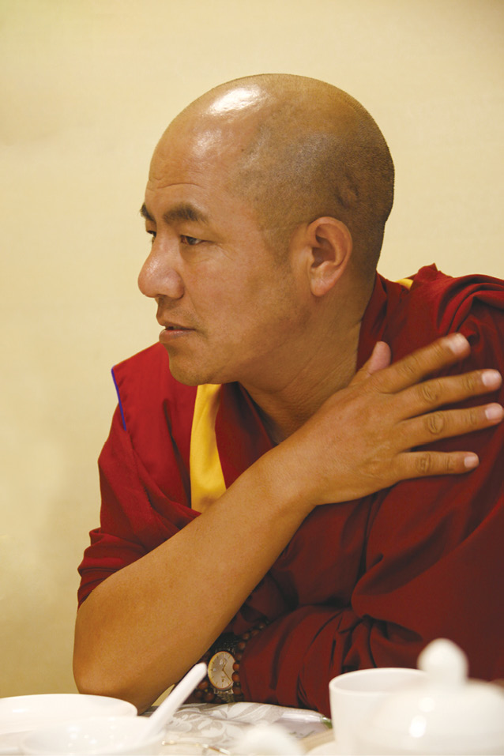
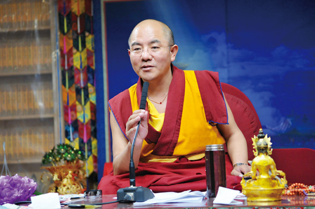
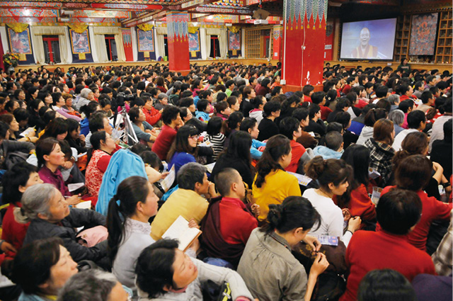
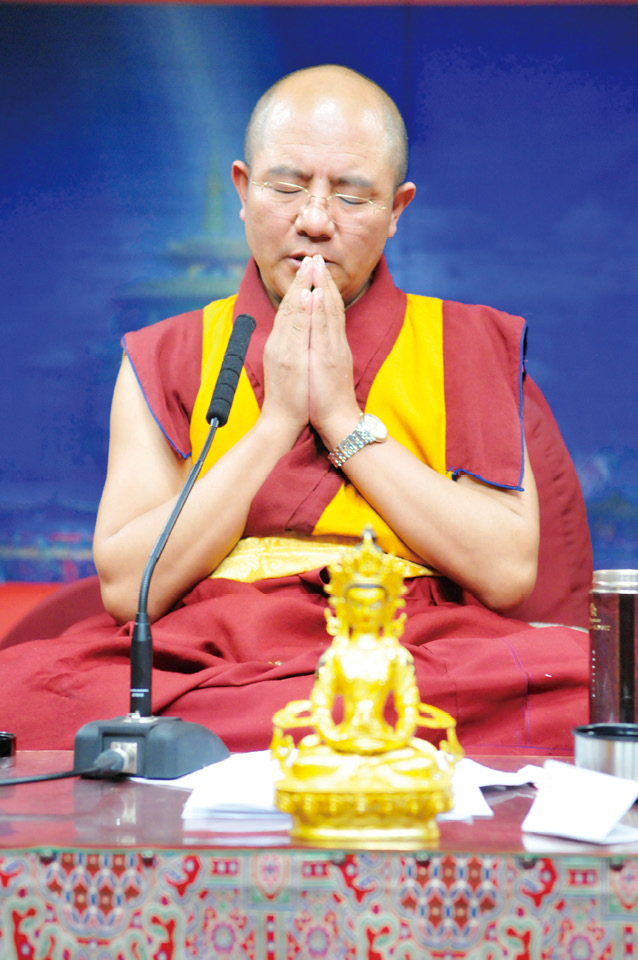
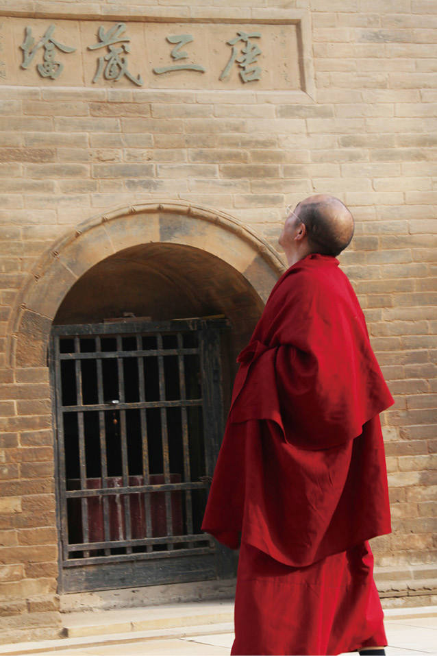
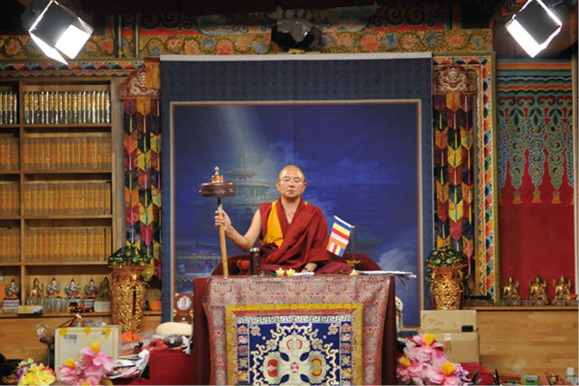

# 出世间的保险 你买了吗

——2011年金刚萨埵法会开示

2011年5月22日

今天晚上，我在智悲讲堂，先跟大家讲一下金刚萨埵法会的事，然后再念一下法会仪轨的传承。

## 别上来，就在当地共修

大家都知道，学院每年都有四大法会，金刚萨埵法会是其中之一。今年的金刚萨埵法会，过一段时间就要举行。

对这个法会，学院一直有一个要求：尽量完成40万遍金刚萨埵心咒。法王如意宝在世时，就有这样的传统。所以，学院的道友都会想办法完成。有发心工作的会提前念，没有发心的则会在法会八天内圆满。即便工作或法务特别繁忙，也会在一个月或者两个月之内完成。

这次法会，不管你是学藏传的，还是学汉传的，也不管你具体学的是哪个宗派，都可以参加。

释迦牟尼佛降生、成道、涅槃三大纪念日，都聚集在萨嘎月。学院的金刚萨埵法会，便在如此殊胜的萨嘎月举行。尤其是本月的初八到十六，所做功德增长的倍数相当高。每年这个时候，学院都会尽最大努力行持善法。

所以，我在这里特别提醒大家，一定要把握好这个难得的时机。大城市的道友，工作通常比较繁忙，尤其需要提前作好思想准备。对我们每个人来讲，参加这次法会都非常重要。希望各个地方——寺院也好，学会也好，或其他一些道场，最好利用八天或三天的时间，一起共修金刚萨埵。

听说，有些人打算到佛学院来，最好不要这样。现在来学院的人比较多，我们的接待能力很有限。而且很多人到了学院，因为高山反应，根本开不了法会——天天灌氧气，天天输液。八天法会，八天都在输液。等输完液，法会也结束了，自己也该回去了。与其这样，不如在自己的道场或家里，好好参加共修。

实际上，不管在哪里共修，所得的功德和在学院参加法会，都没有什么差别。我们佛学院内部，也依靠科技，通过广播等方式，在不同的地方[^1]进行共修。外面的道友，也可以这样。

不管怎样，希望大家尽量空出时间来共修。如果实在空不出八天，藏历初八，也就是公历6月9日那天，非常关键，大家一定要空出来，要么到道场和大家共同念修，要么在家里独自念诵。

对此，佛学院也有准备，到时UC讲堂可能会有直播。你们如果有时间，应该尽量跟随。具体时间，在智悲佛网上会跟大家讲。

总之，到学院参加法会，跟自己在家里参与共修，没有什么差别。最重要的是，大家要完成金刚萨埵心咒40万遍。提前念，或在法会期间念，都可以。如果念不完，也要争取在一两个月或100天之内完成。希望大家都能在规定的时间内圆满。实在不行，念10万遍也可以。这个应该没什么困难。

在我们学院，每年完成40万遍金刚萨埵心咒，没有任何问题。大家的闻思和发心再忙、再累，也会挤出时间，把40万遍念满。其实，金刚萨埵心咒很好念。从早到晚，念得快一点，完成10万遍完全没问题。

希望大家对这次金刚萨埵法会，能引起重视。不管是城里的，还是山上的，道友们无始以来所造的罪业，都相当多。虽然学佛以后开始行持佛法，但自己的业力那么深重，牵涉的业缘那么繁杂——自己知道和不知道的许许多多的罪障，该如何净除？

所以，我们一定要好好地忏悔。佛经和续部都讲了，只要有一颗真正的忏悔心，即使破了根本誓言，以念诵金刚萨埵心咒10万遍的威力，罪业也可以清净。

法王如意宝曾经解释说：虽然续部里讲，念10万遍可以清净罪业，但有些经典认为，10万遍说的是正法时期的情况，末法时代需要念40万遍。所以，大家如果按要求念完40万遍金刚萨埵心咒，必定会清净罪业。

我个人对金刚萨埵心咒非常有信心，对金刚萨埵法门也非常有信心，每年都尽量在法会期间完成40万遍。今年我比较忙，但还是要尽量完成。

以上跟大家讲了金刚萨埵法会的重要性。

## 人太多，上来自己带被子

尽管每年开金刚萨埵法会，我都叫大家不要上来，但还是有些人不听话，非要上来。现在不管走马尔康，还是甘孜州，途中都在修路，要耽误很长时间。前段时间我们上来，一段一段都在修路，走走停停，停停走走，感觉特别累。你们要是上来，路上肯定也比较辛苦。

前两天，我和一些道友在商量，看怎么做一些象征性的接待工作。其实，即便我们这里所有的出家人都出来接待，因为来的人比较多，也满足不了大家的需求。但不管怎么样，我们每年都会尽心尽力为新来的佛友提供一些帮助。

一定要来的个别道友，希望你们和当地的主管法师说一下，需要我们提供哪些东西，并提前告诉我们。这里大的方面是没办法提供的，你们自己最好带一些被褥。吃的方面，到时僧众这边有供斋。法王在世时开许过，不管居士还是出家人，凡是参加金刚萨埵法会的，都可以享用斋饭。

但是，有些在家人还是觉得害怕：这是出家人的斋饭，我能不能享用啊？

我们再三地看过戒律的法本，大家一致认为，所有参会僧俗都可以享用法会的斋饭。而且，供养金刚萨埵法会的施主们也要求，凡是参加法会的人都可以享用供品。所以这方面不用担心。

昨天听接待室的道友说，如果新来的居士没有被褥，接待室会暂时借给你们用。虽然他们会尽量做一些准备，但不知到时有多少人，如果人太多，可能也没法借，希望你们作好思想准备。另外，交通方面我也比较担心。你们如果要来，可能各方面都要注意一下。

以后，大多数的学佛小组，参加法会不一定非要去寺院。寺院里，出家人本来就比较多，在家人如果再去居住，各方面都有些不方便。

现在，不论国内国外，各个地方，各个城市，科技都比较发达。如果我们懂得利用这些科技，为自己积累善根，那不用花很长时间，就能得到真正的功德。这也是处于这个时代的我们，应该做的事情。否则，自己花了很多时间，却得不到真实的利益，很不划算。

这次开金刚萨埵法会，希望各个地方的道友好好忏悔自己的罪业。作为世间人，不管学佛不学佛，不说别的，光是从小到现在杀害众生或者享用肉食，就造下了许许多多的罪业。更何况，许多人都还有妄语、邪淫等很多罪业。所有这一切，都需要在金刚萨埵面前忏悔清净。

金刚萨埵在因地曾经发过愿，任何一个众生，只要念金刚萨埵的心咒、名号，一心祈祷金刚萨埵，一定可以清净自己的罪业，如果不能清净，他就不取正觉。后来，金刚萨埵成就如此大愿，在自己的刹土现前成佛。

刚才，我看到一个教言：重要的话说三遍。所以，我再三跟大家强调：念40万遍金刚萨埵心咒忏悔罪业，特别重要，大家尽量从现在就开始念！

希望大家在当地好好参加法会，好好念诵金刚萨埵心咒。如果能够这样，就是和学院这么多僧众一起共修，功德非常大。

《俱舍论》里有很多教证，说明共修的力量不可思议，比如共修就像熊熊的烈火，各自修行则像小小的火星，等等。总之，共同发愿的善根和功德相当大，这次法会大家一定要好好共修。

## 发长远之心，集众人之力

各地的学佛小组，在管理和发心方面，都应该对自己有一些要求。

佛学院从上个世纪80年代成立开始，到现在已经有三十多年了。在此期间，我们在任何一个地方，对任何一个正规的佛教中心和小组，都有相应的要求。法王如意宝在世就是这样，现在的佛学院也是这样。

所以，我希望这里的发心人员能长期发心。不要发了一天两天、一年两年的心以后，就退失了。如果我们口口声声说自己是大乘佛教徒，而在实际行动中，却天天只做自己的事，对弘扬佛法和利益众生一点不关心，那真的应该感到惭愧。

现在，个别地方招发心人员非常困难。有些人暂时是发心人员，但一两年以后就不愿意干了。大家最愿意干的是什么呢？自己的事情。看吧，我们这些大乘佛教徒，不想为众生，不想为佛法，只想为自己。

这种心态，不要说成正觉，连阿罗汉的心态都没有。阿罗汉的心态，《毗奈耶经》里是怎么讲的？很多声闻缘觉利益众生的心，实际上非常强烈，非常广大。这方面，我们应该和他们比一比。

我真的希望，我们的发心人员不管在哪里，都能发长远的心。

在我们喇荣的佛学院，在外面的各个道场、佛学院、中心、学会，以及其他的研究所和学校，都有许许多多的大乘佛教徒。所有这些大乘佛教徒，都应该团结起来，努力为佛教的闻思修行和弘法利生作一点点贡献。

每一年结束的时候，希望大家都能做一个简单的自我总结：这一年，我为自己的修行做了多少事情？为弘扬佛法做了多少事情？为利益众生做了多少事情？

上师如意宝一辈子的事业，全部归纳起来就是这三件事：要么在利益众生，要么在弘扬佛法，要么在自己修行。除了这三者以外，我依止老人家接近20年，也再找不到其他的什么事情。

我现在经常想：“上师在世时，我非常有福报，不仅依止了那么多年，还经常跟上师去汉地、藏地以及国外的很多地方。不管去到哪里，老人家显现出来的言行举止，都是为了利益众生和弘扬佛法。”

现在，我们这些学习大乘佛教的人，有没有这样的精神呢？希望大家反观自心。

我像这样鼓励大家发心，并不是因为缺少发心人员，而是因为弘扬佛法需要大家的共同努力。只有集合众人的力量，才能搭建发心的平台，才能产生巨大的善根。

现在的人，内心越来越浮躁，痛苦越来越强烈，道德败坏的现象越来越炽盛，不懂因果的情况越来越严重。背后的原因是什么？就是因为不懂佛法，不懂善有善报、恶有恶报的自然法则。

如果有许许多多的人，懂得这样的道理，行持这样的操守，社会自然而然和平、安定，人类自然而然和谐、快乐。对整个国家也好，对整个人类也好，佛教都是引发和谐最殊胜的一剂良药。

希望每一位发心人员、每一位道友，都能努力培养弘法利生的精神和能力。现在很多人发心，这方面的愿力和心力都特别薄弱。说起自己的事，特别有兴趣；说利益众生和弘扬佛法，都没能力，都没信念。这是现在很多人最大的一个毛病，大家一定要有所警惕。

## 将高尚的教育传递下去

尤其是对孩子，从小就要培养他们有好的信念和信仰。

大概还有一个礼拜，六一儿童节就到了。我以前也说过：每年六一儿童节，包括我们藏地的很多学校，都会安排一些精彩的节目，举行一些庆祝的活动。这些当然很好，但更重要的，应该让孩子从小学会关爱，学会敬畏，比如关爱生命、关爱父母、恭敬上师三宝等。

当然，对孩子的培养不能强迫。有信仰的家庭，比如在我们藏地，父母对三宝的理念，会影响99%的孩子信仰佛教。而在其他地方，有些家庭有信仰，有些家庭则没有。历史上，唐朝90%以上的汉人，都是有信仰的。现在的话，有信仰也好，没信仰也好，学校都应该通过各种方式，给孩子提供道德的教育。此外，父母带给孩子的影响也很重要。

所以，六一儿童节不能只让孩子们跳跳舞，唱唱歌，还应该开展一些爱心活动、感恩活动、报恩活动，比如保护生命、关爱父母、关爱残疾人，等等。帮助孩子在自己的节日里，苏醒和提升各方面的道德和素养，非常有意义。

如果学校和家庭，两方面条件都允许、都方便，大家可以试着这样推行。如果不方便，也没有什么，随顺众生就好。佛教本来就强调随缘、契机，弘扬佛教的理念也一直是这样。不管通过什么途径，都不能强求。

我不管去哪一所高等学校，都会跟学校的老师进行交流。在这个过程中，我深深地觉得：佛教的很多教育，都非常随顺国家，随顺大众，随顺每一个人的需求。真正的佛教，不会破坏任何一个社会的秩序或任何一所学校的制度——永远不会。在现代社会，佛教是一门非常高尚的教育。

因此，大家根据自己的情况，如果家里方便，学校也方便，各方面因缘具足，尽量为孩子们开展一些感恩之类的活动。

孩子们在六一儿童节唱歌啊，跳舞啊，都有必要，都很好，但还远远不够，还应该有生命和道德方面的引导。

## 给自己买一份出世间保险

有些道友，经常在各个道场之间跑来跑去，学佛的精神不够稳，这不太好。

我从初来学院到现在，已经二十多年了，始终都觉得应该终身学修佛法。我自己下了一个决心，一定要成为上师的终身弟子，绝不能变来变去。

当然，你们刚开始学佛，各方面因缘不具足，有所变动也可以理解。但过了三四年以后，信心就应该比较坚定。我对你们的希望是：作为佛教徒，大家一定要有终身的发愿和终身的发心。

当然，如果你自己不愿意，我也不会有任何强迫。我只希望用自己的智慧，给大家作一些引导，不会像世间个别气功师那样，用迷惑的手段吸引人。我们这里是很开明、很简单的，不会耍什么手段。

我学过因明的辩论法，该怎么说、怎么做，也知道一点分寸。我也学过中观、因明和实践论，对世间的知识，包括法规、法律、政策等，也了解一些。和这些专业的领导探讨，我的知识有时也跟得上，不会差很远。可以说，在当前这样的社会，我是非常随顺大家的。

在今天这个场合，我希望大家发愿终身学佛，这对你们是唯一有利的。

关于评“终身学员”，听说个别道友因为资格和条件不具足，心里很苦恼。对这个问题，大家没必要特别着急。如果你真的有心，那就慢慢来。刚开始，我们不愿意让太多人盲目加入。因为做任何一件事情，刚开始都有很多人特别活跃，到了后面就慢慢消失。

一般来讲，我个人说到的，会尽量做到。尤其是对终身学佛、各种条件都具足的这些人，我确实想过，以后在他们死的时候，至少为他们念100遍以上的观音心咒，也希望下面的道友，尽量为他们念100遍观音心咒。

现在佛教徒这么多，每个人都念100遍观音心咒，100个人就能念1万遍。这就是出世间的一种保险。我们给自己买了很多医疗保险、养老保险，买得最多的是人身保险，比如上飞机前买一份，万一飞机失事死了，保险公司会给家人付一点钱。这些当然很重要，但最重要的还是买出世间的保险。

大家听到道友去世的消息后，一心一意为他念100遍观音心咒，压力也不是很大，而且非常值得。这些善根一点一点积累起来，对亡者非常有利。

我们藏地有句谚语：“人死以后，为他念一遍观音心咒的价值相当于一匹马。”这句话在藏地家喻户晓。意思是说，为中阴身念一遍观音心咒的价值，堪比一匹马。

确实如此。人死以后，生不带来、死不带走的任何财物，对他都没有用，唯一有用的是善根。按照很多经典的教证，活人如果一心一意为亡者念经，的确能让亡者得到超度，得到利益。

我提出终身学佛的要求，是为了让大家不再忙来忙去，今天依止一位上师，明天又依止另一位。其核心是一种坚定的方向和信念，而不是限定你必须依止哪一位上师。为了稳固大家的方向，坚定大家的信念，我采取了这样的方便方法。对此，大家一定要认真考虑。

所以，刚开始的时候，大家不要着急，要慢慢地来。终身学员的评定条件，比如学习、发心、年龄等，如果不具足，也不要担心。再过一两年，这些条件都具足了，我这边肯定会考虑，不会有什么困难。大家都好好地想一下，各个地方都按照要求，慢慢地来。

另外，我希望包括学院在内的各个学佛团体，每年都要招收新生。学院现在是一年开两次新班，并对新班有一些要求。各地的学佛小组，也应该按照要求，每年都开办新班，方便大家加入。在这之前，可以以旁听者的方式参与学习。这件事，各个地方的道友一定要重视。

## 没有系统闻思，怎能学好佛法？

现在，有些辅导员的水平不是特别够，因此各个地方都需要培养一些辅导员。以后，我们会通过UC开示，让辅导员们尽量参加法师的辅导，并学习我讲的课程。

现在个别地方的辅导员，自己根本没有传承，根本没有好好听DVD的课，光是自己看一看书，就给别人辅导。光是看一看法本，连传承都没有，怎么能做辅导员呢？

前一段时间，我狠狠批评了一个辅导员。当时我询问他学习的过程，结果他只是自己看看书，然后就根据自己的分别念，讲许许多多的内容，很多地方都不太符合经义和教理。确实有点离谱。

以后因缘具足的时候，各地辅导员都要尽量听学院法师的正式讲课。这样才可以学得更好，辅导得更好。

学习佛法一定要有系统性。可以这么说，在所有的事情中，我对讲经说法是最重视的。我本人求学的时候，闻法也是自己最开心、最看重的事情。这一点，不光我个人如此，我们的上师如意宝，以及学院所有的法师，也都如此。

我们现在最需要什么？世人认为，人们最需要的是金钱、地位和感情。但这些东西，观察它的本质会发现，并没有什么实质可言。

其实我们真正需要的，是智慧和悲心。所以，学院的道友不会希求其他东西，每天只是尽心尽力地闻思修行。我们的人生目标，确实应该如此。我希望大城市里的道友，也要搞清楚自己人生的目标。

如果我们光是为钱而活、为感情而活，一定会活得很累。最后离开的时候，不要说往生极乐世界，恐怕连人身都保不住，只有堕入恶道。

大家一定要系统地学习佛法。随着你学得越来越好，很多问题都会迎刃而解。而且，这样的系统学习非常合理，很多地方的道友都比较喜欢。

## 凡事合理合法，与国际同轨

现在，全世界的人都在努力与国际同轨。这是一种整体的趋势。

依靠一两个人或一两个部门，就想改变整个世界前进的方向，是不太现实的。国家的经济也好，个人的信仰也好，都需要顺应国际的潮流。

作为宗教人士，我们在处理任何问题的时候，都要依照法律法规，以求合理合法。这一点，我们应该着重强调。

有时候，个别佛教徒在某些地方的确有过激行为，比如欺骗信众——自己本来不是善知识，却一直吹捧自己，最后伤害了很多很多的信徒。这样的行为，有违佛教的教理，特别过分。

同时，极个别部门在执行公务的时候，并没有完全遵照国家的宪法和法律法规，而是凭自己的想象，这个不准那个不准，也有不太合理、不太公正的地方。实际上，不管是佛教徒还是非佛教徒，做人做事都应该合情、合理、合法。这一点特别重要。

我希望道友们在修学佛法的过程中，一定要注意，言行不能过激，影响不要太大，一定要低调、低调、再低调。没有必要大张旗鼓，到处搞宣传，到处扩大势力，到处提高知名度，更不要为了一些名闻利养，去做一些传销之类的活动。

现在有一部分佛教徒，来这里不是为了学习，而是为了做生意。为了达到这个目的，他们做出了好多非法的行为，很不合理。

佛教真正的精神，是“诸恶莫作，众善奉行”。大家一定要以这样的准则来要求自己、完善自己。如果能做到自主、自制、自信，利他、爱他、帮他的精神自然而然会得到提升。

## 修加行，没有“后门”

在加行方面，学院道友已经开始修金刚萨埵。完了以后，就准备修曼茶罗。外面道友的加行，还没有正式开始，最好先修莲花生大士心咒。按照历史上一些大德的要求，莲花生大士的心咒要修1000万遍。但现在是末法时代，能不能修到这个量不知道，不过至少也要修100万。大家可以先念莲花生大士心咒，同时修前面的四加行。如果有时间，可以从皈依开始，从磕大头开始，慢慢慢慢地修。

我听说，有些人不想修加行，只想直接听密法。这是绝对不允许的。任何一个人，只要没有好好修加行，就不能够听密法。关于这一点，我以前没有特意强调，今天正式给大家说清楚。你要想听密法，就一定要按照密法的要求来。

你如果想到一些高僧大德那里开后门，那我管不着。但要在我这边听密法，必须严格遵守要求。

大家修加行的时候，不要因为时间长，就慢慢产生厌烦心。不过，这种现象不会太多，很多道友修加行还是很精进的，非常不错。

我还要给大家提一点希望。现在，我们围绕着一个共同的目标在努力。我自己天天忙，也希望各位发心人员认真一点、积极一点。我对大家有什么样的要求，有怎样的交代，希望你们都认真执行，不要敷衍了事。做任何事情都应该这样。

你再忙、再累、再怎么样，也要坚持，因为事关众生和佛法。我们对自己的小事，都不会有半点放松，那为了众生的慧命和佛法的弘扬，又怎么能敷衍了事呢？

不是随随便便应付一下，就可以对上上下下都有所交代的。但现在有些人就是这样，“上有政策，下有对策”，每个地方都有自己的一套。这不太合理。

## 在文明时代，做一个文明的人

一般情况下，我每过一个月或两个月，会作一次UC开示。像今天这样，我以后会经常给大家作简单的开示，把该讲的事情讲一下。

接下来，我给大家念一下麦彭仁波切的金刚萨埵修法仪轨和法王如意宝的金刚萨埵修法仪轨——每次开法会，我都要念。之后利用10到20分钟的时间，跟大家有一个简单的互动。你们有什么问题，可以提出来，我简单地回答一下。

这里很多道友都是知识分子，都会使用网络。但是，你们千万不要利用网络在自相续引发贪心、嗔心甚至各种邪知邪念——这是我的希望。这样做特别不好，特别不值。

我们应该依靠网络等科技手段，共同行持善法，这才是真正有必要的。我现在不管发微博，还是发博客，都有人非常随喜。看到有这么多人随喜，我自己觉得非常开心。

在当前的社会，利用网络等科学技术，传递具有正能量的见解和思想，可以帮助很多人。但如果利用网络散布不好的东西，则既害自己，又害他人，对人类社会的道德文明也是一种破坏。

活在这个世界上，我们即使不能当最好的人，也不要做最坏的人。当坏人不是什么光荣的事。在大庭广众之下，脱掉身上的衣服，裸体表演，也许会有极个别的愚痴者，用掌声表示欢迎。但实际上，表演者也好，鼓掌者也好，都是愚痴之辈。

我们所在的社会，已处于文明的时代。只有一心向善，向着好的方向努力，才不会违背人类的道德规范和法律底线。

另外，大家对学佛不要有任何担忧。我去过很多知识分子的群体，大家都一致认为，佛教是一种优秀的思想和智慧，也是有史以来巨大的精神财富。所谓的学佛，其实就是学一种优秀的思想和智慧。所以，大家没有必要担忧，也没有必要当作简单的知识，淡而化之。我们应该共同遵守这样的法理。

下面我念两个金刚萨埵修法的仪轨，完了以后是简单的问答互动。听说今天有一些人想皈依，再念一个简单的皈依偈。

（堪布用藏语念传承，并为部分道友授皈依）

最后，再给大家交代几句：

密法和显宗部分的加行，实际上并不矛盾，我们应该同等地重视。

应该把网络学习和小组学习结合起来，最好参加小组学习。在网络上学习，如果没有自我管理的能力，很容易“掉线”，不知不觉，信心就退了。大家目前的信心，还需要依靠团体的力量，才能稳固。只有相互帮助，共同努力，才能持续地学下去。

但不管怎么学，都要根据自己的时间和心力，重点学习一个法门。学净土就着重学净土，学中观就着重学中观，其他时间可以安排一些发心的事。在这个基础上，如果还有能力和机会，再报其他班的学习。否则，学了这个学那个，报了这个报那个，最后什么都学不好，什么都得不到。一定要主次分明。

前一段时间，我去了复旦大学、南京大学和北京的一些大学，跟这些学校的师生作了一些佛法方面的交流。当时我想，和这些理性的知识分子交流，可能需要不同的思路和方法。于是，我将佛教的简单道理，和现代心灵科学与自然科学的研究结果，鲁迅先生、梁启超、爱因斯坦等中外智者对佛教的评价，以及自己学佛的收益等，结合起来和他们探讨。从大家的反应来看，效果还不错。可见，这样的探讨思路是对的。我希望道友们以后交流的时候，也多一些理性的探讨和思考。

当然，我们在理性交流的同时，也要有感性的信心。这两者都非常重要，缺一不可。既要有理论，又要有实践，理论和实践必须结合。佛教徒也好，世间任何一个学者也好，都必须遵循这样的原则。

现场互动

⊙ 问：我是替上海一个道友问的。他的女儿因为车祸，现在不能说话了。想在这次金刚萨埵法会上，为他女儿念100万遍金刚萨埵心咒，这样如法吗？

堪布：前段时间，我去过一个上海道友那里。不知道是不是你说的那个道友。那个道友很年轻，原本在国外留学，不幸遇车祸……我去看望过她。

希望大家都帮她念一念金刚萨埵心咒。她的家人发愿为她念100万金刚萨埵心咒，非常好，我们大家共同随喜。

即生当中，我们不管是变成植物人，还是生为五根不全的残疾人，都与前世的业力有关——前世一定杀害或伤害过别人。我们每一个人，以前都造过这样那样的罪业。现在看见他人遭受罪业的果报，应该帮他们忏悔。我刚才给大家讲金刚萨埵法会重要性的原因，就在这里。

⊙ 问：弟子去年6月份加入学会网络部，现在分担了一点发心工作。目前，我的顶礼才2万多，观修才100多座，达不到学修要求，想在年底参加新班，但又舍不得现在的小组和发心工作，很难决定。请上师慈悲开示。

堪布：从我个人来讲，非常感谢发心人员。我们这里有很多发心人员，他们在共同弘扬佛法、提高大家学习的方便程度等方面，起到了相当大的作用。如果没有他们，我们很多的学习开展都有一定困难。

你的加行数量，虽然不是很让人惊讶，但也的确比较少。可能是城市散乱的因比较多，懈怠的威力比较大吧。

很多人经常说“我太忙了，太忙了”，实际上可能是在为自己的懈怠懒惰找借口。大家虽然有工作和生活的压力，但还是有一部分时间处于散乱当中。

人的生命是有限的。在短暂的人生中，我希望大家多做无限的、有意义的、有功德的事情。当然，如果为了让家人、他人皈依佛门，付出一些时间和精力，也是有意义的。

不管怎么样，我没有特别明确的要求，你还是自己选择吧。不过发心的机会很难得，最好不要舍弃。一般没有学过的人，才从新班开始。你已经学过一遍，应该不断努力，让自己的学修尽量达到要求。如果实在达不到，也千万不能退。一旦退了，结果会很不好。

我看到很多道友，有些以好的借口退，比如因为某某上师、因为自己的境界已经如何如何；有些以不好的借口退，比如因为散乱、懒惰等。但不管以什么样的借口，这些退下来的道友，当我再遇到他们的时候，他们闻思修行的整个状况，都已经没什么可羡慕的地方了。

学佛需要系统性和次第性，也需要大家的相互帮助。道友之间共同学习的威力，可以让你不至于掉队。

⊙ 问：不能同时修很多法，又不想放弃这么多殊胜的法。能不能每天以学院安排的一个法作为主修，对其他的法，则自己加一个意念，暗示这些法自己也在修？

堪布：我想，我刚才对这个问题已经回答了。

我们现在提供的这些法，大家应该选择最合适、最重要的来修。本来，不管从哪个法入手，佛法都非常甘美，非常有意义。但八万四千法门，要一下子全部接受，有一定的困难，因此最好主修自己最有信心、最适合自己根基的法门。至于其他的法，则要根据时间和情况来决定。

至于自己加个意念，暗示自己的说法，还是要根据自己的意乐来定，我没办法给你指定方向。每个人的想法和修行方向都不同，大体来讲，我们的要求是，要么学前行，要么学净土，要么学甚深的中观和因明。

⊙ 问：我参加《大圆满前行》的学习才两个多月，希望一直学下去。可我有家庭，有时不太便。我的小孩才上五年级，我很想把他带到学佛的道上。该怎么做呢？

堪布：现在学佛的道友，有的全家都学，有的整个家里只有一两个人学，有的除了他自己，家人一个都不学，甚至非常反对。

这很正常。在佛陀时代，印度的六大城市都有相当多的人不学佛，更何况现在？我们并不要求所有人都信佛、学佛，没有这个想法。

对家人，最好是通过自己对佛法的学习，慢慢感化他们。我们学佛的目的，不是为了让自己的宗教变得强盛，而是因为佛教的理念对众生、对整个人类的生存和发展非常有意义。让它走进一个国家，走进一个社群，走进一个家庭，让它对这些群体的未来和当下，产生不可言说的利益和价值，才是我们学佛的真正目的。

所以，对你的孩子也好，对其他家人也好，把他们带入佛门的价值，都远远超过为他们提供金钱的帮助。

我是这样认为的：不管在什么地方，如果有人为我传授了佛教的智慧，那他给我的帮助，一定远胜别人给我的任何的金银财宝。

⊙ 问：我很喜欢使用转经轮，不管是持咒还是看书，都一直摇着，这样如不如法？是否在不分心的情况下，除了开法会或其他不允许使用的时候，都可以使用转经轮？

堪布：一般来讲，听课的时候尽量不用转经轮，《大圆满前行》也这样要求。其他时候，不管到哪里，都可以用。如果担心别人对手拿转经轮的人，产生误解或持其他的态度，暂时放下也可以。

我们用转经轮、念珠、计数器等佛教标志，都是非常好的。城市里拿这些佛教标志的人比较少，但在佛教群体中，每个人都手拿念珠，甚至经常拿着转经轮，不管去哪里都拿着。做这些善法，还是很有意义和功德的。

⊙ 问：有一位道友，先学前行。后来了学净土，认为净土更适合自己，想退转。理由是自己不是学密的根性，而且学密的条件很严格，还要修前行，太难了。请大恩上师开示，大圆满法的殊胜性和修学条件。

堪布：本来，学前行或净土，都是可以的。不过，我希望大家一旦选择了某个法门，最好不要退。发心也是如此。

有些人认为密法很难，净土很简单。其实严格来讲，净土跟密法的要求是一样的。学净土是要往生极乐世界，获得圣者的果位，如果达不到一定的条件，也不可能成就。没有那么简单。

学密法虽然有要求，但只要自己有信心，有时比净土还容易。就像我们藏地的高僧大德，从他们的传记或虹身成就的事迹来看，他们的成就非常迅速，学净土宗的人不一定有那么快。

虽然大家对不同法门的信心不同，但从意义上讲，密法和净土完全一样，只不过侧重点有所差别。因此，不管学什么法，中途都最好不要退转。

至于学修大圆满的殊胜性，可以这样理解：学修大圆满的人，能很快获得不同程度的境界和功德。这方面的内容，我以前讲《前行》和《莲师七句祈祷文》的时候，都讲过一些。

以前，藏地有一个叫格玛旺波·丹增诺若的人，他在《三戒论》里面说：如果一心一意祈祷莲花生大士，末法时代的各种违缘和障碍都能遣除。所以，我们学习大圆满，通过祈祷莲师，也同样能得到加持。

噶陀寺的邓登大法师以前说过，末法时代的黑暗越来越强盛之时，大圆满加持的月光会越来越光耀四方。所以说，在末法时代，大圆满的加持在某种意义上，远远超过显宗的任何一个法门。

⊙ 问：我发现一些道友的心中，还没有树立起佛法的正见，很想帮助他们，但又不想引起争论，所以表面上比较随顺大家。同时又担心，这样会不会失去自己的菩提心？

堪布：不管是在家庭内部，还是在各个群体当中，树立佛教的正见都特别重要。但现在的状况是什么呢？第一，很多人没有任何信仰；第二，即使有点信仰，也不了解佛教的真正教义和真理所在。

所以，我们自己应该先去了解佛教甚深和广大的两种教义，然后以交流和沟通的方式，帮助别人树立正知正见，比如慈悲观、智慧观等。这是我经过多年的学习，摸索出来的经验。

对世间人特别追求的种种对境，我看过，也享受过一些。但所有这些对境，不管是地位也好，财富也好，凡是世间人特别执著的东西，我个人都不在意。我唯一值得骄傲的是，自己的见解特别完美。这也是我最感欣慰的地方。

当然，和别人沟通的过程中，不一定非要辩论、争论甚至吵架，或使用一些极不悦耳的语言。即使和道友就佛教的见解进行辩论，也应该尽量使用文明语言。当然，辩驳的意义可以很尖锐。

藏传佛教经常开展辩论。这样的辩论，实际上是用自己的智慧，去遣除他人疑惑的过程。

现在的居士团体，也可以开展辩论。但大家一定要注意，不能吵架。辩论跟吵架完全不同，是另外一回事。真正的辩论，是站在公正客观的立场，互相争议、互相交流，遣除各自的疑惑、偏见和邪见。所以，不能带有强烈的主观见解。

当然，刚开始由于没有养成习惯，帮别人建立见解的时候，可能会出现不和谐的地方，甚至得罪别人，但慢慢慢慢地，一定会有所改变。

前一段时间，有些法师开研讨会时也说，在家人也应该学习藏地寺院的辩论方法，开展一些辩论——一个人先提出自己的观点，另一个人出来辩驳。

以前，藏地在家人的群体是没有辩论的。但现在藏地的有些高等学校里面，经常看到男男女女出来辩论。整个辩论的过程中，他们不会脸红，不会因为观点不同而吵架、骂人。在我们学院，每天都有一个多小时的辩论，几百上千个喇嘛一起上场。但无论怎么辩论，也从来听不到他们吵架。

而有些学佛小组，本来只有十几个人，辩辩辩，最后全都不高兴，全都不说话，一个个背着包就离开了。主要是以前没有这方面的学习气氛和习惯。

如果都像个别道友一样，在小小的屋子里，十几个人都要吵架，那我们学院和拉萨三大寺院的僧人们，可能天天都要打架了，有这个危险性。但实际上，从来没有发生过这样的事。

辩论有它独特的风格和作用。通过辩论解除怀疑，对学习佛法而言，非常有必要。所以，大家应该用一种和谐的方式，进行辨析、讨论。

⊙ 问：能否祈请上师翻译《释量论大疏》？

堪布：《释量论大疏》要全部翻译，工程量可能比较大。但《释量论》中有一品叫《成量品》，主要建立释迦牟尼佛是量士夫，即建立释迦牟尼佛是这个世界最伟大、最完美的大师。这一品我以前翻译过，网上可能也有。

过一段时间，如果有必要，我会考虑把《释量论大疏》的一部分翻译出来。不过，很多人不一定看得懂、听得懂。法王如意宝是在1987年冬天讲的《释量论大疏》。我刚开始学的时候，感觉还是很费劲的。

以后如果有机会，整部大疏都可以翻译。但人的生命是有限的，我现在有好多这样那样的事情，加上身体有时也不好，所以希望不是很大。

十年过起来特别快。在短暂的生命中，要完成好几部大论的翻译，有一定的困难。所以，只能代表性、象征性地翻译一些。以前已经翻译了《释量论·成量品》，必要时我可以跟大家共享。

## 结语

今天智悲讲堂的UC开示到此结束了。

刚才作皈依的时候，忘了给大家取法名。今天取的法名，就叫萨埵，金刚萨埵的萨埵。萨埵是梵文，是勇士的意思，藏文的勇士是森华。藏文的勇士和梵文的勇士——森华，萨埵。今天新皈依的道友，名字都叫萨埵。

非常感谢讲堂的各位道友。你们有家庭有工作，特别忙，能到UC讲堂，和大家共同听课、共同学习，说明对佛法有信心。否则，你们每个人的时间都那么宝贵，根本不会来这里听我胡言乱语。

我内心非常希望，你们每个人都能获得佛法的利益，得到心灵的平静和安宁。佛教的智慧，尤其是调心法，全世界的心理学都没法与之相提并论，究竟都不同程度地证悟空性的境界，利益无量无边的众生。这是我内心对大家的一种祝愿。

同时，也希望大家近段时间精进地修加行，念金刚萨埵心咒；尽量通过网络的方便方法，满足自己的学修要求，调伏自己的心，并尽量地利益众生。

今天的开示圆满结束。下面，大家一起把共修的善根，回向给所有的众生。

[^1]: 指在不同的经堂参加共修。
