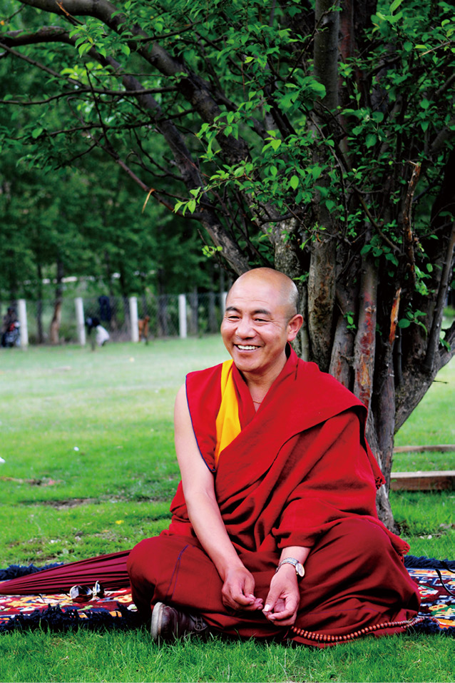
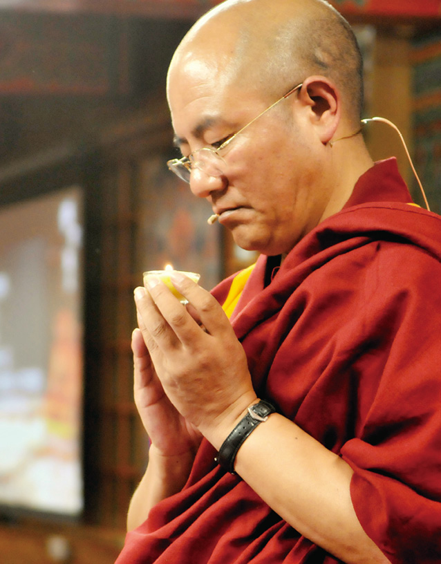
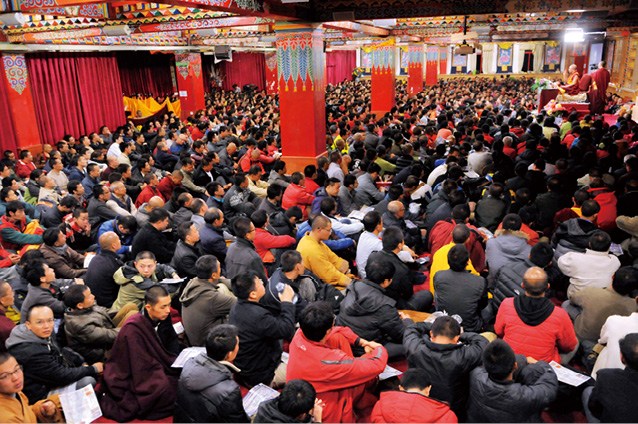
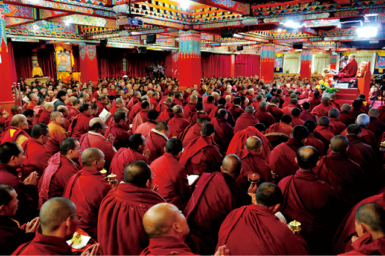

## 往生的重要性

2010年10月24日

今天，先给大家讲一下极乐修法的重要性，然后念阿弥陀佛修法的传承，最后安排了短短的提问时间。因为时间关系，所有的内容，包括开示和问答，尽量在一个小时内完成，因为我这边比较忙，道友们也有许多事情。

我这次不讲太多理论，只把重要的问题说一下，大家下来好好修行就可以。对一些深细的教言，我平时已讲了很多，希望各位静下心来系统学习前行、净土以及其他法要。

## 殊胜的极乐法会

从明天开始，我们佛学院要开八天的极乐法会，每天从早上8点开始，到下午6点钟结束。因为这次是在居士林举办，所以没办法同步转播，到时如果方便，可能会给大家播一下音频。希望你们自己发愿，自己修行。

开法会的过程中，要一心一意地修往生法。上师如意宝在世时也是这样要求的。法会念诵基本上有三个内容：一个是伏藏大师列绕郎巴的伏藏品——阿弥陀佛的略修法，一个是乔美仁波切的《极乐愿文》，最后以《普贤行愿品》作回向。围绕这三个内容，大家要一直念修阿弥陀佛心咒“嗡阿弥德瓦阿依斯德吽舍”，积累往生资粮。

以前上师每一次举办极乐法会，都要求圆满念诵30万遍阿弥陀佛心咒。在线、在场的各位道友，如果能发愿念30万遍，那今天你来这里聚会是非常有意义的。从明天开始念，如果时间等因缘具足，八天是可以完成的。

实在不行的话，我前两天也发了通知，比如城市里工作特别繁忙的人，可以延长到100天，也就是明年2月到期。你若能在明年2月1号之前把30万遍咒语念完，也可以参加我们这边的报数。

你们可以在10月30号之前，在智悲佛网上把数量报上来，我们到时候会一起回向。报上来的数目，一定要在明年2月1号前完成。如果比较精进，100天完成30万遍心咒没有任何问题。到时候我们祈请所有僧众回向，大家会得到相同的功德。

再跟大家提醒一下：从明天开始，学院所有僧众共同念修净土法门，希望大家尽量参与。很多道友在城市里来不成，其实不来也好。现在的藏地，气候特别寒冷。藏族人能适应高原的恶劣气候，而汉地各大城市的人到了这里，由于缺氧，高山反应很厉害，对寒冷的天气也很不适应。

我刚接待了几个居士。他们来自不同的地方，有些拿着氧气袋，有些吊着输液瓶，来到这里就是这样一个状况。即使你想去经堂参加法会，可能也没办法，因为根本不能如理如法地念诵仪轨。也许在很快的时间，就因为身体的原因不得不下山。所以，待在当地参加法会是最好的。

希望今天现场和网上的各位道友，趁这次机会，与法王结上殊胜的缘。我再三讲过，我们今天能聚在这里，也是因为法王如意宝事业不可思议的加持力。两百多年前的授记里也说：谁与法王如意宝结上缘，谁就会往生极乐世界——一个都不剩，全部往生！

对于这一点，我们要深信不疑。如果你有信心，应尽量念完30万遍咒语。如果实在没有信心，或者工作比较忙，或者有其他修法任务，不念也可以。我们没有任何强迫性的要求，看各人的意乐，随缘。

每个人都看看自己，到底能不能念，能念多少。我本人的话，每年的咒语都尽量完成，尤其是金刚萨埵法会的40万遍心咒，因为觉得自己曾造了许多业，如果不净除，要成就殊胜的境界有一定困难。现在开的极乐法会，我也很重视，觉得自己住在人间的时间不一定很长，净土法门最为殊胜，念阿弥陀佛名号、祈祷阿弥陀佛对往生特别特别重要。

我个人而言，对这两个法会特别重视。虽然每年都有翻译工作，还有学院大大小小的事情，但我还是会尽量抽时间来完成，自己离开这个世界的时候，一定要往生净土。

这几天恰好讲完《极乐愿文大疏》，这个缘起也特别好。山下净土班的道友还没有学完，可能还要很长一段时间才能圆满。大家对学习一定要重视。我给你们讲课不是那么容易，一直在坚持。对我而言，不管遇到什么样的违缘和困难，都不容易倒下，一定要坚强地支撑着把事情做完。希望你们听课也有这样一种毅力。

刚才，我和个别道友在谈话中提到，大家共修的力量是很强的，如果能参加共修，永远不会中途倒下、退出。相反，如果没有参加共修，可能刚开始比较精进，渐渐地，没办法自律，最后就销声匿迹了。这种现象是非常多的。

因此一定要重视共修，否则，我担心你们长期的闻思修行会坚持不下去。对多生累劫难遭难遇的学佛机缘，大家一定要珍惜。

## 二、往生四因

净土法门即使要广说，《极乐愿文大疏》中也可以全部含摄。我讲解时也算尽心尽力，讲记一共有六本书[^1]，非常细致广泛地宣说了汉藏各大宗派对净土法门的论述。如果有机会、有时间，你们一定要好好看看。

如果实在没有时间，那我今晚简单强调一下往生极乐世界的四个因或四个条件。其实这四个因，不论在藏传佛教中，还是汉传佛教中，所有净土经论都从不同的角度强调过。

第一个因，明观福田。也就是经常观想阿弥陀佛和极乐世界国土的庄严。我们平时念阿弥陀佛心咒或者名号的时候，一定要把阿弥陀佛或极乐世界的唐卡、照片，放在自己的前面。如果你能观得起来，不放也可以；如果观不起来，就要把唐卡或相片放在面前，经常专注地观看。

同时心里要想：阿弥陀佛在因地发下四十八大愿，要具足极其庄严、极其微妙的身体，以此度化无量众生。如今他已圆满实现了一切愿望，具足了如此的相好庄严，受持了极乐世界的清净国土，成熟和解脱了无量无边的众生！

一定要反反复复观想阿弥陀佛和极乐世界。这是往生极乐世界的第一个条件，叫明观福田。

第二个因，积资净障。为了往生极乐世界，我们需要积累资粮和清净罪障。如何才能积累资粮呢？七支供是积资净障最殊胜的方便，包括顶礼、皈依、供养、忏罪、随喜、请转法轮、请不涅槃。像有关论典里所描述的那样，我们哪怕是在佛前供一朵花、点一根香、磕一个头，或者对别人做的任何善事真心随喜，也是积累资粮的殊胜方便。

如何清净罪障呢？对自相续所造的罪业，可以通过念修金刚萨埵心咒、百字明，依靠金刚萨埵佛尊进行忏悔，还可以读诵《金刚经》等相关经论，或者念诵专门的忏罪咒语等。另外，经常在诸佛菩萨像前供花、供香、供水、供曼茶等，也都是在积资净障。

我们修净土法门，不能指望念一句阿弥陀佛就解决所有事情。对利根者来说，一句佛号当然可以解决所有问题，但对我们这样的钝根者而言，必须要经常积累资粮，清净罪障。在这个过程中，还要尽量地弘扬佛法，利益众生。以这样的发心做任何善事，都是在为往生而积资净障。

第三个因，数数发菩提心。我们凡夫人要生起真正的菩提心，其实是很困难的。我刚才遇到一个道友，他说：“没有烦恼的时候，菩提心好像生得起来。一起烦恼，菩提心就不见了。”

我个人也有这种感觉。什么事情都顺顺利利的，我也会想到众生，想到佛法。当遇到逆境时，尤其是有人无缘无故侮辱我、加害我，嗔恨心很有可能就爆发出来了。而当悦意的人也好，财物也好，这些对境出现时，又很容易产生贪心。如果竞争对手在旁边，还会生嫉妒心……这些时候，利他心好像全部消失于空中了。

原因是什么呢？我们现在的菩提心，不过停留在理论上而已。而且，修的时间太短。如果修的时间很长，菩提心的境界会比较稳固。

《大圆满前行》里也讲了，佛陀著名的弟子无著菩萨，在鸡足山整整修了12年，才真正生起四无量心和菩提心。在这之前，他的菩提心显现上并没有生起。无著菩萨是佛陀重要的传承弟子，他都要修12年，何况我们这些浊世凡夫了？我们的福德底子比较薄，起步资源非常缺乏，因此，要想在短短的时间内将菩提心修圆满，修到量，这不太现实。

尽管如此，我们在修持菩提心的过程中，不管遇到什么样的情况，都不能疲厌，也不能退失，一定要像文殊菩萨、普贤菩萨那样勇猛精进。我们行持的任何一个善法，都要为利益众生和弘扬佛法而回向；我们平时的所作所为，都要为了天边无际的一切众生往生极乐世界而努力。

第四个因，经常发愿回向。我们平时念诵咒语、供养僧众等行持善法，一定要以回向或发愿来摄持，“回向给天边无际的一切众生，愿他们都能离苦得乐，像阿弥陀佛那样圆满具足一切功德”，或者“愿所有众生，包括我自己在内，神识离开今世的身体以后，一定要往生极乐世界，并获得如海般的世间和出世间的圆满功德”。一定要发大愿，以这样的心来摄持善根。现在发大愿的人，将来做很多事情都会有机缘。如果当初发愿太小，最后得果也很小。

为什么说大乘根基和小乘根基不相同？因为大乘根基的人，心非常非常大，不管怎么样都一定要弘扬佛法，一定要利益无边的众生，有种特别大的勇气。这种勇气是大乘根基不同于小乘的特法，所以我们一定要有大乘修行人的勇气。

总之，行持任何一种善法，都要记得回向或发愿。要以此善根为缘，愿自他一切众生，命终后要往生极乐世界，亲见阿弥陀佛、观世音菩萨和大势至菩萨，相续中具足无量无边出世间的威德、神变以及功德，并依靠这种功德和力量，在无量无边的十方世界度化无量无边的芸芸众生，护持如来的事业永不间断。

一定要发这样的大愿。我们行持善法不能只为了个人的身体健康、家庭和睦等小目标。虽然这样发愿也没什么不可以，但真正的大乘行者应该多发大愿。

发愿的同时还要祈祷：十方所有的诸佛菩萨、高僧大德、护法神，您们一定要垂怜我，加持我，一定要让我的誓愿得以实现！在发愿的同时，祈祷诸佛菩萨满自己的愿，是一个特别关键的窍诀。以上是往生的第四个条件，摄持一切善根发愿往生极乐世界。

## 三、得受阿弥陀佛灌顶

从明天开始，八天念完30万遍咒语的净土修法就开始了，或者100天内念完也可以。念咒的时候，如果能观想，最好先观想阿弥陀佛的身像，再观想自己在阿弥陀佛面前念咒语，这在仪轨中讲得很清楚。

智悲佛网上有法王如意宝给四众弟子灌的阿弥陀佛顶，你们如果方便，可以看一看。这个视频，是原原本本公布在网上的，你们能下载就下载，不能下载就在网上看。

以前学《入菩萨行论》还是《大圆满前行》的时候，我给每个学员都发过一张法王如意宝阿弥陀佛灌顶的光盘，里面还有阿弥陀佛修法的讲解。这几天方便时，你们可以拿出来再看看，不要认为时间久了就过期了。这些光盘不是方便面盒子，用完一次就扔掉，而是值得反复看，最好隔几年就看一次。我最近为了获得殊胜加持，重新看了法王如意宝的灌顶。门措上师最近也在学院为四众弟子灌阿弥陀佛的顶。

我每年都在不断地强调，你们城市里的人，每年要得受这个灌顶不一定方便，因为灌顶并不能随随便便就放在网上，也不能随随便便对外直播。但法王如意宝的这个灌顶，是特别开许的。

等会儿下课后，你们最好看一下视频，观想在法王如意宝面前得到真实的阿弥陀佛灌顶，再看一看极乐法会的阿弥陀佛修法仪轨。看了这两个视频后，从明天开始就好好念咒语，好好参加法会。

## 四、认真备考，如法参加

参加法会的同时，好多道友也面临着佛学考试。大家不能轻视这次考试，一定要把时间挤出来，好好复习。不要认为，又要念阿弥陀佛咒语，又要闻思，又要考试，哪有这么多的时间？压力太大了！

其实，你们的压力并不是很大。在我们学院，很多道友每天吃饭都是急急忙忙的，马上吃完，马上上课。而且不是一两堂课，而是好多堂课，背好多论典，念好多咒语。

现在城市里面有些人，做一点点善法就觉得特别累，造恶业的时候却一点都不累，也不觉得时间长。跟朋友聊天吃饭，两三个小时都觉得理所当然，让他听一个小时的佛法课，就觉得好辛苦。凡夫人行持善法就像爬山，非常困难，非常慢；造恶业就像坐滑道，眨个眼就下去了，特别容易，特别快。这样的坏习惯和坏习气，我们最好改正过来。

我们以前上学时，如果没有老师的管教，天天都想玩，不太愿意做作业，也不太愿意学习。这是小孩子的天性。但是因为有老师和父母的严格管理，我们不得不认真学习。其实这种逼出来的学习还是很好的。如果上学的时候每天玩，什么知识都没有学到，长大了不会有一点前途的。

凡夫人就像幼儿园的孩子，没有自觉性，所以需要管理。最近大家不要总觉得很累，累也要坚持。

这次考试也一样，如果想参加，一定要按规矩来，不要在中间搞很多假成分。而且第一次报名截止以后，不能再补报，这是我们的规定。如果真的想考，那也要等以后再说。也不要一会儿报考这个，一会儿报考那个，以前怎么报的就怎么考，要有坚定的承诺。我们都学过《二规教言论》，里面讲的誓言坚定有什么样的法相，大家都清楚。两三个月的时间，没有必要变来变去。希望大家如理如法地参加考试。

为了大家能好好闻思，为了大家的善根早日成熟，我们这边，包括我本人和一些发心道友，都在日日夜夜地忙碌着，有时候确实很辛苦。一方面，你们应该理解金刚道友们的苦口婆心。另一方面，不管你在哪个地方，如果愿意学习，那就如理如法地学习。如果不愿意学，完全可以退出。我们没有任何收费，也没有任何强迫。

学佛，其实是学一种广大的智慧。世界上任何一个人，只要愿意，都可以自由地学习。现在世间有一些非法网络，谁都可以浏览，没有人干涉。既然非法的都可以，我们善法更不用说了。

真是这样的。我们学佛没有伤害任何一个人，不像其他个别宗教，给人们的身心带来了一些不愉快。佛教过去没有，将来也不会。各地相关部门应该不会干涉。

而且，我们学佛没有任何不纯净的目的，不掺杂任何其他成分。正因为这样，大家的闻思是随缘的。如果你愿意学习，我们尽量从各方面提供方便。如果不愿意，那是你个人的缘分，我们也不强迫。

既然你要学习，那最好听从相关人员的管理，如理如法地按规定去做。如果能够这样，你将会得到传承上师和十方诸佛菩萨的加持与护佑。

凭良心说，我们都是学大乘佛法的，不是世间的狡诈者。我们所做的一切，都是为了利益你们。希望你们能自觉遵守某些方面的规定。以后的考试也好，报名也好，学习也好，一定要懂得珍惜。

很多人对学习佛法确实有兴趣，这样很好。因为不懂佛法，大多数人的命运可能很难改变。一旦懂了佛法，情况就完全不同了。学佛不仅可以改变今世的命运，乃至生生世世的命运，都能得以改变。佛法的加持真的不可思议。

我并不是卖西瓜的，自己赞叹自己的瓜甜。我说的这些，是总结自己多年闻思佛法的经验后得出的结论。任何一个人，如果能从佛法里得到一些智慧，其价值远远超过世间的有漏财富。我是这么认为的。

今天我一直忙，没有准备什么，随口跟大家讲些心里话。如果说得对，你们可以接受；如果说得不对，也可以抛弃，无所谓的。反正几十分钟的时间，你们也经常浪费。有时候看电视，一个小时很快就过了，如果你也觉得“这个人讲的不对，没有一点意义”，那就当成看了一场无聊的电视吧，可以随意舍弃我说的话。

## 五、沉下心，修加行

前行的学习，我已经进入不共加行的内容了，这几天开始念修皈依。外面的道友可能五加行还没有修完。大多数地方，大头已经磕完——当然，磕小头也可以。过一段时间，我们这里开始修五加行，从顶礼开始。

在这两三年内，一定要修完加行。一般来说，事情到了中间，有些人就会感觉疲厌。希望大家坚持下去，不要觉得时间太长。听说极个别地方的人，特别地着急，一定要马上听最殊胜的窍诀。窍诀的话，也许有些上师会给你传。但若50万加行没有修完，基础没有打好，所谓的窍诀也不一定和你相应。

如果你不信，可以提前把窍诀修一修，看能不能适应。如果你对业因果的道理根本不明白，对如何依止善知识一窍不通，对轮回的痛苦从来没思维过，对人身难得和寿命无常没有一点基础，这样的话，修再高深的法，比如宁玛巴的大圆满，格鲁派的大手印、大威德，最后能不能开悟，能不能转变自相续，也很难说。

所以，希望大家不要特别着急。以前的传承上师们，有修12年加行的，有修13年、16年的。这么长的时间，一直在修加行。

但个别地方，对共同加行没有特别修，不共加行也没有特别修。这是不对的，应该重视共同加行和不共加行的实修。我曾去过美国的一个佛教中心，那里的上师特别重视这两种加行。最初的六年，他反反复复让弟子观修人身难得和寿命无常，根本不让他们修不共加行。到最后，弟子们修出来的境界特别稳固，而且相续完全与佛法相应。可见，打基础是很重要的。

因此，你们不要特别着急。我这几年会一边讲《大圆满前行》，一边给大家安排修行的步骤和内容。你们一定要先修50万加行，同时尽量观修共同加行的内容。至于后面的法怎样安排、怎样修行，慢慢再看。

现在总的情况还是很好，各地学佛的兴趣越来越浓，行为越来越如法，意乐也越来越强。当然，个别人与之相反的现象也有，这也正常。不要说大城市里，就是我们学院当中，也有出家后无法与佛法相应而退失的人。要对所有人一概而论，是有一定困难的。

总的来讲，希望大家把闻思当作长期的事。不要只有一两天的兴趣，像观看唱歌跳舞的节目一样。学佛表面看不那么精彩，但如果长期坚持，耳濡目染，我们的相续会在潜移默化中逐渐得到改变。这一点特别重要。

## 六、觉姆经堂开光

还有一件事，我们的觉姆大经堂基本竣工了，准备在天降日那天，也就是藏历22号、公历29号进行开光。我前两天给大家发了通知。通知有两层内容：一是觉姆大经堂的建筑项目已经竣工，这方面的结缘已全部停止。凡是与觉姆经堂、喇嘛经堂结缘的道友，到时所有僧众会为你们回向。没有结上缘的道友，如果产生一个随喜心，也能得到同样的功德。

第二层内容是，僧众开光的场面会给大家作一个简短的直播。别的寺院也许会搞开光仪式，我们学院一般不举行这样的活动，只是让僧众念念经，加持一下。除此之外，什么剪彩啊，放鞭炮啊，都是没有的。你们不要一直盼着：怎么还没有放鞭炮呀？没必要等。

29号那天，学院所有出家人会在觉姆经堂里念经加持。本来我们男众出家人是不能去觉姆经堂的，平时连看都不能去看，但当天有特别开许，他们可以进入里面，和尼众一起念经，为经堂开光加持。经过男女僧众的念经加持后，觉姆经堂就正式投入使用了。

觉姆经堂的修建过程非常顺利，没有出现任何违缘。我今天在这里，一方面要特别感谢汉族的四众弟子，一方面也要把这个善根为主的自他三时所造的一切善根，回向给天边无际的一切众生。大家应该这样默默地回向。

## 七、首届吃素法会

我们学院的四大法会，都是上师如意宝根据佛陀特别殊胜的四大节日而安排的。极乐法会是在天降月举行。这个月所造的任何善业，功德都特别大。当然，如果在这个月造恶业，过失也相当大。尤其是藏历22号、公历29号那一天，是释迦牟尼佛到天界为母说法后返回人间的日子。为了纪念这一天，人们把它叫做天降日。这一天所造的善根，功德相当大。所以那一天，大家无论如何也要多多行持善法。

这次极乐法会，学院特别要求所有参加法会的人在八天当中吃素。这是最近才有的规定，以前是没有的。因为今年参加法会的人数比较多，担心有人会在附近杀牛之类的——以前有过这种现象，所以要求大家，不管是出家人还是在家人，这八天中都要吃素。

当然，这个要求对有些藏族而言，不一定很方便。如果实在不方便，在29号的殊胜日忍一下可以吧？只在那一天吃素，应该不是很困难。大家能在八天当中吃素当然最好，如果实在不行，天降日那天也应该吃素，同时多多行持善法，念念《普贤行愿品》，把自己的一切功德回向给众生，发愿将来往生极乐世界。这对每个人都很重要。

我再次提醒你们，要听受法王如意宝的灌顶。以前听受过的，今年应该再次听受，然后认真念诵法会仪轨和心咒。这样的话，每个人的善根肯定会增上。下面，我给大家传一下阿弥陀佛的修法——《极乐捷径法》。

（堪布念法会仪轨的传承）

## 八、珍惜因缘，共同行善

今天菩提讲堂参加网络共修的道友很多，我本人很高兴。虽然由于网速的差别，各地效果不一定相同，但是我们能依靠这样一种因缘来共同行持善法，的确非常难得。

你们如果都到学院来求法，因缘很难具足。即使有这样的因缘，一路颠簸，也非常辛苦。而要我们亲自到各个地方给大家传法，也不现实。现在最关键的是，我们需要共同行持善法，今天大家聚集的目的也是这个。有了网络，目标实施起来就很方便了。

记住哦，从明天开始，你们要跟学院僧众一起发愿。只要发了愿，你就与亲自参加法会没有什么差别。上师如意宝等很多高僧大德都讲过，共同行持一个善法，大家最终得到的功德完全等同。

同时，希望闻思的道友好好地复习，考出好成绩，给自己，也给传承上师和堪布堪姆一个好的交代。凡是参加这次考试的人，都会得到一份纪念品。这些加持品现在一直放在我家里，说是要放7天。我虽然没法7天7夜都念经加持，但每次看见它们时，都会拼命地念念咒，吹吹气。过两天学院所有的僧众还要加持。

如果心里特别重视加持，这一份经僧众和上师加持、由自己努力而得的纪念品，对大家来讲应该有一定意义。不过，如果你没有信仰，没有这方面的价值观，那就不一定了。一件事情重要与否，和人的价值观有很大关系。

现场互动

⊙ 问：我们是该观想念佛，还是持名念佛？或者一边观空性，一边念佛？

堪布：这得根据自己的情况，看自己在哪方面更有信心，感觉更有效果。有了这个前提，持名或观空性都可以。但初学者观空性比较难，最好观阿弥陀佛和极乐世界的庄严，一心一意地念佛。对一般人来讲，这种方法可能比较适合。

⊙ 问：如何增强对西方极乐世界的信心和感应？

堪布：先对藏汉两地的净土法门广闻博学，然后再实际修持。修行跟听闻有很大差别，如果光是听一听，始终不实修，不可能进入状态的。比如，你可以一心一意观想阿弥陀佛和极乐净土，同时认真念诵佛号。这样坚持一段时间，对阿弥陀佛和极乐法门的信心一定会增上。

总之，要有实际行动。先在闻思上花一定的时间，下一定的功夫，然后再实修净土法门。持之以恒，自然会获得不一般的感应。

⊙ 问：助念的时候，能不能受用亡者家里的斋饭和一些其他费用，比如交通费之类的？如果接受之后，却没有超度好，会不会有过失？

堪布：一般情况下，到别人家里去助念，他们做好饭给我们享用，没有什么过失，因为我们口里念诵的都是佛的金刚语。

在我们藏地，不管居士还是出家人，到别人家去念经，都会享用饮食。而且对方如果有条件，给每个人作一点点供养，也可以接受。但我们不能提这种要求。至于交通费用，如果对方愿意出，当然也可以。如果没有，也不能强求，应该以爱心和利他心来做这件事。

即使我们对亡者没有完全超度，但为他念诵的这些佛号和咒语，对他决定是有利的，决定会缩短他在地狱或三恶趣的时间，或者会减少他的痛苦。以后大家去助念超度时，不用那么害怕，该怎么样就怎么样，不会有什么过失。

⊙ 问：助念期间给亡者做火施如不如法？如果可以做，应该注意什么？

堪布：助念仪轨里没有安排火供，因为没有必要。如果需要的话，我们会放进去的。原来的仪轨要求怎样做，就照着去做，不用在上面加很多东西。如果是在别的时间、别的地方，用不用烟供得自己看情况。

⊙ 问：您在《供灯功德文》中说过，不能将空碗放在佛堂上。如果供完灯就外出或者睡觉了，灯燃完后出现了空碗，这种情况该如何处理？

堪布：无意当中出现的这个空碗，可能没有什么大的过失。

一般来讲，灯器如果是空的，包括用空器供养上师，是会有过失的。以前，米拉日巴尊者给马尔巴上师供养了一个空的灯器，后来他的修行虽然获得了成功，但生活却遭受了饥饿。所以，供灯燃完以后，就要收起来，放在一边，不要一直空空的摆在供桌上。

如果因为外出或者睡觉，空碗来不及收拾，那也不要紧。我们藏地供灯，一般也是晚上燃完了，第二天才收的。晚上虽然是空的，但没有什么过失。

⊙ 问：修净土法门时，如何对法王如意宝生起强烈的信心，随他的愿力往生极乐刹土？

堪布：法王如意宝降生的时间比较特殊。“文革”刚刚过去时，我们藏地的佛教遭到了历史性的毁灭。他在这个时候，披上精进的盔甲，让佛法在藏地再度弘扬开来，这是特别特别不容易的一件事。

要对法王上师生起信心，最好先看一看他的传记，再想一想他摄受的这些弟子，以及他开创的这些闻思修行的法门。通过这些途径，应该能对上师生起信心。最后，我们要和法王所说的净土法门结上善缘，逐渐融入上师的事业海，做弘法利生的事业。

⊙ 问：我看到一些关于缘起的开示，比如因果缘起、支配缘起、唯识缘起、中观缘起，还有《华严经》中说的法界缘起。缘起的根本定义是什么？

堪布：缘起的根本定义有两种。从胜义角度来讲，缘起就是一切万法都是空性。因为佛经里说了，因缘而生就是空性。在世俗当中，缘起的根本意义在于，任何一个法都不可能无缘无故产生，都是有因有缘的，由因缘而生，这叫做缘起法。

缘起的分类比较多，中观讲到了胜义空性、十二缘起、阿赖耶缘起等个别的名称，但经论中并没有中观缘起、唯识缘起的说法。

⊙ 问：往生兜率内院和极乐世界，哪个更好？

堪布：这要看每个众生的根基和意乐。《极乐愿文》的作者乔美仁波切，最初有很长时间都在祈祷弥勒菩萨，希望到兜率内院去，后来因为害怕轮回的生死大苦，意愿就转变为极乐世界了。所以，每个众生的选择都不相同。

不过相关经典说，极乐世界完全是清净的刹土，那里的种种快乐，包括自然环境等，都是随心所欲的，因此显现上可能更微妙一些吧。

⊙ 问：我们东北有所谓的“出马仙”，就是一些动物经过修炼，附在人的身上，给别人打卦、测事、看病。如果佛教徒身上有附体，该如何对待？

堪布：我以前去过东北。那里确实有很多关于仙的说法，什么狐仙啊，黄仙啊，这个仙儿、那个仙儿……仙儿特别多。

关于这些，有的可能只是民间传说，有的则是真实存在的。这一类非人有时会附在人身上，依靠人的嘴巴来说神通、打卦、算命。我想，对他们的调伏和帮助，应该以念佛为主。

我们藏地会有护法神降临人身的情况。人们会看到，有些人突然之间发生变化，开始以护法神的身份给人授记。像紫玛护法神、金刚称护法神，很多时候会依靠人的身体来给某人授记，预测未来一些好或不好的事。

这里面也有真假的区别。像东北的狐仙，我们不能说完全不存在。我采访过一些人，他们就是以附体的思维在和别人交流，各方面看都不是假装的，确实真有这样的。还有一些人，身上根本没有附体或者感应，全是自己的分别念，却经常在别人面前说这说那。

这些问题比较复杂，三言两语说不清楚。不过总的来讲，有附体也好，没有附体也好，或者有仙儿也好，没仙儿也好，不管是什么样的生命，我们若能经常对它们发慈悲心，为它们念一些佛号，让它们暂时得到一些利益，它们便不会去害众生。最后再让它们皈依佛门，慢慢开始为众生做有意义的事情。

⊙ 问：在梦境里，我的贪爱特别严重，很惭愧，也很着急。怎么样才能够把这一关突破？

堪布：在一段漫长的旅程中，会遇到特别美丽的草原，也会面临恐怖的险地，还可能遇到预想不到的其他情况。我们的修行也是一个特别漫长的过程，不可能一帆风顺。偶尔状态好的时候，白天晚上，法全部融于心，特别顺利，特别快乐。但挫折肯定会出现，比如烦恼无法对治，内外的违缘和障碍相继出现……

这个时候，我们要注意两件事：第一，时时刻刻祈祷三宝，千万不能忘。第二，一定要勇敢，要有坚强的意志。不能遇到一点点违缘，就认为没有办法突破和超越。

在修行过程中，无论遇到什么样的困境，心里都应该有所准备：“修行一定会遇到各种坎坷。但是，任何违缘都不能阻挡我前进的步伐。我一定要勇往直前，抵达我最向往的目的地！”每个人都应该有这样的心力。

## 结语：感谢所有的付出

今天我们在这里聚会，也是一种善法的因缘。特别感谢所有参与者，也要感谢很多的义工和发心人员。我们的义工遍于不同的地方：天上有，地上也有；人中有，非人中也有；线下有，线上也有。为了利益众生，弘扬佛法，大家白天晚上都特别辛苦。

我们大家的目的是一致的。虽然每个人的力量不同，但都在尽己所能地努力着、配合着，目的就是为了让佛法如意宝长久住世。任何一个众生，只要能从中得到一点一滴的快乐和解脱，我们也愿意为此不惜一切。

大家都是发过菩提心的人。发了菩提心以后，唯一的工作就是利益众生和弘扬佛法。在这个过程中，不管你付出的是人力也好，财力也好，物力也好，或者以欢喜心随喜也好，都值得赞叹和称扬。

我们有些道友，虽然没有其他能力，但却经常微笑。其实微笑也是一种付出，而且是令人非常欢喜的一种付出。所有付出的道友——尤其是在这里长期发心的义工，我今天在这里以个人的名义，对你们表示特别的感谢！

[^1]: 详见索达吉堪布全集260-265《极乐愿文大疏讲解》。
