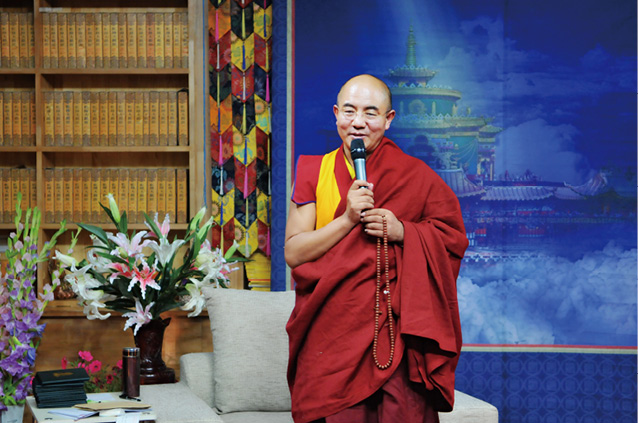

# 持之以恒地闻思修行

2011年6月15日

后天，金刚萨埵法会就圆满了。到时，来佛学院参加法会的道友们，会陆续回到自己的地方。在此之前，我想跟大家说几句话。

与以往相比，这次参加法会的人比较多，整体上非常圆满，没有任何违缘。在座的各位，多数是第一次来学院参加金刚萨埵法会，甚至还有原本不信仰佛教，来了以后才皈依的。也有一些以前就来过佛学院，或平时就在听经闻法的菩提学会的道友。

这次大家特意赶来参加法会，按理来讲，我早就应该跟大家见见面、说说话。但因为法会期间，我一直忙着在外面的学校讲课，所以直到今天，才跟大家见面。我今天只跟现场的各位说说话，没有通过UC，向全国佛友开示。

## 为法苦行，赋予人生不同的意义

这次法会，大家都开得非常认真，多数人已经完成了40万遍金刚萨埵心咒。我听说，这次念修的总数已经达到800多亿。根据《俱舍论》的教证，以及传承上师和前辈大德的一致说法，所有参与共修的人，都可以完整得到共修功德的总和。因此，在这8天中，你们每个人都收获了800多亿的功德，真的不可思议。大家这次满载而归，应该法喜充满。

我个人很惭愧。虽然觉得忏悔很重要，每年金刚萨埵法会，也都在尽量念金刚萨埵心咒，但这一次，由于到一些学校做学术交流，日程安排得特别紧，这次不要说念40万遍，连1万都没完成，只能随喜大家。山下通过网络直播参加法会的道友，多数也念满了40万遍。对这些功德，大家也应该随喜。

这次法会，也特别感谢学院常住的出家人和居士，包括管家、各班法师、各部门的负责人和成员。他们在法会期间，基本上付出了所有的时间和精力，里里外外做了很多的工作，为新来的道友提供饮食住宿等各种服务，而自己该完成的咒语，却没能好好念诵。

我这次不在，大家这么做很有必要。虽然不一定满足你们所有人的意愿，但我听说，有相当多的常住道友，法会结束后已经累垮了。对此，你们不可能用其他方式报答。希望你们回去以后，好好地学习佛法，这是学院所有常住道友的共同心愿。

在学院，不管是卫生条件，还是饮食、住宿等方面，都有一定的困难，无法跟发达的城市相提并论。而且藏地气候恶劣，听说这次法会一直下大雨，道路泥泞，有点不尽如人意。但不管怎么样，在座各位来这里的目的，不是为了享受，而是为了消业。在这样的环境中，为法苦行非常必要。我们很多人在求法过程中，都经历过一番苦行。

你们城市里的人，为了自己的衣食住行，感受过各种各样的折磨，但为了佛法，可能从来没有经历过这么多苦行。所以我觉得，你们这次如果受了一些苦，生了一些病，经历了饮食不适等困难，也是值得的。为了求法而苦行，会赋予我们的人生不一样的意义。

同时，我也特别感谢来自天南海北的善信居士。大家来佛学院求法，非常不容易。听说大部分人特别精进，已经念完40万遍金刚萨埵心咒。没念完的，回到自己的家里，回到工作岗位以后，一定要尽心尽力地补齐。

若是每年都如理如法地圆满40万遍心咒，努力忏悔往昔所造的业障，就有往生极乐世界的机缘。无论如何，我们种下的解脱种子，一定会发芽抽枝、开花结果。

## 真理在哪里，就在哪里维护

法王如意宝圆寂以后，我们大家都有一个共同的心愿：佛学院要继续成为弘扬佛法的真正道场。事实证明，在树立佛幢、闻思修行方面，佛学院的的确确是藏汉两地首屈一指的。如今我到很多大学院校，都会听到师生们说，他们对佛学院的闻思修行产生了一些兴趣。

佛学院在闻思修行和弘扬佛法方面，之所以具有巨大的力量，离不开三个方面的因缘：第一，离不开上师如意宝、门措上师以及学院所有高僧大德的加持；第二，离不开学院内外、心系学院的所有道友的共同努力；第三，离不开三宝和护法神不可思议的护持——这是我们肉眼无法看到的。

因为具足这样的三种因缘，如今在汉藏两地，乃至在全世界的佛教徒中，甚至在其他宗教和非宗教的群体中，佛学院闻思修行和弘扬佛法的精神，都在发扬光大。

在以后的日子里，不管你是出家人还是在家人，是佛教徒还是非佛教徒，我都希望你能希求真理。不管哪里有真理，都要维护，都要弘扬，这是我们人类本应具备的理念。任何国家、任何民族、任何宗教、任何个人，都需要持续不变地希求真理、维护真理。

## 此时修行，非比寻常

另外，明天凌晨2点20到6点之间有月全食。按照藏地《时轮金刚》[^1]、汉地《苏悉地经》[^2]以及其他一些大乘经论所说，在日食和月食的时候，修法的功德非常大。不过，不同的经典和续部，对功德增长的倍数说法不一，有些说增长7000万倍，有些说增长上亿倍，有些说增长2亿倍。不管怎样，在日食月食时，大家若能精进行善，比如念诵咒语、观修本尊、守持八关斋戒等，功德会非常圆满。反之，如果在此期间，造下杀盗淫妄等恶业，过失也会反向倍增。

因此，如果可能的话，希望你们今晚早一点睡觉——等一会儿下课就睡，明天早一点起来。凌晨2点钟时，或者在自己的住处，或者到经堂来，念咒、禅修，行持善法。

在平时，凌晨2点到6点，是我们不间断“入定”的时间。明天2点起床，持续4个小时修法，如果实在觉得困难，也起码要坚持两三个小时。如果连这个都做不到，那我们作为修行人，应该深感惭愧。大家一定要尽量利用这段时间，精进修行。

而且，现在正值萨嘎月，集中了释迦牟尼佛降生、成道、涅槃三个重要的日子。以前上师如意宝在世时，要求全体僧众在这个月广行善法，要么修功德最大、意义最深的法门，要么持诵最具加持的咒语等。这一次，有这么多人共聚一堂，非常难得，大家应该好好利用萨嘎月的时间，精进行善。

今天是十五号，萨嘎月已经过半了。剩下的半个月，大家可以选择吃素。我原来经常倡导，如果终身吃素比较困难，可以吃素一年；如果一年也难做到，可以在学院举办法会的四大殊胜月吃素；如果一个月也不行，用短暂的半个月甚至一个礼拜行持这样的善法，也可以，也特别重要。因此，剩下的半个月，尤其是明天，大家一定要专注于善法。

我们每一个人，毕竟都会离开世间。到那时，除了善法以外，地位、感情、钱财、名声等，百无一用、毫无利益。所以，在我们离开之前，特别需要造一些善业，来保护自己。如果你对此不屑一顾、充耳不闻，最后会特别遗憾。

在世间，一个特别有商业头脑的人，如果发现了商机，一定会大加利用。同样的道理，佛教徒在修持善法的时候，如果遇到了良机，也一定要利用起来。这是我今天特别强调的。前辈大德们对此特别重视，因为他们都是抓住过机遇的人。

## 二十年的坚守

这次参加法会的，也有一些学会的道友。跟你们有关的一些事情，我也想说一说。我和学会的管理人员曾经共同商量，以后学会要在各个地方，正常有序地办下去。菩提学会的道友，走过的路有长有短，最短的6年，从6年前学习《入菩萨行论》开始，中等的10年左右，最长的大概20年。

怎么会有这么长的呢？最早，我跟上师如意宝一起去印度，回来途经香港，看到贝诺法王、敦珠法王等了不起的大德，都在香港专门为在家居士开设了很多佛教中心、佛教道场。我当时觉得非常震撼：原来，在家居士也可以拥有道场、学习佛法！

然而在汉地，只听说上海有个居士林，而且还没正式启用。除此之外，再没听说哪里有在家人学佛的场所。回到学院之后，我便跟个别的居士商量，为在汉地建立居士的金刚道场做准备。到今年6月中旬，当年建立的居士金刚道场，刚好过了20个春秋。最近，我去了几个这样的道场。它们也算是具有一定的纪念意义和纪念价值吧。

20年来，当年那些居士坚持学习学院的法，一直没有退失信心，特别不容易。我自己也是，这20年，无论是外在的环境，还是自身的健康，违缘都层出不穷，但我都坚持下来了。前几天，我在道场对他们说：“我们应该好好地回忆以前的历史。1991年6月，我们着手在汉地建立道场。时至今日，有的道场人去楼空，消于法界，有的仍在持续地发扬光大。参加这样的聚会，非常具有历史意义。和大家一起回顾20年前的今天，我心里充满欢喜。”

我今天为什么要说这些呢？再过20年，我不一定在人间，但是在座的很多人可能还在。我希望到那个时候，你们可以回顾一下，过去的20年，自己在学会走的，是一条什么样的道，又得到了什么样的果。像这样回味过去，我觉得很有意义，很有价值。

大家不要认为，学佛只是三两天、三两个月的事；也不要认为，学完《大圆满前行》就足够了，学完某某法就别无所求了。如果学完这些就立即退出，彻底淹没在世俗的人群当中，甚至连皈依戒都舍弃，就太可惜了。

在修学佛法方面，我希望以自己的切身体会，和大家做个交流。我不敢说自己像上师如意宝等持教大德那样，将毕生精力用于修持佛法，但我人生有近30年的时间，是投身于佛法的。总结自己的前半生，我觉得闻思修行并不是两三年就可以圆满的。

这次来开法会的居士，如果还没有参加菩提学会，自己又想系统、完整地学习佛法，希望你们回去以后，找一个正规的佛学道场，接受系统的管理和闻思。否则，蜻蜓点水一般，偶尔开个法会，念念经咒、诵诵仪轨，只是形象的学佛，不是系统、完整的学习方式。当然，也欢迎你们加入菩提学会。

一直在学会系统学习的道友，希望你们回去之后，能够力所能及地弘扬佛法。不要整天以自私自利的心，耽著自身的小事，也不要遇到一点点阻碍就想离开，或者退失发心。学院的环境这么艰苦，我身边却有一些道友，始终在为你们的学习发心制作法本和光碟。他们放下了自己的学修，付出了大量的心血，全心地投入。如果你们连学习的兴趣都没有，不知道这样的付出是否值得。

我看到，外面有很多很多的人，喜欢搞形象上的学佛，沉迷于简单的佛教仪式，对真正的闻思修行兴趣索然，这样的人数不胜数。不过，值得欣慰的是，各地也有一些系统管理的学佛团队，有相当一部分人加入其中，在如理如法地闻思修行。不管哪位法师名下的道场，只要在系统地学习佛法，大家就可以加入。

我们的法会只有8天。光是参加8天的法会，根本断除不了我们无始以来深重恶劣的习气。要达到这样的目标，必须真正深入地学习佛法的教理。

我遇到过很多知识分子，他们对个别寺院僧人的行为非常反感。原因是什么呢？这些僧人在教理上一无所知，修行境界也全然没有，整天只知道执著仪式，搞表面行为。实际上，一个真正的佛教徒，并不需要这样的形象，也不赞叹这样的行为。

建寺院、放生、会供等，只是佛教的一部分，并不是佛法的全部。真正的佛法，唯一是教法和证法。这两者，只有通过闻思修行才能得到。

现在有些居士，整天跟着一些上师跑来跑去，很少闻思。当然，你整天不离善知识左右，我不会有任何嫉妒，我自己不需要任何弟子跟着——以前如此，现在也如此。但从负责任的角度来讲，我觉得很多道友确实需要正知正见，而具足正知正见的前提，就是要系统地闻思。

这次来开法会的人当中，个别道友已经闻思了20年。只不过20年前，不叫菩提学会，而叫金刚道场或金刚法会，也有叫显密中心的。时代不同，名称也迥然有异。就像现在区分出生年代，有80后、90后等不同的网络语言，我在90年代给道场取的名称，跟后来的菩提学会也不同——2011年以后可能还会取其他名称，但不管叫什么，都是菩提学会的本体。

一路走来，伴随菩提学会的成长，我看到了一些特别好的修行人。这20年，他们无论经历了怎样的艰难困苦，都始终没有退失信心，始终未曾掉队。对坚守了20年的这些道友，我这次准备发一个特别的奖。

## 难的是一辈子行持善法

我希望大家来到学院，不要满足于开开法会、见见上师。一看到上师就热泪盈眶，激动得不能自已，可是过了两天就生邪见、作诽谤，这样的人，我遇到过很多。

所以，我们佛教徒不要只重视形式，一定要好好修五十万加行，好好念阿弥陀佛圣号600万——念藏文是100万，每年好好修诵40万遍金刚萨埵心咒，同时坚持参加学会的课程。我准备给大家开设净土班、中观班和前行班。

现在，很多人都在修五十万加行，而且非常精进。这次我去了很多学校，听说一些大学的老师和学生，都能完成五十万加行。大家知道，在大学里修五加行，各方面都不是太方便。既然他们能完成，我们为什么不能完成呢？人与人之间的差距，有时候真的是天差地别。

有的人抱怨说，这次到了学院，没有见到我。其实对我个人，见与不见都没什么差别，我又不是“见解脱”。如果你们真的信任我，就应该听听我苦口婆心的劝告——系统地闻思修行。如果没有闻思修行，不要说见我，就算见了真正的佛菩萨，也不一定有大的利益。我们有些人，经常在梦中见到上师、本尊或佛陀，但如果没有调伏自相续的烦恼，这些好梦也是无足轻重的。

总之，见一个人不是很重要，心血来潮时精进一两天也不是很重要。真正重要的，是自己回去以后要长期地闻思修行。

世间有这样的说法：做一次好事不难，难的是一辈子做好事。修行也是这样，开一两次法会，行持一两次善法，发一两次心、做做上供下施，并不是很难，难的是坚持不懈、持之以恒地做下去。

我现在越来越认识到，学习佛法是一个长期的工程。前辈的高僧大德，都是将毕生精力用于闻思修行的。除此之外，没有其他的琐事。

当然，在座的各位，多数是在家人，肯定关心自己的家庭、生计等。对这些问题，我们当然不能忽略。如果因为学佛，对家人和领导，全都不管不顾，必定会受到方方面面的抨击。因此，我们需要在随顺社会、随顺亲友的前提下，空出一定的时间好好修行。这是当前非常重要的事情。

虽然我本人不在佛学院，但即使我在，即使我们面对面地交谈，除了这些话，我也再没什么可说的了。释迦牟尼佛曾经亲口说过：“吾为汝说解脱法，解脱依赖于自己。”就连佛陀都这样说，更何况是我这种修行极差的人呢？

虽然我没有修行的境界，但是我有一颗好心，奉劝大家、恳请大家，一定要系统、长期地学习佛法，之后加以思维，最后实地修持。这是我的肺腑之言。无论我在不在学院，除此以外，我再也没有其他礼物可以送给大家了。如果觉得我的话有一点意义，回去以后就好好地思维。

## 革命尚未成功，同志仍须努力

有人学佛只是一时兴起，有人学佛20年不退，真是鲜明的对比。我觉得，他们一路走来特别不容易，很想给他们发一些加持品。

回顾过去，我自己最早用汉语讲经说法，是从1987年开始的。而正式依靠道场，跟大家交流，是在1991年。这么多年，我怀揣一颗对佛陀的信心，凭着对上师如意宝的信任，尽心尽责践行上师的嘱托，走到了现在。

对在座的诸位来说，路就在前方。孙中山先生曾说：“革命尚未成功，同志仍须努力。”同样，我们度生的事业尚未圆满，需度的众生尚未度尽，成佛的境界尚未证得，所以，千万不要认为自己得过一个灌顶，修过一个法，或听过某个上师的开示，收获了一点境界，就可以止步不前了。这样简简单单地滑过，将信仰形式化，不是真正的佛教徒该做的事情。我们学院的修行人，都在不断地努力，大家也应该做一个长远的打算。

我们知道，现在汉地一些道场，并没有讲经说法。如果在每一座城市，都建一个居士林，也有一定的困难。因此，在座的各位回家以后，能不能尝试着，开设一些家庭道场？哪怕在半年当中，让学会的人定期或不定期，到你的家里学习或共修念佛，功德也不可思议。

哪怕这房子，是你花100万买的，如果给大家提供共修的方便，所花的钱也值。但如果只是独自享受，这个世界的钱财，不可能平白无故得到，即使不是三宝的钱，也是众生的血汗钱，背后一定伴随着许多痛苦的泪水。所以，一个人享用或者一家人享用，意义不大。即使说，自己挣钱自己享用天经地义，但是你一旦用完，福报也就消耗尽了。不如为了给自己增福，也为了弘扬佛法，将自己的房子暂时提供出来，给大家共修。

现在的基督教，不仅在城市有大大小小的教堂，教徒们还经常举办家庭聚会。我们佛教为什么不能这样呢？在各个地方，佛教徒也可以10人、20人聚在一起，小范围地遍地开花，以此弘扬真正的佛教。

你们能到佛学院来，实属不易。有些人既骗了家人，又骗了单位领导。跟领导请事假，跟家人说出差。但人走了以后，电话一直处于关机状态；回去后，脸上晒得黑黢黢的……你可能只好跟他们解释，你去非洲帮助孩子们，那里条件很差……像这样说一些方便妄语，也可以，也开许。

最主要的，大家到佛学院以后，应该学会跟僧众一起发愿。发什么样的愿呢？利益众生的愿，一定要发；弘扬佛法的愿，一定要发。除此以外，诸如健康无病、升官发财、家庭和睦等世间愿望，发不发都可以。当然，如果你们愿意发，也未尝不可。

## 美丽的烟花，庆祝圆满

截至今晚，金刚萨埵心咒念诵已经圆满，明天还要念一天的《药师七佛经》。《药师七佛经》的功德相当大，如果你们有时间，就继续念。如果没有时间，从明天开始，大家就可以陆陆续续地往回走了。

现在，甘孜州不管哪里都在修路，实施交通管制。因此，在回去的路上，大家要尽量小心。藏地有些司机的技术不一定很好，让他们别开太快，你们自己也不要特别着急。这两天可能不太好找车，如果还有假期，缓一缓再走也可以。

我所在的地方，外面正在放烟花，你们听得到吗？这是为庆贺法会胜利圆满，祝贺大家功德圆满而放的吧？哈哈哈……哎呀，很漂亮，很好看，供养三宝！

我们佛学院的道友，这次法会特别累。法会结束后，好好地休息两三天。下个礼拜一正式上课，那时我也回学院了。原本还有几个地方要去，但后来计划有变，忙完这边的事情以后，就先上去了。我的课大概在礼拜三，但具体什么时间，到时各个法师会给大家通知。

一切万法都是无常的。即将离开学院的道友，以后能不能再来，很难说。临走之前，每个人都应该在心里发善愿，比如利益众生、弘扬佛法等。想发哪方面的愿，根据自己的意乐来定。总之，发愿特别重要——我讲过很多次了，发愿特别重要！

哇，这边放的烟花，真的很好看！应该给你们拍下来，供养金刚萨埵。本来还想讲一些其他的事，但因为外面的爆竹声，我的思路被打断了。实际上，该说的我都已经说了。

总结一下今天的内容：

一是法会很圆满，希望你们回去以后，好好地修行。

二是我们的佛学小组，已经成立20周年了。今年，我们要在很多地方，陆陆续续地举办一些庆祝活动。在汉地建立道场20周年，很不容易，我自己是这样认为的。

三是菩提学会的有些负责人，这次也上来了，如果你们有时间，这几天可以和我这边相关的管理人员，共同商量一下以后的管理方向。希望你们回去以后，一如既往地好好发心。我们这里的出家人为大家做事，都是不惜一切的，所以你们回去以后，也应该为弘法利生奉献自己的一份力量。

其他没有什么要说的了。今天现场来了很多人，我想，跟大家结上法缘很重要，所以，接下来我给你们念一下《佛子行三十七颂》的传承，可能需要5分钟。大家静静地听着，然后我们做一个简单的回向。今晚你们早一点休息，明天早一点起来，大家要健健康康、顺顺利利地回去。回去之后，心里一定要想着佛法，想着众生，想着发菩提心。

《佛子行三十七颂》，我在上师如意宝跟前听过很多次。今天，我用它跟大家结上法缘，愿大家相续中生起真正的菩提心。下面我用藏语来念。

（堪布念传承）

听说有人想皈依，下面我给个别想皈依的人，授一下皈依戒。但不是皈依我个人，而是皈依三宝。以前皈依过的人，不用再次皈依。

（堪布授皈依戒）

今天新皈依的道友，我不取法名。按照藏地的传统，人们从小就皈依，不会因为皈依，重新取一个法名。因此，皈依不一定非要取法名。名字不是很重要，相续中具有皈依的决心，才是最重要的。

金刚萨埵法会已经圆满。组委会这边，给大家准备了法会的食品和钱，部分已经分给大家，明后天还会分一些钱。听说一些新来的居士不敢接受，其实不要紧，这是经过僧众同意的。原则上，这次参加法会的道友都可以拿。如果实在不愿意接受，也不勉强。其实，以得到僧众的纪念品或加持品的心态接受，以后在善法方面能获得很大的力量。你们根据自己的情况来定。

不管怎样，这次法会非常圆满。金刚萨埵法会本来是我们降魔胜利洲负责，但是益西彭措堪布不在，我也不得不出来，所以临行前特意交代藏族的几个管家帮忙管理——他们特别特别辛苦。总之，这次法会办得很圆满，多数人都特别满意。

最后，我要特别感谢举办法会的所有的主要工作人员，感谢从各方面帮助我们举办法会的相关人员，感谢前来参加法会的所有佛教徒、贵宾、新闻记者、媒体等。作为大乘佛教徒，我们应该感恩所有的人。即使是危害和损害我们的人和非人，也永远是我们感谢的对境。

你们已经在经堂坐了一天，我如果再耽误时间，你们不知道要入于什么状态了。所以，你们早一点休息。

希望大家持之以恒地学习佛法、闻思修行，这是我最后想说的一句话，也是我再三强调的一句话。

谢谢大家！扎西德勒！

[^1]: 《时轮金刚》认为，外在的日、月，是人体内在气脉明点的一种投影。我们每个人每天的呼吸次数是21600次，其中绝大多数是业气，智慧气的比例很少。但在这些特殊的日子里，多数业气就变成了智慧气，气脉明点运行处于特殊阶段，在这时候精进修行，效果非比寻常。
[^2]: 《苏悉地经》中云：“于月蚀时，成就最上之物；于日蚀时，通上中下成就之物。”
