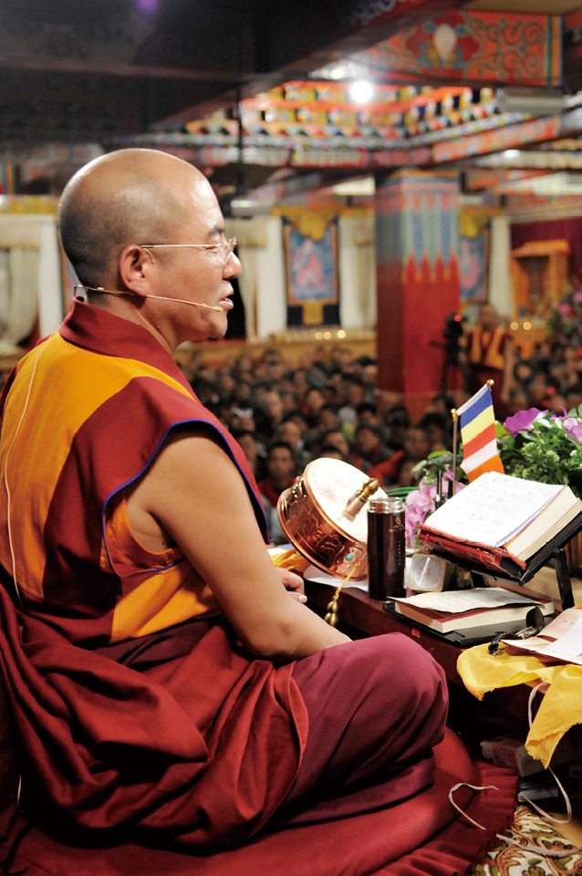
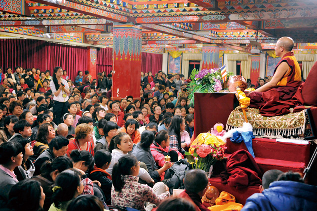
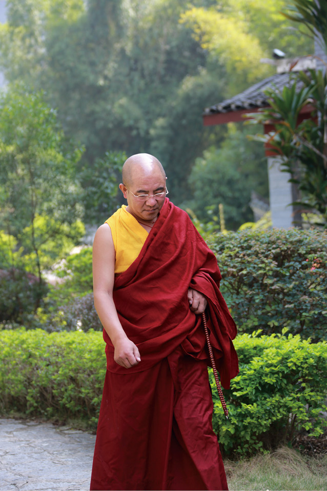
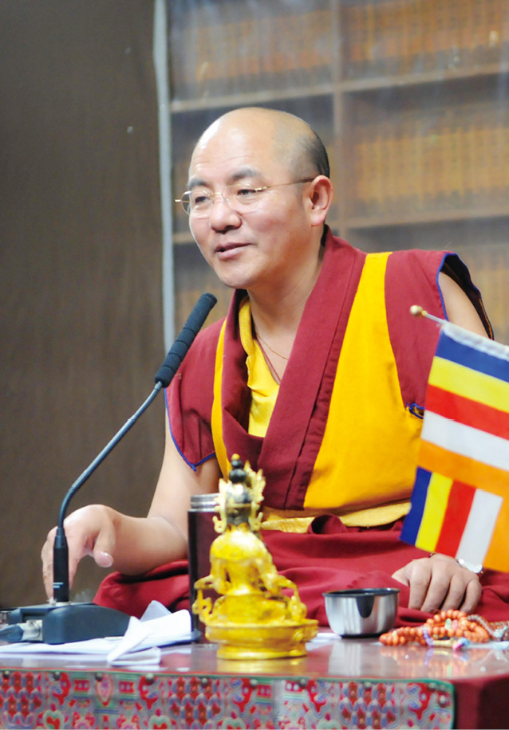

# 新年新气象

——2011年元旦开示

2011年1月1日

各位道友：

晚上好！元旦快乐！

今天是2011年的元旦佳节。我们已经送走了2010年的岁月，迎来了新的一年。

所谓的“元旦”，“元”是刚开始的意思；太阳从地平线上升起，出现曙光，则称为“旦”。根据历史记载，西方的“元旦”，最早是在公元前46年，由古罗马凯撒大帝制定的，后来一直延续到现在。在西方，元旦是一个非常盛大的节日。

就汉地而言，“元旦”一词在三皇五帝时期就已经出现了。不过，当时指的是农历初一。到了1949年，汉地才把西元新年的第一天定为“元旦”，把农历新年的第一天定为“春节”。[^1]

各个民族、各个国家，都有自己迎接元旦的不同方式。印度人认为，随着新年的到来，人的寿命又减少了一年，因此，他们是以忧伤的心态，来度过新年第一天的[^2]。按照英国的习俗，过元旦的时候，一定要瓶中有酒、柜中有肉。因此英国人的元旦，可能存在大量杀生的传统[^3]。墨西哥人在旧的一年接近圆满时，最后5天当中，是不能微笑的[^4]。比利时人的元旦传统也比较特殊，他们会走到牛羊、骏马等牲畜跟前，祝福它们元旦快乐[^5]。

今天，智悲讲堂的道友大都是佛教徒，不会执著世间的各种传统。因此，我会以佛教徒的方式，从总结过去、展望未来两方面，给大家献上一份元旦贺词。

## 总结过去

我相信，在座的许多佛友，都曾学过不少的佛教理论知识。自从2006年6月学会成立，在近5年的时间内，我为大家圆满地传授了《阿弥陀经》、《入菩萨行论》、《量理宝藏论》、《般若摄颂》和《弟子规》等诸多经论与传统文化典籍，也广讲了《大圆满前行》不共内前行“皈依”之前的部分内容。这些课程，大的有一两百课，小的不到一百课。在座的大多数人，这几年都跟随课程，不间断地在闻思。

在次第闻思之前，你们许多人虽然自称佛教徒，但却仅仅停留在烧香拜佛的层面上，并没有深入细致地学习佛法的真正意义，更不用说实际修持了。如今，在我们的共同努力下，大家应该已经懂得了什么是菩提心、什么是弘法利生、如何调伏自己的烦恼、学佛的最终目的和结果是什么等诸如此类的许多问题。这是非常令人欢喜和随喜的。

各地的道友，不仅共同学习了大乘佛法的理论知识，还通过爱心活动，把大乘佛教的利他精髓付诸实践。

比如，关心失去读书机会的孩子；到福利院、孤儿院和养老院，帮助无家可归的病人、孤苦伶仃的老人和生活无法自理的残疾人；以《生死救度》的仪轨和理念，帮助刚刚离世的亡人；定期或不定期在各地举行大量的放生活动，对可怜的众生尽了一个大乘佛子应尽的责任。

应该说，通过短短几年的闻思和实践，大家的相续都有了进步，学佛也有了成效。

最近，我看了你们的很多考卷，了解你们的考试成绩。大多数人，在面对生活和工作双重压力的同时，日日夜夜、废寝忘食地学习，取得了令人瞩目的成绩。也有一部分人，所谓的学佛只是停留在口头上，停留在某种表面的行为上，并没有认真学习法本的教义，连一些非常简单的问题也答不上来。更有极少数的人，虽然自称佛教徒，却做出一些不太如法的事情……

当然，即使是在劫初或圆满劫，佛教或其他宗教都有这样的现象，何况现在是五浊恶世？我们应该从大的趋势、从取得的成绩方面来看问题。

今后，我们要一如既往地学习佛法，并在实际行动中，发扬大乘佛法的精神。只要对众生有利、对弘扬佛法有利，我们就要共同努力，全力成办自他二利。这是我对过去大概的总结。

## 展望未来

从今天起，新的一年就已经开始了。在行持善法方面，大家应该有一个计划。你可以把这个计划告诉同行道友、传承上师，也可以在心里默默地发愿，不对任何人说。

我觉得，佛教的慈悲观念和实修实证，对于每个人来讲，都特别重要。但是，你们大多数人是在城市里长大的，从小到大受到的教育，就是多挣钱、挣大钱，所思所想、所作所为，均是围绕着今生的吃喝玩乐、家庭美满和事业有成等个人利益。对很多人而言，以实际行动帮助社会、帮助国家乃至帮助全世界的思想理念，非常稀有。至于获得圆满正等觉果位、普利天下无边众生的大乘精神，更是闻所未闻。

在这种现象的背后，我们往往会忽略掉一个重要的事实：生命，并不只是短短的几十年！在未来，我们还会度过无量无边的时日，前往无量无边的世界！

如果懂得考虑自身的未来和前途，我们一定会努力行持善法。即生只要努力行善，最后离开这个世间的时候，就一定不会后悔。

总而言之，我们不仅迫切地需要佛法的慈悲甘霖，并且还要去亲修实证。这对每个人来说，都是极为重要的人生大事。

今天是西元新年的第一天，为了提醒大家修行的重要性，我在这里讲一个老修行人的故事。

这位老修行人叫丹珠喇嘛，今年84岁——我刚到学院就认识他。在上周举办的法王纪念法会上，丹珠喇嘛圆寂了。从学院成立至今，在将近30年的时间里，他一直住在学院，精进修行。前一段时间，他身体不好，自己发愿在法王纪念法会期间往生，结果真的这样示现了。

丹珠喇嘛行持善法的力量，是我们很多人无法想象的。在我们眼里，他闻思佛法不算精进，在讲、辩、著等方面不一定能做到多少。但他早起晚睡，念诵和观想特别勇猛。他这一生，一共念了6亿观音心咒、100万遍《普贤行愿品》、10万遍《三十五佛忏悔文》。他曾在法王面前发愿，每天念诵《系解脱》，这么多年来，他从未间断过，最多时一天念诵七八遍。

你们虽然不能和山上的出家人比，但是，你们也是过一辈子，当自己离开这个世界的时候，能念多少咒语？能修多少法？你们在规划自己的人生时，应该大概地知道吧。

这位老修行人，对死亡没有一点恐惧，因为他早已做好了准备。死亡对他来说，就像从色达去另一个地方。而世间人面对生老病死的时候，表现却不太相同。

所以，我在这里提醒大家：我们这一辈子，虽然不一定能念那么多咒语，但至少不能浪费时间。

城市里有许多人，天天都在吃喝玩乐。尤其是今天，无数的餐厅、舞厅和娱乐场所，屠杀了无量的众生。亲朋好友欢聚一起，浪费的是大量的钱财，杀害的是鲜活的生命……

各位克服了各种困难，拒绝了亲人的种种要求，才来到网上听开示。虽然我说不出什么真实的道理，但是，我们有着和世人不同的价值观，我们真正相信今生来世的存在，深信佛法甘霖对众生不可思议的利益和意义，因此，我希望在座的各位，一定要认识到修行的重要性。

在新的一年中，我也有各方面的打算。依靠三宝和护法神的加持，如果能如愿以偿，我会很高兴；如果不能成办，我也不会灰心。因为，一切都是因缘而生，因缘而灭。弘扬佛法和闻思修行，也要有随缘的心态。

去年的新年，我发了一些愿，并一直朝着目标努力。如今，百分之九十的愿望都已圆满。今年，我也要发愿：

第一，不断地传法。

前行组：《大圆满前行》的讲修，是一个非常浩大的工程。我在这个世间，再也找不到比《大圆满前行》和《入菩萨行论》更深的窍诀了。这也许是因为，我自己从中获得了很大的利益吧。如果你们把其中的法理融入自心就会明白，这两部论典有着不可思议的加持和力量。

《大圆满前行》不共内前行“发菩提心”后面的内容，还没有传完。在座的很多人，已经学了前面的部分，我希望大家继续学完，不要因为一点小小的违缘，就退失信心。

净土组：新的一年，我发愿传讲《无量寿经》。汉地的《无量寿经》现有五种不同的版本，历史上甚至有十几种版本，我正在研究。大家离开这个世界时，都希望往生西方极乐世界，因此，我们要共同学习《无量寿经》。

般若班：可能会讲《入中论》或《现观庄严论》。藏地修行人都熟悉五部大论，尤其是《现观庄严论》。不论是格鲁派、宁玛派还是噶举派的寺院，都会用三到五年的时间，学习这部论典。我以前传过《现观庄严论》的《总义》和《略义》，接下来要继续传讲它的正文。

如果大家的加行学修圆满，各方面因缘具足，可能还会讲一些密宗的法要。

因缘聚合的时候，我希望在座的道友不断地闻法。这次考试，一些道友得到了一、二、三等奖。接下来，我们还会给参加考试的所有道友，颁发鼓励奖。

个别道友虽然身居都市，但几年如一日，通过网络和光盘，圆满地听受了许多法要。再过一年，我们也会给这些道友颁发加持品，作为他们学习圆满的总结。

我本人在加持品上，花费了大量的人力和财力，希望对坚持闻思修的道友，予以精神上的鼓励。

第二，不断地翻译。去年年初，我也发愿翻译，现在《实相宝藏论》等部分论典，已经翻译圆满。今年我还会继续翻译，至少翻译一两部论典，留给人间。

在这个世界上，藏传佛教依然保存着奇珍异宝般的经典和论典，但由于语言的隔阂，很多人至今无法享受到它的甘露美味。而人的生命是无常的，我不知道自己什么时候会离开这个世间。所以，我希望在有生之年，尽量多翻译，让你们也能品尝到藏传佛教的甚深教理。

第三，广行慈善。在新的一年，如果各方面因缘具足，学院尚未竣工的部分建筑，我会继续修建。在慈善方面，我也有不断扩展的心愿，希望能建造一些学校和养老院。

只要事情合理合法、对众生有利，我就想不断地做。在这个过程中，一些道友给了我相当大的支持和帮助，借此机会，我要对你们表示衷心的感谢！

以后，只要自己还有一分能力，还有一分利他的心，我就会不断地行持这些善法。

第四，弘扬藏文化。就像许多汉地众生舍弃自己珍贵的传统文化，将西方的垃圾文化作为自己的精神寄托一样，藏地如今也面临着这个问题。

藏文化和藏传佛教，本来是当今世界的瑰宝，可是藏地现在的年轻人，由于受到外来文化的冲击，却将藏族古老的传统文化全部舍弃。他们不仅将本民族悠久的思想文化、佛教信仰、慈悲观和空性观等佛教精义全部抛之脑后，甚至对祖祖辈辈传承下来的、对自他的今生来世都有利益的价值观，也越来越淡漠、越来越鄙弃，从而陷入了严重的精神危机。

在过去近20年里，我把自己宝贵的青春、精力和智慧，全部花在了汉地佛教徒的身上，一心一意将藏传佛教的稀有经论，翻译并传授给汉地乃至海外的许多众生。但是，作为一名普普通通的藏族出家人，我如果对自己的民族文化没有责任感，不知道保护，则没有尽到自己应尽的义务。

为了抢救本民族的文化遗产，并在力所能及的范围内将其发扬光大，今后，我将会在短暂的人生中，奉献自己的一段生命。我希望不同民族的道友，能在这些方面给予我支持，提供应有的方便。

第五，带修五加行。在座的诸位，能够得到这样的暇满人身，相当不容易。一旦失去，能否再次得到，非常难说。所以我希望，凡是和我有缘的人，都能将所学的佛法，实实在在地身体力行。在修行方面，我为大家找到了两种方法：一种是修五十万加行，一种是念阿弥陀佛求生净土。

佛学院的汉族四众弟子，我已经带领大家完成了五十万加行的顶礼部分。从今天起，开始修皈依十万遍、发心十万遍、百字明十万遍和供曼茶十万遍，然后再修上师瑜伽。

人生很短暂，我跟学院的道友也讲，带领大家共修五加行，是一个大工程。对我而言，今生是第一次，也是最后一次，以后不可能再有这样的机会。如果你当成练气功一样，在表面上应付，这欺骗不了别人，只能欺骗你自己。

外面学会的学员，如果不出违缘，明年10月份，会领到相关的书籍和光盘。从那时起，大家也要学修不共加行。

这几年，别人供养的钱，我都用来制作莲花生大士和阿弥陀佛的圣像。你们修完五十万加行以后，我会把这两尊非常珍贵的佛像，赠送给你们。

大家应该履行自己的承诺。只要没有出现死亡等重大违缘，最初的发愿不要随时间的推移，中途发生改变。我本人也会尽量将自己承诺的事情，付诸行动。

近五年来，有些人依教奉行，没有落下一堂课，非常令人感动。但也有一些人，由于前世业力、今生散乱等因素，修行马马虎虎，学佛装模作样，非常差劲。

每个道友都可以扪心自问。即使我们追随不了前辈大德的感人事迹，但是，也没有必要跟从整天沉迷、花天酒地的愚昧之辈。

因此，我希望在座的道友，有正直的人格，有希求解脱的愿望，也有悲心和智慧双运的大乘功德。尽量断除各种散乱的因缘，将宝贵的时间用来修持解脱之法，这对大家的今生来世都有利益。

第六，提倡和平。去年新年我曾经说过，从现在开始，我们应该为人类的和平而奋斗。在这个世界上，国家与国家之间、民族与民族之间、家庭与家庭之间、人与人之间、人与动物之间，都存在着侵略、虐待、恐吓和威胁。这种不平等的态度和行为，既不符合和平共处的国际原则，也不符合众生平等的大乘思想。

所以从现在起，我们要倡导人类保持善良的心态，令彼此都有生存的空间。人类有权利，也有义务，为着这个伟大的目标，共同努力。

## 法雨普润

最后，我即兴编了一个偈颂，作为送给大家的新年礼物：“积极行善法，断除恶习气，广降佛法雨，普润众心田。”

意思是说：要积极地行持善法，断除相续中的各种恶劣习气，比如世间的轮回习气、贪嗔痴等烦恼习气。虽然在获得阿罗汉和菩萨果位之前，完全断除这些习气非常困难，但也要尽心尽力地去断。除此之外，我们还要尽量降下佛法的甘露妙雨，滋润无量无边的众生的心田。

2010年的北京之行，我曾在一些大学和慈善活动中做过开示。现在，这些开示的内容已经编辑成书，书名叫《法雨普润》，也算是送给大家的新年礼物吧。

《法雨普润》针对现代知识分子，从科学和文化的视角，阐述了佛教的思想。21世纪是科技高度发达的时代，与前辈的思想完全不同，很多现代人的分别念只随高科技而转。在这种形势下，佛教如果不能和科技并存，就可能被历史淘汰。

实际上，大乘佛法的精神，与当今的科技时代非常相应。作为一个佛教徒，应该懂得用佛法来阐释科学。至于科学无从解释的博大精深的佛教理论，则可以通过闻思和修证来通达。科学和佛教互相诠释的共存模式，很有必要，也值得我们去探索。

希望我今天的简单开示，通过网络平台，跨过重重雪山，越过滔滔江河，飞过高楼大厦，到达你们的身边；愿所有的有缘者，在新的一年里，法喜充满，六时吉祥！谢谢大家！

按照藏地的传统，要清除过去一年的病魔、违缘，需要念《心经》回遮；新的一年要获得健康、长寿，也需要念《心经》。我想，在座的诸位都喜欢长寿，都希望健康，都想要平安，为了达成你们的心愿，我用藏语为大家念一遍《心经》。

接下来，还要给部分人做一个皈依。

（堪布念诵传承、授皈依戒）

以前取过皈依法名的人，今天不用再取名。个别新皈依的道友，共同取名为“圆利”，圆满的“圆”，利益众生的“利”。

现场互动

⊙ 问：如何善巧方便地让众生体会到有漏皆苦，从而生起坚定的出离心？

堪布：一般有钱、有地位的人，暂时还没遇到挫折和困难，会觉得生活充满了快乐，不一定生得起出离心。但他如果详细观察，自己生活中的每一分快乐，实际上都会变成忧苦。比如他在享受金钱带来的富足时，会担忧钱财灭尽。这就是所谓的变苦和行苦。

佛陀在经中讲，有些苦只不过暂时没有现前，就像吃了毒药的人，毒性没有发作时，他还是会过得很快乐。但不管怎么快乐，他身体里的毒药终究会发作，那时必定感受痛苦。

所以，当我们知道轮回的本性即是痛苦时，就会对整个轮回生起厌离心和出离心。

⊙ 问：弟子非常不愿意闻思，只喜欢发心做事。怎样才能让自己进入闻思的状态？

堪布：根据对闻思的兴趣不同，可以分为两种人：一种人，因为前世听闻佛法的习气比较深厚，今生很乐意闻思，一看到经书就异常激动。对他们来讲，闻思修行很容易，特别开心。

还有一种人，因为即生环境不具足，或心态没调整好，所以不愿意闻思，但这是暂时的因缘。根本的因缘，按照经典的说法，是由于前世闻思的习气薄弱，因而即生提不起闻思的信心。

所以，一方面要忏悔，一方面要时常提醒自己：如果不闻思，就没法明白佛教的甚深道理。知道闻思的重要性之后，再去学习，便会很容易。

⊙ 问：我在修行中发的愿，因为提不起正念，往往半途而废。如何才能让自己时刻保持正念，将所发之愿圆满行持？

堪布：这跟自己的誓言是否坚定有关。

好多道友发愿不究竟，原因有两种：一是发愿时没有调整好心态，没有考虑自己能否做到，看到别人发愿轻而易举，自己就跟着发。另一个，与自己所处的环境、生活传统和周围的人群等，也有密切的关系。

就我个人而言，这一生每年发的愿，以及一些重大的事情，我都会写在日记本上，放在比较显眼的地方，经常提醒自己、劝勉自己。一年结束的时候，我会反反复复地观察自己：以前发了什么愿？现在做到没有？当然，我也有做不到的时候，很惭愧。

今天是新年的开端，在座的很多人，都会发愿做一些事情。如果到了明年的今天，总结这一年，发现自己并没有践行所发的愿，那就不太好。《二规教言论》里讲：誓言坚定对每个人来讲，都非常重要[^6]。誓言坚定的人，古大德也极其赞叹。

虽然圆满自己的誓言，的确有一定的难度和违缘，但不管怎么样，我希望在座的各位能在这方面多多努力。

⊙ 问：破了三昧耶戒，虽然可以忏悔，可以重受灌顶，但即生成就已绝无可能，是这样的吗？

堪布：一般来讲，最好不要破密宗的誓言，尤其不要失毁和金刚上师、金刚道友之间的誓言。如果已经破了，三年之内一定要忏悔。超过了三年，虽然也可以忏悔，但即生要完全恢复，是不可能的。

⊙ 问：我是一名小小的发心人员，也非常喜欢闻思，但总感觉发心和闻思修行是冲突的。请问堪布，发心和闻思修行能否兼具，具体该怎么办？

堪布：发心跟闻思有时可能会冲突，但我在学院却经常强调，大家如果能发心，就要尽量发心。

我个人认为，作为大乘修行人，弘扬佛法和利益众生是最重要的。当我为学院发心、为其他寺院发心，或者去社会上演讲时，都是暂时把自己的修行放舍一旁的。

按照大乘菩萨的精神，利益众生的机会非常难得，虽然可能耽误修行，甚至可能失去修行的机会，但是，只要涉及弘扬佛法和利益众生的发心，我都会优先考虑，并尽心尽力去做。

我们如今的弘法利生事业，光依靠我一个人，或者我们几百个人，根本做不到如此广大。今天的UC讲堂，有许许多多的发心人员。在过去的一年中，他们将自己所有的时间和精力，全都奉献给了众生。

借此机会，我以个人、学会和爱心小组的名义，对网络上转播课程的，以及分布在各地，以诚挚的信心帮助众生、利益众生的各位发心道友，表示真诚的感谢！

虽然在表面上，你们的修行有所耽误，但我祈祷诸佛菩萨加持你们，愿上师三宝的加持融入你们的心，断除你们相续中的一切恶习，愿你们将来能无勤利益无量无边的众生，任运成就佛陀的一切广大事业！

⊙ 问：佛法倡导积极的利生行为，需要以发心摄持实际的行动。那么，是否会无缘产生利益有情的念头，同时觉照念头，而不会落入灭尽定的无记状态？

堪布：我们入定修行，不太容易落入灭尽定，因为要入灭尽定，首先必须成就四禅以上的禅定，而要达到这样的境界，特别困难。我们入定的时候，有时心里似乎不产生任何分别念，但那并不是真正的灭尽定。

在相关的论典中，讲了九种安住自心的方法。九种住心法全部圆满之后，才能成就第一禅定。第一禅定的所有支分圆满之后，才可以次第成就第二、第三、第四禅定。第四禅定成熟之后，才能获得灭尽定的禅定支分。所以，入灭尽定特别不容易。

禅宗有跑香、坐禅等不同的禅法，密宗也一样。相续有一定境界的住地菩萨，出定的时候，可以在如梦如幻的境界中，随心所欲、洒脱自在地利益无量无边的众生。所以，利益众生跟禅法并不相违。

⊙ 问：如此多的老母有情，辛苦一生，却不信佛法，想着他们将来必定堕落恶道，心里很难过。弟子怎样才能更好地利益有缘的众生？

堪布：老母有情不学佛法，我们可以尽量想办法，向他们宣讲三宝的功德、皈依的利益，令他们皈依三宝、趋入佛门。不过，有些众生特别刚强，不要说我们，即使佛陀在世，恐怕也难以调化。

但不管怎么样，看到那么多老母有情沉溺在苦海当中，我们作为大乘佛法的修学者，一定要无有疲厌、全力以赴、想尽一切办法，去帮助他们、利益他们。暂时来讲，解除他们身体和精神的痛苦；究竟来说，给他们的相续种下善根，逐渐将他们安置于佛地。

⊙ 问：藏传佛教的生起次第和圆满次第是怎样的？

堪布：藏传佛教的生起次第和圆满次第，内容比较深广。今天网络上的很多道友，没有得过真实的密宗灌顶，所以我不方便在这里介绍生起次第和圆满次第的具体理论和修法。在得过灌顶、修完加行之后，自己可以翻阅《大圆满心性休息》等相关的论典和续部。

⊙ 问：《华严经》中讲，一定要注意自己的言行，否则容易造下诽谤佛教的罪业。但《大圆满前行》里又讲，要认真地观察上师。这两种说法怎么统一呢？

堪布：《大圆满前行》里说观察上师，是指在结上法缘之前，可以观察上师的行为，如果自己不了知，也可以询问他人。而《华严经》里讲的观清净心，是从每个众生本具如来藏功德的角度讲的。

[^1]: 1949年9月，中国人民政治协商会议第一届全体会议决议，“中华人民共和国纪年采用公元纪年法”，这即是我们所说的阳历。为了区别农历和阳历两个新年，又鉴于农历二十四节气中的“立春”恰好在农历新年的前后，因此便把农历正月初一定为“春节”，阳历1月1日定为“元旦”。至此，元旦成为中国的一个重要节日。
[^2]: 印度的元旦被称为“痛哭元旦”“禁食元旦”。人们在新年第一天，不许对人生气，更不准发脾气。在有些地方，不但不庆祝，反而拥抱大哭。他们认为，光阴如梭，人生短暂，所以要用哭声表示悲伤。在有些地区，人们则会禁食一天一夜，来迎接新年。
[^3]: 在英国，元旦前一天，家家户户都要瓶中有酒，柜中有肉。英国人认为，家中如果没有多余的酒肉，来年便会贫穷。
[^4]: 墨西哥人把一年分为18个月，每月有20天左右。按照他们的传统习惯，如果想获得好运，一年的最后五天不能笑。
[^5]: 在比利时，农村人在元旦的早上，第一件事便是走到牛、马、羊、狗、猫等动物身边，煞有介事地祝福这些生灵：“新年快乐！”
[^6]: 《二规教言论》有云：“若人誓愿愈坚定，则于彼人愈可信，若愈成为可信者，则天与德亦会集。”
